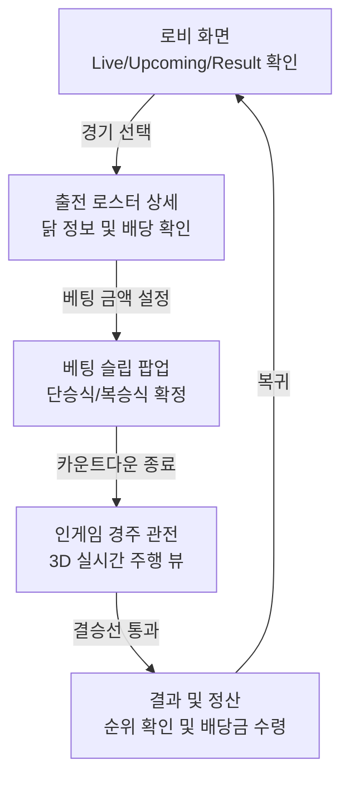

# ROOSTER RUMBLE: Derby Race - MVP 구성안

문서 상태: MVP 개발용 기획서  
작성일: 2026-08-04  
대상 범위: Derby Race 로비, 인게임, 결과 연출, 순위 산출, 배당 정산 및 기술 명세  
기반 문서: `ROOSTER RUMBLE_Derby Race_게임 구성_v3.0.3`, `순위 산출 정의`, `베팅 및 배당 정의`

---

## 1. 개요 및 전체 흐름

### 1.1 게임 콘셉트 및 플랫폼
- **정의**: 닭 캐릭터의 경주를 소재로 한 관전형 아케이드 시뮬레이션 베팅 게임.
- **핵심 목표**: 짧은 주기(약 30~60초) 내에 배당 확인, 베팅, 경주 관전, 정산의 재미를 콤팩트하게 제공함.
- **플랫폼**: 모바일/온라인(웹) 통합 화면 비율 지원. (로비: 세로 / 인게임: 가로 화면 레이아웃 전환)

### 1.2 전체 게임 흐름도 (Core Flow)

유저의 핵심 플레이 동선은 크게 5단계의 루프로 순환함.

---

## 2. 로비 및 파산 유저 구제

### 2.1 로비 3단 화면 구조 명세

| 구분 | 화면 요소 | 세부 설명 |
| :--- | :--- | :--- |
| **상단 고정 영역** | 헤더 (Header) | 유저 프로필 썸네일, 닉네임, 현재 게임 머니 잔액, 전체 메뉴(설정/도움말) 노출함. 유저 잔액 고갈 시 적색 충전 알림 표기함. |
| **중앙 메인 영역** | 경기 리스트 탭 | `Live` / `Upcoming` / `Result` 탭 제공. **Upcoming 탭에서는 향후 5개 경기 리스트가 노출됨.** 각 리스트 항목에는 **날짜 및 경기 번호(예: 9월 5일 제1경기), 카운트다운 타이머, 유저 로컬 타임 기준 실제 시작 시간(예: 14:20 시작)**이 함께 직관적으로 표기되어야 함. |
| **하단 고정 영역** | 하단 네비게이션 | 로비 홈, 전적 보기, 무료 충전소 버튼을 고정 표시하여 이동 최소화. |
| **알림 팝업 (플로팅)** | 미수령 배당금 알림 | 유저가 미수령 상태로 재접속 시, 화면 하단(네비게이션 위)에 알림 팝업을 강제 노출하여 보상 수령을 유도함. |

### 2.2 파산 감지 및 무료 충전소 복귀 동선

| 처리 단계       | 로직 및 연출       | 세부 설명                                                |
| :---------- | :------------ | :--------------------------------------------------- |
| **1단계: 감지** | 파산 실시간 감지     | 유저 보유 게임 머니가 최소 베팅 금액 미만으로 하락 시 '파산 상태'로 즉각 판정함.     |
| **2단계: 제한** | 비활성화 시각 처리    | 모든 베팅 카드 및 결정 버튼에 회색 필터 및 50% 반투명 처리 적용하여 입력 잠금 처리함. |
| **3단계: 유도** | 복귀 루프 (유저 유지) | 파산 유저 이탈 방지 위해 연습 모드 유도 툴팁 활성화 및 무료 충전소 버튼 노출.       |

### 2.3 경주 일정 및 출전 로스터 화면 명세

| 구분 (영역) | 표시 항목 | 세부 설명 및 상호작용 |
| :--- | :--- | :--- |
| **경기 기본 정보** | 타이틀, 타이머, 시작 시간 | 상단 헤더에 **경기 날짜와 방 번호(예: 9월 5일 제1경기), 시작 카운트다운(MM:SS), 유저 로컬 타임 기준 실제 시작 시간**을 병기하여 노출함. |
| **출전 선수 리스트** | 6마리 선수 정보 | 순번, 닭 초상화, 닭 이름, 주행 스타일, 컨디션 상태. 특정 선수 터치 시 '상세 능력치 팝업 모달' 호출함. |
| **배당률 영역** | 단승/복승 배당률 | 1등 맞히기(단승식), 순위권 맞히기(복승식) 배당률 뱃지 표출 및 터치 영역 할당함. |

---

## 3. 베팅 설정 및 배당 정산 시스템

### 3.1 레이스 스케줄러 타임테이블 및 상태 변화 (서버 자동 실행)

| 경기 상태 | 타임라인 | 제약 및 설명 |
| :--- | :--- | :--- |
| **일일 스케줄 생성** | 자정 (00:00) | 서버는 하루치 72개 경기의 로스터를 사전에 일괄 편성하여 DB에 등록함. |
| **Upcoming (대기)** | 경기 시작 30초 전까지 | 현재 시간 기준 **향후 예정된 최대 5개(추후 조정 가능)의 경기**가 동시에 Upcoming 상태로 활성화되며, 유저는 이 중 원하는 경기에 자유롭게 미리 베팅할 수 있음. |
| **Betting Closed (마감)**| 시작 30초 전 ~ 0초 | 추가 베팅 차단 및 출전 준비 카운트다운 UI 송출. |
| **Live (진행)** | 시작(0초) ~ 45초 | 인게임 3D 중계 뷰 송출 및 레이스 진행. |
| **Result (종료)** | 순위 산출 완료 후 | 정산 데이터 확정 상태. 로비 Result 탭으로 상태 갱신. |

### 3.2 지원 베팅 방식 (단승식 / 복승식 2종) 명세

| 베팅 타입 | 예측 대상 | 특징 및 배당 산정 방식 |
| :--- | :--- | :--- |
| **단승식 (1등 맞히기)** | 출전 6마리 중 **최종 1위** 1마리 예측 | 적중 난이도가 높아 산출된 승리 확률 역산값을 그대로 배당률로 적용. |
| **복승식 (1, 2위 맞히기)**| 출전 6마리 중 **최종 1위와 2위에 입상할 2마리** 예측 조합 | 2마리를 묶어서 맞혀야 하는 조합 방식. 복승 조합 확률을 바탕으로 별도의 조합 배당률 산출. |
| **다중 베팅 정책** | 동일 경기 단승식 1건 + 복승식 1건 | 각각 동시 베팅 가능하나, 동일 타입(예: 단승식 2건) 중복 베팅은 원천 차단함. |

### 3.3 하단 베팅 슬립창 (하단 팝업창) UI 명세
단승식과 복승식은 베팅 구조(선택 대상 수, 배당 로직)가 다르므로 별개의 슬립 UI로 완전히 분리 구성함.

| 구분 (영역) | 표시 항목 | 세부 설명 및 상호작용 |
| :--- | :--- | :--- |
| **단승식 슬립** | 1위 예측 베팅 | 선택한 1마리의 닭이 1위로 들어올 것을 예측. 단승 배당률과 단일 선택 정보 제공. |
| **복승식 슬립** | 1, 2위 예측 베팅 | 1위와 2위 안에 들어올 2마리의 닭을 선택하여 예측. 복승 조합 배당률 표기. |
| **칩 입력 패널** | 칩 버튼/텍스트 | +10, +100, +1000, +MAX 버튼 및 직접 타이핑 입력 영역 제공함. |
| **예상 당첨금** | 수동 계산(조회) | 실시간 부하 방지를 위해 금액 입력 후 [조회하기] 버튼을 눌러야 예상 금액이 표출됨. |
| **당첨금 확정 안내** | 경고성 메시지 표출 | "최종 예상 당첨금은 베팅 마감 후 확정됩니다"라는 안내 문구를 노출함. |
| **제어 버튼** | 취소 / 확인 버튼 | 모달 최하단에 베팅 취소(취소) 및 확정(확인) 버튼 고정 배치함. |

#### 3.3.1 단승식 베팅 슬립

| 구분 (상태) | 시각적 변화 | 설명 및 논리적 제약 |
| :--- | :--- | :--- |
| **팝업 레이아웃** | 화면 하단 70% 덮음 | **하단 팝업창** 형태로 베팅 슬립 노출. |
| **베팅 종류 표시** | 좌상단 고정 텍스트 | "단승 (1등 맞히기)" 모드임을 명확히 표기. |
| **단일 선택 정보** | 1열 세로 나열 구조 | 유저가 선택한 1마리의 닭 정보와 단승 배당률 제공. |
| **버튼: 기본 상태** | 다크 그레이 배경, 하늘색 테두리 | - |
| **버튼: 비활성화** | 50% 반투명, 회색 필터 | 베팅 금액 부족 시 차단 상태 적용. |
| **예상 당첨금 조회** | [조회하기] 버튼 추가 | 베팅 금액 입력 후, 버튼 클릭 시 예상 당첨금을 산출하여 표출 (서버 부하 감소 목적). |
| **당첨금 확정 안내** | 붉은색 텍스트 경고 | "※ 최종 예상 당첨금은 베팅 마감 후 확정됩니다." 문구로 배당률 변동 가능성 사전 고지. |
| **하단 고정 입력부** | Sticky 고정 배치 | 금액 입력 필드 및 확인 버튼을 최하단 고정하여 스크롤 무관하게 확정 가능. |

#### 3.3.2 복승식 베팅 슬립

| 구분 (상태) | 시각적 변화 | 설명 및 논리적 제약 |
| :--- | :--- | :--- |
| **팝업 레이아웃** | 화면 하단 70% 덮음 | 단승식과 동일한 하단 팝업 프레임 공유. |
| **베팅 종류 표시** | 주황색 강조 텍스트 | "복승 (1위, 2위 맞히기)" 모드임을 색상(주황계열)으로 확연히 구분. |
| **기준 선택 정보** | 1번째 닭 정보 고정 | 로비에서 클릭하여 진입한 1번째 닭의 정보를 최상단에 기준값으로 고정 표기. |
| **추가 선택 UI** | 2번째 닭 선택 버튼 제공 | 1위를 다툴 나머지 1마리를 베팅 슬립창 내부에서 즉각 추가 선택할 수 있도록 닭 번호 버튼(2~6번 등) 목록 제공. |
| **조합 배당률** | 배당률 표기 | 추가 수탉을 선택하면 두 닭의 묶음 조합 배당률을 노출. |
| **버튼: 테마 색상** | 주황색 포인트 컬러 | 확인 버튼 및 핵심 정보에 주황색(Warning/Special) 톤을 적용하여 단승식과 시각적 분리. |
| **예상 당첨금 조회** | [조회하기] 버튼 추가 | 단승식과 동일하게 수동 조회 인터페이스 제공. |
| **당첨금 확정 안내** | 붉은색 텍스트 경고 | 단승식과 동일하게 확정 타이밍(마감 후) 고지. |
| **하단 고정 입력부** | Sticky 고정 배치 | 금액 입력 및 확인 버튼 동일 구조 제공. |

### 3.4 고정 배당률 산출 공식 및 환수율 밸런스

| 정책 구분 | 정책 내용 | 도입 목적 및 효과 |
| :--- | :--- | :--- |
| **배당 규칙** | 완벽한 고정 배당 | 유저가 확정한 배당률은 경기 도중/정산 시까지 변동되지 않음. |
| **산식** | `최소최대제한((1 - 하우스 수수료) / 승리 확률, 1.01, 99.00)` | 하우스 마진(10%) 제외 후 배당률 산출 및 극한값 방어. |
| **보상 비율 통제** | 환수율 88~96% 구간 유지 | 게임 내 경제 인플레이션을 방어. |
| **예상 배당금 표시**| `입력 금액 * 배당률` 수동 조회 | 배당률 산식 적용 후, 금액을 입력하고 [조회하기]를 누르면 산출된 금액 표출. |

### 3.5 베팅 마감 잠금 및 확인 제어 정책

| 제어 및 잠금 정책 | 기술적 처리 | 방어 목적 (보안 효과) |
| :--- | :--- | :--- |
| **30초 마감 차단** | 시작 30초 전 패널 및 통신 강제 차단 | 서버 동기화 시간을 기준으로 잠금 검증, 클라이언트 시간 변조 완벽 방어. |
| **중복 터치 방어** | Confirm 즉시 입력 비활성화, 로딩 아이콘 표출 | 모바일 다중 터치나 서버 지연에 따른 중복 전송 방어. |

### 3.6 Claim(수령) 버튼 상태 전이 및 중복 지급 방지 (1회성 보장)

| 상태 전이 및 로직 | 시각적 변화 및 상세 정책 | 논리적 제약 및 보안 |
| :--- | :--- | :--- |
| **활성 상태** | 화려한 색상 번짐 효과 적용 | 적중 완료 후 미수령 상태. 터치 유도. |
| **수령 완료 상태** | 회색조 전환, 텍스트 변경 | 1회 수령 성공 응답 즉시 영구 비활성화 처리. |
| **숨김 상태** | 미노출 | 미베팅 또는 예측 실패 유저 대상. |
| **만료 상태** | 지급 영구 불가 | 적중 후 30일 경과 시 수령 권한 소멸. |
| **일괄 수령** | 미수령 전체 (최대 20건) 일괄 정산 | 유저 편의성 증대. |
| **중복 지급 방지** | 복합 키 활용 DB 고유 제약 | 동시 요청 시에도 최초 1회만 유효 처리, 중복 저장 원천 차단. |

### 3.7 베팅 한도 및 최대 당첨금 상한 정책

| 정책 구분 | 정책 내용 | UI 표기 및 목적 |
| :--- | :--- | :--- |
| **베팅 금액 한도** | 최소 10 ~ 최대 10,000 게임 머니 | 한도 내에서만 베팅 확정 가능. |
| **당첨금 지급 상한** | 최대 당첨금 상한 10,000 게임 머니 제한 | 파산 및 경제 인플레이션 방지. |
| **UI 한도 적용** | 한도 초과 시 10,000으로 강제 고정 | `최대 당첨금 적용` 황색 경고 뱃지 즉각 노출. |

### 3.8 결과 및 정산 화면 (Result & Payout) UI 상세 명세

- **진입 동선**: 
  1. 인게임 경주 시청 직후: 경주가 종료되면 자동으로 결과 화면으로 전환됨.
  2. 로비 탭에서 진입: 로비의 `Result`(완료된 경기) 탭에서 과거 경기 리스트를 터치하여 진입함.

| 화면 영역 (구분) | UI 요소 및 시각적 변화 | 설명 및 논리적 제약 |
| :--- | :--- | :--- |
| **타이틀 바** | 상단 "경기 결과" 텍스트 | 다크 그레이 배경을 사용해 시인성을 높이고 현재 화면의 목적을 명시함. |
| **순위표 (Leaderboard)** | 1위~3위 선수 리스트 패널 | 최종 도착 시간 기준으로 순위별 색상(금/은/동)을 차등 적용하여 입상 닭들의 정보(번호, 이름, 도착 시간)를 나열함. |
| **적중 여부 표기** | 영수증 상단 스탬프 연출 | 단승식(1위 적중) 또는 복승식(1, 2위 적중) 시 녹색 텍스트와 테두리로 "적중 성공!" 스탬프를 비스듬히 찍어내는 축하 시각 연출. |
| **정산 영수증 (Receipt)** | 베팅 금액 및 당첨금 명세 | 유저가 베팅한 원금, 배당률 연산이 적용된 총 당첨금 산출 내역을 명세서 형태로 노출함. |
| **순수익 표기** | 녹색 볼드 텍스트 | 당첨금에서 베팅 원금을 제외한 '순수익(+ G)'을 강조하여 유저의 성취감을 극대화함. 미적중 시 회색 0으로 처리함. |
| **수령 (Claim) 버튼** | 활성/비활성 상태 전이 | 적중 시 활성화되며 클릭 시 1회성 보상을 지급함 (3.6항 규칙 따름). 미베팅 또는 미적중 시 숨김 처리됨. |
| **로비 복귀 버튼** | 화면 최하단 버튼 | 수령을 완료했거나 미적중한 유저가 다시 로비(1단계)로 돌아가도록 유도함. |

---

## 4. 화면 공통 요소 및 상호작용 명세 (터치 반응)

### 4.1 출전 선수 상세 정보창 (선수 상세 정보창)

- **진입 동선**: 로비의 예정 경기(Upcoming) 리스트에서 특정 선수 카드를 터치 시 팝업 됨.
- **표시 정보**:
  
  | 구분 | 표시 항목 | 설명 및 시각화 방식 |
  | :--- | :--- | :--- |
  | **상태 정보** | 주행 스타일, 컨디션 | 도주/선행 등 스타일 및 컨디션 상태 텍스트 노출 |
  | **핵심 스탯** | 속도, 출발, 기질, 집중력, 체력, 근성 | 6대 스탯별 수치를 시각적 진행도 막대(Progress Bar)로 표기 |
  | **전적 정보** | 최근 전적 요약 | 최근 출전 기록 및 승률 요약 텍스트 노출 |

### 4.2 베팅 최종 승인 및 토스트 알림 (확인 및 경고 알림 화면)

- **진입 동선**: 유저가 퀵 베팅 패널에서 배당을 선택하고 베팅하기를 누르거나, 시스템 예외 상황 발생 시 팝업 됨.
- **표시 정보**:

  | 구분 | 표시 항목 | 설명 및 시각화 방식 |
  | :--- | :--- | :--- |
  | **확인 창** | Confirm 모달 | "정말 베팅하시겠습니까?" 텍스트 및 Confirm / Cancel 분기 버튼 노출 |
  | **경고 문구** | 붉은색 텍스트 노출 | Confirm 모달 내에 "※ 베팅 확정 후에는 변경 및 취소가 불가합니다." 라는 경고 문구 삽입 |
  | **알림 창** | 공통 알림 (Toast) | "베팅이 완료되었습니다", "네트워크 불안정" 등 상태 메시지를 상단에 2초간 팝업 후 소멸 |

## 5. 인게임 주행 연출 및 최적화

### 5.1 경주 진행 화면 UI 구성

| 구분 (영역) | 표시 항목 | 세부 설명 및 상호작용 |
| :--- | :--- | :--- |
| **메인 3D 뷰** | 3D 경주 렌더링 | 130M 주로를 달리는 6마리 닭의 실시간 3D 렌더링 영역 (가로 화면). |
| **상단 정보창** | 남은 거리 및 선두 | 전체 130M 중 현재 남은 거리 표기, 선두 그룹 이름표 점멸(강조) 처리함. |
| **내 베팅 요약 툴팁** | 툴팁 (우측 상단) | 작게 떠 있는 '내가 베팅한 닭 번호(또는 복승식 조합) 및 당첨 예상액' 정보 창. |
| **2D 미니맵** | 점(Dot) 위치 요약 | 우측에 전체 주로 대비 각 닭들의 현재 위치를 점(Dot)으로 요약 표기함. |

| UI 항목 | 시각 및 동작 명세 |
| :--- | :--- |
| **화면 레이아웃** | 모바일 가로 화면 비율 최적화. |
| **상단 고정 HUD** | 상단에 유저의 선택 선수(또는 조합) 배당률 및 당첨 예상액 상시 고정함. |
| **뷰 전환 버튼** | 우측 상단 전환 버튼 선택 시, 전체 화면 3D 중계 뷰에서 2D 미니맵 진행도 뷰로 즉각 화면 배치 요약 전환 기능 제공. |

### 5.2 3D 중계 엔진: 서버 결과 사전 확정 및 시각적 가감속 보간 연출

| 연출 항목 | 트리거(조건) | 시각/물리적 처리 방식 |
| :--- | :--- | :--- |
| **통합 계산 원칙** | 경주 시작 직후 1회 | 최종 순위와 도착 시간을 6.5 공식에 따라 단 한 번에 통합 산출 (실시간 연산 폐기). |
| **화면 보간 연출** | 주행 시간 내내 | 130M 길이에 맞춰 서버 도착 시간 기반 기본 속도를 역산, 빈 공간을 채우는 시각적 보간 연출. |
| **시각적 역전 연출** | 주행 중 무작위 | 클라이언트 단에서 무작위 가감속(가짜 엎치락뒤치락) 발생. 단, 최종 도착 시간은 1ms 오차 없이 강제 고정. |

### 5.3 3D 주행 부드러운 움직임 보정 및 시간 배속 동기화 명세

| 보정 항목 | 문제 현상 | 시각 및 물리적 처리 방식 |
| :--- | :--- | :--- |
| **가감속 움직임 보정** | 캐릭터 속도 튐 현상 | 무작위 가감속 연출 시 코사인 곡선을 통한 부드러운 속도 곡선 보정 처리. |
| **발 미끄러짐 방지** | 속도-애니메이션 괴리 | 애니메이션 `재생 속도(배속)`를 실시간 달리기 속도에 비례해 `0.5 ~ 2.0` 자동 한계값 고정. |
| **배속 기준점 설정** | 튜닝 기준점 모호 | `재생 배속 1.0` = 물리 주행 속도 `15.0m/s`로 명시하여 지면 밀착 보정. |

### 5.4 주행 연출 몰입도 강화 순서

| 주행 단계 | 시각 이펙트 (VFX) | 사운드 이펙트 (SFX) |
| :--- | :--- | :--- |
| **출발선 게이트 오픈** | 앞 게이트 오픈 및 흙먼지 폭발 이펙트 | 시작 총성(출발 신호총) |
| **초~중반 질주** | - | 다수의 발굽 소리 및 무작위 울음소리(Cluck) 다중 겹침 재생 |
| **막판 스퍼트** | 선두권 닭 UI 이름표 점멸 (결승선 10m 앞) | 심장 박동 사운드 재생 및 배경 BGM 페이드아웃(Duck) |

---

## 6. 경기 결과 및 순위 산출 시뮬레이션 엔진
- 서버 백엔드 및 시뮬레이션 엔진에서 경기 결과 및 최종 순위를 산출하는 로직 명세임.

### 6.1 1ms 단위 정렬 및 동점 처리 로직

| 처리 단계 | 로직 및 기술 방식 | 목적 (처리 효과) |
| :--- | :--- | :--- |
| **순위 정렬 (1조건)**| 정수형 밀리초(ms) 변환 후 오름차순 정렬 | 도착 시간 기반 기본 순위 산출 |
| **동점 처리 (Tie-breaking)** | 고유 `race시드` 기반 난수(0.000001~0.999999) 결합 | 동일 ms 기록 시 단일 순위 확정 |
| **난수 서버 통제** | 서버 독점 난수 생성 및 결과 확정 | 결과 변조 방지 및 검증 일치성 유지 |

### 6.2 주행 스타일 스탯 가중치 및 최종 시간 산출 공식

| 산출 단계 | 적용 공식 및 수치 | 설명 및 목적 |
| :--- | :--- | :--- |
| **스타일별 가중치** | 도주(출발40/속도40), 추입(근성40/지구력40), 선행(출발35/근성35) 자재(지구력50), 선입(속도30/집중력30), 변칙(기질50) | 주행 스타일에 따른 핵심 능력치 비중 차등화. |
| **컨디션 보정치** | 최상(+4,+2), 좋음(+3), 불안정(-3,+3), 지침(-5,-3) | 경기 당일 컨디션에 따른 스탯 가감산 연산. |
| **기본 시간 공식** | `20.0초 - ((가중 능력치 - 60) × 0.05초)` | 스탯을 기반으로 20초 컷 기준 최종 도착 시간 사전 산출. |
| **한계값 고정(Clamp)**| `최소 16.0초 ~ 최대 24.0초` 구간 절대 수치 고정 | 무작위 보정치로 인해 시간이 극단적으로 튀는 버그 방지. |

### 6.3 포토 피니시 카메라 및 슬로우 모션 연출 트리거

| 연출 단계 | 시각/물리적 처리 방식 | 세부 수치 명세 |
| :--- | :--- | :--- |
| **트리거 조건** | 1, 2위 결승선 도착 격차가 오차 범위 내 초박빙일 시 가동 | - |
| **화면 정지 및 슬로우**| 결승선 통과 즉시 화면 3초 정지 후 슬로우 모션 전환 | 0.2배속 재생 |
| **카메라 줌 인** | 카메라 렌즈 시야각(FOV) 서서히 축소 확대 | 45도에서 20도까지 0.5초간 애니메이션 |
| **초점 강제 고정** | 카메라 초점을 1, 2위 닭의 중간점 좌표로 강제 고정 | 판독 시인성 극대화 |

### 6.4 데이터 처리(통신) DB 잠금 대기 및 롤백 에러 규정

| 처리 로직 | 기술 방식 | 방어 목적 (예외 처리) |
| :--- | :--- | :--- |
| **트랜잭션 격리** | 데이터 읽기/쓰기 격리 및 DB 안전 잠금(Lock) | 베팅/수령 시 데이터 무결성 보장 및 동시성 문제 방어. |
| **잠금 순서 강제** | `User 자산 테이블 -> Bet 기록 테이블` 단방향 잠금 | 분산 트랜잭션 시 발생할 수 있는 교착 상태(Deadlock) 및 데이터 엉킴 방지. |
| **타임아웃 롤백** | 대기 시간 2초 초과 시 409 Conflict 반환 후 자동 롤백 | 서버 무한 대기 방지 및 에러 UI 노출로 유저 경험 보호. |

---

## 7. 실무 테크니컬 아트 & 사운드 명세

### 7.1 3D 모델링 및 자연스러운 동작 이어짐(블렌드 트리)

| 에셋 분류 | 최적화 제약 사항 | 렌더링 및 연출 지침 |
| :--- | :--- | :--- |
| **3D 메쉬 (폴리곤)**| 캐릭터 1종당 최대 3,000 Tris 제한 | 관절 뼈대(Bones) 30개 이하 제약 강제 (WebGL 최적화). |
| **텍스처 및 질감** | 최대 해상도 `1024x1024` 제한 | `Mobile/Unlit` 셰이더 사용 권장. |
| **애니메이션 트랜지션**| 속도값: `0(Idle)`, `0~10(Walk)`, `10~20(Run)`, `20초과(Sprint)` | 전환 블렌드 타임: `Walk <-> Run` 0.2초, `Run <-> Sprint` 0.1초 할당하여 동작 끊김 방지. |

### 7.2 이펙트 파티클 및 머티리얼 최적화

| 에셋 분류 | 시각 연출 및 최적화 제약 | 파티클 수치 명세 |
| :--- | :--- | :--- |
| **흙먼지 입자 효과** | 주행 속도 10m/s 초과 시 발동. 메모리 누수 방지 차단. | 초당 15개 생성, 유지시간 0.5초 제한, 크기/투명도 감소 적용. |
| **폭죽 세레머니** | 단승/복승 적중 시 양측 3회 폭죽 발동. 복승식의 경우 1, 2위 색상 교차 매핑. | 1회 30개 방출, 중력 1.0, 유지시간 1.5초. |
| **질감 매핑 통합** | 색상 채널 분리 기법 적용 (동적 매핑). | 화면 그리기 요청(Draw Call) 1개로 압축. |

### 7.3 사운드 엔진 데이터 시트

| 사운드 로직 | 발동 조건 | 기술적 처리 방식 |
| :--- | :--- | :--- |
| **소리 재생 권한 획득**| 로비 진입 후 최초 터치/클릭 시 | `AudioContext.resume()` 호출을 강제 편입하여 브라우저 정책(Autoplay 차단) 방어. |
| **오디오 덕킹 (Ducking)**| 팝업, 오류 알림, 결승선 통과 시 | 배경 BGM 볼륨을 0.5초간 -10dB 감소시켜 SFX 가독성 극대화. |
| **카운트업 사운드** | 정산 금액 카운트업 진행 및 종료 시 | 진행 중 피치(Pitch) 상승 루프 재생, 종료 시 타격감 있는 피니시 효과음(`Coin_Tick_End.wav`) 출력. |

---

## 8. 필수 리소스 에셋 리스트 (Graphics, VFX, Sound)

### 8.1 3D 환경 및 캐릭터 모델링 에셋

| 분류 | 에셋 명칭 | 파일명 정의 | 상세 규격 및 요구사항 | 수량 |
| :--- | :--- | :--- | :--- | :--- |
| **캐릭터 3D** | 수탉 베이스 메쉬 | `ch_rooster_base.fbx` | Max 3,000 Tris, 30 Bones 이하 제약 준수 (모바일 WebGL 최적화) | 1종 |
| **텍스처** | 알베도 맵 (Albedo) | `tex_rooster_albedo.png` | 1024x1024 해상도 이하, 카툰 스타일 베이스 텍스처 | 1종 |
| **텍스처** | 컬러 마스킹 맵 | `tex_rooster_mask.png` | RGB 채널 분리형 동적 색상 매핑용 텍스처 (드로우콜 1개 유지) | 1종 |
| **애니메이션**| Idle (대기) 모션 | `anim_rooster_idle.anim` | 출발 전 게이트 안에서 대기하는 호흡 애니메이션 | 1종 |
| **애니메이션**| Walk (걷기) 모션 | `anim_rooster_walk.anim` | 느린 이동 동작 | 1종 |
| **애니메이션**| Run (뛰기) 모션 | `anim_rooster_run.anim` | 중간 속도 이동 동작 | 1종 |
| **애니메이션**| Sprint (전력 질주) 모션 | `anim_rooster_sprint.anim` | 라스트 스퍼트용 역동적인 질주 동작 | 1종 |
| **애니메이션**| Flinch (출발 실수) 모션 | `anim_rooster_flinch.anim` | 기질 스탯 미달로 출발 시 움찔하는 동작 | 1종 |
| **배경 3D** | 130M 경주 트랙 | `bg_race_track.fbx` | 흙바닥 재질의 직선 주로 | 1종 |
| **배경 3D** | 출발선 게이트 메쉬 | `bg_start_gate.fbx` | 선수가 대기하는 6칸 게이트 구조물 | 1종 |
| **애니메이션**| 게이트 오픈 모션 | `anim_gate_open.anim` | 시작과 동시에 문이 열리는 애니메이션 | 1종 |
| **배경 3D** | 결승선 띠 메쉬 | `bg_finish_line.fbx` | 피니시 라인에 설치된 실린더/띠 구조물 | 1종 |
| **애니메이션**| 결승선 끊어짐 물리 | `anim_finish_break.anim` | 1위 통과 시 띠가 흩어지거나 끊어지는 모션 | 1종 |
| **배경 3D** | 원경 관중석 및 구조물 | `bg_stadium_props.fbx` | 최적화된 저폴리곤 배경 건물 및 관중석 | 1식 |
| **스카이박스**| 배경 하늘 맵 | `tex_skybox_day.png` | 카툰풍 스카이박스 텍스처 | 1종 |

### 8.2 UI / 2D 그래픽 에셋

| 분류 | 에셋 명칭 | 파일명 정의 | 상세 규격 및 요구사항 | 수량 |
| :--- | :--- | :--- | :--- | :--- |
| **로비 UI** | `Live` 상태 뱃지 | `ui_badge_live.png` | 진행 중인 경기를 나타내는 뱃지 아이콘 | 1종 |
| **로비 UI** | `Upcoming` 상태 뱃지 | `ui_badge_upcoming.png` | 대기 중인 경기를 나타내는 뱃지 아이콘 | 1종 |
| **로비 UI** | `Result` 상태 뱃지 | `ui_badge_result.png` | 종료된 경기를 나타내는 뱃지 아이콘 | 1종 |
| **재화 UI** | 게임 머니 (코인) 아이콘 | `ui_icon_coin.png` | 보유 금액 및 획득 금액 표시용 재화 아이콘 | 1종 |
| **베팅 UI** | 칩 토큰 이미지 | `ui_icon_chip.png` | 베팅 금액 설정에 쓰이는 카지노 칩 형태의 에셋 | 1종 |
| **베팅 UI** | 버튼 기본 상태 상태 | `ui_btn_normal.png` | 기본 버튼 디자인 | 1식 |
| **베팅 UI** | 버튼 Hover 상태 | `ui_btn_hover.png` | 데스크탑 마우스 오버 시 하이라이트 효과 디자인 | 1식 |
| **베팅 UI** | 버튼 활성 상태 상태 | `ui_btn_active.png` | 모바일 터치 시 3% 수축 및 타격감 효과 디자인 | 1식 |
| **베팅 UI** | 버튼 비활성화 상태 상태 | `ui_btn_disabled.png` | 50% 투명도 및 회색 필터가 적용된 잠금 디자인 | 1식 |
| **베팅 UI** | 당첨 상한 경고 뱃지 | `ui_badge_max_payout.png` | 당첨금 한도 초과 시 노출할 `최대 당첨금 적용` 황색 뱃지 | 1종 |
| **인게임 UI** | 2D 미니맵 진행도 바 | `ui_minimap_track.png` | 미니맵의 트랙 텍스처 바 | 1종 |
| **인게임 UI** | 닭 머리통 마커 6종 세트 | `ui_minimap_marker_[1~6].png` | 미니맵에서 6마리의 위치를 표시할 개별 컬러 마커 아이콘 | 6종 |
| **인게임 UI** | 주행 선두권 이름표 | `ui_ingame_nametag.png` | 인게임 3D 뷰 위에 띄울 선수 네임택 패널 | 1종 |
| **정산 UI** | 우승자 축하 배경창 | `ui_result_bg_fx.png` | 1등 선수 뒤에 깔리는 집중선/축하 디자인 | 1종 |
| **정산 UI** | 영수증 폼 패널 | `ui_result_receipt.png` | 순수익/당첨금이 영수증처럼 출력되는 텍스트 패널 | 1종 |
| **공통 UI** | 가로 회전 애니메이션 | `ui_anim_rotate.gif` | 스마트폰 90도 회전을 유도하는 팝업 아이콘/애니 | 1종 |
| **공통 UI** | 글로벌 로딩 아이콘 | `ui_anim_loading.gif` | 통신 대기 시 화면 중앙에서 빙글빙글 도는 UI | 1종 |

### 8.3 이펙트 및 파티클 (VFX) 에셋

| 분류 | 에셋 명칭 | 파일명 정의 | 상세 규격 및 요구사항 | 수량 |
| :--- | :--- | :--- | :--- | :--- |
| **텍스처** | 흙먼지 (Dust) 텍스처 | `vfx_tex_dust.png` | 카툰 스타일의 흙먼지 2D 텍스처 | 1종 |
| **시스템** | 주행 흙먼지 파티클 | `vfx_sys_dust_trail.prefab` | 속도 10m/s 이상 발동. Emission 15/sec, Size decay, Fade-out 속성 | 1식 |
| **시스템** | 게이트 폭발 이펙트 | `vfx_sys_gate_burst.prefab` | 경기 시작 총성과 함께 앞 게이트 바닥에서 튀어 오르는 파티클 | 1식 |
| **텍스처** | 폭죽 (Confetti) 텍스처 | `vfx_tex_confetti.png` | 종이 꽃가루 형태의 2D 텍스처 에셋 | 1종 |
| **시스템** | 축하 폭죽 입자 효과 | `vfx_sys_confetti_burst.prefab` | 양옆 발동. 한 번에 30개 방출, 우승닭 색상 동적 매핑, 유지시간 1.5초 | 1식 |
| **포스트** | 포토 피니시 비네팅 | `vfx_post_vignette.mat` | 동점 박빙 시 화면 가장자리를 감싸는 슬로우 모션 블러링 이펙트 | 1종 |

### 8.4 오디오 (BGM & SFX) 에셋

| 분류 | 에셋 명칭 | 파일명 정의 | 상세 규격 및 요구사항 | 수량 |
| :--- | :--- | :--- | :--- | :--- |
| **BGM** | 로비 테마곡 | `bgm_lobby_theme.mp3` | 메뉴 탐색 및 베팅 시 재생될 잔잔한 음악 | 1종 |
| **BGM** | 인게임 질주 테마곡 | `bgm_ingame_race.mp3` | 주행 중 재생될 빠르고 긴장감 넘치는 음악 | 1종 |
| **BGM** | 결과 정산 테마곡 | `bgm_result_theme.mp3` | 승리 및 정산 화면에 어울리는 축제 분위기의 음악 | 1종 |
| **SFX** | 공통 버튼 터치음 | `sfx_ui_click.wav` | 메뉴나 칩을 터치할 때 나는 짧은 피드백음 | 1종 |
| **SFX** | 베팅 확정 타격음 | `sfx_ui_confirm.wav` | Confirm 버튼을 누를 때 묵직하게 들어가는 확정음 | 1종 |
| **SFX** | 에러 및 경고음 | `sfx_ui_error.wav` | 통신 에러, 파산, 한도 초과 시 발생하는 경고음 | 1종 |
| **SFX** | 출발 총성 | `sfx_race_startgun.wav` | 경기 시작을 알리는 출발 신호총 소리 | 1종 |
| **SFX** | 게이트 마찰음 | `sfx_race_gateopen.wav` | 시작 시 금속 게이트가 덜컹 열리는 환경음 | 1종 |
| **SFX** | 주행 발굽 소리 (다중) | `sfx_race_gallop_[1~3].wav` | 속도별로 재생 템포가 달라지는 닭 발소리 (다그닥) 레이어 팩 | 1식 |
| **SFX** | 닭 울음소리 (다중) | `sfx_race_cluck_[1~3].wav` | 주행 중 무작위로 출력될 Cluck 소리 베리에이션 레이어 팩 | 1식 |
| **SFX** | 포토 피니시 심장 박동음 | `sfx_race_heartbeat.wav` | 슬로우 모션 진입 시 일시적 페이드아웃과 함께 들리는 Heartbeat | 1종 |
| **SFX** | 정산 카운트업 루프 | `sfx_ui_countup_loop.wav` | 당첨금 숫자가 올라갈 때 피치가 상승하는 루핑 사운드 | 1종 |
| **SFX** | 카운트업 피니시음 | `sfx_ui_countup_end.wav` | 카운트가 끝날 때 도달감을 주는 획득음 (`Coin_Tick_End.wav`) | 1종 |

---

## 9. 클라이언트 기술 구현 및 API 명세

### 9.1 핵심 API 통신 필수 요구사항
서버/클라이언트 간 연동 시 기획적으로 보장되어야 할 필수 데이터 송수신 항목 명세.

| API 종류 | Method | 송수신 데이터 및 에러 처리 |
| :--- | :--- | :--- |
| **경기 상태 및 로비 동기화**| GET | **수신**: Race ID, 진행 상태, 서버 시간, 대기 시간, 출전 6마리 기본 정보 및 배당률. |
| **베팅 확정 요청 및 검증** | POST | **송신**: Race ID, 베팅 타입, 선수 번호, 베팅 금액. **예외**: 한도/잔액/마감시간 오류 시 409 반환 -> 클라이언트 UI 초기화. |
| **경기 결과 수신** | GET | **수신**: Race ID 고유 난수 시드(고윳값), 6마리 전체의 1ms 단위 도착 시간 및 순위표. |

### 9.2 인게임 주행 연출 기획 (역산 보간 요구사항)
서버에서 전달받은 도착 시간 데이터에 맞춰, 클라이언트가 130M 주로를 시각적으로 어떻게 렌더링해야 하는지에 대한 기획적 의도 및 요구사항 명세.

| 주행 구간 | 클라이언트 렌더링 로직 | 서버 데이터 동기화 |
| :--- | :--- | :--- |
| **기본 주행 속도** | 전체 130M 기준 | 서버가 넘겨준 최종 도착 시간(초)으로 나눈 값을 기본 속도로 할당. |
| **가감속 (출발 ~ 100M)**| 기본 속도 + 노이즈 수치(불규칙 난수) | 단순 정속 주행 방지 및 시각적 엎치락뒤치락 역전 연출 가동. |
| **강제 보정 (100 ~ 130M)**| 가감속 노이즈 비중 점진적 소거 (0으로 수렴) | '남은 거리/시간'을 실시간 계산해 속도 강제 고정, 서버 시간과 1ms 오차 없이 130M 통과. |

### 9.3 앱 백그라운드 전환 및 통신 지연 시 예외 처리 명세
모바일 환경 특성상 앱이 화면 밖으로 전환(홈 화면으로 나감)되거나 일시적인 통신 끊김이 발생했을 때의 화면 복구 명세.

- **화면 이탈 (앱 내림)**: 유저가 경기 도중 앱을 화면 밖으로 내릴 경우 게임 화면 렌더링이 일시 정지됨.
- **화면 복귀 및 시점 보정**:
  1. 앱이 다시 활성화되면 즉시 서버 현재 시간을 새로 요청함.
  2. 서버 시간과 경기 시작 시간을 비교하여 유저가 화면을 보지 못하고 경과된 시간을 계산함.
  3. 모든 수탉 캐릭터의 달리기 위치를 새로 계산된 경과 시간에 맞춰 강제로 순간이동(건너뛰기) 시킴.
  4. 만약 앱을 내린 동안 경주가 이미 종료되었다면, 남은 주행을 보여주지 않고 즉시 '결과 정산 화면'으로 강제 전환하여 진행 불가를 방어함.
- **통신 지연 (응답 없음)**: 베팅이나 정산 처리 중 5초 이상 서버 응답이 없을 경우, 화면 잠금을 강제 해제하고 "네트워크가 불안정합니다" 경고 알림을 띄운 후 로비 화면으로 자동 복구함.

---

## 10. 서버 매칭 및 상태 제어 시스템

### 10.1 정기 매치업(방) 편성 알고리즘
서버는 매 20분 주기로 새로운 경기를 스케줄링할 때, 서버에 사전 정의된 **'경주 닭 로스터 풀(Pool)'**에서 6마리를 선발하여 하나의 레이스 방을 편성함. (유저 간 실시간 큐 매칭 아님)

#### [로스터 풀 (Rooster Pool) 구조]
- 서버에는 총 N마리의 경주 닭 스탯 데이터베이스가 존재함.
- 능력치 총합에 따라 **티어(Tier) 그룹**(예: A클래스, B클래스, C클래스)으로 나뉘어 관리됨.

#### [매치업 편성 3단계 알고리즘]
서버 스케줄러가 방을 생성할 때 다음 3단계 로직을 거쳐 최종 6마리의 명단을 확정함.

| 단계 | 로직 (Logic) | 목적 및 예외 처리 |
| :--- | :--- | :--- |
| **1단계: 티어 기반 픽** | 이번 경기에 할당될 '목표 티어'를 결정하고, 해당 티어 그룹 내에서 랜덤으로 6마리를 1차 선발함. | 비슷한 스탯의 닭들로 묶어 별도의 복잡한 연산 없이 자연스럽게 **스탯 밸런스(판정값 격차 최소화)**를 맞춤. |
| **2단계: 주행 스타일 리롤** | 1차 선발된 6마리 중, 동일한 주행 스타일(예: 도주, 선입, 추입 등)이 3마리 이상 겹치는지 검증함. 겹칠 경우 초과된 닭을 제외하고 해당 티어 내 다른 스타일의 닭으로 **리롤(Re-roll)**하여 교체함. | 특정 메타에 유리한 경기 생성을 막고 **다양성**을 확보. (로스터 풀 부족 시 최대 3마리까지만 예외적 허용) |
| **3단계: 당일 컨디션 부여** | 2단계까지 확정된 6마리에게 이번 경기의 '당일 컨디션(최상, 좋음, 보통, 나쁨, 최악)'을 랜덤으로 부여함. | 한 경기 내에 '최상'이나 '최악' 컨디션이 3마리 이상 극단적으로 몰리지 않도록 확률 **가중치 보정** 알고리즘 적용. |

### 10.2 레이스 스케줄러 타임테이블 (서버 자동 실행)

| 경기 상태 | 타임라인 | 제약 및 설명 |
| :--- | :--- | :--- |
| **일일 스케줄 생성** | 자정 (00:00) | 서버는 하루치 72개 경기의 로스터를 사전에 일괄 편성하여 DB에 등록함. |
| **Upcoming (대기)** | 경기 시작 30초 전까지 | 현재 시간 기준 **향후 예정된 최대 5개(추후 조정 가능)의 경기**가 동시에 Upcoming 상태로 활성화되며, 유저는 이 중 원하는 경기에 자유롭게 미리 베팅할 수 있음. |
| **Betting Closed (마감)**| 시작 30초 전 ~ 0초 | 추가 베팅 차단 및 경기 준비 카운트다운 UI 노출. |
| **Live (진행)** | 시작(0초) ~ 45초 | 인게임 3D 주행 연출 및 실시간 레이스 관전. |
| **Result (결과)** | 레이스 종료 후 | 결과 정산 및 확인 대기. 로비의 Result 탭에 경기 등록됨. |
