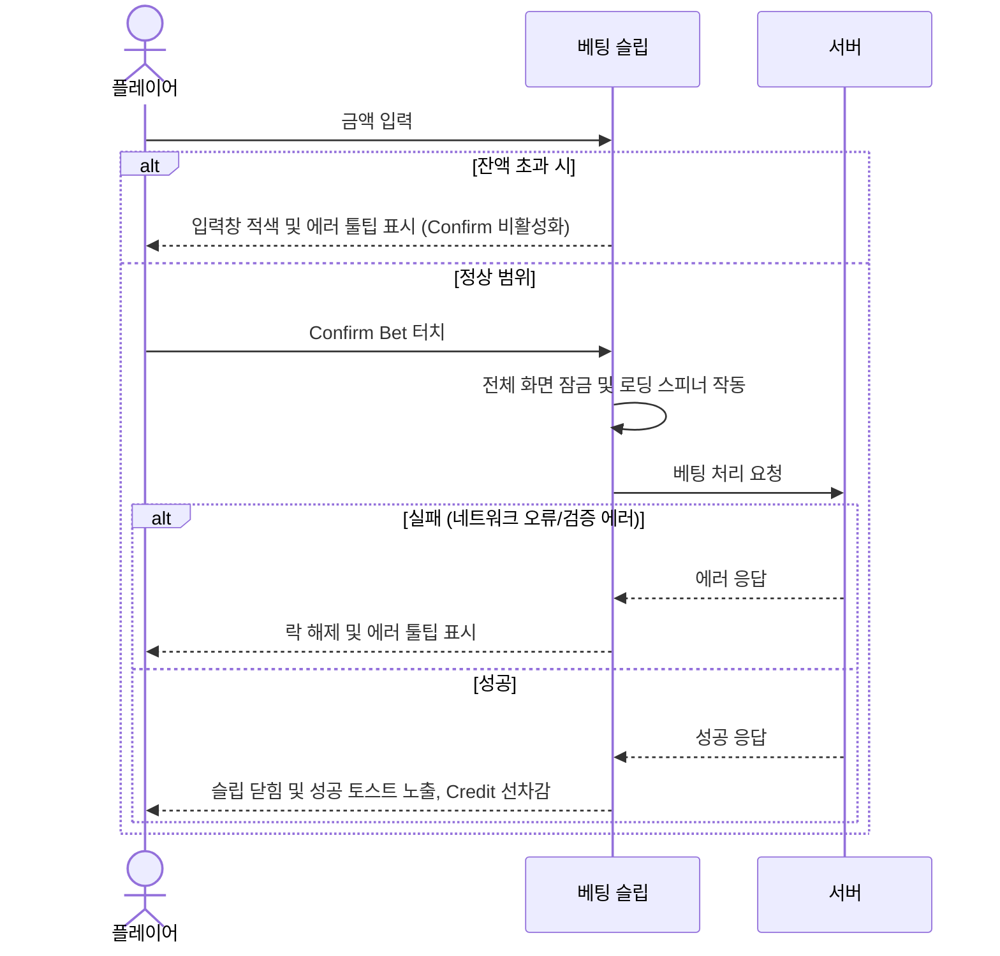
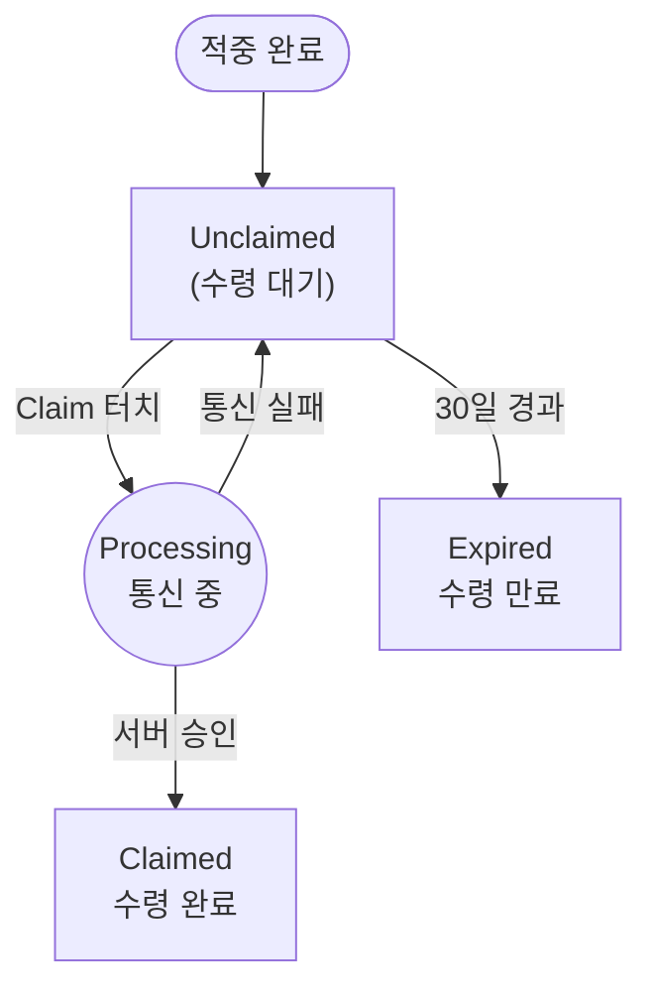

# ROOSTER RUMBLE: Derby Race - 베팅 및 배당 정의 (v1.2.9)

## 목차

- [1. 개요 및 목적](#1.%20개요%20및%20목적)
- [2. 베팅 방식](#2.%20베팅%20방식)
  - [2.1 단승식 및 복승식의 상세 동작 및 구성 명세](#2.1%20단승식%20및%20복승식의%20상세%20동작%20및%20구성%20명세)
  - [2.2 삼쌍승식 (Trifecta) — 추후 업데이트 예정](#2.2%20삼쌍승식%20—%20추후%20업데이트%20예정)
  - [2.2 베팅 화면의 UI/UX 구조 및 조작 흐름](UX%20구조%20및%20조작%20흐름)
    - [1) 베팅 화면 레이아웃 구조](#1)%20베팅%20화면%20레이아웃%20구조)
    - [2) 베팅 조작 시퀀스 및 예외 처리](#2)%20베팅%20조작%20시퀀스%20및%20예외%20처리)
  - [2.3 베팅 한도](#2.4%20베팅%20한도)
  - [2.4 다중 베팅 규칙](#2.5%20다중%20베팅%20규칙)
  - [2.5 베팅 마감 정책](#2.6%20베팅%20마감%20정책)
- [3. 고정 배당률 및 예상 배당금 산식](#3.%20고정%20배당률%20및%20예상%20배당금%20산식)
  - [3.1 고정 배당률 결정 공식](#3.1%20고정%20배당률%20결정%20공식)
    - [1) 승리 확률 계산](#1)%20승리%20확률%20계산)
    - [2) 고정 배당률 계산 및 범위 제약](#2)%20고정%20배당률%20계산%20및%20범위%20제약)
    - [3) 상세 구현 시 참조: 시뮬레이션 기반 산출 방식](#3)%20상세%20구현%20시%20참조:%20시뮬레이션%20기반%20산출%20방식)
  - [3.2 예상 배당금 실시간 연산](#3.2%20예상%20배당금%20실시간%20연산)
  - [3.3 지급 한도 및 파산 방지](#3.3%20지급%20한도%20및%20파산%20방지)
- [4. 배당금 지급 및 다중 접속 제어](#4.%20배당금%20지급%20및%20다중%20접속%20제어)
  - [4.1 Claim Payout 버튼의 상태 전이 규칙](#4.1%20Claim%20Payout%20버튼의%20상태%20전이%20규칙)
  - [4.2 중복 지급 방지 (멱등성 보장)](#4.2%20중복%20지급%20방지%20(멱등성%20보장))
  - [4.3 수령 만료 기간 및 일괄 수령](#4.3%20수령%20만료%20기간%20및%20일괄%20수령)
  - [4.4 정산 다중 접속 제어](#4.4%20정산%20다중%20접속%20제어)
  - [4.5 데이터베이스 잠금 대기 시간 타임아웃 및 롤백 에러 규정](#4.5%20데이터베이스%20잠금%20대기%20시간%20타임아웃%20및%20롤백%20에러%20규정)
  - [4.6 결과 화면 베팅 내역 표시 스펙](#4.6%20결과%20화면%20베팅%20내역%20표시%20스펙)
- [5. UI/UX 연출 및 피드백 스펙](UX%20연출%20및%20피드백%20스펙)
  - [5.1 모바일 세로 뷰포트 레이아웃 구성](#5.1%20모바일%20세로%20뷰포트%20레이아웃%20구성)
  - [5.2 Confirm Bet 클릭 시 인터랙션 및 잠금 정책](#5.2%20Confirm%20Bet%20클릭%20시%20인터랙션%20및%20락(Lock)%20정책)
  - [5.3 Confirm Bet 버튼의 시각적 피드백 (UX) 정의](#5.3%20Confirm%20Bet%20버튼의%20시각적%20피드백%20정의)
  - [5.4 Credit 카운트업(Count-Up) 애니메이션 연출](#5.4%20Credit%20카운트업(Count-Up)%20애니메이션%20연출)
  - [5.5 베팅 시스템 UI 구성 요소 정의](#5.5%20베팅%20시스템%20UI%20구성%20요소%20정의)
- [6. RTP 및 경제 밸런스 정책](#6.%20RTP%20및%20경제%20밸런스%20정책)
- [7. QA 검증 체크리스트](#7.%20QA%20검증%20체크리스트)

---

## 1. 개요

- **핵심 목표**: 더비 레이스 내 베팅 타입, 배당률 산출, 배당금 지급 및 정산 절차의 명확한 기준 확립
- **적용 범위**: 플레이어의 베팅 참여 시점부터 경주 종료 후 크레딧 지급까지의 전체 시스템 동작
- **동작 원칙**: 다중 접속 환경에서의 데이터 정합성 보장 및 중복 지급 원천 차단

---

## 2. 베팅 방식

더비 레이스의 기본 경기 모델은 6마리의 수탉이 출전하는 레이스로 구성되며, 현재 버전에서 지원하는 베팅 방식은 단승식(Win) 및 복승식(Quinella) 2종임. (연승식 Place는 사용하지 않음)

| 베팅 방식 | 영문 표기 | 기획적 정의 | 적중 요건 |
| :--- | :---: | :--- | :--- |
| **단승식** | Win | 경주에서 최종 1위로 골인할 선수를 예측 (1마리 선택) | 선택한 수탉 선수의 최종 순위가 **1위**인 경우 |
| **복승식** | Quinella | 경주에서 최종 1위와 2위를 차지할 2마리 선수를 예측 (2마리 조합 선택) | 선택한 2마리 수탉 조합이 순서 상관없이 **1위와 2위**를 차지한 경우 |

### 2.1 베팅 종목별 상세 동작 및 구성 명세

| 구분 | 단승식 (Win) | 복승식 (Quinella) |
| :--- | :--- | :--- |
| **상세 동작** | 출전 닭 6마리 중 오직 **최종 1위** 닭 1마리를 선택하여 예측 | 출전 닭 6마리 중 **최종 1위와 2위** 닭 2마리 조합을 선택하여 예측 |
| **적용 배당률** | 가중 스탯 기반 승리 확률 역산 단승 배당률 적용 | 2마리 조합 확률 및 시뮬레이션 기반 조합 배당률 적용 |
| **마권 검증 처리** | 경주 종료 후 도착 시간이 가장 짧은 1위 닭 ID 일치 | 1위 및 2위 닭 ID 조합과 유저가 베팅한 2마리 ID 조합 일치 |
| **예외/동점 처리** | 동점자 판별을 통해 단 1마리의 1위만 확정 (중복 적중 차단) | 동점 해소 규칙에 따라 고유 정렬된 1위와 2위 2마리 조합 확정 |

### 2.2 베팅 화면의 UI/UX 구조 및 조작 흐름

#### 1) 베팅 화면 레이아웃 구조

- **UI 컴포넌트 사양 및 상태 제어**:

| UI 컴포넌트 | 노출 정보 (View) | 인터랙션 및 상태 제어 (Action/State) |
| :--- | :--- | :--- |
| **선택 탭 (Win/Quinella)** | 베팅 타입 텍스트 | 탭 전환 시 배당판 수치(Odds) 실시간 교체 |
| **선수 카드 Grid** | 닭 번호, 컨디션(▲/●/▼), 고정 배당률 | 선택 시 테두리 하이라이트 적용 및 단일 선택 처리 |
| **금액 입력 필드** | 현재 입력 금액 및 안내 문구 | 보유 잔액 실시간 검증. 한도/잔액 초과 시 에러 문구 노출 및 적색 전환 |
| **예상 지급액 표시기** | 예상 지급액 및 최대 상한 뱃지 | `베팅 금액 * 배당률` 실시간 롤링 연산 및 상한 도달 시 강제 보정 |
| **Confirm 버튼** | 확정 텍스트 및 로딩 스피너 | 유효성 통과 시 활성화, 터치 시 패널 내 전체 입력 잠금 가동 |

#### 2) 베팅 조작 시퀀스 및 예외 처리

- **베팅 시스템(UI-Server) 상호작용 흐름**:

- **단계별 분기 및 예외 처리 정책**:

| 조작 단계 | 정상 흐름 | 예외 처리 및 UI 피드백 |
| :--- | :--- | :--- |
| **1. 타입/선수 선택** | 타입(Win/Place) 및 출전 선수 1명 선택 완료 | 선택 완료 전까지 Confirm Bet 버튼 비활성 유지 |
| **2. 금액 입력** | 최소(10)~최대(10,000) 한도 내 금액 설정 | **잔액 및 한도 초과:** 입력창 적색 전환 및 Confirm 비활성화 |
| **3. 베팅 확정** | Confirm Bet 터치 | **중복 요청 방지:** 터치 즉시 비활성화 처리하여 중복 서버 통신 차단 |
| **4. 서버 검증** | 슬립 잠금 유지 및 API 통신 대기 | **네트워크 에러/타임아웃:** UI 락 해제 및 오류 툴팁 표시 |
| **5. 처리 완료** | 슬립 닫힘, 성공 토스트 노출, Credit 선차감 | (해당 없음) |

### 2.3 베팅 한도

#### 1) 시스템 한도 (현행 적용)
- **최소 베팅 금액**: 단일 베팅 건당 **10 Credit**
- **최대 베팅 금액**: 단일 베팅 건당 **10,000 Credit**
- 플레이어는 보유 크레딧(Credit) 범위 내에서만 베팅을 확정할 수 있으며, 한도를 초과하거나 미달하는 베팅 진행 불가

#### 2) 레이스 타입별 차등 한도 (추후 업데이트 예정)
마스터 기획서(`게임기획서 §4.3, §11.4`)에 정의된 레이스 타입별 차등 베팅 한도는 아래와 같으며, 시스템 안정화 이후 단계적으로 도입할 예정

| 레이스 타입 | 최소 베팅 | 최대 베팅 | 변동성 | 권장 용도 |
| :--- | ---: | ---: | :--- | :--- |
| Rookie Derby | 10 Credit | 100 Credit | 낮음 | 신규/복귀 플레이어 보호 |
| Standard Derby | 10 Credit | 200 Credit | 보통 | 일반 플레이어 대상 |
| High Stakes Derby | 100 Credit | 1,000 Credit | 높음 | 숙련 플레이어 대상 |

### 2.4 다중 베팅 규칙
- **동일 경기 내 다중 베팅**: 동일 경기에서 동일 플레이어가 Win (단승식) 베팅과 Quinella (복승식) 베팅을 각각 1건씩 동시에 진행할 수 있음. 단, 동일 타입(Win+Win 또는 Quinella+Quinella)의 중복 베팅은 허용하지 않음
- **다른 경기 간 다중 베팅**: 플레이어가 예정된 여러 경기에 동시 베팅하는 기능을 지원. 각 베팅 건은 고유 베팅 식별자 형태로 서버 및 클라이언트에 기록
- **동일 경기 다중 베팅 시 Credit 차감**: Win과 Quinella를 동시에 베팅할 경우, 각 베팅 금액의 합산이 보유 Credit을 초과할 불가. 선(先)확정된 베팅의 금액은 잔여 Credit에서 즉시 선차감되어 후속 베팅의 가용 한도에 반영

### 2.5 베팅 마감 정책
- 경기가 시작되는 정각(Start Time) 기준 **정확히 30초 전에 베팅 강제 마감**
- 마감 시점 이후에는 퀵 베팅 확장 슬립 및 베팅 슬립 패널의 모든 상호작용 인터랙션이 비활성화(Locked) 처리
- **베팅 취소 불가 규칙**: 최종 베팅 확인(Confirm Bet) 처리 완료 후 서버에 기록된 베팅은 시스템 정합성 유지와 중복 지급 예방을 위해 **수정 및 취소 절대 불가** (UI 내 툴팁 및 경고 창 안내)

---

## 3. 고정 배당률 및 예상 배당금 산식

- **기본 정책**: 경기 시작 전 배당률이 고정되는 **고정 배당제** 방식 준수

### 3.1 고정 배당률 결정 공식
- 대진 생성 시 출전 선수 6마리의 가중 스탯 기반 승리 확률 및 하우스 에지(수수료율 10%) 적용 산출

#### 1) 승리 확률 계산
- `선수 승리 확률 = 선수의 가중 스탯 / 출전 선수 6마리의 가중 스탯 합산`

#### 2) 고정 배당률 계산 및 범위 제약
- `배당률 = 제한값 적용(최소 1.01, 최대 99.00, (1 - 수수료 0.10) / 선수 승리 확률)`
- **배당값 최종 처리**: 산출된 배당률 값은 소수점 셋째 자리에서 반올림하여 둘째 자리까지 최종 확정. (예: `1.50x`, `2.75x`, `12.00x` 등으로 고정 배당임을 명시)
- **보정 범위와 권장 배당 범위의 관계**: 시스템 안전 보정 범위(1.01~99.00)는 극단적 스탯 편차에 의한 배당률 이상치를 방지하는 안전 한계값이며, 기획서(`게임기획서 §11.2`)에서 권장하는 실 운용 배당 범위는 Win `1.5x ~ 10.0x`, Place `1.1x ~ 3.0x`로 이보다 좁음. 대부분의 경기에서 산출된 배당률은 권장 범위 내에 자연 분포하며, 보정 한계에 도달하는 경우는 극히 드문 예외 상황에 해당

#### 3) 상세 구현 시 참조: 시뮬레이션 기반 산출 방식
위 2)항의 단일 공식은 대진 생성 시점에 빠르게 배당률을 결정하는 간략 산출 방식. 마스터 기획서(`게임기획서 §11.6`)에는 보다 정밀한 시뮬레이션 기반 배당 산출 프로세스가 별도 정의되어 있으며, 상세 구현 시 아래 흐름을 참조할 수 있음
1. 출전 선수 6마리의 공개 스탯과 컨디션 확정
2. 동일 레이스 조건으로 내부 시뮬레이션을 1,000회 반복 실행
3. 선수별 Win Rate와 Place Rate 산출
4. 레이스 타입별 목표 RTP와 House Edge 적용
5. 최소/최대 배당 범위 및 지급 상한을 보정하여 최종 Win/Place 배당 확정

- **기본 산식**: `표시 배당률 = (1 / 승리 확률) * 목표 RTP`
- **RTP 목표값**: 레이스 타입별 88~96% 범위 설정 (§6 참조)

### 3.2 예상 배당금 실시간 연산
베팅 슬립 내 입력 필드에 베팅 금액을 입력하거나 퀵 버튼(+10, +50, +100 등)을 클릭하는 즉시, 실시간으로 예상 배당금을 연산하여 사용자 화면에 갱신
- `예상 배당금 = 베팅 금액 * 적용 배당률`
- **단수 처리 규칙**: 지급액 연산 및 최종 지급 시 소수점 둘째 자리에서 반올림하여 첫째 자리까지 표기하는 단수 처리 적용

### 3.3 지급 한도 및 파산 방지
- **최대 지급 상한**: 레이스 타입별로 단일 베팅 건당 최대 지급액을 초과할 수 없도록 제한
- **UI 표기**: 예상 배당금이 레이스 최대 지급 상한액을 초과할 경우, 화면 내 예상 지급액 영역에 `MAX PAYOUT APPLIED` 문구를 노출하고 최대 상한값으로 베팅 및 정산을 강제 고정

#### 레이스 타입별 최대 지급 한도

| 레이스 타입 | 최대 지급 | 비고 |
| :--- | ---: | :--- |
| Rookie Derby | 2,000 Credit | 낮은 변동성, 신규 플레이어 보호 |
| Standard Derby | 10,000 Credit | 기본 플레이 대상 |
| High Stakes Derby | 100,000 Credit | 고위험 고보상 대상 |

- 레이스 타입별 차등 한도가 도입되기 전(현행)에는 **단일 최대 지급 상한 10,000 Credit**을 전 레이스에 공통 적용

---

## 4. 배당금 지급 및 다중 접속 제어

경기가 종료되면 서버는 시뮬레이션 결과에 맞춰 최종 순위를 확정하고 플레이어의 베팅 적중 여부 정산

### 4.1 Claim Payout 버튼의 상태 전이 규칙
결과 화면 및 전적 화면에서 적중된 배당금의 청구 및 지급 상태 전이 흐름은 다음과 같음

- **상태별 진입 조건 및 피드백 제어**:

| 버튼 상태 | 상태 진입 조건 (Trigger) | UI 렌더링 및 인터랙션 제어 |
| :--- | :--- | :--- |
| **Unclaimed (수령 대기)** | 경기 결과 적중 완료 시 | 주황/초록 고대비 하이라이트 노출. 터치 시 정산 요청 시작 |
| **Processing (통신 중)** | Claim Payout 터치 시 | 로딩 애니메이션 작동 및 버튼 비활성화 처리 (서버 통신 대기) |
| **Claimed (수령 완료)** | 서버 정산 승인 완료 | 회색조 전환, 'Claimed' 텍스트 표출 및 영구 비활성화 |
| **Expired (만료)** | 적중 후 30일 경과 시 | 수령 권한 소멸 및 버튼 비활성화 (또는 목록 제거) |
| **미노출 (N/A)** | 미적중 또는 미참여 시 | 해당 결과 카드에 Claim 버튼 영역 렌더링 안 함 |

### 4.2 중복 지급 방지 (멱등성 보장)
- **식별자 고유화**: API 레벨에서 경기 고유 번호를 활용한 정산 식별자를 이용해 멱등성 정산 보장
- **UI 레벨 차단**: 플레이어가 'Claim Payout' 단추를 클릭하여 서버 통신이 시작되는 즉시, 클라이언트 UI에서는 버튼을 즉시 비활성화 처리하여 중복 요청 전송을 원천 차단

### 4.3 수령 만료 기간 및 일괄 수령
- **만료 기한**: 레이스 정산 완료 시점 기준 **최대 30일(720시간)** 이내에 배당금을 청구해야 하며, 30일이 경과한 미수령 내역은 자동 소멸(`Expired`)되어 지급이 영구 불가
- **일괄 수령**: 경기 완료 리스트 탭 상단의 'Claim All' 버튼을 활성화하여, 최근 20개 경기 결과 목록 중 사용자가 청구하지 않은 모든 적중 경기의 배당금을 일괄 정산 API 호출을 통해 일괄 멱등 정산 처리

### 4.4 정산 다중 접속 제어
- **제어 목적**: 다중 디바이스/탭 환경에서 동일 정산 건의 동시 요청 시 발생하는 레이스 컨디션 방지 및 강도 높은 DB 다중 접속 제어 수행
- **다중 접속 처리 수준**: 데이터베이스 표준인 `Read Committed` 수준 이상의 격리 상태 유지
- **비관적 잠금**: 대상 유저의 자산 정보와 정산 기록을 조회할 때 무결성 보장을 위해 반드시 배타적 쓰기 잠금 권한 선점
- **데드락 방지 시퀀스**: 교착 상태 방지를 위해 잠금 획득 순서를 항상 '유저 정보'에서 '베팅 정보'로 향하는 단방향 시퀀스로 강제 고정

#### 정산 처리 논리 시퀀스 및 상태 검증
1. **정산 절차 개시**: 정산 처리를 위한 독립적인 검증 세션 생성
2. **유저 자산 잠금 획득**: 다중 기기 접속에 의한 크레딧 동시 수정 방지를 위해, 대상 유저의 보유 크레딧 정보에 대한 쓰기 권한 선점
3. **베팅 정보 잠금 획득 및 상태 검증**: 해당 베팅 기록의 접근 권한을 획득한 뒤, 해당 베팅이 이미 정산 완료(`CLAIMED`) 상태인지 2차 교차 검증 수행
4. **유저 자산 증액 및 상태 업데이트**: 검증이 통과될 경우 유저의 크레딧 잔액을 배당금만큼 즉시 증액하고, 베팅 기록을 수령 완료 상태로 변경
5. **정산 완료 승인**: 모든 데이터 업데이트가 정상적으로 수행되었을 경우 변경 사항을 영구 저장

### 4.5 데이터베이스 잠금 대기 타임아웃 규정 및 예외 처리
- **타임아웃 제한**: 동시 정산 요청 충돌로 인해 데이터베이스 잠금 대기 현상이 길어지는 것을 방어하기 위해, 서버 단에서 **잠금 대기 제한 시간을 최대 2초**로 엄격하게 통제
- **롤백 처리**: 대기 시간이 2초를 초과하여 잠금을 획득하지 못할 경우, 서버는 즉각적으로 해당 요청을 강제 취소 처리하고 자원 반환
- **사용자 피드백 (UI/UX)**: 타임아웃 발생 시 클라이언트에는 데이터 충돌 에러 코드(`409 Conflict`)를 응답하며, 화면 상에 *"동시 정산 요청이 많아 일시 지연되었습니다. 잠시 후 다시 시도해 주세요."* 라는 안내 팝업을 노출하여 사용자의 자발적인 재시도 유도

### 4.6 결과 화면 베팅 내역 표시 스펙
- **표시 목적**: 결과 정산 화면 내 베팅 내역 요약 표시를 통한 정산 과정의 투명성 제공

| 표시 항목 | 설명 | 노출 조건 |
| :--- | :--- | :--- |
| **Bet Type** | Win / Place 중 선택한 베팅 타입 | 항상 노출 |
| **Target** | 선택한 선수 번호 및 이름 | 항상 노출 |
| **Bet Amount** | 확정된 베팅 금액 | 항상 노출 |
| **Applied Odds** | 확정 시점에 적용된 고정 배당률 | 항상 노출 |
| **Result Rank** | 선택한 선수의 최종 순위 | 경기 완료 후 노출 |
| **Payout** | 적중 시 지급 Credit / 미적중 시 `0` | 경기 완료 후 노출 |
| **Net Profit** | `Payout - Bet Amount` (적중 시 양수, 미적중 시 음수) | 경기 완료 후 노출 |
| **Current Credit** | 정산 반영 후 현재 보유 Credit | 경기 완료 후 노출 |

- 동일 경기에 Win + Place를 동시 베팅한 경우, 각 베팅 건을 별도 행(Row)으로 분리 표시
- 적중 건에는 Claim Payout 버튼이 활성화되고, 미적중 건에는 `MISS` 또는 `LOST` 상태 뱃지 표기

---

## 5. UI/UX 연출 및 피드백 스펙

### 5.1 모바일 세로 뷰포트 레이아웃 구성
- **뷰포트 크기**: 모바일 기기 세로 화면 비율 대응
- **베팅 슬립 패널**: 모바일 화면 최하단 배치, 슬립 영역 내 베팅 유형/금액 설정/확정의 빠른 조작 지원

### 5.2 Confirm Bet 클릭 시 인터랙션 및 잠금 정책
- 사용자가 'Confirm Bet' 버튼을 클릭하는 즉시, 베팅 입력 필드, 토글 카드, 버튼 등을 포함한 슬립 내부의 모든 상호작용 가능한 UI 요소를 비활성화 처리
- Confirm Bet 버튼은 로딩 애니메이션으로 전환하여 네트워크 요청 처리 중임을 알리고 화면 터치를 일시 차단
- **성공 및 실패 연출**:
  - **전송 성공**: 슬립 창이 부드럽게 닫히며 *"베팅이 성공적으로 완료되었습니다."* 성공 토스트 알림 팝업
  - **전송 실패**: UI 락이 해제되며 오류 원인(예: 크레딧 부족, 베팅 마감 등)에 따른 적절한 에러 툴팁 및 시스템 다이얼로그 표시
- **네트워크 단절 및 유실**: Processing 상태 중 연결이 유실될 경우, 5초 타임아웃을 적용하여 락을 해제하고 *"네트워크 응답이 지연되었습니다. 전적 화면에서 정산 내역을 확인해 주세요."* 안내를 노출하여 이중 베팅 시도 차단

### 5.3 Confirm Bet 버튼의 시각적 피드백 (UX) 정의

| 상태 | 시각적 연출 및 인터랙션 목표 |
| :--- | :--- |
| **기본 활성** | 게임의 메인 테마(브랜드 컬러)를 적용하여 화면 내에서 가장 높은 주목도를 확보함 |
| **터치(호버)** | 버튼이 눌리는 듯한 물리적 축소 애니메이션과 음영 변화를 통해 즉각적인 조작 타격감 제공 |
| **통신 대기** | 텍스트를 숨기고 '로딩 애니메이션'을 출력하여 서버 통신 중임을 인지시키며, 이중 터치를 무시함 |
| **비활성화** | 채도와 명도를 대폭 낮춘 무채색(회색조)으로 전환하여, 현재 조건(잔액 부족 등)상 조작 불가 상태임을 명확히 시사함 |

### 5.4 Credit 카운트업(Count-Up) 애니메이션 연출
- **동작 조건**: 배당금 수령 청구(Claim) 성공 및 서버의 정산 완료 응답 수신
- **시각 피드백**: 로비 및 헤더 영역의 크레딧 정보 영역에 다음 연출 적용
1. **헤더 점멸**: 기존 보유 크레딧 텍스트 영역이 하이라이트 색상으로 빠르게 점멸함
2. **숫자 롤링**: 기존 수치에서 획득한 배당금이 누적 합산되는 숫자가 빠르게 상승하는 카운트업 효과 렌더링
3. **파티클 연출**: 카운트업 종료 시점에 코인 획득 효과음과 함께 숫자 주변으로 미세한 파티클을 순간 방출

### 5.5 베팅 시스템 UI 구성 요소 정의

#### 1) 베팅 슬립 조작 단계별 화면 구성
- **단계별 베팅 슬립 UI 디자인 시안**: 조작 단계별 베팅 슬립 패널 설계 구조
- **[1단계] 베팅 방식 선택 대기**:

- **[2단계] 선수 및 금액 설정 입력**:

- **[3단계] Confirm Bet 터치 후 UI 락**:

#### 2) 경기 탭 컨트롤러
- **정의 및 역할**: 로비 중앙 상단에 위치하여 경기 상태(진행 중/예정/완료)별로 경기 리스트를 필터링·전환하는 탭 네비게이션
- **시각적 노출 정보**: `Live (진행 중)`, `Upcoming (예정)`, `Result (완료)` 탭 3종. 각 탭은 현재 해당 상태 경기 건수를 뱃지로 병기
- **상태 제어 규칙**:
- **활성**: 선택된 탭은 브랜드 하이라이트 언더라인 및 고대비 텍스트로 강조 노출되며, 하위 경기 리스트 영역이 해당 탭의 경기 목록으로 즉시 교체
- **비활성**: 선택되지 않은 탭은 차콜 딤드 텍스트로 렌더링되어 대기 상태 명시
- **상태별 연출 효과**: 각 탭의 경기 카드는 진행 상태에 따라 시각적으로 구분되어 노출. Live는 실시간 진행 연출, Upcoming은 마감 카운트다운, Result는 당첨 여부 강조 처리 적용

#### 3) 경기 카드
- **정의 및 역할**: 경기 요약 정보(경기 번호, 마감까지 남은 시간, 퀵 베팅 토글)를 노출하는 카드 컴포넌트. Upcoming 탭 첫 번째 카드는 베팅 슬립 패널이 자동 확장
- **시각적 노출 정보**: 경기 고유 번호(Race #ID), 경기 시작까지 남은 시간 카운트다운, 퀵 베팅 확장 토글 버튼(`Quick Bet ∧/∨`)
- **상태 제어 규칙**:
- **접힘(기본)**: 기본 상태. 경기 요약 정보만 1행으로 노출되며 퀵 베팅 패널은 숨겨진 상태
- **펼침(확장)**: `Quick Bet` 토글 터치 시 하단으로 6마리 선수 카드 그리드와 베팅 입력 영역이 슬라이드 애니메이션으로 부드럽게 확장
- **마감**: 경기 시작 30초 전 이후에는 퀵 베팅 토글 버튼이 비활성화되며 카드 전체에 마감 상태 표기 오버레이

#### 4) 베팅 타입 선택 탭
- **정의 및 역할**: 베팅 방식(단승식/복승식) 토글 전환을 위한 상단 선택 컴포넌트
- **시각적 노출 정보**: 단승식(Win)/복승식(Place) 텍스트 명칭 및 하단 배당률 범위(최저~최고 Odds) 병기 처리
- **상태 제어 규칙**:
- **활성**: 선택된 베팅 타입 탭은 하이라이트 언더라인 및 굵은 글씨로 노출되어 활성화 상태임을 시각적으로 표기. 활성 상태인 베팅 타입의 배당률(Win Odds 또는 Place Odds)이 하위 선수 카드에 실시간 전환 적용
- **비활성**: 선택되지 않은 탭은 어두운 차콜 텍스트 스타일로 표시되어 대기 상태임 표시
- **잠금**: 베팅 마감 시점(경주 시작 30초 전) 또는 베팅 전송 서버 통신 중에는 탭 변경 조작이 완전 불가능하도록 잠금 처리

#### 5) 출전 선수 카드
- **정의 및 역할**: 출전 선수의 스탯 및 실시간 배당률 정보를 출력하며, 베팅 대상을 선택하는 격자형(3열 2행) 카드 컴포넌트
- **시각적 노출 정보**: 닭의 고유 번호(1~6), 닭 이미지 아이콘, 닭 이름, 주행 스타일 태그(선행/추입/자재), 경기 컨디션 화살표(▲ 상승 / ● 보통 / ▼ 하락), 베팅 타입별 실시간 고정 배당률(Odds)
- **컨디션 표기 기준**:
- **▲ (상승)**: 직전 경기 대비 컨디션 수치가 향상된 선수. 카드 컨디션 아이콘을 상향 화살표(녹색 계열)로 표기
- **● (보통)**: 컨디션 변동이 없거나 평균 범위 내인 선수. 원형 아이콘(회색 계열)으로 표기
- **▼ (하락)**: 직전 경기 대비 컨디션 수치가 저하된 선수. 하향 화살표(적색 계열)로 표기
- **상태 제어 규칙**:
- **대기**: 선택되지 않은 기본 상태. 반투명 다크 그레이 카드 배경, 미세한 하늘색 경계 테두리 선이 적용된 대기 스타일로 렌더링
- **마우스 오버**: 마우스 커서 진입 시 짙은 그레이 배경 및 선명한 하늘색 광원 그림자 효과 활성화
- **선택**: 터치 시 하늘색 하이라이트 배경으로 전환되며 카드가 미세하게 3% 수축하여 확실한 터치 감을 제공. 선수 카드는 단일 선택 그룹으로 동작하여 한 번에 단 1마리의 선수만 선택 활성화되도록 제약
- **비활성화**: 베팅 마감 이후 또는 베팅 잠금 시 50% 투명도 및 회색 필터가 적용되며 모든 상호작용 및 클릭이 강제 차단

#### 6) 퀵 베팅 확장 패널
- **정의 및 역할**: 경기 카드의 `Quick Bet` 토글을 터치하면 슬라이드 애니메이션으로 확장되는 인라인 베팅 입력 영역. 별도 화면 이동 없이 로비 리스트 화면에서 바로 베팅 참여가 가능하도록 설계
- **시각적 노출 정보**: 출전 선수 6마리 격자 카드(3열 2행), 베팅 타입 선택 탭(Win/Place), 금액 입력 필드, 퀵 금액 버튼, 예상 배당금 표시기, Confirm Bet 버튼
- **확장 애니메이션**: 카드 하단에서 슬라이드 다운 형태로 부드럽게 패널이 펼쳐지며, 접힘 시에는 역방향으로 슬라이드 업 처리
- **고정 배당률 표시 정책**: 패널 확장 시점 서버 확정 고정 배당률(Fixed Odds)을 선수 카드에 즉시 표기. 유저의 Confirm Bet 완료 전까지 해당 배당률 변동 없이 고정 유지

#### 7) 금액 입력 필드 및 퀵 버튼
- **정의 및 역할**: 베팅에 참여할 크레딧 금액을 수동으로 입력하거나 프리셋 버튼으로 조작하는 수량 설정 컴포넌트
- **시각적 노출 정보**: 수동 입력창, 유저 보유 크레딧(Balance) 잔액 표시, 누적형 퀵 금액 버튼 5종 및 절대값형 금액 프리셋 6종
- **퀵 금액 버튼 (누적 합산형)**: `+10`, `+50`, `+100`, `+500`, `Max` — 터치할 때마다 현재 입력된 금액에 해당 값을 누적 합산하는 방식
- **금액 프리셋 버튼 (절대값 지정형)**: `10`, `20`, `50`, `100`, `200`, `MAX BET` — 터치 시 입력창의 금액을 해당 값으로 즉시 교체하는 방식. (기획서 §5.4 참조)
- 두 버튼 그룹은 베팅 슬립 패널 내에서 상하 배치되며, 누적형 버튼은 미세 조정 용도로, 절대값형 버튼은 빠른 금액 지정 용도로 활용
- **Max 버튼 동작 규칙**: 터치 시 유저의 현재 보유 잔액과 레이스 최대 베팅 한도(10,000 Credit) 중 더 낮은 값이 자동으로 입력창에 세팅. 잔액이 최소 베팅 한도(10 Credit) 미만인 경우 Max 버튼 자체 비활성화
- **상태 제어 규칙**:
- **미입력**: 금액이 지정되지 않은 상태로, 입력창 내에 최소 베팅액 안내 문구가 노출되며 Confirm Bet 버튼은 비활성 상태 유지
- **유효**: 보유 잔액 범위 내의 최소 베팅(10) 이상, 최대 베팅(10,000) 이하 금액이 지정된 상태로, 입력창이 기본 테두리색을 유지하며 Confirm Bet 버튼 활성화
- **무효(에러)**: 보유 잔액을 초과하거나 최소/최대 한도를 벗어난 금액이 감지될 경우, 입력창 테두리를 적색으로 강제 전환하고 경고 툴팁을 표시하며 Confirm Bet 버튼 비활성화

#### 8) 예상 지급액 표시기
- **정의 및 역할**: 금액 설정 필드에 지정된 베팅 크레딧과 선택된 선수 카드의 실시간 배당률을 곱 연산하여 예측 성공 시 획득할 보상을 동적으로 출력하는 안내 컴포넌트. 유저가 베팅 참여 전 기댓값을 명확히 인지할 수 있도록 상시 노출
- **시각적 노출 정보**: `예상 지급액: [계산액] Credit (Odds [적용 배당률])` 포맷. 금액 및 배당률 변경 시 수치가 부드럽게 롤링 전환
- **상태 제어 규칙**:
- **실시간 계산**: 금액 수정 또는 선수 변경 시마다 `베팅 금액 × 배당률` 수식을 즉시 재연산하여 수치 갱신
- **상한 보정**: 연산된 결과가 레이스별 최대 지급 상한액을 초과할 경우, 결과값을 최대 상한 수치로 강제 고정하며 우측에 `MAX PAYOUT APPLIED` 황색 경고 뱃지를 즉각 노출

#### 9) 베팅 최종 확정 버튼
- **정의 및 역할**: 설정된 베팅 데이터(선수 ID, 베팅 타입, 베팅 금액)를 백엔드 서버에 서버로 전송하는 최종 실행 컴포넌트
- **시각적 노출 정보**: 확정 버튼 명칭(`Confirm Bet [베팅 금액]`) 또는 처리 중 상태 안내(로딩 스피너 + `PROCESSING` 텍스트)
- **UI 락 범위**: Processing 상태 진입 시 베팅 슬립 패널 전체 영역(타입 탭, 선수 카드, 금액 입력, 퀵 버튼, 예상 지급액 표시기 포함)에 반투명 딤드 레이어를 오버레이하여 모든 상호작용을 완전 차단
- **상태 제어 규칙**:
- **비활성**: 유효한 선수 선택이 없거나 입력 금액 유효성 검사를 통과하지 못한 경우 회색 딤드 처리되며 터치 상호작용 차단
- **활성**: 모든 필수 입력 값 및 유효성 검사 충족 시 즉각 고대비 컬러(주황색 계열)로 활성화하여 클릭 가능 상태 안내
- **처리 중**: 버튼 클릭 즉시 슬립 패널 전체 영역에 터치 방지 레이어을 가동하고, 버튼 내부 텍스트를 로딩 애니메이션 스피너로 전환하여 중복 요청을 원천 차단. 서버 응답 수신 시까지 락 상태를 고정 유지

---

## 6. RTP 및 경제 밸런스 정책

- **설계 방향**: 플레이어의 장기 관전·예측 지원 및 Credit 무한 증가 구조 방지
- **기준 지표**: 마스터 기획서(`게임기획서 §11.4`)에 정의된 목표값 기반 적용

### 6.1 레이스 타입별 RTP 목표

| 레이스 타입 | 권장 평균 RTP | 변동성 | 용도 |
| :--- | ---: | :--- | :--- |
| Rookie Derby | 92~96% | 낮음 | 신규/복귀 플레이어 보호 |
| Standard Derby | 90~94% | 보통 | 기본 플레이 |
| High Stakes Derby | 88~92% | 높음 | 고위험 고보상 플레이 |

- RTP(Return To Player)는 장기 평균 기준 목표값이므로, 개별 레이스의 결과 보장 불가
- **하우스 에지(House Edge) 산출**: `100% - RTP` (수수료율 10% 적용 시 RTP 90% 해당)

### 6.2 베팅 타입별 경제 방향

| 베팅 타입 | 역할 | 기대 적중률 | 보상 정책 |
| :--- | :--- | :--- | :--- |
| Place (복승식) | 안정형 | 높음 | 낮은 배당, 잦은 적중감 |
| Win (단승식) | 표준형 | 중간 | 배당과 적중률의 균형 |

### 6.3 경제 검증 기준
- 10,000회 이상 자동 시뮬레이션으로 베팅 타입별 RTP 검증
- 특정 번호 및 배당 구간의 장기적이고 과도한 이점 방지
- Credit 복귀 수단(Daily Credit, Rookie Practice)을 포함한 시뮬레이션에서 Rookie Derby 재진입률과 Credit 고갈 반복 빈도 확인

---

## 7. QA 검증 체크리스트

- **검증 목적**: 베팅·배당·정산 규칙의 정합성 확인
- **수행 방식**: 순위 산출 정의 문서(`순위 산출 정의 §12`)의 QA 체크리스트와 병행 수행

| 테스트 항목 | 기대 결과 | 관련 섹션 |
| :--- | :--- | :---: |
| 최소 베팅 미달 입력 | Confirm Bet 비활성화, 에러 텍스트 노출 | §2.4 |
| 최대 베팅 초과 입력 | Confirm Bet 비활성화, 입력창 적색 전환 | §2.4 |
| 보유 Credit 초과 베팅 | Confirm Bet 비활성화, 잔액 초과 경고 | §2.4 |
| Win+Place 동시 베팅 후 Credit 차감 | 선확정 베팅 금액을 잔여 Credit에서 즉시 선차감 | §2.5 |
| 동일 타입 중복 베팅 시도 (Win+Win) | 중복 베팅 차단 및 안내 | §2.5 |
| 베팅 마감 30초 전 UI 잠금 | 슬립 전체 잠금 처리, 입력 불가 | §2.6 |
| 확정 후 베팅 취소 시도 | 취소 불가 안내 노출 | §2.6 |
| 배당률 안전 보정 범위 검증 | 산출값이 1.01x~99.00x 범위 내 고정 | §3.1 |
| 예상 배당금 실시간 갱신 | 금액/선수 변경 즉시 `베팅 금액 * 배당률` 재연산 | §3.2 |
| MAX PAYOUT APPLIED 표기 | 예상 지급액 > 최대 지급 한도 시 뱃지 노출 | §3.3 |
| Confirm Bet 중복 클릭 | 첫 클릭 즉시 비활성화, 중복 통신 시도 없음 | §5.2 |
| Claim Payout 멱등성 | 동일 정산 식별자 재요청 시 중복 지급 없음 | §4.2 |
| 정산 동시 요청 (다중 탭) | 배타적 잠금으로 중복 정산 원천 차단 | §4.4 |
| DB 락 타임아웃 (2초 초과) | 통신 지연 에러 응답 및 안전 재시도 팝업 노출 | §4.5 |
| 30일 미수령 배당금 자동 소멸 | Expired 상태 전이, 지급 영구 불가 | §4.3 |
| Claim All 일괄 수령 | 미수령 적중 건 전체 단일 일괄 정산 | §4.3 |
| Credit 카운트업 연출 | Claim 성공 시 헤더 점멸 → 숫자 롤링 → 파티클 | §5.4 |
| 결과 화면 베팅 내역 표시 | Bet Type, Target, Amount, Odds, Payout 정상 표기 | §4.6 |
