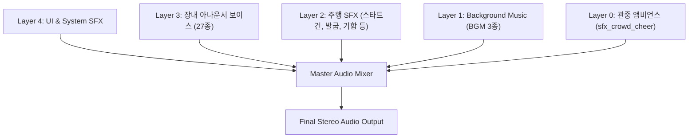
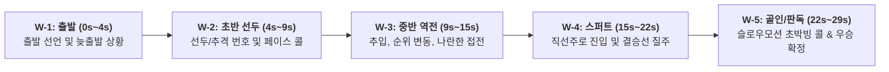

# ROOSTER RUMBLE: Derby Race - 인게임 사운드 MVP 구성안

- 문서 상태: 인게임 사운드 MVP 구성안
- 작성일: 2026-09-29
- 대상 범위: 3D 경주(약 26초 주행 + 결과 팡파레), BGM 3종, 영문 아나운서 보이스 27종, 풀 레이스 시뮬레이션 샘플 3종
- 기반 문서: `Derby Race MVP 구성안.md`

---

## 1. 개요 및 사운드 아키텍처

### 1.1 문서 목적
- `ROOSTER RUMBLE` 경주 모드(Derby Race)의 BGM, SFX, 장내 아나운서 음성 제어 사양 정의

### 1.2 4대 오디오 채널 레이어 구조

| 레이어                     | 대상 사운드                      | 덕킹 및 동적 제어 정책                                                            |
| :---------------------- | :-------------------------- | :----------------------------------------------------------------------- |
| **Layer 3 (Voice)**     | 장내 아나운서 영문 음성 27종           | 하위 레이어(Layer 1, 2) 감쇄 제어 트리거                                             |
| **Layer 2 (주행 SFX)**    | 출발 신호총                      | 보이스 출력 시 -3dB ~ -4dB 가벼운 감쇄                                              |
| **Layer 1 (BGM)**       | 로비 테마, 인게임 질주 테마, 결과 정산 팡파레 | 보이스 출력 시 -5.7dB ~ -6.5dB 자동 감쇄, 결승 15m 전 페이드아웃                           |
| **Layer 0 (관중 앰비언스)**   | 야외 경기장 관중 함성 소음             | 출발 서지 $\rightarrow$ 중반 기본 $\rightarrow$ 결승 15m 크레센도 $\rightarrow$ 골인 대환호 |

---

## 2. BGM (배경음악) 사양 명세

| 에셋 ID        | 파일명 (File Name)        |  재생 형식   | 믹싱 및 연출 제어                                                      |
| :----------- | :--------------------- | :------: | :-------------------------------------------------------------- |
| `bgm_race`   | `bgm_ingame_race.mp3`  |   Loop   | 출발 총성과 동시에 시작, 보이스 출력 시 -5.7dB 감쇄, 결승 15m 슬로우모션 진입 시 0.4초 페이드아웃 |
| `bgm_result` | `bgm_result_theme.mp3` | One-shot | 우승 판정 직후 발동, 중간 페이드아웃 없이 5.75초 전곡 100% 연주 후 자연스러운 잔향 마감         |

---

## 3. SFX (효과음) 사양 명세

### 3.1 인게임 주행 SFX

| 에셋 ID            | 파일명 (File Name)             | 사운드 구성 및 특성                                                                                                                | 인게임 연출 및 믹싱 제어                                                                                                     |
| :--------------- | :-------------------------- | :------------------------------------------------------------------------------------------------------------------------- | :----------------------------------------------------------------------------------------------------------------- |
| `sfx_startgun`   | `sfx_race_startgun.mp3`     | **"Ready..." 음성 + 0.3초 묵음 + 육상 스타트건 발포음 (1.31초)** (출발 긴장감 조성 보이스 $\rightarrow$ 0.3초 침묵 $\rightarrow$ 건샷 어택)             | 카운트다운 완료 시 단독 발동, 클린 헤드룸으로 왜곡 없는 총성 출력                                                                             |
| `sfx_crowd`      | `sfx_crowd_cheer.mp3`       | **야외 경기장 관중 함성 앰비언스** (현장감 넘치는 관중 응원 및 환호 소음)                                                                           | 볼륨 엔벨로프 제어: 출발 순간 서지(0.68) $\rightarrow$ 중반 기본 응원(0.48) $\rightarrow$ 결승 15m 크레센도(0.80) $\rightarrow$ 골인 대환호(0.82) |
| `sfx_heartbeat`  | `sfx_race_heartbeat.mp3`    | **심장 박동음** (저역 흉강 공명 Lub/Dub 이중 박동)                                                                                     | *선택적 옵션 에셋*: 슬로우모션 연출 시 관중 크레센도/아나운서 콜 중심 연출이 기본이며, 필요 시 연출 옵션으로 활용                                                |

---

## 4. 영문 장내 아나운서 보이스 사양

### 4.1 주행 5대 오디오 윈도우 구조

| 윈도우 ID                     | 구간 타임라인           | 주요 상황 및 역할                       |
| :------------------------- | :---------------- | :------------------------------- |
| **W-1: Line Break**        | **0.0s ~ 4.0s**   | 신호총 발포 직후 출발 콜, 늦출발 수탉 발생 시 상황 콜 |
| **W-2: Early Lead**        | **4.0s ~ 9.0s**   | 초반 선두 수탉 호출 및 2위 추격 수탉 간의 페이스 중계 |
| **W-3: Overtake & Move**   | **9.0s ~ 15.0s**  | 중반 외곽 추입, 순위 뒤바뀜, 두 마리 나란한 접전 콜  |
| **W-4: Final Stretch**     | **15.0s ~ 22.5s** | 직선주로 진입, 전원 스퍼트, 선두 경쟁 수탉 집중 콜   |
| **W-5: The Wire & Finish** | **22.5s ~ 29.5s** | 피니시 판독 콜, 최종 우승 확정 콜             |

### 4.2 실제 제작 완료된 장내 아나운서 보이스 DB (총 27종)

저장 경로: `assets/audio/race/voice/

#### 1) 선수 번호 호명 (6종)
인게임 상황 멘트 직전/직후 조합하여 특정 수탉 지칭 시 사용.

| 에셋 ID | 파일명 | 영문 대사 | 한글 참고 번역 | 재생 길이 | 피크 | RMS |
| :--- | :--- | :--- | :--- | :---: | :---: | :---: |
| `vo_rooster_num_01` | `vo_rooster_num_01.mp3` | *"Number 1!"* | "1번!" | 1.03s | 0.651 | 0.089 |
| `vo_rooster_num_02` | `vo_rooster_num_02.mp3` | *"Number 2!"* | "2번!" | 1.03s | 0.646 | 0.076 |
| `vo_rooster_num_03` | `vo_rooster_num_03.mp3` | *"Number 3!"* | "3번!" | 1.03s | 0.654 | 0.083 |
| `vo_rooster_num_04` | `vo_rooster_num_04.mp3` | *"Number 4!"* | "4번!" | 1.03s | 0.658 | 0.089 |
| `vo_rooster_num_05` | `vo_rooster_num_05.mp3` | *"Number 5!"* | "5번!" | 1.03s | 0.654 | 0.081 |
| `vo_rooster_num_06` | `vo_rooster_num_06.mp3` | *"Number 6!"* | "6번!" | 1.03s | 0.652 | 0.076 |

#### 2) W-1: 출발 및 늦출발 상황 (5종)

| 에셋 ID | 파일명 | 영문 대사 스크립트 | 한글 참고 번역 | 재생 길이 | 우선순위 |
| :--- | :--- | :--- | :--- | :---: | :---: |
| `vo_us_start_01` | `vo_us_start_01.mp3` | *"And away they go!"* | "일제히 힘차게 출발합니다!" | 1.03s | P2 |
| `vo_us_start_02` | `vo_us_start_02.mp3` | *"And they're off in Rooster Rumble!"* | "루스터 럼블, 경주가 시작되었습니다!" | 1.24s | P2 |
| `vo_us_start_03` | `vo_us_start_03.mp3` | *"Off the mark and away they sprint!"* | "출발선을 차고 수탉들이 튀어나갑니다!" | 1.25s | P2 |
| `vo_us_flinch_01` | `vo_us_flinch_01.mp3` | *"Bad break! Stumbled off the line!"* | "출발이 삐끗합니다! 출발선에서 멈칫하네요!" | 1.87s | P2 |
| `vo_us_flinch_02` | `vo_us_flinch_02.mp3` | *"Awkward start, losing ground early!"* | "스타트 불안정! 초반 거리가 벌어집니다!" | 1.41s | P2 |

#### 3) W-2: 초반 선두 및 페이스 (3종)

| 에셋 ID | 파일명 | 영문 대사 스크립트 | 한글 참고 번역 | 재생 길이 | 우선순위 |
| :--- | :--- | :--- | :--- | :---: | :---: |
| `vo_us_early_01` | `vo_us_early_01.mp3` | *"Showing early speed to take the lead!"* | "빠른 순발력으로 선두를 잡습니다!" | 1.29s | P3 |
| `vo_us_early_02` | `vo_us_early_02.mp3` | *"Grabs the lead early on!"* | "초반 선두로 나섭니다!" | 1.12s | P3 |
| `vo_us_early_03` | `vo_us_early_03.mp3` | *"Setting the pace out front!"* | "선두에서 경주를 이끌어갑니다!" | 1.15s | P3 |

#### 4) W-3: 중반 추입, 역전 및 접전 (4종)

| 에셋 ID | 파일명 | 영문 대사 스크립트 | 한글 참고 번역 | 재생 길이 | 우선순위 |
| :--- | :--- | :--- | :--- | :---: | :---: |
| `vo_us_over_01` | `vo_us_over_01.mp3` | *"Takes over the lead!"* | "선두를 빼앗아냅니다!" | 1.03s | P1 |
| `vo_us_over_02` | `vo_us_over_02.mp3` | *"Makes a powerful surge!"* | "거세게 치고 올라옵니다!" | 1.15s | P1 |
| `vo_us_over_03` | `vo_us_over_03.mp3` | *"Surging to the front!"* | "맹렬하게 선두로 치고 나섭니다!" | 1.04s | P1 |
| `vo_us_side_01` | `vo_us_side_01.mp3` | *"Head-to-head in a battle!"* | "팽팽하게 맞서며 치열한 접전입니다!" | 1.08s | P1 |

#### 5) W-4: 직선주로 라스트 스퍼트 (4종)

| 에셋 ID | 파일명 | 영문 대사 스크립트 | 한글 참고 번역 | 재생 길이 | 우선순위 |
| :--- | :--- | :--- | :--- | :---: | :---: |
| `vo_us_stretch_01` | `vo_us_stretch_01.mp3` | *"Down the stretch they come!"* | "마지막 직선주로로 일제히 접어듭니다!" | 1.06s | P1 |
| `vo_us_stretch_02` | `vo_us_stretch_02.mp3` | *"Leading them to the wire!"* | "선두로 결승선을 향해 질주합니다!" | 1.06s | P1 |
| `vo_us_stretch_03` | `vo_us_stretch_03.mp3` | *"They're sprinting for the wire!"* | "결승선을 향해 전원 스퍼트합니다!" | 1.12s | P1 |
| `vo_us_stretch_chui`| `vo_us_stretch_chui.mp3`| *"Charging hard from behind!"* | "뒤쪽에서 무서운 속도로 맹추격합니다!" | 1.12s | P1 |

#### 6) W-5: 골인, 판독 및 우승 확정 (5종)

| 에셋 ID | 파일명 | 영문 대사 스크립트 | 한글 참고 번역 | 재생 길이 | 우선순위 |
| :--- | :--- | :--- | :--- | :---: | :---: |
| `vo_us_win_01` | `vo_us_win_01.mp3` | *"Wins it wire-to-wire!"* | "처음부터 끝까지 앞서며 우승을 차지합니다!" | 1.04s | P0 |
| `vo_us_win_02` | `vo_us_win_02.mp3` | *"It is all victory at the wire!"* | "결승선 앞 완벽한 승리를 거둡니다!" | 1.21s | P0 |
| `vo_us_win_03` | `vo_us_win_03.mp3` | *"Takes the victory in Rooster Rumble!"* | "루스터 럼블의 챔피언에 등극합니다!" | 1.29s | P0 |
| `vo_us_photo_01` | `vo_us_photo_01.mp3` | *"Too close to call! They cross the line together!"* | "판가름하기 어렵습니다! 거의 동시에 통과합니다!" | 1.91s | P0 |
| `vo_us_photo_02` | `vo_us_photo_02.mp3` | *"Nose to nose at the wire! Who took it?!"* | "부리와 부리가 나란히 통과! 과연 승자는 누구인가!" | 1.74s | P0 |

---

## 5. 인게임 오디오 제어 및 동적 덕킹(Dynamic Ducking) 규격

### 5.1 오디오 우선순위 체계 (Priority Queue)
- `[P0: 골인/사진 판독/우승]` > `[P1: 직선주로 스퍼트/추입/역전]` > `[P2: 출발 선언/늦출발]` > `[P3: 초반 선두 호명]`

### 5.2 동적 덕킹 파라미터 규격
중계 음성 가청도 및 BGM 비트감 동시 확보 목적 파라미터 규격:

- **BGM 덕킹 레벨**: 보이스 출력 시 정상 볼륨 대비 **-5.7dB ~ -6.5dB (0.52배)** 감쇄 (BGM의 비트감과 브라스 선율이 묻히지 않고 힘차게 유지됨)
- **SFX 덕킹 레벨**: 보이스 출력 시 **-3.0dB ~ -4.0dB (0.75배)** 감쇄
- **어택/릴리즈 스무딩**: Moving Average 필터 기반 선행 어택 40ms, 릴리즈 120ms

### 5.3 결승선 결과 팡파레 시퀀스
1. **결승 15m 전 슬로우모션 진입 (22.5s)**:
   - 질주 BGM 0.4초 페이드아웃 적용
   - 장내 관중 함성 크레센도 폭발 (0.48 $\rightarrow$ 0.80)
   - 아나운서의 긴박한 포토피니시 콜 (*"Nose to nose at the wire! Who took it?!"* 또는 *"Too close to call!"*) 출력
2. **결승선 돌파 (25.5s)**:
   - 결승선 라인 통과와 동시에 관중 대환호 최대치 출력 (0.82)
3. **우승 선언 및 결과 팡파레 연동 (26.2s ~ 32.5s)**:
   - 우승 수탉 번호 콜 및 승리 선언 콜 출력
   - 결과 팡파레(`bgm_result_theme.mp3`, 5.75초)가 시작되어 마지막 음까지 **중간 컷 없이 전곡 연주**
   - 팡파레 종료 후 자연스러운 잔향 마감

---

## 6. 사운드 마스터 에셋 총괄 리스트 (총 40종)

| 분류        | 에셋 ID                  | 파일명 (File Name)              | 포맷  | 비고                                  |
| :-------- | :--------------------- | :--------------------------- | :-: | :---------------------------------- |
| **BGM**   | `bgm_race`             | `bgm_ingame_race.mp3`        | MP3 | 인게임 질주 테마곡 (Loop)                   |
| **BGM**   | `bgm_result`           | `bgm_result_theme.mp3`       | MP3 | 결과 팡파레 (5.75s, One-shot)            |
| **SFX**   | `sfx_startgun`         | `sfx_race_startgun.mp3`      | MP3 | 출발 신호총 ("Ready..." + 0.3s + Dry 탕!) |
| **SFX**   | `sfx_crowd`            | `sfx_crowd_cheer.mp3`        | MP3 | 야외 경기장 관중 함성 앰비언스                   |
| **SFX**   | `sfx_countup_end`      | `sfx_ui_countup_end.mp3`     | MP3 | 카운트업 피니시음                           |
| **Voice** | `vo_rooster_num_01~06` | `vo_rooster_num_[01~06].mp3` | MP3 | 선수 번호 호명 6종                         |
| **Voice** | `vo_us_start_01~03`    | `vo_us_start_[01~03].mp3`    | MP3 | 정상 출발 멘트 3종                         |
| **Voice** | `vo_us_flinch_01~02`   | `vo_us_flinch_[01~02].mp3`   | MP3 | 늦출발 상황 멘트 2종                        |
| **Voice** | `vo_us_early_01~03`    | `vo_us_early_[01~03].mp3`    | MP3 | 초반 선두 멘트 3종                         |
| **Voice** | `vo_us_over_01~03`     | `vo_us_over_[01~03].mp3`     | MP3 | 중반 역전 멘트 3종                         |
| **Voice** | `vo_us_side_01`        | `vo_us_side_01.mp3`          | MP3 | 나란한 접전 멘트 1종                        |
| **Voice** | `vo_us_stretch_01~03`  | `vo_us_stretch_[01~03].mp3`  | MP3 | 라스트 스퍼트 멘트 3종                       |
| **Voice** | `vo_us_stretch_chui`   | `vo_us_stretch_chui.mp3`     | MP3 | 후방 추입 멘트 1종                         |
| **Voice** | `vo_us_win_01~03`      | `vo_us_win_[01~03].mp3`      | MP3 | 단독 우승 멘트 3종                         |
| **Voice** | `vo_us_photo_01~02`    | `vo_us_photo_[01~02].mp3`    | MP3 | 초박빙 접전 판독 멘트 2종                     |

---

## 7. [참고용] 풀 레이스 데모 사운드 시뮬레이션 샘플 사양 및 시나리오 (3종)

인게임 26초 경기와 결과 팡파레의 전체 사운드 연출 실전 검증 목적 제작 3종 마스터 시뮬레이션 트랙.  
모든 샘플: **32.55초** 길이, **결과 팡파레 5.75초 완주**, **관중 함성/BGM 부각**, **발소리의 자연스러운 배경 텍스처화** 적용.

| 트랙 구분 | 파일 경로 | 주요 시나리오 및 전개 | 우승 수탉 | 특징적 아나운서 콜 |
| :--- | :--- | :--- | :---: | :--- |
| **샘플 1** | `assets/audio/race/demo/demo_race_simulation_26s.mp3` | 3번 선두 장악 $\rightarrow$ 5번의 외곽 급상승 $\rightarrow$ 5번 와이어 투 와이어 우승 | **5번** | *"And they're off in Rooster Rumble!"* *"Wins it wire-to-wire!"* |
| **샘플 2** | `assets/audio/race/demo/demo_race_simulation_sample_2.mp3` | 1번 폭발적 도주 $\rightarrow$ 3번의 거센 압박 $\rightarrow$ 4번의 후방 폭풍 추입 $\rightarrow$ 코차(Nose) 극적 역전승 | **4번** | *"Off the mark and away they sprint!"* *"Charging hard from behind!"* *"It is all victory at the wire!"* |
| **샘플 3** | `assets/audio/race/demo/demo_race_simulation_sample_3.mp3` | 6번 출발 실수로 후미 낙오 $\rightarrow$ 2번 단독 선두 $\rightarrow$ 6번의 무서운 뒷심 발휘 $\rightarrow$ 피 튀기는 데드히트 혈투 $\rightarrow$ 6번 대역전승 | **6번** | *"Bad break! Stumbled off the line!"* *"Head-to-head in a battle!"* *"Takes the victory in Rooster Rumble!"* |

---

## 8. 리소스 관리 및 디렉터리 구조

- `assets/audio/race/bgm/`: 공식 BGM 3종
- `assets/audio/race/sfx/`: 공식 SFX 7종 (8개 파일)
- `assets/audio/race/voice/`: 장내 아나운서 영문 보이스 27종
- `assets/audio/race/demo/`: 마스터 풀 레이스 시뮬레이션 트랙 3종
- `tools/source_cache/`: 효과음 제작 및 합성에 사용되었던 원본 원자재 아카이브 (총 22개 파일, 인게임 빌드 대상에서 제외 보관)
