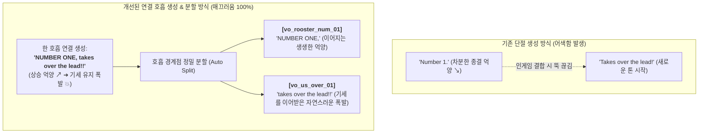

# ROOSTER RUMBLE: Derby Race 연결 호흡 기반 아나운서 대사 마스터 시트

- 문서 상태: **연결 호흡(Natural Flow) & 정밀 분할 맞춤형 개정판**
- 목적: 단절된 단어 생성 시 발생하는 억양 단절(호흡 끊김, 부자연스러운 피치 급변)을 원천 차단하기 위해, **실제 인게임에서 이어지는 [선수 번호 + 상황 멘트]를 한 호흡의 연결 문장으로 생성한 후 분할**하도록 설계

---

## 1. 연결 호흡 작업 원리 및 필요성



1. **단절 생성의 문제점**:
   - `Number 1`을 단독으로 생성하면 문장의 끝으로 인식하여 목소리가 아래로 툭 떨어지는 **종결 하강 억양(↘)**으로 마감됨.
   - 이를 인게임에서 상황 멘트와 붙여서 재생하면 두 음원의 호흡과 피치가 완전히 달라 극도로 어색함.
2. **연결 생성 후 분할(Connect & Split)의 효과**:
   - `NUMBER ONE, takes over the lead!!`처럼 쉼표(`,`)로 연결된 한 문장으로 일레븐랩스에 입력하면:
     - 앞의 번호는 뒤로 이어지는 **긴박한 상승 억양(↗)**으로 발성됨.
     - 뒤의 상황 멘트는 앞의 호흡과 속도감을 그대로 이어받아 **자연스러운 하이텐션 질주 톤**으로 발성됨.
   - 이 연결된 음원의 경계점을 분할하여 사용하면, 인게임에서 1~6번 어떤 번호와 조합해도 100% 매끄럽게 연결됨.

---

## 2. 텍스트 카테고리 구성 (단독 멘트 vs 연결 호흡 멘트)

- **[그룹 A: 단독 독립 멘트 10종]**:
  - 다른 문장과 결합 없이 경기장 전체에 단독으로 터져 나오는 샤우팅 (출발 선언, 직선주로 진입, 결승선 사진 판독 등).
  - 단독으로 완전한 한 문장으로 생성.
- **[그룹 B: 연결 호흡 멘트 11종 (번호 + 상황 일체형)]**:
  - 인게임에서 `[선수 번호]` 뒤에 곧바로 이어붙는 상황 멘트들 (초반 선두, 중반 역전, 결승 스퍼트, 우승 선언 등).
  - 번호와 상황 멘트를 한 호흡으로 연결하여 생성 후 분할.

---

## 3. 일레븐랩스 복사용 연결 마스터 대사 시트

---

### [파트 1] 단독 독립 샤우팅 멘트 (10종 일괄 생성)
- **특징**: 번호 결합 없이 단독 발동되는 장내 아나운서 포효
- **저장 파일명**: `batch_solo.mp3`
- **복사할 텍스트**:

```text
And AWAY they GO!! ...

And they're OFF in Rooster Rumble!! ...

Off the mark and AWAY they sprint!! ...

BAD BREAK! Stumbled off the line! ...

Awkward start! Losing ground early! ...

DOWN THE STRETCH they come!! ...

They're SPRINTING for the wire!! ...

TOO CLOSE to call!! They cross the line TOGETHER!! ...

NOSE TO NOSE at the wire!! WHO TOOK IT?!! ...

It is ALL VICTORY at the wire!!
```

---

### [파트 2] 연결 호흡 멘트 세트 1 (초반 선두 & 페이스 콜)
- **특징**: 번호 호명 후 즉시 선두 상황으로 이어지는 연결 호흡
- **저장 파일명**: `batch_early.mp3`
- **복사할 텍스트**:

```text
NUMBER ONE, showing blazing speed to TAKE the lead!! ...

NUMBER TWO, GRABS the lead early on!! ...

NUMBER THREE, SETTING the pace out front!!
```
> **자동 분할 결과**:
> - 앞부분 ➔ `vo_rooster_num_01`, `02`, `03` (이어지는 라이브 억양)
> - 뒷부분 ➔ `vo_us_early_01`, `02`, `03` (자연스러운 선두 콜)

---

### [파트 3] 연결 호흡 멘트 세트 2 (중반 역전 & 치열한 격돌)
- **특징**: 번호 호명 후 즉시 선두 탈환/추입으로 치고 나가는 격정적 호흡
- **저장 파일명**: `batch_overtake.mp3`
- **복사할 텍스트**:

```text
NUMBER FOUR, TAKES OVER the lead!! ...

NUMBER FIVE, makes a POWERFUL surge!! ...

NUMBER SIX, SURGING to the front!! ...

NUMBER ONE and NUMBER TWO, HEAD-TO-HEAD in a fierce battle!!
```
> **자동 분할 결과**:
> - 앞부분 ➔ `vo_rooster_num_04`, `05`, `06` (이어지는 라이브 억양)
> - 뒷부분 ➔ `vo_us_over_01`, `02`, `03`, `vo_us_side_01` (역전 및 접전 콜)

---

### [파트 4] 연결 호흡 멘트 세트 3 (종반 직선주로 스퍼트 & 결승선 질주)
- **특징**: 번호 호명 후 결승선을 향해 목청을 높이는 라스트 스퍼트 호흡
- **저장 파일명**: `batch_stretch.mp3`
- **복사할 텍스트**:

```text
NUMBER FIVE, LEADING THEM all the way to the wire!! ...

NUMBER THREE, CHARGING HARD from behind!!
```
> **자동 분할 결과**:
> - 뒷부분 ➔ `vo_us_stretch_02`, `vo_us_stretch_chui`

---

### [파트 5] 연결 호흡 멘트 세트 4 (결승선 골인 & 최종 우승 선언)
- **특징**: 우승 수탉 번호 호명 후 최고조로 터져 나오는 챔피언 포효
- **저장 파일명**: `batch_win.mp3`
- **복사할 텍스트**:

```text
NUMBER FIVE, WINS IT wire-to-wire!! Unbelievable!! ...

NUMBER THREE, TAKES THE VICTORY in Rooster Rumble!!
```
> **자동 분할 결과**:
> - 뒷부분 ➔ `vo_us_win_01`, `vo_us_win_03`

---

## 4. 자동 분할 및 인게임 적용 방법

1. 일레븐랩스에서 위 파트별 텍스트를 복사하여 생성 후 다운로드.
2. 다운로드한 파일을 `assets/audio/race/voice_import/` 폴더에 위 명시된 파일명(`batch_solo.mp3`, `batch_early.mp3` 등)으로 저장.
3. 터미널에서 분할 실행 (또는 다운로드 후 말씀해 주시면 즉시 분할):
   ```bash
   python tools/split_connected_voices.py --speed 1.25 --rebuild-sim
   ```
   - 연결 문장에서 번호와 상황 멘트 경계점을 정밀 분할
   - 피치 왜곡 없는 1.25배속 가속 + 방송용 펀치 EQ 마스터링
   - 27종 인게임 규격 에셋 자동 배치 및 26초 풀 레이스 데모 자동 갱신 완료
