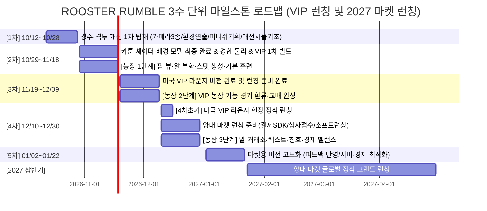
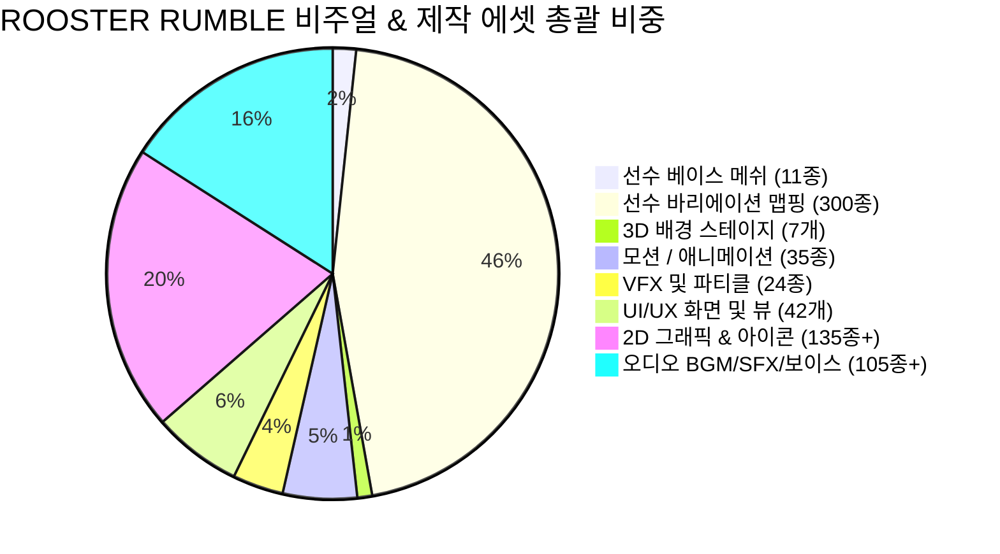

# 🐓 ROOSTER RUMBLE: 경주/격투/농장 개선 요소 및 3주 단위 마일스톤 계획서

* **문서 버전**: `v1.5.1`
* **문서 성격**: 시연 피드백 기반 경주(Derby Race)·격투(Rumble Pit) 개선 과제, 미국 VIP 라운지 런칭 대응(VIP 농장 포함, 3차 버전완료·4차초기 런칭, 온·오프라인 분리 운영), 5차 마켓용 버전 고도화 및 양대 마켓 런칭(2027 상반기) 3주 주기 개발 마일스톤 명세서, 전 모드 구성 요소(기본 모델 11종 및 **바리에이션 맵핑 300종** 포함) 볼륨 픽스 총괄표
* **1차 마일스톤 마감일**: 2026-10-28 (수)

---

### ■ 문서 개정 이력 (Revision History)

| 버전 (Version) | 개정일 (Date) | 주요 개정 내역 및 상세 변경 사항                                                                           | 관련 절 바로가기                 |
| :----------: | :--------: | :-------------------------------------------------------------------------------------------- | :------------------------ |
|  **v1.5.1**  | 2026-10-15 | 기본 선수 모델링(11종 베이스 메쉬) 기반 텍스처 바리에이션용 맵핑 수량 **'총 300종 (추후 추가 예정)'** 제6절 볼륨 픽스표 및 마일스톤 단계별 투입 배분표에 적시 반영 | [[#6-전-모드-구성-요소비주얼-에셋-포함-볼륨-픽스-및-마일스톤별-투입-총괄표\|6절 볼륨 픽스 총괄표]] |
|  **v1.5.0**  | 2026-10-15 | 전 모드 세부 구성 요소(3D 모델, 모션, VFX, UI, 오디오, 마스터 데이터, 시스템 등 비주얼 에셋 중심) 볼륨 정량 픽스(Fix) 및 차수별(1차~후속) 마일스톤 투입 배분 총괄표(제6절) 신설 | [[#6-전-모드-구성-요소비주얼-에셋-포함-볼륨-픽스-및-마일스톤별-투입-총괄표\|6절 볼륨 픽스 총괄표]] |
|  **v1.4.1**  | 2026-10-13 | 4.1절 [1차 마일스톤 WBS]에서 2차 완료 항목인 '3D 카툰 셰이더 적용 및 배경 모델링'을 2차 마일스톤(5.1절)으로 완전 이관하고, 1차 R-1을 '캐릭터 및 배경 3D 모델 비주얼 컨셉/시안 확정'으로 정비. 비고란 수기 메모 실무 스펙/DoD로 정제 | [[#41-경주-모드-derby-race-상세-작업\|4.1절 경주 WBS]] |
|  **v1.4.0**  | 2026-10-13 | 4절 1차 마일스톤 WBS 수기 수정 사항 반영 로드맵 전면 개편: (1) R-1 카툰 셰이더 적용을 2차 완료로 이관 및 1차 캐릭터/배경 모델 컨셉 확정 선행, (2) 피니쉬 연출 3단계 기획 수립(FINISH 표출, 슬로우 리플레이, 감속런·세리머니), (3) 중계 카메라 3종 랜덤 워킹(R-10) 및 환경 변수 연출(R-11) 1차 신규 편입, (4) P-1 격투 모델 차별화/공용성 컨셉 검토 및 P-3 대전 시뮬레이터 개발 연계, (5) 1~3절 및 5절 후속 마일스톤 연계 계획 동기화 | [[#3-3주-단위-전체-마일스톤-로드맵\|3~5절 전면 개편]] |
|  **v1.3.0**  | 2026-10-12 | 마일스톤 단계 신설: 4차와 후속(글로벌 런칭) 사이에 '5차 마켓용 버전 고도화' 단계 신설 (소프트런칭 피드백 반영, 서버·클라이언트 최적화, 스토어 대응, 경제 밸런스 고도화 및 5.4절 신설, 글로벌 런칭 5.5절로 재편) | [[#3-3주-단위-전체-마일스톤-로드맵\|3~5절 5차 마켓 고도화]] |
|  **v1.2.2**  | 2026-10-12 | 마일스톤 상세 조정: 3차 마일스톤을 '미국 VIP 라운지 버전 개발 완료 및 런칭 준비 완료'로 변경하고, 현장 정식 런칭 작업을 4차 초기에 진행하도록 로드맵 및 세부 연계 계획 개정 | [[#3-3주-단위-전체-마일스톤-로드맵\|3~5절 VIP 일정 조정]] |
|  **v1.2.1**  | 2026-10-12 | 오프라인 VIP 라운지와 온라인 모바일 앱 간 계정 및 크레딧 분리 운영 원칙 반영 (상호 연동 전면 배제 및 채널별 독립 운영 정책 명시) | [[#1-개요-및-수립-배경\|1절 원칙]] |
|  **v1.2.0**  | 2026-10-12 | 마일스톤 전략 개정: 3차 마일스톤까지 미국 VIP 라운지 정식 런칭 대응 집중(VIP 라운지용 농장 기능 포함), 양대 마켓 런칭 준비는 4차부터 착수하여 2027 상반기 글로벌 런칭으로 스케줄 조정 | [[#3-3주-단위-전체-마일스톤-로드맵\|3~5절 로드맵·VIP·마켓 런칭 계획]] |
|  **v1.1.0**  | 2026-10-12 | 럼블 팜(Rumble Farm - 육성 모드) 개발 범위 2차 마일스톤 신규 편입 (2.3절 농장 개발 요소 신설, 3~5절 로드맵·스케줄·후속 연계 계획 전면 확장) | [[#23-럼블-팜-rumble-farm---육성-모드-개발-과제-2차-마일스톤-적용\|2.3절 농장 개발 과제]] |
|  **v1.0.2**  | 2026-10-12 | 수기 수정 사항(시연 피드백 통일, 주행 스타일 외형화, 감속런·세리머니 검토화, 상황 반응형 보이스 전환) 3~5절 로드맵·WBS·후속 연계 전면 반영 | [[#3-3주-단위-전체-마일스톤-로드맵\|3~5절 로드맵·WBS]] |
|  **v1.0.1**  | 2026-10-12 | 4.1절 경주(Derby Race) 상세 작업 식별 번호 표기를 D-n(날짜 카운트 오해 방지)에서 R-n(Race)으로 수정         | [[#41-경주-모드-derby-race-상세-작업\|4.1절 경주 WBS]] |
|  **v1.0.0**  | 2026-10-12 | 시연 피드백 반영 경주/격투 3대 분야(모델·모션·상용화 연출) 개선 항목 도출 및 3주 단위 4단계 마일스톤(~10/28 1차 마일스톤 상세 WBS 포함) 최초 수립 | [[#1. 개요 및 수립 배경\|1절 개요]] |

---

## 1. 개요 및 수립 배경

* **목적**: 시연 피드백을 수렴하여 경주(Derby Race) 및 격투(Rumble Pit) 모드의 비주얼/속도감/타격감/상용화 연출을 격상하고, 3차 마일스톤까지 **미국 VIP 라운지 버전 개발 및 현장 런칭 준비(VIP 라운지용 농장 기능 완비)**를 완료하여 4차 초기에 현장 정식 런칭을 단행하며, 4차 마일스톤부터 양대 마켓 런칭 준비에 착수하고 **5차 마켓용 버전 고도화(2027.01)**를 거쳐 **2027년 상반기 글로벌 정식 런칭**을 달성하기 위함.
* **핵심 제약 및 원칙**:
  - **3주 단위 스프린트 마일스톤 운용**: 2026년 10월부터 연말 및 2027년 초까지 3주 주기로 점진적 릴리즈 빌드 패키징.
  - **1차 마일스톤 (~10/28) 즉시 반영**: 기존 확보된 리소스 및 파이프라인을 바탕으로 10/28까지 투입 가능한 경주/격투 개선 과제 최우선 탑재 (내부 시연용). 단, 닭 캐릭터 3D 모델 카툰 셰이더 및 배경 모델링은 캐릭터/배경 컨셉 확정 선행 후 2차 마일스톤에서 최종 완료하며, 1차에서는 선수 식별 번호 인디케이터 부착, 질주 속도감 상향(+30%), 중계 카메라 워킹 3종 랜덤 적용, 환경 변수(비/바람-낙엽/아지랑이) 연출, 피니쉬 3단계 기획(FINISH!/슬로우 리플레이/감속런 세리머니) 수립 및 격투 대전 시뮬레이터 기초/전투 기술 매핑을 집중 구현.
  - **2차 마일스톤 (~11/18) 카툰 셰이더·배경 모델 최종 완료 & VIP 1차 빌드 & 농장 1단계 착수**: 1차에서 확정된 컨셉을 기반으로 닭 캐릭터 3D 카툰 셰이더 및 배경 모델링을 최종 적용 완료하고, 6종 주행 스타일 외형 차별화 모델 분기 및 환경 물리 보정 연동. 이와 병행하여 10/29부터 농장 모드 개발에 착수하여 알 부화·스탯 생성·기본 훈련 8종 및 팜 뷰를 구축하고, 미국 VIP 라운지 1차 시연 빌드 패키징.
  - **3차 마일스톤 (~12/09) 미국 VIP 라운지 버전 완료 및 런칭 준비 완료**: 현장 전용 디스플레이/태블릿 UI, 키오스크 결제/크레딧 정산 및 **VIP 라운지용 농장 주요 기능**(패스트 트랙 UX, 급속 부화/훈련, VIP 전용 출전 환류) 상용 버전 빌드 완성 및 현장 리허설/런칭 준비 완비.
  - **온·오프라인 계정 및 크레딧 분리 운영 (상호 연동 배제)**: 규제 리스크 방지 및 각 플랫폼별 운영 독립성을 위해 미국 VIP 라운지(오프라인 현장 단말기/키오스크)와 온라인 모바일 앱(Google Play / Apple App Store) 간의 유저 계정, 게임 재화, 베팅 크레딧은 상호 연동하지 않고 100% 분리 운영 (독립 DB 및 독립 빌드 유지).
  - **4차 마일스톤 (~12/30) [4차 초기] VIP 라운지 런칭 & 양대 마켓 런칭 준비 착수**: 4차 초기에 미국 VIP 라운지 현장 정식 런칭 및 라이브 운영을 개시하며, 이와 병행하여 Google Play / App Store 제출용 인앱 결제(IAP) SDK 연동, IARC 연령등급, 보안/약관, 스토어 심사 접수 및 온라인 생태계(거래소/퀘스트) 완성, 소프트 런칭/CBT 운영.
  - **5차 마일스톤 (2027.01: 01/02~01/22) 마켓용 버전 고도화**: 소프트 런칭 및 CBT 실데이터 피드백을 반영하여 닭/경기 밸런스 미세 조정, 모바일 디바이스 최적화, 스토어 심사 피드백 대응 및 최종 승인 획득, 글로벌 서버/인프라 스트레스 검증 완료.
  - **2027년 상반기 글로벌 정식 런칭**: 5차 고도화 검증 완료 후 2027년 상반기 글로벌 동시 그랜드 오픈 전환.
  - **베팅 신뢰성 훼손 방지**: 인위적인 경기 중단(히트스톱), 급격한 시점 왜곡(딥 다이브 줌인), 조작 오해를 유발하는 경기 중 슬로우 모션 배제.

---

## 2. 모드별 핵심 개선 요소 (3대 영역: 모델 / 모션 / 연출)

### 2.1 더비 레이스 (Derby Race - 경주 모드)

#### 1) 모델 (3D Model & Visual Style)
* **아케이드 카툰 렌더링 스타일 (컨셉 확정 ➔ 2차 적용 완료)**:
  - 실사풍의 표현 한계를 탈피하고, 동작 시인성과 시각적 게임성을 극대화한 아케이드 카툰 셰이더 적용.
  - 1차 마일스톤에서 캐릭터 및 배경 모델 컨셉을 우선 확정하고, 최종 3D 카툰 셰이더 적용 완료는 2차 마일스톤으로 이관.
  - 모바일 소형 화면 및 오프라인 대형 디스플레이 양측에서 뚜렷한 외곽선 및 채도 유지.
* **선수 식별 번호 인디케이터 부착**:
  - 기존 화면 하단 리스트 나열식 번호 확인의 한계 개선.
  - 각 닭 캐릭터의 머리 위에 직관적인 게이트 번호(1~6번) 및 고유 컬러 인디케이터 부착.
  - 레인 침범 및 치열한 선두 경합 시에도 유저가 베팅한 닭의 위치를 즉각 식별 가능하도록 시인성 확보.
* **6종 주행 스타일 외형 차별화**:
  - 도주, 선행, 선입, 추입, 자재, 변칙 6종 스타일에 맞춘 체형 실루엣 및 깃털 텍스처 톤앤매너 정립 필요 (2차 연계).

#### 2) 모션 (Animation & Dynamics)
* **출발 대기 모션 세분화 (베팅 기대감 고조 - R-1 후속 연계)**:
  - 스타트 게이트 안에서 단순히 서 있는 정적 대기 배제.
  - 발을 구르는 닭, 날개를 가볍게 터는 닭, 고개를 빠르게 두리번거리며 기합을 넣는 닭 등 개별 준비 동작 세분화 (R-1 모델 컨셉/기초 메쉬와 연계 탑재).
* **질주 모션 속도감 상향 (+30%)**:
  - 전체 질주 애니메이션의 템포 및 보폭 주기를 30% 상향 튜닝하여 박진감 넘치는 질주감 구현.
  - 최고속 질주(라스트 스퍼트 구간) 시 날개를 거세게 퍼덕이며 추진력을 얻는 역동적 애니메이션 연계.
* **피니시 감속 및 승리 세리머니 모션 [피니쉬 연출 기획 필요-3]**:
  - 결승선 통과 직후 급정지하지 않고 자연스럽게 감속하며 트랙을 도는 런 다운 모션 적용 검토.
  - 1위 완주 닭의 단상 도약 및 날개 펼침 우승 세리머니 연계 기획 수립 및 검증.

#### 3) 연출 (Direction - 상용화 버전 적용)
* **출발 / 피니시 시각 임팩트 강화 [피니쉬 연출 기획 필요-1]**:
  - 출발 0초 시점에 화면 중앙에 강렬한 볼드 폰트의 `"START"` 그래픽 표출 및 출발총/비프 사운드 싱크.
  - 1위 닭 결승선 통과 시점에 화면 중앙에 `"FINISH!"` 텍스트 강조 표출 및 팡파레 연계 기획 확정.
* **결승 통과 직후 1초 자동 슬로우 리플레이 (+ 스킵 기능) [피니쉬 연출 기획 필요-2]**:
  - 레이스 진행 중 슬로우 모션은 결과 조작 오해를 유발하므로 원천 배제.
  - 실제 스포츠 중계를 벤치마킹하여, 레이스가 완전히 종료된 직후 결승 통과 1초 전후 순간을 다이내믹 앵글로 슬로우 리플레이 재생.
  - 빠른 경기 턴을 원하는 유저를 위해 즉시 결과창으로 넘어가는 `[Skip]` 버튼 연계 기획 확정.
* **가속 스피드 라인 FX 및 환경 파티클 (구체적 샘플 확보 선행)**:
  - 실효성이 떨어지는 발자국 잔상/바람 궤적은 배제하고, 속도감을 극대화하는 측면 '가속 스피드 라인' 이펙트 적용 (아트/기획 구체적 레퍼런스 샘플 기반 제작).
  - 발굽 지면 접촉 시 흙먼지 킥 파티클 연출.
* **경기 중계 카메라 워킹 추가 (1차 신규 편입)**:
  - 단조로운 시점을 탈피하고 속도감 및 관전 몰입감을 극대화하기 위해 최소 3종의 중계 카메라 워킹을 추가 개발하여 경기 중 랜덤하게 적용.
* **환경 변수 연출 (1차 신규 편입)**:
  - 비, 바람(낙엽 흩날림), 아지랑이 등 트랙 환경 변수에 대응하는 시각 연출 1차 구현 (2차에서 트랙 주행 물리 보정과 결합).
* **카메라 워킹 최적화 (2차 옵션화 연계)**:
  - 1차 카메라 3종 랜덤 적용 결과를 바탕으로, 오프라인 대형 스크린 시청 시 시각적 멀미를 방지하는 안정적 쿼터뷰 트랙 카메라(기본)와 다이내믹 박력 카메라(옵션) 간 유저 선택 기능은 2차에서 완성.
* **오디오 & 아나운서 보이스 동기화 (R-12 연동)**:
  - 출발 카운트다운 비프(2회) ➔ 출발 GO 비프 ➔ 출발 신호총 레이어링.
  - 아나운서 보이스를 임시로 적용한 고정 타임라인 방식에서 상황에 따라 출력 되는 방식으로 적용 필요.

---

### 2.2 럼블 핏 (Rumble Pit - 격투 모드)

#### 1) 모델 (3D Model & Arena Environment)
* **비의인화 조류 골격 기반 카툰 3D 모델 (더비 모델과의 차별화/신규 컨셉 검토)**:
  - 철권/복싱 스타일의 어색한 인간형 관절 꺾임을 배제하고, 실제 투계의 신체 비율(목, 가슴, 날개, 다리, 며느리발톱)에 부합하는 카툰 렌더 모델 구축.
  - 더비 레이스 모델과의 공용 여부 또는 격투 전용 신규 모델 분기 컨셉 확정 선행 및 타격 부위(부리, 발톱, 날개) 시인성 강화.
* **5대 격투 스타일별 외형 분기**:
  - 인파이터(단단한 근육형 체구, 붉은 볏), 아웃파이터(날렵한 날개깃, 긴 다리), 브롤러(거대한 흉곽, 거친 깃털), 테크니션(정교한 부리/발톱, 화려한 깃털), 밸런서(균형 잡힌 표준 체형).
* **원형 벽면 경기장 (Circular Walled Arena) 3D 에셋**:
  - 사각 코너 및 링 로프를 배제하고, 직경 10m 목재/철망 구조의 아케이드형 원형 투계장 모델 배치.
  - 흙바닥 텍스처 및 외곽 벽면 펜스 모델링 구현.

#### 2) 모션 (Avian Motions & Combat Actions)
* **조류 6대 이동 모션 완비 & 대전 시뮬레이터 개발 연계**:
  - `전진 총총걸음`: 고개를 짧게 흔들며 무게중심을 낮추고 좁은 보폭으로 접근하는 전진 보법.
  - `짧은 뒤로 홉`: 두 발을 모아 가볍게 뒤로 튀어 오르며 상대 공격 사거리에서 벗어나는 후퇴.
  - `목 빼고 질주`: 목을 전방으로 길게 빼고 날개를 반쯤 펼쳐 아레나를 가로지르는 급속 대시.
  - `날개 퍼덕 후방 이탈`: 양 날개를 크게 내리치며 공중으로 몸을 띄워 먼 거리로 급격히 빠지는 이탈.
  - `측면 사이드 홉`: 좌/우측 대각선으로 몸을 틀며 상대 정면 타격축을 회피하는 측면 홉.
  - `원형 탐색 걸음`: 상대와 시선을 맞춘 채 외곽 궤도를 따라 원형으로 맴도는 탐색 보법.
  - 단순 모션 클립 연동을 넘어 두 선수의 간격, 타격축, 회피 및 판정을 관장하는 **대전 시뮬레이터 기본 프레임워크 개발** 병행 착수.
* **비의인화 7대 전투 기술 애니메이션 매핑**:
  - `[공1] 전진 부리 속사`: 목을 순간적으로 S자로 접었다가 전방으로 뻗어 상대 안면을 속사 타격.
  - `[공2] 낮은 발톱 할퀴기`: 날개 반동으로 낮게 도약하여 한쪽 발톱으로 하체를 긁어 올림.
  - `[공3] 비상 발톱 급습`: 양 날개를 쳐올려 공중 1.2m까지 비상한 후 급강하하며 양발로 짓누름.
  - `[공4] 광폭 발버둥 난타`: 양 날개를 마구 퍼덕이며 두 발로 전방 반원을 할퀴고 차올리는 피니시 난타.
  - `[방1] 깃털 부풀려 버티기`: 전신 깃털을 부풀리고 목을 웅크려 충격을 흡수하며 밀려남을 최소화.
  - `[방2] 납작 엎드리기`: 몸을 바닥에 밀착시켜 상단/공중 공격을 헛치게 유도.
  - `[방3] 맞발톱 쳐내기`: 상대 공격 직전 짧게 마주 도약하여 발톱으로 궤적을 튕겨내고 확정 카운터 유발.
* **스탠딩 그로기 모션**:
  - 강타 피격 또는 가드 브레이크 발생 시 바닥에 쓰러지지 않고 두 다리를 비틀거리며 중심을 잡으려는 모션.
  - 짧은 시간(1.0~1.5초) 유지되어 유저에게 역전/피니시의 서스펜스 부여.
* **즉시 바닥 다운 모션**:
  - 체력이 0에 도달했을 때 무릎이 꺾이며 바닥에 완전히 쓰러지는 캔버스 다운 모션.
  - 10초 카운트다운 없이 다운 즉시 승패 확정 및 경기 종료.

#### 3) 연출 (Direction - 상용화 버전 적용)
* **아케이드 섬광 & 스파크 타격 이펙트**:
  - 사실적 상처 대신 대전 격투 아케이드 스타일의 히트 섬광과 황금빛 스파크 FX로 타격감 극대화.
  - 부리 공격 시 핀포인트 스파크, 발톱 할퀴기 시 슬래시 궤적, 날개 난타 시 광역 바람 파티클.
* **크리티컬 히트 한정 화면 렌즈 혈흔 FX**:
  - 캐릭터 신체에 피를 묻히거나 지속 출혈하는 묘사 배제.
  - 크리티컬 대미지 적중 순간에만 카메라 렌즈에 붉은 핏방울이 확 튀었다가 0.8초 내 페이드아웃되는 감각적 연출.
* **히트스톱 및 딥 다이브 줌인 배제 (객관적 관전 시점 유지)**:
  - 타격 순간 프레임을 정지시키거나 특정 선수 쪽으로 과도하게 줌인하는 연출을 금지하여 베팅 조작 오인 차단.
  - 두 선수의 거리에 비례하여 부드럽게 줌인/줌아웃되는 스포츠 중계 카메라 적용.
* **사운드 타종 & 보이스 연출**:
  - 라운드 개시 보이스 (`"First Round... FIGHT!"`) 직후 단독 1회 타종 징소리.
  - 즉시 KO 판정 순간 울려 퍼지는 연속 타종 벨소리(`SFX_PIT_KO_BELL`) 및 관중 환호성 증폭.

---

### 2.3 럼블 팜 (Rumble Farm - 육성 모드 개발 과제: 2차 마일스톤 적용)

#### 1) 공간 및 비주얼 (2.5D Isometric Farm & Visuals)
* **메인 팜 5대 핵심 공간 레이아웃 구축**:
  - `부화실(Incubator)`: 알 보관함 및 등급별 부화 인큐베이터 슬롯 배치.
  - `훈련장(Training Field)`: 8종 훈련 기구 및 닭 캐릭터 트레이닝 애니메이션 연출.
  - `닭장 및 스파(Rest & Spa)`: 경기 출전 후 피로 회복(휴식) 및 부상 치료 공간.
  - `교배소(Breeding Pen)`: 성체 닭 2세 번식 및 혈통 유전 교배 공간.
  - `관리동(Farm House)`: 칭호, 일일/주간 퀘스트, 누적 업적 및 팜 경제 통계 관리.
* **캐주얼 아케이드 2.5D 아이소메트릭 뷰**:
  - 전연령층 대상의 따뜻한 파스텔톤 농장 뷰포트 및 닭들의 유쾌한 자율 배회 애니메이션 연출.

#### 2) 육성 및 라이프사이클 (Core Breeding & Status)
* **알 획득 & 부화 시스템**:
  - 65종 알 가차 마스터 연동 및 출석/광고 기반 통합 무료 알 수급 체계.
  - 등급별 부화 대기시간 및 터치 미니게임(부화 시간 가속) 인터랙션.
  - 부화 시 등급별 1차 기본 피지컬 스탯(Common Core 6종: 체력/근력/순발력/지구력/공격성/회복력) 초기 분배 및 잠재력(POT) 롤링 메커니즘.
* **8종 훈련 시스템**:
  - 피지컬/경주/격투 특화 훈련 8종(트레드밀, 샌드백, 밸런스 짐볼 등) 재화 소모 및 대기시간 기반 스탯 성장.
* **닭 캐릭터 10대 상태 머신**:
  - `미부화` ➔ `대기` ➔ `훈련중` ➔ `출전중` ➔ `휴식중` ➔ `부상` ➔ `치료중` ➔ `교배중` ➔ `교배쿨다운` ➔ `은퇴` 라이프사이클 관리.

#### 3) 모드 간 환류 및 교배 (Cross-Mode Circulation & Genetics)
* **경기 출전 환류 루프**:
  - Derby Race / Rumble Pit 경기 출전 시 피로도 적재(+25), 부상 판정(30%), 30분 쿨다운 발동.
  - 닭장 휴식, 영양 사료 급여, 수의사 치료를 통한 상태 회복 ➔ 재출전 사이클 확립.
* **2차 파생 스탯 & 7대 전투 기술 연동**:
  - 훈련 스탯 상승치 ➔ 경주 2차 파생 스탯(최고속, 가속, 코너링, 라스트스퍼트 등) 연동 공식 적용.
  - 훈련 스탯 상승치 ➔ 격투 2차 파생 스탯(공격력, 방어력, 그로기 저항 등) 및 7대 전투 기술 개화/슬롯 장착 연동.
* **2세대 교배 시스템**:
  - 부모 스탯/잠재력 상속 유전 공식, 생애 5회 교배 한도 제약, 외형 및 패시브 특성 유전 확률표 적용.

#### 4) 미국 VIP 라운지 전용 농장 특화 기능 (VIP Lounge Farm Features: 3차 버전 완료 및 4차 런칭 연계)
* **현장 태블릿/키오스크 맞춤형 패스트 트랙 UX**:
  - 모바일 대비 넓은 16:9 가로 뷰포트에서 1~2터치로 선수 선택/육성/출전을 원스톱 완료하는 직관적 UI.
* **현장 즉시 육성(Fast-Breeding) 시스템**:
  - 오프라인 관전 대기시간을 고려하여 긴 부화/훈련 대기시간을 압축하고, VIP 크레딧 즉시 소모를 통한 급속 부화 및 부상 즉각 치료 연계.
* **VIP 전용 희귀 알 수급 및 현장 경기 출전 루프**:
  - VIP 라운지 전용 고등급(Unique/Legendary) 알 가차 풀 및 즉시 럼블 핏/더비 레이스에 출전 가능한 VIP 엔트리 슬롯 제공.
  - 현장 경기 종료 후 배당금/크레딧 즉시 환류 및 닭장 스파 자동 복귀.
* **오프라인 독자 운영 체계 (모바일 앱 연동 전면 배제)**:
  - VIP 라운지의 농장 육성 데이터, 보유 닭, 크레딧은 현장 로컬 폐쇄망/독립 서버에서만 운용되며, 온라인 모바일 앱과는 계정 및 재화가 일체 연동되지 않는 분리 운영 체제 확립.

---

## 3. 3주 단위 전체 마일스톤 로드맵

|   단계   |            기간             | 마일스톤 명칭                                                               | 핵심 목표 및 산출물                                                                                                                                                                                                                                                                                                                                                           |
| :----: | :-----------------------: | :-------------------------------------------------------------------- | :-------------------------------------------------------------------------------------------------------------------------------------------------------------------------------------------------------------------------------------------------------------------------------------------------------------------------------------------------------------------- |
| **1차** |      `10/12 ~ 10/28`      | **경주·격투 핵심 개선 1차 탑재 (카메라·환경·피니쉬기획·시뮬레이터 기초)**         | • 10/28 내부 시연용 상용화 수준 경주/격투 1차 빌드 • **경주**: 닭 번호 인디케이터 부착, 질주 가속 +30%, 피니쉬 3단계 기획 수립(FINISH! 표출, 1초 슬로우 리플레이, 감속런·세리머니), 중계 카메라 3종 랜덤 워킹 추가, 환경 변수 연출(비/바람-낙엽/아지랑이), 스피드 라인 FX 샘플 제작, 상황 반응형 보이스 기초 구조 (※ 닭 3D 모델 카툰 셰이더 및 배경 모델링은 컨셉 확정 선행 후 2차 완료로 이관) • **격투**: 더비 모델과의 차별화/신규 모델 컨셉 검토 및 2종 베이스 준비, 대전 시뮬레이터 기초 프레임워크 개발 병행, 조류 6대 이동 모션 및 7대 전투 기술 매핑, 즉시 KO 판정, 아케이드 섬광 FX ※ 농장 모드는 1차 시연 피드백 검증 후 2차 마일스톤부터 개발 착수 |
| **2차** |      `10/29 ~ 11/18`      | **카툰 셰이더·배경 모델 최종 완료, 경합 인터랙션 고도화, VIP 라운지 1차 & [농장 1단계] 착수** | • **닭 캐릭터 3D 모델 카툰 셰이더 및 배경 모델링 최종 적용 완료 (1차 R-1 이관분 수렴)** • 미국 오프라인 라운지 현장 기기용 1차 시연 빌드 패키징 • 6종 주행 스타일 외형 차별화 모델 분기, 다이내믹 중계 보이스 풀 확장, 세리머니 본 연동, 레인 침범(차선 변경), 원형 벽면 충돌 연출, 환경 변수 트랙 물리 보정 연동, 현장 결제/정산 프로토타입 • **[농장 1단계]**: 2.5D 메인 팜 뷰 및 5대 핵심 공간(부화실/훈련장/닭장/교배소/관리동) 레이아웃, 65종 알 가차/부화 미니게임, 1차 기본 피지컬 스탯(6종) 및 잠재력 생성, 기본 훈련 8종 구현 |
| **3차** |      `11/19 ~ 12/09`      | **미국 VIP 라운지 버전 완료 및 런칭 준비 완료 & [농장 2단계] VIP 농장 기능 및 전 모드 환류 완성**     | • **미국 VIP 라운지 상용 버전 개발 완료 및 현장 런칭 준비 완비** (※ 오프라인 거점 독자 운영, 온라인 모바일 앱 연동 전면 배제, 4차 초기에 현장 런칭 진행) • 현장 전용 대형 디스플레이/태블릿 가로 UI 완성, 키오스크 결제 및 크레딧 충전/실시간 베팅 정산 구현, 현장 리허설 완료 • **[농장 2단계 (VIP 라운지용)]**: 현장 태블릿 특화 패스트 트랙 UX, 급속 부화/훈련 및 즉각 치료, VIP 전용 희귀 알 수급, 경기(Derby/Pit) 출전 환류 루프(피로도/부상/쿨다운), 2차 파생 스탯 및 7대 전투 기술 개화/장착, 2세대 교배 유전 완성                         |
| **4차** |      `12/10 ~ 12/30`      | **[4차 초기] 미국 VIP 라운지 정식 런칭, 양대 마켓 런칭 준비 착수, 스토어 심사 접수 & [농장 3단계] 완비** | • **[4차 초기] 미국 VIP 라운지 현장 정식 런칭 및 운영 개시** (현장 배포, 관전/태블릿 베팅/키오스크 정산 라이브 오픈) • Google Play / Apple App Store 제출용 모바일 마스터 빌드 패키징 및 스토어 심사 접수 • 인앱 결제(IAP) SDK 연동, IARC 연령등급, 서비스 약관, 치팅 방지 보안 모듈, 세션 자동 복구, 리플레이 최적화 • **[농장 3단계]**: 유저 간 알 거래소(8% 수수료), 일일/주간 퀘스트, 영구 업적 8종, 칭호 20종 마스터, 육성-경기-거래 통합 경제 밸런스 실데이터 튜닝 • 특정 국가 시범 출시(소프트 런칭/CBT) 및 실데이터 수집 개시 |
| **5차** | `2027.01 (01/02 ~ 01/22)` | **마켓용 버전 고도화 및 최종 안정화** | • 소프트 런칭 및 CBT 유저 실데이터 기반 경기/육성 밸런스 및 배당률 알고리즘 미세 튜닝 • 모바일 저사양 기기 최적화, 발열/메모리 누수 해소, 다양한 화면비 UI 반응성 고도화 • Google Play / Apple App Store 심사 피드백 대응 및 최종 스토어 승인 확보 • 글로벌 런칭 대비 10만 동접 서버 오토스케일링 및 DB 병목 해소 스트레스 검증 완료 |
| **후속** | `2027 상반기` | **양대 마켓 글로벌 정식 런칭 (Grand Open)** | • 스토어 심사 승인 완료 후 2027년 상반기 글로벌 양대 마켓 동시 그랜드 오픈 • 대규모 동접 부하 대응, 라이브 서비스 운영 및 글로벌 마케팅 전개 |

---

## 4. [1차 마일스톤] 상세 작업 분류표 (WBS: ~10/28 완료)

10/28(수) 내부 시연 피드백 검증을 위해 즉시 투입 가능한 경주 및 격투 모드 작업 범위임. (※ 농장 모드는 1차 시연 종료 후 2차 마일스톤부터 세부 WBS 개시)

### 4.1 경주 모드 (Derby Race) 상세 작업
|    No    |    구분     | 세부 작업 내용                                 | 완료 기준 (DoD)                                                     | 비고                                                 |
| :------: | :-------: | :--------------------------------------- | :-------------------------------------------------------------- | -------------------------------------------------- |
| **R-1**  | **컨셉/기획** | 닭 캐릭터 및 트랙 배경 3D 모델 비주얼 컨셉/스타일 시안 확정     | 카툰 셰이더 룩앤필 및 배경 컨셉 아트/시안 승인 완료 (2차 카툰 셰이더 및 배경 모델링 최종 완료 기준 확립) | **※ 3D 모델 카툰 셰이더 적용 및 배경 모델링 최종 완료는 2차 마일스톤으로 이관** |
| **R-2**  |  **모델**   | 닭 머리 위 게이트 번호(1~6) 및 고유 컬러 인디케이터 부착      | 기존 3D 모델 상단 부착 완료, 6두 뒤엉킴 시에도 각 닭의 번호가 100% 식별 가능 검증            | 1차 시연 시인성 최우선 확보                                   |
| **R-3**  |  **모션**   | 스타트 게이트 대기 모션 3종(발구르기/날개털기/고개짓) 탑재       | 출발 카운트다운 동안 닭들이 랜덤 대기 모션 정상 수행 검증                               | 기존 베이스 모델 연동 (2차 카툰 모델 승계)                         |
| **R-4**  |  **모션**   | 기본 질주 모션 템포 30% 상향 튜닝 및 날개짓 연동           | 기존 대비 체감 속도 30% 증가 검증 완료                                        | 속도감 극대화                                            |
| **R-5**  | **모션/기획** | 결승 통과 후 자연스러운 감속 런 모션 적용 및 1위 세리머니 연계 검토 | 골인 직후 급정지 없이 감속 후 승리 포즈 연결 타당성 검증 및 모션 클립 확보                    | 피니쉬 연출 3단계 기획 수립-3                                 |
| **R-6**  |  **연출**   | 출발 시 화면 중앙 `"START"` 볼드 그래픽 표출           | 출발 신호총 및 GO 비프와 0.1초 오차 없이 싱크                                   | 출발 연출 임팩트 강화                                       |
| **R-7**  |  **연출**   | 1위 골인 시 화면 중앙 `"FINISH!"` 강조 연출          | 결승선 터치 순간 센터 텍스트 팝업 및 BGM 전환 동기화                                | 피니쉬 연출 3단계 기획 수립-1                                 |
| **R-8**  |  **연출**   | 레이스 종료 직후 1초 자동 슬로우 리플레이 (+ Skip 버튼)     | 결승 순간 1초 슬로우 재생 및 스킵 클릭 시 즉시 결과창 이동 정상 작동                       | 피니쉬 연출 3단계 기획 수립-2                                 |
| **R-9**  |  **연출**   | 주행 가속 스피드 라인 FX 및 흙먼지 킥 파티클 탑재           | 화면 양측 가속 라인 및 지면 흙먼지 파티클 표출로 속도감 전달 검증                          | 아트/기획 구체적 레퍼런스 샘플 기반 제작                            |
| **R-10** |  **연출**   | 경기 중계 카메라 워킹 3종 추가 (랜덤 적용)               | 최소 3개 카메라 워킹 앵글 추가 및 경기 중 무작위 자동 전환 적용 완료                       | 1차 신규 편입 (2차 옵션화 연계)                               |
| **R-11** |  **연출**   | 트랙 환경 변수(비, 바람-낙엽, 아지랑이) 시각 연출 구현        | 비, 바람(낙엽 흩날림), 아지랑이 등 3종 환경 변수 시각 효과 렌더링 정상 표출                  | 1차 신규 편입 (2차 주행 물리 연동)                             |
| **R-12** |  **사운드**  | 경기 상황 반응형 아나운서 보이스 구조 적용 (이벤트 트리거형)      | 출발, 라스트스퍼트, 피니시 등 핵심 경기 이벤트 트리거 연동 음성 정상 출력                     | 고정 타임라인 방식 전면 탈피                                   |

### 4.2 격투 모드 (Rumble Pit) 상세 작업
|    No    |   구분    | 세부 작업 내용                                    | 완료 기준 (DoD)                                    | 비고                 |
| :------: | :-----: | :------------------------------------------ | :--------------------------------------------- | ------------------ |
| **P-1**  | **컨셉/모델** | 격투 모델 컨셉 검토 및 조류 골격 기반 3D 파이터 베이스 2종(인파이터/테크니션) 준비 | 더비 모델과의 차별화/격투 전용 모델 여부 확정 및 인간형 관절 배제 실제 조류 비율 3D 메쉬 준비 완료 | 더비 모델과의 차별화 및 신규 모델 컨셉 검토 선행 |
| **P-2**  | **모델**  | 직경 10m 원형 벽면 아레나(Circular Arena) 3D 배경 배치   | 사각 링 철거, 목재/철망 원형 벽면 환경 렌더링 완료                 | 원형 경기장 구조 안착 |
| **P-3**  | **모션/시뮬** | 조류 6대 이동 모션 클립 연동 및 대전 시뮬레이터 기본 프레임워크 개발 병행 | 전진총총, 뒤로홉, 목빼고질주, 후방이탈, 사이드홉, 탐색걸음 적용 및 간격/타격축 판정 기초 프레임워크 구축 | 대전 시뮬레이터 개발 병행 연동 |
| **P-4**  | **모션**  | 비의인화 7대 전투 기술(공4/방3) 모션 클립 매핑               | 부리속사, 발톱할퀴기, 비상급습, 발버둥난타, 버티기, 엎드리기, 맞발톱쳐내기 연동 | 기술 모션 클립 완비 |
| **P-5**  | **모션**  | 피격 시 단발성 스탠딩 그로기(Groggy) 모션 연동              | 강타 피격 시 1.0초간 비틀거림 모션 발동                       | 서스펜스 부여 |
| **P-6**  | **모션**  | 체력 0 도달 시 즉시 바닥 다운(Knockdown) 모션 연동         | 10카운트 없이 바닥 닿는 즉시 KO 판정                        | 아케이드 템포 유지 |
| **P-7**  | **연출**  | 타격 시 아케이드 섬광 & 스파크 히트 이펙트 표출                | 적중 순간 선명한 타격 스파크 및 섬광 출력                       | 타격감 극대화 |
| **P-8**  | **연출**  | 크리티컬 히트 한정 화면 렌즈 혈흔 FX 탑재                   | 치명타 발생 시 화면 렌즈에 일시적 혈흔 튀김 연출                   | 스포츠 중계 렌즈 연출 |
| **P-9**  | **연출**  | 히트스톱 및 딥 다이브 줌인 배제, 선수 간 거리 비례 카메라 유지       | 타격 프레임 정지 없이 부드러운 거리 연동 뷰포트 유지                 | 베팅 조작 오해 차단 |
| **P-10** | **사운드** | 라운드 보이스(`"FIGHT!"`), 단독 타종, KO 연속 벨소리 연동    | 라운드 시작 및 KO 종료 시 효과음 정상 동기화                    | 사운드 타종 임팩트 |

---

## 5. 차수별 후속 마일스톤 연계 계획

### 5.1 [2차 마일스톤: ~11/18] 카툰 셰이더·배경 모델 최종 완료, 미국 VIP 라운지 1차 시연 대응 & [농장 1단계] 착수
* **3D 카툰 셰이더 및 배경 모델링 최종 완료 (1차 R-1 이관 과제 완수)**:
  - 1차 마일스톤에서 확정된 캐릭터 및 배경 모델 컨셉을 바탕으로 닭 캐릭터 3D 모델 카툰 셰이더 최종 적용 완료.
  - 경기장 트랙 및 배경 3D 모델링 확정 및 최종 렌더링 파이프라인 안착.
* **경주 모드 심화**:
  - **6종 주행 스타일 외형 차별화 모델 분기**: 도주, 선행, 선입, 추입, 자재, 변칙 6종 스타일에 맞춘 체형 실루엣 및 깃털 텍스처 3D 모델 분기 탑재.
  - **피니쉬 3단계 연출 본 연동**: 1차 피니쉬 기획(1: FINISH! 표출, 2: 1초 슬로우 리플레이, 3: 감속 런·우승 세리머니) 결과를 바탕으로 1위 완주 닭의 우승 세리머니(단상 도약 및 날개 펼침) 최종 연계.
  - **관전 카메라 2종 옵션화**: 1차에서 추가된 중계 카메라 3종 랜덤 워킹 데이터를 바탕으로 안정적 기본 뷰 vs 다이내믹 박력 뷰 유저 선택 옵션화 구현.
  - **환경 변수 트랙 주행 물리 연동**: 1차 시각 연출(비/바람-낙엽/아지랑이)에 이어 환경 변수에 따른 트랙 마찰력/주행 물리 보정 로직 연동.
  - **경기 상황 반응형 다이내믹 중계 보이스 고도화**: 실시간 순위 변동, 추월, 초접전 경합 등 레이스 동적 이벤트에 반응하는 보이스 풀 대폭 확장 (R-12 연계 고도화).
  - 장거리 코스에서 레인 침범(차선 변경) 및 진로 방해/몸싸움 경합 물리 연산 적용.
* **격투 모드 심화 (대전 시뮬레이터 및 모델 확장)**:
  - **격투 모델 분기 및 확장**: 1차 P-1 컨셉 검토 결과(더비 모델과의 차별화/격투 전용 모델 여부)를 바탕으로 브롤러, 아웃파이터, 밸런서 3종 추가 파이터 모델/모션 확장.
  - **대전 시뮬레이터 고도화**: 1차에서 구축된 대전 시뮬레이터 기본 프레임워크를 기반으로 콤보 캔슬, 실시간 동시 격돌(`Clash`) 상성 역습 시퀀스 및 외곽 벽면 압박 시 꼬리깃 튕김/벽 격돌(`Wall Impact`) 모션/사운드 연동 완성.
* **농장 모드 1단계 (Core Farm Foundation)**:
  - **메인 팜 2.5D 아이소메트릭 뷰 및 5대 공간 배치**: 부화실, 훈련장, 닭장/스파, 교배소, 관리동 레이아웃 및 닭 캐릭터 자율 배회 애니메이션 연출.
  - **알 가차 & 부화 시스템**: 65종 알 가차 마스터 연동, 등급별 부화 대기시간 및 터치 미니게임(부화 시간 가속) UI/UX 구현.
  - **1차 기본 피지컬 스탯(6종) & 잠재력 롤링**: 부화 시 등급별 기본 스탯(체력/근력/순발력/지구력/공격성/회복력) 분배식 및 잠재력(POT) 생성 로직 탑재.
  - **기본 8종 훈련 시스템 & 상태 머신**: 트레드밀, 샌드백 등 8종 훈련 기구 재화 소모/대기시간/스탯 성장 로직 및 닭 10대 상태 머신 1차 구현.
* **미국 VIP 라운지 1차 현장 시연 빌드 패키징**:
  - 현장 전용 대형 디스플레이(16:9 가로 모드) 뷰포트 UI 배치 최적화.
  - 오프라인 키오스크/단말기 연동 결제 및 크레딧 충전/정산 플로우 프로토타입 검증.

### 5.2 [3차 마일스톤: ~12/09] 미국 VIP 라운지 버전 완료 및 런칭 준비 완료 & [농장 2단계] VIP 농장 기능 및 전 모드 환류 완성
* **미국 VIP 라운지 상용 버전 개발 완료 및 현장 런칭 준비 완비**:
  - **현장 전용 대형 스크린 & 태블릿 가로 UI 완성**: VIP 라운지 내 대형 관전 모니터 중계 뷰와 유저별 좌석 태블릿 간 0.1초 실시간 동기화.
  - **현장 키오스크 결제 및 실시간 베팅/크레딧 정산 시스템 구현 완료**: 현금/카드/VIP 멤버십 크레딧 충전, 경기별 베팅 티켓 발권, 적중 시 크레딧 즉시 환급/출금 연동.
  - **VIP 현장 네트워크/기기 환경 안정화 및 런칭 리허설 완료**: 라운지 로컬 서버 및 통신 장애 대비 오프라인 캐시 및 자동 페일오버 완비, 현장 런칭 전 최종 리허설 검증.
  - *(※ 미국 VIP 라운지 현장 정식 런칭 및 오픈 작업은 4차 마일스톤 초기에 진행)*
* **농장 모드 2단계 (VIP 라운지용 농장 기능 & 전 모드 환류)**:
  - **VIP 라운지 특화 패스트 트랙 UX**: 복잡한 육성 뎁스를 압축하여 1~2터치로 선수 선택/육성/출전을 원스톱 진행하는 태블릿 전용 UI 제공.
  - **현장 급속 육성(Fast-Breeding) 시스템**: VIP 크레딧 즉시 소모를 통한 알 급속 부화, 고속 훈련, 피로 회복 및 부상 즉각 치료(스파 VIP 케어) 연계.
  - **VIP 전용 희귀 알 수급 및 현장 경기 즉시 출전**: VIP 전용 고등급(Unique/Legendary) 알 가차 풀 및 현장 더비/피트 경기 즉시 엔트리 슬롯 제공.
  - **경기 출전 환류 루프**: 경기 종료 후 피로도(+25), 부상(30%), 쿨다운 적재 ➔ 닭장 휴식/스파 치료 복귀 환류 사이클 완성.
  - **2차 파생 스탯 & 7대 전투 기술 연동**: 훈련 스탯 ➔ 경주(최고속/가속 등) 및 격투(공격/방어/기술슬롯 등) 2차 파생 스탯 공식 탑재.
  - **2세대 교배 시스템 완성**: 부모 스탯/잠재력 상속 유전 공식, 생애 5회 교배 제한, 외형/특성 유전 확률표 적용.

### 5.3 [4차 마일스톤: ~12/30] [4차 초기] 미국 VIP 라운지 정식 런칭, 양대 마켓 런칭 준비 착수, 스토어 심사 접수 & [농장 3단계] 완비
* **[4차 초기] 미국 VIP 라운지 현장 정식 런칭 및 운영 개시**:
  - 3차에서 개발 및 런칭 준비가 완료된 VIP 라운지 전용 상용 빌드(경주/격투/VIP농장)를 현장 기기에 배포 및 정식 오픈.
  - 현장 관전 스크린 중계, 유저별 좌석 태블릿 베팅, 키오스크 크레딧 충전/정산 및 VIP 농장 라이브 운영 개시.
  - 현장 전담 CS 및 실시간 운영 모니터링/장애 대응 프로세스 가동.
* **양대 마켓(Google Play / Apple App Store) 모바일 런칭 준비 착수**:
  - **인앱 결제 SDK 및 플랫폼 보안**: Google Play Billing 및 Apple In-App Purchase 모듈 연동, 영수증 검증 서버 보안 강화, 치팅 방지 로직 적용.
  - **심사 규격 및 법적 고지 UI**: IARC 설문 기반 연령등급 표시, 글로벌 개인정보처리방침, 서비스 이용약관 팝업 구현.
  - **모바일 클라이언트 최적화**: 저사양 기기 메모리 최적화, 네트워크 단절 및 백그라운드 전환 시 자동 재접속/세션 복구 프로세스 완비.
  - **양대 마켓 스토어 제출용 마스터 빌드 패키징 및 심사 접수 완료**.
* **농장 모드 3단계 (Ecosystem Completion & Balance)**:
  - **유저 간 알 거래소(Egg Marketplace)**: 알 등록/구매 및 8% 거래 수수료 회수 로직 구현.
  - **퀘스트, 업적 및 칭호 시스템**: 일일 퀘스트 5종, 주간 퀘스트 4종, 영구 누적 업적 8종, 칭호 20종 마스터 데이터 연동.
  - **통합 경제 밸런스 튜닝**: 실데이터 기반 재화 순환 경제 모델(Sink & Source) 및 훈련/교배/치료 밸런스 최적화.
* **소프트 런칭 및 CBT 시범 출시**:
  - 특정 국가(동남아 등) 시범 소프트 런칭 개시 및 실제 유저 유입을 통한 경기/육성 실데이터 1차 수집.

### 5.4 [5차 마일스톤: 2027.01 (01/02 ~ 01/22)] 마켓용 버전 고도화 및 최종 안정화
* **소프트 런칭/CBT 실데이터 기반 게임·경제 밸런스 미세 조정**:
  - 시범 출시 국가 유저들의 실제 베팅 패턴, 승률 통계, 재화 순환 데이터를 정밀 분석하여 경기 배당률 알고리즘 및 닭 AI 난이도 튜닝.
  - 농장 훈련 스탯 증가율, 알 부화/교배 쿨다운, 피로도 회복 비용 및 알 거래소 수수료율 등 전반적인 인게임 이코노미 Sink & Source 밸런스 미세 최적화.
* **모바일 클라이언트 성능 및 디바이스 호환성 고도화**:
  - 안드로이드 저사양 기기 및 다양한 화면비/해상도 모바일·태블릿 기기 대상 UI 반응성 및 렌더링 최적화.
  - 장시간 플레이 시 발열 및 배터리 소모 완화, 메모리 누수(Memory Leak) 차단 및 텍스처 스트리밍 안정화.
* **스토어 심사 피드백 대응 및 최종 승인 획득**:
  - Google Play 및 Apple App Store 심사 피드백/리젝 이슈 발생 시 신속한 클라이언트 및 백엔드 패치 대응.
  - 연령 등급, 결제 가이드라인, 개인정보보호 규정 등 스토어 정책 100% 충족 및 글로벌 릴리즈 가능 최종 마스터 승인 확보.
* **글로벌 서버 인프라 스트레스 검증 및 안정화**:
  - 글로벌 런칭 대비 10만 이상 동시 접속 트래픽 시뮬레이션을 통한 클라우드 서버 인프라 오토스케일링 검증.
  - 실시간 경기 관전/베팅 패킷 트래픽 분산 최적화 및 DB 트랜잭션 병목 사전 제거 완료.

### 5.5 [2027년 상반기 로드맵] 양대 마켓 글로벌 정식 런칭 (Grand Open)
* **글로벌 양대 마켓 동시 그랜드 오픈**:
  - Google Play 및 Apple App Store 글로벌 전 권역 동시 정식 런칭 개시.
* **글로벌 라이브 운영 및 대규모 마케팅 전개**:
  - 글로벌 정규 토너먼트 리그 운영 및 시즌제 랭킹전 개시.
  - 실시간 서버 장애 관제, 부정 행위(치팅) 실시간 탐지 및 글로벌 CS 체제 본격 가동.

---

## 6. 전 모드 구성 요소(비주얼 에셋 포함) 볼륨 픽스 및 마일스톤별 투입 총괄표

### 6.1 총괄 에셋 볼륨 집계 매트릭스 (Total Asset Matrix)
프로젝트 전 모드(경주·격투·농장·VIP라운지·온라인 마켓)의 모든 세부 구성 요소(3D 모델, 모션/애니메이션, VFX, UI/UX, 오디오, 시스템)의 확정 볼륨(Fix) 및 제작 배분 현황은 다음과 같음.

#### ■ 전 모드 핵심 에셋 정량 픽스 요약표
| 제작 영역 | 세부 항목 수량 | 단위 | 볼륨 픽스 상태 (Fix Status) | 비고 |
| :--- | :---: | :---: | :---: | :--- |
| **3D 캐릭터 모델 (베이스 메쉬)** | **11** | 종 | **FIXED** | 경주 6종 스타일 분기 + 격투 5종 파이터 분기 베이스 메쉬 |
| **선수 바리에이션용 맵핑** | **300** | 종 | **FIXED** | **총 300개의 텍스처/컬러 맵핑 바리에이션 (추후 추가 예정)** |
| **3D 캐릭터 부착물 에셋** | **6** | 종 | **FIXED** | 1~6번 게이트 고유 번호판 인디케이터 머리 위 부착물 |
| **3D 경기장/배경 스테이지** | **7** | 개소 | **FIXED** | 더비 트랙(1), 핏 아레나(1), 팜 5대 공간(부화/훈련/스파/교배/관리) |
| **모션 / 애니메이션 클립** | **35** | 종 | **FIXED** | 경주(7종) + 격투(16종) + 팜 자율/훈련/스파(12종) |
| **VFX 및 파티클 이펙트** | **24** | 종 | **FIXED** | 경주(7종) + 격투(7종) + 팜 및 연출(10종) |
| **UI 화면 및 모달 패널** | **42** | 개 | **FIXED** | 경주(6) + 격투(6) + 팜(14) + VIP현장(8) + 스토어/공통(8) |
| **2D 아이콘 및 그래픽 에셋** | **135+** | 종 | **FIXED** | 알 65종, 훈련 8종, 상태 10종, 칭호 20종, 업적 8종, 기술 7종 등 |
| **BGM 음원** | **8** | 곡 | **FIXED** | 로비, 경주, 격투, 팜, VIP, 팡파레 3종 |
| **효과음 (SFX)** | **52** | 종 | **FIXED** | 경주(12종) + 격투(18종) + 팜/공통(22종) |
| **음성 보이스 클립** | **45+** | 종 | **FIXED** | 아나운서 중계(25종) + 격투 콜(10종) + 닭 울음소리(10종) |
| **마스터 데이터 테이블** | **6** | 세트 | **FIXED** | 알 65종, 30두 스탯, 24시간 스케줄, 훈련/유전, 경제 밸런스 등 |
| **핵심 엔진 & 서버 시스템** | **5** | 대모듈 | **FIXED** | 경주 물리, 핏 시뮬레이터, 팜 유전, VIP 폐쇄서버, 10만 동접 인프라 |

---

### 6.2 모드별 세부 구성 요소 확정 볼륨 명세표

#### 1) 더비 레이스 (Derby Race - 경주 모드)
| 대분류 | 세부 구성 항목 | 확정 볼륨 (Fix) | 상세 규격 및 작업 스펙 | 마일스톤 배분 |
| :--- | :--- | :---: | :--- | :---: |
| **3D 모델** | 주행 스타일별 3D 모델 분기 | **6종** | 도주, 선행, 선입, 추입, 자재, 변칙 6종 체형 실루엣 및 깃털 차별화 메쉬 | 1차 컨셉 확정 ➔ 2차 최종 완료 |
| | 게이트 번호 인디케이터 | **6종** | 1~6번 게이트 고유 컬러 및 번호판 머리 위 3D 부착물 에셋 | 1차 완료 |
| | 선수 바리에이션용 맵핑 | **총 300종** | 기본 11종 선수 모델 기반 깃털 무늬, 컬러 패턴, 품종 스킨 맵핑 (추후 추가 예정) | 1차 6종 ➔ 2차 30종 ➔ 3차 100종 ➔ 4차 200종 ➔ 5차 300종 |
| | 카툰 셰이더 머티리얼 | **1종** | 아케이드 툰 셰이딩, 외곽선(Outline), 림라이트, 채도 보정 셰이더 | 2차 완료 |
| | 트랙 및 스타트/골인 아레나 | **1종** | 타원형 오벌 트랙, 6구 스타트 게이트, 피니쉬 아치, 우승 단상, 관중석 | 2차 완료 |
| **모션** | 게이트 대기 모션 | **3종** | 발구르기, 날개털기, 고개짓 등 출발 카운트다운 랜덤 대기 모션 클립 | 1차 완료 |
| | 질주 모션 튜닝 | **2종** | 기본 질주 템포 +30% 가속 모션, 라스트 스퍼트 강풍 날개짓 파워 모션 | 1차 완료 |
| | 피니쉬 및 세리머니 | **2종** | 결승 통과 후 감속 런다운 모션 1종, 1위 완주 닭 단상 도약/날개 펼침 세리머니 1종 | 1차 기획 ➔ 2차 본연동 |
| **VFX** | 속도감 및 주행 파티클 | **2종** | 측면 가속 스피드 라인 FX, 발굽 지면 흙먼지 킥(Kick Dust) 파티클 | 1차 완료 |
| | 환경 변수 연출 | **3종** | 트랙 비(Rain) 파티클, 바람-낙엽 흩날림 파티클, 지면 열기 아지랑이 셰이더 FX | 1차 연출 ➔ 2차 물리 결합 |
| | 레이스 스타트/피니쉬 FX | **2종** | 출발 0초 볼드 "START" 팝업, 1위 결승 통과 "FINISH!" 팡파레 축하 버스트 FX | 1차 완료 |
| **UI/UX** | 레이스 카메라 워킹 | **3종** | 기본 쿼터뷰 트랙 카메라, 다이내믹 박력 추적 카메라, 결승 통과 클로즈업 카메라 | 1차 3종 ➔ 2차 2종 옵션화 |
| | 1초 슬로우 리플레이 | **1종** | 결승 1초 전후 다이내믹 앵글 슬로우 모션 리플레이 및 [Skip] 인터랙션 | 1차 기획 ➔ 2차 구현 |
| | 레이스 인게임 HUD | **4종** | 상단 실시간 순위 바, 미니맵 트랙 진행 인디케이터, 배당률 표출창, 결과창 | 1차 완료 |
| **사운드** | 레이스 SFX | **12종** | 카운트다운 비프(2회), GO 비프, 출발 신호총, 발자국 흙길/잔디 루프, 날개 퍼덕임 등 | 1차 완료 |
| | 상황 반응형 아나운서 | **25종** | 출발, 선두 다툼, 외곽 추월, 접전 경합, 라스트 스퍼트, 골인 등 동적 보이스 풀 | 1차 기초 ➔ 2차 확장 |
| | BGM | **3곡** | 경기 대기 룸 BGM, 박진감 질주 BGM, 우승 팡파레 BGM | 1차 완료 |

#### 2) 럼블 핏 (Rumble Pit - 격투 모드)
| 대분류 | 세부 구성 항목 | 확정 볼륨 (Fix) | 상세 규격 및 작업 스펙 | 마일스톤 배분 |
| :--- | :--- | :---: | :--- | :---: |
| **3D 모델** | 5대 파이터 3D 모델 분기 | **5종** | 인파이터(근육/붉은볏), 아웃파이터(날렵/린다리), 브롤러(거대흉곽), 테크니션(정교), 밸런서 | 1차 2종(베이스) ➔ 2차 5종 완성 |
| | 원형 벽면 아레나 (10m) | **1종** | 직경 10m 목재/철망 구조 원형 투계장, 흙바닥 링 텍스처, 원형 펜스 벽면 | 1차 배치 ➔ 2차 완성 |
| **모션** | 조류 6대 이동 보법 | **6종** | 전진 총총, 짧은 뒤로 홉, 목 빼고 질주 대시, 날개 퍼덕 후방 이탈, 측면 사이드 홉, 원형 탐색 걸음 | 1차 연동 완료 |
| | 비의인화 7대 전투 기술 | **7종** | [공격4] 부리 속사, 낮은 발톱 할퀴기, 비상 발톱 급습, 광폭 발버둥 난타 / [방어3] 버티기, 엎드리기, 맞발톱 쳐내기 | 1차 클립 ➔ 2차 시뮬 완성 |
| | 피격 및 피니시 모션 | **3종** | 강타 피격 단발 모션, 스탠딩 그로기(1.0초 비틀거림), 즉시 캔버스 다운(Knockdown) | 1차 연동 완료 |
| | 격돌/벽면 충돌 모션 | **2종** | 동시 격돌(`Clash`) 튕김 모션, 아레나 벽면 충돌(`Wall Impact`) 바운드 모션 | 2차 완료 |
| **VFX** | 아케이드 타격 FX | **3종** | 부리 핀포인트 스파크, 발톱 할퀴기 슬래시 궤적, 날개 난타 광역 충격파 파티클 | 1차 완료 |
| | 크리티컬 렌즈 혈흔 FX | **1종** | 치명타 적중 시 화면 렌즈에 붉은 핏방울 일시 표출 후 0.8초 내 페이드아웃 | 1차 완료 |
| | 벽면 충돌 및 방어 FX | **2종** | 벽면 충돌 파편 흙먼지 FX, 깃털 부풀려 가드 시 깃털 흩날림 파티클 | 2차 완료 |
| **UI/UX** | 격투 관전 카메라 | **1종** | 두 선수 간 거리에 비례하여 부드럽게 줌인/줌아웃되는 객관적 스포츠 중계 카메라 | 1차 완료 |
| | 대전 인게임 HUD | **4종** | 좌우 2두 체력 게이지(HP Bar), 배당률 표시창, 라운드/타이머 표출창, 대전 결과 모달 | 1차 완료 |
| | 대전 시각 연출 그래픽 | **2종** | 라운드 시작 볼드 `"FIGHT!"` 표출, 승패 판정 센터 볼드 `"KO"` 그래픽 표출 | 1차 완료 |
| **사운드** | 격투 타격/피격 SFX | **14종** | 부리 타격음, 발톱 슬래시, 날개 강타, 뼈 충돌, 조류 피격 비명, 그로기 헐떡임 등 | 1차 완료 |
| | 타종 및 관중 SFX | **4종** | 단독 타종 징소리, KO 연속 타종 벨소리(`SFX_PIT_KO_BELL`), 관중 함성/탄식 | 1차 완료 |
| | 보이스 및 BGM | **3종** | 라운드 개시 보이스("First Round... FIGHT!"), 대전 긴장 BGM, KO 승리 팡파레 | 1차 완료 |
| **엔진** | 대전 시뮬레이터 | **1모듈** | 두 선수 간격, 타격축, 회피/판정, 콤보 캔슬 및 상성 역습을 관장하는 전용 시뮬레이터 | 1차 기초 ➔ 2차 고도화 |

#### 3) 럼블 팜 (Rumble Farm - 육성 모드)
| 대분류 | 세부 구성 항목 | 확정 볼륨 (Fix) | 상세 규격 및 작업 스펙 | 마일스톤 배분 |
| :--- | :--- | :---: | :--- | :---: |
| **2.5D 에셋** | 메인 팜 5대 핵심 공간 | **5종** | 부화실(Incubator), 훈련장(Training Field), 닭장/스파(Rest & Spa), 교배소(Breeding Pen), 관리동(Farm House) | 2차 1단계 완성 |
| | 농장 배경/지형 에셋 | **1세트** | 2.5D 아이소메트릭 파스텔톤 타일맵, 울타리, 잔디, 조경 오브젝트 세트 | 2차 완성 |
| | 8종 훈련 기구 오브젝트 | **8종** | 트레드밀, 샌드백, 밸런스 짐볼, 속도 래더, 타격 목인, 타이어 끌기, 점프대, 명상대 | 2차 완성 |
| **2D 에셋** | 알 가차 2D 그래픽 | **65종** | 커먼(20종), 언커먼(15종), 레어(15종), 에픽(10종), 레전더리(5종) 고유 알 그래픽 에셋 | 2차 완성 |
| | 상태 머신 배지 아이콘 | **10종** | 미부화, 대기, 훈련중, 출전중, 휴식중, 부상, 치료중, 교배중, 쿨다운, 은퇴 인디케이터 | 2차 완성 |
| | 칭호 / 업적 / 퀘스트 아이콘 | **33종** | 칭호 20종, 영구 업적 8종 트로피, 일일(5종)/주간(4종) 퀘스트 인디케이터 | 4차 3단계 완성 |
| **모션** | 닭 캐릭터 팜 자율 배회 | **4종** | 모이 쪼기, 꼬꼬댁 고개짓, 흙목욕 털기, 횟대 낮잠 자율 모션 | 2차 완성 |
| | 8종 훈련 인터랙션 모션 | **8종** | 8개 기구별 특화 운동 모션 (트레드밀 달리기, 샌드백 부리 쪼기, 짐볼 중심잡기 등) | 2차 완성 |
| | 치료 및 휴식 모션 | **2종** | 스파 온천 배스 모션, 부상 붕대 감기 치료 모션 | 2차 완성 |
| **VFX** | 알 부화 연출 파티클 | **3종** | 알 흔들림/금가기, 등급별(일반/희귀/전설) 부화 폭발 광원 버스트 FX | 2차 완성 |
| | 훈련/스파 파티클 | **4종** | 스탯 성장 스파클 FX, 훈련 땀방울 파티클, 스파 온천김 파티클, 하트 힐링 FX | 2차 완성 |
| **UI/UX** | 농장 관리 HUD 및 모달 | **14화면** | 메인 팜 뷰포트, 인큐베이터 슬롯 패널, 부화 가속 미니게임 UI, 훈련 지정창, 선수 프로필 방사형 육각 스탯 차트, 교배창, 알 거래소(마켓), 퀘스트창, 업적/칭호창 등 | 2차~4차 단계별 완성 |
| **사운드** | 팜 인터랙션 SFX | **16종** | 알 부화 껍질 깨짐음, 훈련 기구 구동음 8종, 스파 물소리, 치료 완료 벨, UI 클릭음 | 2차 완성 |
| | 팜 평화 BGM | **1곡** | 전연령층 대상의 유쾌하고 따뜻한 어쿠스틱 팜 테마 BGM | 2차 완성 |
| **데이터** | 마스터 데이터 세트 | **4종** | 알 65종 가차 마스터, 훈련 성장치 테이블, 상태머신 쿨다운표, 2세대 유전 확률표 | 2차~3차 완성 |

#### 4) 미국 VIP 라운지 및 마켓/시스템
| 대분류 | 세부 구성 항목 | 확정 볼륨 (Fix) | 상세 규격 및 작업 스펙 | 마일스톤 배분 |
| :--- | :--- | :---: | :--- | :---: |
| **VIP UI** | 16:9 대형 스크린 관전 뷰 | **2화면** | 라운지 메인 관전 디스플레이 1080p/4K 전광판 UI (더비 중계 뷰, 피트 중계 뷰) | 3차 완성 |
| | 좌석 태블릿 가로 전용 UI | **4화면** | 1~2터치 선수 선택 패스트트랙, 실시간 베팅 슬립 발권 UI, 경기 관전창, 정산창 | 3차 완성 |
| | 키오스크 결제/정산 UI | **2화면** | 현금/카드/VIP 멤버십 크레딧 충전 화면, 당첨 티켓 바코드 스캔 및 즉시 출금 화면 | 3차 완성 |
| **VIP 기능** | VIP 즉시 육성 모듈 | **3기능** | VIP 크레딧 즉각 소모를 통한 부화 0초 완료, 훈련 즉시 완료, 스파 즉각 치료 모듈 | 3차 완성 |
| | VIP 전용 알 & 엔트리 슬롯 | **2기능** | VIP 전용 고등급(Unique/Legendary) 알 풀 제공, 더비/피트 즉시 출전 VIP 전용 엔트리 슬롯 | 3차 완성 |
| **서버/인프라**| 오프라인 로컬 독립 서버 | **1시스템** | 현장 폐쇄망 로컬 독립 DB, 게임 세션 서버, 온·오프라인 계정 분리 운영 검증 | 3차 준비 ➔ 4차 런칭 |
| | 통신 장애 대비 자동 페일오버 | **1시스템** | 단말기-키오스크 간 오프라인 로컬 캐시 및 통신 단절 시 데이터 무결성 보존 모듈 | 3차 완성 |
| **스토어 SDK**| 결제 및 플랫폼 연동 | **2종** | Google Play Billing 및 Apple In-App Purchase 모듈 연동 및 서버 영수증 검증 | 4차 심사 접수 |
| | 규정 준수 및 법적 고지 | **3화면** | IARC 연령등급 표시, 글로벌 개인정보처리방침 팝업, 서비스 이용약관 동의 모달 | 4차 접수 ➔ 5차 승인 |
| **클라이언트**| 모바일 최적화 & 안티치트 | **3세트** | 안드로이드 발열/메모리 최적화, 자동 세션 복구 및 메모리 변조 방지 안티치트 | 4차~5차 완성 |
| **글로벌 서버**| 10만 동접 클라우드 인프라 | **1시스템** | 글로벌 다중 리전 분산 서버, DB 커넥션 풀 최적화, 10만 동접 부하 스트레스 검증 | 5차 완료 |

---

### 6.3 차수별(1차~후속) 마일스톤별 투입 볼륨 매핑표

| 마일스톤 | 기간 | 확정 투입 볼륨 (Fixed Deliverables) | 중점 관리 지표 및 산출물 규격 |
| :---: | :---: | :--- | :--- |
| **1차** | `10/12 ~ 10/28` (17일간) | • **3D 모델 & 맵핑**: 캐릭터/배경 비주얼 컨셉 확정, 게이트 번호 인디케이터 **6종** 부착, 격투 베이스 모델 **2종** 준비, 초기 기본 맵핑 **6종** 적용 • **모션**: 스타트 대기 모션 **3종**, 가속 질주 모션, 조류 6대 이동 보법 **6종**, 7대 전투 기술 클립 **7종**, 그로기/다운 모션 **2종** • **VFX**: 스피드라인, 흙먼지 킥, START 플래시, 피니쉬 표출, 타격 섬광 스파크, 렌즈 혈흔 FX (**6종**) • **UI/카메라**: 중계 카메라 워킹 **3종** 랜덤 적용, 결승 1초 슬로우 리플레이 기획, 피니시 3단계 기획 수립 • **사운드**: 상황 반응형 아나운서 보이스 구조(R-12), 라운드 타종 징소리, KO 연속 벨소리(`SFX_PIT_KO_BELL`) • **시스템**: 대전 시뮬레이터 기초 프레임워크 구축 착수 | 10/28 내부 시연용 상용화 수준 경주/격투 1차 빌드 무결성 확보 |
| **2차** | `10/29 ~ 11/18` (21일간) | • **3D 모델 & 맵핑**: **3D 카툰 셰이더 최종 적용 완료**, 트랙/배경 3D 모델링 확정, 6종 주행 스타일 외형 분기, 핏 5대 파이터 모델 확정 (**11종** 베이스 메쉬), 1차 상용 30두 닭 기본 맵핑 **30종** 완성 • **배경/공간**: 직경 10m 원형 투계장 아레나 완성, 메인 팜 **5대 핵심 공간** 2.5D 에셋 배치, 훈련 기구 **8종** 배치 • **2D/에셋**: 알 가차 **65종** 마스터 연동, 닭 10대 상태 머신 배지 **10종** • **모션**: 팜 자율 배회 모션 **4종**, 훈련 기구 인터랙션 모션 **8종**, 스파 휴식 모션 **2종**, 우승 세리머니 단상 도약 본 연동 • **VFX/연출**: 환경 변수 트랙 주행 물리 결합(비/바람/아지랑이), 알 부화 광원 버스트 FX **3종**, 훈련/스파 파티클 **4종** • **엔진/시스템**: 대전 시뮬레이터 상성/격돌 완성, 팜 1차 피지컬 6대 스탯 생성 로직 탑재 • **VIP 1차 빌드**: 미국 VIP 라운지 1차 시연 빌드 패키징 및 키오스크 정산 플로우 프로토타입 검증 | 카툰 셰이더 및 배경 100% 안착 & VIP 1차 시연 & 팜 1단계 릴리즈 |
| **3차** | `11/19 ~ 12/09` (21일간) | • **VIP 라운지 완성**: 현장 대형 스크린(16:9) 관전 뷰 UI **2종**, 좌석 태블릿 가로 전용 UI **4종**, 키오스크 충전/정산 UI **2종** 완성 • **선수 맵핑 확장**: VIP 전용 고등급(Unique/Legendary) 닭 및 2세대 교배 파생 바리에이션 등 누적 **100종** 맵핑 연동 • **VIP 전용 농장**: 태블릿 패스트트랙 1~2터치 UX, 급속 부화/훈련/치료 기능, VIP 전용 희귀 알 수급 및 즉시 출전 슬롯 **2기능** • **환류 & 교배**: 경기 출전 환류 루프(피로도/부상/쿨다운), 2차 파생 스탯 및 7대 전투 기술 개화/장착 완성, 2세대 교배 유전 시스템 탑재 • **오프라인 인프라**: 현장 폐쇄망 로컬 독립 DB 구축, 온·오프라인 계정 분리 운영 검증, 자동 페일오버 완비, 현장 런칭 최종 리허설 | 미국 VIP 라운지 상용 버전 개발 완료 및 현장 런칭 준비 100% 완비 |
| **4차** | `12/10 ~ 12/30` (21일간) | • **[4차초기] 미국 VIP 라운지 현장 정식 런칭 및 운영 개시** (12월 중순 현장 오픈, 라이브 관전/베팅/키오스크 정산/VIP농장 가동) • **선수 맵핑 확장**: 알 가차(65종) 닭 품종 파생 및 거래소 대응 누적 **200종** 맵핑 연동 • **양대 마켓 런칭 준비**: Google Play / Apple App Store 결제(IAP) SDK 연동, IARC 연령등급 표시, 약관/보안 모듈, 스토어 심사 접수 완료 • **팜 3단계 생태계**: 알 거래소(8% 수수료 회수 로직), 칭호 **20종**, 영구 업적 **8종**, 일일/주간 퀘스트 **9종** 데이터 연동 • **소프트 런칭**: 특정 국가 시범 소프트 런칭/CBT 운영 개시 및 경기/육성 실데이터 1차 수집 | 미국 VIP 현장 정식 라이브 오픈 & 양대 마켓 심사 접수 & 소프트런칭 |
| **5차** | `01/02 ~ 01/22` (21일간) | • **바리에이션 맵핑 300종 완성**: 글로벌 정식 출시 대비 **총 300종 텍스처/컬러 바리에이션 맵핑 100% 완성 및 리소스 최적화 (추후 추가 예정)** • **밸런스 고도화**: 소프트런칭/CBT 유저 실데이터 기반 배당률 알고리즘 및 닭 AI 난이도 튜닝, 인게임 이코노미 Sink & Source 최적화 • **모바일 최적화**: 저사양 기기 발열 완화, 메모리 누수 원천 차단, 다양한 화면비 반응형 렌더링 최적화 • **스토어 승인**: Google Play 및 Apple App Store 심사 피드백 대응 완료 및 최종 스토어 승인 확보 • **서버 안정화**: 글로벌 런칭 대비 10만 동접 클라우드 오토스케일링 부하 스트레스 검증 완료 | 마켓용 버전 고도화 완료 & 300종 맵핑 완비 & 스토어 최종 승인 |
| **후속** | `2027 상반기` | • **글로벌 그랜드 오픈**: 양대 마켓 글로벌 전 권역 동시 정식 출시 • **글로벌 라이브 운영 & 추가 바리에이션**: 정규 글로벌 토너먼트 리그 가동, 시즌제 랭킹전, 시즌별 신규 닭 바리에이션 맵핑 지속 추가 확장 | ROOSTER RUMBLE 글로벌 서비스 성공 안착 |

