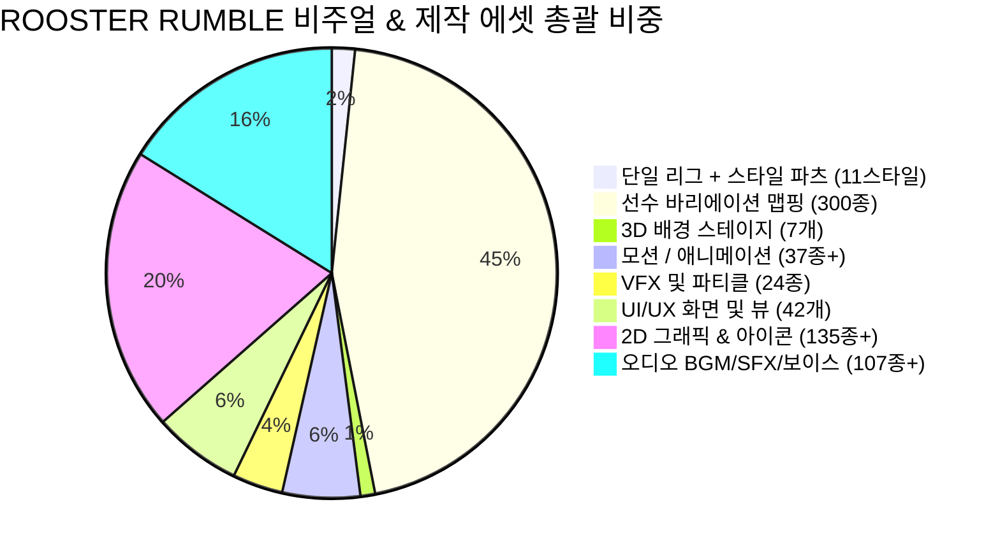
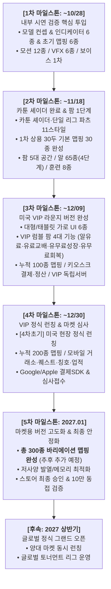

# 🐓 ROOSTER RUMBLE: 전 모드 구성 요소(비주얼 에셋 포함) 볼륨 산정 및 마일스톤 배분 명세서

* **문서 버전**: `v1.2.0`
* **작성 일자**: 2026-11-24
* **문서 성격**: ROOSTER RUMBLE 프로젝트 전 모드(경주·격투·농장·VIP라운지·온라인 마켓)의 모든 세부 구성 요소, 3D 모델(단일 기본 리그 + 등급별 외형 파츠 및 **바리에이션용 텍스처 맵핑 300종** 포함), 모션/애니메이션, VFX 파티클, UI/UX 화면, 오디오, 마스터 데이터 및 시스템 볼륨을 정량적으로 체크 및 픽스(Fix)하고, 3주 단위 마일스톤(1차~후속)과 1:1 매핑한 공식 기준 볼륨 산정서

---

### ■ 문서 개정 이력 (Revision History)

| 버전 (Version) | 개정일 (Date) | 주요 개정 내역 및 상세 변경 사항 | 관련 절 바로가기 |
| :---: | :---: | :--- | :--- |
| **v1.0.0** | 2026-10-15 | 전 모드 3D 모델, 모션, VFX, UI, 오디오, 시스템 정량 볼륨 전수 체크/픽스 및 3주 단위 마일스톤 1:1 투입 배분표 최초 수립 | [[#1-개요-및-볼륨-산정-기준\|1~4절 전면]] |
| **v1.1.0** | 2026-10-15 | 기본 선수 모델링(11종 베이스 메쉬) 기반 텍스처 바리에이션용 맵핑 수량 **'총 300종 (추후 추가 예정)'** 정량 적시 및 3주 단위 마일스톤 단계별(1차 6종 ➔ 2차 30종 ➔ 3차 100종 ➔ 4차 200종 ➔ 5차 300종) 투입 배분 로드맵 수립 | [[#12-볼륨-분류-체계-7대-영역\|1~4절 전면]] |
| **v1.2.0** | 2026-11-24 | **[VIP 라운지 럼블 팜 4대 기능 통합 및 v1.5.0 단일 기준선 정합]** 3D 단일 기본 리그+3단계 외형 파츠, 럼블 팜 5대 공간 표준명, 알 65종 4등급(`Natural 30/Superior 20/Rare 10/Legendary 5`), 팜 BGM 3곡/SFX 10종, 격투 9대 기술(`F33/F34`), VIP 라운지 럼블 팜 4대 범위(알 유료 획득·유료 교배·유/무료 성장·유/무료 회복) 동기화 | [[#23-럼블-팜-rumble-farm---육성-모드\|2.3~2.4절 VIP 팜 반영]] |

---

## 1. 개요 및 볼륨 산정 기준

### 1.1 산정 목적
* 시연 피드백 반영 과제, 미국 VIP 라운지 런칭 대응 과제(3차 완료·4차초기 런칭), 2027 상반기 양대 마켓 글로벌 정식 출시를 달성하기 위해 필요한 모든 구성 요소의 작업 볼륨(에셋 및 시스템 규모)을 명확한 수치로 정의·픽스(Fix)함.
* 제작 파이프라인(기획·아트·모션·VFX·UI·사운드·클라이언트·서버) 간 누락 및 병목 현상을 방지하고, 3주 단위 스프린트 마일스톤별 투입 목표를 체계적으로 통제하기 위함.

### 1.2 볼륨 분류 체계 (7대 영역)
1. **3D 캐릭터/환경 모델 및 맵핑 (3D Models, Mappings & Shaders)**: **단일 기본 리그(Rig) + 3단계 등급별 외형 파츠(볏·깃털·며느리발톱) + 경주 6/격투 5 스타일 실루엣 차별화**, 게이트 번호 인디케이터 부착물 6종, **선수 바리에이션용 텍스처 맵핑 총 300종 (추후 추가 예정)**, 경기장 및 농장 3D 스테이지 7개소.
2. **모션/애니메이션 (Animations & Motions)**: 주행 모션, 조류 6대 보법, 9대 전투 기술(공4+방3+특수2 `F33/F34`), 피격/그로기/넉다운·즉시 KO 다운 분리, 실무 가공 클립 5종, 팜 인터랙션 모션 클립.
3. **VFX 및 파티클 (VFX & Visual Effects)**: 타격 섬광, 스파크, 스피드라인, 환경 파티클, 렌즈 혈흔, 특수 슬램 지면 충격, 연출 그래픽 FX.
4. **UI/UX 화면 및 2D 에셋 (UI Screens & 2D Graphics)**: 인게임 HUD, 대형 스크린/태블릿/키오스크 전용 화면(VIP 럼블 팜 4대 기능 포함), 알 가차 65종(4단계 등급), 칭호/업적/상태 배지.
5. **오디오 (Audio & Voice)**: BGM 8곡(팜 3곡 포함), 효과음(SFX), 상황 반응형 아나운서 및 캐릭터 보이스 풀.
6. **마스터 데이터 (Master Data Tables)**: 65종 알, 30두 선수 스탯, 24시간 타임 스케줄, 경제/확률 밸런스 테이블, 4대 연출 CSV(`Proto_Editor`).
7. **엔진 및 시스템 (Engine & Architecture)**: 대전 시뮬레이터, 결정론적 경주 물리, 오프라인 VIP 독립 서버(경주·격투 + VIP 럼블 팜 4대 기능), 인앱결제/스토어 승인 인프라.

---

## 2. 모드별 구성 요소 상세 볼륨 명세표

### 2.1 더비 레이스 (Derby Race - 경주 모드)
| 대분류 | 세부 구성 항목 | 확정 볼륨 (Fix) | 상세 규격 및 작업 스펙 | 마일스톤 배분 |
| :--- | :--- | :---: | :--- | :---: |
| **3D 모델** | 단일 리그 기반 주행 스타일 외형 파츠 | **6종 스타일** | 도주, 선행, 선입, 추입, 자재, 변칙 6종 스타일별 파츠(볏·깃털·발톱) 차별화 | 1차 컨셉 확정 ➔ 2차 최종 완료 |
| | 게이트 번호 인디케이터 | **6종** | 1~6번 게이트 고유 컬러 및 번호판 머리 위 3D 부착물 에셋 | 1차 완료 |
| | 선수 바리에이션용 맵핑 | **총 300종** | 단일 리그 기반 깃털 무늬, 컬러 패턴, 품종 스킨 맵핑 (추후 추가 예정) | 1차 6종 ➔ 2차 30종 ➔ 3차 100종 ➔ 4차 200종 ➔ 5차 300종 |
| | 카툰 셰이더 머티리얼 | **1종** | 아케이드 툰 셰이딩, 외곽선(Outline), 림라이트, 채도 보정 셰이더 | 2차 완료 |
| | 트랙 및 스타트/골인 아레나 | **1종** | 타원형 오벌 트랙, 6구 스타트 게이트, 피니쉬 아치, 우승 단상, 관중석 | 2차 완료 |
| **모션** | 게이트 대기 모션 | **3종** | 발구르기, 날개털기, 고개짓 등 출발 카운트다운 랜덤 대기 모션 클립 | 1차 완료 |
| | 질주 모션 튜닝 | **2종** | 기본 질주 템포 +30% 가속 모션, 라스트 스퍼트 강풍 날개짓 파워 모션 (`07_Run_22f`) | 1차 완료 |
| | 피니쉬 및 세리머니 | **2종** | 결승 통과 후 감속 런다운 모션 1종, 1위 완주 닭 단상 도약/날개 펼침 세리머니 1종 | 1차 기획 ➔ 2차 본연동 |
| **VFX** | 속도감 및 주행 파티클 | **2종** | 측면 가속 스피드 라인 FX, 발굽 지면 흙먼지 킥(Kick Dust) 파티클 | 1차 완료 |
| | 환경 변수 연출 | **3종** | 트랙 비(Rain) 파티클, 바람-낙엽 흩날림 파티클, 지면 열기 아지랑이 셰이더 FX | 1차 연출 ➔ 2차 물리 결합 |
| | 레이스 스타트/피니쉬 FX | **2종** | 출발 0초 볼드 "START" 팝업, 1위 결승 통과 "FINISH!" 팡파레 축하 버스트 FX | 1차 완료 |
| **UI/UX** | 레이스 카메라 워킹 | **3종** | 기본 쿼터뷰 트랙 카메라, 다이내믹 박력 추적 카메라, 결승 통과 클로즈업 카메라 | 1차 3종 ➔ 2차 2종 옵션화 |
| | 1초 슬로우 리플레이 | **1종** | 결승 1초 전후 다이내믹 앵글 슬로우 모션 리플레이 및 [Skip] 인터랙션 | 1차 기획 ➔ 2차 구현 |
| | 레이스 인게임 HUD | **4종** | 상단 실시간 순위 바, 미니맵 트랙 진행 인디케이터, 배당률 표출창, 결과창 | 1차 완료 |
| **사운드** | 레이스 SFX | **12종** | 카운트다운 비프(2회), GO 비프, 출발 신호총, 발자국 흙길/잔디 루프, 날개 퍼덕임 등 | 1차 완료 |
| | 상황 반응형 아나운서 | **25종** | 연결 호흡 분할 파이프라인(독립 10+초반 11+중반 10 등) 동적 보이스 풀 | 1차 기초 ➔ 2차 확장 |
| | BGM | **3곡** | 경기 대기 룸 BGM, 박진감 질주 BGM, 라스트 스퍼트 BGM | 1차 완료 |

---

### 2.2 럼블 핏 (Rumble Pit - 격투 모드)
| 대분류 | 세부 구성 항목 | 확정 볼륨 (Fix) | 상세 규격 및 작업 스펙 | 마일스톤 배분 |
| :--- | :--- | :---: | :--- | :---: |
| **3D 모델** | 단일 리그 기반 5대 파이터 파츠 | **5종 스타일** | 단일 기본 리그(Rig) + 3단계 등급별 파츠 기반 인파이터/아웃파이터/브롤러/테크니션/밸런서 | 1차 2종(베이스) ➔ 2차 5종 완성 |
| | 원형 벽면 아레나 (10m) | **1종** | 직경 10m 목재/철망 구조 원형 투계장, 흙바닥 링 텍스처, 원형 펜스 벽면 | 1차 배치 ➔ 2차 완성 |
| **모션** | 조류 6대 이동 보법 | **6종** | 전진 총총, 짧은 뒤로 홉, 목 빼고 질주 대시, 날개 퍼덕 후방 이탈, 측면 사이드 홉, 원형 탐색 걸음 | 1차 연동 완료 |
| | 비의인화 9대 전투 기술 | **9종** | [공격4] 부리 속사, 낮은 발톱 할퀴기, 비상 발톱 급습, 광폭 발버둥 난타 / [방어3] 버티기, 엎드리기, 맞발톱 쳐내기 / **[특수2] 머리 잡아 바닥 찍기(`F33`), 머리 풀고 반격하기(`F34`)** | 1차 클립 ➔ 2~3차 시뮬 완성 |
| | 피격·넉다운 및 KO 분리 모션 | **4종** | 강타 피격 단발, 스탠딩 그로기, **일반 넉다운(`15_Down_Land_30f`, 2초 기상)**, **즉시 KO 다운(`13_Down_Land_60f`)** | 1차 연동 ➔ 3차 분리 완료 |
| | 실무 가공 5종 & 격돌/벽면 충돌 | **7종** | 실무 5종(`08_atk`, `09_Mirror`, `11_x2`, `12_crit`, `16_crit`), 동시 격돌(`Clash`), 벽면 충돌(`Wall Impact`) | 2~3차 완료 |
| **VFX** | 아케이드 타격 & 슬램 FX | **4종** | 부리 스파크, 발톱 슬래시, 날개 난타 충격파, **`F33` 머리 찍기 지면 흙먼지 폭발** | 1~3차 완료 |
| | 크리티컬 렌즈 혈흔 FX | **1종** | 치명타 적중 시 화면 렌즈에 붉은 핏방울 일시 표출 후 0.8초 내 페이드아웃 | 1차 완료 |
| | 벽면 충돌 및 방어 FX | **2종** | 벽면 충돌 파편 흙먼지 FX, 깃털 부풀려 가드 시 깃털 흩날림 파티클 | 2차 완료 |
| **UI/UX** | 격투 관전 카메라 | **1종** | 두 선수 간 거리 비례 객관적 스포츠 중계 카메라 + `F_SLAM_CLOSE` 로우앵글 연동 | 1차 완료 |
| | 대전 인게임 HUD | **4종** | 좌우 2두 체력 게이지(HP Bar), 배당률 표시창, 라운드/타이머 표출창, 대전 결과 모달 | 1차 완료 |
| | 대전 시각 연출 그래픽 | **2종** | 라운드 시작 볼드 `"FIGHT!"` 표출, 승패 판정 센터 볼드 `"KO"` 그래픽 표출 | 1차 완료 |
| **사운드** | 격투 타격/피격·특수 SFX | **16종** | 부리 타격, 발톱 슬래시, 날개 강타, **특공 바닥 찍기(`SFX_PIT_SLAM`), 잡기 반격(`SFX_PIT_BREAK`)** 등 | 1~3차 완료 |
| | 타종 및 관중 SFX | **4종** | 단독 타종 징소리, KO 연속 타종 벨소리(`SFX_PIT_KO_BELL`), 관중 함성/탄식 | 1차 완료 |
| | 보이스 및 BGM | **3종** | 라운드 개시 보이스("First Round... FIGHT!"), 대전 긴장 BGM, KO 승리 팡파레 | 1차 완료 |
| **엔진** | 대전 시뮬레이터 | **1모듈** | 4대 순환 상성, 콤보 캔슬, 상성 역습 및 다운/KO 분리를 관장하는 전용 시뮬레이터 | 1차 기초 ➔ 2차 고도화 |

---

### 2.3 럼블 팜 (Rumble Farm - 육성 모드)
| 대분류 | 세부 구성 항목 | 확정 볼륨 (Fix) | 상세 규격 및 작업 스펙 | 마일스톤 배분 |
| :--- | :--- | :---: | :--- | :---: |
| **2.5D 에셋** | 메인 팜 5대 핵심 공간 | **5종** | **부화 온실(`Hatchery Greenhouse`), 개화 훈련장(`Training Field`), 선수 닭장 & 힐링 스파(`Coop & Healing Spa`), 혈통 교배소(`Breeding Pen`), 관리동 & 파머스 마켓(`Farm House & Market`)** | 2차 1단계 완성 |
| | 농장 배경/지형 에셋 | **1세트** | 2.5D 아이소메트릭 파스텔톤 타일맵, 울타리, 잔디, 조경 오브젝트 세트 | 2차 완성 |
| | 8종 훈련 기구 오브젝트 | **8종** | 고속 트랙, 타이어, 모래언덕, 통나무, 과녁, 깃털 방어대, 외나무 균형대, 진흙탕 | 2차 완성 |
| **2D 에셋** | 알 가차 2D 그래픽 | **65종** | **4단계 등급**: 무료 일반(`Natural` 30종), 유료 1단계(`Superior` 20종), 유료 2단계(`Rare` 10종), 유료 3단계(`Legendary` 5종) + 교배 혈통 알(`Heritage`) | 2차 완성 |
| | 상태 머신 배지 아이콘 | **10종** | 알 보관, 부화 진행, 부화 완료, 대기, 훈련, 출전, 피로, 부상, 스파, 교배잠금/쿨다운/은퇴 | 2차 완성 |
| | 칭호 / 업적 / 퀘스트 아이콘 *(모바일 전용)* | **33종** | 칭호 20종, 영구 업적 8종 트로피, 일일(5종)/주간(4종) 퀘스트 인디케이터 *(VIP 제외)* | 4차 3단계 완성 |
| **모션** | 닭 캐릭터 팜 자율 배회 | **4종** | 모이 쪼기, 꼬꼬댁 고개짓, 흙목욕 털기, 횟대 낮잠 자율 모션 | 2차 완성 |
| | 8종 훈련 인터랙션 모션 | **8종** | 8개 기구별 특화 운동 모션 (트랙 질주, 통나무 타격, 균형대 중심잡기 등) | 2차 완성 |
| | 치료 및 휴식 모션 | **2종** | 스파 온천 배스 모션, 부상 붕대 감기 치료 모션 | 2차 완성 |
| **VFX** | 알 부화 연출 파티클 | **3종** | 알 흔들림/금가기, 등급별(일반/희귀/전설) 부화 폭발 광원 버스트 FX | 2차 완성 |
| | 훈련/스파/교배 파티클 | **4종** | 스탯 성장 스파클 FX, 훈련 땀방울 파티클, 스파 온천김·하트 힐링/교배 FX | 2차 완성 |
| **UI/UX** | 농장 관리 HUD 및 모달 | **14화면** | 메인 팜 뷰포트, 인큐베이터 슬롯(2~4), 10초 미니게임, 유/무료 훈련, 육각 스탯 차트, 닭장·스파 회복, 유료 교배창, 유료 가차(35종) *(VIP 4대 기능 포함)* + 거래소·퀘스트·업적·칭호 *(모바일 전용)* | 2차~4차 단계별 완성 |
| **사운드** | 팜 전용 효과음 (`SFX-Farm`) | **10종** | 알 터치, 껍질 크랙, 부화 성공, 병아리 울음, 수탉 기상, 트랙·통나무·타이어 훈련 3종, 온천 물소리, 회복 챠임 | 2차 완성 |
| | 팜 배경음악 (`BGM`) | **3곡** | `BGM_LOBBY_01`(아침 농장), `BGM_TRAIN_02`(훈련장/미니게임), `BGM_MARKET_03`(알 상점/거래소) | 2차 완성 |
| **데이터** | 마스터 데이터 세트 | **4종** | 알 65종 가차 마스터, 8종 훈련 성장 테이블, 10대 상태 머신, 2세대 단일 유전 공식표 | 2차~3차 완성 |

---

### 2.4 미국 VIP 라운지 (현장 상용화 모드)
| 대분류 | 세부 구성 항목 | 확정 볼륨 (Fix) | 상세 규격 및 작업 스펙 | 마일스톤 배분 |
| :--- | :--- | :---: | :--- | :---: |
| **현장 UI** | 16:9 대형 스크린 관전 뷰 | **2화면** | 라운지 메인 관전 디스플레이 1080p/4K 전광판 UI (더비 중계 뷰, 피트 중계 뷰) | 3차 완성 |
| | 좌석 태블릿 가로 전용 UI | **4화면** | 실시간 베팅 슬립, 경기 관전, 정산창 + **VIP 럼블 팜 4대 기능 통합 가로 대시보드** | 3차 완성 |
| | 키오스크 결제/정산 UI | **2화면** | 현금/카드/VIP 멤버십 크레딧 충전 화면, 당첨 티켓 바코드 스캔 및 즉시 출금 화면 | 3차 완성 |
| **VIP 럼블 팜** | **① 알 유료 획득** | **35종 풀** | VIP 크레딧/Gem 유료 알 35종(`Superior`/`Rare`/`Legendary`, 10연 전설 천장) 전용 *(무료 알/거래소 제외)* | 3차 완성 |
| **(4대 기능 한정)**| **② 유료 교배** | **1모듈** | VIP 크레딧/Gem 결제 전용 2세대 혈통 교배 (`ROOSTER`+`HEN`, 생애 5회 한도, 24h 쿨다운) | 3차 완성 |
| | **③ 유/무료 성장** | **2트랙** | 무료(일반 대기 부화·10초 미니게임·일반 8종 훈련) + 유료(0초 즉시 부화·급속 부스트 훈련) 병행 | 3차 완성 |
| | **④ 유/무료 회복** | **2트랙** | 무료(일반 닭장 시간당 -10, 영양 사료 10개 -20) + 유료(프리미엄 스파 즉시 완충·완치) *(광고 제외)* | 3차 완성 |
| **서버/인프라**| 오프라인 로컬 독립 서버 | **1시스템** | 현장 폐쇄망 로컬 독립 DB(`VIP Lounge Local DB`), 온·오프라인 계정/재화 100% 분리 운영 | 3차 준비 ➔ 4차 런칭 |
| | 통신 장애 대비 자동 페일오버 | **1시스템** | 단말기-키오스크 간 오프라인 로컬 캐시 및 통신 단절 시 데이터 무결성 보존 모듈 | 3차 완성 |

---

### 2.5 온라인 양대 마켓 및 공통 시스템 (Global Launch & Common Ecosystem)
| 대분류 | 세부 구성 항목 | 확정 볼륨 (Fix) | 상세 규격 및 작업 스펙 | 마일스톤 배분 |
| :--- | :--- | :---: | :--- | :---: |
| **스토어 SDK**| 결제 및 플랫폼 연동 | **2종** | Google Play Billing 및 Apple In-App Purchase 모듈 연동 및 서버 영수증 검증 | 4차 심사 접수 |
| | 규정 준수 및 법적 고지 | **3화면** | IARC 연령등급 표시, 글로벌 개인정보처리방침 팝업, 서비스 이용약관 동의 모달 | 4차 접수 ➔ 5차 승인 |
| **클라이언트**| 모바일 디바이스 최적화 | **1세트** | 안드로이드 저사양 발열/메모리 누수 차단, 16:9~21:9 반응형 뷰포트 레이아웃 최적화 | 5차 완료 |
| | 자동 세션 복구 및 치팅 방지 | **2모듈** | 네트워크 단절 시 무중단 자동 재접속, 메모리 변조/위변조 방지 안티치트 모듈 | 4차~5차 완성 |
| **글로벌 인프라**| 10만 동접 클라우드 오토스케일링| **1시스템** | 글로벌 다중 리전 분산 서버, DB 커넥션 풀 최적화, 10만 동접 부하 스트레스 검증 | 5차 완료 |
| | 글로벌 토너먼트 리그 시스템 | **1시스템** | 글로벌 실시간 랭킹전, 시즌별 토너먼트 대진표 자동 생성 및 칭호 보상 배포 모듈 | 후속 런칭 |

---

## 3. 총괄 볼륨 집계 및 에셋 매트릭스 (Asset Matrix)

전체 프로젝트에서 제작 및 관리되는 핵심 자산의 총 수량은 다음과 같이 집계·픽스(Fix)됨.

### ■ 총괄 에셋 수량 픽스 요약표
| 제작 영역 | 세부 항목 수량 | 단위 | 볼륨 픽스 상태 (Fix Status) | 비고 |
| :--- | :---: | :---: | :---: | :--- |
| **3D 캐릭터 모델 (단일 리그+파츠)** | **단일 리그 + 11스타일** | 종 | **FIXED** | 단일 기본 리그(Rig) + 3단계 등급별 파츠 + 경주 6/격투 5 스타일 차별화 |
| **선수 바리에이션용 맵핑** | **300** | 종 | **FIXED** | **총 300개의 텍스처/컬러 맵핑 바리에이션 (추후 추가 예정)** |
| **3D 캐릭터 부착물 에셋** | **6** | 종 | **FIXED** | 1~6번 게이트 고유 번호판 인디케이터 머리 위 부착물 |
| **3D 경기장/배경 스테이지** | **7** | 개소 | **FIXED** | 더비 트랙(1), 핏 아레나(1), 팜 5대 공간(부화 온실/훈련장/닭장·스파/교배소/관리동·마켓) |
| **모션 / 애니메이션 클립** | **37+** | 종 | **FIXED** | 경주(7종) + 격투(18종, 실무 5종 포함) + 팜 자율/훈련/스파(12종+) |
| **VFX 및 파티클 이펙트** | **24** | 종 | **FIXED** | 경주(7종) + 격투(7종) + 팜 및 연출(10종) |
| **UI 화면 및 모달 패널** | **42** | 개 | **FIXED** | 경주(6) + 격투(6) + 팜(14) + VIP현장(8: VIP 팜 4대 기능 포함) + 스토어/공통(8) |
| **2D 아이콘 및 그래픽 에셋** | **135+** | 종 | **FIXED** | 알 65종(4단계), 훈련 8종, 상태 10종, 칭호 20종, 업적 8종, 퀘스트 9종, 전투기술 9종 등 |
| **BGM 음원** | **8** | 곡 | **FIXED** | 로비/팜(1), 훈련장(1), 알 상점/거래소(1), 경주(3), 격투(1), 우승 팡파레(1) |
| **효과음 (SFX)** | **54** | 종 | **FIXED** | 경주(12종) + 격투(20종) + 팜(10종)/공통 UI(12종) |
| **음성 보이스 클립** | **45+** | 종 | **FIXED** | 아나운서 중계(25종+) + 격투 콜(10종) + 닭 울음소리(10종) |
| **마스터 데이터 테이블** | **6** | 세트 | **FIXED** | 알 65종, 30두 스탯, 24시간 스케줄, 훈련/유전, 경제 밸런스, 4대 연출 CSV |
| **핵심 엔진 & 서버 시스템** | **5** | 대모듈 | **FIXED** | 경주 물리, 핏 시뮬레이터, 팜 유전, VIP 폐쇄서버(4대 팜 포함), 10만 동접 인프라 |

---

## 4. 차수별(1차~후속) 마일스톤 투입 볼륨 픽스 배분표

각 마일스톤에 배정된 실제 개발 및 에셋 투입 볼륨의 1:1 매핑 명세표는 다음과 같음.

### ■ 마일스톤별 상세 투입 에셋 및 개발 태스크 매핑표

| 마일스톤 | 기간 | 확정 투입 볼륨 (Fixed Deliverables) | 중점 관리 지표 및 산출물 규격 |
| :---: | :---: | :--- | :--- |
| **1차** | `10/12 ~ 10/28` (17일간) | • **3D 모델 & 맵핑**: 캐릭터/배경 비주얼 컨셉 확정, 게이트 번호 인디케이터 **6종** 부착, 격투 베이스 모델 **2종** 준비, 초기 기본 맵핑 **6종** 적용 • **모션**: 스타트 대기 모션 **3종**, 가속 질주 모션, 조류 6대 이동 보법 **6종**, 7대 전투 기술 클립 **7종**, 그로기/다운 모션 **2종** • **VFX**: 스피드라인, 흙먼지 킥, START 플래시, 피니쉬 표출, 타격 섬광 스파크, 렌즈 혈흔 FX (**6종**) • **UI/카메라**: 중계 카메라 워킹 **3종** 랜덤 적용, 결승 1초 슬로우 리플레이 기획, 피니시 3단계 기획 수립 • **사운드**: 상황 반응형 아나운서 보이스 구조(R-12), 라운드 타종 징소리, KO 연속 벨소리(`SFX_PIT_KO_BELL`) • **시스템**: 대전 시뮬레이터 기초 프레임워크 구축 착수 | 10/28 내부 시연용 상용화 수준 경주/격투 1차 빌드 무결성 확보 |
| **2차** | `10/29 ~ 11/18` (21일간) | • **3D 모델 & 맵핑**: **3D 카툰 셰이더 및 단일 기본 리그+등급별 파츠 완료**, 트랙/배경 3D 모델링 확정, 경주 6/격투 5 스타일 분기, 1차 상용 30두 닭 기본 맵핑 **30종** 완성 • **배경/공간**: 직경 10m 원형 투계장 아레나 완성, 메인 팜 **5대 핵심 공간** 2.5D 에셋 배치, 훈련 기구 **8종** 배치 • **2D/에셋**: 알 가차 **65종(4단계)** 마스터 연동, 닭 10대 상태 머신 배지 **10종** • **모션**: 팜 자율 배회 모션 **4종**, 훈련 기구 인터랙션 모션 **8종**, 스파 휴식 모션 **2종**, 우승 세리머니 단상 도약 본 연동 • **VFX/연출**: 환경 변수 트랙 주행 물리 결합(비/바람/아지랑이), 알 부화 광원 버스트 FX **3종**, 훈련/스파 파티클 **4종** • **엔진/시스템**: 대전 시뮬레이터 상성/격돌 완성, 팜 1차 피지컬 6대 스탯 생성 로직 탑재 • **VIP 1차 빌드**: 미국 VIP 라운지 1차 시연 빌드 패키징 및 키오스크 정산 플로우 프로토타입 검증 | 카툰 셰이더 및 배경 100% 안착 & VIP 1차 시연 & 팜 1단계 릴리즈 |
| **3차** | `11/19 ~ 12/09` (21일간) | • **VIP 라운지 완성**: 현장 대형 스크린(16:9) 관전 뷰 UI **2종**, 좌석 태블릿 가로 전용 UI **4종**, 키오스크 충전/정산 UI **2종** 완성 • **선수 맵핑 확장**: VIP 전용 고등급 알 부화 닭 및 2세대 유료 교배 파생 바리에이션 등 누적 **100종** 맵핑 연동 • **VIP 전용 럼블 팜 (4대 기능 한정)**: ① **알 유료 획득**(유료 35종 가차/10연 천장), ② **유료 교배**(VIP 크레딧 전용 2세대 교배), ③ **유/무료 성장**(대기·10초 미니게임·일반 훈련 vs 0초 즉시 부화·급속 훈련), ④ **유/무료 회복**(닭장·사료 vs 프리미엄 스파) • **환류 & 전투/교배**: 경기 출전 환류 루프(피로도/부상/쿨다운), 2차 파생 스탯 및 **9대 전투 기술(공4+방3+특수2 `F33/F34`)** 개화/장착·일반 넉다운/즉시 KO 분리 완성, 2세대 단일 유전 공식 탑재 • **오프라인 인프라**: 현장 폐쇄망 로컬 독립 DB 구축, 온·오프라인 계정 분리 운영 검증, 자동 페일오버 완비, 현장 런칭 최종 리허설 | 미국 VIP 라운지 상용 버전 개발 완료 (경주·격투 + VIP 럼블 팜 4대 기능) |
| **4차** | `12/10 ~ 12/30` (21일간) | • **[4차초기] 미국 VIP 라운지 현장 정식 런칭 및 운영 개시** (12월 중순 현장 오픈, 라이브 관전/베팅/키오스크 정산/VIP 농장 4대 기능 가동) • **선수 맵핑 확장**: 알 가차(65종) 닭 품종 파생 및 거래소 대응 누적 **200종** 맵핑 연동 • **양대 마켓 런칭 준비**: Google Play / Apple App Store 결제(IAP) SDK 연동, IARC 연령등급 표시, 약관/보안 모듈, 스토어 심사 접수 완료 • **팜 3단계 생태계 (모바일 풀버전)**: 유저 간 알 거래소(8% 수수료, `[큰손]` 7%), 칭호 **20종**, 영구 업적 **8종**, 일일/주간 퀘스트 **9종**, 3스탬프 무료 알 연동 • **소프트 런칭**: 특정 국가 시범 소프트 런칭/CBT 운영 개시 및 경기/육성 실데이터 1차 수집 | 미국 VIP 현장 정식 라이브 오픈 & 양대 마켓 심사 접수 & 소프트런칭 |
| **5차** | `01/02 ~ 01/22` (21일간) | • **바리에이션 맵핑 300종 완성**: 글로벌 정식 출시 대비 **총 300종 텍스처/컬러 바리에이션 맵핑 100% 완성 및 리소스 최적화 (추후 추가 예정)** • **밸런스 고도화**: 소프트런칭/CBT 유저 실데이터 기반 배당률 알고리즘 및 닭 AI 난이도 튜닝, 인게임 이코노미 Sink & Source 최적화 • **모바일 최적화**: 저사양 기기 발열 완화, 메모리 누수 원천 차단, 다양한 화면비 반응형 렌더링 최적화 • **스토어 승인**: Google Play 및 Apple App Store 심사 피드백 대응 완료 및 최종 스토어 승인 확보 • **서버 안정화**: 글로벌 런칭 대비 10만 동접 클라우드 오토스케일링 부하 스트레스 검증 완료 | 마켓용 버전 고도화 완료 & 300종 맵핑 완비 & 스토어 최종 승인 |
| **후속** | `2027 상반기` | • **글로벌 그랜드 오픈**: 양대 마켓 글로벌 전 권역 동시 정식 출시 • **글로벌 라이브 운영 & 추가 바리에이션**: 정규 글로벌 토너먼트 리그 가동, 시즌제 랭킹전, 시즌별 신규 닭 바리에이션 맵핑 지속 추가 확장 | ROOSTER RUMBLE 글로벌 서비스 성공 안착 |

---

## 5. 결론 및 향후 관리 수칙

1. **볼륨 통제의 일관성 유지**:
   - 본 문서에 정의된 3D 모델(단일 기본 리그 + 3단계 등급별 외형 파츠, **바리에이션용 맵핑 300종**, 인디케이터 부착물 6종), 모션(37종+), VFX(24종), UI(42화면), 2D 에셋(135종+), 오디오(107종+)의 정량 수치는 프로젝트의 공식 기준선(Baseline)임.
   - 기본 단일 리그에 적용되는 바리에이션용 맵핑은 1차~5차에 걸쳐 300종까지 단계적으로 구축하며, 런칭 이후 라이브 서비스 시즌에 따라 추가 확장함.
   - 향후 기획 변경 시 임의 에셋 추가를 지양하고, 본 볼륨 명세서 및 마일스톤 계획서의 개정 절차를 거쳐 체계적으로 통제함.
2. **마일스톤 문서 연계 최신화**:
   - 본 볼륨 산정 결과는 기존 메인 마일스톤 계획서([`ROOSTER_RUMBLE_경주_격투_개선_요소_및_마일스톤.md`](file:///d:/OneDrive/%EC%97%85%EB%AC%B4_%EC%A7%84%ED%96%89/C/ROOSTER%20RUMBLE/ROOSTER_RUMBLE_%EA%B2%BD%EC%A3%BC_%EA%B2%A9%ED%88%AC_%EA%B0%9C%EC%84%A0_%EC%9A%94%EC%86%8C_%EB%B0%8F_%EB%A7%88%EC%9D%BC%EC%8A%A4%ED%86%A4.md) 및 [`.html`](file:///d:/OneDrive/%EC%97%85%EB%AC%B4_%EC%A7%84%ED%96%89/C/ROOSTER%20RUMBLE/ROOSTER_RUMBLE_%EA%B2%BD%EC%A3%BC_%EA%B2%A9%ED%88%AC_%EA%B0%9C%EC%84%A0_%EC%9A%94%EC%86%8C_%EB%B0%8F_%EB%A7%88%EC%9D%BC%EC%8A%A4%ED%86%A4.html))의 제6절로 통합 반영되어 관리됨.

