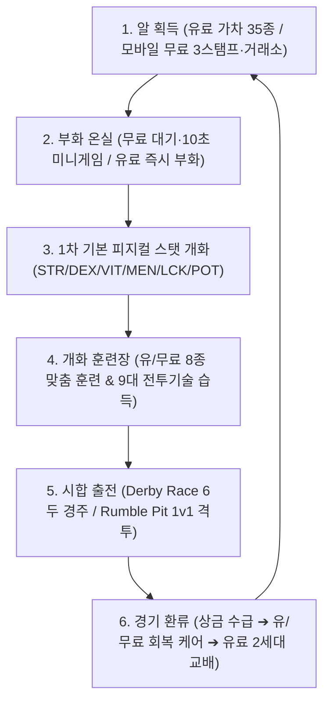
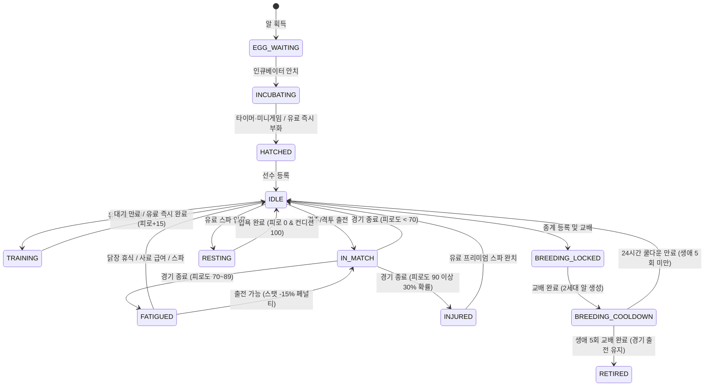

# 🐓 ROOSTER RUMBLE: Rumble Farm (육성 모드) - MVP 세부 기획 구성안

---

* **문서 정체성**: <ROOSTER RUMBLE> 3대 코어 모드 중 육성 전초기지인 **럼블 팜(Rumble Farm)**의 단독 자립형 실무 기획 명세서
* **문서 상태**: MVP 정식 개발 규격서
* **문서 버전**: v1.5.0
* **최종 개정일**: 2026-11-24
* **연계 모드**: 더비 레이스(Derby Race - 경주), 럼블 핏(Rumble Pit - 격투)
* **작성 원칙**: 불필요한 수식어 배제 및 100% 개조식 기술 사양 명세

---

### ■ 문서 개정 이력 (Revision History)

| 버전 (Version) | 개정일 (Date) | 주요 개정 내역 및 상세 변경 사항 | 관련 절 바로가기 |
| :---: | :---: | :--- | :--- |
| **v0.0.1** | 2026-08-11 | 통합 MVP 구성안 내 럼블 팜(육성 모드) 개요 및 기본 범위 최초 기획 | [[#1.1 프로젝트 개요 및 럼블 팜(Rumble Farm) 핵심 컨셉\|1.1절 개요 및 컨셉]] |
| **v0.1.0** | 2026-08-11 | 알 65종 가차 마스터 구조 및 등급별 부화 시간, 잠재력 범위 수치 정의 | [[#2.3 알 뽑기(가차) 65종 마스터 구조, 등급별 확률 및 천장(Pity) 시스템\|2.3절 알 가차 시스템]] |
| **v0.2.0** | 2026-08-13 | 1차 기본 피지컬 스탯(Common Core 6종) 분배식 및 부화 터치 미니게임 가속률 정립 | [[#3.3 부화 시 등급별 1차 기본 스탯 초기 생성 분배식 및 잠재력(POT) 롤링 메커니즘\|3.3절 1차 스탯 생성식]] |
| **v0.3.0** | 2026-08-27 | 닭 캐릭터 10대 상태 머신 전이 규칙 및 유저 간 알 거래소(5% 수수료) 명세 구축 | [[#4.1 닭 캐릭터 10대 상태 머신 전이 규칙\|4.1절 10대 상태 머신]] |
| **v0.4.0** | 2026-08-27 | 훈련 종목 8종(피지컬/경주/격투) 스탯 상승식 및 2차 파생 스탯 연동 프로세스 확립 | [[#5.1 훈련 종목 8종 소모 재화, 대기시간 및 스탯 상승률\|5.1절 훈련 시스템]] |
| **v0.5.0** | 2026-08-27 | 2세대 교배 유전 공식(스탯/잠재력 상속 및 생애 5회 제한), 칭호 20종 마스터 수록 | [[#6.2 부모 스탯 기반 2세대 기본 스탯/잠재력 유전 공식\|6.2절 교배 유전 공식]] |
| **v0.6.0** | 2026-08-27 | 일일 퀘스트 5종, 주간 퀘스트 4종, 영구 누적 업적 8종 및 논리 DB 스키마 7종 수록 | [[#7.2 일일 퀘스트 5종 및 주간 퀘스트 4종 명세표\|7.2절 퀘스트 명세표]] |
| **v0.7.0** | 2026-08-27 | 럼블 팜 전용 오디오 규격 신설 (BGM 2종, SFX-Farm 10종 및 이벤트 매핑 완비) | [[#9.3 럼블 팜 전용 배경음악(BGM) 3종 및 효과음(SFX-Farm) 10종 명세표\|9.3절 팜 효과음 명세]] |
| **v0.8.0** | 2026-08-31 | 기획서 경계 정상화: 공간 레이아웃 5대 영역 정의 및 온보딩 튜토리얼 동선 정제 | [[#9.1 메인 팜 5대 핵심 공간 레이아웃\|9.1절 팜 공간 레이아웃]] |
| **v0.8.1** | 2026-09-01 | 재화 순환 경제 모델(Sink & Source) 수치 정합 및 출석/광고 3스탬프 무료 알 수급 일원화 | [[#2.2 출석/광고 기반 통합 무료 알 수집 체계\|2.2절 무료 알 수집]] |
| **v0.8.2** | 2026-09-04 | 경기 출전 피로도(+25), 부상(30%), 쿨다운(30분) ➔ 팜 복귀 닭장 휴식/스파 치료 환류 메커니즘 동기화 | [[#4.2 경기(Derby/Pit) 출전 후 피로도 적재(+25), 부상 판정(30%) 및 30분 쿨다운 환류 규칙\|4.2절 경기 출전 환류]] |
| **v0.9.0** | 2026-09-07 | 럼블 핏 연계: 훈련을 통한 7대 전문 전투 기술 습득 및 선수 등급별 슬롯(2~5개) 장착 규격 신설 | [[#5.3 훈련 스탯 상승의 격투 2차 파생 스탯 및 9대 전투 기술 개화/습득 연동\|5.3절 전투 기술 연동]] |
| **v0.9.1** | 2026-09-18 | **[단독 분리 신규 작성]** 통합 MVP 구성안에서 럼블 팜 육성 모드 명세를 전면 독립화하여 완전 자립형 단독 실무 기획서 구축 (3대 모드 연관관계 100% 무결 보존) | [[#1. 게임 개요 및 핵심 루프 (Game Overview & Core Loop)\|1장 게임 개요]] |
| **v1.2.0** | 2026-10-08 | **[럼블 핏 v1.2.0 정합성 동기화]** 비의인화 투계 7대 전투 기술 명칭(`깃털 부풀려 버티기`, `낮은 발톱 할퀴기`, `비상 발톱 급습`, `맞발톱 쳐내기`), 원형 아레나 규격 및 노그로기 칭호 조건 동기화 | [[#5.3 훈련 스탯 상승의 격투 2차 파생 스탯 및 9대 전투 기술 개화/습득 연동\|5.3절 전투 기술 연동]] |
| **v1.5.0** | 2026-11-24 | **[VIP 라운지 4대 육성 기능 반영 및 통합 MVP v1.5.0 전면 동기화]** 1. **VIP 라운지 서비스 동시 제공 범위 확정**: 알 유료 획득, 유료 교배, 유/무료 성장(일반 대기·미니게임·훈련 vs 즉시 부화·급속 훈련), 유/무료 회복(닭장·사료 vs 프리미엄 스파) 4대 기능 반영 및 무료 알/광고/거래소/퀘스트·칭호·업적 제외 명세 2. **수치·공식 단일화**: 알 가차 65종 CSV 가중치(`70/20/8/2%`, 유료 `66.7/26.7/6.6%`), 8종 훈련 1차 스탯, 2차 파생 스탯 공식, 2세대 교배 공식(`90% ± 난수`, `Max*1.05`, 외형 `40/40/20%`) 통합 MVP와 100% 정합 3. **최신 격투/3D 규격 및 기술 명세 통일**: 9대 전투 기술(기본 7대 + 특수 2종 `F33/F34`), 단일 기본 리그+3단계 외형 파츠, `t_*` 논리 DB 및 `/api/v1/farm/*` API·`farm:*` WS, 5대 공간 표준명·BGM 3곡/SFX 10종 통일 | • [[#1.2 모바일 vs 자체 온라인 웹 vs 미국 VIP 라운지 서비스 비교\|1.2절 VIP 4대 범위]] • [[#5.3 훈련 스탯 상승의 격투 2차 파생 스탯 및 9대 전투 기술 개화/습득 연동\|5.3절 9대 기술 연동]] • [[#6.2 부모 스탯 기반 2세대 기본 스탯/잠재력 유전 공식\|6.2절 단일 교배 공식]] • [[#8. 데이터베이스 논리 스키마 및 통신 API 규격 (Database & API Specification)\|8장 DB/API 통일]] |

#### ■ 연동 마스터 데이터 CSV 파일
* **03. 선수 1차 피지컬 스탯 (30두)**: [03_roosters_base_stats_1st.csv](03_roosters_base_stats_1st.csv)
* **04. 선수 2차 경주 스탯 (30두)**: [04_roosters_derby_stats_2nd.csv](04_roosters_derby_stats_2nd.csv)
* **05. 선수 2차 격투 스탯 (30두)**: [05_roosters_pit_stats_2nd.csv](05_roosters_pit_stats_2nd.csv)
* **06. 알 가차 마스터 데이터 (65종)**: [06_egg_gacha_master_list_65.csv](06_egg_gacha_master_list_65.csv)

---

## 목차
1. [[#1. 게임 개요 및 핵심 루프 (Game Overview & Core Loop)]]
   - [[#1.1 프로젝트 개요 및 럼블 팜(Rumble Farm) 핵심 컨셉]]
   - [[#1.2 모바일 vs 자체 온라인 웹 vs 미국 VIP 라운지 서비스 비교]]
   - [[#1.3 럼블 팜 6단계 코어 플레이 루프 & 플로우차트]]
2. [[#2. 알 획득, 거래소 및 가차 시스템 (Egg Acquisition & Economy)]]
   - [[#2.1 유저 간 알 거래소 (Egg Marketplace) 거래/수수료(8%) 규칙]]
   - [[#2.2 출석/광고 기반 통합 무료 알 수집 체계]]
   - [[#2.3 알 뽑기(가차) 65종 마스터 구조, 등급별 확률 및 천장(Pity) 시스템]]
   - [[#2.4 연동 마스터 데이터 (06_egg_gacha_master_list_65.csv)]]
3. [[#3. 알 부화 및 1차 기본 피지컬 스탯 생성 시스템 (Incubation & Base Stats)]]
   - [[#3.1 등급별 부화 대기시간 및 터치 미니게임(부화 가속)·유료 즉시 부화 규칙]]
   - [[#3.2 1차 기본 피지컬 스탯 (Common Core 6종) 정의]]
   - [[#3.3 부화 시 등급별 1차 기본 스탯 초기 생성 분배식 및 잠재력(POT) 롤링 메커니즘]]
4. [[#4. 닭 캐릭터 10대 상태 머신 및 라이프사이클 관리 (Lifecycle & Status)]]
   - [[#4.1 닭 캐릭터 10대 상태 머신 전이 규칙]]
   - [[#4.2 경기(Derby/Pit) 출전 후 피로도 적재(+25), 부상 판정(30%) 및 30분 쿨다운 환류 규칙]]
   - [[#4.3 닭장 휴식, 영양 사료 급여 및 수의사 치료를 통한 상태 회복 프로세스]]
5. [[#5. 훈련 시스템 및 타 모드(Derby/Pit) 파생 스탯 연동 (Training & Mode Linking)]]
   - [[#5.1 훈련 종목 8종 소모 재화, 대기시간 및 스탯 상승률]]
   - [[#5.2 훈련 스탯 상승의 경주 2차 파생 스탯 연동 공식]]
   - [[#5.3 훈련 스탯 상승의 격투 2차 파생 스탯 및 9대 전투 기술 개화/습득 연동]]
6. [[#6. 2세대 교배 시스템 및 유전 메커니즘 (Breeding & Genetics)]]
   - [[#6.1 교배 자격 요건, 비용 및 생애 5회 교배 한도 제약]]
   - [[#6.2 부모 스탯 기반 2세대 기본 스탯/잠재력 유전 공식]]
   - [[#6.3 외형(스킨/색상) 및 패시브 특성 유전 확률표]]
7. [[#7. 칭호, 퀘스트 및 영구 업적 시스템 (Titles & Achievements)]]
   - [[#7.1 칭호(Title) 4대 등급 구조 및 20종 마스터 데이터 명세표]]
   - [[#7.2 일일 퀘스트 5종 및 주간 퀘스트 4종 명세표]]
   - [[#7.3 영구 누적 업적 8종 명세표]]
8. [[#8. 데이터베이스 논리 스키마 및 통신 API 규격 (Database & API Specification)]]
   - [[#8.1 데이터베이스 분리 구성표 및 럼블 팜 핵심 엔티티 논리 스키마]]
   - [[#8.2 핵심 REST API 엔드포인트 명세 (육성 관련 13종)]]
   - [[#8.3 실시간 WebSocket 이벤트 명세 (육성 3종)]]
9. [[#9. 화면 레이아웃, UI/UX 및 사운드 연출 규격 (UI/UX & Sound Specification)]]
   - [[#9.1 메인 팜 5대 핵심 공간 레이아웃]]
   - [[#9.2 부화/훈련/교배 조작 팝업 UI/UX 인터랙션 및 오류 예외 처리]]
   - [[#9.3 럼블 팜 전용 배경음악(BGM) 3종 및 효과음(SFX-Farm) 10종 명세표]]

---

## 1. 게임 개요 및 핵심 루프 (Game Overview & Core Loop)

### 1.1 프로젝트 개요 및 럼블 팜(Rumble Farm) 핵심 컨셉
* **모드명**: Rumble Farm (럼블 팜)
* **포지셔닝**: <ROOSTER RUMBLE> 통합 생태계의 기반이 되는 선수(Rooster) 알 구매, 부화, 육성, 훈련, 혈통 관리 및 경기 스케줄링 전담 전초기지 모드
* **핵심 역할**:
  - `Derby Race` (경주 모드) 및 `Rumble Pit` (격투 모드) 출전용 고성능 선수 공급원 역할 수행
  - 유전 교배를 통한 세대 교체 및 고유 잠재력(Potential) 상한 돌파 창구 제공
  - 단기 베팅/경기의 피로감을 완화하고 장기 애착을 형성하는 캐주얼 매니지먼트 영역 담당
* **톤앤매너 및 비주얼 컨셉**:
  - 타겟층: 전연령층 누구나 직관적으로 이해 가능한 캐주얼 아케이드 농장 감성
  - 3D 모델링 아키텍처: 리깅 결함(날개 찢김) 방지를 위한 **단일 기본 리그(Rig) + 3단계 등급별 외형 파츠(볏·깃털·며느리발톱) 바리에이션 + 텍스처 맵핑 300종(추후 추가 예정)** 적용
  - 따뜻한 파스텔톤의 활기찬 농장 비주얼 및 2.5D 아이소메트릭(Isometric) 뷰 적용

### 1.2 모바일 vs 자체 온라인 웹 vs 미국 VIP 라운지 서비스 비교

| 구분 | 📱 모바일 앱 (Mobile App) | 🌐 자체 온라인 웹 (Online Web) | 🏆 미국 VIP 라운지 (Offline VIP Lounge) |
| :--- | :--- | :--- | :--- |
| **서비스 성격** | 캐주얼 육성 + 아케이드 리그 플레이 풀버전 | 라이브 중계 관전 + 실시간 베팅 + 유료 스파 케어 | 오프라인 현장 대형 전광판 관전 + 좌석 태블릿 베팅·핵심 육성 동시 서비스 |
| **알 획득 범위** | 출석/광고 3스탬프 무료 알 + 유료 가차 35종 + 유저 거래소 | 기본 온보딩 알 + 인게임 유료 구매 | **알 유료 획득 전용** (VIP 크레딧/Gem 유료 가차 35종 및 10연 천장, 무료 알·거래소 제외) |
| **성장/부화 범위** | 무료 대기·10초 미니게임·일반 8종 훈련 + 유료 가속 지원 | 원격 스탯 조회 및 육성 연계 | **유/무료 성장 동시 지원** (무료 일반 부화·10초 미니게임·일반 훈련 + 유료 0초 즉시 부화·급속 훈련) |
| **회복/케어 범위** | 닭장 휴식(무료) · 사료 급여 · 광고 회복(-20) · 유료 스파 | 닭장 휴식(무료) vs 유료 프리미엄 스파 | **유/무료 회복 동시 지원** (무료 닭장 휴식·영양 사료 급여 + 유료 프리미엄 스파; 광고 회복 제외) |
| **교배/메타 범위** | 교배 토큰+골드/유료 교배, 거래소(8%), 퀘스트/업적/칭호 20종 | 유저 간 거래 비활성화 (초기 버전) | **유료 교배 전용** (VIP 크레딧/Gem 결제 2세대 교배만 제공; 거래소/경매·분양/퀘스트·업적·칭호 제외) |
| **데이터베이스** | `Mobile App DB` (독립 DB) | `Online Web DB` (독립 DB) | `VIP Lounge Local DB` (**온·오프라인 계정/재화/선수 100% 물리 분리 운영**) |

#### ■ 미국 VIP 라운지 내 럼블 팜 적용 범위 매트릭스 (4대 허용 vs 미반영 항목)
* **VIP 라운지 동시 서비스 원칙**: 경주(`Derby Race`)·격투(`Rumble Pit`) 현장 관전/베팅과 함께 좌석 태블릿에서 **럼블 팜 핵심 육성 4대 기능**을 동시 서비스하며, 온·오프라인 계정 및 크레딧은 일체 상호 연동하지 않음

| 구분 | 세부 기능 항목 | VIP 라운지 반영 여부 | 운영 및 과금 정책 명세 |
| :---: | :--- | :---: | :--- |
| **① 알 유료 획득** | 유료 알 가차 35종 (`Superior`/`Rare`/`Legendary`) | **반영 (유료 전용)** | VIP 크레딧/Gem 유료 결제 전용 (10연속 뽑기 시 전설 알 100% 확정 천장 포함) |
| **② 유료 교배** | 암수 2두 2세대 혈통 교배 (`ROOSTER`+`HEN`) | **반영 (유료 전용)** | VIP 크레딧/Gem 유료 결제 전용 (생애 5회 한도, 24시간 쿨다운, 단일 유전 공식 적용) |
| **③ 유/무료 성장** | 알 부화(대기+미니게임 / 0초 즉시) & 8종 훈련(일반 / 급속) | **반영 (유/무료 병행)** | 무료(일반 대기·터치 미니게임·사료/골드 훈련) + 유료(크레딧 소모 0초 즉시 부화·급속 부스트 훈련) |
| **④ 유/무료 회복** | 닭장 자연 휴식 / 영양 사료 급여 / 프리미엄 스파 | **반영 (유/무료 병행)** | 무료(닭장 시간당 -10, 사료 10개 -20) + 유료(프리미엄 스파 피로도 0 & 부상 즉시 완치) |
| **제외 항목** | 3스탬프 무료 알, 보상형 광고 3종, 알 거래소(8%)·경매/분양, 일일/주간 퀘스트, 업적 8종, 칭호 20종, 모바일 6단계 리그 | **미반영 (모바일 전용)** | VIP 라운지 현장 태블릿 UI에서는 노출 비활성화 (모바일 스토어 앱 풀버전 전용 기능 유지) |

### 1.3 럼블 팜 6단계 코어 플레이 루프 & 플로우차트

* **순환 메커니즘**:
  1. **알 수급**: 모바일(출석/광고 3스탬프 무료 알, 유료 가차 65종 마스터, 유저 거래소) 또는 VIP 라운지(**알 유료 획득**: 유료 35종 가차/천장)를 통해 알 확보
  2. **부화 및 개화**: 인큐베이터 안치 후 무료 대기(터치 미니게임 10초로 최대 20% 단축) 또는 유료 즉시 부화(0초 완료), 1차 피지컬 6대 스탯 및 외형 파츠 롤링
  3. **유/무료 맞춤 훈련**: 경주 특화(3종)·격투 특화(4종)·공통(1종) 총 8종 훈련을 무료(일반 대기) 또는 유료(급속 부스트 0초)로 수행하여 1차/2차 스탯 성장 및 격투 9대 기술 개화
  4. **시합 출전**: 더비 레이스 6두 달리기 또는 럼블 핏 1대1 원형 아레나 시합 참전
  5. **유/무료 회복 케어**: 경기 결과 상금 수령 후 누적 피로도(+25) 및 부상(30%) 발생 시 무료(닭장 휴식·영양 사료) 또는 유료(프리미엄 스파)로 치유
  6. **유료 세대 교체**: 생애 5회 한도 내에서 우수 암수 혈통 간 2세대 교배(VIP는 **유료 교배 전용**)를 통해 잠재력 상한 돌파 2세대 알 생산

---

## 2. 알 획득, 거래소 및 가차 시스템 (Egg Acquisition & Economy)

### 2.1 유저 간 알 거래소 (Egg Marketplace) 거래/수수료(8%) 규칙 *(모바일 앱 전용)*
* **적용 플랫폼**: 모바일 스토어 앱 전용 (**VIP 라운지 및 초기 온라인 웹 미지원**)
* **거래 대상**: 유저가 보유한 미부화 알 (`Natural`, `Superior`, `Rare`, `Legendary`, `Heritage` 교배 알)
* **거래 화폐**: 인게임 골드(Gold)
* **거래 수수료 체계**:
  - 판매 등록 수수료: 무료
  - 거래 체결 수수료: **8.0%** (구매자 지불 골드 중 8% 시스템 회수 후 판매자에게 92% 정산 지급)
  - 칭호 혜택 연동: `[큰손]` 칭호 장착 시 거래 수수료 8% ➔ **7%** 인하 적용
* **유찰 및 등록 만료 규칙**:
  - 매매 등록 후 **72시간** 미거래 시 자동 등록 취소 및 소유주 보관함 복귀
  - 최대 동시 등록 슬롯: 기본 3개 (VIP 등급에 따라 최대 5개 확장)

### 2.2 출석/광고 기반 통합 무료 알 수집 체계 *(모바일 앱 전용)*
* **적용 플랫폼**: 모바일 스토어 앱 전용 (**VIP 라운지 제외**)
* **단일 통합 3스탬프 게이지 (3/3) 시스템**:
  - 복잡한 알 파편 수집 방식 배제, 단일 직관 게이지 운용
  - **수집 수단 A (출석 체크)**: 매일 최초 로그인 시 **스탬프 1개** 자동 적립
  - **수집 수단 B (보상형 광고)**: 광고 1회 시청 시 **스탬프 1개** 추가 적립 (광고 시청 1회당 **5분 쿨다운**, 일일 최대 **2회** 시청 제한)
  - **무료 알 지급**: 출석 1개 + 광고 2개 합산 스탬프 3개 달성 즉시 무료 일반 알(`Natural Egg`, `EGG-NAT-001~030` 30종 중 1종 균등 추첨) 1개 인벤토리 지급 및 게이지 리셋

| 광고 종목 | 일일 시청 제한 | 쿨다운 대기시간 | 보상 및 기능 명세 | VIP 라운지 적용 |
| :---: | :---: | :---: | :--- | :---: |
| **무료 알 스탬프 광고** | 하루 최대 2회 | **5분 (300초)** | 1회 시청 시 통합 수집 라인 **스탬프 1개** 적립 (총 3개 달성 시 무료 알 지급) | **제외** |
| **경기 상금 2배 광고** | 경기 우승 시 팝업 | 즉시 시청 | 우승 상금 Gold 200% 증액 정산 | **제외** |
| **피로도 회복 광고** | 하루 최대 3회 | **10분 (600초)** | 1회 시청 시 참전 닭 피로도 **-20** 즉시 회복 | **제외** |

### 2.3 알 뽑기(가차) 65종 마스터 구조, 등급별 확률 및 천장(Pity) 시스템
* **마스터 데이터 기준**: [06_egg_gacha_master_list_65.csv](06_egg_gacha_master_list_65.csv) 4단계 65종 기준 단일화

| 구분 | 마스터 수량 | CSV 전체 드롭 가중치 | 유료 가차 풀 비중 (VIP/유료 35종) | 수급 경로 및 가격 (모바일 / VIP) | 기본 부화 시간 | 잠재력(POT) 범위 |
| :---: | :---: | :---: | :---: | :--- | :---: | :---: |
| **무료 일반 (`Natural`)** | 30종 (`EGG-NAT-001~030`) | **70.0%** | *(VIP 라운지 제외)* | 모바일 출석/광고 3스탬프 무료 | 10분 (600초) | 30 ~ 45 |
| **유료 1단계 (`Superior`)** | 20종 (`EGG-PAID1-001~020`) | **20.0%** | **66.7%** | 30 Gem / 3,000 Gold *(VIP 유료 크레딧)* | 1시간 (3,600초) | 46 ~ 60 |
| **유료 2단계 (`Rare`)** | 10종 (`EGG-PAID2-001~010`) | **8.0%** | **26.7%** | 100 Gem / 10,000 Gold *(VIP 유료 크레딧)* | 4시간 (14,400초) | 61 ~ 80 |
| **유료 3단계 (`Legendary`)** | 5종 (`EGG-PAID3-001~005`) | **2.0%** | **6.6%** | 300 Gem *(VIP 유료 크레딧, 10연 천장 확정)* | 12시간 (43,200초) | 81 ~ 100 |

* **가차 천장 규칙 (Pity System — 모바일·VIP 라운지 공통)**:
  - 유료 뽑기 1회 시마다 천장 카운트 `+1` 누적
  - 9회 연속 전설 알 미등장 시 **10회차 뽑기에서 유료 3단계(`Legendary`) 알 100% 확정 지급**
  - 전설 알 획득 시 즉시 천장 카운트 0 초기화
* **알 식별자 표준 명명 체계**: `EGG-[TIER_CODE]-[INDEX:03d]` 규격 준수 (`NAT`, `PAID1`, `PAID2`, `PAID3`)

### 2.4 연동 마스터 데이터 (06_egg_gacha_master_list_65.csv)
* **마스터 데이터 파일**: [06_egg_gacha_master_list_65.csv](06_egg_gacha_master_list_65.csv)
* **주요 스키마**: `알 ID (Egg ID)`, `알 이름 (Egg Name)`, `알 등급 (Tier)`, `등급 코드 (Tier Code)`, `구매 가격 (Price)`, `잠재력 범위 (Potential Cap)`, `부화 시간초 (Hatch Sec)`, `드롭 가중치 (Weight %)`, `부화 특징 명세 (Note)`

---

## 3. 알 부화 및 1차 기본 피지컬 스탯 생성 시스템 (Incubation & Base Stats)

### 3.1 등급별 부화 대기시간 및 터치 미니게임(부화 가속)·유료 즉시 부화 규칙
* **부화 슬롯 규격**: 기본 2개 무료 제공, 최대 4개 슬롯 확장 가능 (Gem 또는 VIP 크레딧 소모)
* **유/무료 성장 지원 (부화 트랙 — 모바일·VIP 라운지 공통)**:
  1. **무료 부화 가속 (10초 터치 미니게임)**:
     - 발동 조건: 인큐베이터 안치 후 부화 잔여 시간 50% 경과 시 알 껍질 흔들림 이펙트 및 미니게임 팝업 노출 (알당 1회)
     - 진행 방식: 10초간 화면 지정 4개 구역에 무작위 출현하는 타깃 탭(Tap) 연타
     - 판정 및 단축 수치:
       - **S등급 (15회 이상 탭 성공)**: 잔여 부화 대기시간 **`20%`** 즉시 단축
       - **A등급 (10~14회 탭 성공)**: 잔여 부화 대기시간 **`12%`** 즉시 단축
       - **B등급 (5~9회 탭 성공)**: 잔여 부화 대기시간 **`5%`** 즉시 단축
       - **C등급 (4회 이하 실패)**: 단축 없음
  2. **유료 즉시 부화 (`Fast-Hatch`, 0초 완료)**:
     - 인큐베이터 안치 중 잔여 시간에 비례한 Gem 또는 VIP 크레딧 결제 시 **대기시간 0초 즉시 부화 완료(`HATCHED`)** 전환

### 3.2 1차 기본 피지컬 스탯 (Common Core 6종) 정의

| 스탯명 | 영문 코드 | 밸런스 범위 | 육성 모드 내 역할 및 타 모드 파생 연동 영향 |
| :--- | :---: | :---: | :--- |
| **힘 (Strength)** | `STR` | 10 ~ 100 | 골격/근력 척도. 격투 `POW`·`DEF`·`HP` 주력 및 경주 `SPD`·`TMP` 반영 |
| **민첩 (Dexterity)** | `DEX` | 10 ~ 100 | 순발력/반응 척도. 경주 `SPD`·`STA`·`FOC` 주력 및 격투 `DEF`·`TEC`·`POW` 반영 |
| **활력 (Vitality)** | `VIT` | 10 ~ 100 | 체력/지구력 척도. 격투 `HP`·`REC`·`GRT` 주력 및 경주 `STM`·`GUT` 반영 |
| **정신력 (Mentality)** | `MEN` | 10 ~ 100 | 멘탈/집중 척도. 경주 `FOC`·`GUT`·`STM`·`TMP` 주력 및 격투 `GRT`·`REC`·`TEC` 반영 |
| **행운 (Luck)** | `LCK` | 10 ~ 100 | 운/기회포착 척도. 경주 `TMP`·`STA` 주력 및 훈련 대성공·변이 보정 반영 |
| **잠재력 (Potential)** | `POT` | 30 ~ 100 | 성장 상한선 척도. 1차 기본 5대 스탯 상한 제어 및 2차 파생 스탯 전반(계수 0.1~0.3 / HP×2) 반영 |

### 3.3 부화 시 등급별 1차 기본 스탯 초기 생성 분배식 및 잠재력(POT) 롤링 메커니즘

1. **잠재력(POT) 결정 연산식**:
   $$\text{잠재력(POT)} = \text{RandomInteger}(\text{Min\_POT}, \;\; \text{Max\_POT})$$
   * **[연산식 설명]**: 알 등급별 정의된 잠재력 범위(`[Min_POT, Max_POT]`) 내 균등 정수 난수 추출 확정

2. **1차 기본 5대 스탯 초기 생성 분배 공식**:
   $$\text{스탯}_i = \text{Clamp}\left(\text{반올림}\left(\text{잠재력(POT)} \times 0.65\right) + \text{난수}(-3, +3), \;\; 10, \;\; \text{잠재력(POT)}\right)$$
   * **[연산식 설명]**: 잠재력(`POT`)의 65%를 기준값으로 설정하고, 5개 스탯(`STR`, `DEX`, `VIT`, `MEN`, `LCK`) 각각에 독립 난수(`-3 ~ +3`) 합산 후 최소 10에서 잠재력 상한선 사이로 제한 (성별 `ROOSTER`/`HEN` 각 50% 확률 부여)
   * **[계산 예시 (잠재력 POT 60 알 부화 시)]**:
     - 기준 스탯값: $60 \times 0.65 = 39$
     - `STR` 난수 `+2` 발생 시: $39 + 2 = \mathbf{41\text{ STR}}$ 산출
     - `DEX` 난수 `-1` 발생 시: $39 - 1 = \mathbf{38\text{ DEX}}$ 산출
     - `VIT`, `MEN`, `LCK`도 동일 독립 난수 합산 적용
   * **[계산 예시 (상한 고정)]**: 잠재력 `POT 30` 알에서 기준값 `20`에 난수가 가산되어 상한을 넘거나 연산값이 `32`로 산출 시 잠재력 상한선 **`30`**으로 강제 보정

---

## 4. 닭 캐릭터 10대 상태 머신 및 라이프사이클 관리 (Lifecycle & Status)

### 4.1 닭 캐릭터 10대 상태 머신 전이 규칙

#### ■ 10대 상태 코드 상세 명세표

| 상태 코드 | 상태 명칭 | 출전 | 훈련 | 스파 | 발생 조건 | 상태 해제 및 복귀 조건 |
| :---: | :--- | :---: | :---: | :---: | :--- | :--- |
| `EGG_WAITING` | 알 보관 | X | X | X | 유료 가차/교배/거래소/무료 스탬프 획득 | 인큐베이터 안치 시 `INCUBATING` 전환 |
| `INCUBATING` | 부화 진행 | X | X | X | 인큐베이터 안치 | 타이머·미니게임 또는 유료 즉시 부화 시 `HATCHED` 전환 |
| `HATCHED` | 부화 완료 | X | X | X | 부화 완료 | 선수 등록 버튼 클릭 시 `IDLE` 전환 |
| `IDLE` | 기본 대기 | O | O | O | 기본 상태 | 훈련 시 `TRAINING`, 출전 시 `IN_MATCH`, 교배 시 `BREEDING_LOCKED` 전환 |
| `TRAINING` | 훈련 진행 | X | X | X | 유/무료 훈련 실행 | 대기 만료 또는 유료 즉시 완료 시 스탯 상승 및 피로도 `+15` 적재 후 `IDLE` 복귀 |
| `IN_MATCH` | 경기 참전 | X | X | X | 경주/격투 출전 | 경기 종료 시 피로도 `+25` 적재 후 `IDLE`/`FATIGUED`/`INJURED` 판정 |
| `FATIGUED` | 피로 누적 | O (스탯-15%) | O | O | 피로도 70 이상 누적 | 닭장 휴식(시간당 -10), 사료(-20), 스파 입욕 시 `IDLE` 복귀 |
| `INJURED` | 부상 상태 | X | X | O (유료) | 피로도 90 이상 출전 시 30% 확률 | 유료 프리미엄 스파 이용 시 즉시 완치 후 `IDLE` 복귀 (닭장 치료 불가) |
| `RESTING` | 스파 입욕 | X | X | X | 유료 프리미엄 스파 결제 | 입욕 완료 즉시 피로도 0 완충 및 24시간 컨디션 100 부여 후 `IDLE` 복귀 |
| `BREEDING_LOCKED` | 씨닭 지정 / 은퇴(`RETIRED`) | X (종계중) / O (은퇴후) | X / O | X / O | 종계 등록 또는 5회 교배 완료 | 교배 실행 시 `BREEDING_COOLDOWN` 전환, 5회 도달 시 영구 교배 은퇴(`RETIRED`) |
| `BREEDING_COOLDOWN` | 교배 휴식 | O | O | O | 교배 완료 | 24시간 경과 시 재교배 잠금 해제 후 `IDLE` 복귀 |

### 4.2 경기(Derby/Pit) 출전 후 피로도 적재(+25), 부상 판정(30%) 및 30분 쿨다운 환류 규칙
* **경기 출전 환류 규칙 (모바일·VIP 라운지 공통)**:
  - 더비 레이스 또는 럼블 핏 경기 1회 출전 완료 시 피로도 **`+25`** 즉시 적재 (최대 100 상한)
  - 럼블 핏 격투 경기 출전 시 경기 종료 후 **30분간 동일 닭 출전 쿨다운 잠금**, 더비 레이스 출전 시 **2개 레이스(40분간) 참전 쿨다운 잠금** 발동
* **부상 발생 조건**:
  - 피로도 **`90`** 이상 누적 상태에서 무리하게 출전 시 **`30.0%`** 난수 확률로 **부상(`INJURED`)** 상태 전이
  - 부상 닭은 모든 경주/격투 경기 출전 및 훈련 전면 불가
* **피로도 페널티**:
  - 피로도 70~89 구간(`FATIGUED`): 경기 출전 시 경기 중 전 스탯 **`-15%` 페널티** 적용

### 4.3 닭장 휴식, 영양 사료 급여 및 수의사 치료를 통한 상태 회복 프로세스

| 구분 | 구분(과금) | 적용 플랫폼 | 소모 재화 | 피로도 회복 속도 | 컨디션 지수 변화 | 부상 치유 여부 |
| :---: | :---: | :---: | :---: | :---: | :---: | :---: |
| **일반 닭장 휴식** | **무료 회복** | 모바일 / 웹 / **VIP 라운지** | 무료 | **시간당 `-10`** 자동 감소 | '보통' (50~70) 유지 | **불가 (부상 치유 불가)** |
| **영양 사료 급여** | **무료 회복** | 모바일 / **VIP 라운지** | 사료 10개 | 즉시 **`-20`** 회복 (일일 3회 제한) | 컨디션 `+10` ('좋음' 70~85) 상승 | **불가** |
| **피로도 회복 광고** | 광고 보상 | 모바일 전용 (**VIP 제외**) | 보상형 광고 (쿨다운 10분) | 즉시 **`-20`** 회복 (일일 3회 제한) | 현재 컨디션 유지 | **불가** |
| **프리미엄 스파 (수의사)** | **유료 회복** | 모바일 / 웹 / **VIP 라운지** | 50 Gem 또는 5,000 Gold *(VIP 크레딧)* | **즉시 `0` 완충** | **24시간 동안 '최상(100)' 고정** | **즉시 완치 (`IDLE` 전환)** |

---

## 5. 훈련 시스템 및 타 모드(Derby/Pit) 파생 스탯 연동 (Training & Mode Linking)

### 5.1 훈련 종목 8종 소모 재화, 대기시간 및 스탯 상승률
* **유/무료 성장 옵션 (모바일·VIP 라운지 공통)**:
  - **무료(일반) 훈련**: 아래 표의 사료 + 골드를 소모하고 15~30분 훈련 대기시간 경과 후 완료 (완료 시 피로도 `+15` 적재)
  - **유료(급속) 부스트 훈련**: VIP 크레딧 또는 Gem 추가 결제 시 **대기시간 0초 즉시 완료** 및 **유료 부스트 보너스 `+2` 추가 상승** 적용

| 훈련 종목명 | 타깃 연계 모드 | 주력 상승 1차 스탯 | 소모 사료 | 소모 골드 | 무료 훈련 시간 | 유료 즉시 옵션 | 기본 스탯 상승량 |
| :---: | :---: | :---: | :---: | :---: | :---: | :---: | :---: |
| **고속 트랙 주행** | Derby Race | 민첩 (`DEX`) / 최고속도 | 10개 | 1,000 Gold | 15분 | 0초 완료 (+2) | DEX `+3 ~ +5` |
| **타이어 튀기기** | Derby Race | 민첩·행운 (`DEX·LCK`) / 가속 | 10개 | 1,000 Gold | 15분 | 0초 완료 (+2) | DEX·LCK `+3 ~ +5` |
| **모래언덕 오르기** | Derby Race | 활력·정신력 (`VIT·MEN`) / 지구력·근성 | 12개 | 1,200 Gold | 20분 | 0초 완료 (+2) | VIT·MEN `+3 ~ +5` |
| **통나무 타격하기** | Rumble Pit | 힘 (`STR`) / 공격력(`POW`) | 10개 | 1,000 Gold | 15분 | 0초 완료 (+2) | STR `+3 ~ +5` |
| **과녁 정밀 타격** | Rumble Pit | 민첩·정신력 (`DEX·MEN`) / 기술(`TEC`) | 12개 | 1,200 Gold | 20분 | 0초 완료 (+2) | DEX·MEN `+3 ~ +5` |
| **깃털 부풀려 버티기 수련** | Rumble Pit | 민첩·힘 (`DEX·STR`) / 방어(`DEF`) | 10개 | 1,000 Gold | 15분 | 0초 완료 (+2) | DEX·STR `+3 ~ +5` |
| **외나무 밸런스 균형대** | Rumble Pit | 정신력·활력 (`MEN·VIT`) / 근성(`GRT`) | 15개 | 1,500 Gold | 30분 | 0초 완료 (+2) | MEN·VIT `+4 ~ +6` |
| **진흙탕 극기 훈련** | 공통 피지컬 | 활력·행운 (`VIT·LCK`) | 15개 | 1,500 Gold | 30분 | 0초 완료 (+2) | VIT `+2`, LCK `+3` |

* **훈련 스탯 상승 연산식**:
  $$\text{상승 스탯} = \text{반올림}\left(\text{기본 상승량} \times \text{컨디션 계수}\right) + \text{유료 부스트 보너스}(0\text{ 또는 }2)$$
  - **[연산식 설명]**: 훈련 기본 상승량에 컨디션 계수(최상 `1.2`, 양호 `1.0`, 보통 `0.9`, 저조 `0.7`)를 곱해 반올림하고 유료 급속 훈련 시 `+2` 가산
  - **[계산 예시]**: 기본 상승량 `+5`, 컨디션 최상(`1.2`), 일반 무료 훈련 시: $\text{반올림}(5 \times 1.2) = \mathbf{+6}$ 상승 (유료 급속 훈련 시 $+8$ 산출)
* **잠재력(POT) 상한 제어 공식**:
  $$\text{최종 스탯} = \text{최솟값}\left(\text{현재 스탯} + \text{상승 스탯}, \;\; \text{잠재력(POT) 상한}\right)$$
  - **[연산식 설명]**: 타고난 잠재력 상한선을 초과하여 성장 불가 (잠재력 상한 돌파는 2세대 교배로만 가능)
  - **[계산 예시]**: 현재 `DEX 60`, 상승 `+6`, 잠재력 `POT 64` 기준: $60 + 6 = 66$이나 상한선 제어로 `+4`만 적용되어 최종 **`64`** 확정

### 5.2 훈련 스탯 상승의 경주 2차 파생 스탯 연동 공식
* 럼블 팜 1차 피지컬 스탯 상승 즉시 [04_roosters_derby_stats_2nd.csv](04_roosters_derby_stats_2nd.csv) 규격의 더비 레이스 6대 2차 스탯 자동 재연산 반영:
  1. **속도 (`SPD`)**: $\text{반올림}(\text{DEX} \times 0.5 + \text{STR} \times 0.3 + \text{POT} \times 0.2) + \text{Speed\_Bias}$
  2. **출발 (`STA`)**: $\text{반올림}(\text{DEX} \times 0.7 + \text{LCK} \times 0.2 + \text{POT} \times 0.1) + \text{Start\_Bias}$
  3. **지구력 (`STM`)**: $\text{반올림}(\text{VIT} \times 0.6 + \text{MEN} \times 0.2 + \text{POT} \times 0.2) + \text{Stamina\_Bias}$
  4. **집중력 (`FOC`)**: $\text{반올림}(\text{MEN} \times 0.5 + \text{DEX} \times 0.3 + \text{POT} \times 0.2) + \text{Focus\_Bias}$
  5. **기질 (`TMP`)**: $\text{반올림}(\text{LCK} \times 0.6 + \text{MEN} \times 0.2 + \text{STR} \times 0.2) + \text{Temper\_Bias}$
  6. **근성 (`GUT`)**: $\text{반올림}(\text{MEN} \times 0.5 + \text{VIT} \times 0.3 + \text{POT} \times 0.2) + \text{Guts\_Bias}$

### 5.3 훈련 스탯 상승의 격투 2차 파생 스탯 및 9대 전투 기술 개화/습득 연동
* 럼블 팜 1차 피지컬 스탯 상승 즉시 [05_roosters_pit_stats_2nd.csv](05_roosters_pit_stats_2nd.csv) 규격의 럼블 핏 6대 2차 스탯 자동 재연산 반영:
  1. **공격력 (`POW`)**: $\text{반올림}(\text{STR} \times 0.6 + \text{DEX} \times 0.2 + \text{POT} \times 0.2) + \text{POW\_Bias}$
  2. **방어력 (`DEF`)**: $\text{반올림}(\text{DEX} \times 0.5 + \text{STR} \times 0.3 + \text{POT} \times 0.2) + \text{DEF\_Bias}$
  3. **최대 체력 (`HP`)**: $\text{반올림}(\text{VIT} \times 10 + \text{STR} \times 2 + \text{POT} \times 2) + \text{HP\_Bias}$
  4. **회복력 (`REC`)**: $\text{반올림}(\text{VIT} \times 0.5 + \text{MEN} \times 0.3 + \text{POT} \times 0.2) + \text{REC\_Bias}$
  5. **기술력 (`TEC`)**: $\text{반올림}(\text{DEX} \times 0.4 + \text{MEN} \times 0.3 + \text{POT} \times 0.3) + \text{TEC\_Bias}$
     - 기력 호흡 정돈 쿨다운 연동: $\text{호흡 정돈 쿨다운(초)} = \max\left(1.5 - \left(\frac{\text{TEC}}{100}\right) \times 0.5, \;\; 1.0\right)$
  6. **근성 (`GRT`)**: $\text{반올림}(\text{MEN} \times 0.6 + \text{VIT} \times 0.2 + \text{POT} \times 0.2) + \text{GRT\_Bias}$
* **비의인화 9대 전투 기술 개화 및 4대 상성·슬롯 연동 (`통합 MVP v1.4.0` 기준)**:
  - **기술 풀 (총 9종)**: 기본 공격 4종(`[공1] 전진 부리 속사`, `[공2] 낮은 발톱 할퀴기`, `[공3] 비상 발톱 급습`, `[공4] 광폭 발버둥 난타`) + 기본 방어 3종(`[방1] 깃털 부풀려 버티기`, `[방2] 납작 엎드리기`, `[방3] 맞발톱 쳐내기`) + **특수 액션 2종(`[특공] 머리 잡아 바닥 찍기 (F33)`, `[특방] 머리 풀고 반격하기 (F34)`)**
  - **4대 가위바위보 순환 상성**: `[타격(공1/공2) ➔ 가드(방1) ➔ 잡기([특공] F33) ➔ 반격([특방] F34) ➔ 타격]` 순환 상성 및 피격자 잔여 HP별 3대 후속 플로우(HP=0 즉시 KO `13_Down_Land_60f` / HP<20% 그로기 / HP≥20% 일반 넉다운 `15_Down_Land_30f` 후 2초 기상) 연계
  - **훈련 개화 매핑**: 훈련 누적 완수 시 연관 기술 확률 개화 (예: 통나무 타격 ➔ `[공2:낮은 발톱 할퀴기]`/`[특공:머리 잡아 바닥 찍기 F33]`, 과녁 정밀 ➔ `[공3:비상 발톱 급습]`/`[특방:머리 풀고 반격하기 F34]`, 깃털 수련 ➔ `[방1:깃털 부풀려 버티기]`, 외나무 ➔ `[방3:맞발톱 쳐내기]`)
  - **슬롯 장착 및 외형 파츠**: 선수 등급별 슬롯(일반 2개, 희귀 3개, 영웅 4개, 전설 5개) 내 자유 장착 및 단일 기본 리그(Rig) 기반 3단계 등급별 외형 파츠(볏/깃털/며느리발톱) 자동 적용

---

## 6. 2세대 교배 시스템 및 유전 메커니즘 (Breeding & Genetics)

### 6.1 교배 자격 요건, 비용 및 생애 5회 교배 한도 제약
* **교배 자격 조건 (모바일·VIP 라운지 공통)**:
  - 수탉(`ROOSTER`) 1두 + 암탉(`HEN`) 1두 보유 (부화 시 각 50% 확률 성별 결정)
  - 상태: 양측 모두 정상(`IDLE`) 상태 (훈련/출전/부상/교배 쿨다운 중 불가)
  - 생애 교배 횟수: 각 닭당 **5회 미만** (`breeding_count < 5`)
* **교배 소모 비용 (유료 교배 정책)**:
  - **모바일 앱**: 교배 토큰 1개 + `5,000 Gold` 또는 유료 재화(`Gem`) 결제
  - **미국 VIP 라운지**: **유료 교배 전용** — VIP 크레딧 또는 Gem 유료 결제 전용 (무료 교배 토큰 미지원, 교배 직후 유료 0초 즉시 부화 연계 가능)
* **생애 최대 교배 횟수 상한 (Lifetime Limit)**:
  - 닭 1두당 평생 최대 **5회** 교배 가능 (`breeding_count <= 5`)
  - 교배 1회 실행 완료 시 `breeding_count += 1` 가산, `Heritage Egg`(기본 부화 2시간/7,200초) 생성 및 **24시간 재교배 쿨다운(`BREEDING_COOLDOWN`)** 발동
  - 5회 최대치 도달 시 영구 교배 은퇴(`RETIRED`) 전환 (선수 능력치 및 경주/격투 경기 출전 자격 영구 유지)

### 6.2 부모 스탯 기반 2세대 기본 스탯/잠재력 유전 공식 *(통합 MVP 단일 공식)*

1. **자손 잠재력(`POT`) 상한 유전 공식**:
   $$\text{자식 POT} = \text{Clamp}\left(\text{반올림}\left(\max(\text{부모A POT}, \;\; \text{부모B POT}) \times 1.05\right), \;\; 30, \;\; 100\right)$$
   * **[연산식 설명]**: 부모 중 더 높은 잠재력 수치에 `5%` 보너스(`1.05배`)를 곱하여 반올림한 뒤 30~100 범위로 제한
   * **[계산 예시]**: 부모A 잠재력 `70`, 부모B 잠재력 `80` 기준: $\text{반올림}(\max(70, 80) \times 1.05) = 80 \times 1.05 = \mathbf{84\text{ POT}}$ 확정

2. **자손 1차 기본 5대 스탯 (`STR/DEX/VIT/MEN/LCK`) 상속 연산식**:
   $$\text{자식 스탯}_i = \text{Clamp}\left(\text{반올림}\left(\text{부모A}_i \times 0.45 + \text{부모B}_i \times 0.45\right) + \text{난수}(-5, +10), \;\; 10, \;\; \text{자식 POT}\right)$$
   * **[연산식 설명]**: 부모 A, B 스탯의 각 45%를 합산한 90% 계승치에 `-5 ~ +10` 범위의 유전 변동 난수를 더하고, 최소 10에서 산출된 `자식 POT` 상한선 사이로 고정
   * **[계산 예시]**: 부모A 힘 `60`, 부모B 힘 `50`, 유전 난수 `+4`, `자식 POT 84` 기준: $\text{반올림}(60 \times 0.45 + 50 \times 0.45) + 4 = \text{반올림}(27 + 22.5) + 4 = 50 + 4 = \mathbf{54\text{ STR}}$ 확정

### 6.3 외형(스킨/색상) 및 패시브 특성 유전 확률표

| 구분 | 부(Father) 특성 상속 | 모(Mother) 특성 상속 | 돌연변이 / 믹스 변이 |
| :---: | :---: | :---: | :---: |
| **외형 파츠 / 텍스처 스킨** | **40.0%** | **40.0%** | **20.0%** (믹스·희귀 변이 파츠/맵핑) |
| **주행 스타일 (Derby 6종)** | **40.0%** | **40.0%** | **20.0%** (무작위 6종 스타일 변이) |
| **격투 스타일 (Pit 5종)** | **40.0%** | **40.0%** | **20.0%** (무작위 5종 스타일 변이) |
| **보유 패시브 · 전투 기술** | **50.0%** (부모 보유 기술 각 50% 독립 계승) | **50.0%** (부모 보유 기술 각 50% 독립 계승) | **15.0%** (신규 히든 변이 기술 발현) |

---

## 7. 칭호, 퀘스트 및 영구 업적 시스템 (Titles & Achievements) *(모바일 앱 전용)*

> **플랫폼 적용 구분**: 제7장(칭호 20종, 일일/주간 퀘스트, 영구 누적 업적 8종)은 **모바일 스토어 앱 풀버전 전용** 메타 리텐션 시스템이며, **미국 VIP 라운지 버전에서는 제외(미반영)** 처리됨.

### 7.1 칭호(Title) 4대 등급 구조 및 20종 마스터 데이터 명세표

| No | 칭호명 | 등급 | 카테고리 | 획득 조건 | 장착 시 패시브 효과 |
| :---: | :--- | :---: | :---: | :--- | :--- |
| **1** | **`[초보 사육사]`** | 일반 | 육성 | 최초 1마리 닭 부화 완료 | 없음 (치장용) |
| **2** | **`[부화의 달인]`** | 희귀 | 육성 | 알 누적 50회 부화 성공 | 알 부화 터치 미니게임 판정 범위 +5% |
| **3** | **`[명문 혈통]`** | 영웅 | 육성 | 2세대 교배로 잠재력 90 이상 닭 획득 | 2세대 교배 쿨다운 시간 -10% |
| **4** | **`[열혈 트레이너]`** | 희귀 | 훈련 | 훈련 누적 100회 완수 | 훈련 소모 사료(Feed) 1개 고정 할인 |
| **5** | **`[근성의 화신]`** | 영웅 | 훈련 | 단일 닭 6대 스탯 합산 400 돌파 | 모든 훈련 대기시간 -5% 단축 |
| **6** | **`[스파 VIP]`** | 희귀 | 케어 | 프리미엄 스파 누적 20회 이용 | 스파 이용 골드/젬 비용 5% 할인 |
| **7** | **`[첫 발걸음]`** | 일반 | 경주 | 더비 레이스 최초 1회 출전 | 없음 (치장용) |
| **8** | **`[광속의 질주]`** | 희귀 | 경주 | 더비 레이스 누적 50회 우승(1위) | 경주 모드 획득 상금(Gold) +3% |
| **9** | **`[추입의 마술사]`** | 영웅 | 경주 | '추입' 주행 스타일로 누적 30회 1위 | 추입 스타일 편성 시 라스트 스퍼트 +1 |
| **10**| **`[더비의 제왕]`** | **전설** | 경주 | 모바일 챔피언십 리그 주간 1위 달성 | 경주 모드 획득 상금 +5%, 프로필 특수 이펙트 |
| **11**| **`[링의 도전자]`** | 일반 | 격투 | 럼블 핏 최초 1회 출전 | 없음 (치장용) |
| **12**| **`[KO 펀처]`** | 희귀 | 격투 | 럼블 핏 1라운드 KO승 누적 20회 달성 | 격투 승리 파이트 머니 +3% |
| **13**| **`[철벽의 방패]`** | 영웅 | 격투 | 누적 100 라운드 이상 노그로기(No-Groggy) 승리 | 격투 모드 시작 시 닭 최대체력 +20 |
| **14**| **`[핏의 지배자]`** | **전설** | 격투 | 럼블 핏 누적 100승 달성 | 격투 승리 파이트 머니 +5%, 프로필 특수 이펙트 |
| **15**| **`[적중의 신]`** | 희귀 | 베팅 | 단일 경기 10.0배 이상 배당 적중 | 온라인 베팅 정산 수수료 1% 감면 |
| **16**| **`[인생 역전]`** | **전설** | 베팅 | 단일 경기 50.0배 이상 고배당 적중 | 온라인 베팅 정산 수수료 2% 감면 |
| **17**| **`[큰손]`** | 영웅 | 경제 | 유저 거래소 누적 거래액 100만 Gold 돌파 | 거래소 거래 체결 수수료 8% ➔ 7% 인하 |
| **18**| **`[성실한 농장주]`**| 희귀 | 출석 | 연속 출석 30일 달성 | 일일 출석 무료 사료 지급량 +5개 |
| **19**| **`[컬렉터]`** | 영웅 | 수집 | 65종 알 도감 중 40종 이상 등록 | 가차 뽑기 시 희귀(Rare) 이상 확률 +1% |
| **20**| **`[불멸의 럼블러]`**| **전설** | 마스터 | 1~19번 칭호 중 15개 이상 수집 완료 | 전 모드 골드 획득 +5%, 전용 골드 테두리 |

### 7.2 일일 퀘스트 5종 및 주간 퀘스트 4종 명세표

* **일일 퀘스트 (매일 00:00 KST 초기화 / 올클리어 시 보석 30 Gem + 무료 스탬프 1개 + 3,000 Gold)**:

| No | 퀘스트 명칭 | 퀘스트 목표 및 달성 조건 | 개별 지급 보상 |
| :---: | :--- | :--- | :--- |
| **D-1** | **농장 출근 도장** | 게임 로비 일일 1회 접속 | 사료(Feed) 15개 + 1,000 Gold |
| **D-2** | **체력 단련의 시간** | 닭 캐릭터 훈련 누적 3회 실행 | 사료(Feed) 20개 + 1,500 Gold |
| **D-3** | **트랙 위 질주** | 더비 레이스(경주) 누적 2회 출전 | 2,000 Gold + 10 Gem |
| **D-4** | **링 위의 결투** | 럼블 핏(격투) 누적 2회 출전 | 2,000 Gold + 10 Gem |
| **D-5** | **승부사의 촉** | 경주 또는 격투 무료 승자 예측 1회 참여 | 1,500 Gold + 사료 10개 |

* **주간 퀘스트 (매주 월요일 00:00 KST 초기화 / 완주 보너스: 고급 알 1개 + 100 Gem + 20,000 Gold)**:

| No | 퀘스트 명칭 | 퀘스트 목표 및 달성 조건 | 개별 지급 보상 |
| :---: | :--- | :--- | :--- |
| **W-1** | **엘리트 육성가** | 닭 캐릭터 훈련 누적 20회 완수 | 사료 100개 + 10,000 Gold |
| **W-2** | **더비 레이스 정복자**| 더비 레이스 1위(우승) 누적 10회 달성 | 50 Gem + 15,000 Gold |
| **W-3** | **링의 파이터** | 럼블 핏 승리 누적 10회 달성 | 50 Gem + 15,000 Gold |
| **W-4** | **알 부화 전문가** | 인큐베이터 부화 누적 5회 성공 | 고급 알(Superior) 티켓 1장 |

### 7.3 영구 누적 업적 8종 명세표

| No | 업적 명칭 | 1단계 목표 및 보상 | 2단계 목표 및 보상 | 3단계 (최종) 목표 및 보상 |
| :---: | :--- | :--- | :--- | :--- |
| **A-1** | **대규모 양계장** | 닭 5마리 보유 (5,000 G) | 닭 15마리 보유 (15,000 G + 50 Gem) | 닭 30마리 보유 (50,000 G + 200 Gem) |
| **A-2** | **황금 알의 기적** | 고급 알 1회 부화 (30 Gem) | 희귀 알 1회 부화 (100 Gem) | 전설 알 1회 부화 (500 Gem + 전설 알 1장) |
| **A-3** | **스피드 스타** | 경주 10회 우승 (10,000 G) | 경주 50회 우승 (50,000 G + 100 Gem) | 경주 200회 우승 (200,000 G + 500 Gem) |
| **A-4** | **무패의 파이터** | 격투 10회 승리 (10,000 G) | 격투 50회 승리 (50,000 G + 100 Gem) | 격투 200회 승리 (200,000 G + 500 Gem) |
| **A-5** | **교배의 마술사** | 2세대 1회 교배 (5,000 G) | 2세대 10회 교배 (30,000 G + 50 Gem) | 2세대 50회 교배 (100,000 G + 300 Gem) |
| **A-6** | **백만장자** | 누적 10만 Gold 보유 (50 Gem)| 누적 100만 Gold 보유 (300 Gem)| 누적 1,000만 Gold 보유 (1,000 Gem + [황금 양계장] 전용 테마 스킨) |
| **A-7** | **명예 수집가** | 칭호 3개 획득 (30 Gem) | 칭호 10개 획득 (150 Gem) | 칭호 20개 전수 획득 (1,000 Gem + 전설 칭호) |
| **A-8** | **온천 매니아** | 스파 5회 이용 (사료 50개) | 스파 20회 이용 (20,000 G + 50 Gem) | 스파 100회 이용 (100,000 G + 300 Gem) |

---

## 8. 데이터베이스 논리 스키마 및 통신 API 규격 (Database & API Specification)

### 8.1 데이터베이스 분리 구성표 및 럼블 팜 핵심 엔티티 논리 스키마
* **물리/논리 DB 분리 원칙**: 모바일(`Mobile App DB`), 온라인 웹(`Online Web DB`), 미국 VIP 라운지(`VIP Lounge Local DB`) 3대 DB를 완전 독립 분리 운영

| 엔티티명 | 적용 DB (`Mobile` / `VIP Local`) | 주요 관리 데이터 및 논리 스키마 (`t_*` 표준) |
| :--- | :---: | :--- |
| **`t_user_mobile` / `t_user_vip`** | 모바일 / VIP 독립 | `user_id`(PK), `nickname`, `gold_balance`, `gem_balance`, `vip_credit_balance`(VIP), `feed_balance`, `free_egg_stamps`(모바일) |
| **`t_rooster_farm`** | 모바일 / VIP 독립 | `rooster_id`(PK), `user_id`, `name`, `gender`, `tier`, `generation`, `str`, `dex`, `vit`, `men`, `lck`, `pot`, `state`, `fatigue`, `is_injured`, `cooldown_until`, `breeding_count`, `race_style_id`, `fight_style_id`, `skills[]`, `appearance_parts` |
| **`t_egg_inventory`** | 모바일 / VIP 독립 | `egg_instance_id`(PK), `user_id`, `egg_id`(FK), `tier`, `acquire_route`('PAID_GACHA'/'BREED'/'STAMP'/'MARKET'), `acquired_at`, `status`('EGG_WAITING'/'INCUBATING'/'HATCHED'), `slot_index` |
| **`t_incubator_slot`** | 모바일 / VIP 독립 | `slot_id`(PK), `user_id`, `egg_instance_id`(FK), `start_time`, `end_time`, `minigame_played`, `speedup_rate`, `is_instant_paid` |
| **`t_training_log`** | 모바일 / VIP 독립 | `training_id`(PK), `rooster_id`(FK), `program_id`, `train_mode`('FREE'/'PAID'), `started_at`, `end_at`, `stat_type`, `gained_val`, `unlocked_skill_id` |
| **`t_breeding_log`** | 모바일 / VIP 독립 | `breed_id`(PK), `sire_id`(부), `dam_id`(모), `offspring_egg_id`, `pay_type`('VIP_CREDIT'/'GEM'/'TOKEN_GOLD'), `created_at` |
| **`t_spa_premium_log`** | 모바일 / 웹 / VIP 독립 | `log_id`(PK), `user_id`, `rooster_id`, `cost_type`, `cost_amount`, `applied_at`, `expires_at` |
| **`t_market_trade`** | **모바일 전용** (`VIP 제외`) | `trade_id`(PK), `seller_id`, `buyer_id`, `egg_instance_id`, `price_gold`, `fee_gold`(8% / `[큰손]` 7%), `status`, `expires_at` |
| **`t_user_titles` / `t_user_quests`** | **모바일 전용** (`VIP 제외`) | `title_id`, `is_equipped` / `quest_progress_id`, `quest_code`, `current_count`, `target_count`, `is_claimed` |

### 8.2 핵심 REST API 엔드포인트 명세 (육성 관련 13종)

| 메서드 | URI 엔드포인트 | 적용 플랫폼 | 호출 목적 및 요청·응답 스펙 |
| :---: | :--- | :---: | :--- |
| `GET` | `/api/v1/farm/roosters` | 모바일 / VIP | 보유 선수단·스탯 6종·상태·피로도 조회 ➔ `{ "roosters": [...] }` |
| `POST` | `/api/v1/farm/egg/stamp` | 모바일 전용 | 출석/광고 스탬프 적립 및 무료 알 수령 `{ "type": "ATTEND"\|"AD" }` ➔ `{ "stamps": 3, "reward_egg": {...} }` |
| `POST` | `/api/v1/farm/egg/gacha` | 모바일 / VIP | 유료 알 가차 뽑기 `{ "tier": "PAID1"\|"PAID2"\|"PAID3", "count": 1\|10, "pay_type": "CREDIT"\|"GEM"\|"GOLD" }` ➔ `{ "acquired_eggs": [...], "pity_count": N }` |
| `POST` | `/api/v1/farm/incubator/set` | 모바일 / VIP | 알 인큐베이터 안치 `{ "slot_id": 1, "egg_instance_id": "..." }` ➔ `{ "end_time": "..." }` |
| `POST` | `/api/v1/farm/incubator/minigame` | 모바일 / VIP | 부화 가속 터치 미니게임 제출 `{ "slot_id": 1, "tap_count": 16 }` ➔ `{ "grade": "S", "reduced_rate": 0.20 }` |
| `POST` | `/api/v1/farm/incubator/hatch` | 모바일 / VIP | 부화 완료 또는 유료 즉시 부화 `{ "slot_id": 1, "instant_paid": true\|false }` ➔ `{ "rooster": {...} }` |
| `POST` | `/api/v1/farm/training/start` | 모바일 / VIP | 유/무료 8종 훈련 개시 `{ "rooster_id": "...", "program_id": 1, "train_mode": "FREE"\|"PAID" }` ➔ `{ "training_id": "...", "finish_at": "..." }` |
| `POST` | `/api/v1/farm/training/claim` | 모바일 / VIP | 훈련 완료 수령 및 2차 스탯·기술 개화 `{ "training_id": "..." }` ➔ `{ "gained_val": 6, "unlocked_skill": "..." }` |
| `POST` | `/api/v1/farm/breeding/exec` | 모바일 / VIP (유료) | 2세대 교배 실행 `{ "sire_id": "...", "dam_id": "...", "pay_type": "CREDIT"\|"GEM"\|"TOKEN" }` ➔ `{ "offspring_egg": {...}, "cooldown_until": "..." }` |
| `POST` | `/api/v1/farm/care/rest` | 모바일 / VIP | 무료 닭장 휴식 진입 `{ "rooster_id": "..." }` ➔ `{ "fatigue_rate_per_hour": -10 }` |
| `POST` | `/api/v1/farm/care/feed` | 모바일 / VIP | 무료 영양 사료 급여 `{ "rooster_id": "..." }` ➔ `{ "fatigue_reduced": -20, "daily_remain": 2 }` |
| `POST` | `/api/v1/farm/spa/enter` | 모바일 / 웹 / VIP | 유료 프리미엄 스파 입욕 `{ "rooster_id": "...", "currency_type": "CREDIT"\|"GEM"\|"GOLD" }` ➔ `{ "fatigue": 0, "is_injured": false, "condition": 100 }` |
| `POST` | `/api/v1/farm/market/trade` | 모바일 전용 | 유저 알 거래소 등록/구매 체결 `{ "action": "LIST"\|"BUY", "price_gold": 10000 }` ➔ `{ "fee_gold": 800, "settled_gold": 9200 }` |

### 8.3 실시간 WebSocket 이벤트 명세 (육성 3종)

| 이벤트 채널 식별자 | 패킷 전송 방향 | 적용 플랫폼 | 발송 트리거 및 페이로드(Payload) 주요 데이터 스펙 |
| :--- | :---: | :---: | :--- |
| **`farm:hatch_ready`** | Server ➔ Client | 모바일 / VIP | 인큐베이터 부화 타이머 만료 또는 유료 즉시 부화 시 ➔ `user_id`, `slot_id`, `egg_instance_id`, `ready_at` |
| **`farm:train_done`** | Server ➔ Client | 모바일 / VIP | 훈련 타이머 만료 또는 유료 급속 훈련 완료 시 ➔ `user_id`, `rooster_id`, `program_id`, `gained_stat`, `new_val`, `unlocked_skill` |
| **`farm:market_sold`** | Server ➔ Client | 모바일 전용 | 유저 거래소 등록 알 판매 체결 시 ➔ `seller_id`, `trade_id`, `settled_gold`, `fee_gold` |

---

## 9. 화면 레이아웃, UI/UX 및 사운드 연출 규격 (UI/UX & Sound Specification)

### 9.1 메인 팜 5대 핵심 공간 레이아웃
* **뷰포트 및 공간 시점**: 2.5D 아이소메트릭(Isometric) 쿼터뷰 농장 전경 (모바일 세로/가로 반응형 및 VIP 라운지 좌석 태블릿 16:9 가로 패스트트랙 패드 지원)

| 번호 | 표준 공간 명칭 | 영문 코드 | 주요 역할 및 VIP 라운지 적용 구성 |
| :---: | :--- | :--- | :--- |
| **1** | **부화 온실** | `Hatchery Greenhouse` | 인큐베이터 슬롯(2~4개), 무료 대기·10초 터치 미니게임 및 유료 즉시 부화(0초) 조작 |
| **2** | **개화 훈련장** | `Training Field` | 8대 훈련 기구(트랙, 타이어, 모래언덕, 통나무, 과녁, 깃털대, 외나무, 진흙탕) 유/무료 훈련 연출 |
| **3** | **선수 닭장 & 힐링 스파** | `Coop & Healing Spa` | 보유 닭 로스터·방사형 육각 차트·출전 관리 + 무료 휴식/사료 급여 및 유료 스파 온천 완치 연출 |
| **4** | **혈통 교배소** | `Breeding Pen` | 암수 종계 2두 안치, 2세대 예상 POT 범위 프리뷰, 유료 교배 및 하트·산란 연출 |
| **5** | **관리동 & 파머스 마켓** | `Farm House & Market` | 유료 알 가차 상점(VIP 공통) + 알 거래소(8%)·퀘스트·업적·칭호 관리동(모바일 전용) |

### 9.2 부화/훈련/교배 조작 팝업 UI/UX 인터랙션 및 오류 예외 처리
* **부화 연출 (Hatch UX)**:
  - 10초 미니게임 또는 유료 즉시 부화 완료 시 껍질에 금이 가는 3단계 크랙 애니메이션 (`SFX_FARM_EGG_CRACK`)
  - 알 깨짐 및 병아리 탄생 모션(`SFX_FARM_EGG_HATCH`, `SFX_CHICK_CHIRP`) ➔ 1차 피지컬 스탯 카드 롤링 표출
* **6대 예외 및 오류 처리**:
  - 부화 슬롯 가득 참: `"인큐베이터 슬롯 부족. 슬롯 확장 또는 부화 완료 알 우선 수령 필요"` 안내 팝업 표출
  - 사료/골드/크레딧 부족: 훈련·교배·가차 시작 차단 및 충전 모달 유도
  - 부상 닭 출전 시도: `"부상 상태 선수 출전 불가. 스파 치료 우선 진행 필요"` 안내 팝업 표출 및 차단
  - 교배 한도 초과: `"생애 5회 교배 한도 소진 은퇴 종계"` 안내 경고 표출 (경기 출전은 정상 허용)
  - VIP 라운지 제한 기능 접근: 무료 알/광고/거래소/퀘스트·칭호 메뉴 비활성화 및 VIP 4대 허용 기능 중심 패스트트랙 유도
  - 네트워크 단절 중 훈련 완료: 로컬 타이머 완료 시 서버 재접속 즉시 멱등성 검증 후 스탯 동기화

### 9.3 럼블 팜 전용 배경음악(BGM) 3종 및 효과음(SFX-Farm) 10종 명세표

* **럼블 팜 전용 배경음악 (BGM 3종 — `통합 MVP` §7.2 기준 통일)**:

| 사운드 큐 식별자 | 트랙 명칭 | 재생 씬 / 모드 | 테마 및 악기 구성 | 루프 여부 |
| :--- | :--- | :--- | :--- | :---: |
| **`BGM_LOBBY_01`** | **평화로운 아침 농장** | 메인 로비 & 농장 전경 | 컨트리 어쿠스틱 (기타, 밴조) | 루프 (Loop) |
| **`BGM_TRAIN_02`** | **땀방울의 리듬** | 훈련장 & 부화 온실 미니게임 | 펑키 디스코 (일렉 베이스, 브라스) | 루프 (Loop) |
| **`BGM_MARKET_03`** | **시끌벅적 계란 장터** | 유료 알 가차 상점 & 거래소 | 스윙 재즈 (피아노 트리오, 워킹 베이스) | 루프 (Loop) |

* **럼블 팜 전용 효과음 (SFX-Farm 10종 — `통합 MVP` §7.4 기준 통일)**:

| 사운드 큐 식별자 | 사운드 명칭 | 출력 타이밍 (트리거 시점) | 연출 효과 및 음색 가이드 |
| :--- | :--- | :--- | :--- |
| **`SFX_FARM_EGG_TAP`** | **알 터치 타격** | 부화 미니게임 화면 터치 | 단단한 달걀 껍질 두드리는 맑은 소리 |
| **`SFX_FARM_EGG_CRACK`** | **껍질 금 감** | 미니게임 게이지 50% 돌파 또는 즉시 부화 | 계란 껍질 갈라지는 크랙 사운드 |
| **`SFX_FARM_EGG_HATCH`** | **부화 성공** | 부화 완료 알 깨짐 | 껍질 깨지며 빛 이펙트 터지는 소리 |
| **`SFX_CHICK_CHIRP`** | **병아리 삐약** | 부화 직후 갓 태어난 상태 | 높고 귀여운 병아리 울음소리 |
| **`SFX_ROOSTER_CROW`** | **수탉 아침 기상** | `IDLE` 상태 닭 터치 인터랙션 | 당당하고 우렁찬 수탉 울음소리 |
| **`SFX_TRAIN_TRACK`** | **트랙 고속 질주** | 고속 트랙·모래언덕·균형대·진흙탕 훈련 | 모래 트랙을 빠르게 스쳐 지나가는 소리 |
| **`SFX_TRAIN_WOOD`** | **통나무 타격** | 통나무·과녁·깃털 버티기 훈련 | 부리와 발톱이 나무에 꽂히는 타격음 |
| **`SFX_TRAIN_TIRE`** | **타이어 튀기기** | 타이어 튀기기 훈련 중 | 고무 타이어 튕기는 묵직한 반발음 |
| **`SFX_SPA_WATER_IN`** | **온천 풍덩** | 유료 프리미엄 스파 입욕 시 | 따뜻한 온천수에 몸 담그는 물소리 |
| **`SFX_SPA_HEAL_CHIME`** | **완전 회복 챠임** | 스파 완충 및 부상 완치 | 영롱하고 따스한 힐링 윈드차임 사운드 |
