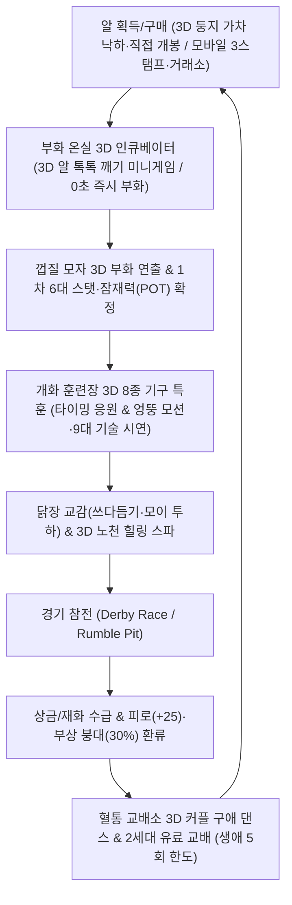

# 🐓 ROOSTER RUMBLE: Rumble Farm 기획방향

---

* **문서 버전**: `v1.6.0`
* **최종 개정일**: 2026-11-26
* **작성 원칙**: 불필요한 수식어 배제 및 100% 개조식 기술 사양 명세

### ■ 문서 개정 이력 (Revision History)

| 버전 (Version) | 개정일 (Date) | 주요 개정 내역 및 상세 변경 사항 | 관련 절 바로가기 |
| :---: | :---: | :--- | :--- |
| **v1.0.0** | 2026-07-30 | 럼블 팜 초기 기획방향, 5대 공간, 유전/훈련/스케줄 기본 루프 수립 | [[#1. Rumble Farm 개요 및 핵심 루프 (Main Loop)\|1장 개요]] |
| **v1.2.0** | 2026-10-08 | 통합 MVP·럼블 핏 비의인화 규격(7대 기술/원형 아레나) 방향성 정렬 | [[#4. 타 모드(Derby Race, Rumble Pit)와의 데이터/선수 연동 구조\|4장 모드 연동]] |
| **v1.5.0** | 2026-11-24 | **[VIP 라운지 4대 육성 기능 반영 및 v1.5.0 단일 기준선 동기화]** 5대 공간 표준명, 단일 교배 유전 공식, 8종 훈련, 유/무료 성장·회복, VIP 라운지 적용 범위(알 유료 획득·유료 교배·유/무료 성장·유/무료 회복) 반영 | [[#6. 미국 VIP 라운지 동시 서비스 적용 범위\|6장 VIP 라운지 범위]] |
| **v1.6.0** | 2026-11-26 | **[3D 교감형 게임성 강화]** 수치 시뮬레이션 탈피 ➔ 실시간 3D 닭·알 표현, 귀엽고 엉뚱한(Quirky) 3D 모션·표정·소품 및 기능별 직접 상호작용(쓰다듬기·모이 뿌리기·3D 알 깨기·참여형 8종 훈련·3D 온천 스파·구애 댄스 교배) 구체화 | [[#1.2 톤앤매너 및 비주얼 컨셉\|1.2절 3D 교감 컨셉]] |

---

## 목차
1. [[#1. Rumble Farm 개요 및 핵심 루프 (Main Loop)]]
   - [[#1.1 모드 정의 및 핵심 역할]]
   - [[#1.2 톤앤매너 및 비주얼 컨셉]]
   - [[#1.3 핵심 순환 루프 (Main Loop)]]
2. [[#2. 메인 화면 UI/UX 공간 구성안 (5대 영역 매칭)]]
   - [[#2.1 메인 화면 공간 레이아웃 오버뷰]]
   - [[#2.2 5대 핵심 공간 영역 명세]]
3. [[#3. 5대 핵심 기능별 상세 기획 메커니즘]]
   - [[#3.1 알 구매 및 교배 유전 시스템 (유전/교배 인계 공식 포함)]]
   - [[#3.2 부화 시스템 (Incubation System)]]
   - [[#3.3 육성 및 훈련 시스템 (Training System)]]
   - [[#3.4 기존 선수(닭) 관리 시스템 (Rooster Management)]]
   - [[#3.5 경기 출전 스케줄 관리 시스템 (Schedule & Fatigue)]]
4. [[#4. 타 모드(Derby Race, Rumble Pit)와의 데이터/선수 연동 구조]]
   - [[#4.1 공통 및 모드별 특화 데이터 구조]]
   - [[#4.2 Derby Race & Rumble Pit 데이터 매핑 표]]
   - [[#4.3 경기 출전 결과 데이터 환류 구조]]
5. [[#5. 주요 재화 흐름 및 초반 온보딩(Onboarding) 가이드]]
   - [[#5.1 재화 순환 구조 (Economy Flow)]]
   - [[#5.2 초반 온보딩 튜토리얼 5단계 동선]]
6. [[#6. 미국 VIP 라운지 동시 서비스 적용 범위]]

---

## 1. Rumble Farm 개요 및 핵심 루프 (Main Loop)

### 1.1 모드 정의 및 핵심 역할
* **모드명**: Rumble Farm (럼블 팜)
* **포지셔닝**: <ROOSTER RUMBLE> 통합 생태계의 기반이 되는 선수(Rooster) 알 구매, 부화, 육성, 훈련, 혈통 관리 및 경기 스케줄링 전담 전초기지 모드
* **핵심 역할**:
  - `Derby Race` (경주 모드) 및 `Rumble Pit` (격투 아레나 모드) 출전용 고성능 선수 공급원 역할 수행
  - 유전 교배를 통한 세대 교체 및 고유 잠재력(Potential) 상한 돌파 창구 제공
  - 단기 경기의 피로감을 완화하고 장기 애착을 형성하는 캐주얼 매니지먼트 영역 담당

### 1.2 톤앤매너 및 비주얼 컨셉
* **타겟층**: 전연령층(10대~60대) 누구나 직관적으로 교감 가능한 캐주얼 3D 아케이드 농장 감성
* **수위 및 톤앤매너**:
  - 욕설, 성적 표현, 과도한 블랙유머 전면 배제 (순한맛 아케이드 감성 유지)
  - 수치 위주의 딱딱한 시뮬레이션을 지양하고, **실시간 3D 닭과 3D 알을 직접 보고·만지고·반응을 끌어내는 교감형 게임 경험** 최우선 지향
  - **귀엽고 엉뚱한(Goofy/Quirky) 캐릭터 연출**: 포인터를 따라 굴러가는 커다란 왕눈알(Googly Eyes), 통통 뛰는 짧은 다리, 넘어지거나 부리가 땅에 박히는 등 유쾌하고 코믹한 리액션 극대화
* **3D 아트 & 연출 스타일**:
  - 따뜻한 파스텔톤 햇살과 입체 잔디·울타리·5대 공간 오브젝트로 구성된 **실시간 3D 아이소메트릭/클로즈업 인터랙티브 스테이지** (360° 드래그 회전 및 줌 인/아웃 지원)
  - **단일 기본 리그(Rig) + 3단계 등급별 외형 파츠(볏·깃털·며느리발톱) + 텍스처 맵핑 300종** 기반 캐릭터 표현 및 상태별 3D 소품(부상 붕대·스파 머리수건/러버덕·훈련 머리띠·전설 왕관) 실시간 부착
  - **3D 알 비주얼**: 등급별(`Natural`/`Superior`/`Rare`/`Legendary`/`Heritage`) 입체 문양 텍스처, 부화 임박 시 알 껍질 틈으로 **빼꼼 눈알** 노출, 부화 직후 깨진 **껍질 모자** 착용 연출

### 1.3 핵심 순환 루프 (Main Loop)

---

## 2. 메인 화면 UI/UX 공간 구성안 (5대 영역 매칭)

### 2.1 메인 화면 공간 레이아웃 오버뷰
* **화면 구도**: 상단/중앙에 **풀폭 실시간 3D 농장 스테이지**(마우스/터치 드래그 360° 회전, 줌 인/아웃, 대상 직접 클릭 상호작용), 하단/측면에 컴팩트한 조작 컨트롤 패널 배치 (모바일 세로/가로 반응형 및 VIP 라운지 16:9 가로 태블릿 지원)
* **직접 상호작용 원칙**: 모든 공간 전환 시 카메라가 해당 3D 존으로 부드럽게 줌 인/포커싱되며, 3D 알·닭·기구를 직접 터치/클릭해 게임 액션을 수행함

### 2.2 5대 핵심 공간 영역 명세

| 영역 번호 | 표준 공간 명칭 | 매칭 핵심 기능 | 3D 스테이지 직접 상호작용 및 게임성 연출 |
| :---: | :--- | :--- | :--- |
| **Zone 1** | **부화 온실 (`Hatchery Greenhouse`)** | 알 보관 및 유/무료 부화 시스템 | • 3D 인큐베이터 유리 돔 위 **입체 알 클로즈업** (흔들림·빛 오라·빼꼼 눈알) • 유저가 **3D 알 표면의 반짝이는 타깃을 직접 톡톡 연타**해 크랙을 내는 10초 미니게임 & 0초 즉시 부화 번개 연출, **껍질 모자 병아리** 탄생 |
| **Zone 2** | **개화 훈련장 (`Training Field`)** | 유/무료 8종 맞춤 훈련 시스템 | • Derby 3종·Pit 4종·공통 1종 **3D 훈련 기구 실물 위 3D 닭 직접 탑승** • 훈련 중 타이밍 탭 응원 성공 시 대성공 연출, 실패/피로 시 엉뚱한 실수 모션(트레드밀 미끄러짐·통나무 부리 박힘·진흙탕 구르기) 재생 |
| **Zone 3** | **선수 닭장 & 힐링 스파 (`Coop & Healing Spa`)** | 교감·관리 및 유/무료 회복 시스템 | • 3D 마당에서 **닭 직접 쓰다듬기(하트·컨디션 소폭 상승)**, **콕 찌르기(화들짝 점프)**, **바닥에 사료 뿌려 우르르 쪼아먹기** • 9대 전투 기술 3D 동작 즉시 시연 및 **3D 노천 온천탕 풍덩 입욕(머리수건·러버덕·온천김)** 연출 |
| **Zone 4** | **혈통 교배소 (`Breeding Pen`)** | 2세대 교배 및 유전 승계 시스템 | • 3D 로맨틱 아치 아래 암수 2두 마주 보기 • 교배 실행 시 **수탉의 엉뚱한 가슴 내밀기·발구르기 구애 댄스 ➔ 하트 파티클 폭발 ➔ 중앙 둥지 2세대 3D 알 산란** 연출 |
| **Zone 5** | **관리동 & 파머스 마켓 (`Farm House & Market`)** | 유료 알 상점 & 메타 관리 시스템 | • 가차 실행 시 **3D 둥지로 알 낙하·바운스 후 유저가 직접 클릭해 개봉** (모바일·VIP 공통) • 유저 간 알 거래소(8%)·3스탬프 무료 알·퀘스트·업적·칭호 20종 관리 (모바일 전용) |

---

## 3. 5대 핵심 기능별 상세 기획 메커니즘

### 3.1 알 구매 및 교배 유전 시스템 (유전/교배 인계 공식 포함)

#### ■ 알 분류 및 수급 명세 (65종 마스터 + 교배 혈통 알)
1. **무료 일반 알 (`Natural Egg`, 30종)** *(모바일 전용)*:
   - 일일 출석(+1) + 보상형 광고 2회(+2, 5분 쿨다운) 합산 **3스탬프 게이지(3/3)** 달성 시 즉시 지급
   - 기본 `POT 30~45`, 부화 시간 10분(600초), 전체 드롭 가중치 `70.0%`
2. **유료 알 가차 (`Superior` 20종 / `Rare` 10종 / `Legendary` 5종)** *(모바일·VIP 공통)*:
   - 유료 1단계 `Superior`(30 Gem / 3,000G, `POT 46~60`, 1시간), 유료 2단계 `Rare`(100 Gem / 10,000G, `POT 61~80`, 4시간), 유료 3단계 `Legendary`(300 Gem, `POT 81~100`, 12시간, **10연속 천장 확정**)
   - 전체 CSV 가중치 `20% / 8% / 2%` (유료 35종 풀 단독 비중 `66.7% / 26.7% / 6.6%`)
3. **교배 혈통 알 (`Heritage Egg`)**:
   - 보유 암수 닭 2두(`ROOSTER`+`HEN`, `IDLE`, 생애 5회 미만)를 3D 교배소에서 마주 세워 교배 실행 ➔ **수탉의 엉뚱한 구애 댄스 및 하트 폭발 연출 후 2세대 알(`Heritage Egg`, 2시간) 산란**
   - VIP 라운지는 **유료 교배 전용(VIP 크레딧/Gem 결제)**으로 운영
4. **유저 간 알 거래소 (8% 수수료)** *(모바일 전용)*:
   - 미부화 알 골드 매매 (`[큰손]` 칭호 장착 시 수수료 7% 인하, 72시간 미거래 시 자동 반환)

#### ■ 유전 및 교배 인계 공식 (통합 MVP 단일 공식)

$$\text{자식 기본 스탯}_i = \text{Clamp}\left(\text{반올림}\left(\text{부모A}_i \times 0.45 + \text{부모B}_i \times 0.45\right) + \text{난수}(-5, +10), \;\; 10, \;\; \text{자식 POT}\right)$$

$$\text{자식 POT} = \text{Clamp}\left(\text{반올림}\left(\max(\text{부모A POT}, \;\; \text{부모B POT}) \times 1.05\right), \;\; 30, \;\; 100\right)$$

* **기초 스탯 계승 규칙**: 부모 2두 스탯 합산 90%(각 45%) 인계 + `-5 ~ +10` 유전 변이 난수 반영, `[10, 자식 POT]` 범위 제한
* **잠재력(`POT`) 인계 규칙**: 부모 중 더 높은 잠재력 상한에 `5%` 보너스(`1.05배`) 적용 후 `[30, 100]` 제한
* **외형/스타일/패시브 인계 확률**:
  - 외형 파츠/스킨: 부 40% / 모 40% / 믹스·희귀 변이 20%
  - 주행·격투 스타일: 부 40% / 모 40% / 무작위 변이 20%
  - 보유 패시브·전투 기술: 부모 보유 기술 각 50% 독립 계승, 신규 히든 변이 기술 15% 확률 발현

---

### 3.2 부화 시스템 (Incubation System)

* **부화 온실 메커니즘**:
  - 인큐베이터 슬롯(기본 2개 ~ 최대 4개)에 3D 알 안치 후 등급별 부화 타이머 작동 (`Natural` 10분, `Superior` 1시간, `Heritage` 2시간, `Rare` 4시간, `Legendary` 12시간)
* **유/무료 부화 가속 트랙**:
  - **무료 가속 (3D 알 10초 터치 미니게임)**: 잔여 시간 50% 경과 시 알 껍질 흔들림·**빼꼼 눈알** 연출과 함께 진입, 10초간 3D 알 표면에 순차 출현하는 반짝 타깃을 유저가 직접 톡톡 연타해 3D 크랙·젤리 바운스 발생(S:15+회 `-20%`, A:10~14회 `-12%`, B:5~9회 `-5%`, C:`0%`)
  - **유료 즉시 부화**: VIP 크레딧 또는 Gem 결제 시 번개 버스트 FX와 함께 대기시간 **0초 즉시 부화 완료**
* **부화 완료 연출**:
  - 알 껍질 폭발 후 깨진 **알 껍질 모자를 머리에 쓴 3D 병아리/닭**이 뛰어나오며 `POT`, 1차 5대 스탯 `Clamp(Round(POT×0.65)+Rand(-3,+3), 10, POT)`, 성별(50%), 스타일 확정

---

### 3.3 육성 및 훈련 시스템 (Training System)

#### ■ 유/무료 잠재력 훈련 메커니즘
* 모든 닭은 1차 6대 스탯(`STR`, `DEX`, `VIT`, `MEN`, `LCK`, `POT`)을 보유하며, **8종 전용 3D 훈련 기구 위에서 직접 탑승·운동하는 모습**을 관전 및 참여형 타이밍 탭으로 응원해 `POT` 상한 내 성장 (완료 시 피로도 `+15`)
* 컨디션 계수(최상 `1.2`, 양호 `1.0`, 보통 `0.9`, 저조 `0.7`) 반영 + 타이밍 응원(`GREAT`/`PERFECT`) 성공 시 대성공 연출(`+1` 추가 보너스), 실패·과피로 시 트레드밀 헛바퀴·통나무 부리 박힘 등 코믹 모션 재생
* **무료(일반) 훈련**: 사료 10~15개 + 1,000~1,500 Gold 소모 및 15~30분 대기
* **유료(급속) 부스트 훈련**: VIP 크레딧 또는 Gem 소모 시 초고속 잔상 이펙트와 함께 **대기시간 0초 즉시 완료 + 성장 보너스 `+2` 추가**

#### ■ 타깃 모드별 맞춤 8종 훈련 종목

| 구분 | 훈련 종목명 | 상승 1차 스탯 | 소모 사료/골드 & 시간 |
| :---: | :--- | :--- | :--- |
| **Derby Race** | **고속 트랙 주행** | `DEX` (`+3~+5`) | 사료 10개 / 1,000G / 15분 |
| **Derby Race** | **타이어 튀기기** | `DEX·LCK` (`+3~+5`) | 사료 10개 / 1,000G / 15분 |
| **Derby Race** | **모래언덕 오르기** | `VIT·MEN` (`+3~+5`) | 사료 12개 / 1,200G / 20분 |
| **Rumble Pit** | **통나무 타격하기** | `STR` (`+3~+5`) | 사료 10개 / 1,000G / 15분 |
| **Rumble Pit** | **과녁 정밀 타격** | `DEX·MEN` (`+3~+5`) | 사료 12개 / 1,200G / 20분 |
| **Rumble Pit** | **깃털 부풀려 버티기 수련** | `DEX·STR` (`+3~+5`) | 사료 10개 / 1,000G / 15분 |
| **Rumble Pit** | **외나무 밸런스 균형대** | `MEN·VIT` (`+4~+6`) | 사료 15개 / 1,500G / 30분 |
| **공통 피지컬** | **진흙탕 극기 훈련** | `VIT` `+2`, `LCK` `+3` | 사료 15개 / 1,500G / 30분 |

---

### 3.4 기존 선수(닭) 관리 시스템 (Rooster Management)

* **10대 상태 머신 관리**: `EGG_WAITING`, `INCUBATING`, `HATCHED`, `IDLE`, `TRAINING`, `IN_MATCH`, `FATIGUED`, `INJURED`, `RESTING`, `BREEDING_LOCKED`/`BREEDING_COOLDOWN`/`RETIRED`
* **직접 교감 & 유/무료 회복 케어**:
  - **3D 마당 교감**: 보유 3D 닭 직접 쓰다듬기(하트·반달 눈웃음·컨디션 소폭 상승), 콕 찌르기(화들짝 점프·깃털 날림), 바닥 사료 투하(닭 우르르 달려와 쪼기) 지원
  - **무료 회복**: 일반 닭장 자연 휴식(시간당 피로도 `-10`, 부상 치유 불가) 및 영양 사료 급여(3D 사료 알갱이 직접 던져 쪼아먹기 연출, 사료 10개, 즉시 `-20`, 일 3회 제한)
  - **유료 회복**: 프리미엄 스파(3D 노천 온천탕 풍덩 입욕·머리수건·러버덕·모락모락 온천김 연출, 50 Gem / 5,000G / VIP 크레딧, 즉시 피로도 `0` + 부상 붕대 해제 완치 + 24시간 컨디션 100 고정)
  - **광고 회복** *(모바일 전용)*: 보상형 광고 시청 시 즉시 피로도 `-20` (일 3회)
* **전투 기술 슬롯 & 3D 동작 시연**: 등급별 슬롯(일반 2 ~ 전설 5개)에 비의인화 **9대 전투 기술(공4+방3+특수2 `F33/F34`)** 장착·교체 및 기술 클릭 시 **3D 닭의 즉시 기술 포즈 시연** 제공

---

### 3.5 경기 출전 스케줄 관리 시스템 (Schedule & Fatigue)

* **출전 스케줄 연동**: 일일 경주 72회(20분 간격) / 격투 48회(30분 간격) 및 모바일 6단계 리그 참전
* **피로도 및 부상 메커니즘**:
  - 경기 1회 출전 시 피로도 `+25` 증가 (최대 100), 격투 30분 / 경주 40분(2레이스) 출전 쿨다운 적용
  - 피로도 `70~89`(`FATIGUED`) 출전 시 전 스탯 `-15%` 감쇄
  - 피로도 `90` 이상 출전 시 `30%` 확률로 `INJURED`(부상 — 유료 스파 외 치료 및 출전/훈련 불가) 전환

---

## 4. 타 모드(Derby Race, Rumble Pit)와의 데이터/선수 연동 구조

### 4.1 공통 및 모드별 특화 데이터 구조
* **공통 기본 데이터**: `rooster_id`, 선수명, 세대, 성별, 1차 6대 스탯(`STR/DEX/VIT/MEN/LCK/POT`), 3단계 등급별 외형 파츠, 상태 코드, 피로도, 부상 여부, 생애 교배 횟수(최대 5회)
* **모드별 특화 데이터**:
  - `Derby Race`: 주행 스타일 6종(도주/추입/선행/자재/선입/변칙) 및 경주 2차 6대 스탯(`SPD`, `STA`, `STM`, `FOC`, `TMP`, `GUT`)
  - `Rumble Pit`: 격투 스타일 5종(인파이터/아웃파이터/브롤러/테크니션/밸런서), 격투 2차 6대 스탯(`POW`, `DEF`, `HP`, `REC`, `TEC`, `GRT`), 9대 전투 기술(`공1~4`, `방1~3`, `특공 F33`, `특방 F34`)

### 4.2 Derby Race & Rumble Pit 데이터 매핑 표

| 1차 피지컬 스탯 | Derby Race 반영 2차 스탯 | Rumble Pit 반영 2차 스탯 |
| :---: | :--- | :--- |
| **`STR` (힘)** | 속도(`0.3`), 기질(`0.2`) | 공격력(`0.6`), 방어력(`0.3`), 최대 체력(`×2`) |
| **`DEX` (민첩)** | 속도(`0.5`), 출발(`0.7`), 집중력(`0.3`) | 방어력(`0.5`), 기술력(`0.4`), 공격력(`0.2`) |
| **`VIT` (활력)** | 지구력(`0.6`), 근성(`0.3`) | 최대 체력(`×10`), 회복력(`0.5`), 근성(`0.2`) |
| **`MEN` (정신력)** | 집중력(`0.5`), 근성(`0.5`), 지구력(`0.2`), 기질(`0.2`) | 근성(`0.6`), 회복력(`0.3`), 기술력(`0.3`) |
| **`LCK` (행운)** | 기질(`0.6`), 출발(`0.2`) | 훈련 대성공 및 유전 변이 보정 |
| **`POT` (잠재력)** | 속도·지구력·집중력·근성(`0.2`), 출발(`0.1`) | 기술력(`0.3`), 공격·방어·회복·근성(`0.2`), 최대 체력(`×2`) |

### 4.3 경기 출전 결과 데이터 환류 구조
* **경기 후 팜 환류**: 상금(`Gold`/`Credit`) 및 승점(`RP`, 모바일 리그) 수령, 피로도 `+25` 및 쿨다운 적재, 부상(30%) 발생 시 유료 스파 케어로 환류

---

## 5. 주요 재화 흐름 및 초반 온보딩(Onboarding) 가이드

### 5.1 재화 순환 구조 (Economy Flow)
* **재화 유입**: 출석/광고 보상(모바일), 경주 상금, 격투 파이트 머니, VIP 현장 크레딧 충전
* **재화 소모**: 유료 알 가차(30~300 Gem / VIP 크레딧), 훈련 소모(사료 10~15개 + 1,000~1,500G / 급속 유료 옵션), 유료 스파(50 Gem / 5,000G / VIP 크레딧), 유료 교배(VIP 크레딧 / 토큰+5,000G)

### 5.2 초반 온보딩 튜토리얼 5단계 동선
1. **Step 1 [첫 알 확보 및 배치]**: 모바일(무료 알 수령) 또는 VIP(기본 웰컴 알/유료 가차) 후 부화 온실 인큐베이터 안치
2. **Step 2 [부화 및 미니게임 체험]**: 10초 터치 미니게임 가속(또는 유료 즉시 부화) 완료 및 1차 6대 스탯·성별·외형 파츠 확인
3. **Step 3 [첫 맞춤 훈련]**: 개화 훈련장 이동 및 사료 활용 훈련 1회 완수 ➔ 2차 파생 스탯 상승 확인
4. **Step 4 [실전 경기 출전]**: Derby Race 또는 Rumble Pit 출전 및 결과 확인
5. **Step 5 [회복 케어 및 혈통 교배]**: 피로도 누적 닭 닭장 휴식/사료/스파 케어 및 혈통 교배소 안내 완료

---

## 6. 미국 VIP 라운지 동시 서비스 적용 범위

* **독자 운영 및 분리 원칙**: 미국 오프라인 VIP 라운지에서 경주·격투와 함께 럼블 팜 동시 제공, 단 모바일/온라인 웹과 계정·재화·선수는 **100% 독립 로컬 DB(`VIP Lounge Local DB`)로 분리 운영**
* **VIP 라운지 반영 4대 기능 (엄격 한정)**:
  1. **알 유료 획득**: 유료 알 35종 가차 풀 및 10연 천장 확정만 제공 (무료 알/거래소 제외)
  2. **유료 교배**: VIP 크레딧/Gem 유료 결제 전용 2세대 혈통 교배만 제공
  3. **유/무료 성장**: 무료(일반 대기 부화·10초 터치 미니게임·일반 8종 훈련) + 유료(0초 즉시 부화·급속 부스트 훈련) 병행
  4. **유/무료 회복**: 무료(닭장 자연 휴식·영양 사료 급여) + 유료(프리미엄 스파 즉시 완충/완치) 병행
* **VIP 라운지 미반영 항목**: 출석/광고 3스탬프 무료 알, 보상형 광고 3종, 유저 알 거래소(8%) 및 현장 경매/분양, 일일 5종/주간 4종 퀘스트, 영구 업적 8종, 칭호 20종, 모바일 6단계 리그 전면 제외
