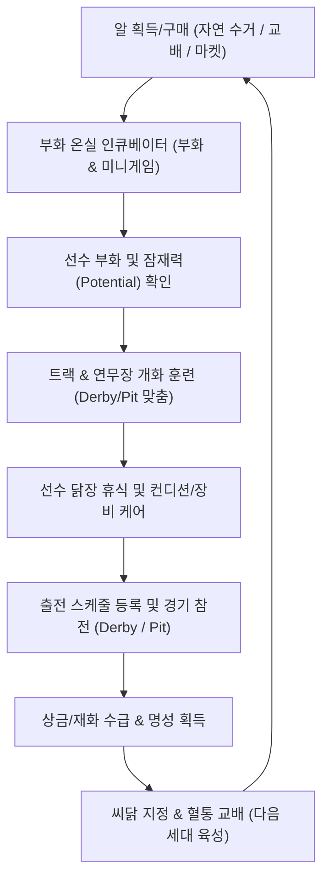

# 🐓 ROOSTER RUMBLE: Rumble Farm 기획방향

---

## 목차
1. [[#1. Rumble Farm 개요 및 핵심 루프 (Main Loop)]]
   - [[#1.1 모드 정의 및 핵심 역할]]
   - [[#1.2 톤앤매너 및 비주얼 컨셉]]
   - [[#1.3 핵심 순환 루프 (Main Loop)]]
2. [[#2. 메인 화면 UI/UX 공간 구성안 (5대 영역 매칭)]]
   - [[#2.1 메인 화면 공간 레이아웃 오버뷰]]
   - [[#2.2 5대 핵심 공간 영역 명세]]
3. [[#3. 5대 핵심 기능별 상세 기획 메커니즘]]
   - [[#3.1 알 구매 및 교배 유전 시스템 (유전/교배 인계 공식 포함)]]
   - [[#3.2 부화 시스템 (Incubation System)]]
   - [[#3.3 육성 및 훈련 시스템 (Training System)]]
   - [[#3.4 기존 선수(닭) 관리 시스템 (Rooster Management)]]
   - [[#3.5 경기 출전 스케줄 관리 시스템 (Schedule & Fatigue)]]
4. [[#4. 타 모드(Derby Race, Rumble Pit)와의 데이터/선수 연동 구조]]
   - [[#4.1 공통 및 모드별 특화 데이터 구조]]
   - [[#4.2 Derby Race & Rumble Pit 데이터 매핑 표]]
   - [[#4.3 경기 출전 결과 데이터 환류 구조]]
5. [[#5. 주요 재화 흐름 및 초반 온보딩(Onboarding) 가이드]]
   - [[#5.1 재화 순환 구조 (Economy Flow)]]
   - [[#5.2 초반 온보딩 튜토리얼 5단계 동선]]

---

## 1. Rumble Farm 개요 및 핵심 루프 (Main Loop)

### 1.1 모드 정의 및 핵심 역할
* **모드명**: Rumble Farm (럼블 팜)
* **포지셔닝**: <ROOSTER RUMBLE> 통합 생태계의 기반이 되는 선수(Rooster) 알 구매, 부화, 육성, 훈련, 혈통 관리 및 스케줄링 전담 전초기지 모드
* **핵심 역할**:
  - `Derby Race` (경주 모드) 및 `Rumble Pit` (격투 아레나 모드) 출전용 고성능 선수 공급원 역할 수행
  - 유전 교배를 통한 세대 교체 및 고유 잠재력(Potential) 개화 창구 제공
  - 단기 경기의 피로감을 완화하고 장기 애착을 형성하는 캐주얼 매니지먼트 영역 담당

### 1.2 톤앤매너 및 비주얼 컨셉
* **타겟층**: 전연령층(10대~60대) 누구나 직관적으로 이해 가능한 캐주얼 아케이드 농장 감성
* **수위 및 톤앤매너**:
  - 욕설, 성적 표현, 과도한 블랙유머 전면 배제 (순한맛 아케이드 감성 유지)
  - 닭들의 유쾌한 훈련 동작 및 모션 연출 중심의 힐링/위트 조합
* **아트 스타일**: 따뜻한 파스텔톤의 활기찬 아네모네 농장 비주얼 및 2.5D 아이소메트릭(Isometric) 뷰 적용

### 1.3 핵심 순환 루프 (Main Loop)



---

## 2. 메인 화면 UI/UX 공간 구성안 (5대 영역 매칭)

### 2.1 메인 화면 공간 레이아웃 오버뷰
* **화면 구도**: 농장 전체를 한눈에 둘러보는 2.5D 자유 시점 스크롤 방식 적용
* **터치 인터랙션**: 각 오브젝트 직접 터치 시 해당 전용 기능 팝업 및 카메라 줌인 연출 발생

### 2.2 5대 핵심 공간 영역 명세

| 영역 번호 | 공간 명칭 | 매칭 핵심 기능 | 주요 UI 요소 및 연출 |
| :---: | :--- | :--- | :--- |
| **Zone 1** | **부화 온실 (Incubator Greenhouse)** | 알 구매 및 부화 시스템 | • 알 보관대 및 부화 인큐베이터 슬롯 (기본 2개 ~ 최대 6개)<br>• 온실 온도계, 알 터치 미니게임 팝업, 알 등급별 붉은/황금빛 이펙트 |
| **Zone 2** | **훈련 트랙 & 연무장 (Training Center)** | 육성 및 훈련 시스템 | • Derby 전용 러닝머신/허들 트랙 및 Pit 전용 샌드백/타격대 배치<br>• 훈련 중인 닭들의 코믹한 열정 땀방울 애니메이션 및 스탯 상승 텍스트 이펙트 |
| **Zone 3** | **선수 닭장 & 힐링 스파 (Coop & Rest House)** | 선수(닭) 관리 시스템 | • 보유 선수 로스터 보드, 온천 스파 회복탕, 장비 수납함<br>• 씨닭(Breeder) 지정 깃발 표식, 휴식 중인 닭들의 모이 집어먹기/수면 연출 |
| **Zone 4** | **혈통 교배소 (Heritage Breeding Center)** | 교배 및 유전 승계 시스템 | • 부모 닭 2두 배치 교배 단상, 유전율 분석 홀로그램 차트<br>• 혈통 알(Pedigree Egg) 마켓 상점 가판대 및 2세대 알 조합 교배기 |
| **Zone 5** | **출전 스케줄 게시판 (Match Calendar Board)** | 경기 출전 스케줄 관리 | • 월간/주간 출전 경기 달력, 피로도 경고등, 로테이션 슬롯<br>• Derby Race 및 Rumble Pit 모드 즉시 진입 셔틀 버스 승차장 |

---

## 3. 5대 핵심 기능별 상세 기획 메커니즘

### 3.1 알 구매 및 교배 유전 시스템 (유전/교배 인계 공식 포함)

#### ■ 알 분류 및 수급 명세
1. **무료 알 (Natural Egg)**:
   - 4시간마다 팜 농장 모이통에서 자동 수거 (최대 3개 적재)
   - 기본 C~B등급 노말 닭 부화 (기초 능력치 제공)
2. **혈통 교배 알 (Heritage Breeding Egg)**:
   - 보유 중인 우수 암/수 닭 2두를 교배하여 획득하는 2세대 알
   - 부모 닭의 능력치, 외형, 특수 패시브 유전 인자 계승
3. **마켓 프리미엄 혈통 알 (Pedigree Egg)**:
   - 상점에서 유료 재화(Gem)로 구매하는 프리미엄 알
   - 전설급/희귀급 고정 유전자 및 특수 외형(피부/벼슬) 내장

#### ■ 유전 및 교배 인계 공식 (Genetics & Breeding Formula)

$$\text{Child Base Stat} = \left( \text{Stat}_{\text{ParentA}} \times 0.45 + \text{Stat}_{\text{ParentB}} \times 0.45 \right) + \text{RandomMutation}(-5\% \sim +10\%)$$

$$\text{Child Potential Cap} = \max(\text{Potential}_{\text{ParentA}}, \text{Potential}_{\text{ParentB}}) + \text{GenerationBonus}(+5\%)$$

* **기초 스탯 계승 규칙**:
  - 부모 닭 2두의 해당 스탯 평균값 90%(각 45%) 인계 적용
  - -5% ~ +10% 범위의 돌연변이(Mutation) 난수 보정값 반영
* **잠재력(Potential Limit) 인계 규칙**:
  - 부모 중 더 높은 잠재력 상한치를 기본 계승 후 세대(Generation)당 +5% 추가 확장 부여
* **패시브 스킬 및 외형 인계 확률**:
  - 우성 인자 (부모 보유 패시브): 각 50% 확률로 자식에게 독립 계승
  - 열성/변이 인자 (신규 히든 패시브): 15% 확률로 돌연변이 발현
  - 외형 유전 (깃털 색상/벼슬 모양): 부모 외형 40% / 40% 계승, 20% 확률로 믹스 외형 출현

---

### 3.2 부화 시스템 (Incubation System)

* **부화 온실 메커니즘**:
  - 인큐베이터 슬롯에 알 안치 후 부화 타이머 작동
  - 알 등급별 소요 시간: 일반 알(10분), 혈통 알(2시간), 전설 알(12시간)
* **시간 단축 터치 미니게임 (Egg Tapping Minigame)**:
  - 부화 진행 중 알 껍질 흔들림 이펙트 발생 시 미니게임 진입 가능
  - 10초간 화면 지정 지점 탭(Tap) 또는 스와이프 모션 수행
  - 미니게임 성공 시 잔여 부화 시간의 20% 즉시 단축 (알당 최대 3회 수행 제한)
* **부화 완료 연출**:
  - 껍질 깨짐 애니메이션과 함께 부화 선수 닭의 초기 스탯, 잠재력 그래프, 등급 팝업 제공

---

### 3.3 육성 및 훈련 시스템 (Training System)

#### ■ 잠재력(Potential) 개화 훈련 메커니즘
* 모든 부화 닭은 '현재 스탯'과 계승받은 '잠재력 상한선(Potential)' 보유
* 훈련 실행 시 사료(Energy) 소모 및 잠재력 수치를 현재 스탯으로 전환 개화

#### ■ 타깃 모드별 맞춤 훈련 종목

| 구분 | 훈련 종목명 | 상승 주요 스탯 | 훈련 오브젝트 연출 |
| :---: | :--- | :--- | :--- |
| **Derby Race 맞춤 훈련** | **고속 트랙 주행** | 최고속도 (Top Speed) | 동력 트랙 러닝머신 질주 모션 |
| | **타이어 튀기기** | 가속도 (Acceleration) | 대형 타이어 끌기 및 점프 연출 |
| | **지옥의 모래산 넘기** | 근성 (Guts) | 모래언덕 오르기 및 침착성 훈련 |
| **Rumble Pit 맞춤 훈련** | **통나무 타격하기** | 공격력 (Attack Power) | 단단한 통나무 부리/발차기 타격 |
| | **급소 부르기 연습** | 치명타율 (Critical Rate) | 과녁 타깃 정밀 타격 모션 |
| | **철판 깃털 방어** | 방어력 (Defense) | 날개 차단 및 매집 방어 연출 |
| | **매화틀 버티기** | 투지 (Stamina/Fighting Spirit) | 외나무다리 균형잡기 및 정신력 훈련 |

---

### 3.4 기존 선수(닭) 관리 시스템 (Rooster Management)

* **선수단 로스터 (Coop Roster)**:
  - 기본 보유 슬롯 10두 제공 (재화를 통한 닭장 확장 가능)
  - 선수별 전적, 상세 스탯, 부모 혈통도, 현재 컨디션 통합 관리
* **씨닭 (Breeder Rooster) 지정 시스템**:
  - 교배 전용 우수 종계 닭 최대 4두 지정 (씨닭 지정 시 경기 출전 임시 제한)
  - 교배 진행 후 24시간 쿨타임(휴식기) 메커니즘 적용
* **휴식 및 스파 컨디션 회복**:
  - 경기 출전 및 훈련으로 적재된 피로도(Fatigue) 소모용 힐링 스파 공간
  - 온천 입욕 시 시간 경과에 따라 피로도 감소 및 컨디션(최상/양호/보통/저조) 회복
* **장비 착용 및 관리**:
  - 주행용 깃털 스퍼, 격투용 붉은 부리 캡 등 착용을 통한 추가 보정치 부여

---

### 3.5 경기 출전 스케줄 관리 시스템 (Schedule & Fatigue)

* **출전 달력 (Match Calendar)**:
  - 주간 단위 Derby Race 및 Rumble Pit 리그/토너먼트 일정 표출
  - 일자별 출전 희망 선수 사전 예약 및 로테이션 슬롯 등록
* **피로도 (Fatigue) 및 부상 메커니즘**:
  - 경기 1회 출전 시 피로도 +25 증가 (최대 100)
  - 피로도 70 이상 출전 시 전반적 스탯 15% 감태 적용
  - 피로도 90 이상 누적 출전 시 30% 확률로 부상(Injury) 발생 (부상 시 훈련/출전 불응 상태 전환)
* **로테이션 배정 메커니즘**:
  - A팀(메인 출전), B팀(후보/휴식) 교대 배정을 통한 피로도 분산 유도

---

## 4. 타 모드(Derby Race, Rumble Pit)와의 데이터/선수 연동 구조

### 4.1 공통 및 모드별 특화 데이터 구조
* **공통 기본 데이터 (Common Core)**:
  - ID, 선수명, 세대(Generation), 성별, 외형 파츠 코드, 현재 피로도, 컨디션 지수
* **모드별 특화 데이터 분리 매핑**:
  - `Derby Race`: 주행 스탯 및 레이스 주행 스타일(선입, 선두, 추입, 자유)
  - `Rumble Pit`: 격투 스탯 및 아레나 격투 스타일(타격형, 인파이팅, 반격형, 방어형)

### 4.2 Derby Race & Rumble Pit 데이터 매핑 표

```
[Rumble Farm 육성 스탯]
        │
        ├── (Derby 연동) ───> 최고속도 / 가속도 / 근성 / 주행 스타일
        │
        └── (Pit 연동) ─────> 공격력 / 치명타율 / 방어력 / 투지 / 격투 스타일
```

| Rumble Farm 훈련 항목 | Derby Race 반영 스탯 | Rumble Pit 반영 스탯 | 비고 |
| :---: | :---: | :---: | :--- |
| **순발력 / 스피드 훈련** | 최고속도 (Top Speed) | 이동속도 및 회피율 | 양 모드 공통 영향 |
| **파워 / 근력 훈련** | 가속도 (Acceleration) | 기본 공격력 (ATK) | 양 모드 공통 영향 |
| **정신력 / 멘탈 훈련** | 근성 (Guts - 스퍼트 유지) | 투지 (KO 버티기 확률) | 모드별 멘탈 보정 |
| **방어 / 매집 훈련** | 체력 감소율 완화 | 방어력 (DEF) 및 피격 데감 | 모드별 방어 보정 |

### 4.3 경기 출전 결과 데이터 환류 구조
* **경기 후 팜(Farm) 데이터 반영**:
  - 경기 결과(1~3위, KO승 등)에 따라 선수 경험치(EXP) 및 명성(Reputation) 획득
  - 경기 직후 피로도 자동 차감 및 소폭의 무작위 스탯 성장 보너스(0.1~0.5) 획득

---

## 5. 주요 재화 흐름 및 초반 온보딩(Onboarding) 가이드

### 5.1 재화 순환 구조 (Economy Flow)

```
[Derby Race / Rumble Pit 경기 참전] ──(상금/코인 수급)──> [Rumble Farm 재화 축적]
                                                                  │
                                                        (사료/가속제/알 구매)
                                                                  ▼
[고성능 2세대 선수 부화 및 훈련] <──(교배/육성 소모)─── [농장 시설 및 훈련 투자]
```

* **주요 재화 및 소모처**:
  - **사료 (Energy Feed)**: 훈련 실행 시 필수 소모 (시간 경과 충전 및 퀘스트 수급)
  - **부화 가속제 (Incubation Booster)**: 알 부화 대기시간 즉시 완화
  - **교배 토큰 (Breeding Token)**: 2세대 혈통 교배 실행 시 수수료 지불
  - **골드 / 젬 (Gold / Gem)**: 닭장 공간 확장, 프리미엄 알 구매, 장비 구입

### 5.2 초반 온보딩 튜토리얼 5단계 동선

1. **Step 1 [첫 알 수거 및 배치]**:
   - 농장 모이통에서 무료 알 1개 첫 수거 안내 및 부화 온실 인큐베이터 안치
2. **Step 2 [부화 및 미니게임 체험]**:
   - 알 터치 미니게임 즉시 발동 및 터치 입력을 통한 부화 완료 연출 체험 (튜토리얼용 초보자 닭 획득)
3. **Step 3 [첫 스탯 개화 훈련]**:
   - 훈련 트랙 이동 및 무료 제공 사료를 활용한 스피드/파워 훈련 1회 완료
4. **Step 4 [Derby Race 실전 출전]**:
   - 출전 게시판 이동 후 육성한 첫 닭을 Derby Race 튜토리얼 경주에 등록 및 경기 참전
5. **Step 5 [보상 획득 및 팜 확장]**:
   - 첫 경주 상금 수령 및 농장 시설 둘러보기 완수를 통한 튜토리얼 종료 및 자유 플레이 전환
