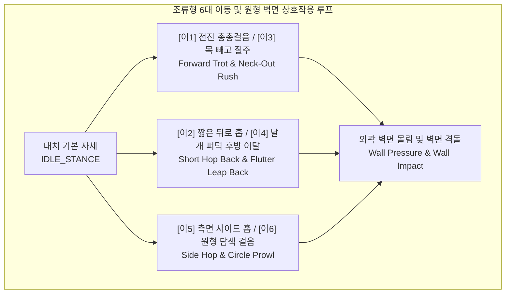
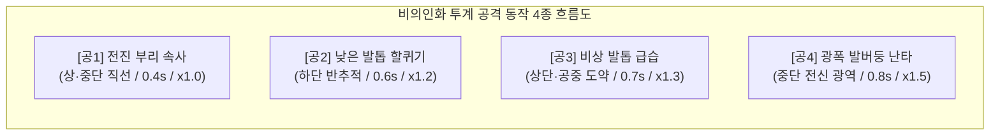
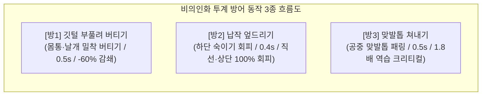
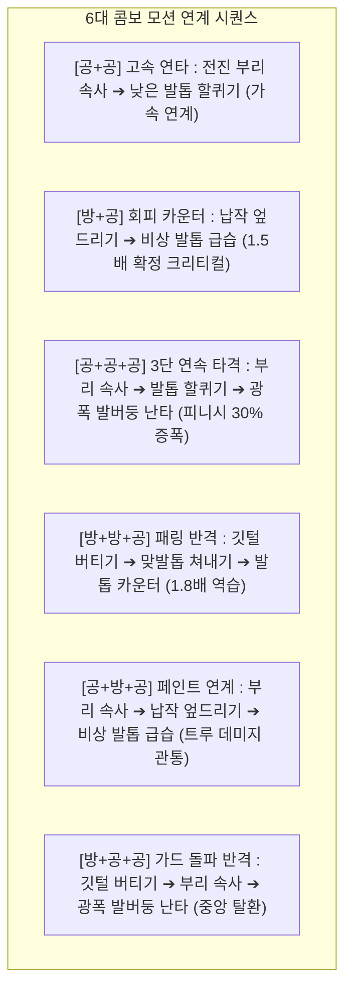
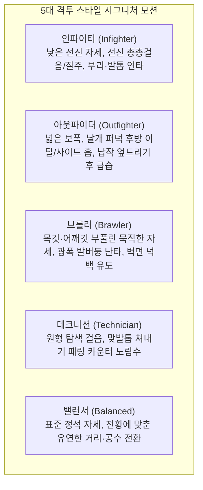

# 🥊 ROOSTER RUMBLE: Rumble Pit 선수 공격/방어 동작 구성안 (Fighter Action & Motion Specification)

* **현재 문서 버전**: `v1.2.0`
* **마지막 개정일**: 2026-10-08
* **문서 정체성**: 럼블 핏(Rumble Pit) MVP 구성안 중 **비의인화 닭(투계) 골격 기반 선수 캐릭터의 이동(6종)/공격(4종)/방어·회피·반격(3종)/피격/특수 상태 동작(애니메이션 모션, 프레임 규격, 판정 부위, 콤보 트랜지션, VFX/SFX 연동)**에 특화된 단독 동작 명세서
* **기반 문서**: [Rumble Pit MVP 구성안.md](file:///d:/OneDrive/%EC%97%85%EB%AC%B4_%EC%A7%84%ED%96%89/C/ROOSTER%20RUMBLE/Rumble%20Pit%20MVP%20%EA%B5%AC%EC%84%B1%EC%95%88.md), [Rumble_Pit_전투_시뮬레이션_규칙_정의서.md](file:///d:/OneDrive/%EC%97%85%EB%AC%B4_%EC%A7%84%ED%96%89/C/ROOSTER%20RUMBLE/Rumble_Pit_%EC%A0%84%ED%88%AC_%EC%8B%9C%EB%AE%AC%EB%A0%88%EC%9D%B4%EC%85%98_%EA%B7%9C%EC%B9%99_%EC%A0%95%EC%9D%98%EC%84%9C.md), [Rumble Pit 전투 장면 인게임 구성안.md](file:///d:/OneDrive/%EC%97%85%EB%AC%B4_%EC%A7%84%ED%96%89/C/ROOSTER%20RUMBLE/Rumble%20Pit%20%EC%A0%84%ED%88%AC%20%EC%9E%A5%EB%A9%B4%20%EC%9D%B8%EA%B2%8C%EC%9E%84%20%EA%B5%AC%EC%84%B1%EC%95%88.md)

---

### ■ 문서 개정 이력 (Revision History)

| 버전 (Version) | 개정일 (Date) | 주요 개정 내역 및 상세 변경 사항 | 관련 절 바로가기 |
| :---: | :---: | :--- | :--- |
| **v0.0.1** | 2026-08-11 | 닭 격투 기본 공방 모션(부리 쪼기, 기본 가드) 및 대치 자세 최초 기획 | [[#1.1 대치 기본 자세 및 시선/무게중심 규격\|1.1절 기본 대치 자세]] |
| **v0.2.0** | 2026-08-13 | Hitbox 4종(Head/Leg/Air/Area) 및 공격 부위별 모션 타임라인 규격 수립 | [[#2.1 공1 전진 부리 속사 모션 및 판정 스펙\|2.1절 전진 부리 속사 모션]] |
| **v0.4.0** | 2026-08-27 | Last Stand 투지 버티기 생존 모션 및 바닥 다운(Knockdown) 연출 정의 | [[#6.3 투지 버티기(Last Stand) 1 HP 생존 모션\|6.3절 Last Stand 모션]] |
| **v0.7.0** | 2026-08-27 | 동작별 연동 효과음(SFX-Pit 12종) 및 타격/피격 VFX 애니메이션 매핑 | [[#8. 동작별 시각 이펙트(VFX) 및 사운드(SFX) 매핑 매트릭스\|8장 동작 VFX/SFX 매핑]] |
| **v0.9.0** | 2026-09-07 | 7대 전문 기술(공4+방3), 6대 콤보 연계 모션, 실시간 패링 캔슬/가드브레이크 동작 수립 | [[#3.1 방1 깃털 부풀려 버티기 모션 및 게이지 소모\|3.1절 방어형 기술 모션]] |
| **v0.9.1** | 2026-09-28 | **[단독 분리 발췌]** 럼블핏 MVP 구성안에서 선수 공격/방어 동작 사양 전면 추출 및 독립 동작 명세서화 | [[#2. 공격 동작(Offensive Motions) 4종 상세 명세\|2장 공격 동작 4종 명세]] |
| **v0.9.2** | 2026-09-29 | **[SFX 12종 실사 MP3 에셋 제작]** 8장 매핑 SFX-Pit 12종 실사 녹음 음원 기반 MP3 에셋 구축 및 사운드보드 연동 | [[#8.2 SFX-Pit 14종 오디오 파일 목록 및 청음\|8.2절 SFX 오디오 파일 목록]] |
| **v0.9.3** | 2026-09-29 | **[라운드 시작 연출 개편]** 권투/격투 아나운서 보이스("Round 1... FIGHT!") + KO 벨 참조 1회 공식 벨소리(DING!) 합성 에셋 완비 | [[#8.1 동작별 시각 이펙트(VFX) 및 사운드(SFX) 매핑 매트릭스\|8.1절 시작 연출]] |
| **v0.9.4** | 2026-09-29 | **[라운드 1~3 보이스 및 긴박감 개편]** 전문 격투 아나운서 하이텐션 샤우팅(Round 1~3, Final Round) 및 한국어 긴박 보이스 전 라운드 에셋 완비 | [[#8. 동작별 시각 이펙트(VFX) 및 사운드(SFX) 매핑 매트릭스\|8장 동작 VFX/SFX 매핑]] |
| **v0.9.5** | 2026-09-29 | **[라운드 시작 보이스 단일화]** 다크 헤비 버전(Dragon Announcer: First/Second/Third Round... FIGHT!) 공식 단독 채택 및 에셋 일원화 | [[#8. 동작별 시각 이펙트(VFX) 및 사운드(SFX) 매핑 매트릭스\|8장 동작 VFX/SFX 매핑]] |
| **v0.9.6** | 2026-09-29 | **[SFX 11종 정예화 및 에셋 정리]** 심판 카운트 큐(SFX_PIT_REFEREE_CNT) 삭제 및 다크 헤비 단독 정규 파일 외 불필요 음원 전량 파기 | [[#8.2 SFX-Pit 14종 오디오 파일 목록 및 청음\|8.2절 SFX 오디오 파일 목록]] |
| **v0.9.7** | 2026-09-29 | **[공방 SFX 고품질화, 다목적 공방음 추가 및 라운드 벨소리 분리]** 공격/방어 SFX 실사 음원 기반 고품질화, 다목적 타격(SFX_PIT_HIT_GEN)/방어(SFX_PIT_GUARD_GEN) 2종 신설, 라운드 보이스 내 벨소리 완전 분리 및 중복 퍼스트 라운드 에셋 영구 삭제 | [[#8.2 SFX-Pit 14종 오디오 파일 목록 및 청음\|8.2절 SFX 오디오 파일 목록]] |
| **v0.9.8** | 2026-09-29 | **[격투 경기 박진감 고품질 오케스트라 BGM 구축]** 인게임 전투 배경음악(BGM_PIT_FIGHT, 150 BPM 시네마틱 액션 배틀 오케스트라 172.58초) 마스터링 에셋 완비 및 pit/bgm/ 경로 배치 | [[#8.2 SFX-Pit 14종 오디오 파일 목록 및 청음\|8.2절 SFX 오디오 파일 목록]] |
| **v1.2.0** | 2026-10-08 | **[비의인화 닭 골격 기반 공/방/이동 동작 개편 및 원형 벽면 경기장·즉시 KO 동기화]**<br>1. `Rumble Pit MVP 구성안(v1.2.0)` 및 `Rumble_Pit_전투_시뮬레이션_규칙_정의서(v1.2.0)` 기준 전면 동기화<br>2. 조류 보행 생태 기반 **6대 이동 동작**(`전진 총총걸음`, `짧은 뒤로 홉`, `목 빼고 질주`, `날개 퍼덕 후방 이탈`, `측면 사이드 홉`, `원형 탐색 걸음`) 및 **원형 벽면 몰림(`Wall Pressure`)·벽 격돌(`Wall Impact`)** 모션 신설<br>3. 비의인화 투계 골격에 부합하도록 **공격 4종(`전진 부리 속사`, `낮은 발톱 할퀴기`, `비상 발톱 급습`, `광폭 발버둥 난타`)** 및 **방어 3종(`깃털 부풀려 버티기`, `납작 엎드리기`, `맞발톱 쳐내기`)** 동작·단계별(`준비➔실행➔회수`) 연출 개편<br>4. 경기 중 중간 기상 모션 배제, **짧은 스탠딩 그로기(0.5~1.0초) 위기 탈출 및 바닥 다운 즉시 KO 종료** 규칙 반영 | • [[#1.2 원형 투계장 내 조류형 6대 이동(Footwork) 동작\|1.2절 6대 이동 동작]]<br>• [[#2. 공격 동작(Offensive Motions) 4종 상세 명세\|2장 공격 동작 4종]]<br>• [[#3. 방어 및 회피/반격 동작(Defensive Motions) 3종 상세 명세\|3장 방어 동작 3종]]<br>• [[#6.2 짧은 스탠딩 그로기(Standing Groggy) 및 즉시 KO 다운 모션\|6.2절 그로기 및 즉시 KO]] |

---

## 목차
1. [[#1. 선수 기본 자세 및 이동/스텝(Footwork) 동작]]
   - [[#1.1 대치 기본 자세 및 시선/무게중심 규격]]
   - [[#1.2 원형 투계장 내 조류형 6대 이동(Footwork) 동작]]
   - [[#1.3 원형 외곽 벽면 몰림 및 벽면 격돌 모션]]
2. [[#2. 공격 동작(Offensive Motions) 4종 상세 명세]]
   - [[#2.1 공1 전진 부리 속사 모션 및 판정 스펙]]
   - [[#2.2 공2 낮은 발톱 할퀴기 모션 및 판정 스펙]]
   - [[#2.3 공3 비상 발톱 급습 모션 및 판정 스펙]]
   - [[#2.4 공4 광폭 발버둥 난타 모션 및 판정 스펙]]
3. [[#3. 방어 및 회피/반격 동작(Defensive Motions) 3종 상세 명세]]
   - [[#3.1 방1 깃털 부풀려 버티기 모션 및 게이지 소모]]
   - [[#3.2 방2 납작 엎드리기 하단 회피 모션 및 판정]]
   - [[#3.3 방3 맞발톱 쳐내기 패링 및 반격 모션]]
4. [[#4. 3연속기(Combo Chain) 6대 조합별 모션 연계 흐름]]
   - [[#4.1 공+공 고속 연타 모션 블렌딩 및 2타 가속]]
   - [[#4.2 방+공 회피 카운터 엎드리기 후 즉시 급습 역습]]
   - [[#4.3 공+공+공 3단 연속 타격 완주 모션]]
   - [[#4.4 방+방+공 패링 반격 1.8배 피니시 역습 모션]]
   - [[#4.5 공+방+공 페인트 연계 트루 데미지 관통 모션]]
   - [[#4.6 방+공+공 가드 돌파 반격 아레나 중앙 탈환 모션]]
5. [[#5. 격돌(Clash), 캔슬(Cancel) 및 특수 상태 모션]]
   - [[#5.1 상호 동시 타격(Mutual Clash) 및 크로스 카운터 모션]]
   - [[#5.2 콤보 중간 강제 차단(Cancel) 및 피격 경직(Stun) 모션]]
   - [[#5.3 가드 브레이크(Guard Break) 및 무방비 취약(Vulnerable) 모션]]
   - [[#5.4 기력 호흡 정돈(Stamina Breathing) 쿨다운 모션]]
6. [[#6. 피격(Hit Reaction), 다운 및 생존 모션]]
   - [[#6.1 피격 부위별 리액션 모션]]
   - [[#6.2 짧은 스탠딩 그로기(Standing Groggy) 및 즉시 KO 다운 모션]]
   - [[#6.3 투지 버티기(Last Stand) 1 HP 생존 모션]]
   - [[#6.4 최종 KO 쓰러짐 및 승리 세리머니 모션]]
7. [[#7. 격투 스타일 5종별 시그니처 자세 및 모션 가중치]]
   - [[#7.1 스타일별 시그니처 자세 및 모션 특징]]
   - [[#7.2 인게임 동작 가중치 및 연속기 구사 성향]]
8. [[#8. 동작별 시각 이펙트(VFX) 및 사운드(SFX) 매핑 매트릭스]]
   - [[#8.1 동작별 시각 이펙트(VFX) 및 사운드(SFX) 매핑 매트릭스]]
   - [[#8.2 SFX-Pit 14종 오디오 파일 목록 및 청음]]

---

## 1. 선수 기본 자세 및 이동/스텝(Footwork) 동작



### 1.1 대치 기본 자세 및 시선/무게중심 규격

* **아이들 자세 명칭**: `IDLE_STANCE`
* **모션 컨셉**: 원형 벽면 투계장(`Circular Walled Arena`) 흙바닥 위에서 의인화되지 않은 실제 투계 골격 그대로 상대를 정면 응시하며 상하로 가볍게 리듬을 타는 전투 대치 자세.
* **신체 부위별 포즈 가이드**:
  - **머리 및 목**: 목깃(`Hackle`)을 바짝 세우고 목을 S자로 당겨 두부 급소를 보호하며, 시선은 상대를 고정 추적.
  - **날개(양 날개)**: 양 날개 어깨죽지를 몸통 측면에 70% 밀착하여 낮게 웅크린 상태 유지 (언제든 깃털 부풀려 버티기 또는 도약 시동 전환 가능).
  - **다리 및 꼬리**: 다리 관절을 살짝 굽혀 무게중심을 낮추고, 발톱과 며느리발톱을 흙바닥에 단단히 고정. 꼬리깃은 45도 상향 기립하여 균형 유지.
* **호흡 바운스 주기**: 0.8초 주기 상하 미세 바운스 (1초당 약 1.25회 호흡 루프).

---

### 1.2 원형 투계장 내 조류형 6대 이동(Footwork) 동작

| 동작 식별자 | 동작 명칭 (한글/영문) | 이동 방향 및 거리 효과 | 비의인화 조류 골격 모션 연출 가이드 | 모션 지속 시간 | 주요 전환/상성 액션 |
| :--- | :--- | :---: | :--- | :---: | :--- |
| **`[이1] MOVE_TROT`** | **전진 총총걸음 (Forward Trot)** | 전방 1단계 좁힘 (1.8 m/s) | 상체를 살짝 낮추고 고개를 앞뒤로 까딱이며 두 다리로 흙바닥을 빠르게 총총걸음으로 딛고 전진 | `0.3초` (9f) | 전 공격(`공1`~`공4`), `깃털 부풀려 버티기(방1)` 즉시 연결 |
| **`[이2] MOVE_HOP_BWD`** | **짧은 뒤로 홉 (Short Hop Back)** | 후방 반 단계 벌림 (1.5 m/s) | 날개를 살짝 펴 균형을 잡으며 두 발로 동시에 지면을 가볍게 차고 통 튀듯 반 걸음 뒤로 물러남 | `0.3초` (9f) | 근거리 부리 견제 흘리기, `납작 엎드리기(방2)` 연계 |
| **`[이3] MOVE_RUSH`** | **목 빼고 질주 (Neck-Out Rush)** | 전방 1~2단계 급속 단축 (3.2 m/s) | 목과 머리를 앞으로 길게 수평으로 빼고 양 날개를 등 뒤로 젖힌 채 보폭을 넓혀 폭발적으로 질주 (발밑 흙먼지 발생) | `0.4초` (12f) | 후방 이탈(`이4`) 추격, `비상 발톱 급습(공3)` 연계 (단, 시전 중 방어 불가) |
| **`[이4] MOVE_LEAP_BWD`** | **날개 퍼덕 후방 이탈 (Flutter Leap Back)** | 후방 1~2단계 대폭 벌림 (2.8 m/s) | 양 날개를 위아래로 크게 2~3회 퍼덕여 양력을 얻으며 뒤쪽으로 훌쩍 뛰어올라 거리를 단숨에 벌림 (외곽 벽면 밀착 시 발동 불가) | `0.45초` (14f) | `전진 부리 속사(공1)` 및 `낮은 발톱 할퀴기(공2)` 사거리 밖 이탈 |
| **`[이5] MOVE_SIDE_HOP`** | **측면 사이드 홉 (Side Hop L/R)** | 거리 유지 + 좌/우 45~90도 축 이동 | 상대를 주시한 채 한쪽 날개를 튕기며 좌측 또는 우측 대각선으로 가볍게 폴짝 뛰어 공격선(Line of Attack) 이탈 | `0.35초` (11f) | 직선 공격(`공1`, `공3`) 100% 회피 및 측면 노출 추격타 유도, 외곽 벽면 탈출 |
| **`[이6] MOVE_PROWL`** | **원형 탐색 걸음 (Circle Prowl)** | 중거리 유지 + 원형 공전 (1.4 m/s) | 목깃을 세우고 날개 끝을 바닥 쪽으로 낮춘 채 상대를 중심으로 둥글게 걸으며 호흡 정돈 및 빈틈 탐색 | `0.5초` (15f) | 3연속기 완주 직후 기력 호흡 정돈 루프 연동 |

---

### 1.3 원형 외곽 벽면 몰림 및 벽면 격돌 모션

* **외곽 벽면 몰림 모션 (`WALL_PRESSURE`)**:
  - 원형 투계장 외곽 나무/철망 펜스 벽면에 꼬리깃과 등이 닿았을 때 발동 (사각 코너 없음).
  - 후방 이동(`이2: 짧은 뒤로 홉`, `이4: 날개 퍼덕 후방 이탈`)이 물리적으로 차단되며, 벽면을 등진 채 날개를 파닥이며 좌우 `측면 사이드 홉(이5)` 탈출 또는 `맞발톱 쳐내기(방3)` 카운터를 노리는 긴장 모션 출력.
* **벽면 격돌 모션 (`WALL_IMPACT`)**:
  - 외곽 벽면을 등진 상태에서 `광폭 발버둥 난타(공4)` 또는 3단 연속기 피니시 등 강한 넉백 공격에 피격되었을 때 발동 (링 로프 반동 배제).
  - 선수 몸통이 나무/철망 벽면에 강하게 부딪히며 깃털과 흙먼지가 튀고, 벽면을 타고 흘러내리듯 휘청거리는 **추가 피격 경직 및 스탠딩 그로기** 모션 출력 (지속 시간: `0.5초`).

---

## 2. 공격 동작(Offensive Motions) 4종 상세 명세



### 2.1 공1 전진 부리 속사 모션 및 판정 스펙

* **기술 식별자**: `[공1] 전진 부리 속사 (Rapid Neck Peck)`
* **유효 사거리 / 판정 부위 (Hitbox)**: **근거리 (Close) / 상·중단 직선 (Head)**
* **모션 프레임 타임라인 (총 0.4초 / 30fps 기준 12프레임)**:
  - **준비 (Startup, 0.0초 ~ 0.1초, 3프레임)**: 다리는 지면에 고정한 채 목을 S자로 짧게 뒤로 당기며 시선을 상대 두부에 고정.
  - **타격 (Active, 0.1초 ~ 0.25초, 4프레임)**: 반걸음 내디디며 스프링처럼 목을 뻗어 날카로운 부리 끝으로 상대의 볏과 안면을 2~3회 연속으로 재빠르게 쪼아 타격.
  - **회수 (Recovery, 0.25초 ~ 0.4초, 5프레임)**: 머리를 재빠르게 원위치로 거두어들여 노출 시간을 최소화하고 기본 대치 자세로 복귀.
* **피해량 계수**: `POW × 1.0`
* **모션 연계 특권**: 적중 성공 시 다음 연계 기술 시전 속도 **15% 가속** 적용 (근접 콤보 시동기).
* **피격자 리액션**: 상대 두부가 뒤로 10도 젖혀지는 경미한 상단 경직 (`HIT_HEAD_LIGHT`).

---

### 2.2 공2 낮은 발톱 할퀴기 모션 및 판정 스펙

* **기술 식별자**: `[공2] 낮은 발톱 할퀴기 (Low Claw Rake)`
* **유효 사거리 / 판정 부위 (Hitbox)**: **근~중거리 (Close~Mid) / 하단 반추적 (Leg)**
* **모션 프레임 타임라인 (총 0.6초 / 30fps 기준 18프레임)**:
  - **준비 (Startup, 0.0초 ~ 0.2초, 6프레임)**: 자세를 낮추고 양 날개를 좌우로 살짝 벌려 지면 위 수평 균형을 잡음.
  - **타격 (Active, 0.2초 ~ 0.4초, 6프레임)**: 날개를 한 번 강하게 퍼덕여 지면 위를 낮게 튀어 오르며, 두 다리를 앞으로 뻗어 발톱과 며느리발톱으로 상대의 가슴 아래·다리 부위를 거칠게 할퀴고 지나감 (반추적 궤적으로 `납작 엎드리기(방2)` 중인 상대도 타격).
  - **회수 (Recovery, 0.4초 ~ 0.6초, 6프레임)**: 두 발로 흙바닥을 짚으며 착지하고 날개를 접어 중심을 회복 (빗나갈 경우 착지 순간 하체 빈틈 발생).
* **피해량 계수**: `POW × 1.2` (상대 방어력 DEF **20% 관통**).
* **피격자 리액션**: 상대 다리와 하복부가 긁히며 중심이 무너지는 **0.2초간의 하단 피격 경직** (`HIT_LEG_HEAVY`).

---

### 2.3 공3 비상 발톱 급습 모션 및 판정 스펙

* **기술 식별자**: `[공3] 비상 발톱 급습 (Dive Talon)`
* **유효 사거리 / 판정 부위 (Hitbox)**: **중~원거리 (Mid~Long) / 상단·공중 도약 직선 (Air)**
* **모션 프레임 타임라인 (총 0.7초 / 30fps 기준 21프레임)**:
  - **준비 (Startup, 0.0초 ~ 0.3초, 9프레임)**: 다리를 깊게 굽혔다가 양 날개를 거세게 내리치며 공중 1.2~1.5m 높이로 솟구쳐 오름.
  - **타격 (Active, 0.3초 ~ 0.5초, 6프레임)**: 공중에서 몸을 뒤로 살짝 젖히며 양발의 며느리발톱을 전방 하단으로 길게 뻗어, 상대의 머리·목·어깨를 대각선 위에서 강하게 찍어 누르고 할큄.
  - **회수 (Recovery, 0.5초 ~ 0.7초, 6프레임)**: 타격 반동으로 지면에 착지하며 날개를 퍼덕여 충격을 흡수 (회피당해 허공에 떨어질 경우 착지 딜레이가 크게 증가).
* **피해량 계수**: `POW × 1.3` (기본 치명타율 **+15% 가산**, 상대 `깃털 부풀려 버티기(방1)`의 감쇄율을 -60%에서 -30%로 약화).
* **피격자 리액션**: 상단 하향 압박으로 상대 상체와 목이 바닥 쪽으로 강하게 꺾이는 수직 피격 경직 (`HIT_AIR_STAMP`).

---

### 2.4 공4 광폭 발버둥 난타 모션 및 판정 스펙

* **기술 식별자**: `[공4] 광폭 발버둥 난타 (Frenzy Flap & Claw)`
* **유효 사거리 / 판정 부위 (Hitbox)**: **근~중거리 (Close~Mid) / 중단 전신 광역 (Area)**
* **모션 프레임 타임라인 (총 0.8초 / 30fps 기준 24프레임)**:
  - **준비 (Startup, 0.0초 ~ 0.3초, 9프레임)**: 온몸의 목깃과 등깃을 곤두세우고 낮게 웅크리며 거친 호흡과 함께 도약 에너지를 응축.
  - **타격 (Active, 0.3초 ~ 0.55초, 8프레임)**: 낮게 도약한 상태에서 양 날개를 미친 듯이 퍼덕여 흙먼지와 깃털 돌풍을 일으키고, 동시에 부리 쪼기와 양발 할퀴기를 전방위(`좌·우 측면 이동 경로 포함`)로 3~4회 맹렬하게 퍼부음.
  - **회수 (Recovery, 0.55초 ~ 0.8초, 7프레임)**: 거친 숨을 몰아쉬며 지면에 착지하느라 순간적으로 날개가 처지고 자세가 흐트러져 큰 후딜레이 노출.
* **피해량 계수**: `POW × 1.5`
* **특수 판정**: 상대의 진행 중인 연속기 **강제 차단(Interrupt/Cancel)** 및 상대 선수를 원형 외곽 벽면 쪽으로 2m 튕겨내는 **강한 넉백(Knockback)** 유발 (`측면 사이드 홉(이5)`까지 폭넓게 포착).
* **피격자 리액션**: 광폭 난타에 휘말려 발이 흙바닥에서 떨어지며 후방 외곽 벽면으로 밀려나는 넉백 슬라이딩 (`HIT_KNOCKBACK`).

---

## 3. 방어 및 회피/반격 동작(Defensive Motions) 3종 상세 명세



### 3.1 방1 깃털 부풀려 버티기 모션 및 게이지 소모

* **기술 식별자**: `[방1] 깃털 부풀려 버티기 (Bristle Brace)`
* **동작 형태**: **기본 가드 (Bristle Full Guard)**
* **모션 프레임 타임라인 (총 0.5초 / 30fps 기준 15프레임)**:
  - **준비 (0.0초 ~ 0.1초, 3프레임)**: 다리를 넓게 벌려 두 발톱으로 바닥을 움켜쥐고, 목을 몸통 쪽으로 깊숙이 집어넣음.
  - **유지 (0.1초 ~ 0.4초, 9프레임)**: 목깃과 등·날개 깃털을 한껏 부풀려 쿠션층을 만들고, 단단한 날개 어깨죽지(`Wing Shoulder`)를 전방으로 내밀어 상대의 타격을 몸통으로 받아내며 버팀.
  - **해제 (0.4초 ~ 0.5초, 3프레임)**: 부풀렸던 깃털을 가볍게 털어내며 기본 대치 자세로 복귀.
* **피해량 보정**: 피격 데미지 **`-60%` 감쇄 흡수** (단, `[공3: 비상 발톱 급습]` 피격 시에는 `-30%`만 경감).
* **가드 내구도 게이지 소모**:
  - 가드 상태에서 타격 피격 시마다 가드 게이지 **-25%** 차감.
  - 게이지가 0에 도달할 경우 즉시 [[#5.3 가드 브레이크(Guard Break) 및 무방비 취약(Vulnerable) 모션|가드 브레이크]] 상태로 강제 전환.

---

### 3.2 방2 납작 엎드리기 하단 회피 모션 및 판정

* **기술 식별자**: `[방2] 납작 엎드리기 (Low Duck)`
* **동작 형태**: **하단 숙이기 회피 (Low Posture Evade)**
* **모션 프레임 타임라인 (총 0.4초 / 30fps 기준 12프레임)**:
  - **회피 시동 (0.0초 ~ 0.1초, 3프레임)**: 다리 관절을 순간적으로 접어 배가 지면에 닿을 듯 낮게 자세를 낮춤.
  - **완전 회피 (0.1초 ~ 0.3초, 6프레임)**: 목과 머리를 바닥과 수평이 되도록 납작하게 숙여, 머리 위로 날아오는 상대의 `전진 부리 속사(공1)`나 `비상 발톱 급습(공3)`을 머리 위로 스쳐 지나가게 흘려보냄 (단, 하단을 긁는 `낮은 발톱 할퀴기(공2)`에는 피격됨).
  - **원위치 복귀 (0.3초 ~ 0.4초, 3프레임)**: 접었던 두 다리를 용수철처럼 튕기며 즉각 기립하여 반격 준비 자세로 전환.
* **피해량 보정**: 직선·상단 타격 피해량 **`100% 무효화 (0 데미지)`**.
* **카운터 연계 특권**: 회피 성공 즉시 다음 공격 액션에 **`조건부 100% 확정 크리티컬 (1.5배)`** 버프 부여.

---

### 3.3 방3 맞발톱 쳐내기 패링 및 반격 모션

* **기술 식별자**: `[방3] 맞발톱 쳐내기 (Spur Deflect)`
* **동작 형태**: **공중 맞발톱 패링 카운터 (Mid-Air Spur Clash & Counter)**
* **모션 프레임 타임라인 (총 0.5초 / 30fps 기준 15프레임)**:
  - **패링 장전 (0.0초 ~ 0.1초, 3프레임)**: 상대의 공격 시동 동작을 포착하고 순간적으로 무게중심을 뒷다리에 실음.
  - **쳐내기 접촉 (Active, 0.1초 ~ 0.25초, 5프레임)**: 상대의 공격이 닿기 직전, 날개를 강하게 한 번 치며 짧게 마주 뛰어올라 앞발톱과 며느리발톱으로 상대의 공격 부위(부리 또는 다리)를 정면에서 강하게 걷어차 튕겨냄 (접촉 순간 황금 스파크 파열).
  - **반격 자세 전환 (0.25초 ~ 0.5초, 7프레임)**: 상대가 튕겨 나가며 중심을 잃는 동안 먼저 지면에 착지하여 즉각 확정 카운터 타격을 가할 수 있는 유리한 자세 선점 (패링 실패 시 본인이 무방비 노출).
* **특수 판정**: 상대 콤보 즉시 강제 캔슬 + 상대 스턴 경직 전환 후 **`100% 무조건 반격 크리티컬 (1.8배)`** 확정권 획득.

---

## 4. 3연속기(Combo Chain) 6대 조합별 모션 연계 흐름



### 4.1 공+공 고속 연타 모션 블렌딩 및 2타 가속

* **조합 식별자**: `[공1: 전진 부리 속사] + [공2: 낮은 발톱 할퀴기]`
* **모션 트랜지션 블렌딩**:
  - 1타 전진 부리 속사의 회수 프레임(0.15초)을 생략하고 캔슬하여 2타 낮은 발톱 할퀴기 준비 동작을 즉시 블렌딩.
  - 2타 도약 할퀴기 속도 15% 가속 적용 (전체 완주 시간: 0.4초 + 0.5초 = **`0.9초`**).
* **인게임 연출**: 1타 부리 적중 즉시 낮게 튀어 오르는 양 발톱 궤적에 붉은색 잔광 블러 이펙트 생성.

---

### 4.2 방+공 회피 카운터 엎드리기 후 즉시 급습 역습

* **조합 식별자**: `[방2: 납작 엎드리기] + [공3: 비상 발톱 급습]`
* **모션 트랜지션 블렌딩**:
  - 납작 엎드리기로 다리 관절을 깊게 접은 반동을 그대로 수직 도약력으로 전환하여 공중으로 솟구침.
  - 회피 프레임(0.3초)에서 지면을 강하게 박차고 비상 발톱 급습 모션으로 매끄럽게 연결 (완주 시간: 0.4초 + 0.6초 = **`1.0초`**).
* **인게임 연출**: 지면에 회피 잔상이 남아있는 상태에서 상공 1.5m에서 급강하하며 화면 순간 줌인 및 확정 크리티컬 옐로우 섬광 파열.

---

### 4.3 공+공+공 3단 연속 타격 완주 모션

* **조합 식별자**: `[공1: 전진 부리 속사] + [공2: 낮은 발톱 할퀴기] + [공4: 광폭 발버둥 난타]`
* **모션 트랜지션 블렌딩**:
  - 전진 부리 속사(1타) ➔ 낮은 발톱 할퀴기(2타) ➔ 전방위 광폭 발버둥 난타(3타)로 이어지는 최고 난이도 공세.
  - 1타 상단 부리 쪼기 후 착지 탄성을 이용해 2타 하단 할퀴기, 이어 3타 전신 난타까지 멈춤 없이 몰아침 (완주 시간: **`1.6초`**).
* **인게임 연출**: 3타 피니시 타격 순간 카메라 쉐이크(진동 시간 0.3초)와 함께 상대 선수가 원형 외곽 벽면으로 날아가며 짧은 스탠딩 그로기(0.5~1.0초)에 빠지는 연출.

---

### 4.4 방+방+공 패링 반격 1.8배 피니시 역습 모션

* **조합 식별자**: `[방1: 깃털 부풀려 버티기] + [방3: 맞발톱 쳐내기] + [공2: 낮은 발톱 할퀴기]`
* **모션 트랜지션 블렌딩**:
  - 1타 깃털 부풀려 버티기로 상대 선제타 충격을 받아낸 직후, 2타 맞발톱 쳐내기로 마주 뛰어올라 상대 후속타를 정면에서 걷어차 튕겨냄.
  - 쳐내진 상대가 뒤로 기우뚱하는 틈을 타 착지 탄성으로 3타 낮은 발톱 할퀴기를 복부·하체에 직격 (완주 시간: **`1.4초`**).
* **인게임 연출**: 맞발톱 충돌 순간 금빛 스파크 파열 ➔ 1.8배 카운터 크리티컬 타격 시 강렬한 임팩트 이펙트.

---

### 4.5 공+방+공 페인트 연계 트루 데미지 관통 모션

* **조합 식별자**: `[공1: 전진 부리 속사] + [방2: 납작 엎드리기] + [공3: 비상 발톱 급습]`
* **모션 트랜지션 블렌딩**:
  - 전진 부리 속사(1타)로 상대의 반격을 유도한 후, 상대의 직선 반격을 예측하고 납작 엎드리기(2타)로 머리 위로 흘려냄.
  - 상대의 헛공격 빈틈을 타고 공중으로 치솟아 비상 발톱 급습(3타)으로 두부와 목덜미를 내리찍음 (완주 시간: **`1.4초`**).
* **인게임 연출**: 3타 적중 시 상대 방어력을 100% 무시하고 뚫고 들어가는 푸른색 관통 궤적 파티클 및 `TRUE DAMAGE` 표출.

---

### 4.6 방+공+공 가드 돌파 반격 아레나 중앙 탈환 모션

* **조합 식별자**: `[방1: 깃털 부풀려 버티기] + [공1: 전진 부리 속사] + [공4: 광폭 발버둥 난타]`
* **모션 트랜지션 블렌딩**:
  - 외곽 벽면에 몰려 깃털 부풀려 버티기로 수세를 견딘 상태에서 전진 부리 속사(2타)로 틈을 만들고, 즉시 광폭 발버둥 난타(3타)로 상대를 밀어냄 (완주 시간: **`1.5초`**).
* **인게임 연출**: 외곽 벽면에 몰렸던 선수가 상대를 넉백시키며 원형 투계장 중앙 스포트라이트 영역을 탈환하는 카메라 패닝 연출.

---

## 5. 격돌(Clash), 캔슬(Cancel) 및 특수 상태 모션

### 5.1 상호 동시 타격(Mutual Clash) 및 크로스 카운터 모션

```
[Red: 전진 부리 속사 돌진] ──► 💥 (동일 프레임 충돌) ◄── [Blue: 낮은 발톱 할퀴기 돌진]
                                │
            ┌──────────────────┴──────────────────┐
            ▼                                     ▼
 [위력 격차 10% 초과 시]               [위력 격차 10% 이내 시: 크로스 카운터]
 위력 상위자 일방 적중 & 상대 캔슬        양측 동시 피격, 상호 1.5m 후방 넉백
```

* **동시 충돌(Clash) 모션**:
  - 양 선수가 동시에 공격 모션을 펼치며 원형 투계장 중앙에서 부딪치는 프레임.
  - 충돌 접점에서 원형 화이트 쇼크웨이브 충격파 및 깃털 비산 출력.
* **크로스 카운터(Cross Counter) 모션**:
  - 양 선수의 부리와 발톱이 교차하며 서로의 몸통과 안면을 동시에 가격.
  - 양측 모두 고개가 꺾이며 뒤로 1.5m 밀려나는 상호 넉백 모션 동시 재생.

---

### 5.2 콤보 중간 강제 차단(Cancel) 및 피격 경직(Stun) 모션

* **모션 명칭**: `MOTION_CANCEL_STUN`
* **발동 트리거**: 3연속기 시전 도중 상대의 맞발톱 쳐내기(`방3`) 또는 광폭 발버둥 난타(`공4`)에 피격당한 순간.
* **모션 연출 가이드**:
  - 전개 중이던 공격 애니메이션이 즉각 강제 중단.
  - 공중에서 튕겨 나간 뒤 착지 자세가 무너지며 고개를 흔들고 비틀거리는 **`0.5초 피격 경직(Stun)`** 모션 출력.
  - 머리 위에 노란색 별 회전 파티클 표출.

---

### 5.3 가드 브레이크(Guard Break) 및 무방비 취약(Vulnerable) 모션

* **모션 명칭**: `GUARD_BREAK_VULNERABLE`
* **발동 트리거**: 가드 게이지 0 도달 또는 `깃털 부풀려 버티기(방1)` 상태에서 관통 강타 연속 피격 시.
* **모션 연출 가이드**:
  - 부풀렸던 깃털이 사방으로 흩날리며 양 날개가 힘없이 옆으로 벌어지고, 목이 뒤로 젖혀진 채 다리가 후들거려 가슴 급소가 전면 노출됨.
  - **`0.5~1.0초간 짧은 스탠딩 그로기(무방비 취약) 상태`** 유지.
  - 전신에 보라색 방패 파열 파편이 흩어지는 VFX 연출 및 탈출 액션(`방2+이5` / `방1+이4` / `방3`) 판정 연동.

---

### 5.4 기력 호흡 정돈(Stamina Breathing) 쿨다운 모션

* **모션 명칭**: `STAMINA_BREATHE_LOOP`
* **발동 트리거**: 3연속기 완주 직후 TEC 기반 쿨다운(1.0초 ~ 1.5초) 구간.
* **모션 연출 가이드**:
  - 날개 끝을 낮추고 부리를 살짝 벌려 상하로 깊은 숨을 몰아쉬는 조류 호흡 자세.
  - 상대와의 거리를 중거리로 유지한 채 `[이6: 원형 탐색 걸음]`으로 투계장 주위를 둥글게 도는 서클링 모션 유지.

---

## 6. 피격(Hit Reaction), 다운 및 생존 모션

### 6.1 피격 부위별 리액션 모션

| 피격 부위 | 판정 기술 | 피격 모션 명칭 | 비의인화 조류 골격 애니메이션 연출 가이드 | 모션 지속 시간 |
| :--- | :--- | :--- | :--- | :---: |
| **두부 (Head)** | 전진 부리 속사 (`공1`) | `HIT_HEAD` | 목과 고개가 뒤로 빠르게 젖혀졌다가 돌아오는 경미한 스냅 | 0.2초 (6프레임) |
| **복부/하체 (Body/Leg)** | 낮은 발톱 할퀴기 (`공2`) | `HIT_BODY` | 다리 관절이 순간 꺾이며 몸통이 낮게 주저앉았다 일어나는 둔탁한 경직 | 0.35초 (10프레임) |
| **공중 강습 (Air Stamp)** | 비상 발톱 급습 (`공3`) | `HIT_AIR` | 위에서 내리찍힌 발톱 충격으로 목과 가슴이 바닥 쪽으로 강하게 눌림 | 0.3초 (9프레임) |
| **광역 넉백 (Knockback)** | 광폭 발버둥 난타 (`공4`)| `HIT_KNOCKBACK`| 발이 흙바닥에서 뜨며 외곽 벽면 쪽으로 2m 미끄러지는 넉백 슬라이딩 | 0.5초 (15프레임) |

---

### 6.2 짧은 스탠딩 그로기(Standing Groggy) 및 즉시 KO 다운 모션

* **짧은 스탠딩 그로기 모션 (`MOTION_STANDING_GROGGY`)**:
  - 경기 도중 강한 피니시 타격 또는 벽면 격돌(`WALL_IMPACT`) 피격 시 바닥에 눕지 않고 서 있는 상태에서 발동 (중간 기상 및 심판 카운트 없음).
  - 부리를 벌린 채 고개가 좌우로 흔들리고 다리가 휘청거리는 **`0.5~1.0초 스탠딩 그로기`** 연출 후 위기 탈출 동작으로 즉시 복귀.
* **즉시 KO 다운 쓰러짐 모션 (`MOTION_KNOCKDOWN_KO`)**:
  - **오직 체력(HP)이 0에 도달하고 `투지 버티기(Last Stand)`가 발동하지 않거나 이미 소진된 경우에만 발동**.
  - 다리 힘이 완전히 풀리며 옆으로 쓰러진 후 원형 투계장 흙바닥에 날개를 늘어뜨리고 엎어짐 (지속 시간: `0.6초`).
  - 바닥 충돌 시 흙먼지 파티클 및 충격음(`SFX_PIT_KNOCKDOWN`) 발생과 함께 **심판 카운트 및 재기립 없이 즉시 해당 경기 KO 종료**로 직결.

---

### 6.3 투지 버티기(Last Stand) 1 HP 생존 모션

* **모션 명칭**: `LAST_STAND_SURVIVE`
* **발동 트리거**: 체력 0 도달 순간 선천적 근성(GRT) 비례 확률(GRT × 0.5%) 발동 성공 시 (경기당 1회 한정).
* **모션 연출 가이드**:
  - 바닥에 완전히 쓰러지기 직전, 두 다리와 발톱으로 흙바닥을 강하게 움켜쥐고 날개 끝으로 지면을 짚으며 쓰러짐을 버텨냄.
  - 목깃을 바짝 곤두세우고 눈빛이 붉게 타오르며 온몸의 깃털을 강하게 털고 벌떡 기립.
  - 전신을 감싸는 황금색 오라 펄스 이펙트 및 심장 박동 공명음(`SFX_PIT_LAST_STAND`) 출력.

---

### 6.4 최종 KO 쓰러짐 및 승리 세리머니 모션

* **최종 KO 쓰러짐 (`MOTION_KO_COLLAPSE`)**:
  - `MOTION_KNOCKDOWN_KO` 발동 즉시 이어지는 영구 패배 포즈.
  - 선수가 흙바닥에 옆으로 완전히 누워 날개와 목이 바닥에 축 처진 채 미동하지 않는 다운 자세 유지.
* **승리 세리머니 (`MOTION_VICTORY_ROAR`)**:
  - 승리 선수가 원형 투계장 중앙 스포트라이트 아래로 걸어 나와 가슴을 한껏 부풀림.
  - 양 날개를 활짝 펼치며 목을 길게 빼고 하늘을 향해 우렁찬 승리의 수탉 포효("꼬끼오-!") 동작 수행.
  - 머리 위로 골드 승리 월계관 뱃지 및 스포트라이트 집중 연출.

---

## 7. 격투 스타일 5종별 시그니처 자세 및 모션 가중치

### 7.1 스타일별 시그니처 자세 및 모션 특징



| 격투 스타일 | 선호 교전 거리 | 주력 이동 및 선호 모션 | 고유 조류 모션 연출 디테일 |
| :---: | :---: | :--- | :--- |
| **인파이터 (Infighter)** | **근거리 (Close)** | `이1/이3`, `전진 부리 속사`, `낮은 발톱 할퀴기`, `공공공` | 목을 낮게 깔고 쉴 새 없이 전진 총총걸음으로 파고드는 저돌적 접근 |
| **아웃파이터 (Outfighter)** | **원~중거리 (Long~Mid)** | `이2/이4/이5`, `납작 엎드리기`, `비상 발톱 급습`, `방공` | 원형 투계장 공간을 넓게 쓰며 날개 퍼덕 후방 이탈 후 기습 도약 급습 |
| **브롤러 (Brawler)** | **근~중거리 (Close~Mid)** | `이1/이3`, `낮은 발톱 할퀴기`, `광폭 발버둥 난타` | 온몸의 깃털을 부풀리고 돌진하여 광폭 발버둥 난타로 외곽 벽면에 몰아넣음 |
| **테크니션 (Technician)** | **중거리 (Mid)** | `이5/이6`, `맞발톱 쳐내기`, `페인트 연계`, `방방공` | 원형 탐색 걸음으로 간격을 재며 상대 공격 순간 마주 뛰어올라 맞발톱 패링 |
| **밸런서 (Balanced)** | **전 거리 (All-Round)** | `이1~이6` 균등, 유동적 콤보 체인 구사 | 상대 스타일과 잔여 체력에 맞춰 거리와 공수 모션을 유연하게 전환 |

---

### 7.2 인게임 동작 가중치 및 연속기 구사 성향

| 격투 스타일 | 공격 모션 가중치 | 방어/회피 가중치 | 스텝/거리 유지 | 1순위 주력 콤보 모션 체인 |
| :---: | :---: | :---: | :---: | :--- |
| **인파이터** | **70%** | 15% | 15% | `[공+공]`, `[공+공+공]` (무한 근접 압박 연타) |
| **아웃파이터** | 40% | 35% | **25%** | `[방+공]`, `[공+방+공]` (거리 유지 회피 카운터) |
| **브롤러** | **70%** | 20% | 10% | `[공+공+공]`, `[방+공+공]` (가드 돌파 벽면 넉백 난타) |
| **테크니션** | 45% | **40%** | 15% | `[방+방+공]`, `[공+공]` (맞발톱 패링 반격 역전 한방) |
| **밸런서** | 55% | 25% | 20% | 전 연속기 균등 구사 (상황별 최적 공수 전환) |

---

## 8. 동작별 시각 이펙트(VFX) 및 사운드(SFX) 매핑 매트릭스

### 8.1 동작별 시각 이펙트(VFX) 및 사운드(SFX) 매핑 매트릭스

| 동작 카테고리 | 트리거 동작 | 시각 효과 (VFX Animation) | 연동 효과음 ID | 음색 및 연출 가이드 |
| :--- | :--- | :--- | :--- | :--- |
| **시작** | `라운드 시작 (1R~3R)` | 중앙 대형 자막 `ROUND 1/2/3 - FIGHT!` 점멸 | `SFX_PIT_ROUND_START` | 다크 헤비 아나운서 순수 샤우팅("First/Second/Third Round... FIGHT!") [벨소리와 완전 분리, DING 벨 개별 트리거] |
| **공격** | `[공1] 전진 부리 속사` | 부리 끝 백색 스파크 파티클 | `SFX_PIT_HIT_POKE` | 날카로운 부리로 연속 쪼아 박는 초고속 타격음 (실사 펀치 트랜지언트) |
| **공격** | `[공2] 낮은 발톱 할퀴기` | 낮은 발톱 할퀴기 적색 슬래시 잔광 | `SFX_PIT_HIT_SPUR` | 공기를 가르는 예리한 발톱 슬래시와 묵직한 하체 타격음 |
| **공격** | `[공3] 비상 발톱 급습` | 공중 체공 바람 잔상 + 급강하 쇼크웨이브 | `SFX_PIT_HIT_WING` | 거센 날개 펄럭임 도약음과 대각선 발톱 급강하 타격음 |
| **공격** | `[공4] 광폭 발버둥 난타` | 전방위 깃털·흙먼지 돌풍 파티클 | `SFX_PIT_HIT_WING` + `CRIT` | 광폭 날개 퍼덕임 돌풍음과 함께 묵직하게 파열하는 연속 난타음 |
| **공격** | `다목적 타격` | 정타 적중 시 백색/황색 충격 섬광 | `SFX_PIT_HIT_GEN` | 모든 일반 공격/평타/스킬에 범용 적용 가능한 정통 클린 히트 강타음 |
| **방어** | `[방1] 깃털 부풀려 버티기` | 몸통 전면 백색 깃털 쿠션 방어막 | `SFX_PIT_GUARD` | 깃털을 부풀려 데미지를 둔탁하게 흡수하는 감쇄음 |
| **방어** | `다목적 방어` | 가드 방어 및 블로킹 성공 시 방어막 펄스 | `SFX_PIT_GUARD_GEN` | 모든 방어/쳐내기/블로킹에 범용 적용 가능한 단단하고 묵직한 솔리드 블록음 |
| **회피** | `[방2] 납작 엎드리기` | 하단 회피 및 사이드 홉 청록색 잔상 실루엣 | `SFX_PIT_DODGE` | 공격을 머리 위로 흘려보내는 날렵한 공기 가르는 소리 |
| **패링** | `[방3] 맞발톱 쳐내기` | 공중 맞발톱 충돌 순간 황금빛 스파크 | `SFX_PIT_GUARD_GEN` + `HIT_GEN` | 솔리드 블록과 함께 상대 발톱·부리를 튕겨내는 카운터 타격음 |
| **특수** | `가드 브레이크` | 보라색 방패 파열 파편 사방 비산 | `SFX_PIT_HIT_CRIT` | 방패가 산산조각 깨지는 듯한 파열 강타음 |
| **특수** | `Last Stand` | 선수 전신 감싸는 황금 오라 펄스 | `SFX_PIT_LAST_STAND` | 묵직한 심장 박동음과 함께 치솟는 오라 공명음 |
| **피격** | `일반 피격` | 피격 부위 백색 타격 섬광 | `SFX_PIT_HIT_GEN` | 부리/발톱/날개 기본 타격음 연동 |
| **피격** | `치명타 피격` | 대형 황색 방사형 섬광 + 카메라 진동 | `SFX_PIT_HIT_CRIT` | 베이스 왜곡과 함께 파열하는 강력한 타격음 |
| **다운** | `즉시 KO 다운` | 바닥 충돌 흙먼지 파티클 | `SFX_PIT_KNOCKDOWN` | 투계장 바닥에 육중하게 쓰러지는 최종 KO 다운 충격 둔탁음 |
| **종료** | `KO 확정` | 골드 승리 월계관 + 색종이 폭죽 | `SFX_PIT_KO_BELL` + `CROWD` | 다운 즉시 울리는 연속 3회 종소리와 관중들의 폭발적 함성 |

---

### 8.2 SFX-Pit 14종 오디오 파일 목록 및 청음

* **파일 포맷**: MP3 (44,100 Hz, 192 kbps, Stereo/Mono, 피크 마진 -0.7 dBFS 정규화)
* **음향 제작 방식**: 권투/격투 대전 액션 연출(다크 헤비 순수 샤우팅 보이스, 단독 1회 공식 벨소리, 실사 펀치/임팩트 타격음 및 솔리드 블록 가드음, 인간 심장박동, 경기장 관중 환호) 기반 믹싱 및 마스터링
* **사운드보드 플레이어**: [Rumble_Pit_SFX_사운드보드.html](file:///d:/OneDrive/%EC%97%85%EB%AC%B4_%EC%A7%84%ED%96%89/C/ROOSTER%20RUMBLE/Rumble_Pit_SFX_%EC%82%AC%EC%9A%B4%EB%93%9C%EB%B3%B4%EB%93%9C.html) (14종 개별 청음, 1~3R 라운드별 선택 청음 및 인게임 콤보 연계 레이어링 청음)
* **저장 디렉토리**: [assets/audio/pit/sfx/](file:///d:/OneDrive/%EC%97%85%EB%AC%B4_%EC%A7%84%ED%96%89/C/ROOSTER%20RUMBLE/assets/audio/pit/sfx/)

| 연번 | SFX 리소스 ID | 오디오 파일명 (Clickable) | 재생시간 | 파일용량 | 음향 특성 및 음원 소스 | 연동 동작 및 매핑 사양 |
| :---: | :--- | :--- | :---: | :---: | :--- | :--- |
| 1 | `SFX_PIT_ROUND_START` | [sfx_pit_round1_start.mp3](file:///d:/OneDrive/%EC%97%85%EB%AC%B4_%EC%A7%84%ED%96%89/C/ROOSTER%20RUMBLE/assets/audio/pit/sfx/sfx_pit_round1_start.mp3) | 2.02초 | 50 KB | 다크 헤비 아나운서 순수 샤우팅("First Round... FIGHT!") [벨소리 완전 분리] | 라운드 시작 순수 보이스 연출 (1R~3R 완비) |
| 2 | `SFX_PIT_BELL_SINGLE` | [sfx_pit_bell_single.mp3](file:///d:/OneDrive/%EC%97%85%EB%AC%B4_%EC%A7%84%ED%96%89/C/ROOSTER%20RUMBLE/assets/audio/pit/sfx/sfx_pit_bell_single.mp3) | 2.40초 | 58 KB | KO 3연타 벨 Strike 3 추출 기반 단독 1회 공식 벨소리 (DING!) | 라운드 시작/종료 공식 단독 타종 |
| 3 | `SFX_PIT_HIT_POKE` | [sfx_pit_hit_poke.mp3](file:///d:/OneDrive/%EC%97%85%EB%AC%B4_%EC%A7%84%ED%96%89/C/ROOSTER%20RUMBLE/assets/audio/pit/sfx/sfx_pit_hit_poke.mp3) | 0.20초 | 6 KB | 실사 펀치 트랜지언트 및 날카로운 부리 스냅 (실사 펀치) | `[공1] 전진 부리 속사` 초고속 쪼기 |
| 4 | `SFX_PIT_HIT_SPUR` | [sfx_pit_hit_spur.mp3](file:///d:/OneDrive/%EC%97%85%EB%AC%B4_%EC%A7%84%ED%96%89/C/ROOSTER%20RUMBLE/assets/audio/pit/sfx/sfx_pit_hit_spur.mp3) | 0.35초 | 9 KB | 예리한 나이프 슬래시 공기 절단음 + 묵직한 발톱 할퀴기 타격음 | `[공2] 낮은 발톱 할퀴기` |
| 5 | `SFX_PIT_HIT_WING` | [sfx_pit_hit_wing.mp3](file:///d:/OneDrive/%EC%97%85%EB%AC%B4_%EC%A7%84%ED%96%89/C/ROOSTER%20RUMBLE/assets/audio/pit/sfx/sfx_pit_hit_wing.mp3) | 0.42초 | 11 KB | 거센 깃털 펄럭임 돌풍음 + 묵직한 전신 난타 타격음 | `[공3] 비상 발톱 급습` / `[공4] 광폭 발버둥 난타` |
| 6 | `SFX_PIT_HIT_CRIT` | [sfx_pit_hit_crit.mp3](file:///d:/OneDrive/%EC%97%85%EB%AC%B4_%EC%A7%84%ED%96%89/C/ROOSTER%20RUMBLE/assets/audio/pit/sfx/sfx_pit_hit_crit.mp3) | 0.58초 | 15 KB | 서브 럼블 베이스 + 헤비 펀치 + 플레이트 파열 크런치 강타음 | 치명타 강타 / 가드 브레이크 |
| 7 | `SFX_PIT_HIT_GEN` | [sfx_pit_hit_gen.mp3](file:///d:/OneDrive/%EC%97%85%EB%AC%B4_%EC%A7%84%ED%96%89/C/ROOSTER%20RUMBLE/assets/audio/pit/sfx/sfx_pit_hit_gen.mp3) | 0.30초 | 8 KB | 실사 미디엄/헤비 펀치 블렌딩 클린 히트 정타음 | 다목적 범용 타격음 (평타/스킬 공용) |
| 8 | `SFX_PIT_GUARD` | [sfx_pit_guard.mp3](file:///d:/OneDrive/%EC%97%85%EB%AC%B4_%EC%A7%84%ED%96%89/C/ROOSTER%20RUMBLE/assets/audio/pit/sfx/sfx_pit_guard.mp3) | 0.28초 | 8 KB | 깃털 펄럭임 + 소프트 헤비 바디 가드 충격 흡수음 | `[방1] 깃털 부풀려 버티기` |
| 9 | `SFX_PIT_GUARD_GEN` | [sfx_pit_guard_gen.mp3](file:///d:/OneDrive/%EC%97%85%EB%AC%B4_%EC%A7%84%ED%96%89/C/ROOSTER%20RUMBLE/assets/audio/pit/sfx/sfx_pit_guard_gen.mp3) | 0.26초 | 7 KB | 솔리드 우드/소프트 임팩트 기반 단단한 블로킹음 | 다목적 범용 방어음 / `[방3] 맞발톱 쳐내기` |
| 10 | `SFX_PIT_DODGE` | [sfx_pit_dodge.mp3](file:///d:/OneDrive/%EC%97%85%EB%AC%B4_%EC%A7%84%ED%96%89/C/ROOSTER%20RUMBLE/assets/audio/pit/sfx/sfx_pit_dodge.mp3) | 0.24초 | 7 KB | 빠른 하단 회피 및 측면 홉 순간의 공기 가르는 스위시음 | `[방2] 납작 엎드리기` / `[이5] 측면 사이드 홉` |
| 11 | `SFX_PIT_LAST_STAND`| [sfx_pit_last_stand.mp3](file:///d:/OneDrive/%EC%97%85%EB%AC%B4_%EC%A7%84%ED%96%89/C/ROOSTER%20RUMBLE/assets/audio/pit/sfx/sfx_pit_last_stand.mp3) | 2.30초 | 56 KB | 실제 생체 심장 박동음 (쿵-쿵, 쿵-쿵) 2회 반복 | 투지 버티기 1 HP 생존 |
| 12 | `SFX_PIT_KNOCKDOWN` | [sfx_pit_knockdown.mp3](file:///d:/OneDrive/%EC%97%85%EB%AC%B4_%EC%A7%84%ED%96%89/C/ROOSTER%20RUMBLE/assets/audio/pit/sfx/sfx_pit_knockdown.mp3) | 0.68초 | 18 KB | 투계장 바닥 충격음 + 육체 낙하 둔탁음 | 체력 0 도달 즉시 KO 다운 바닥 충격 |
| 13 | `SFX_PIT_KO_BELL` | [sfx_pit_ko_bell.mp3](file:///d:/OneDrive/%EC%97%85%EB%AC%B4_%EC%A7%84%ED%96%89/C/ROOSTER%20RUMBLE/assets/audio/pit/sfx/sfx_pit_ko_bell.mp3) | 1.74초 | 43 KB | 공식 경기 종료 벨 3연타 (Ding! Ding! Ding!) 실사 녹음 | KO 공식 확정 벨소리 |
| 14 | `SFX_PIT_CROWD_ROAR`| [sfx_pit_crowd_roar.mp3](file:///d:/OneDrive/%EC%97%85%EB%AC%B4_%EC%A7%84%ED%96%89/C/ROOSTER%20RUMBLE/assets/audio/pit/sfx/sfx_pit_crowd_roar.mp3) | 3.60초 | 87 KB | 실제 경기장 군중 환호성 및 갈채 녹음 | 지하 투계장 열광 관중 환호 |

* **라운드 1~3 공식 다크 헤비 순수 보이스 음원 목록 (벨소리 완전 분리)**:
  - **1라운드 순수 보이스**: [sfx_pit_round1_start.mp3](file:///d:/OneDrive/%EC%97%85%EB%AC%B4_%EC%A7%84%ED%96%89/C/ROOSTER%20RUMBLE/assets/audio/pit/sfx/sfx_pit_round1_start.mp3) (2.02초, 50 KB) - "First Round... FIGHT!" (보이스 단독)
  - **2라운드 순수 보이스**: [sfx_pit_round2_start.mp3](file:///d:/OneDrive/%EC%97%85%EB%AC%B4_%EC%A7%84%ED%96%89/C/ROOSTER%20RUMBLE/assets/audio/pit/sfx/sfx_pit_round2_start.mp3) (2.19초, 53 KB) - "Second Round... FIGHT!" (보이스 단독)
  - **3라운드 순수 보이스**: [sfx_pit_round3_start.mp3](file:///d:/OneDrive/%EC%97%85%EB%AC%B4_%EC%A7%84%ED%96%89/C/ROOSTER%20RUMBLE/assets/audio/pit/sfx/sfx_pit_round3_start.mp3) (2.02초, 50 KB) - "Third Round... FIGHT!" (보이스 단독)
  - **단독 1회 공식 벨소리**: [sfx_pit_bell_single.mp3](file:///d:/OneDrive/%EC%97%85%EB%AC%B4_%EC%A7%84%ED%96%89/C/ROOSTER%20RUMBLE/assets/audio/pit/sfx/sfx_pit_bell_single.mp3) (2.40초, 58 KB) - KO 3연타 벨 참조 1회 공식 타종 벨소리 (독립 트리거 대응)
