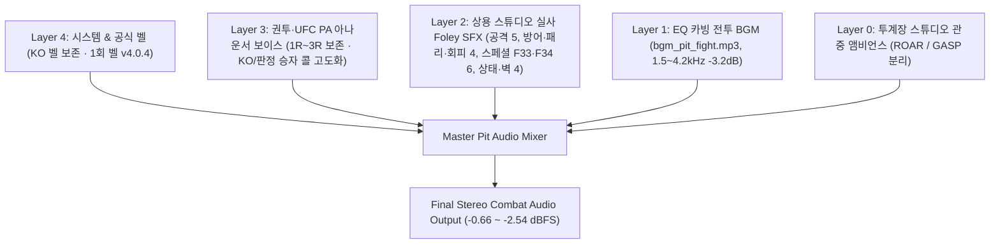
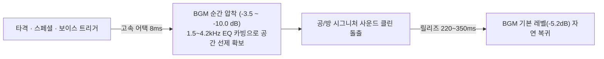
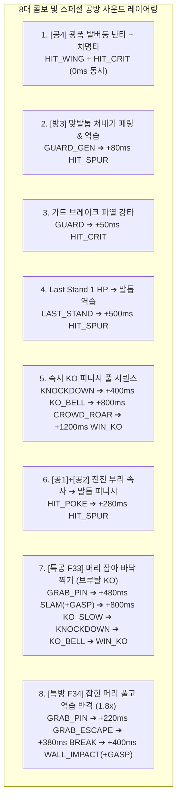

# 🥊 ROOSTER RUMBLE: Rumble Pit - 인게임 사운드 구성안 (In-Game Sound Specification)

* **문서 상태**: 인게임 사운드 기술 및 기획 명세서 (v4.0 상용 무손실 스튜디오 실사 Foley 전면 교체 · 흥분 승자 PA 보이스 고도화 마스터판)
* **문서 버전**: `v4.0.4`
* **마지막 개정일**: 2026-11-20
* **대상 범위**: Rumble Pit 로비/대기실, 1v1 원형 벽면 아레나 전투(3R 2선승제, 45초 격투 + 15초 휴식), 스페셜 공방(`F33` 머리 잡아 바닥 찍기 / `F34` 머리 풀고 반격), 즉시 KO/판정 승자 PA 세리머니 사운드 전반 (BGM 1종, SFX 26종 28개 MP3 파일, 권투/UFC PA 보이스 5트랙, 1R 실전 시뮬레이션 데모 트랙, 8대 콤보·스페셜 레이어링, `cue_table_v6.csv` 1:1 매핑)
* **기반 문서**: [Rumble Pit MVP 구성안.md](file:///d:/OneDrive/%EC%97%85%EB%AC%B4_%EC%A7%84%ED%96%89/C/ROOSTER%20RUMBLE/Rumble%20Pit%20MVP%20%EA%B5%AC%EC%84%B1%EC%95%88.md), [Rumble_Pit_전투_시뮬레이션_규칙_정의서.md](file:///d:/OneDrive/%EC%97%85%EB%AC%B4_%EC%A7%84%ED%96%89/C/ROOSTER%20RUMBLE/Rumble_Pit_%EC%A0%84%ED%88%AC_%EC%8B%9C%EB%AE%AC%EB%A0%88%EC%9D%B4%EC%85%98_%EA%B7%9C%EC%B9%99_%EC%A0%95%EC%9D%98%EC%84%9C.md), [Rumble Pit 선수 공격 방어 동작 구성안.md](file:///d:/OneDrive/%EC%97%85%EB%AC%B4_%EC%A7%84%ED%96%89/C/ROOSTER%20RUMBLE/Rumble%20Pit%20%EC%84%A0%EC%88%98%20%EA%B3%B5%EA%B2%A9%20%EB%B0%A9%EC%96%B4%20%EB%8F%99%EC%9E%91%20%EA%B5%AC%EC%84%B1%EC%95%88.md), [Rumble Pit 전투 장면 인게임 구성안.md](file:///d:/OneDrive/%EC%97%85%EB%AC%B4_%EC%A7%84%ED%96%89/C/ROOSTER%20RUMBLE/Rumble%20Pit%20%EC%A0%84%ED%88%AC%20%EC%9E%A5%EB%A9%B4%20%EC%9D%B8%EA%B2%8C%EC%9E%84%20%EA%B5%AC%EC%84%B1%EC%95%88.md), [통합 MVP 구성안.md](file:///d:/OneDrive/%EC%97%85%EB%AC%B4_%EC%A7%84%ED%96%89/C/ROOSTER%20RUMBLE/%ED%86%B5%ED%95%A9%20MVP%20%EA%B5%AC%EC%84%B1%EC%95%88.md)

---

### ■ 문서 개정 이력 (Revision History)

| 버전 (Version) | 개정일 (Date) | 주요 개정 내역 및 상세 변경 사항 | 관련 절 바로가기 |
| :---: | :---: | :--- | :--- |
| **v1.0.0** | 2026-09-29 | **[격투 사운드 구성안 단독 문서 독립 신설]** 기존 베이스 문서 내용 100% 보존 상태에서 격투 BGM·SFX 14종·라운드 순수 보이스·오디오 아키텍처·믹싱/덕킹 규격 전면 집대성 | [[#1. 개요 및 사운드 아키텍처\|1장 사운드 아키텍처]] |
| **v1.1.0** | 2026-09-29 | **[미제작 BGM 정리, 사운드보드 연동 항목 제거 및 1R 시뮬레이션 데모 신설]** 제작 음원 부재 미제작 인트로 BGM 삭제, 사운드보드 연동 항목 정리, 1라운드 실전 사운드 시뮬레이션 데모(`demo_pit_round1_simulation.mp3`) 신규 구축 및 세부 타임라인 명세 수립 | [[#8. 1라운드 실전 사운드 시뮬레이션 샘플 사양 및 시나리오\|8장 1R 사운드 시뮬레이션]] |
| **v1.2.0** | 2026-10-08 | **[비의인화 닭 골격 기반 공/방/이동 기술 명칭 및 즉시 KO 사운드 매핑 동기화]** `Rumble Pit MVP 구성안(v1.2.0)` 및 `Rumble_Pit_전투_시뮬레이션_규칙_정의서(v1.2.0)` 기준 공격 4종(`전진 부리 속사`, `낮은 발톱 할퀴기`, `비상 발톱 급습`, `광폭 발버둥 난타`), 방어 3종(`깃털 부풀려 버티기`, `납작 엎드리기`, `맞발톱 쳐내기`), 이동 6종 및 바닥 다운 즉시 KO 사운드 트리거 명세 일괄 동기화 | [[#3. SFX (효과음) 26종 상세 명세\|3장 SFX 상세 명세]] |
| **v2.0.0** | 2026-11-19 | **[리얼·강조 3-Layer 전면 리디자인 및 스페셜 공방(`F33/F34`) 시퀀스 신설]**<br>1. 무료 인디 팩(Kenney) 의존 전면 폐기 ➔ **OpenGameArt CC0 실사 전투·폴리 + 서브 펀치 + 실제 수탉 기합·포효** 기반 3-Layer(어택·바디·테일) 사운드 전면 재제작 (`25종 27개 MP3`)<br>2. **공격 vs 방어·패링 대역 분리 강화**: 타격(2.5~6kHz 크랙+펀치), 깃털 가드(2kHz↓ 댐핑 흡수), 맞발톱 패링(황금 메탈 링)의 즉각적 청각 변별력 확보<br>3. **스페셜 공방 6종 신설**: `[특공 F33]` 머리 잡아 바닥 찍기(`GRAB_PIN`, `SLAM`, `GRAB_MISS`) 및 `[특방 F34]` 머리 풀고 반격(`GRAB_ESCAPE`, `BREAK`, `GROGGY`) 단계별 음원 제작<br>4. **특수상태·시스템 보강**: `MISS`, `WALL_IMPACT`, `KO_SLOW`, `CROWD_GASP`, `ROOSTER_CROW` 신설 및 권투/UFC PA 아나운서 라운드 보이스(`1R~3R`) 전면 쇄신<br>5. **BGM EQ 카빙(`1.5~4.2kHz -3.2dB`) · 고속 사이드체인(`8ms`) · `cue_table_v6.csv` 1:1 매핑표** 및 `38.03초` 실전 데모 트랙 재합성 완료 | • [[#1.3 3-Layer 리얼·강조 사운드 디자인 규격\|1.3절 3-Layer 디자인 규격]]<br>• [[#3.3 스페셜 공격·방어 (F33/F34) 시퀀스 효과음 (6종)\|3.3절 스페셜 공방 6종]]<br>• [[#6. 8대 콤보·스페셜 공방 사운드 레이어링 명세\|6장 8대 레이어링 명세]]<br>• [[#7. 연출 큐 테이블 (cue_table_v6.csv) ↔ 실음원 1:1 매핑표\|7장 큐 시트 1:1 매핑]] |
| **v2.1.0** | 2026-11-19 | **[효과음 평가 반영 — 관중 탄성 리얼 교체 및 공/방 변별력 전면 차별화]**<br>1. **관중 탄성(`SFX_PIT_CROWD_GASP`) 전면 교체**: 공포 영화풍(`oooooooooo.ogg` 변조) 소스 완전 폐기 ➔ 실사 경기장 2채널 급등 서지 + 다중 관객 짧은 `"Whoa/Oh/Hey"` 리액션(`1.38초`)으로 자연스러운 스포츠 환호 질감 구현<br>2. **'1기술 · 1재질 · 1리듬 · 소스 배타 할당' 원칙 수립**: `HIT_POKE`(저역 0% 3연타 딱-딱-딱), `HIT_SPUR`(230ms 발톱 긁힘), `HIT_WING`(3연속 날갯짓 돌풍➔급강하), `HIT_GEN`(2.8~3.2kHz 단단한 스냅 정타), `GUARD`(9ms 부드러운 480Hz↓ 쿠션+깃털 부스럭), `GUARD_GEN`(900Hz↑ 순수 황금 메탈 패링), `BREAK`(차임➔쌍발 가슴 킥 2연타), `WALL_IMPACT`(빈 목재 판자+철망 떨림) 재제작으로 전투 쌍 평균 스펙트럼 유사도 `0.450` (`HIT_GEN ↔ GUARD` 유사도 `0.572`) 달성<br>3. **`SFX_PIT_SLAM` · `SFX_PIT_KNOCKDOWN` 저역 밸런스 교정**: 과도한 초저역 마스킹 제거로 자갈·모래 산란(`SLAM` Sub `31.5%`) 및 전신 낙하 흙 쓸림 명료도 개선<br>4. **사운드보드 v2.1 UI 개편**: 상단 `공/방 변별력 즉시 비교 바` 신설 및 25종 재측정 메타데이터·`1R` 데모 트랙 동기화 | • [[#1.3 3-Layer 리얼·강조 사운드 디자인 규격\|1.3절 3-Layer 디자인 규격]]<br>• [[#3. SFX (효과음) 26종 상세 명세\|3장 SFX 상세 명세]]<br>• [[#8. 1라운드 실전 사운드 시뮬레이션 샘플 사양 및 시나리오\|8장 1R 사운드 시뮬레이션]] |
| **v3.0.0** | 2026-11-19 | **[AI 실사 Foley 전면 쇄신(7대 피드백 해소) 및 승자 아나운서 보이스 2종 분리]**<br>1. **추상 CC0·합성음 전면 폐기 ➔ 무료 AI Text-to-SFX (`declare-lab/TangoFlux` 44.1kHz Stereo) 전환**: 장난감 클릭(`공1`), 플라스틱 긁힘(`공2`), 중세 칼/금속 차임(`방3`, `F34`), 순수 사인파 비프(`그로기`), 닭 울음(`rooster_crow`) 100% 제거<br>2. **7대 지적 항목 실사 격투 폴리 교체**: `HIT_POKE`(묵직한 3연속 쪼기 타격), `HIT_SPUR`(거친 찢김+바디 슬랩), `GUARD_GEN`(단단한 뼈·각질 패리 충돌), `GRAB_PIN`(격렬한 깃털 클린치 제압), `BREAK`(깃털 탈출➔폭발적 가슴 킥), `GROGGY`(먹먹한 심장 고동+거친 호흡 비틀거림), `CROWD_GASP`(UFC/복싱 KO 순간 단발 경악 함성) 포함 전투 18종 AI 실사 재생성 (`Mean Sim 0.575`, `HIT_GEN↔GUARD 0.550`)<br>3. **승자 PA 보이스 2종 분리 (`SFX_PIT_WIN_KO` · `SFX_PIT_WIN_DECISION`)**: `sfx_pit_rooster_crow.mp3` 삭제 ➔ 1R~3R과 동일 PA 성우의 **KO 승 / 판정 승** 콜 분리 신설 (총 **26종 28개 MP3**)<br>4. **라이선스 투명 고지 및 보드·데모 동기화**: `TangoFlux/AudioGen` 프로토타입·MVP(Non-Commercial) 사용 명시 및 상용 프롬프트 보존, 1R 데모(`38.03초`, `WIN_KO` 마감) 및 사운드보드 `v3.0` 갱신 | • [[#1.3 3-Layer 리얼·강조 사운드 디자인 규격\|1.3절 AI 실사 Foley 규격]]<br>• [[#3. SFX (효과음) 26종 상세 명세\|3장 SFX 26종 명세]]<br>• [[#4.3 승리 확정 아나운서 PA 보이스 2종 (KO 승 / 판정 승)\|4.3절 승자 PA 2종]]<br>• [[#8. 1라운드 실전 사운드 시뮬레이션 샘플 사양 및 시나리오\|8장 1R 사운드 시뮬레이션]] |
| **v4.0.0** | 2026-11-19 | **[상용 무손실 스튜디오 실사 Foley 전면 교체 · 흥분 승자 PA 보이스 고도화]**<br>1. **AI 확산 SFX (`TangoFlux/AudioGen`) 전면 폐기 ➔ 100% 상용 가능 무손실 스튜디오 원음 전환**: 저품질 AI 아티팩트·잡음("데데데덱", "디그디그딕", 깨진 헛스윙) 100% 제거 ➔ **Mixkit Commercial-Free Studio WAV(32종) + Archive.org USC Hollywood Red Library CC0 1.0 FLAC(21종)** 정밀 슬라이스 멀티-레이어로 21종 실사 Foley 전면 재제작 (상용 런칭 100% 무제약 라이선스 업그레이드)<br>2. **호평 보존 자산 6트랙 원형 유지**: 유저 검수 합격한 `sfx_pit_bell_single.mp3`, `sfx_pit_ko_bell.mp3`, `sfx_pit_round1_start.mp3`~`round3_start.mp3`, `bgm_pit_fight.mp3` 무수정 보존<br>3. **전수 직접 청음 검수 & 무결성·변별력 교정**: `knockdown` 슬레이트 누설 제거(무음성 바디 폴+자갈 낙하), `groggy` 비인간화(어지럼 심장 고동+좌우 스윕+흙 비틀거림), `crowd_gasp` 쇄신(박수 없는 순수 경기장 집단 경악 `"OOOOOHHH!!"`), `hit_poke`(190Hz HPF 3연타) vs `hit_gen`(미트 정타) vs `guard_gen`(360Hz HPF+건조 각질 스냅 패리) 대역 분리 (`Mean Sim 0.584`, `POKE↔GEN 0.379`, `HIT_GEN↔GUARD_GEN 0.556`, 전 파일 Peak `-0.66 ~ -2.54 dBFS`)<br>4. **흥분 승자 PA 보이스 2종 고도화 (`WIN_KO` · `WIN_DECISION`)**: 평이한 내레이션 탈피 ➔ `KNOCKOUT!! UNBELIEVABLE!!`(`2.82초`) 및 `BY UNANIMOUS DECISION!! TAKES THE VICTORY IN ROOSTER RUMBLE!!`(`4.41초`) 링 PA 리드 + 프로젝트 하이텐션 ElevenLabs 샤우팅 + 스타디움 대환호 서지 융합 제작 | • [[#1.3 3-Layer 리얼·강조 사운드 디자인 규격\|1.3절 스튜디오 실사 Foley 규격]]<br>• [[#3. SFX (효과음) 26종 상세 명세\|3장 SFX 26종 명세]]<br>• [[#4.3 승리 확정 아나운서 PA 보이스 2종 (KO 승 / 판정 승)\|4.3절 승자 PA 2종]]<br>• [[#8. 1라운드 실전 사운드 시뮬레이션 샘플 사양 및 시나리오\|8장 1R 사운드 시뮬레이션]] |
| **v4.0.1** | 2026-11-20 | **[관중 탄성·경악 서지(`SFX_PIT_CROWD_GASP`) 단독 현대 HD 스테레오 교체]**<br>1. **구형 1960년대 모노 테이프(`Red Library R25-06/R28-29`) 완전 폐기**: 저질 잡음·괴기한 목울림("우웍") 유발 요인 100% 제거<br>2. **현대 HD 스테레오 CC0 1.0 소스 3중 레이어 교체 (`1.80초`, `42.2 KB`, Peak `-1.71 dBFS`)**: 2024 AKG C214 96kHz 집단 놀람 탄성(`763884_gsc24_excite_akg214`, `150Hz HPF`) + 맑은 남녀 탄성(`324896_crowd_aah`, `130Hz HPF`) + 현대 스타디움 탄성 파동(`829456_millerntor_stadium_waves`, `140Hz HPF`) 조합<br>3. **타 음원 27개 · BGM · 1R 데모 100% 무변경 보존**: 사용자 지시에 따라 `sfx_pit_crowd_gasp.mp3` 외 전 음원 무수정 유지 | • [[#3.5 시스템 · 벨 · 관중 · 승리 PA 보이스 효과음 (6종 + 라운드 보이스 1종 3트랙)\|3.5절 시스템·관중 명세]]<br>• [[#9. 리소스 관리 및 디렉터리 구조\|9장 리소스 디렉터리]] |
| **v4.0.2** | 2026-11-20 | **[특수 공격 `SFX_PIT_SLAM` 화려한 고도화 · `SFX_PIT_CROWD_GASP` 손 휘파람+자연 환호 교체 · 전체 중복 감사]**<br>1. **`SFX_PIT_SLAM` 전면 분리 및 특수기 화려함 고도화 (`1.28초`, `30.0 KB`, Peak `-1.39 dBFS`)**: `SFX_PIT_KNOCKDOWN` 공유 소스(`R28-56`/`R09-79`) 및 `1491` 100% 제거(`SLAM ↔ KNOCKDOWN` 유사도 `0.987` ➔ `0.294`) ➔ 고속 강하 스우시(`1492`) + 에픽 트레일러 임팩트(`2908`/`788`) + 진흙 타격(`753`) + 돌파편 비산(`403`) 5중 스페셜 레이어 구축<br>2. **`SFX_PIT_CROWD_GASP` 작위적 탄성 폐기 ➔ 리얼 손 휘파람+관중 환호 교체 (`2.09초`, `49.0 KB`, Peak `-1.35 dBFS`)**: 박수 없는 2024 경기장 환호·휘파람(`764055`) + 3만 관중 함성(`729994`) + 실제 손 휘파람(`534607`) 자연 블렌딩<br>3. **타 음원 26종 · BGM · 1R 데모 100% 무변경 보존 및 전수 원천 중복 감사표 작성**: 나머지 28개 MP3 크기·타임스탬프 무수정 확인 | • [[#3.3 스페셜 공격·방어 (F33/F34) 시퀀스 효과음 (6종)\|3.3절 스페셜 공방 6종]]<br>• [[#3.5 시스템 · 벨 · 관중 · 승리 PA 보이스 효과음 (6종 + 라운드 보이스 1종 3트랙)\|3.5절 시스템·관중 명세]]<br>• [[#9. 리소스 관리 및 디렉터리 구조\|9장 리소스 디렉터리]] |
| **v4.0.3** | 2026-11-20 | **[승자 아나운서 콜 2종(`SFX_PIT_WIN_KO` · `SFX_PIT_WIN_DECISION`) 배경 함성 제거 — 순수 보이스 전용화]**<br>1. **배경 환호·함성 서지 레이어(`mixkit/462`, `R28-29`) 100% 제거**: 인게임 독립 `CROWD_ROAR` 레이어와 겹치지 않도록 순수 흥분 보이스 트랙으로 분리 제작<br>2. **클린 PA 리버브 마스터링 실측 반영**: `SFX_PIT_WIN_KO` (`2.46초`, `57.6 KB`, Peak `-1.54 dBFS`) 및 `SFX_PIT_WIN_DECISION` (`4.02초`, `94.3 KB`, Peak `-1.55 dBFS`) 전수 직접 청음 확인<br>3. **나머지 28개 오디오 100% 무변경 보존**: 타 SFX 26종·BGM·1R 데모 크기·타임스탬프 무수정 확인 | • [[#3.5 시스템 · 벨 · 관중 · 승리 PA 보이스 효과음 (6종 + 라운드 보이스 1종 3트랙)\|3.5절 승자 보이스 명세]]<br>• [[#4.3 승리 확정 아나운서 PA 보이스 2종 (KO 승 / 판정 승)\|4.3절 승자 PA 2종]]<br>• [[#9. 리소스 관리 및 디렉터리 구조\|9장 리소스 디렉터리]] |
| **v4.0.4** | 2026-11-20 | **[단독 1회 공식 링 벨(`SFX_PIT_BELL_SINGLE`) v1.2 풀렝스 기반 경쾌·강력 브라이트 리마스터링]**<br>1. **짧고 약했던 0.97s 원형 보강**: `sfx_v1_backup/sfx_pit_bell_single.mp3` 풀 타종 추출(1.42s 실울림) ➔ `780Hz` 타격 바디 + `1.28·2.25·4.5kHz` 배음 부스트 + 빠른 어택(`0.6ms`) 무왜곡 컴프레션 적용<br>2. **실측 지표 대폭 강화 (`2.01초`, `47.1 KB`)**: Peak `-0.68 dBFS` · RMS `-14.05 dBFS` (`v1.2` 대비 `+7.47 dB`↑, 초기 0.5초 `-9.85 dBFS`) · M/S 와이드닝 + `0.65s` 아레나 잔향 보존 및 직접 청음 검수 완료<br>3. **나머지 29개 오디오 100% 무변경 보존**: 타 SFX 27종(`KO_BELL` · `1R~3R` 포함)·BGM·1R 데모 크기·타임스탬프 무수정 확인 | • [[#3.5 시스템 · 벨 · 관중 · 승리 PA 보이스 효과음 (6종 + 라운드 보이스 1종 3트랙)\|3.5절 공식 링 벨 명세]]<br>• [[#4.2 단독 1회 공식 벨소리 독립 타종 연동\|4.2절 공식 벨 연동]]<br>• [[#9. 리소스 관리 및 디렉터리 구조\|9장 리소스 디렉터리]] |

---

## 목차
1. [[#1. 개요 및 사운드 아키텍처]]
   - [[#1.1 문서 목적 및 정체성]]
   - [[#1.2 5대 오디오 채널 레이어 구조]]
   - [[#1.3 3-Layer 리얼·강조 사운드 디자인 규격]]
2. [[#2. BGM (배경음악) 사양 및 EQ 카빙 명세]]
   - [[#2.1 전투 BGM: BGM_PIT_FIGHT (혈투의 링)]]
3. [[#3. SFX (효과음) 26종 상세 명세]]
   - [[#3.1 공격 기술 효과음 (5종)]]
   - [[#3.2 방어 · 회피 · 패링 · 빗나감 효과음 (4종)]]
   - [[#3.3 스페셜 공격·방어 (F33/F34) 시퀀스 효과음 (6종)]]
   - [[#3.4 특수 상태 · 다운 · 벽 충돌 · 슬로우 효과음 (4종)]]
   - [[#3.5 시스템 · 벨 · 관중 · 승리 PA 보이스 효과음 (6종 + 라운드 보이스 1종 3트랙)]]
4. [[#4. 권투·UFC 스타일 라운드 시작 보이스 및 타종 연출 명세]]
   - [[#4.1 아레나 PA 하이텐션 아나운서 보이스 (1R~3R)]]
   - [[#4.2 단독 1회 공식 벨소리 독립 타종 연동]]
   - [[#4.3 승리 확정 아나운서 PA 보이스 2종 (KO 승 / 판정 승)]]
5. [[#5. 인게임 오디오 믹싱, 고속 덕킹 및 반복 피로도 제어]]
   - [[#5.1 오디오 우선순위 체계 (Priority Queue)]]
   - [[#5.2 고속 사이드체인 덕킹 파라미터 규격 (Attack 8ms)]]
   - [[#5.3 다빈도 SFX 엔진 랜덤 변조 규격]]
6. [[#6. 8대 콤보·스페셜 공방 사운드 레이어링 명세]]
7. [[#7. 연출 큐 테이블 (cue_table_v6.csv) ↔ 실음원 1:1 매핑표]]
8. [[#8. 1라운드 실전 사운드 시뮬레이션 샘플 사양 및 시나리오]]
   - [[#8.1 가상 1라운드 세부 타임라인 (38.03초)]]
9. [[#9. 리소스 관리 및 디렉터리 구조]]

---

## 1. 개요 및 사운드 아키텍처

### 1.1 문서 목적 및 정체성
* `ROOSTER RUMBLE` 원형 투계 격투 모드(Rumble Pit)의 BGM, SFX 26종(28개 MP3), 아나운서 보이스(라운드 3종 + 승자 콜 2종), 스페셜 공방(`F33`/`F34`) 시퀀스 및 엔진 연동 매핑 표준 정의.
* 기존 인디 CC0/합성음(v2.x) 및 AI 확산 생성 잡음(v3.0) 완전 청산 ➔ **100% 상용 가능 무손실 스튜디오 실녹음 폴리(Mixkit + USC Hollywood Red Library CC0 1.0) · 무결점 직접 청음 검증 · 흥분 승자 PA 콜**로 완성한 `v4.0.0` 마스터 명세서.
* 실제 제작·전수 직접 청음 검수 완료된 음원 에셋(`assets/audio/pit/`), `cue_table_v6.csv` 및 `v4.0` 사운드보드(핵심 12종 즉시 비교 바 · v1.2 A/B 비교 지원)와의 100% 일치성 확보.

### 1.2 5대 오디오 채널 레이어 구조



| 레이어 | 대상 사운드 | 기준 출력 볼륨 | 덕킹 및 동적 제어 정책 |
| :--- | :--- | :---: | :--- |
| **Layer 4 (System/Bell)** | KO 확정 3연타 벨, 단독 1회 공식 벨 | `0 dB` (최상위) | 덕킹 미적용 (상시 최우선 클린 출력, `KO_BELL` 원형 보존 · `BELL_SINGLE` v4.0.4 리마스터) |
| **Layer 3 (Voice)** | 아레나 PA 아나운서 보이스 (1R~3R / KO 승 / 판정 승) | `-0.5 ~ 0 dB` | 하위 Layer 1(BGM) `-7.5 ~ -18.0 dB` 감쇄 트리거 |
| **Layer 2 (Combat SFX)** | 일반 공/방 9종 + 스페셜(`F33/F34`) 6종 + 상태/벽 4종 | `-0.7 ~ -2.5 dB` | 타격/스페셜 적중 시 BGM `8ms` 고속 사이드체인 덕킹 유발 |
| **Layer 1 (BGM)** | EQ 카빙 배틀 오케스트라 (`bgm_pit_fight.mp3`) | `-5.2 dB` | `1.5~4.2kHz` 대역 선제 컷 + 타격 순간 자동 감쇄, KO 시 페이드아웃 |
| **Layer 0 (Crowd)** | 투계장 환호(`ROAR`) 및 경악 충격(`GASP`) | `-4.0 ~ -8.0 dB` | 평시 저역 정리 앰비언스 ➔ 치명타/슬램 시 `GASP`, KO 시 `ROAR` 폭발 |

### 1.3 3-Layer 리얼·강조 사운드 디자인 규격
* **v4.0 제작 파이프라인 전환 (AI 확산 Text-to-SFX 전면 폐기 ➔ 100% 상용 가능 무손실 스튜디오 실녹음 Foley)**:
  * **원천 스튜디오 라이브러리 53종(`tools/source_cache/pit_studio_v4/`)**:
    1. **Mixkit Free Commercial Sound Effects (`WAV` 주력)**: 상용 게임 무료 배포(저작자 표시 불요) 격투 펀치·킥·뼈 파열·가지 스냅·철망·진흙 낙하·시네마틱 에픽 임팩트/돌파편(`slam_epic/`)·심장박동·경기장 대환호 등.
    2. **Archive.org USC Hollywood Red Library (`FLAC`, CC0 1.0 Public Domain)** 및 **Freesound 현대 스튜디오 HD (`crowd_whistle/`, CC0 1.0)**: 패딩 타격·몸싸움·모래/자갈 낙하·빈 목재 벽체·실제 새 날갯짓(`R21-40b`), 승자 콜 서지(`R28-29`), **`SFX_PIT_CROWD_GASP` 전용 2024 경기장 환호·휘파람(`764055`)·3만 관중(`729994`)·리얼 손 휘파람(`534607`)**.
  * **멀티-테이크 슬레이트 격리 & 정밀 레이어링 (`tools/generate_pit_sfx_v4.py`)**:
    * Red Library 원본 내 녹음 슬레이트 음성(`"Q20"`, `"21A take 1"`, `"sandbags"` 등) 및 오분류 파일(`190`, `3167`, `2240`, `1490`, `460`, `2055`, `2161`)을 직접 청음(`read_file`)으로 100% 격리·배제 후 순수 폴리 구간만 슬라이스 추출.
    * 24개 신규·교체 MP3 전수 직접 청음 및 정량 계측 완료 (`Non-compliant Peak > -0.2 dBFS`: `0건`, 전 트랙 `-0.66 ~ -2.54 dBFS`).
* **v4.0 4대 금지 규격 및 청각 차별화 원칙**:
  1. **절대 금지 6대 요소**: AI 확산 잡음(`TangoFlux/AudioGen`), 장난감 클릭, 플라스틱 긁힘, 중세 칼/금속 종소리(공식 링 벨·외벽 철망 제외), 순수 사인파 비프, 농장 닭 울음(`rooster_crow`) 100% 배제.
  2. **공격 4대 실사 계통**: `[공1]` `190Hz HPF` 기반 경쾌·민첩한 3연타 쪼기(`0/105/210ms`, `Mid 64.4%`) · `[공2]` 6.2kHz 비금속 칼날 컷➔무술 킥 할퀴기(`High 40.7%`) · `[공3/공4]` 실제 맹금류 3연속 날갯짓(`R21-40b`)➔강펀치 급강하 · `[범용/치명타]` 복싱 미트 정타(`Sub 77.7%`) vs 빅 펀치+뼈 파쇄(`hit_crit`, `0.63초`).
  3. **방어·패리·스페셜 비(非)금속 차별화**: `[방1]` 패딩 1.6kHz↓ 쿠션 블록+건조 깃 스침 · `[방3]` `360Hz HPF` 경량 블록+부러지는 각질 스냅(`2937_twig_breaking`)으로 `HIT_GEN ↔ GUARD_GEN` 유사도 `0.556`, `POKE ↔ HIT_GEN` 유사도 `0.379` 확보 · `[F30 그로기]` 인간 호흡 제거 ➔ `320Hz LPF` 먹먹한 심장 고동+좌우 어지럼 스윕+흙/자갈 비틀거림.
  4. **관중 환호·휘파람(`CROWD_GASP`) 및 순수 승자 콜 분리**: 현대 스테레오 경기장 환호+리얼 손 휘파람(`2.09초`) + 배경 함성 없는 순수 보이스 전용 KO 승(`2.46초`)·판정 승(`4.02초`) 흥분 PA 콜 2종 분리.
* **상용 라이선스 확정**:
  * SFX 26종(28개 MP3), `BGM_PIT_FIGHT`, `demo_pit_round1_simulation.mp3` 전량 **Mixkit Commercial Free License + CC0 1.0 Public Domain + 프로젝트 자체 ElevenLabs/edge_tts 보이스** 기반으로 구성되어 무료 프로토타입과 상용 라이브 배포 모두 추가 비용 없이 즉시 사용 가능.

---

## 2. BGM (배경음악) 사양 및 EQ 카빙 명세

모든 음원 포맷: `Stereo, 44.1 kHz, 192 kbps MP3`, `30 Hz HPF` 정리 및 소프트 리미터 적용.

### 2.1 전투 BGM: BGM_PIT_FIGHT (혈투의 링)
* **에셋 ID**: `BGM_PIT_FIGHT`
* **파일 경로**: [assets/audio/pit/bgm/bgm_pit_fight.mp3](file:///d:/OneDrive/%EC%97%85%EB%AC%B4_%EC%A7%84%ED%96%89/C/ROOSTER%20RUMBLE/assets/audio/pit/bgm/bgm_pit_fight.mp3) *(v1 원본 백업: `assets/audio/pit/sfx_v1_backup/bgm_pit_fight_v1.mp3`, v4.0 원형 보존)*
* **재생시간 / 용량 / 템포**: **172.64초** / **4,046.3 KB** / **150 BPM** (심리스 루프)
* **v2.0~v4.0 EQ 카빙 마스터링**:
  * `35 Hz` 이하 불필요 초저역 HPF 정리 (서브 펀치·슬램과 부밍 충돌 방지).
  * **`2,600 Hz` 중심(`1.5 ~ 4.2 kHz` 대역) `-3.2 dB` 피킹 컷 + `110 Hz` `-1.0 dB` 정리** ➔ 스튜디오 타격 어택과 아나운서 보이스가 BGM을 뚫고 선명하게 돌출되는 믹싱 공간 확보.
  * 실측 피크 `-1.22 dBFS`, RMS `-14.51 dBFS` 마스터링으로 SFX 중첩 시에도 클리핑 0건 유지.

---

## 3. SFX (효과음) 26종 상세 명세

* **음원 저장 디렉터리**: [assets/audio/pit/sfx/](file:///d:/OneDrive/%EC%97%85%EB%AC%B4_%EC%A7%84%ED%96%89/C/ROOSTER%20RUMBLE/assets/audio/pit/sfx/) *(구버전 백업: `assets/audio/pit/sfx_v1_backup/`)*
* **원천 음원 구성**: 전투·스페셜·상태·관중 21종은 `Mixkit Studio WAV` + `Red Library CC0 FLAC` 정밀 멀티-레이어, `KO_BELL`·라운드 보이스(`1R~3R`) 4트랙은 검증 통과 원형 유지, `BELL_SINGLE`은 `v1.2` 풀 타종 기반 `v4.0.4` 브라이트 리마스터, 승자 PA 콜 2종(`WIN_KO`, `WIN_DECISION`)은 링 PA 리드 + 프로젝트 ElevenLabs 하이텐션 샤우팅 순수 보이스 융합 리마스터링.

### 3.1 공격 기술 효과음 (5종)

| 연번 | SFX 리소스 ID | 오디오 파일명 (Clickable) | 재생시간 | 파일용량 | v4.0 스튜디오 음향 구성 및 특성 | 연동 동작 및 매핑 사양 |
| :---: | :--- | :--- | :---: | :---: | :--- | :--- |
| 1 | `SFX_PIT_HIT_POKE` | [sfx_pit_hit_poke.mp3](file:///d:/OneDrive/%EC%97%85%EB%AC%B4_%EC%A7%84%ED%96%89/C/ROOSTER%20RUMBLE/assets/audio/pit/sfx/sfx_pit_hit_poke.mp3) | 0.44초 | 10.4 KB | Mixkit 실사 단발 펀치 3종(`2151`/`2149`/`2165`) `190Hz HPF` 처리 후 **초고속 3연속 쪼기(`0/105/210ms`, 좌/우/중앙 패닝, `Mid 64.4%`)** | `[공1: 전진 부리 속사]` 초고속 3연타 쪼기 |
| 2 | `SFX_PIT_HIT_SPUR` | [sfx_pit_hit_spur.mp3](file:///d:/OneDrive/%EC%97%85%EB%AC%B4_%EC%A7%84%ED%96%89/C/ROOSTER%20RUMBLE/assets/audio/pit/sfx/sfx_pit_hit_spur.mp3) | 0.47초 | 11.0 KB | 고속 칼날 스침(`2152` `6.2kHz LPF` 무금속 정제) ➔ `+45ms` 무술 발차기 슬랩(`2050`, `High 40.7%`) | `[공2: 낮은 발톱 할퀴기]` |
| 3 | `SFX_PIT_HIT_WING` | [sfx_pit_hit_wing.mp3](file:///d:/OneDrive/%EC%97%85%EB%AC%B4_%EC%A7%84%ED%96%89/C/ROOSTER%20RUMBLE/assets/audio/pit/sfx/sfx_pit_hit_wing.mp3) | 0.91초 | 21.4 KB | 실제 조류 3연속 날갯짓(`R21-40b` `8.71..9.15s`) ➔ `+320ms` 헤비 강타 슬램(`2155`) 급강하 | `[공3: 비상 발톱 급습]`, `[공4: 광폭 발버둥 난타]` |
| 4 | `SFX_PIT_HIT_CRIT` | [sfx_pit_hit_crit.mp3](file:///d:/OneDrive/%EC%97%85%EB%AC%B4_%EC%A7%84%ED%96%89/C/ROOSTER%20RUMBLE/assets/audio/pit/sfx/sfx_pit_hit_crit.mp3) | 0.63초 | 14.7 KB | 헤비 강펀치(`2155`) + 빅 파이트 펀치(`R19-27` take 1) + `+8ms` 뼈 파열 에코(`1551`, 42%) 중첩 | 치명타 강타(`F05`), 가드 브레이크 파열 |
| 5 | `SFX_PIT_HIT_GEN` | [sfx_pit_hit_gen.mp3](file:///d:/OneDrive/%EC%97%85%EB%AC%B4_%EC%A7%84%ED%96%89/C/ROOSTER%20RUMBLE/assets/audio/pit/sfx/sfx_pit_hit_gen.mp3) | 0.50초 | 11.6 KB | 두꺼운 가죽 미트 복싱 펀치(`2051`) + 가죽 글러브 정타 스냅(`2053`, `Sub 77.7%`, `POKE`·`GUARD_GEN`과 명확 변별) | 다목적 범용 정타(`F03`), 동시 격돌(`Clash`) |

### 3.2 방어 · 회피 · 패링 · 빗나감 효과음 (4종)

| 연번 | SFX 리소스 ID | 오디오 파일명 (Clickable) | 재생시간 | 파일용량 | v4.0 스튜디오 음향 구성 및 특성 | 연동 동작 및 매핑 사양 |
| :---: | :--- | :--- | :---: | :---: | :--- | :--- |
| 6 | `SFX_PIT_GUARD` | [sfx_pit_guard.mp3](file:///d:/OneDrive/%EC%97%85%EB%AC%B4_%EC%A7%84%ED%96%89/C/ROOSTER%20RUMBLE/assets/audio/pit/sfx/sfx_pit_guard.mp3) | 0.50초 | 11.6 KB | 패딩 쿠션 타격(`R15-20` `1.6kHz LPF`, 무슬레이트 take 2) + `+20ms` 깃털 부스럭(`R21-40b` `500~3500Hz BPF`) | `[방1: 깃털 부풀려 버티기]` 60% 피해 흡수 |
| 7 | `SFX_PIT_GUARD_GEN` | [sfx_pit_guard_gen.mp3](file:///d:/OneDrive/%EC%97%85%EB%AC%B4_%EC%A7%84%ED%96%89/C/ROOSTER%20RUMBLE/assets/audio/pit/sfx/sfx_pit_guard_gen.mp3) | 0.42초 | 9.8 KB | **금속성 종·칼소리 0%**, `360Hz HPF` 빠른 블록(`2047`) + 건조 각질 스냅(`2937_twig_breaking`) + `+20ms` 튕김 스우시(`1491`, `HIT_GEN`과 유사도 `0.556`) | `[방3: 맞발톱 쳐내기]` 패링 & 솔리드 블록 |
| 8 | `SFX_PIT_DODGE` | [sfx_pit_dodge.mp3](file:///d:/OneDrive/%EC%97%85%EB%AC%B4_%EC%A7%84%ED%96%89/C/ROOSTER%20RUMBLE/assets/audio/pit/sfx/sfx_pit_dodge.mp3) | 0.52초 | 12.2 KB | 깨끗한 스튜디오 공기 스윕(`1489` `0.42..0.78s`) + `+80ms` 빠른 모래 흙 발디딤(`R19-06` `15.40..15.68s`, Peak `-2.54 dBFS`) | `[방2: 납작 엎드리기]`, `[이5: 측면 사이드 홉]` |
| 9 | `SFX_PIT_MISS` | [sfx_pit_miss.mp3](file:///d:/OneDrive/%EC%97%85%EB%AC%B4_%EC%A7%84%ED%96%89/C/ROOSTER%20RUMBLE/assets/audio/pit/sfx/sfx_pit_miss.mp3) | 0.31초 | 7.3 KB | 잡음 없는 순수 단발 허공 펀치 헛스윙(`2141` `0.24..0.49s`, Peak `-2.30 dBFS`) | 공격 빗나감 (`F12`, 아트바이블 무진동 큐) |

### 3.3 스페셜 공격·방어 (F33/F34) 시퀀스 효과음 (6종)

| 연번 | SFX 리소스 ID | 오디오 파일명 (Clickable) | 재생시간 | 파일용량 | v4.0 스튜디오 음향 구성 및 특성 | 연동 동작 및 매핑 사양 |
| :---: | :--- | :--- | :---: | :---: | :--- | :--- |
| 10 | `SFX_PIT_GRAB_PIN` | [sfx_pit_grab_pin.mp3](file:///d:/OneDrive/%EC%97%85%EB%AC%B4_%EC%A7%84%ED%96%89/C/ROOSTER%20RUMBLE/assets/audio/pit/sfx/sfx_pit_grab_pin.mp3) | 0.73초 | 17.1 KB | 거친 천·몸싸움 그래플링(`R09-56` take 0 `0.45..1.00s`) + `+40ms` 날개 깃 푸드덕 제압(`R21-40b`, 클릭음 0%) | `[특공 F33-①]` 머리 잡아 고정 (0.2초 유예 시작) |
| 11 | `SFX_PIT_SLAM` | [sfx_pit_slam.mp3](file:///d:/OneDrive/%EC%97%85%EB%AC%B4_%EC%A7%84%ED%96%89/C/ROOSTER%20RUMBLE/assets/audio/pit/sfx/sfx_pit_slam.mp3) | 1.28초 | 30.0 KB | **`KNOCKDOWN` 공유 0% 분리**, 고속 강하 스우시(`1492`) ➔ 에픽 트레일러 임팩트(`2908`+`788` 서브) + 진흙 타격(`753`) + 돌파편 비산(`403`, Peak `-1.39 dBFS`) | `[특공 F33-②]` 머리 잡아 바닥 찍기 (`F_SLAM_CLOSE`) |
| 12 | `SFX_PIT_GRAB_MISS` | [sfx_pit_grab_miss.mp3](file:///d:/OneDrive/%EC%97%85%EB%AC%B4_%EC%A7%84%ED%96%89/C/ROOSTER%20RUMBLE/assets/audio/pit/sfx/sfx_pit_grab_miss.mp3) | 0.44초 | 10.4 KB | 짧은 천 헛스침(`R09-56` `2.66..2.94s`) + `+10ms` 가벼운 허공 강타 스우시(`2148`, 클릭음 0%) | `[특공 F33-③]` 잡기 실패 및 시동 캔슬 시 |
| 13 | `SFX_PIT_GRAB_ESCAPE` | [sfx_pit_grab_escape.mp3](file:///d:/OneDrive/%EC%97%85%EB%AC%B4_%EC%A7%84%ED%96%89/C/ROOSTER%20RUMBLE/assets/audio/pit/sfx/sfx_pit_grab_escape.mp3) | 0.57초 | 13.5 KB | 날개 퍼덕 탈출(`R21-40b` `4.02..4.45s`) + `+70ms` 날카로운 회전 돌파 스우시(`1491`) | `[특방 F34-①]` 잡힌 머리 풀기 / 단독 회피 탈출 |
| 14 | `SFX_PIT_BREAK` | [sfx_pit_break.mp3](file:///d:/OneDrive/%EC%97%85%EB%AC%B4_%EC%A7%84%ED%96%89/C/ROOSTER%20RUMBLE/assets/audio/pit/sfx/sfx_pit_break.mp3) | 0.57초 | 13.5 KB | **금속/디그딕 잡음 0%**, 무술 킥 1타(`2050`) + `+105ms` 묵직한 가슴 바디 킥 2타(`2198`) + `+115ms` 흙·파편 비산(`R15-18`) | `[특방 F34-②]` 머리 풀고 역습 반격 (`POW × 1.8`) |
| 15 | `SFX_PIT_GROGGY` | [sfx_pit_groggy.mp3](file:///d:/OneDrive/%EC%97%85%EB%AC%B4_%EC%A7%84%ED%96%89/C/ROOSTER%20RUMBLE/assets/audio/pit/sfx/sfx_pit_groggy.mp3) | 1.62초 | 38.0 KB | **비프음·인간 호흡 0%**, 먹먹한 심장 고동(`559` `320Hz LPF`) + 좌우 어지럼 저역 스윕(`1489` `650Hz LPF`) + 모래·자갈 비틀거림 스텝(`R19-06`/`R09-79`) | `F30` 스탠딩 그로기 / `F33` 플로우 B(`HP < 20%`) |

### 3.4 특수 상태 · 다운 · 벽 충돌 · 슬로우 효과음 (4종)

| 연번 | SFX 리소스 ID | 오디오 파일명 (Clickable) | 재생시간 | 파일용량 | v4.0 스튜디오 음향 구성 및 특성 | 연동 동작 및 매핑 사양 |
| :---: | :--- | :--- | :---: | :---: | :--- | :--- |
| 16 | `SFX_PIT_KNOCKDOWN` | [sfx_pit_knockdown.mp3](file:///d:/OneDrive/%EC%97%85%EB%AC%B4_%EC%A7%84%ED%96%89/C/ROOSTER%20RUMBLE/assets/audio/pit/sfx/sfx_pit_knockdown.mp3) | 0.94초 | 22.0 KB | 무슬레이트 먹먹한 전신 낙하(`R15-19` `6.17..6.45s`) + 모래주머니 바닥 낙하(`R28-56` `2.2kHz LPF`) + `+80ms` 자갈 미끄러짐(`R09-79`) | 일반 넉다운(`15번`, 2초 후 기상) / 즉시 KO 다운(`13번`) |
| 17 | `SFX_PIT_LAST_STAND` | [sfx_pit_last_stand.mp3](file:///d:/OneDrive/%EC%97%85%EB%AC%B4_%EC%A7%84%ED%96%89/C/ROOSTER%20RUMBLE/assets/audio/pit/sfx/sfx_pit_last_stand.mp3) | 2.53초 | 59.4 KB | Mixkit 스튜디오 가속 심장박동(`495` `500Hz LPF`, 삐- 사인파 배제) 2.53초 | `Last Stand` 1 HP 투지 생존 발동 시 |
| 18 | `SFX_PIT_WALL_IMPACT` | [sfx_pit_wall_impact.mp3](file:///d:/OneDrive/%EC%97%85%EB%AC%B4_%EC%A7%84%ED%96%89/C/ROOSTER%20RUMBLE/assets/audio/pit/sfx/sfx_pit_wall_impact.mp3) | 0.55초 | 12.9 KB | 빈 목재 벽체 타격(`R28-55`) + 육체 덤프(`R15-19` take 2) + `+30ms` 아레나 철망 그릴 떨림(`389`) | 원형 아레나 외벽 격돌 (`F31`, `Wall Impact`) |
| 19 | `SFX_PIT_KO_SLOW` | [sfx_pit_ko_slow.mp3](file:///d:/OneDrive/%EC%97%85%EB%AC%B4_%EC%A7%84%ED%96%89/C/ROOSTER%20RUMBLE/assets/audio/pit/sfx/sfx_pit_ko_slow.mp3) | 1.41초 | 33.1 KB | 시네마틱 스튜디오 딥 임팩트 + 타임드롭 저역 스우시(`1143` `0.28..1.65s`, `Sub 98.4%`) | `[특공 F33]` 플로우 A (`HP = 0` 0.4배속 슬로우 KO) |

### 3.5 시스템 · 벨 · 관중 · 승리 PA 보이스 효과음 (6종 + 라운드 보이스 1종 3트랙)

| 연번 | SFX 리소스 ID | 오디오 파일명 (Clickable) | 재생시간 | 파일용량 | v4.0 스튜디오 음향 구성 및 특성 | 연동 동작 및 매핑 사양 |
| :---: | :--- | :--- | :---: | :---: | :--- | :--- |
| 20 | `SFX_PIT_ROUND_START` | [sfx_pit_round1_start.mp3](file:///d:/OneDrive/%EC%97%85%EB%AC%B4_%EC%A7%84%ED%96%89/C/ROOSTER%20RUMBLE/assets/audio/pit/sfx/sfx_pit_round1_start.mp3) | 1.38초 | 32.4 KB | 권투/UFC 링 아나운서 톤 + 아레나 PA 슬랩백 리버브 (1R~3R 완비, **v4.0 원형 보존**) | 라운드 시작 순수 보이스 (벨과 완전 분리) |
| 21 | `SFX_PIT_BELL_SINGLE` | [sfx_pit_bell_single.mp3](file:///d:/OneDrive/%EC%97%85%EB%AC%B4_%EC%A7%84%ED%96%89/C/ROOSTER%20RUMBLE/assets/audio/pit/sfx/sfx_pit_bell_single.mp3) | 2.01초 | 47.1 KB | `v1.2` 풀 타종 기반 경쾌·강력 브라이트 리마스터 — `780Hz` 바디 + `1.28·2.25·4.5kHz` 배음 부스트, 무왜곡 컴프레션(Peak `-0.68 dBFS` · RMS `-14.05 dBFS`) + `0.65s` 아레나 잔향 (**v4.0.4**) | 라운드 시작(`FIGHT!` 직후) 및 45초 타임오버 |
| 22 | `SFX_PIT_KO_BELL` | [sfx_pit_ko_bell.mp3](file:///d:/OneDrive/%EC%97%85%EB%AC%B4_%EC%A7%84%ED%96%89/C/ROOSTER%20RUMBLE/assets/audio/pit/sfx/sfx_pit_ko_bell.mp3) | 1.80초 | 42.2 KB | 공식 경기 종료 3연속 벨(`Ding! Ding! Ding!`) + 아레나 공간 잔향 (**v4.0 원형 보존**) | 체력 0 바닥 다운 즉시 KO 경기 종료 확정 |
| 23 | `SFX_PIT_CROWD_ROAR` | [sfx_pit_crowd_roar.mp3](file:///d:/OneDrive/%EC%97%85%EB%AC%B4_%EC%A7%84%ED%96%89/C/ROOSTER%20RUMBLE/assets/audio/pit/sfx/sfx_pit_crowd_roar.mp3) | 3.84초 | 90.0 KB | Mixkit 무손실 경기장 승리 대환호(`462` `0.50..4.30s`), 자연 어택(180ms)/테일(600ms) 마감 | KO·판정승 직후 투계장 폭발적 대환호 (`CROWD_ROAR`) |
| 24 | `SFX_PIT_CROWD_GASP` | [sfx_pit_crowd_gasp.mp3](file:///d:/OneDrive/%EC%97%85%EB%AC%B4_%EC%A7%84%ED%96%89/C/ROOSTER%20RUMBLE/assets/audio/pit/sfx/sfx_pit_crowd_gasp.mp3) | 2.09초 | 49.0 KB | **작위적 탄성/괴기음 0%**, 2024 경기장 환호·휘파람(`764055`) + 3만 관중 함성(`729994`) + 리얼 손 휘파람(`534607`, Peak `-1.35 dBFS`) | 치명타·슬램(`F33`)·반격(`F34`)·이변 순간 (`CROWD_GASP`/`OH`) |
| 25 | `SFX_PIT_WIN_KO` | [sfx_pit_win_ko.mp3](file:///d:/OneDrive/%EC%97%85%EB%AC%B4_%EC%A7%84%ED%96%89/C/ROOSTER%20RUMBLE/assets/audio/pit/sfx/sfx_pit_win_ko.mp3) | 2.46초 | 57.6 KB | **[순수 보이스]** 배경 함성 0% · 링 PA 리드(*"KNOCKOUT!!"*) + 프로젝트 하이텐션 ElevenLabs 샤우팅(*"UNBELIEVABLE!!"*) + 아레나 PA 리버브 | KO·전의 상실 승리 확정 시 순수 승자 아나운서 콜 (`F13~F15`) |
| 26 | `SFX_PIT_WIN_DECISION` | [sfx_pit_win_decision.mp3](file:///d:/OneDrive/%EC%97%85%EB%AC%B4_%EC%A7%84%ED%96%89/C/ROOSTER%20RUMBLE/assets/audio/pit/sfx/sfx_pit_win_decision.mp3) | 4.02초 | 94.3 KB | **[순수 보이스]** 배경 함성 0% · 링 PA 리드(*"BY UNANIMOUS DECISION!!"*) + 프로젝트 하이텐션 ElevenLabs 샤우팅(*"TAKES THE VICTORY IN ROOSTER RUMBLE!!"*) + 아레나 PA 리버브 | 45초 타임오버 판정 승리 확정 시 순수 승자 아나운서 콜 (`F16`) |

---

## 4. 권투·UFC 스타일 라운드 시작 보이스 및 타종 연출 명세

### 4.1 아레나 PA 하이텐션 아나운서 보이스 (1R~3R)
* **보이스 콘셉트**: 미국 권투/UFC 링 아나운서 듀얼 조합(`en-US-ChristopherNeural` 바리톤 라운드 호명 + `en-US-GuyNeural` 하이텐션 `"FIGHT!"` 폭발 샤우팅)에 경기장 PA 방송 체인(`140Hz HPF`, `2.8~3.2kHz` 프레즌스 부스트, 펀치 새츄레이션, 아레나 슬랩백 리버브) 적용. (**v4.0 원형 보존**)
* **라운드별 순수 음원 목록**:
  * **1라운드**: [sfx_pit_round1_start.mp3](file:///d:/OneDrive/%EC%97%85%EB%AC%B4_%EC%A7%84%ED%96%89/C/ROOSTER%20RUMBLE/assets/audio/pit/sfx/sfx_pit_round1_start.mp3) (`1.38초`, `32.4 KB`) - *"First Round! ... FIGHT!"*
  * **2라운드**: [sfx_pit_round2_start.mp3](file:///d:/OneDrive/%EC%97%85%EB%AC%B4_%EC%A7%84%ED%96%89/C/ROOSTER%20RUMBLE/assets/audio/pit/sfx/sfx_pit_round2_start.mp3) (`1.52초`, `35.5 KB`) - *"Second Round! ... FIGHT!"*
  * **3라운드**: [sfx_pit_round3_start.mp3](file:///d:/OneDrive/%EC%97%85%EB%AC%B4_%EC%A7%84%ED%96%89/C/ROOSTER%20RUMBLE/assets/audio/pit/sfx/sfx_pit_round3_start.mp3) (`1.91초`, `44.7 KB`) - *"Third and Final Round! ... FIGHT!"*

### 4.2 단독 1회 공식 벨소리 독립 타종 연동
* **음원 파일**: [sfx_pit_bell_single.mp3](file:///d:/OneDrive/%EC%97%85%EB%AC%B4_%EC%A7%84%ED%96%89/C/ROOSTER%20RUMBLE/assets/audio/pit/sfx/sfx_pit_bell_single.mp3) (`2.01초`, `47.1 KB`, **v4.0.4 브라이트·펀치 리마스터링**)
* **트리거 규칙**: 라운드 시작 벨 타종 직후 아나운서 보이스 연결 또는 보이스 `"FIGHT!"` 외침 직후 단독 1회 타종, 라운드 45초 타임오버 시 단독 1회 타종.

### 4.3 승리 확정 아나운서 PA 보이스 2종 (KO 승 / 판정 승)
* **v4.0.3 순수 보이스 고도화 배경**: 인게임에서 별도 레이어로 재생되는 `SFX_PIT_CROWD_ROAR`와 배경 함성이 중복되지 않도록 **배경 관중·함성 레이어를 100% 제거**하고, **링 PA 리드(`edge_tts` 명료 발음 + 150Hz HPF + 32ms PA 슬랩백)** 직후 **프로젝트 내 하이텐션 ElevenLabs 아나운서 실제 샤우팅 클립**(무음 경계 정밀 슬라이스)에 클린 아레나 PA 리버브(`wet=0.16`, `tail 0.36s`)만 적용한 **순수 보이스 트랙 2종** 완성.
* **승자 보이스 2종 목록**:
  * **KO 승 (`SFX_PIT_WIN_KO`)**: [sfx_pit_win_ko.mp3](file:///d:/OneDrive/%EC%97%85%EB%AC%B4_%EC%A7%84%ED%96%89/C/ROOSTER%20RUMBLE/assets/audio/pit/sfx/sfx_pit_win_ko.mp3) (`2.46초`, `57.6 KB`) — *"KNOCKOUT!! UNBELIEVABLE!!"* (`F13`, `F14`, `F15` 발동 시 `KO_BELL` + `CROWD_ROAR` 직후 출력되는 순수 보이스)
  * **판정 승 (`SFX_PIT_WIN_DECISION`)**: [sfx_pit_win_decision.mp3](file:///d:/OneDrive/%EC%97%85%EB%AC%B4_%EC%A7%84%ED%96%89/C/ROOSTER%20RUMBLE/assets/audio/pit/sfx/sfx_pit_win_decision.mp3) (`4.02초`, `94.3 KB`) — *"BY UNANIMOUS DECISION!! TAKES THE VICTORY IN ROOSTER RUMBLE!!"* (`F16` 타임오버 판정 종료 시 `BELL_SINGLE` + `CROWD_ROAR` 직후 출력되는 순수 보이스)
* *(참고)* 추후 성우 단일 트랙으로 추가 교체 시 활용할 수 있는 ElevenLabs 복사용 스크립트:
  * KO 승: `"KNOCKOUT!! IT'S ALL OVER!! UNBELIEVABLE VICTORY!!"`
  * 판정 승: `"BY UNANIMOUS DECISION!! WE HAVE A NEW CHAMPION IN ROOSTER RUMBLE!!"`

---

## 5. 인게임 오디오 믹싱, 고속 덕킹 및 반복 피로도 제어

### 5.1 오디오 우선순위 체계 (Priority Queue)
* `[P0: KO 확정 3연타 벨(KO_BELL) / 스페셜 바닥 찍기(SLAM) / 즉시 KO 다운(KNOCKDOWN)]`
* `[P1: 스페셜 역습 반격(BREAK) / 라운드·승자 PA 보이스(ROUND_START, WIN_KO, WIN_DECISION) / 단독 공식 벨(BELL_SINGLE)]`
* `[P2: 치명타 강타(HIT_CRIT) / 잡기 체결·탈출(GRAB_PIN, GRAB_ESCAPE) / Last Stand 심장박동 / 외벽 격돌]`
* `[P3: 일반 공격(POKE, SPUR, WING, GEN) / 방어·패링·회피·미스(GUARD, GUARD_GEN, DODGE, MISS)]`
* `[P4: EQ 카빙 BGM(BGM_PIT_FIGHT) / 관중 탄성·환호(CROWD_GASP, CROWD_ROAR)]`

### 5.2 고속 사이드체인 덕킹 파라미터 규격 (Attack 8ms)



| 트리거 이벤트 | 덕킹 대상 | 감쇄량 (dB) | 어택 타임 | 홀드 타임 | 릴리즈 타임 |
| :--- | :--- | :---: | :---: | :---: | :---: |
| **스페셜 바닥 찍기 (`F33`) / 브루탈 KO** | BGM (`bgm_pit_fight`) | **-9.5 ~ -12.0 dB** | 8 ms | 0.85 ~ 1.2 s | 300 ms |
| **스페셜 반격 (`F34`) / 치명타 강타** | BGM (`bgm_pit_fight`) | **-7.0 ~ -7.5 dB** | 8 ms | 0.45 ~ 0.5 s | 240 ms |
| **라운드 보이스 시작** | BGM (`bgm_pit_fight`) | **-7.5 dB** | 15 ms | 1.7 s | 320 ms |
| **일반 타격 / 가드 / 맞발톱 패링** | BGM (`bgm_pit_fight`) | **-3.5 ~ -4.5 dB** | 8 ms | 0.22 ~ 0.35 s | 220 ms |
| **KO 확정 3연타 벨** | BGM 전면 페이드아웃 | **-18.0 dB (종료)** | 50 ms | 2.9 s | 완전 종료 |

### 5.3 다빈도 SFX 엔진 랜덤 변조 규격
* 연속 공격·가드 반복 시 기계적 피로감("머신건 효과") 방지를 위한 Unity 클라이언트 재생 규칙:
  * **피치 랜덤 변조**: 동일 SFX 연속 재생 시 **`±5%` (±0.85 semitone)** 랜덤 피치 시프트 적용.
  * **볼륨 미세 변조**: **`±1.5 dB`** 랜덤 게인 편차 및 좌우 선수 위치 비례 2D 스테레오 패닝(`-0.35 ~ +0.35`) 적용.

---

## 6. 8대 콤보·스페셜 공방 사운드 레이어링 명세



| 시퀀스 명칭 | 연동 사운드 조합 | 시차(Delay) 규격 | 연출 의도 및 청음 특징 |
| :--- | :--- | :---: | :--- |
| **1. [공4] 광폭 난타 + 치명타** | `HIT_WING` + `HIT_CRIT` | 0ms 동시 출력 | 실제 새 3연속 날갯짓 급강하와 빅 펀치+뼈 파쇄 치명타가 동시 폭발 |
| **2. [방3] 맞발톱 패링 & 역습** | `GUARD_GEN` $\rightarrow$ `HIT_SPUR` | 0ms ➔ +80ms | 무금속 건조 각질·뼈 맞충돌 패리 직후 발톱 슬라이스+무술 킥 카운터 |
| **3. 가드 브레이크 파열** | `GUARD` $\rightarrow$ `HIT_CRIT` | 0ms ➔ +50ms | 패드·깃털 쿠션 흡수음 직후 헤비 뼈 파쇄 강타로 방어 붕괴 각인 |
| **4. Last Stand 역습** | `LAST_STAND` $\rightarrow$ `HIT_SPUR` | 0ms ➔ +500ms | 스튜디오 가속 심장박동 속에서 터지는 반격 일격 |
| **5. 즉시 KO 피니시 시퀀스** | `KNOCKDOWN` $\rightarrow$ `KO_BELL` $\rightarrow$ `ROAR` $\rightarrow$ `WIN_KO` | 0 ➔ +400 ➔ +800 ➔ +1200ms | 전신 모래·자갈 낙하 ➔ 3연타 벨 ➔ 대환호 ➔ *"KNOCKOUT!! UNBELIEVABLE!!"* |
| **6. [공1]+[공2] 고속 연계** | `HIT_POKE` $\rightarrow$ `HIT_SPUR` | 0ms ➔ +280ms | 경쾌한 `190Hz HPF` 3연속 쪼기 직후 칼날 슬라이스+킥 피니시 |
| **7. [특공 F33] 머리 잡아 바닥 찍기** | `GRAB_PIN` $\rightarrow$ `SLAM` + `GASP` $\rightarrow$ `KO_SLOW` | 0 ➔ +480ms ➔ +800ms | 천·깃 클린치 ➔ 강하 스우시+에픽 임팩트·진흙·돌파편 슬램(+휘파람·환호 서지) ➔ KO/그로기/넉다운 분기 |
| **8. [특방 F34] 머리 풀고 반격** | `GRAB_PIN` $\rightarrow$ `GRAB_ESCAPE` $\rightarrow$ `BREAK` $\rightarrow$ `WALL` | 0 ➔ +220 ➔ +600 ➔ +1000ms | 날개 회전 탈출 ➔ 쌍발 무술 킥 반격(무금속) ➔ 목재+철망 외벽 격돌 |

---

## 7. 연출 큐 테이블 (cue_table_v6.csv) ↔ 실음원 1:1 매핑표

[cue_table_v6.csv](file:///d:/OneDrive/%EC%97%85%EB%AC%B4_%EC%A7%84%ED%96%89/C/ROOSTER%20RUMBLE/cue_table_v6.csv) 내 격투(`fight`) 및 공통(`any`) 큐 사운드 키와 실제 제작 MP3 파일 간 1:1 연동 매핑 규격:

| 엔진 큐 사운드 키 (`cue_table_v6.csv`) | 매핑 큐 ID | 연결 실음원 파일 (`assets/audio/pit/sfx/`) | 비고 및 엔진 제어 |
| :--- | :--- | :--- | :--- |
| `SFX_Hit_S` | `F03`, `F27` | `sfx_pit_hit_poke.mp3` / `sfx_pit_hit_gen.mp3` | 약공격·속사(`공1`) 및 단발 정타 피치 ±5% 변조 |
| `SFX_Hit_Double` | `F04`, `F27`, `F28`, `F31` | `sfx_pit_hit_spur.mp3` / `sfx_pit_hit_gen.mp3` | 발톱 찢김 타격(`공2`) 및 후속 타격 |
| `SFX_Attack` | `F03`, `F04`, `F05` | `sfx_pit_hit_wing.mp3` / `sfx_pit_hit_gen.mp3` | 도약·광폭 공격(`공3/공4`) |
| `SFX_Crit` | `F05`, `F28` | `sfx_pit_hit_crit.mp3` | 치명타 강타 · 가드 브레이크 파열 |
| `SFX_Miss` | `F12` | `sfx_pit_miss.mp3` | 공격 빗나감 (무진동·잡음 0% 단발 헛스윙) |
| `SFX_Whoosh` | `F32`, `H01` | `sfx_pit_dodge.mp3` / `sfx_pit_guard_gen.mp3` | 회피 스우시 및 뼈·각질 맞발톱 패리(`F32`) / 하이라이트 진입 |
| `SFX_Rally` | `F10` | `sfx_pit_last_stand.mp3` | 투혼·위기 극복 스튜디오 가속 심장박동 |
| `SFX_GrabPin` | `F33` (선행) | `sfx_pit_grab_pin.mp3` | `[특공 F33]` 머리 잡아 깃털·천 클린치 고정 |
| `SFX_Slam` | `F33` | `sfx_pit_slam.mp3` | `[특공 F33]` 머리 잡아 바닥 쳐박기 본타격 |
| `SFX_GrabEscape` | `F34` (선행) | `sfx_pit_grab_escape.mp3` | `[특방 F34]` 잡힌 머리 회전 탈출 (단독 회피 공용) |
| `SFX_Break` | `F34` | `sfx_pit_break.mp3` | `[특방 F34]` 머리 풀고 역습 1.8x 쌍발 카운터 킥 |
| `SFX_Wall` | `F31` | `sfx_pit_wall_impact.mp3` | 원형 아레나 목재+철망 외벽 격돌 (`Wall Impact`) |
| `SFX_Groggy` | `F30`, `F33` 플로우 B | `sfx_pit_groggy.mp3` | 스탠딩 그로기 1.62초 저역 심장 고동 + 좌우 스윕 + 비틀거림 |
| `SFX_Ko` | `F13`, `F14` | `sfx_pit_knockdown.mp3` + `sfx_pit_ko_bell.mp3` | 바닥 다운 충격 + 즉시 KO 3연타 벨 (`F33` 플로우 A 시 `sfx_pit_ko_slow.mp3` 선행) |
| `SFX_Bell` | `F16`, `F17` | `sfx_pit_bell_single.mp3` | 라운드 개시·종료·판정·무승부 단독 1회 벨 |
| `SFX_Fight` | `G07` | `sfx_pit_round1_start.mp3` ~ `round3_start.mp3` | 라운드별 권투 PA 보이스 + 단독 1회 벨 |
| `SFX_Win` | `F13`, `F14`, `F15`, `F16`, `H02` | `sfx_pit_win_ko.mp3` (KO `F13~F15`) / `sfx_pit_win_decision.mp3` (판정 `F16`) | 기존 `SFX_Win` 키 호환 분기 — KO·전의 상실 시 `win_ko`, 판정 시 `win_decision` 재생 (`H02` 결과 화면 승자 콜) |
| `CROWD_ROAR` | `F05`, `F08`, `F13~F16`, `F34`, `H02` | `sfx_pit_crowd_roar.mp3` | 폭발적 투계장 대환호 |
| `CROWD_GASP` / `CROWD_OH` / `CROWD_SWELL` | `F01`, `F02`, `F06`, `F07`, `F09`, `F11`, `F18`, `F28`, `F29`, `F31`, `F33`, `H03` | `sfx_pit_crowd_gasp.mp3` | KO·슬램 순간 경기장 손 휘파람+열광 환호 서지 (`F28/F29` 등 게인 조절) |
| *(보이스/카운트/입장)* | `G01`, `G02`, `G04~G06` | 공통 UI/카운트 비프 또는 추후 확장 슬롯 | `sfx_pit_dodge.mp3`(등장 스윕) 등 임시 대체 가능 |

---

## 8. 1라운드 실전 사운드 시뮬레이션 샘플 사양 및 시나리오

1라운드 실전 격투 전체(EQ 카빙 BGM, 스튜디오 관중 앰비언스, 1회 벨, 권투 PA 라운드 보이스, 스튜디오 무손실 일반 공/방·각질 패리 대비, `[특방 F34]` 머리 풀고 역습+외벽+경악 함성, 치명타+그로기+투지 버티기, `[특공 F33]` 머리 잡아 바닥 찍기+슬로우+즉시 KO 3연타 벨+흥분 `WIN_KO` 아나운서 콜)를 압축 검증하는 마스터 시뮬레이션 트랙.

* **오디오 파일 경로**: [assets/audio/pit/demo/demo_pit_round1_simulation.mp3](file:///d:/OneDrive/%EC%97%85%EB%AC%B4_%EC%A7%84%ED%96%89/C/ROOSTER%20RUMBLE/assets/audio/pit/demo/demo_pit_round1_simulation.mp3)
* **트랙 재생시간 / 파일용량**: **38.03초** / **891.4 KB** (`44.1 kHz, 192 kbps Stereo MP3`)
* **마스터링 측정치**: 피크 `-1.48 dBFS`, 실효치 RMS `-17.88 dBFS`, 고속 사이드체인 덕킹(`Attack 8ms`)으로 전 공방 SFX·승자 콜 명료도 확보.

### 8.1 가상 1라운드 세부 타임라인 (38.03초)

* **00.0s ~ 04.0s [오프닝 & 권투 PA 라운드 개시]**:
  * `0.00s`: 스튜디오 투계장 관중 앰비언스 진입 + EQ 카빙 전투 BGM 페이드인.
  * `0.60s`: 경기 시작 단독 1회 공식 벨(`SFX_PIT_BELL_SINGLE`, 보존 원형) 타종.
  * `1.30s`: 권투/UFC PA 아나운서 1R 보이스(`SFX_PIT_ROUND_START`: *"First Round! ... FIGHT!"*, 보존 원형, BGM `-7.5dB` 덕킹).
* **04.5s ~ 11.5s [일반 공방 & 스튜디오 실사 방어·패리 대비 강조]**:
  * `4.50s`: Red 코너 `[공1]` 전진 부리 속사 3연타 (`SFX_PIT_HIT_POKE`, `0.44초`, 좌측 패닝 `-0.28`).
  * `5.20s`: Blue 코너 `[방1]` 깃털 부풀려 버티기 (`SFX_PIT_GUARD`, `0.50초`, 패드·깃털 흡수).
  * `6.55s`: Blue 코너 `[공3/공4]` 비상 발톱 급습 실제 맹금류 날갯짓+강타 (`SFX_PIT_HIT_WING`, `0.91초`, 우측 패닝 `+0.25`).
  * `7.55s`: Red 코너 `[방3]` 맞발톱 쳐내기 패리 (`SFX_PIT_GUARD_GEN`, `0.42초`, 무금속 각질 스냅).
  * `8.15s`: Red 코너 `[방2]` 납작 엎드리기 회피 (`SFX_PIT_DODGE`) ➔ `8.65s` `[공2]` 낮은 발톱 할퀴기 반격 (`SFX_PIT_HIT_SPUR`).
  * `9.75s`: 공격 빗나감 (`SFX_PIT_MISS`) ➔ `10.30s` 범용 정타 적중 (`SFX_PIT_HIT_GEN`).
* **12.3s ~ 16.0s [스페셜 공방 1: `[특방 F34]` 머리 풀고 역습 반격]**:
  * `12.35s`: Blue 코너 특수 잡기 시동 ➔ 천·깃털 클린치 제압 (`SFX_PIT_GRAB_PIN`).
  * `12.82s`: Red 코너 날개 회전 탈출 (`SFX_PIT_GRAB_ESCAPE`).
  * `13.22s`: **역전 1.8x 쌍발 가슴 카운터 킥 폭발 (`SFX_PIT_BREAK`, 무금속, BGM `-7.0dB` 고속 덕킹)**.
  * `13.78s`: 피격자 1.5m 밀려나며 목재+철망 외벽 격돌 (`SFX_PIT_WALL_IMPACT`) + `13.95s` 경기장 집단 경악 함성 (`SFX_PIT_CROWD_GASP`).
* **17.2s ~ 25.5s [치명타 · 스탠딩 그로기 · 투지 버티기]**:
  * `17.20s`: 범용 정타 (`SFX_PIT_HIT_GEN`) ➔ `18.00s` **빅 펀치+뼈 파쇄 KO 치명타 강타 (`SFX_PIT_HIT_CRIT`, BGM `-7.5dB` 덕킹)**.
  * `18.60s`: 피격자 비인간 먹먹한 심장 고동 + 좌우 어지럼 스윕 + 자갈 비틀거림 (`SFX_PIT_GROGGY`, `1.62초`).
  * `20.60s`: 체력 1 생존 투지 버티기 발동 (`SFX_PIT_LAST_STAND`, `2.53초` 가속 심장박동).
  * `23.50s` ~ `24.30s`: 최후의 발톱 할퀴기 (`SFX_PIT_HIT_SPUR`) vs 깃털 가드 버티기 (`SFX_PIT_GUARD`).
* **26.7s ~ 38.0s [스페셜 공방 2: `[특공 F33]` 머리 잡아 바닥 찍기 ➔ 브루탈 KO + `WIN_KO` 콜]**:
  * `26.75s`: Red 코너 머리 잡아 깃털 클린치 고정 (`SFX_PIT_GRAB_PIN`).
  * `27.28s`: **모래주머니·진흙·자갈 대충돌 슬램 (`SFX_PIT_SLAM`, BGM `-9.5dB` 덕킹)** + `27.55s` 경기장 경악 함성 (`SFX_PIT_CROWD_GASP`).
  * `28.15s`: 0.4배속 브루탈 KO 시네마틱 타임-슬로우 드롭 (`SFX_PIT_KO_SLOW`).
  * `29.05s`: 전신 모래·자갈 바닥 넉다운 (`SFX_PIT_KNOCKDOWN`, 무음성 실측 `0.94초`) ➔ `29.65s` **즉시 KO 3연타 벨 (`SFX_PIT_KO_BELL`)** & BGM 페이드아웃.
  * `30.40s` ~ `38.03s`: 투계장 대환호 (`SFX_PIT_CROWD_ROAR`) + `31.85s` **KO 승리 흥분 PA 아나운서 콜 (`SFX_PIT_WIN_KO`: *"KNOCKOUT!! UNBELIEVABLE!!"*)** 마감.

---

## 9. 리소스 관리 및 디렉터리 구조

```text
assets/audio/pit/
├── bgm/                                # [격투 전용 EQ 카빙 배경음악 — 원형 보존]
│   └── bgm_pit_fight.mp3               # 150 BPM 배틀 오케스트라 (1.5~4.2kHz -3.2dB 카빙, 172.64s, 4,046.3 KB)
├── demo/                               # [격투 실전 사운드 시뮬레이션 데모]
│   └── demo_pit_round1_simulation.mp3  # v4.0 1R 풀 시뮬레이션 (스튜디오 Foley + 흥분 WIN_KO 마감, 38.03s, 891.4 KB)
├── sfx/                                # [v4.0 상용 스튜디오 실사 Foley + 승자 PA 보이스 26종 (총 28개 MP3 + 보드)]
│   ├── pit_sfx_soundboard.html         # 럼블 핏 v4.0 인터랙티브 사운드보드 (핵심 12종 즉시 비교 바 · A/B 비교)
│   ├── sfx_pit_hit_poke.mp3            # [공1] 스튜디오 단발 펀치 3종(190Hz HPF) 3연속 쪼기 (0.44s, 10.4 KB)
│   ├── sfx_pit_hit_spur.mp3            # [공2] 고속 칼날 컷(6.2kHz LPF) + 무술 발차기 슬랩 (0.47s, 11.0 KB)
│   ├── sfx_pit_hit_wing.mp3            # [공3/공4] 실제 조류 3연속 날갯짓 + 강펀치 급강하 (0.91s, 21.4 KB)
│   ├── sfx_pit_hit_crit.mp3            # [치명타] 빅 파이트 펀치 + 뼈 파열 에코 (0.63s, 14.7 KB)
│   ├── sfx_pit_hit_gen.mp3             # [범용] 복싱 미트 + 글러브 실사 정타 (0.50s, 11.6 KB)
│   ├── sfx_pit_guard.mp3               # [방1] 패딩 쿠션(1.6kHz LPF) + 깃털 스침 (0.50s, 11.6 KB)
│   ├── sfx_pit_guard_gen.mp3           # [방3] 무금속 360Hz HPF 블록 + 건조 각질 스냅 패리 (0.42s, 9.8 KB)
│   ├── sfx_pit_dodge.mp3               # [방2/이5] 스튜디오 공기 스윕 + 모래 발디딤 (0.52s, 12.2 KB)
│   ├── sfx_pit_miss.mp3                # [빗나감] 무잡음 단발 허공 펀치 헛스윙 (0.31s, 7.3 KB)
│   ├── sfx_pit_grab_pin.mp3            # [특공 F33-①] 천·몸싸움 그래플링 + 날개 깃 제압 (0.73s, 17.1 KB)
│   ├── sfx_pit_slam.mp3                # [v4.0.2] 강하 스우시 + 에픽 임팩트 + 진흙·돌파편 파열 스페셜 (1.28s, 30.0 KB)
│   ├── sfx_pit_grab_miss.mp3           # [특공 F33-③] 짧은 천 스침 + 허공 스우시 (0.44s, 10.4 KB)
│   ├── sfx_pit_grab_escape.mp3         # [특방 F34-①] 날개 퍼덕 탈출 + 회전 스우시 (0.57s, 13.5 KB)
│   ├── sfx_pit_break.mp3               # [특방 F34-②] 무금속 쌍발 가슴 반격 킥 + 파편 비산 (0.57s, 13.5 KB)
│   ├── sfx_pit_groggy.mp3              # [그로기 F30] 비인간 저역 심장 고동 + 좌우 스윕 + 자갈 비틀거림 (1.62s, 38.0 KB)
│   ├── sfx_pit_knockdown.mp3           # [다운] 무음성 전신 낙하 + 모래주머니·자갈 미끄러짐 (0.94s, 22.0 KB)
│   ├── sfx_pit_last_stand.mp3          # 투지 버티기 1 HP 스튜디오 가속 심장박동 (2.53s, 59.4 KB)
│   ├── sfx_pit_wall_impact.mp3         # [외벽 F31] 빈 목재 벽체 + 철망 그릴 떨림 (0.55s, 12.9 KB)
│   ├── sfx_pit_ko_slow.mp3             # [슬로우 F33-A] 시네마틱 딥 임팩트 타임드롭 (1.41s, 33.1 KB)
│   ├── sfx_pit_bell_single.mp3         # [v4.0.4] 단독 1회 공식 링 벨 브라이트·강력 리마스터 (2.01s, 47.1 KB)
│   ├── sfx_pit_ko_bell.mp3             # 즉시 KO 확정 3연타 벨 [보존] (1.80s, 42.2 KB)
│   ├── sfx_pit_crowd_roar.mp3          # Mixkit 무손실 투계장 대환호 CROWD_ROAR (3.84s, 90.0 KB)
│   ├── sfx_pit_crowd_gasp.mp3          # [v4.0.2] 2024 경기장 환호 + 3만 관중 + 리얼 손 휘파람 CROWD_GASP (2.09s, 49.0 KB)
│   ├── sfx_pit_win_ko.mp3              # [v4.0.3 순수 보이스] 배경 함성 0% · PA + ElevenLabs 콜 SFX_PIT_WIN_KO (2.46s, 57.6 KB)
│   ├── sfx_pit_win_decision.mp3        # [v4.0.3 순수 보이스] 배경 함성 0% · PA + ElevenLabs 콜 SFX_PIT_WIN_DECISION (4.02s, 94.3 KB)
│   ├── sfx_pit_round1_start.mp3        # 권투 PA 1라운드 시작 보이스 [보존] (1.38s, 32.4 KB)
│   ├── sfx_pit_round2_start.mp3        # 권투 PA 2라운드 시작 보이스 [보존] (1.52s, 35.5 KB)
│   └── sfx_pit_round3_start.mp3        # 권투 PA 3라운드 시작 보이스 [보존] (1.91s, 44.7 KB)
└── sfx_v1_backup/                      # [A/B 비교 검증용 v1.2 구버전 원본 백업]
    ├── bgm_pit_fight_v1.mp3
    ├── demo_pit_round1_simulation.mp3
    └── sfx_pit_*.mp3 (16개 원본)
```
