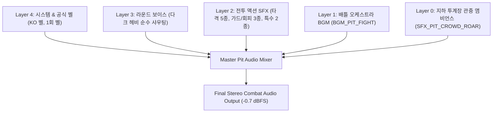
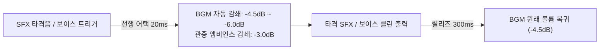
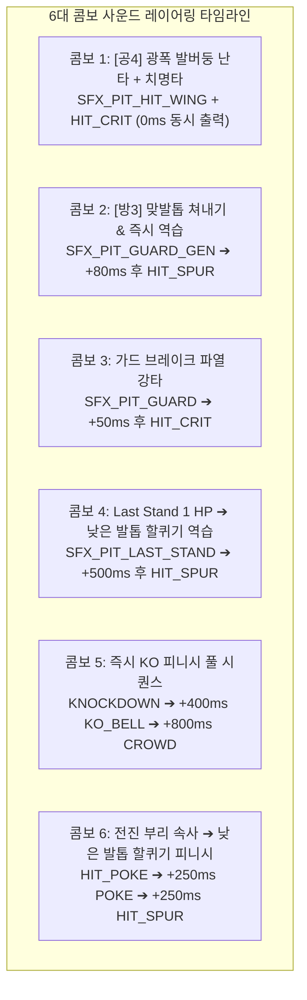

# 🥊 ROOSTER RUMBLE: Rumble Pit - 인게임 사운드 구성안 (In-Game Sound Specification)

* **문서 상태**: 인게임 사운드 기술 및 기획 명세서 (최종 단독 마스터판)
* **문서 버전**: `v1.2.0`
* **마지막 개정일**: 2026-10-08
* **대상 범위**: Rumble Pit 로비/대기실, 1v1 원형 벽면 아레나 전투(3R 2선승제, 45초 격투 + 15초 휴식), 즉시 KO 다운 및 승리 세리머니 사운드 전반 (전투 BGM 1종, SFX 14종 16개 MP3 파일, 순수 라운드 보이스 3종, 1라운드 실전 가상 시뮬레이션 데모 트랙, 6대 콤보 레이어링 믹싱 등)
* **기반 문서**: [Rumble Pit MVP 구성안.md](file:///d:/OneDrive/%EC%97%85%EB%AC%B4_%EC%A7%84%ED%96%89/C/ROOSTER%20RUMBLE/Rumble%20Pit%20MVP%20%EA%B5%AC%EC%84%B1%EC%95%88.md), [Rumble_Pit_전투_시뮬레이션_규칙_정의서.md](file:///d:/OneDrive/%EC%97%85%EB%AC%B4_%EC%A7%84%ED%96%89/C/ROOSTER%20RUMBLE/Rumble_Pit_%EC%A0%84%ED%88%AC_%EC%8B%9C%EB%AE%AC%EB%A0%88%EC%9D%B4%EC%85%98_%EA%B7%9C%EC%B9%99_%EC%A0%95%EC%9D%98%EC%84%9C.md), [Rumble Pit 선수 공격 방어 동작 구성안.md](file:///d:/OneDrive/%EC%97%85%EB%AC%B4_%EC%A7%84%ED%96%89/C/ROOSTER%20RUMBLE/Rumble%20Pit%20%EC%84%A0%EC%88%98%20%EA%B3%B5%EA%B2%A9%20%EB%B0%A9%EC%96%B4%20%EB%8F%99%EC%9E%91%20%EA%B5%AC%EC%84%B1%EC%95%88.md), [Rumble Pit 전투 장면 인게임 구성안.md](file:///d:/OneDrive/%EC%97%85%EB%AC%B4_%EC%A7%84%ED%96%89/C/ROOSTER%20RUMBLE/Rumble%20Pit%20%EC%A0%84%ED%88%AC%20%EC%9E%A5%EB%A9%B4%20%EC%9D%B8%EA%B2%8C%EC%9E%84%20%EA%B5%AC%EC%84%B1%EC%95%88.md)

---

### ■ 문서 개정 이력 (Revision History)

| 버전 (Version) | 개정일 (Date) | 주요 개정 내역 및 상세 변경 사항 | 관련 절 바로가기 |
| :---: | :---: | :--- | :--- |
| **v1.0.0** | 2026-09-29 | **[격투 사운드 구성안 단독 문서 독립 신설]** 기존 베이스 문서 내용 100% 보존 상태에서 격투 BGM·SFX 14종·라운드 순수 보이스·오디오 아키텍처·믹싱/덕킹 규격 전면 집대성 | [[#1. 개요 및 사운드 아키텍처\|1장 사운드 아키텍처]] |
| **v1.1.0** | 2026-09-29 | **[미제작 BGM 정리, 사운드보드 연동 항목 제거 및 1R 시뮬레이션 데모 신설]** 제작 음원 부재 미제작 인트로 BGM 삭제, 8장 사운드보드 연동 항목 전면 제거, 1라운드 가상 시나리오 전체 사운드 실전 시뮬레이션 데모(demo_pit_round1_simulation.mp3, 35.03초) 신규 구축 및 세부 타임라인 명세 수립 | [[#7. 1라운드 실전 사운드 시뮬레이션 샘플 사양 및 시나리오\|7장 1R 사운드 시뮬레이션]] |
| **v1.2.0** | 2026-10-08 | **[비의인화 닭 골격 기반 공/방/이동 기술 명칭 및 즉시 KO 사운드 매핑 동기화]** `Rumble Pit MVP 구성안(v1.2.0)` 및 `Rumble_Pit_전투_시뮬레이션_규칙_정의서(v1.2.0)`에 맞춰 공격 4종(`전진 부리 속사`, `낮은 발톱 할퀴기`, `비상 발톱 급습`, `광폭 발버둥 난타`), 방어 3종(`깃털 부풀려 버티기`, `납작 엎드리기`, `맞발톱 쳐내기`), 이동 6종 및 바닥 다운 즉시 KO 사운드 트리거 명세 일괄 동기화 | [[#3. SFX (효과음) 14종 상세 명세\|3장 SFX 14종 명세]] |

---

## 목차
1. [[#1. 개요 및 사운드 아키텍처]]
   - [[#1.1 문서 목적 및 정체성]]
   - [[#1.2 5대 오디오 채널 레이어 구조]]
2. [[#2. BGM (배경음악) 사양 명세]]
   - [[#2.1 전투 BGM: BGM_PIT_FIGHT (혈투의 링)]]
3. [[#3. SFX (효과음) 14종 상세 명세]]
   - [[#3.1 공격 기술 효과음 (5종)]]
   - [[#3.2 방어 및 회피 효과음 (3종)]]
   - [[#3.3 특수 상태 효과음 (2종)]]
   - [[#3.4 시스템 및 연출 효과음 (4종)]]
4. [[#4. 라운드 시작 보이스 및 타종 연출 명세]]
   - [[#4.1 다크 헤비 아나운서 순수 보이스 (1R~3R)]]
   - [[#4.2 단독 1회 공식 벨소리 독립 타종 연동]]
5. [[#5. 인게임 오디오 믹싱, 덕킹 및 우선순위 제어]]
   - [[#5.1 오디오 우선순위 체계 (Priority Queue)]]
   - [[#5.2 실시간 동적 덕킹 파라미터 규격]]
6. [[#6. 6대 콤보 연속기 사운드 레이어링 명세]]
7. [[#7. 1라운드 실전 사운드 시뮬레이션 샘플 사양 및 시나리오]]
   - [[#7.1 가상 1라운드 세부 타임라인 (35.03초)]]
8. [[#8. 리소스 관리 및 디렉터리 구조]]

---

## 1. 개요 및 사운드 아키텍처

### 1.1 문서 목적 및 정체성
* `ROOSTER RUMBLE` 원형 투계 격투 모드(Rumble Pit)의 BGM, SFX, 아나운서 보이스, 시스템 벨소리 제어 사양 단독 정의.
* 기존 베이스 기획 문서([Rumble Pit 선수 공격 방어 동작 구성안.md](file:///d:/OneDrive/%EC%97%85%EB%AC%B4_%EC%A7%84%ED%96%89/C/ROOSTER%20RUMBLE/Rumble%20Pit%20%EC%84%A0%EC%88%98%20%EA%B3%B5%EA%B2%A9%20%EB%B0%A9%EC%96%B4%20%EB%8F%99%EC%9E%91%20%EA%B5%AC%EC%84%B1%EC%95%88.md), [Rumble Pit 전투 장면 인게임 구성안.md](file:///d:/OneDrive/%EC%97%85%EB%AC%B4_%EC%A7%84%ED%96%89/C/ROOSTER%20RUMBLE/Rumble%20Pit%20%EC%A0%84%ED%88%AC%20%EC%9E%A5%EB%A9%B4%20%EC%9D%B8%EA%B2%8C%EC%9E%84%20%EA%B5%AC%EC%84%B1%EC%95%88.md))의 사운드 매핑 내용을 100% 보존하면서 오디오 엔지니어링 및 믹싱에 특화된 단독 명세서로 체계화.
* 실제 제작된 마스터 MP3 오디오 에셋(BGM 1종 + SFX 14종 16개 파일) 및 인터랙티브 사운드보드 플레이어와의 100% 일치성 확보.

### 1.2 5대 오디오 채널 레이어 구조



| 레이어 | 대상 사운드 | 기준 출력 볼륨 | 덕킹 및 동적 제어 정책 |
| :--- | :--- | :--- | :--- |
| **Layer 4 (System/Bell)** | KO 확정 3연타 벨, 단독 1회 공식 벨 | 0dB (최상위) | 덕킹 미적용 (상시 최우선 클린 출력) |
| **Layer 3 (Voice)** | 다크 헤비 아나운서 순수 보이스 (1R~3R) | -0.5dB ~ 0dB | 하위 레이어(Layer 1 BGM) -6dB 감쇄 트리거 |
| **Layer 2 (Combat SFX)** | 공방 타격음 5종, 가드/회피 3종, 특수 2종 | -1.5dB ~ -3dB | 동시 타격(Clash) 레이어링 시 헤드룸 정규화 적용 |
| **Layer 1 (BGM)** | 배틀 액션 오케스트라 (`bgm_pit_fight.mp3`) | -4.5dB ~ -6dB | 타격 SFX 출력 시 -4.5dB 자동 감쇄, 라운드 휴식 페이드아웃 |
| **Layer 0 (Crowd)** | 지하 투계장 열광 관중 환호 앰비언스 | -4dB ~ -8dB | 평시 은은한 배경 ➔ KO 및 라운드 종료 시 대환호 크레센도 |

---

## 2. BGM (배경음악) 사양 명세

모든 BGM: `Stereo, 44.1kHz, 192kbps MP3` 포맷 통일 및 `-0.7 dBFS (0.922)` 피크 정규화 완료.

### 2.1 전투 BGM: BGM_PIT_FIGHT (혈투의 링)
* **에셋 ID**: `BGM_PIT_FIGHT`
* **트랙 명칭**: 혈투의 링 (Ring of Blood)
* **파일 경로**: [assets/audio/pit/bgm/bgm_pit_fight.mp3](file:///d:/OneDrive/%EC%97%85%EB%AC%B4_%EC%A7%84%ED%96%89/C/ROOSTER%20RUMBLE/assets/audio/pit/bgm/bgm_pit_fight.mp3)
* **재생시간 / 템포**: **172.62초 (2분 52초)** / **150 BPM (심리스 루프 대응)**
* **파일 용량**: **4.14 MB** (4,142,811 bytes)
* **음악 장르**: **박진감 넘치는 시네마틱 액션 배틀 오케스트라 (Cinematic Action Battle Orchestral)**
* **인게임 연출 및 믹싱 제어**:
  * 1~3라운드 인게임 격투 전 구간 루프 재생.
  * 타격 SFX 발생 시 -4.5dB 자동 덕킹 감쇄.
  * 라운드 종료 및 15초 휴식 진입 시 500ms 페이드아웃.

---

## 3. SFX (효과음) 14종 상세 명세

* **음원 저장 디렉터리**: [assets/audio/pit/sfx/](file:///d:/OneDrive/%EC%97%85%EB%AC%B4_%EC%A7%84%ED%96%89/C/ROOSTER%20RUMBLE/assets/audio/pit/sfx/)
* **파일 포맷**: MPEG-1 Layer 3 (MP3, 44.1 kHz, 192 kbps, 피크 헤드룸 -0.7 dBFS 정규화)
* **음원 소스 특성**: 고품질 실사 펀치/슬래시/임팩트/소프트 블록, 다크 헤비 격투 아나운서 보이스, KO 공식 벨, 생체 심장박동, 실제 경기장 군중 환호 적용 (비프음/단순 신디사이저 톤 100% 배제).

### 3.1 공격 기술 효과음 (5종)

| 연번 | SFX 리소스 ID | 오디오 파일명 (Clickable) | 재생시간 | 파일용량 | 음향 특성 및 소스 | 연동 동작 및 매핑 사양 |
| :---: | :--- | :--- | :---: | :---: | :--- | :--- |
| 1 | `SFX_PIT_HIT_POKE` | [sfx_pit_hit_poke.mp3](file:///d:/OneDrive/%EC%97%85%EB%AC%B4_%EC%A7%84%ED%96%89/C/ROOSTER%20RUMBLE/assets/audio/pit/sfx/sfx_pit_hit_poke.mp3) | 0.20초 | 6 KB | 날카로운 실사 미디엄 펀치 트랜지언트 스냅 | `[공1: 전진 부리 속사]` 초고속 쪼기 |
| 2 | `SFX_PIT_HIT_SPUR` | [sfx_pit_hit_spur.mp3](file:///d:/OneDrive/%EC%97%85%EB%AC%B4_%EC%A7%84%ED%96%89/C/ROOSTER%20RUMBLE/assets/audio/pit/sfx/sfx_pit_hit_spur.mp3) | 0.35초 | 9 KB | 예리한 나이프 슬래시 공기 절단음 + 묵직한 하체 강타 | `[공2: 낮은 발톱 할퀴기]` |
| 3 | `SFX_PIT_HIT_WING` | [sfx_pit_hit_wing.mp3](file:///d:/OneDrive/%EC%97%85%EB%AC%B4_%EC%A7%84%ED%96%89/C/ROOSTER%20RUMBLE/assets/audio/pit/sfx/sfx_pit_hit_wing.mp3) | 0.42초 | 11 KB | 거센 깃털 펄럭임 돌풍음 + 헤비 후려침 결합 | `[공3: 비상 발톱 급습]`, `[공4: 광폭 발버둥 난타]` |
| 4 | `SFX_PIT_HIT_CRIT` | [sfx_pit_hit_crit.mp3](file:///d:/OneDrive/%EC%97%85%EB%AC%B4_%EC%A7%84%ED%96%89/C/ROOSTER%20RUMBLE/assets/audio/pit/sfx/sfx_pit_hit_crit.mp3) | 0.58초 | 15 KB | 서브 럼블 베이스 + 헤비 펀치 + 플레이트 파열 크런치 강타 | 치명타 강타, 가드 브레이크 파열 |
| 5 | `SFX_PIT_HIT_GEN` | [sfx_pit_hit_gen.mp3](file:///d:/OneDrive/%EC%97%85%EB%AC%B4_%EC%A7%84%ED%96%89/C/ROOSTER%20RUMBLE/assets/audio/pit/sfx/sfx_pit_hit_gen.mp3) | 0.30초 | 8 KB | 실사 미디엄/헤비 펀치 블렌딩 클린 히트 정타음 | **다목적 범용 타격음** (평타/스킬 공용) |

### 3.2 방어 및 회피 효과음 (3종)

| 연번 | SFX 리소스 ID | 오디오 파일명 (Clickable) | 재생시간 | 파일용량 | 음향 특성 및 소스 | 연동 동작 및 매핑 사양 |
| :---: | :--- | :--- | :---: | :---: | :--- | :--- |
| 6 | `SFX_PIT_GUARD` | [sfx_pit_guard.mp3](file:///d:/OneDrive/%EC%97%85%EB%AC%B4_%EC%A7%84%ED%96%89/C/ROOSTER%20RUMBLE/assets/audio/pit/sfx/sfx_pit_guard.mp3) | 0.28초 | 8 KB | 깃털 펄럭임 + 소프트 헤비 바디 가드 충격 감쇄음 | `[방1: 깃털 부풀려 버티기]` 60% 데미지 흡수 |
| 7 | `SFX_PIT_GUARD_GEN` | [sfx_pit_guard_gen.mp3](file:///d:/OneDrive/%EC%97%85%EB%AC%B4_%EC%A7%84%ED%96%89/C/ROOSTER%20RUMBLE/assets/audio/pit/sfx/sfx_pit_guard_gen.mp3) | 0.26초 | 7 KB | 솔리드 우드/가드 면 충격 기반 단단한 블로킹음 | **다목적 범용 방어음** / `[방3: 맞발톱 쳐내기]` |
| 8 | `SFX_PIT_DODGE` | [sfx_pit_dodge.mp3](file:///d:/OneDrive/%EC%97%85%EB%AC%B4_%EC%A7%84%ED%96%89/C/ROOSTER%20RUMBLE/assets/audio/pit/sfx/sfx_pit_dodge.mp3) | 0.24초 | 7 KB | 빠른 하단 숙이기 및 측면 홉 순간의 공기 가르는 스위시 | `[방2: 납작 엎드리기]`, `[이5: 측면 사이드 홉]` |

### 3.3 특수 상태 효과음 (2종)

| 연번 | SFX 리소스 ID | 오디오 파일명 (Clickable) | 재생시간 | 파일용량 | 음향 특성 및 소스 | 연동 동작 및 매핑 사양 |
| :---: | :--- | :--- | :---: | :---: | :--- | :--- |
| 9 | `SFX_PIT_LAST_STAND`| [sfx_pit_last_stand.mp3](file:///d:/OneDrive/%EC%97%85%EB%AC%B4_%EC%A7%84%ED%96%89/C/ROOSTER%20RUMBLE/assets/audio/pit/sfx/sfx_pit_last_stand.mp3) | 2.30초 | 56 KB | 실제 생체 심장 박동음 (쿵-쿵, 쿵-쿵) 저역 공명 연출 | `Last Stand` 1 HP 투지 생존 발동 시 |
| 10 | `SFX_PIT_KNOCKDOWN` | [sfx_pit_knockdown.mp3](file:///d:/OneDrive/%EC%97%85%EB%AC%B4_%EC%A7%84%ED%96%89/C/ROOSTER%20RUMBLE/assets/audio/pit/sfx/sfx_pit_knockdown.mp3) | 0.68초 | 18 KB | 원형 투계장 바닥 충격음 + 육체 낙하 둔탁음 | 체력 0 도달 즉시 KO 다운 바닥 충격 |

### 3.4 시스템 및 연출 효과음 (4종)

| 연번 | SFX 리소스 ID | 오디오 파일명 (Clickable) | 재생시간 | 파일용량 | 음향 특성 및 소스 | 연동 동작 및 매핑 사양 |
| :---: | :--- | :--- | :---: | :---: | :--- | :--- |
| 11 | `SFX_PIT_ROUND_START` | [sfx_pit_round1_start.mp3](file:///d:/OneDrive/%EC%97%85%EB%AC%B4_%EC%A7%84%ED%96%89/C/ROOSTER%20RUMBLE/assets/audio/pit/sfx/sfx_pit_round1_start.mp3) | 2.02초 | 50 KB | 다크 헤비 아나운서 순수 보이스 ("First Round... FIGHT!") | 라운드 시작 순수 보이스 (1R~3R 완비) |
| 12 | `SFX_PIT_BELL_SINGLE` | [sfx_pit_bell_single.mp3](file:///d:/OneDrive/%EC%97%85%EB%AC%B4_%EC%A7%84%ED%96%89/C/ROOSTER%20RUMBLE/assets/audio/pit/sfx/sfx_pit_bell_single.mp3) | 2.40초 | 58 KB | KO 3연타 벨 Strike 3 추출 기반 단독 1회 공식 벨소리 (DING!) | 라운드 시작/종료 공식 단독 타종 |
| 13 | `SFX_PIT_KO_BELL` | [sfx_pit_ko_bell.mp3](file:///d:/OneDrive/%EC%97%85%EB%AC%B4_%EC%A7%84%ED%96%89/C/ROOSTER%20RUMBLE/assets/audio/pit/sfx/sfx_pit_ko_bell.mp3) | 1.74초 | 43 KB | 공식 경기 종료 3연속 벨 (Ding! Ding! Ding!) 원본 녹음 | 바닥 다운 즉시 KO 공식 확정 벨소리 |
| 14 | `SFX_PIT_CROWD_ROAR`| [sfx_pit_crowd_roar.mp3](file:///d:/OneDrive/%EC%97%85%EB%AC%B4_%EC%A7%84%ED%96%89/C/ROOSTER%20RUMBLE/assets/audio/pit/sfx/sfx_pit_crowd_roar.mp3) | 3.60초 | 87 KB | 실제 경기장 군중 열광 환호성 및 갈채 원본 녹음 | 지하 투계장 열광 관중 환호 |

---

## 4. 라운드 시작 보이스 및 타종 연출 명세

### 4.1 다크 헤비 아나운서 순수 보이스 (1R~3R)
* **보이스 콘셉트**: Dragon Announcer 기반 다크 헤비 아나운서 위압 샤우팅.
* **벨소리 분리 사양**: 보이스와 벨소리를 완전 분리하여 사운드 엔진에서 개별 볼륨 및 타이밍 제어 가능.
* **라운드별 순수 음원 목록**:
  * **1라운드 순수 보이스**: [sfx_pit_round1_start.mp3](file:///d:/OneDrive/%EC%97%85%EB%AC%B4_%EC%A7%84%ED%96%89/C/ROOSTER%20RUMBLE/assets/audio/pit/sfx/sfx_pit_round1_start.mp3) (2.02초, 50 KB) - *"First Round... FIGHT!"*
  * **2라운드 순수 보이스**: [sfx_pit_round2_start.mp3](file:///d:/OneDrive/%EC%97%85%EB%AC%B4_%EC%A7%84%ED%96%89/C/ROOSTER%20RUMBLE/assets/audio/pit/sfx/sfx_pit_round2_start.mp3) (2.19초, 53 KB) - *"Second Round... FIGHT!"*
  * **3라운드 순수 보이스**: [sfx_pit_round3_start.mp3](file:///d:/OneDrive/%EC%97%85%EB%AC%B4_%EC%A7%84%ED%96%89/C/ROOSTER%20RUMBLE/assets/audio/pit/sfx/sfx_pit_round3_start.mp3) (2.02초, 50 KB) - *"Third Round... FIGHT!"*

### 4.2 단독 1회 공식 벨소리 독립 타종 연동
* **음원 파일**: [sfx_pit_bell_single.mp3](file:///d:/OneDrive/%EC%97%85%EB%AC%B4_%EC%A7%84%ED%96%89/C/ROOSTER%20RUMBLE/assets/audio/pit/sfx/sfx_pit_bell_single.mp3) (2.40초, 58 KB)
* **트리거 규칙**: 라운드 시작 보이스 출력 직후(또는 동시) 독립 타종, 라운드 45초 타임오버 시 단독 1회 타종.

---

## 5. 인게임 오디오 믹싱, 덕킹 및 우선순위 제어

### 5.1 오디오 우선순위 체계 (Priority Queue)
- `[P0: KO 확정 벨(KO_BELL) / 즉시 KO 바닥 다운(KNOCKDOWN)]`
- `[P1: 라운드 보이스(ROUND_START) / 단독 공식 벨(BELL_SINGLE)]`
- `[P2: 치명타 강타(HIT_CRIT) / Last Stand 심장박동]`
- `[P3: 일반 공격(HIT_POKE, SPUR, WING, HIT_GEN) / 가드·회피(GUARD, GUARD_GEN, DODGE)]`
- `[P4: 배경음악(BGM_PIT_FIGHT) / 관중 환호(CROWD_ROAR)]`

### 5.2 실시간 동적 덕킹 파라미터 규격



| 트리거 이벤트 | 덕킹 대상 | 감쇄량 (dB) | 어택 타임 | 홀드 타임 | 릴리즈 타임 |
| :--- | :--- | :---: | :---: | :---: | :---: |
| **라운드 보이스 시작** | BGM (`bgm_pit_fight`) | -6.0 dB | 30 ms | 1.8 s | 350 ms |
| **치명타 강타 / 가드브레이크** | BGM (`bgm_pit_fight`) | -5.0 dB | 15 ms | 0.4 s | 250 ms |
| **일반 타격 / 콤보 체인** | BGM (`bgm_pit_fight`) | -3.5 dB | 20 ms | 0.2 s | 200 ms |
| **KO 확정 3연타 벨** | BGM 전면 페이드아웃 | -18.0 dB (음소거) | 100 ms | 2.5 s | 완전 종료 |

---

## 6. 6대 콤보 연속기 사운드 레이어링 명세

인게임 콤보 연계 시 사운드 엔진이 동시 또는 시차를 두고 합성 출력하는 6대 대표 사운드 레이어링 규격:



| 콤보 명칭 | 연동 사운드 조합 | 시차(Delay) 규격 | 연출 의도 및 청음 특징 |
| :--- | :--- | :---: | :--- |
| **[공4] 광폭 발버둥 난타 + 치명타** | `HIT_WING` + `HIT_CRIT` | 0ms 동시 출력 | 깃털 돌풍 스윕음과 서브 베이스 파열음이 중첩되어 육중한 한방 타격감 구현 |
| **[방3] 맞발톱 쳐내기 & 역습** | `GUARD_GEN` $\rightarrow$ `HIT_SPUR` | 0ms ➔ 80ms 후 | 맞발톱 블로킹 직후 즉시 발톱 할퀴기 카운터가 이어지는 역습 쾌감 |
| **가드 브레이크 파열** | `GUARD` $\rightarrow$ `HIT_CRIT` | 0ms ➔ 50ms 후 | 깃털 버티기 둔탁음 직후 방패 파열 굉음 출력 (가드 무력화 인지) |
| **Last Stand 역습** | `LAST_STAND` $\rightarrow$ `HIT_SPUR` | 0ms ➔ 500ms 후 | 심장박동 고동 속에서 번개 같은 낮은 발톱 할퀴기 역습 일격 |
| **즉시 KO 피니시 풀 시퀀스** | `KNOCKDOWN` $\rightarrow$ `KO_BELL` $\rightarrow$ `CROWD` | 0ms ➔ 400ms ➔ 800ms | 바닥 다운 즉시 심판 카운트 없이 3연타 벨 ➔ 관중 대환호 순차 폭발 |
| **전진 부리 속사 ➔ 발톱 피니시**| `HIT_POKE` $\rightarrow$ `HIT_POKE` $\rightarrow$ `HIT_SPUR` | 0ms ➔ 250ms ➔ 250ms | 0.25초 틱 부리 속사 후 묵직한 낮은 발톱 할퀴기로 마감 |

---

## 7. 1라운드 실전 사운드 시뮬레이션 샘플 사양 및 시나리오

1라운드 실전 격투(배경음악, 관중 함성 앰비언스, 라운드 시작 보이스, 시작 벨 타종, 공방 타격/방어/회피음, 치명타 덕킹, 투지 버티기 연출, 라운드 마감 벨)의 전체 사운드 연출 실전 검증 목적 제작 마스터 시뮬레이션 트랙.

* **오디오 파일 경로**: [assets/audio/pit/demo/demo_pit_round1_simulation.mp3](file:///d:/OneDrive/%EC%97%85%EB%AC%B4_%EC%A7%84%ED%96%89/C/ROOSTER%20RUMBLE/assets/audio/pit/demo/demo_pit_round1_simulation.mp3)
* **트랙 재생시간**: **35.03초** (인게임 1라운드 압축 풀 시뮬레이션)
* **파일 규격 및 용량**: MPEG-1 Layer 3 (MP3, 44.1 kHz, 192 kbps Stereo), **840 KB** (840,724 bytes)
* **마스터링 스펙**: 피크 헤드룸 `-3.02 dBFS (0.7062)`, 실효치 RMS `-17.05 dBFS (0.1404)`, 소프트 리미터 적용 클리핑 왜곡 0건 방어.
* **주요 연출 구성**:
  * **Layer 0 (관중 앰비언스)**: 전 구간 기저에 은은하게 깔리는 지하 투계장 웅성거림(0.18) + 주요 액션/종료 시 환호성 스웰(0.50~0.90).
  * **Layer 1 (배경음악 BGM)**: 150 BPM 시네마틱 배틀 오케스트라(`bgm_pit_fight.mp3`) 페이드인(0.0s~2.0s), 크리티컬 히트 및 심장박동 구간 -5.5dB 자동 덕킹(23.0s~27.5s), 라운드 종료 페이드아웃(31.0s~34.8s).
  * **Layer 3 (라운드 시작)**: 단독 1회 공식 벨 타종(`SFX_PIT_BELL_SINGLE`) + 다크 헤비 아나운서 순수 보이스(`SFX_PIT_ROUND_START`: "First Round... FIGHT!").
  * **Layer 2 (실전 공방음)**: 전진 부리 속사, 깃털 부풀려 버티기, 비상 발톱 급습/광폭 발버둥 난타, 맞발톱 쳐내기 솔리드 블록, 납작 엎드리기 회피, 다목적 클린 히트 정타, 낮은 발톱 할퀴기, 치명타 파열 강타, 투지 버티기 생체 심장박동.
  * **Layer 4 (라운드 마감)**: 1라운드 공식 종료 1회 벨 타종(DING!) + 투계장 전원 기립 환호 피날레.

### 7.1 가상 1라운드 세부 타임라인 (35.03초)

* **00.0s ~ 03.5s [오프닝 & 라운드 개시 큐]**:
  * 00.0s: 지하 투계장 관중석 웅성거림 앰비언스 서서히 진입.
  * 00.5s: 배틀 오케스트라 BGM(`bgm_pit_fight`) 도입부 페이드인 시작.
  * 00.8s: 경기 시작 단독 1회 공식 벨(`SFX_PIT_BELL_SINGLE`, DING!) 청명하게 타종.
  * 01.4s: 다크 헤비 아나운서 순수 샤우팅(`SFX_PIT_ROUND_START`: *"First Round... FIGHT!"*).
  * 03.3s: 파이트 콜 종료와 함께 관중 함성 스웰 + BGM 전투 본구간 질주.
* **04.5s ~ 12.0s [초반 탐색전 및 기본 공방]**:
  * 04.8s: Red 코너의 빠른 전진 부리 속사 (`SFX_PIT_HIT_POKE`, 좌측 패닝 -0.3).
  * 05.1s: Blue 코너의 즉각적인 깃털 부풀려 버티기 (`SFX_PIT_GUARD`, 우측 패닝 +0.3).
  * 07.0s: Blue 코너의 반격 비상 발톱 급습 (`SFX_PIT_HIT_WING`, 거센 날개 도약+강습, 우측 패닝 +0.25).
  * 07.3s: Red 코너의 범용 솔리드 방어 (`SFX_PIT_GUARD_GEN`, 단단한 블록, 좌측 패닝 -0.25).
  * 09.2s: Red 코너의 날렵한 납작 엎드리기 회피 (`SFX_PIT_DODGE`).
  * 10.0s: Red 코너의 기습 클린 히트 정타 적중 (`SFX_PIT_HIT_GEN`) ➔ 관중 탄성 반응.
* **13.0s ~ 21.0s [중반 치열한 난타전 및 콤보 공방]**:
  * 13.0s: Blue 코너의 회심의 낮은 발톱 할퀴기 (`SFX_PIT_HIT_SPUR`, 슬래시 공기절단+하체 강타).
  * 14.8s ~ 15.3s: Red 코너의 2연타 반격 (전진 부리 속사 `HIT_POKE` ➔ 낮은 발톱 할퀴기 `HIT_SPUR`).
  * 17.2s: Blue 코너의 광폭 발버둥 난타 맹공 (`SFX_PIT_HIT_WING`).
  * 18.8s ~ 19.2s: 양 선수 찰나의 정타 난타전 격돌 (`SFX_PIT_HIT_GEN` 연속 2회) ➔ 관중 응원 함성 고조.
* **22.5s ~ 29.5s [후반 크리티컬 클라이맥스 & 투지 버티기]**:
  * 22.8s: Red 코너 콤보 시동 전진 부리 속사 (`SFX_PIT_HIT_POKE`).
  * 23.4s: **Red 코너의 결사적인 크리티컬 강타 적중 (`SFX_PIT_HIT_CRIT`, 서브 럼블 베이스 파열음)** ➔ BGM -5.5dB 즉각 덕킹.
  * 24.1s: Blue 코너 외곽 벽면 격돌 충격음 (`SFX_PIT_KNOCKDOWN`, 육중한 충격음).
  * 24.3s: 관중석 폭발적 기립 환호 (`SFX_PIT_CROWD_ROAR`).
  * 25.4s: Blue 코너 체력 1 남기고 투지 버티기 발동 (Last Stand) ➔ **실제 생체 심장 박동음 고동 (`SFX_PIT_LAST_STAND`, 쿵-쿵, 쿵-쿵)**.
  * 28.3s ~ 28.8s: Blue 코너 재기립 후 마지막 정타 교환 (`SFX_PIT_HIT_GEN` vs Red `SFX_PIT_GUARD_GEN`).
* **30.2s ~ 35.0s [1라운드 종료 타종 및 환호 피날레]**:
  * 30.4s: **공식 1라운드 마감 1회 벨 타종 (`SFX_PIT_BELL_SINGLE`, 청명한 DING!)**.
  * 30.6s: 투계장 전체를 뒤흔드는 관중들의 열광적인 기립 대환호 (`SFX_PIT_CROWD_ROAR`).
  * 31.0s ~ 34.8s: BGM의 자연스러운 페이드아웃 및 관중 함성 잔향 마감.

---

## 8. 리소스 관리 및 디렉터리 구조

```text
assets/audio/pit/
├── bgm/                                # [격투 전용 배경음악]
│   └── bgm_pit_fight.mp3               # 150 BPM 시네마틱 배틀 액션 오케스트라 (172.62s, 4.14 MB)
├── demo/                               # [격투 가상 시나리오 인게임 사운드 시뮬레이션 데모]
│   └── demo_pit_round1_simulation.mp3  # 1라운드 실전 시나리오 전체 사운드 시뮬레이션 (35.03s, 840 KB)
└── sfx/                                # [격투 전용 효과음 14종 (총 17개 파일)]
    ├── pit_sfx_soundboard.html         # 격투 SFX 단독 사운드보드 플레이어
    ├── sfx_pit_bell_single.mp3         # 단독 1회 공식 벨 DING!
    ├── sfx_pit_round1_start.mp3        # 1라운드 순수 샤우팅 ("First Round... FIGHT!")
    ├── sfx_pit_round2_start.mp3        # 2라운드 순수 샤우팅 ("Second Round... FIGHT!")
    ├── sfx_pit_round3_start.mp3        # 3라운드 순수 샤우팅 ("Third Round... FIGHT!")
    ├── sfx_pit_hit_poke.mp3            # [공1] 전진 부리 속사
    ├── sfx_pit_hit_spur.mp3            # [공2] 낮은 발톱 할퀴기
    ├── sfx_pit_hit_wing.mp3            # [공3/공4] 비상 발톱 급습 & 광폭 발버둥 난타
    ├── sfx_pit_hit_crit.mp3            # 치명타 강타 & 가드 브레이크
    ├── sfx_pit_hit_gen.mp3             # 다목적 범용 타격음
    ├── sfx_pit_guard.mp3               # [방1] 깃털 부풀려 버티기
    ├── sfx_pit_guard_gen.mp3           # 다목적 범용 방어음 & [방3] 맞발톱 쳐내기
    ├── sfx_pit_dodge.mp3               # [방2] 납작 엎드리기 & [이5] 측면 사이드 홉
    ├── sfx_pit_last_stand.mp3          # 투지 버티기 1 HP 생체 심장박동
    ├── sfx_pit_knockdown.mp3           # 즉시 KO 다운 바닥 충격
    ├── sfx_pit_ko_bell.mp3             # KO 공식 확정 3연타 벨
    └── sfx_pit_crowd_roar.mp3          # 지하 투계장 열광 관중 환호
```
