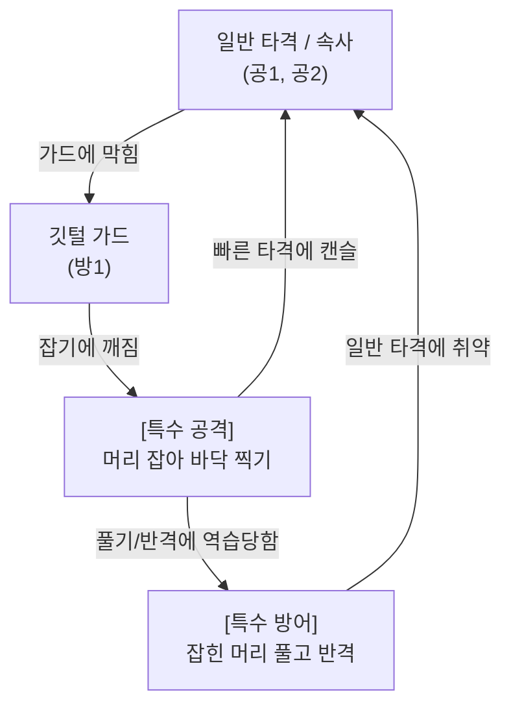
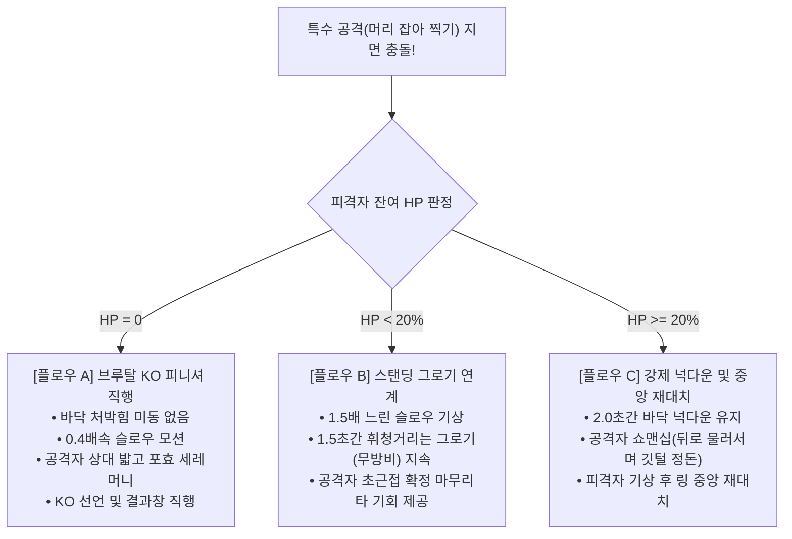
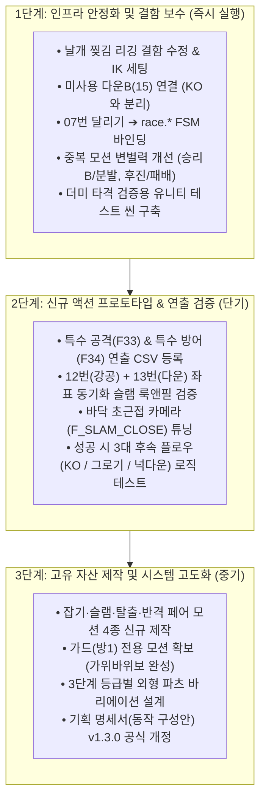

# 🐓 ROOSTER RUMBLE: 럼블핏 애니메이션 및 연출 기획 대비 실구현 현황 비교 분석서

* **문서 버전**: `v1.1.1`
* **최종 개정일**: 2026-11-09
* **개정 이력**:
  * `v1.0.0` (2026-11-09): 기획서 기준 실구현 대조 분석, 미작업/추가작업 분류 및 핵심 비교 매트릭스 초안 작성
  * `v1.1.0` (2026-11-09): 신규 특수 동작(머리 잡아 찍기 / 머리 풀고 반격) 구성, 가위바위보 상성 체계, 특수 공격 성공 시 3대 후속 플로우 및 다층 연출 규격 전면 반영
  * `v1.1.1` (2026-11-09): 단계별 추진 로드맵 누락 항목(특수 방어 검증, 중복 모션 변별력, 3대 분기 로직, 모션 테스트 씬, 3단계 등급 바리에이션) 전면 보완 반영
* **기준 기획 문서**:
  * [Rumble Pit 선수 공격 방어 동작 구성안.md](file:///d:/OneDrive/업무_진행/C/ROOSTER%20RUMBLE/Rumble%20Pit%20선수%20공격%20방어%20동작%20구성안.md) (`v1.2.0`)
  * [Rumble_Pit_전투_시뮬레이션_규칙_정의서.md](file:///d:/OneDrive/업무_진행/C/ROOSTER%20RUMBLE/Rumble_Pit_전투_시뮬레이션_규칙_정의서.md) (`v1.2.0`)
  * [럼블핏_그래픽 적업 요청 사항_261105.txt](file:///d:/OneDrive/업무_진행/C/ROOSTER%20RUMBLE/럼블핏_그래픽%20적업%20요청%20사항_261105.txt)
* **대조 실구현 자산**:
  * `Rooster_001` 기반 Unity 애니메이션 클립 25종 (원본 FBX 20종 + 실무 가공본 5종)
  * `Proto_Editor` 연출 4대 CSV (`camera_frames_v3.csv`, `shake_presets_v3.csv`, `cue_table_v6.csv`, `fx_names_v5.csv`)

---

## 1. 개요 및 분석 총평

본 문서는 **기존 기획 명세서(`v1.2.0`)를 기본 중심 축(기준)**으로 삼아, 현재 엔진/에디터에 실제 구현된 닭 모델 애니메이션 및 연출 데이터와의 일치 여부를 대조하고 **[작업 안 된 것(누락·미구현)]**과 **[추가 작업 된 것(실무 가공·도구 구축)]**을 명확히 분류·정리하며, 향후 전투 완성도를 높이기 위한 **[신규 특수 동작(잡기/반격) 및 성공 플로우]**를 통합 정의한 마스터 분석서임.

* **애니메이션 영역**: 기획서의 '고유 투계 기술 7종 세분화 설계' 대비, 실제 구현은 '보유 FBX 20종 + 타격감 보완 가공본 5종'을 활용한 **대체/압축 매핑 상태**임.
* **연출 시스템 영역**: 기획서의 텍스트 기반 연출 가이드를 넘어, `Proto_Editor` 및 **4대 CSV 기반의 데이터 주도형(Data-Driven) 자동 연출 파이프라인으로 체계화·확장 구축**됨.
* **신규 액션 확장**: 밋밋한 타격 공방을 타파하기 위해 실제 투계 생태에 기반한 **'머리 잡아 바닥 찍기(특수 공격)'** 및 **'머리 풀고 반격(특수 방어)'** 체계를 신규 정립함.

---

## 2. 기획서 기준 ➔ 작업 안 된 것 (미구현 / 누락 / 대체 미흡)

### 1) 공격 동작 (4종 중 3종 미구현)
* **`[공1] 전진 부리 속사 (0.4초 / 12f)`**: 미작업
  * 목을 S자로 당겨 상대 안면을 쪼는 전용 모션 부재.
  * 일반 공격 `11_Attack_40f` 및 점프 공격 가공본(`08_Jump_F_atk`)으로 대체 중.
* **`[공2] 낮은 발톱 할퀴기 (0.6초 / 18f)`**: 미작업
  * 하단을 긁고 지나가는 반추적 하단 공격 모션 부재.
* **`[공4] 광폭 발버둥 난타 (0.8초 / 24f)`**: 미작업
  * 날개를 퍼덕이며 전신 흙먼지 난타 및 넉백을 유발하는 광역 전용 모션 부재 (강공격 가공본으로 뭉뚱그림).

### 2) 방어 및 회피 동작 (3종 중 2종 누락)
* **`[방1] 깃털 부풀려 버티기 (0.5초 / 15f)`**: **완전 미작업 (핵심 누락)**
  * 날개 어깨죽지를 내밀어 데미지를 -60% 흡수하는 기본 가드 모션 부재.
  * 현재 FSM 상태 머신 상에서도 가드(방어) 상태가 완전히 빠져 있음.
* **`[방2] 납작 엎드리기 (0.4초 / 12f)`**: 미작업
  * 상단 공격을 흘려보내는 하단 숙이기 모션 부재 (좌/우 점프 회피로만 대체).
* **`[방3] 맞발톱 쳐내기 (0.5초 / 15f)`**: 미작업
  * 공중 패링 반격 모션 부재 (`cue_table` 상에 SFX/UI만 가설로 등록).

### 3) 특수 상태 및 피격 판정 모션
* **가드 브레이크 (Guard Break)**: 미작업 (가드 파괴 및 비틀거림 무방비 모션 없음).
* **스탠딩 그로기 (Standing Groggy)**: 미작업 (타격 후 비틀거리는 전용 모션 없음).
* **벽면 충돌 (Wall Impact)**: 미작업 (벽에 부딪히는 넉백 리액션 모션 없음).
* **라스트 스탠드 (1 HP 생존 모션)**: 미작업 (전용 생존 모션 대신 `20_Win_B_60f` 승리 포즈 재사용).
* **패배 모션**: 미작업 (전용 좌절/탈진 모션 대신 `06_B_Walk_34f` 후진 걷기 재사용).
* **부위별 피격 분기 (두부/하체/공중)**: 미작업 (구분 없이 `21_Hit_25f` 단일 모션으로 통합 처리).

### 4) 이동 스텝 및 스타일별 시그니처
* **투계 고유 6대 이동 스텝**: 목 빼고 질주, 날개 펄럭 후방 탈출, 원형 탐색 걸음 등 고유 풋워크 미작업 (기본 전·후진 걷기 및 도주 달리기만 연결).
* **격투 스타일 5종별 시그니처 자세**: 미작업 (인파이터, 아웃복서 등 전 스타일 동일 모션 공유).

### 5) 레이스 모드 (`race.*`) FSM 연동
* **레이스 애니메이션 FSM 바인딩**: **완전 미작업**
  * 연출 CSV에는 레이스 큐(R01~R17)가 완비되어 있으나, 닭 애니메이션 FSM은 레이스에 연결 0개.
  * 보유 중인 달리기(`07_Run_22f`) 클립조차 격투의 '도주' 상태에만 바인딩되어 있음.

---

## 3. 기획서 대비 ➔ 추가 작업 된 것 (실무 가공 / 신규 개발)

### 1) 타격감 보완용 가공 애니메이션 (5종 신규 제작)
기획서에는 없었으나, 기존 원본 클립(호흡이 긴 1.13~3.33초)을 격투 템포에 맞추기 위해 실무진이 프레임을 압축·가공하여 신규 생성함.

| 가공 클립명 | 기본 길이 | 제작 목적 및 실무 적용 내용 |
| :--- | :---: | :--- |
| **`08_Jump_F_atk`** | 1.27초 | 앞 점프 모션을 공격용으로 타이밍을 압축하여 일반 공격 대체용으로 신규 제작 |
| **`09_Jump_L_Mirror_48f`** | 1.60초 | 좌측 점프 모션을 좌우 반전(Mirroring)하여 우측 회피 전용 모션 생성 |
| **`11_Attack_x2`** | 1.54초 | 콤보 연출을 위해 기본 공격 모션을 2연타로 이어 붙인 연속 공격 모션 합성 |
| **`12_Jump_Attack_crit`** | 1.40초 | 원본 점프 공격(1.93초)의 후딜레이를 줄이고 타격 프레임을 조정한 강공격 전용 클립 |
| **`16_Up_Land_crit`** | 2.40초 | 기상 모션(Up_Land)을 역발상으로 활용하여 강공격 피격 시 대형 리액션 모션으로 재가공 |

### 2) 연출 엔진 툴 및 데이터 파이프라인 (`Proto_Editor`)
기획서 상의 텍스트 가이드를 실제 동작 가능한 데이터 주도형 시스템으로 독립 구축함.

* **`Proto_Editor` GUI 연출 편집기 구축**:
  * 실시간 샘플 경기 재생 및 4대 탭(CAMERA, SHAKE, CUTS, LIGHT) 연출 실시간 튜닝 환경 개발.
* **4대 CSV 구조 분리 표준화**:
  * [camera_frames_v3.csv](file:///d:/OneDrive/업무_진행/C/ROOSTER%20RUMBLE/camera_frames_v3.csv): 카메라 거리, 화각, 추적, 감쇠, 복귀 시간 매개변수화.
  * [shake_presets_v3.csv](file:///d:/OneDrive/업무_진행/C/ROOSTER%20RUMBLE/shake_presets_v3.csv): 화면 흔들림 강도, 속도, 틸트(기울기), 감쇠 곡선 규격화.
  * [cue_table_v6.csv](file:///d:/OneDrive/업무_진행/C/ROOSTER%20RUMBLE/cue_table_v6.csv): 사건별 카메라·흔들림·히트스탑·쿨다운 종합 제어 허브 구축.
  * [fx_names_v5.csv](file:///d:/OneDrive/업무_진행/C/ROOSTER%20RUMBLE/fx_names_v5.csv): 화면 어둡기(Dim), 전환 시간, 상하 레터박스(검은 띠) 전용 조명/연출 데이터 신규 확립.
* **연출 안전 제어 파라미터 추가**:
  * 연속 공격 시 연출 충돌 및 멀미를 방지하는 `cooldown_s`, `min_gap_s`, `fallback_shake` 규격 신규 추가.
* **`edited/` 격리 저장 파이프라인**:
  * 에디터 `SAVE` 시 원본 데이터를 즉시 덮어쓰지 않고 `edited/` 디렉토리에 격리 내보내기하여 검증 후 수동 반영하는 안전 배포 프로세스 확립.

---

## 4. 핵심 요약 비교 매트릭스

| 항목 구분 | 기획서 기본 중심 축 (`v1.2.0`) | 현재 실구현 상태 | 상태 판정 |
| :--- | :--- | :--- | :---: |
| **공격 4종** | 부리속사 / 발톱할퀴기 / 비상급습 / 난타 | 기본 공격 1종 + 가공 클립 2종(`atk`, `crit`) | **축소 대체** |
| **방어/회피 3종** | 깃털가드 / 납작엎드리기 / 맞발톱패링 | 좌·우 점프 회피 2종만 존재 (가드 모션 부재) | **핵심 누락** |
| **연속기 (콤보)** | 실시간 모션 간 트랜지션 연계 | `11_Attack_x2` 단일 합성 클립 재생 | **간이 구현** |
| **피격 리액션** | 부위별(두부·하체·공중) 피격 분기 | 단일 피격(`21_Hit`) + 기상 가공본(`16_crit`) | **단순화** |
| **특수 상태** | 가드브레이크 / 그로기 / 라스트스탠드 / 벽충돌 | 전용 모션 전무 (승리·후진 모션 재사용 및 배지만 표기) | **미작업** |
| **레이스 연동** | 레이스 상태 달리기 동작 바인딩 | 연출 CSV만 100% 준비 완료 / FSM 클립 연결 0개 | **미작업** |
| **애니메이션 가공** | 기획 없음 (전용 모션 제작 전제) | 실무 타격감 보완 가공 클립 5종 신규 제작 | **추가 작업** |
| **연출 시스템** | 텍스트 서술형 가이드 | `Proto_Editor` GUI 및 4대 CSV 분리 파이프라인 완비 | **추가 작업** |

---

## 5. [신규 검토 과제] 신규 특수 공격·방어 동작 구성 및 성공 플로우

### 1) 기술 컨셉 및 비의인화(투계) 적합성
* **특수 공격: 상대 머리 잡아 바닥에 찍어 누르기 (`Head Pin & Face Slam`)**:
  * 실제 투계의 핵심 필살 테크닉: 부리로 상대 볏/목덜미깃을 강하게 물어 고정한 후, 체중을 실어 바닥에 짓누르며 며느리발톱으로 찍어 누르는 동작.
  * 성격: 단단한 수비를 무너뜨리는 **‘가드 브레이커(Guard Break)’** 및 초근접 하이라이트 결정타.
* **특수 방어: 잡힌 머리 풀고 반격하기 (`Head Break & Claw Reversal`)**:
  * 머리가 잡혀 꺾이는 순간(0.2초 유예 구간), 몸을 회전시켜 깃을 털어내며 빠져나온 뒤 양발로 상대 가슴을 걷어차는 실전 카운터.

### 2) 전투 가위바위보 상성 순환 완성

### 3) 특수 공격 성공 시 시스템 메커니즘
* **초고피해 & 방어 무시**: 기본 공격력 `POW x 2.0` + 상대 방어력 `DEF 50% 관통`.
* **가드 강제 파괴**: 상대 가드 게이지 `100% 즉시 소진`.
* **사기/스태미나 탈취**: 피격자 다음 행동 쿨다운 `+1.5초 지연`, 공격자 투혼 게이지 완충.

### 4) 잔여 HP별 3대 후속 플로우

### 5) 다층 연출 시퀀스 (카메라·흔들림·FX·사운드)
1. **타격 순간 (Impact)**:
   * **히트스탑**: `0.12초` 화면 일시정지.
   * **카메라 (`F_SLAM_CLOSE`)**: 바닥 초근접 로우앵글 (거리 1.2m, 높이 0.15m, FOV 35, Pitch -8°).
   * **흔들림 (`KO_Slam`)**: 수직 강도 8 쿵! + 화면 기울기 2.5도.
   * **FX/사운드**: 대형 흙먼지 폭발 + 깃털 비산, 둔탁한 타격음(`SFX_Slam`) + 관중 탄성(`CROWD_GASP`).
   * **UI**: `CRUSHING SLAM!` 골드 배지 노출 + HP바 대폭 삭감.
2. **후속 처리**:
   * **KO 시**: `0.4배속` 슬로우 모션 + 후퇴 풀샷(`F_PULL_BACK`) + 환호성(`CROWD_ROAR`).
   * **생존 시**: 정상 배속 복귀 후 기본 경기 구도(`F_TWO_SHOT`)로 부드럽게 복귀.

### 6) 연출 CSV 신규 등록 규격안
* **`cue_table_v6.csv` 신규 행**:
  * `F33, fight, cue, fight.grapple_slam, 3, always, F_SLAM_CLOSE, KO_Slam, FX_Hit_01+FX_Slam_01, 0.12, 0.1, HP_DROP_BIG, SFX_Slam+CROWD_ROAR, 8`
* **`camera_frames_v3.csv` 신규 구도**:
  * `F_SLAM_CLOSE`: 타겟 `hit`, 거리 `1.2m`, 높이 `0.15m`, FOV `35`, Pitch `-8도`, 유지 `1.5초`, 복귀 `0.6초`.

---

## 6. 단계별 실무 추진 로드맵 (Action Items)

1. **1단계 (즉시 실행 - 인프라 안정화 및 결함 보수)**:
   * **리깅 오류 보수**: 11/05 요청 사항인 닭 모델 날개 찢어짐 결함 수정 및 기본 IK 컨트롤러 세팅.
   * **미사용 클립 즉시 연결**: 미연결 상태인 `15_Down_Land_30f`(빠른 다운)을 일반 피격 다운에 연결하여 KO 다운(`13번`)과 분리.
   * **레이스 FSM 바인딩**: 보유 중인 `07_Run_22f`(달리기) 클립을 유니티 레이스 FSM에 연결하여 레이스 연출 CSV와 동기화.
   * **중복 모션 변별력 개선**: `승리 B` 모션을 '분발'에 재사용할 때 전용 오라 FX/배속 변조를 적용하고, '패배' 시 후진 걷기 외 고개 떨굼/암전 연출 보완.
   * **모션 테스트 씬 구축**: 닭 1마리와 더미 오브젝트를 배치하고 UI 버튼으로 개별·연속 동작을 검증할 수 있는 유니티 전용 테스트 씬 구축.
2. **2단계 (단기 - 신규 액션 프로토타입 & 연출 검증)**:
   * **연출 큐 등록**: 특수 공격(`F33 fight.grapple_slam`) 및 특수 방어(`F34 fight.grapple_break`)를 `cue_table_v6.csv`에 등록.
   * **슬램 연출 룩앤필 사전 검증**: 기존 클립(`12_Jump_Attack_crit` + `13_Down_Land_60f`)의 트랜스폼 좌표를 일시 정렬하여 슬램 카메라(`F_SLAM_CLOSE`), 흙먼지 FX, 히트스탑(0.12s) 튜닝.
   * **3대 후속 플로우 로직 검증**: 피격자 잔여 HP에 따른 3대 분기 [KO 피니셔 / 스탠딩 그로기(`F30`) 연계 / 강제 넉다운 후 재대치] FSM 상태머신 전이 로직 테스트.
3. **3단계 (중기 - 고유 자산 제작 및 시스템 고도화)**:
   * **페어 애니메이션 4종 신규 제작**: 머리잡기 성공, 피격 슬램, 잡기 탈출 반격, 공격 실패 피격 2인 1조 페어 모션 외주/제작.
   * **가드(방1) 전용 모션 확보**: 깃털 부풀려 버티기 모션을 제작/연결하여 [타격-가드-잡기-반격] 가위바위보 상성 완성.
   * **3단계 등급별 외형 바리에이션**: 기본 리그를 공용화한 상태에서 등급별 외형 파츠(볏, 깃털, 며느리발톱 등) 업그레이드 바리에이션 모델링 설계.
   * **기획 명세서 공식 개정 (`v1.3.0`)**: 25종 가공 클립 현황과 신규 특수 잡기/반격 시스템을 정합화하여 `Rumble Pit 선수 공격 방어 동작 구성안` 문서 개정.
