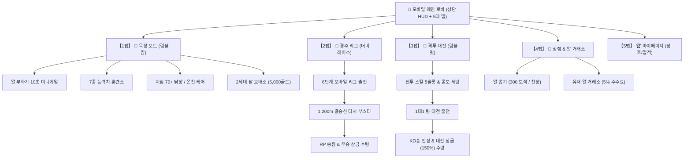
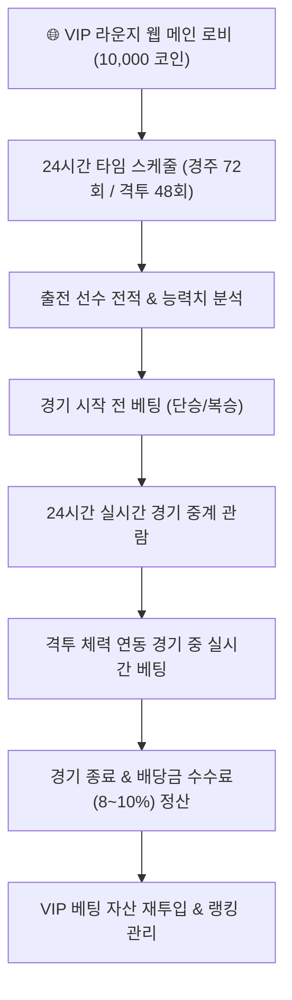

# 🐓 ROOSTER RUMBLE: 유저 플레이 동선 및 플로우 구성안

* **문서 버전**: `v1.8.0`
* **작성일**: 2026-09-18
* **기준 명세**: [[통합 MVP 구성안.md]] (`v0.9.1`) 및 [[통합_MVP_전체_게임_플로우차트.md]] (`v1.3.1`)
* **서비스 구성**: **[모바일 스토어 서비스]** / **[VIP 라운지 서비스]**
* **연계 문서**: `ROOSTER_RUMBLE_스토어 및 라운지 통합 일정.md`

---

## 📋 목차
1. [[#1. 서비스 형태 2종 (모바일 스토어 서비스 vs VIP 라운지 서비스) 비교]]
2. [[#2. 모바일 스토어 서비스 전용 유저 플레이 동선 명세]]
3. [[#3. VIP 라운지 서비스 전용 유저 플레이 동선 명세]]
4. [[#4. 서비스별 화면 이동 경로 (Mermaid)]]

---

## 1. 서비스 형태 2종 (모바일 스토어 서비스 vs VIP 라운지 서비스) 비교

### 1.1 서비스 사양 비교

| 서비스 구분 | 📱 모바일 스토어 서비스 | 🌐 VIP 라운지 서비스 |
| :--- | :--- | :--- |
| **서비스 목적** | 대중적 접근성, 캐주얼 닭 키우기/대전 | 24시간 실시간 경기 관람, 승자 예측 베팅 및 상금 정산 |
| **서비스 플랫폼** | 모바일 앱스토어 / 구글플레이 앱 | 독립 자체 온라인 웹 브라우저 (PC 및 모바일 웹) |
| **주력 모드/기능** | • 럼블 팜 (닭 키우기) • 더비 레이스 (경주 리그) • 럼블 핏 (1대1 링 대전) • 유저 알 거래소 | • 24시간 달리기 경주 중계 (하루 72회) • 24시간 1대1 링 대전 중계 (하루 48회) • 경기 시작 전/경기 중 실시간 베팅 • 독립 웹 코인 및 배당 정산 |
| **수익 모델** | 유료 알 뽑기, 유료 온천 이용료, 광고 3종 | 베팅 수수료 (8% ~ 10%), 유료 온천 이용료 |
| **계정 체계** | 모바일 전용 계정 (구글/애플/게스트) | 자체 VIP 라운지 웹 전용 계정 (상호 미연동) |
| **재화 및 DB** | 골드, 보석, 사료, 알 캡슐 (`모바일 앱 DB`) | 베팅 코인, 격투 대전 상금 (`VIP 라운지 DB`) |

### 1.2 3대 핵심 게임 모드 사양
* **모드 기본 구성**: 닭 키우기(럼블 팜), 6두 달리기 경주(더비 레이스), 1대1 링 대전(럼블 핏) 3개 모드 연계

| 모드 명칭 | 핵심 재미 | 주요 플레이 내용 |
| :--- | :--- | :--- |
| 🚜 **1. 육성 모드 (럼블 팜)** | 알 부화, 훈련, 온천 케어 및 교배 | 3도장 알 획득, 터치 미니게임, 7종 능력치 훈련, 온천 케어, 2세대 닭 교배 |
| 🏇 **2. 경주 모드 (더비 레이스)** | 6두 달리기 경주, 리그 승강급 | 6단계 모바일 리그, 승점(RP), 주행 기술 6종, 결승선 터치 부스터 |
| 🥊 **3. 격투 모드 (럼블 핏)** | 1대1 링 대전, 실시간 동시 격돌 | 7대 전투 기술 세팅, 3연속 콤보 조합, 동시 격돌, 대전 상금 (150%) |

### 1.3 유저 플레이 성향 분류 및 적용 서비스

| 성향 명칭 | 주력 모드 및 적용 서비스 | 주요 행동 명세 |
| :--- | :--- | :--- |
| 🚜 **[성향 A] 닭 키우기 마니아** | 육성 모드 (모바일 스토어 서비스) | 알 수집/부화 손맛, 7종 능력치 맞춤 훈련, 온천 케어, 2세대 닭 교배 |
| 🏇 **[성향 B] 경주 리그 승부사** | 경주 모드 (모바일 스토어 서비스) | 6두 달리기 경주 리그 출전, 주행 기술 세팅, 결승선 부스터 사용 |
| 🥊 **[성향 C] 링 대전 파이터** | 격투 모드 (모바일 스토어 서비스) | 1대1 링 대전, 7대 전투 기술 슬롯 세팅, 3연속 콤보 타격 |
| 🎲 **VIP 라운지 베팅 유저** | 온라인 웹 (VIP 라운지 서비스) | 경주 및 격투 경기 실시간 관람, 경기 전/경기 중 배당 베팅 및 정산 |

---

## 2. 모바일 스토어 서비스 전용 유저 플레이 동선 명세

### 2.1 단계별 (1단계 ~ 4단계) 플레이 동선
* **1단계 (시작 / 첫 경험)**:
  - 앱 설치 및 로그인 (`POST /api/v1/auth/login`)
  - 신규 보상 수령 (기본 닭 1두 + 1,000 골드 + 50 사료)
  - 첫 실행 튜토리얼 진행 (무료 알 10초 터치 부화 미니게임 ➔ 훈련소 1회 훈련 ➔ 달리기 경주 리그 출전 및 결승선 부스터 우승 ➔ 1대1 링 대전 수행)
  - 메인 로비 (5대 하단 탭) 진입
* **2단계 (초기 정착 / 매일 접속)**:
  - 일일 출석체크(+1) 및 광고 2회 시청(+2, 5분 대기시간) (3도장 완료 즉시 무료 알 수령)
  - 부화기 알 부화 ➔ 지침 수치 70+ 관리 (무료 닭장 휴식 / 광고 시청 -20 회복 / 유료 온천)
  - 6단계 경주 리그 출전 (RP 승점 수급) 및 1대1 격투 대전 출전 (대전 상금 150% 수급)
  - 경기 우승 상금 2배 광고 시청 적용
* **3단계 (숙련 / 심화 플레이)**:
  - 보석 뽑기 (300 보석 / 10연속 천장 전설 알) 또는 유저 알 거래소(5% 수수료) 이용
  - 능력치 상한 도달 닭 2두 선택 ➔ 5,000 골드 소모 2세대 닭 교배 (90% 능력치 계승 & 50% 패시브 유전)
  - 7대 전문 전투 기술 중 등급별 최대 5개 슬롯 장착 및 3연속 콤보 세팅
* **4단계 (고수 / 마스터)**:
  - 전설 리그 챔피언 도전 및 영구 칭호 20종 장착 (패시브 버프 적용)
  - 알 거래소 매매 진행 및 재화 순환

### 2.2 주력 모드별 세션 이동 경로
* **🚜 육성 모드 이동 경로**: `[앱 접속] ➔ [3도장 완료] ➔ [알 부화] ➔ [능력치 훈련] ➔ [휴식/온천] ➔ [2세대 닭 교배] ➔ [알 거래소 매매]`
* **🏇 경주 리그 이동 경로**: `[앱 접속] ➔ [주행 기술 세팅] ➔ [리그 출전] ➔ [1,200m 부스터 연타] ➔ [RP 승점/상금 수령] ➔ [상금 2배 광고] ➔ [능력치 훈련]`
* **🥊 격투 대전 이동 경로**: `[앱 접속] ➔ [전투 스킬/콤보 세팅] ➔ [1대1 대전 출전] ➔ [KO승 & 대전 상금 수령] ➔ [능력치 훈련] ➔ [부상 시 온천 진입]`

---

## 3. VIP 라운지 서비스 전용 유저 플레이 동선 명세

### 3.1 단계별 (1단계 ~ 4단계) 플레이 동선
* **1단계 (웹 접속 / 첫 중계 경험)**:
  - 자체 웹 브라우저 접속 및 계정 생성
  - 신규 가입 보상 10,000 베팅 코인 수령
  - 24시간 타임 스케줄 UI 확인 (경주 하루 72회 / 격투 하루 48회)
  - 실시간 경기 관람 및 사전 베팅 수행
* **2단계 (베팅 정착 / 매일 접속)**:
  - 경기 진입 전 출전 선수 세부 능력치/전적 분석
  - 경기 시작 전 베팅 접수 (단승 / 복승)
  - 경기 진행 중 실시간 베팅 참여 (격투 잔여 체력 비율 연동 배당 변동)
  - 경기 종료 즉시 수수료(8% ~ 10%) 차감 정산금 자동 수령
* **3단계 (고급 베팅 전략)**:
  - 경기별 실시간 배당 변동 그래프 분석
  - 고배당 복승식 및 베팅 마감 직전 실시간 베팅 수행
  - 베팅 코인 자산 운용
* **4단계 (VIP 토너먼트 마스터)**:
  - 자체 웹 'VIP 베팅 왕중왕전' 참가
  - VIP 라운지 베팅 정산 코인 자산 운용 및 랭킹 관리

### 3.2 VIP 라운지 베팅 유저 세션 이동 경로
* **🌐 VIP 라운지 베팅 이동 경로**: `[웹 접속] ➔ [계정/코인 확인] ➔ [스케줄 조회] ➔ [전적 분석] ➔ [경기 전 베팅] ➔ [실시간 중계 관람] ➔ [실시간 배당 베팅] ➔ [수수료 차감 정산 수령]`

---

## 4. 서비스별 화면 이동 경로 (Mermaid)

### 4.1 모바일 스토어 서비스 화면 이동 경로

### 4.2 VIP 라운지 서비스 화면 이동 경로

