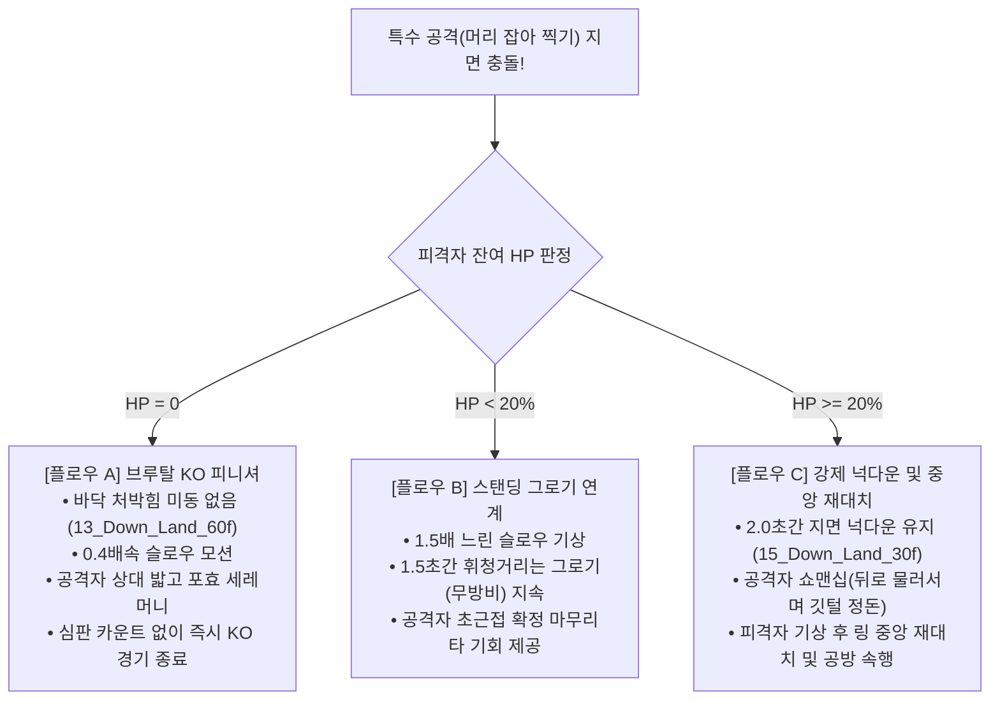
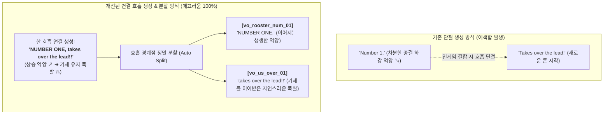

# 🐓 ROOSTER RUMBLE: 통합 MVP 세부 기획 구성안

* **현재 문서 버전**: `v1.4.0` (통합 파이프라인 최신화 기준선)
* **마지막 개정일**: 2026-11-10
* **문서 정체성**: 3개 모드(경주, 격투, 육성) 통합 MVP 실무 작업 지시용 세부 기획 명세서

### ■ 문서 개정 이력 (Revision History)

| 버전 (Version) | 개정일 (Date) | 주요 개정 내역 및 상세 변경 사항 | 관련 절 바로가기 |
| :---: | :---: | :--- | :--- |
| **v0.0.1** | 2026-08-11 | 3개 모드 통합 MVP 개요 및 기본 범위 최초 구성안 작성 | [[#1.2 게임 컨셉, 3대 모드 및 핵심 플레이 루프\|1.2절 핵심 루프]] |
| **v0.1.0** | 2026-08-11 | Derby Race 하루치 72회 스케줄/매칭 룰(3.6) 및 Rumble Pit 하루치 48회 대진/매칭 룰(4.5) 신규 명세 수록 | [[#3.1 24시간 경기 스케줄(72회) 및 6두 자동 매칭/게이트 배정 알고리즘\|3.1절 경주 스케줄]] |
| **v0.2.0** | 2026-08-13 | 한글 사칙연산 표준 수식 정제, 격투 서버/클라이언트 사양 보완(Hitbox/TEC치명타율/베팅락/동점룰), 알 65종 가차 마스터 구축 및 CSV 6종 링크 연동 | [[#2.1 알 획득 방법 (가차 65종, 유저 거래소, 출석/광고 무료 수급)\|2.1절 알 가차 획득]] |
| **v0.3.0** | 2026-08-27 | 경주(Derby Race) 6두 및 격투(Rumble Pit) 1v1 단계별 매칭 알고리즘 구체화, 베팅 슬립 3단계 조작/배당률 롤링/결과 Claim UX/UI 및 로비 탭 컨트롤러 명세 보완 | [[#3.3 [온라인 전용] 승자 베팅 종목, 배당금 계산 규칙 및 베팅 UI/UX 조작 명세\|3.3절 베팅 UI/UX]] |
| **v0.4.0** | 2026-08-27 | 외부 문서 참조 전면 제거(완전 자립화), 컨디션 5등급 상세 보정표 및 시드 난수키, 경주 서버 5단계 상태머신/멱등성 정산키, 격투 라운드 휴식 체력 회복식 내재화 | [[#3.5 경주 결과 연산 공식, 서버 상태 머신 및 클라이언트 시각 보간 명세\|3.5절 경주 연산 공식]] |
| **v0.5.0** | 2026-08-27 | DB 9대 테이블 컬럼 스키마 DDL, REST API 12종/WebSocket 4종, 부화 스탯 롤링식, 격투 틱 AI 매트릭스, 교배 한도 명세 수록 | [[#5.1 모드별 선수 능력치 구조 정의 및 1차 ➔ 2차 파생 스탯 산출 공식\|5.1절 스탯 산출 공식]] |
| **v0.5.1** | 2026-08-27 | 문서 구조 최적화: 1장 프로젝트 핵심 요약 수록, 닭 상태 규칙을 육성 모드(2.1)로 통합, 6대 장 체계 정렬 | [[#1.1 프로젝트 핵심 요약 & 5대 수익화(BM) 모델\|1.1절 핵심 요약]] |
| **v0.5.2** | 2026-08-27 | 기획 이해도 및 개발 순서 최적화: 모드별 진행 순서 및 기술스펙(스탯수식➔마스터➔DB➔API) 정렬 | [[#2. [육성 모드] 럼블 팜 (Rumble Farm)\|2장 럼블 팜]] |
| **v0.5.3** | 2026-08-27 | 과시형 미사여구 및 외래어 전면 정비 (실무형 표준 용어로 통일) | [[#1. 게임 개요 및 핵심 BM (Game Overview & Core Loop)\|1장 개요]] |
| **v0.5.4** | 2026-08-27 | 마스터 데이터 CSV 6종 전수 무결성 검증, 04/05번 2차 파생 스탯 재연산 동기화 및 컬럼 헤더 표준화 | [[#5.2 [선수 마스터 데이터] 3개 모드(육성 / 경주 / 격투) 전용 선수 데이터 세트\|5.2절 선수 마스터]] |
| **v0.6.0** | 2026-08-27 | 신규 핵심 콘텐츠 통합: 모바일 6단계 리그 보상/승강급 룰(3.4), 칭호 20종 마스터(2.6), 일일/주간 퀘스트 및 영구 업적(2.7), 모바일 DB 3종(5.3) 및 REST API 5종(5.4) 신설 확장 | [[#3.4 [모바일 전용] 경주 6단계 리그, 승점(RP) 산정, 승강급 룰 및 주간 랭킹 보상 체계\|3.4절 모바일 리그]] |
| **v0.7.0** | 2026-08-27 | 사운드 및 연출 규격 전면 통합: 7장 신설(BGM 8종, SFX 46종, 믹서 버스 및 이벤트 매핑 완비) | [[#7. 사운드 및 연출 규격 (SFX / BGM)\|7장 사운드 규격]] |
| **v0.8.0** | 2026-08-31 | 기획서 경계 및 역할 정상화 (월권 요소 전면 정제): 물리 보간 알고리즘(3.5), DB 물리 DDL ➔ 논리 스키마(5.3), UI/UX 정보 요구사항(6.1), 사운드 기술스펙 ➔ 연출 요구조건(7장)으로 전환 | [[#5.3 모바일 DB 7종 vs 온라인 DB 5종 (총 12대 테이블) 논리 데이터 모델 명세\|5.3절 논리 DB 스키마]] |
| **v0.8.1** | 2026-09-01 | **[격투 파이트 머니 개정]** 무베팅 시 참가비 100% 전액 환급 및 베팅 풀 연동 단일 연속 가중치 함수(Continuous Unified Formula) 도입 (운영사 적자 원천 방지 및 계단식 구간 배제) | [[#4.5 출전 파이트 머니 지급 및 베팅 수수료 정산 (단일 연속 함수 모델)\|4.5절 파이트 머니 모델]] |
| **v0.8.2** | 2026-09-04 | **[실전 시뮬레이션 시나리오 수록]** 4.6절 실전 1v1 격투 시뮬레이션 종합 예시 시나리오 신규 추가 (라운드별 1초 1틱 판정, 치명타, 휴식 회복, 라이브 배당, Last Stand 및 파이트 머니 정산 수치 완비) | [[#4.6 실전 1v1 격투 시뮬레이션 종합 예시 시나리오 (Match Walkthrough Scenario)\|4.6절 실전 격투 시나리오]] |
| **v0.9.0** | 2026-09-07 | **[전투 시스템 전면 개편]**<br>1. 7대 전문 기술(공격 4종+방어 3종) 및 선수 등급별 보유 슬롯(최대 5개) 도입<br>2. 최대 3연속기(Combo) 조합 시너지 매트릭스(조건부 크리티컬, 1.8배 무조건 반격, 트루 데미지 관통 등 6종) 구축<br>3. 비(非) 턴제 실시간 동시 격돌(Real-Time Clash), 콤보 중간 차단(Interrupt/Cancel) 및 가드 브레이크 시스템 신설<br>4. 기술 계수 및 방어 관통을 반영한 타격 피해량 공식 및 치명타 수식 정립<br>5. 4.6절 실전 1v1 시나리오를 3연속기 실시간 격돌 및 캔슬 버전으로 전면 리뉴얼<br>6. 5.4절 WebSocket 전투 틱 패킷 규격 확장 | • [[#4.2 1대1 아레나 전투 기술 체계, 4대 가위바위보 상성 및 실시간 비(非) 턴제 격돌(Clash) 메커니즘\|4.2절 7대 기술·3연속기·실시간 격돌]]<br>• [[#4.6 실전 1v1 격투 시뮬레이션 종합 예시 시나리오 (Match Walkthrough Scenario)\|4.6절 실전 1v1 3연속기 격돌 시나리오]]<br>• [[#5.4 클라이언트-서버 통신 REST API 17종 및 실시간 WebSocket 이벤트 명세\|5.4절 WebSocket 전투 틱 패킷 규격]] |
| **v0.9.1** | 2026-09-07 | **[전투 시나리오 정합성 검증 및 서술 객관화]**<br>1. 4.6절 실전 시나리오 전면 개편 (경기 타임라인-틱 100% 동기화, 라운드별 체력 감쇄 및 회복 산술 오차 0 정합, 6대 콤보 및 가드 브레이크 수식 실연)<br>2. 4장 내 구버전 표현('1초 1틱')을 '실시간 액션 타임라인'으로 일원화<br>3. 4.2절 및 5.1절 TEC 스탯에 기력 호흡 정돈 쿨다운 단축 공식 명시<br>4. 5.4절 WebSocket 전투 틱(`pit:combat_tick`) 패킷 규격에 기술 식별자, 콤보 단계, 격돌 결과, 타임스탬프 필드 확장 반영<br>5. 문서 전반의 서술형 문장을 개조식 문체로 전면 전환 정제 | • [[#4.2 1대1 아레나 전투 기술 체계, 4대 가위바위보 상성 및 실시간 비(非) 턴제 격돌(Clash) 메커니즘\|4.2절 7대 기술·실시간 격돌]]<br>• [[#4.6 실전 1v1 격투 시뮬레이션 종합 예시 시나리오 (Match Walkthrough Scenario)\|4.6절 실전 1v1 격투 시나리오]]<br>• [[#5.1 모드별 선수 능력치 구조 정의 및 1차 ➔ 2차 파생 스탯 산출 공식\|5.1절 2차 스탯 산출 공식]]<br>• [[#5.4 클라이언트-서버 통신 REST API 17종 및 실시간 WebSocket 이벤트 명세\|5.4절 WebSocket 틱 규격]] |
| **v1.2.0** | 2026-10-08 | **[격투 모드 원형 벽면 경기장, 비의인화 닭 골격 기반 공/방/이동 규칙 및 즉시 KO 반영]**<br>1. `Rumble Pit MVP 구성안(v1.2.0)` 및 `Rumble_Pit_전투_시뮬레이션_규칙_정의서(v1.2.0)` 기준 4장·5장·7장 전면 동기화<br>2. 사각 링에서 **원형 벽면 경기장(`Circular Walled Arena`)**으로 개편, 3단계 교전 거리(`근거리/중거리/원거리`), 외곽 벽면 몰림(`Wall Pressure`)·벽 격돌(`Wall Impact`) 규칙 반영<br>3. 조류형 6대 이동(`전진 총총걸음`, `짧은 뒤로 홉`, `목 빼고 질주`, `날개 퍼덕 후방 이탈`, `측면 사이드 홉`, `원형 탐색 걸음`), 공격 4종(`전진 부리 속사`, `낮은 발톱 할퀴기`, `비상 발톱 급습`, `광폭 발버둥 난타`) 및 방어 3종(`깃털 부풀려 버티기`, `납작 엎드리기`, `맞발톱 쳐내기`) 동작 묘사 반영<br>4. **짧은 스탠딩 그로기(0.5~1.0초) 위기 탈출 및 바닥 다운 즉시 KO 종료(심판 카운트·재기립 배제)** 및 SFX-Pit 14종/칭호 동기화 반영 | • [[#4.2 1대1 아레나 전투 기술 체계, 4대 가위바위보 상성 및 실시간 비(非) 턴제 격돌(Clash) 메커니즘\|4.2절 공방·이동 및 원형 아레나]]<br>• [[#4.3 투지 버티기 확률, 바닥 다운(넉다운 vs 즉시 KO) 판정 및 예외 처리\|4.3절 투지 버티기 및 다운 규칙]]<br>• [[#4.6 실전 1v1 격투 시뮬레이션 종합 예시 시나리오 (Match Walkthrough Scenario)\|4.6절 실전 시나리오 동기화]] |
| **v1.3.0** | 2026-10-16 | **[경주·격투 상용화 개선 요소, 3D 에셋 볼륨 기준선 및 전 모드 수치 정합화]**<br>1. `ROOSTER_RUMBLE_경주_격투_개선_요소_및_마일스톤(v1.5.1)` 및 `구성요소_볼륨_산정서(v1.1.0)` 기준 전 모드 정합성 통합<br>2. **제1장·제2장·제5장 수치 정합**: 알 거래소 수수료 `8%`(`t_market_trade` 포함), 경기 출전 피로도 `+25`, 영양 사료 급여(-20), 8종 훈련(`진흙탕 극기 훈련`) 및 격투 기술 개화 연동, 미국 오프라인 VIP 라운지(온·오프라인 100% 분리) 반영<br>3. **제3장 더비 레이스 상용화 규격(3.6절) 신설**: 6종 주행 스타일별 3D 베이스 메쉬 분기, 머리 위 게이트 번호(1~6번) 인디케이터, 질주 속도감 +30% 튜닝, 피니쉬 3단계 연출(경기 중 슬로우 배제 + 종료 후 1초 슬로우 리플레이), 카메라 워킹 3종, 환경 변수 3종(비/바람-낙엽/아지랑이) 반영<br>4. **제4장·제6장·제7장 보완**: 5종 격투 스타일별 체형 3D 메쉬 및 **선수 바리에이션용 텍스처 맵핑 총 300종(추후 추가 예정)** 로드맵(6.3절), 크리티컬 렌즈 혈흔(0.8초) 및 객관적 거리 비례 줌 카메라, BGM 8종 완비 및 상황 반응형 아나운서 보이스(25종+)·라운드 콜 보이스(7.8절) 신설 | • [[#3.6 더비 레이스 3D 모델·모션·카메라·환경 변수 및 피니쉬 3단계 상용화 연출 규격\|3.6절 경주 상용화 연출]]<br>• [[#6.3 전 모드 구성 요소(비주얼 에셋 포함) 확정 볼륨(Fix) 기준선 요약표\|6.3절 확정 볼륨 요약표]]<br>• [[#7.8 상황 반응형 아나운서 보이스(연결 호흡 대사표) 및 격투 라운드 콜 연출 규격\|7.8절 아나운서 및 콜 보이스]] |
| **v1.4.0** | 2026-11-10 | **[격투 특수 액션 2종·4대 상성 및 다운/KO 분리, 단일 리그 외형 파츠 최적화, 4대 CSV 파이프라인 및 아나운서 연결 대사표 완비]**<br>1. **격투 다운/KO 분리 및 신규 액션 2종 반영**: 체력 잔여 시 피격 넉다운(15번 다운 클립 ➔ 2.0초 후 기상 재대치)과 체력 0 바닥 다운(13번 다운 클립 ➔ 카운트 없는 즉시 KO) 분리, `[특공] 머리 잡아 바닥에 찍어 누르기 (F33)` 및 `[특방] 잡힌 머리 풀고 반격하기 (F34)` 추가, `[타격 ➔ 가드 ➔ 잡기 ➔ 반격]` 4대 가위바위보 순환 상성 및 잔여 HP별 3대 후속 플로우(KO / 그로기 / 넉다운) 확립<br>2. **실무 가공 클립 5종 및 실구현 상태 동기화**: `08_Jump_F_atk`, `09_Jump_L_Mirror_48f`, `11_Attack_x2`, `12_Jump_Attack_crit`, `16_Up_Land_crit` 매핑 수록<br>3. **3D 캐릭터 모델링/바리에이션 파이프라인 실무 최적화**: 11종 체형 분기 모델링에서 리깅 안정성(날개 찢김 방지) 확보를 위한 **'단일 기본 리그(Rig) 및 공용 애니메이션 기반 + 3단계 등급별 외형 파츠(볏/깃털/며느리발톱) 바리에이션'** 전략으로 전환 수치 동기화 (텍스처 맵핑 300종 로드맵 유지)<br>4. **데이터 주도형 4대 연출 CSV 및 Proto_Editor 파이프라인 공식화**: `cue_table_v6.csv`, `camera_frames_v3.csv`, `shake_presets_v3.csv`, `fx_names_v5.csv` 파라미터 규격(히트스탑, FOV, 쿨다운, 쉐이크 강도 등) 및 멀미 방지 안전 제어(`cooldown_s`, `min_gap_s`, `fallback_shake`) 반영<br>5. **더비 레이스 AI 아나운서 중계 연결 호흡(Connect & Split) 파이프라인 및 마스터 영문 대사표 수록**: 번호-상황 결합 시 억양 단절 방지를 위한 일체형 연결 생성 후 분할 메커니즘 및 마스터 영문 스크립트(독립 10종, 초반 선두 11종, 중반 역전 10종) 제7.8절 수록 | • [[#3.6 더비 레이스 3D 모델·모션·카메라·환경 변수 및 피니쉬 3단계 상용화 연출 규격\|3.6절 경주 연출 및 CSV 규격]]<br>• [[#4.2 1대1 아레나 전투 기술 체계, 4대 가위바위보 상성 및 실시간 비(非) 턴제 격돌(Clash) 메커니즘\|4.2절 특수 액션·4대 상성]]<br>• [[#4.3 투지 버티기 확률, 바닥 다운(넉다운 vs 즉시 KO) 판정 및 예외 처리\|4.3절 다운/즉시 KO 분리]]<br>• [[#6.3 전 모드 구성 요소(비주얼 에셋 포함) 확정 볼륨(Fix) 기준선 요약표\|6.3절 확정 볼륨 요약표]]<br>• [[#7.8 상황 반응형 아나운서 보이스(연결 호흡 대사표) 및 격투 라운드 콜 연출 규격\|7.8절 아나운서 연결 대사표]] |

#### ■ 마스터 데이터 CSV 파일 6종 데이터 세트
* **01. 경주 타임 스케줄 (72회)**: [01_derby_race_daily_schedule_72.csv](01_derby_race_daily_schedule_72.csv)
* **02. 격투 1v1 대진표 (48회)**: [02_rumble_pit_daily_matches_48.csv](02_rumble_pit_daily_matches_48.csv)
* **03. 선수 1차 피지컬 스탯 (30두)**: [03_roosters_base_stats_1st.csv](03_roosters_base_stats_1st.csv)
* **04. 선수 2차 경주 스탯 (30두)**: [04_roosters_derby_stats_2nd.csv](04_roosters_derby_stats_2nd.csv)
* **05. 선수 2차 격투 스탯 (30두)**: [05_roosters_pit_stats_2nd.csv](05_roosters_pit_stats_2nd.csv)
* **06. 알 가차 마스터 데이터 (65종)**: [06_egg_gacha_master_list_65.csv](06_egg_gacha_master_list_65.csv)

---

## 목차
1. [[#1. 게임 개요 및 핵심 BM (Game Overview & Core Loop)]]
   - [[#1.1 프로젝트 핵심 요약 & 5대 수익화(BM) 모델]]
   - [[#1.2 게임 컨셉, 3대 모드 및 핵심 플레이 루프]]
   - [[#1.3 모바일 버전 vs 온라인 버전 기능 및 서비스 전략 비교]]
2. [[#2. [육성 모드] 럼블 팜 (Rumble Farm)]]
   - [[#2.1 알 획득 방법 (가차 65종, 유저 거래소, 출석/광고 무료 수급)]]
   - [[#2.2 알 부화 시스템 (등급별 시간, 터치 미니게임, 1차 기본 스탯 초기 생성 분배식)]]
   - [[#2.3 닭 캐릭터 10대 상태 머신 및 피로도/부상/회복 규칙]]
   - [[#2.4 훈련 시스템 (종목별 소모/대기시간, 능력치 상승 및 2차 파생 연동 프로세스)]]
   - [[#2.5 2세대 교배 시스템 (능력치/잠재력 유전 공식, 패시브/외형 유전 인계, 생애 5회 제약)]]
   - [[#2.6 칭호(Title) 시스템 (4대 등급, 장착 효과 및 20종 마스터 명세)]]
   - [[#2.7 일일/주간 퀘스트 및 영구 누적 업적 시스템]]
3. [[#3. [경주 모드] 더비 레이스 (Derby Race)]]
   - [[#3.1 24시간 경기 스케줄(72회) 및 6두 자동 매칭/게이트 배정 알고리즘]]
   - [[#3.2 주행 스타일 6종 명세, 주요 능력치 및 컨디션 5등급 연동 규칙]]
   - [[#3.3 [온라인 전용] 승자 베팅 종목, 배당금 계산 규칙 및 베팅 UI/UX 조작 명세]]
   - [[#3.4 [모바일 전용] 경주 6단계 리그, 승점(RP) 산정, 승강급 룰 및 주간 랭킹 보상 체계]]
   - [[#3.5 경주 결과 연산 공식, 서버 상태 머신 및 클라이언트 시각 보간 명세]]
   - [[#3.6 더비 레이스 3D 모델·모션·카메라·환경 변수 및 피니쉬 3단계 상용화 연출 규격]]
4. [[#4. [격투 모드] 럼블 핏 (Rumble Pit)]]
   - [[#4.1 24시간 대진표(48회) 및 1v1 자동 매칭/코너 배정 알고리즘]]
   - [[#4.2 1대1 아레나 전투 기술 체계, 4대 가위바위보 상성 및 실시간 비(非) 턴제 격돌(Clash) 메커니즘]]
   - [[#4.3 투지 버티기 확률, 바닥 다운(넉다운 vs 즉시 KO) 판정 및 예외 처리]]
   - [[#4.4 [온라인 전용] 실시간 라이브 베팅 및 배당 변동 규칙, 라이브 UX/UI 조작 명세]]
   - [[#4.5 출전 파이트 머니 지급 및 베팅 수수료 정산 (단일 연속 함수 모델)]]
   - [[#4.6 실전 1v1 격투 시뮬레이션 종합 예시 시나리오 (Match Walkthrough Scenario)]]
5. [[#5. 데이터 구조, DB 스키마 및 통신 API 규격]]
   - [[#5.1 모드별 선수 능력치 구조 정의 및 1차 ➔ 2차 파생 스탯 산출 공식]]
   - [[#5.2 [선수 마스터 데이터] 3개 모드(육성 / 경주 / 격투) 전용 선수 데이터 세트]]
   - [[#5.3 모바일 DB 7종 vs 온라인 DB 5종 (총 12대 테이블) 논리 데이터 모델 명세]]
   - [[#5.4 클라이언트-서버 통신 REST API 17종 및 실시간 WebSocket 이벤트 명세]]
6. [[#6. 화면 레이아웃 및 오류 처리]]
   - [[#6.1 메인 화면 구성, 로비 탭 네비게이션 및 베팅 슬립 계층 구조]]
   - [[#6.2 팅김, 잔액 부족, 베팅 락 등 6대 예외 및 오류 처리 방법]]
   - [[#6.3 전 모드 구성 요소(비주얼 에셋 포함) 확정 볼륨(Fix) 기준선 요약표]]
7. [[#7. 사운드 및 연출 규격 (SFX / BGM)]]
   - [[#7.1 사운드 시스템 연출 원칙 및 버스 아키텍처]]
   - [[#7.2 배경음악 (BGM) 8종 연출 명세표]]
   - [[#7.3 공통 UI & 재화 효과음 (SFX-UI) 12종 명세표]]
   - [[#7.4 [육성 모드] 럼블 팜 전용 효과음 (SFX-Farm) 10종 명세표]]
   - [[#7.5 [경주 모드] 더비 레이스 전용 효과음 (SFX-Derby) 10종 명세표]]
   - [[#7.6 [격투 모드] 럼블 핏 전용 효과음 (SFX-Pit) 16종 명세표]]
   - [[#7.7 클라이언트 사운드 이벤트 매핑 및 우선순위 테이블]]
   - [[#7.8 상황 반응형 아나운서 보이스(연결 호흡 대사표) 및 격투 라운드 콜 연출 규격]]

---

## 1. 게임 개요 및 핵심 BM (Game Overview & Core Loop)

### 1.1 프로젝트 핵심 요약 & 5대 수익화(BM) 모델

#### ■ 게임 기본 구성 및 플랫폼별 서비스 방향
* **게임 개요**: 닭 캐릭터를 키우는 **육성(Farm)**, 6두 달리기 **경주(Derby)**, 1대1 싸움 **격투(Pit)** 3개 모드로 구성된 게임
* **플랫폼별 특징**:
  - **모바일 앱**: 육성 플레이, 6단계 리그 경주 출전, 보상형 광고 시청 위주 구성
  - **온라인 웹**: 실시간 경기 관람, 승자 예측 베팅(사전/실시간 라이브), 배당금 및 수수료 정산 위주 구성
  - **미국 오프라인 VIP 라운지**: 매장 대형 전광판(16:9) 실시간 경기 관전, 좌석 개인 태블릿 패스트트랙(Fast-Track) 육성·베팅, 현장 키오스크 크레딧 충전/정산 전용 독립 구성

#### ■ 5대 수익 모델 (BM) 요약표

| 수익 항목 (BM) | 대상 플랫폼 | 결제/소모 조건 | 수익 방식 | 구분 |
| :--- | :---: | :--- | :--- | :---: |
| **① 유료 알 뽑기** | 모바일 / 온라인 / VIP | 높은 잠재력(61~100) 알 뽑기 | 30~300 Gem 유료 결제 (10연속 뽑기 시 전설알 확정) | 유료 상품 |
| **② 유료 스파 이용** | 모바일 / 온라인 / VIP | 피로도 즉시 0 완충, 부상 치료, 24시간 컨디션 100 유지 | 50 Gem 또는 5,000 Gold 소모 | 게임 내 재화 소모 |
| **③ 알 거래소 수수료** | 모바일 전용 | 유저 간 알 매매 거래 체결 | 거래 금액의 **8%** 수수료 차감 (`[큰손]` 칭호 장착 시 **7%**) | 거래 수수료 |
| **④ 베팅 수수료** | 온라인 / VIP 전용 | 경주 및 격투 경기 승자 예측 베팅 | 배당금 정산 시 **8% ~ 10%** 수수료 차감 (격투 8%, 경주 10%) | 베팅 수수료 |
| **⑤ 보상형 광고 3종** | 모바일 전용 | 무료 알 스템프(3/3), 상금 2배, 피로도 -20 회복 | 광고 시청에 따른 광고 수익 발생 (일일 2~3회 제한) | 광고 수익 |

#### ■ 게임 내 재화 획득 및 소모 구조
* **재화 획득 (유입)**: 출석 및 광고 보상, 경기 우승 상금(Gold), 격투 대전료(Credit)
* **재화 소모 (유출)**: 알 부화 및 교배 비용(5,000 Gold), 훈련 비용(1,000~1,500 Gold + 사료), 스파 이용료(5,000 Gold), 베팅 및 거래 수수료(8~10%)
* **파산 방지 지원**: 보유 골드가 100 Gold 미만으로 떨어질 경우 광고 시청 무료 충전(1,000 Gold) 제공

### 1.2 게임 컨셉, 3대 모드 및 핵심 플레이 루프
* **통합 서비스 정의**: 알 부화 및 닭 육성(Rumble Farm), 6두 달리기 경주(Derby Race), 1대1 싸움 격투(Rumble Pit) 3개 모드를 연계 운영하는 구성
* **실무 작업 지시 검증 목표**:
  - 모드 간 선수 데이터 공유 및 스탯 변환 알고리즘 정합성 검증
  - 알 수거 ➔ 미니게임 부화 ➔ 맞춤 훈련 ➔ 경주/격투 출전 ➔ 재화 수급 ➔ 교배/휴식의 6단계 코어 루프 수율 검증

### 1.3 모바일 버전 vs 온라인 버전 기능 및 서비스 전략 비교

#### ■ 플랫폼별 핵심 기능 및 데이터 구조 비교표 (모바일 앱 vs 온라인 웹 vs 미국 오프라인 VIP 라운지)

| 구분 | 모바일 앱 (Mobile App) | 자체 온라인 웹 (Online Web) | 미국 오프라인 VIP 라운지 (Offline VIP Lounge) |
| :--- | :--- | :--- | :--- |
| **서비스 목적** | 대중적 접근성, 캐주얼 육성 플레이, 유저 풀 확보 | 경기 관람 및 승자 예측 베팅, 수수료 수익 창출 | 오프라인 매장 대형 전광판 관전, 좌석 태블릿 초고속 육성 및 베팅 |
| **계정 및 자산** | 모바일 유저 계정, Gold, Gem, 사료, 알 캡슐 | 온라인 유저 계정, 베팅 코인, 파이트 머니 정산금 | 매장 전용 로컬 멤버십 카드/QR 계정, VIP 라운지 전용 크레딧(Credit) |
| **육성 및 케어** | 인큐베이터 슬롯 부화, 훈련, 무료 닭장 휴식 | 무료 닭장 휴식 vs 유료 프리미엄 스파 온천 케어 | 좌석 태블릿 **패스트트랙(`Fast-Breeding`) 즉시 부화·급속 훈련·즉시 스파** |
| **경기 시스템** | 6단계 모바일 경주 리그, 피니시 터치 부스터, 비동기 PvP | 24시간 72회 경주 및 48회 격투 실시간 라이브 중계 | 매장 16:9 대형 메인 전광판 실시간 경주·격투 중계 및 현장 전용 특별 매치 |
| **베팅 시스템** | 미지원 (순수 경기 출전 및 리그 상금 수령) | 6두 승자 예측(단승/복승) 및 1v1 실시간 라이브 베팅 | 좌석 가로형(Landscape) 태블릿 원터치 베팅 및 현장 키오스크 바우처 정산 |
| **수익 모델 (BM)**| 유료 알 뽑기, 보상형 광고 3종(스템프/상금2배/피로회복) | 경기 베팅 수수료(8~10%), 유료 스파 이용료 | 현장 크레딧 충전, VIP 전용 희귀 알 풀 가차, 현장 베팅 수수료(8~10%) |
| **알/선수 거래** | 유저 간 알 자율 거래소 지원 (**8%** 거래 수수료, 칭호 시 7%) | 유저 간 거래 비활성화 (초기 버전) | 현장 라운지 내 선수 즉시 분양 및 VIP 전용 경매/거래 지원 |
| **데이터베이스** | 모바일 서비스 전용 독립 DB (`Mobile App DB`) | 온라인 서비스 전용 독립 DB (`Online Web DB`) | 매장 폐쇄망/로컬 전용 독립 DB (`VIP Lounge Local DB`, **온·오프라인 100% 분리**) |

#### ■ 미국 오프라인 VIP 라운지(Offline VIP Lounge) 전용 운영 원칙
* **온·오프라인 계정 및 재화 100% 분리 원칙**: 미국 현지 법규 준수 및 아케이드 엔터테인먼트 매장 운영 최적화를 위해 온라인/모바일 계정·재화·선수와 오프라인 VIP 라운지 로컬 계정·크레딧·선수는 상호 이전이나 연동 없이 100% 독립 분리 운영
* **3대 하드웨어 디스플레이 분기 체계**:
  - **매장 대형 전광판 (16:9 Wall Screen, 2화면)**: 6두 경주 및 1v1 격투 라이브 중계 뷰포트 + 실시간 배당률/우승자 전광판 전용 화면
  - **좌석 개인용 태블릿 (Landscape Tablet, 4화면)**: 대기 시간 단축형 패스트트랙(`Fast-Breeding`) 인큐베이터·훈련·스파 대시보드 및 퀵 베팅 슬립 통합 화면
  - **현장 입출금 키오스크 (Touch Kiosk, 2화면)**: 멤버십 QR 로그인, 크레딧 충전 및 정산 영수증/바우처 티켓 발권 전용 화면

---

## 2. [육성 모드] 럼블 팜 (Rumble Farm)

### 2.1 알 획득 방법 (가차 65종, 유저 거래소, 출석/광고 무료 수급)

#### 2.1.1 유저 간 알 거래소 (Egg Marketplace)
* **거래 수수료**: 거래 체결 금액의 **8%** 정액 수수료 차감 후 정산금 지급 (`[큰손]` 칭호 장착 시 **7%** 적용)
* **파산 방지 미수락 시**: 매매 등록 알 72시간 미거래 시 자동 취소 후 소유함 복귀

#### 2.1.2 출석/광고 기반 통합 무료 알 수집 체계
* **[출석/광고 기반 통합 무료 알 수집 체계]**:
  - 알 파편 수집 방식 파기 후 **'단일 통합 3스템프 게이지(3/3)'** 시스템 구축
  - **수집 수단 A (출석 체크)**: 일일 로그인 시 **스템프 1개** 자동 적립
  - **수집 수단 B (광고 시청)**: 보상형 광고 1회 시청 시 **스템프 1개** 추가 적립 (광고 매체사 제약 고려 시청 1회당 **5분 쿨다운** 및 **일일 최대 2회** 시청 제한)
  - **무료 알 지급**: 출석 및 광고를 합산하여 스템프 **3개** 달성 즉시 무료 알(Natural Egg, 30종 중 1개) 부화함으로 자동 지급 및 게이지 리셋(롤오버)

| 광고 종목 | 일일 시청 제한 | 쿨다운 대기시간 | 보상 및 기능 명세 |
| :---: | :---: | :---: | :--- |
| **무료 알 스템프 광고** | 하루 최대 2회 | **5분 (300초)** | 1회 시청 시 통합 수집 라인 **스템프 1개** 적립 (총 3개 달성 시 무료 알 지급) |
| **경기 상금 2배 광고** | 경기 우승 시 팝업 | 즉시 시청 | 우승 상금 Gold 200% 증액 정산 |
| **피로도 회복 광고** | 하루 최대 3회 | **10분 (600초)** | 1회 시청 시 참전 닭 피로도 **-20** 즉시 회복 |

#### 2.1.3 알 뽑기(가차) 65종 마스터 구조 및 천장 시스템 (Pity System)

| 구분 | 마스터 수량 | 수급 경로 및 가격 | 부화 대기시간 | 잠재력 범위 |
| :---: | :---: | :--- | :---: | :---: |
| **무료 일반 (Natural)** | 30종 (`EGG-NAT-001~030`) | 단일 통합 3스템프 달성 (출석/광고) | 10분 (600초) | 30 ~ 45 |
| **유료 1단계 (Superior)** | 20종 (`EGG-PAID1-001~020`) | 30 Gem / 3,000 Gold | 1시간 (3,600초) | 46 ~ 60 |
| **유료 2단계 (Rare)** | 10종 (`EGG-PAID2-001~010`) | 100 Gem / 10,000 Gold | 4시간 (14,400초) | 61 ~ 80 |
| **유료 3단계 (Legendary)** | 5종 (`EGG-PAID3-001~005`) | 300 Gem (10연속 천장 100% 확정) | 12시간 (43,200초) | 81 ~ 100 |

* **가차 천장 (Pity System)**: 10연속 뽑기 진행 시 유료 3단계(전설 알) 1개 확정 지급
* **신규 알 추가 규칙**: 신규 알 추가 시 `EGG-[TIER_CODE]-[INDEX:03d]` 식별 체계 기반 확장 지원

#### 2.1.4 연동 마스터 데이터 및 CSV 파일
* **마스터 데이터 명세표**: [[통합 MVP 마스터 데이터 테이블.md#4. [알 가차 모드] 획득 가능 알 65종 마스터 데이터 명세표|4. [알 가차 모드] 획득 가능 알 65종 마스터 데이터 명세표]]
* **알 가차 65종 마스터 데이터 CSV**: [06_egg_gacha_master_list_65.csv](06_egg_gacha_master_list_65.csv)

### 2.2 알 부화 시스템 (등급별 시간, 터치 미니게임, 1차 기본 스탯 초기 생성 분배식)

#### ■ 알 등급별 획득 확률, 가격 및 부화 타이머 수치 테이블

| 알 등급 (Egg Tier) | 수급 경로 | 마스터 수량 | 구매 가격 | 기본 부화 시간 | 잠재력 범위 |
| :---: | :--- | :---: | :---: | :---: | :---: |
| **무료 일반 (Natural)** | 단일 통합 라인 (출석/광고 3스템프 달성) | 30종 (`EGG-NAT-001~030`) | 무료 | 10분 (600초) | 30 ~ 45 |
| **교배 혈통 (Heritage)** | 보유 닭 2두 유전 교배 | 교배 조합 | 교배 토큰 1개 + 5,000 Gold | 2시간 (7,200초) | 부모 상한 +5% |
| **유료 1단계 (Superior)** | 프리미엄 가차 뽑기 | 20종 (`EGG-PAID1-001~020`) | 30 Gem / 3,000 Gold | 1시간 (3,600초) | 46 ~ 60 |
| **유료 2단계 (Rare)** | 프리미엄 가차 뽑기 | 10종 (`EGG-PAID2-001~010`) | 100 Gem / 10,000 Gold | 4시간 (14,400초) | 61 ~ 80 |
| **유료 3단계 (Legendary)** | 프리미엄 가차 (천장) | 5종 (`EGG-PAID3-001~005`) | 300 Gem (10연속 천장) | 12시간 (43,200초) | 81 ~ 100 |

* **알 가차 65종 마스터 데이터 CSV**: [06_egg_gacha_master_list_65.csv](06_egg_gacha_master_list_65.csv)

#### ■ 알 터치 미니게임 (Egg Tapping Minigame) 기획 규칙
* **발동 조건**: 부화 잔여 시간 50% 경과 시 알 껍질 흔들림 이펙트 및 미니게임 팝업 노출
* **인터랙션 스펙**: 10초간 화면 지정 4개 구역에 무작위 출현하는 타깃 탭(Tap) 입력
* **성공 등급별 시간 단축 수치 명세**:
  - **S등급 (15회 이상 탭 성공)**: 잔여 부화 시간 20% 즉시 단축
  - **A등급 (10~14회 탭 성공)**: 잔여 부화 시간 12% 즉시 단축
  - **B등급 (5~9회 탭 성공)**: 잔여 부화 시간 5% 즉시 단축
  - **C등급 (4회 이하 실패)**: 단축 없음

#### ■ 알 부화 시 1차 기본 스탯(STR/DEX/VIT/MEN/LCK) 초기 생성 분배식

1. **기본 잠재력(POT) 결정**:
   - 알 등급별 정의된 잠재력 범위 `[Min, Max]` 내 균등 정수 난수 추출 확정

2. **1차 기본 5대 스탯 초기 생성 연산식**:
   $$\text{초기 기본 스탯} = \text{Clamp}\left(\text{반올림}\left(\text{잠재력(POT)} \times 0.65\right) + \text{난수}(-3, +3), \;\; 10, \;\; \text{잠재력(POT)}\right)$$
   * **[연산식 설명]**: 잠재력(`POT`)의 65%를 기준 기본 능력치로 설정하고, 5개 스탯(`STR`, `DEX`, `VIT`, `MEN`, `LCK`) 각각에 대해 독립적으로 `-3 ~ +3`의 개체 편차 난수를 합산한 후, 최소 10에서 잠재력 상한선 사이로 고정
   * **[계산 예시 (잠재력 POT 60 알 부화 시)]**:
     - 기준 스탯치: $60 \times 0.65 = 39$
     - STR(힘) 난수 `+2` 발생 시: $39 + 2 = 41\text{ STR}$ 산출
     - DEX(민첩) 난수 `-1` 발생 시: $39 - 1 = 38\text{ DEX}$ 산출
     - VIT, MEN, LCK도 독립 난수 합산 적용
   * **[계산 예시 (상한 고정)]**: 잠재력 POT `30` 알에서 연산값 `32` 산출 시: 잠재력 상한선인 **`30`**으로 강제 보정

### 2.3 닭 캐릭터 10대 상태 머신 및 피로도/부상/회복 규칙

#### ■ 닭 캐릭터 4대 상태 순환 단계

* **1단계: 탄생 단계 (알 ➔ 닭)**
  - 알 보관 (`EGG_WAITING`): 인벤토리 보관 상태 ➔ 인큐베이터 안치 시 부화 전환
  - 부화 진행 (`INCUBATING`): 부화 타이머 가동 상태 ➔ 미니게임 완료 시 부화 완료 전환
  - 부화 완료 (`HATCHED`): 기본 스탯 확정 상태 ➔ 선수 등록 시 기본 대기 전환
* **2단계: 일상 및 활동 루프**
  - 기본 대기 (`IDLE`): 모든 행동 가능한 기본 상태 (출전·훈련·교배·스파 가능)
  - 훈련 진행 (`TRAINING`): 능력치 상승 훈련 상태 ➔ 대기시간 만료 시 스탯 상승 및 피로도 `+15` 적재 후 `IDLE` 복귀
  - 경기 참전 (`IN_MATCH`): 시합 출전 상태 ➔ 경기 종료 시 피로도 `+25` 적재 및 상태 판정
* **3단계: 피로 및 부상 판정**
  - 피로 누적 (`FATIGUED`): 피로도 70 이상 상태 (출전 시 능력치 -15% 페널티)
  - 부상 발생 (`INJURED`): 피로도 90 이상 출전 시 30% 확률 발생 (출전/훈련 전면 불가, 유료 스파 전용)
* **4단계: 회복 및 번식 루프**
  - 스파 입욕 (`RESTING`): 프리미엄 스파 치유 상태 (피로 0 완충, 부상 즉시 완치, 24시간 컨디션 100)
  - 씨닭 지정 / 종계 은퇴 (`BREEDING_LOCKED` / `RETIRED`): 교배 대기 상태 또는 생애 5회 교배 완료 시 영구 종계 은퇴 전환 (출전/훈련 정상 가능)
  - 교배 휴식 (`BREEDING_COOLDOWN`): 교배 후 24시간 재교배 잠금 상태 (출전/훈련 정상 가능)

#### ■ 10대 상태 코드 상세 명세표

| 상태 코드 | 상태 명칭 | 출전 | 훈련 | 스파 | 발생 조건 | 상태 해제 및 복귀 조건 |
| :---: | :--- | :---: | :---: | :---: | :--- | :--- |
| `EGG_WAITING` | 알 보관 | X | X | X | 가차/거래소/광고 획득 | 인큐베이터 안치 시 `INCUBATING` 전환 |
| `INCUBATING` | 부화 진행 | X | X | X | 인큐베이터 안치 | 타이머 만료 및 터치 미니게임 완료 시 `HATCHED` 전환 |
| `HATCHED` | 부화 완료 | X | X | X | 미니게임 완료 | 선수 등록 버튼 클릭 시 `IDLE` 전환 |
| `IDLE` | 기본 대기 | O | O | O | 기본 상태 | 훈련 시 `TRAINING`, 출전 시 `IN_MATCH`, 교배 시 `BREEDING_LOCKED` 전환 |
| `TRAINING` | 훈련 진행 | X | X | X | 훈련 실행 | 훈련 대기시간 만료 시 스탯 상승 및 피로도 `+15` 적재 후 `IDLE` 복귀 |
| `IN_MATCH` | 경기 참전 | X | X | X | 경주/격투 출전 | 경기 종료 시 피로도 `+25` 적재 후 `IDLE`/`FATIGUED`/`INJURED` 판정 |
| `FATIGUED` | 피로 누적 | O (스탯-15%) | O | O | 피로도 70 이상 누적 | 닭장 휴식(시간당 -10), 사료 급여(-20), 스파 입욕 시 `IDLE` 복귀 |
| `INJURED` | 부상 상태 | X | X | O (유료) | 피로도 90 이상 출전 시 30% 확률 | 프리미엄 스파 이용 시 즉시 완치 후 `IDLE` 복귀 (닭장 치료 불가) |
| `RESTING` | 스파 입욕 | X | X | X | 프리미엄 스파 결제 | 입욕 완료 즉시 피로도 0 완충 및 24시간 컨디션 100 부여 후 `IDLE` 복귀 |
| `BREEDING_LOCKED` | 씨닭 지정 / 은퇴(`RETIRED`) | X (종계중) / O (은퇴후) | X / O | X / O | 종계 등록 또는 5회 교배 완료 | 교배 실행 시 `BREEDING_COOLDOWN` 전환, 5회 도달 시 영구 교배 불가(`RETIRED`) |
| `BREEDING_COOLDOWN` | 교배 휴식 | O | O | O | 교배 완료 | 24시간 경과 시 재교배 잠금 해제 후 `IDLE` 복귀 |

#### ■ 피로도 누적 및 상태 복구 규칙
* **피로도 누적 규칙**: 경기(경주/격투) 1회 완주 시 피로도 **`+25`** 적재 (훈련 1회 완수 시 피로도 **`+15`** 적재)
* **출전 쿨다운 규칙**: 경주 1회 출전 시 2개 레이스(40분간) 참전 쿨다운, 격투 1회 출전 시 30분간 참전 쿨다운 잠금
* **부상 발생 조건**: 피로도 `90` 이상 상태에서 출전 시 `30%` 확률로 `INJURED` 전환 (출전/훈련 전면 불가)
* **상태 복구 방식 비교 (4대 회복 수단)**:

| 구분 | 소모 재화 / 조건 | 피로도 회복 속도 | 컨디션 지수 변화 | 부상 치유 여부 |
| :---: | :---: | :---: | :---: | :---: |
| **일반 닭장 (무료)** | 무료 | 시간당 `-10` 자연 감소 | '보통' (50~70) 상태 유지 | 불가 (부상 유지) |
| **영양 사료 급여** | 사료(Feed) 10개 소모 | 즉시 `-20` 회복 (일일 최대 3회) | '좋음' (70~85) 소폭 상승 | 불가 (부상 유지) |
| **피로 회복 광고 (모바일)** | 보상형 광고 시청 (쿨다운 10분) | 즉시 `-20` 회복 (일일 최대 3회) | 현재 컨디션 유지 | 불가 (부상 유지) |
| **프리미엄 스파 (유료)** | 50 Gem 또는 5,000 Gold | 입욕 즉시 `0` 완충 | 24시간 동안 '최상' (100) 고정 | 즉시 치유 (정상 전환) |

### 2.4 훈련 시스템 (종목별 소모/대기시간, 능력치 상승 및 2차 파생 연동 프로세스)

#### ■ 훈련 종목별 소모 재화, 대기시간 및 스탯 상승 수치 테이블 (총 8종)

| 훈련 종목명 | 타깃 모드 | 소모 사료 (Feed) | 소모 골드 | 훈련 대기시간 | 1차/2차 스탯 상승량 및 특화 효과 |
| :---: | :---: | :---: | :---: | :---: | :--- |
| **고속 트랙 주행** | Derby Race | 사료 10개 | 1,000 Gold | 15분 | DEX(민첩) / 최고속도 `+3 ~ +5` |
| **타이어 튀기기** | Derby Race | 사료 10개 | 1,000 Gold | 15분 | DEX(민첩)·LCK(행운) / 출발 가속도 `+3 ~ +5` |
| **모래언덕 오르기** | Derby Race | 사료 12개 | 1,200 Gold | 20분 | VIT(활력)·MEN(정신력) / 지구력·근성 `+3 ~ +5` |
| **통나무 타격하기** | Rumble Pit | 사료 10개 | 1,000 Gold | 15분 | STR(힘) / 공격력(POW) `+3 ~ +5` |
| **과녁 정밀 타격** | Rumble Pit | 사료 12개 | 1,200 Gold | 20분 | DEX(민첩)·MEN(정신력) / 기술력(TEC) 및 치명타율 `+1% ~ +2%` |
| **깃털 부풀려 버티기(방어) 수련** | Rumble Pit | 사료 10개 | 1,000 Gold | 15분 | DEX(민첩)·STR(힘) / 방어력(DEF) `+3 ~ +5` |
| **외나무 밸런스 균형대** | Rumble Pit | 사료 15개 | 1,500 Gold | 30분 | MEN(정신력)·VIT(활력) / 투지(GRT) `+4 ~ +6` |
| **진흙탕 극기 훈련** | 공통 피지컬 | 사료 15개 | 1,500 Gold | 30분 | VIT(활력) `+2` / LCK(행운) `+3` 복합 상승 |

* **훈련 스탯 상승량 계산식**:

1. **상승 스탯 연산식**:
   $$\text{상승 스탯} = \text{반올림}\left(\text{훈련 기본 상승량} \times \text{컨디션 보너스 계수}\right)$$
   * **[연산식 설명]**: 훈련 종목별 기본 상승량에 컨디션 보너스 계수를 곱한 뒤 반올림하여 스탯 상승량 산출
   * **[계산 예시]**: 훈련 기본 상승량 `+5`, 컨디션 최상(`1.2`) 기준: $5 \times 1.2 = +6$ 스탯 상승 산출

2. **상승 후 스탯 및 잠재력 상한 제어 공식**:
   $$\text{상승 후 스탯} = \text{최솟값}\left(\text{현재 스탯} + \text{상승 스탯}, \;\; \text{잠재력 상한}\right)$$
   * **[연산식 설명]**: 현재 스탯에 상승 스탯을 합산하되, 선수의 타고난 잠재력 상한선을 초과하지 않도록 상한 고정 처리
   * **[계산 예시]**: 현재 속도 `60`, 상승 스탯 `+6`, 잠재력 상한 `64` 기준: $60 + 6 = 66$이나 상한선(`64`) 제어로 **`+4`만 상승**하여 최종 **`64`** 확정 적용
   * **[컨디션 계수 기준]**: 최상(`1.2`), 양호(`1.0`), 보통(`0.9`), 저조(`0.7`)

#### ■ 훈련 완료 시 스탯 시스템 적용 및 2차 파생 연동 프로세스
1. **훈련 개시 (소모 및 잠금)**: 사료/골드 재화 차감, 선수 '훈련 중' 상태 전환 및 타이머 가동
2. **1차 피지컬 스탯 직접 합산**: 훈련 완료 시 대상 1차 기본 스탯에 상승 스탯 합산 처리 (`현재 스탯 = 현재 스탯 + 상승 스탯`)
3. **2차 파생 스탯 자동 재계산 (실시간 연동)**: 1차 스탯 변경 감지 시 연동된 2차 모드 스탯 자동 재연산 (`§5.1.4` 공식 연동)
4. **격투 7대 전투 기술 개화 및 슬롯 연동**: 격투 타깃 훈련 누적 완수 시 미보유 7대 전투 기술(공격 4종·방어 3종) 확률 개화 및 등급별 슬롯(일반 2개 ~ 전설 5개) 자유 장착 연동
5. **DB 저장 및 UI 연출**: 최종 수치 DB 커밋, 클라이언트 '훈련 완료 (+N)' 팝업 표출 및 피로도 `+15` 적재

### 2.5 2세대 교배 시스템 (능력치/잠재력 유전 공식, 패시브/외형 유전 인계, 생애 5회 제약)

1. **병아리 1차 기본 스탯 유전 수식**:
   $$\text{자식 기본 스탯} = \text{Clamp}\left(\text{반올림}\left(\text{부모A 스탯} \times 0.45 + \text{부모B 스탯} \times 0.45\right) + \text{난수}(-5, +10), \;\; 10, \;\; 100\right)$$
   * **[연산식 설명]**: 부모 A, B 스탯의 각 45%를 합산한 90% 계승치에 `-5 ~ +10` 범위의 유전 변동 난수를 더하고, 최종 값을 10 ~ 100 범위로 고정 산출
   * **[계산 예시]**: 부모A 힘 `60`, 부모B 힘 `50`, 유전 난수 `+4` 발생 기준: $(60 \times 0.45 + 50 \times 0.45) + 4 = (27 + 22.5) + 4 = 50 + 4 = 54$ 스탯 확정

2. **병아리 잠재력 상한 유전 수식**:
   $$\text{자식 잠재력 상한} = \text{반올림}\left(\text{최댓값}\left(\text{부모A 잠재력}, \;\; \text{부모B 잠재력}\right) \times 1.05\right)$$
   * **[연산식 설명]**: 부모 중 더 높은 잠재력 수치에 5% 보너스(1.05배)를 곱하여 자식 닭 잠재력 상한선 산출
   * **[계산 예시]**: 부모A 잠재력 `70`, 부모B 잠재력 `80` 기준: $\text{최댓값}(70, 80) \times 1.05 = 80 \times 1.05 = 84$ 잠재력 상한 확정

#### ■ 패시브 스킬 & 외형 유전 인계 확률 명세
* **우성 패시브 인계 (부모 보유 패시브)**: 부모 A, B 패시브 각각 50% 난수 검증 후 독립 계승
* **히든 변이 패시브 발현 (신규 돌연변이)**: 15% 확립으로 부모에게 없는 3급 히든 패시브 부여
* **외형 파츠 계승 분배율**: 부모A 외형(40%), 부모B 외형(40%), 믹스/변이 외형(20%)

#### ■ 교배 생애 주기 및 성별 제약 조건 명세
* **성별 종계 룰 (Gender Policy)**: 부화 시 **50%** 확률로 암탉(`HEN`) 또는 수탉(`ROOSTER`) 성별 부여 (교배 시에는 반드시 `수탉 1두 + 암탉 1두` 1쌍 구성)
* **생애 최대 교배 횟수 상한 (Lifetime Breeding Limit)**:
  - 닭 1두당 평생 최대 **5회**까지만 교배 가능 (`breeding_count <= 5`)
  - 교배 1회 실행 완료 시마다 `breeding_count += 1` 가산 및 24시간 재교배 쿨다운(`BREEDING_COOLDOWN`) 잠금 가동
  - 5회 최대치 도달 시 영구 종계 은퇴 상태(`BREEDING_LOCKED` / `RETIRED`)로 전환 (선수 능력치 보존 및 경주/격투 경기 출전은 계속 가능)

---

### 2.6 칭호(Title) 시스템 (4대 등급, 장착 효과 및 20종 마스터 명세)

#### 2.6.1 칭호 시스템 개요 및 4대 등급 구조

* **기획 목적**: 유저의 육성 업적, 리그 순위, 배당 적중 기록 등을 시각적으로 과시하고 장착 시 미세한 패시브 혜택을 부여하여 장기 동기부여 제공.
* **4대 등급 체계**:

| 칭호 등급 | 칭호 테두리/색상 | 장착 효과 범위 | 해금 난이도 |
| :---: | :---: | :--- | :--- |
| **일반 (Common)** | 회색 / 단색 | 순수 프로필 치장용 (스탯 보정 없음) | 튜토리얼, 기본 활동 완수 시 즉시 획득 |
| **희귀 (Rare)** | 파란색 / 은색 테두리 | 훈련 비용 1% 할인 또는 경기 골드 +2% 획득 | 특정 모드 50회 플레이 등 일반 누적 업적 |
| **영웅 (Epic)** | 보라색 / 금색 테두리 | 훈련 대기시간 -5% 또는 2차 파생 스탯 특정치 +1 | 리그 상위권 입상, 2세대 고잠재력 육성 성공 |
| **전설 (Legendary)** | 주황색 / 이펙트 발광 | 전 모드 골드 획득 +5%, 스파 비용 10% 할인 | 챔피언십 1위, 고배당 100배 적중 등 최상위 업적 |

#### 2.6.2 칭호 20종 마스터 데이터 명세표

| No | 칭호명 | 등급 | 카테고리 | 획득 조건 | 장착 시 패시브 효과 |
| :---: | :--- | :---: | :---: | :--- | :--- |
| **1** | **`[초보 사육사]`** | 일반 | 육성 | 최초 1마리 닭 부화 완료 | 없음 (치장용) |
| **2** | **`[부화의 달인]`** | 희귀 | 육성 | 알 누적 50회 부화 성공 | 알 부화 터치 미니게임 판정 범위 +5% |
| **3** | **`[명문 혈통]`** | 영웅 | 육성 | 2세대 교배로 잠재력 90 이상 닭 획득 | 2세대 교배 쿨다운 시간 -10% |
| **4** | **`[열혈 트레이너]`** | 희귀 | 훈련 | 훈련 누적 100회 완수 | 훈련 소모 사료(Feed) 1개 고정 할인 |
| **5** | **`[근성의 화신]`** | 영웅 | 훈련 | 단일 닭 6대 스탯 합산 400 돌파 | 모든 훈련 대기시간 -5% 단축 |
| **6** | **`[스파 VIP]`** | 희귀 | 케어 | 프리미엄 스파 누적 20회 이용 | 스파 이용 골드/젬 비용 5% 할인 |
| **7** | **`[첫 발걸음]`** | 일반 | 경주 | 더비 레이스 최초 1회 출전 | 없음 (치장용) |
| **8** | **`[광속의 질주]`** | 희귀 | 경주 | 더비 레이스 누적 50회 우승(1위) | 경주 모드 획득 상금(Gold) +3% |
| **9** | **`[추입의 마술사]`** | 영웅 | 경주 | '추입' 주행 스타일로 누적 30회 1위 | 추입 스타일 편성 시 라스트 스퍼트 +1 |
| **10**| **`[더비의 제왕]`** | **전설** | 경주 | 모바일 챔피언십 리그 주간 1위 달성 | 경주 모드 획득 상금 +5%, 프로필 특수 이펙트 |
| **11**| **`[링의 도전자]`** | 일반 | 격투 | 럼블 핏 최초 1회 출전 | 없음 (치장용) |
| **12**| **`[KO 펀처]`** | 희귀 | 격투 | 럼블 핏 1라운드 KO승 누적 20회 달성 | 격투 승리 파이트 머니 +3% |
| **13**| **`[철벽의 방패]`** | 영웅 | 격투 | 누적 100 라운드 이상 노그로기(No-Groggy) 승리 | 격투 모드 시작 시 닭 최대체력 +20 |
| **14**| **`[핏의 지배자]`** | **전설** | 격투 | 럼블 핏 누적 100승 달성 | 격투 승리 파이트 머니 +5%, 프로필 특수 이펙트 |
| **15**| **`[적중의 신]`** | 희귀 | 베팅 | 단일 경기 10.0배 이상 배당 적중 | 온라인 베팅 정산 수수료 1% 감면 |
| **16**| **`[인생 역전]`** | **전설** | 베팅 | 단일 경기 50.0배 이상 고배당 적중 | 온라인 베팅 정산 수수료 2% 감면 |
| **17**| **`[큰손]`** | 영웅 | 경제 | 유저 거래소 누적 거래액 100만 Gold 돌파 | 거래소 판매 등록 수수료 8% ➔ 7% 인하 |
| **18**| **`[성실한 농장주]`**| 희귀 | 출석 | 연속 출석 30일 달성 | 일일 출석 무료 사료 지급량 +5개 |
| **19**| **`[컬렉터]`** | 영웅 | 수집 | 65종 알 도감 중 40종 이상 등록 | 가차 뽑기 시 희귀(Rare) 이상 확률 +1% |
| **20**| **`[불멸의 럼블러]`**| **전설** | 마스터 | 1~19번 칭호 중 15개 이상 수집 완료 | 전 모드 골드 획득 +5%, 전용 골드 테두리 |

---

### 2.7 일일/주간 퀘스트 및 영구 누적 업적 시스템

#### 2.7.1 일일 퀘스트 5종 및 올 클리어 보너스 명세표

* **초기화 시점**: 매일 00:00:00 (UTC+9) 일괄 리셋
* **올 클리어 보너스 상자**: 일일 퀘스트 5종 전수 완료 시 **[보석 30 Gem + 무료 알 스탬프 1개 + 3,000 Gold]** 즉시 지급

| No | 퀘스트 명칭 | 퀘스트 목표 및 달성 조건 | 개별 지급 보상 |
| :---: | :--- | :--- | :--- |
| **D-1** | **농장 출근 도장** | 게임 로비 일일 1회 접속 | 사료(Feed) 15개 + 1,000 Gold |
| **D-2** | **체력 단련의 시간** | 닭 캐릭터 훈련 누적 3회 실행 | 사료(Feed) 20개 + 1,500 Gold |
| **D-3** | **트랙 위 질주** | 더비 레이스(경주) 누적 2회 출전 | 2,000 Gold + 10 Gem |
| **D-4** | **링 위의 결투** | 럼블 핏(격투) 누적 2회 출전 | 2,000 Gold + 10 Gem |
| **D-5** | **승부사의 촉** | 경주 또는 격투 무료 승자 예측(응원) 1회 참여 | 1,500 Gold + 사료 10개 |

#### 2.7.2 주간 퀘스트 4종 명세표

* **초기화 시점**: 매주 월요일 00:00:00 (UTC+9) 일괄 리셋
* **주간 완주 보너스**: 4종 전수 완료 시 **[고급 알(Superior) 1개 + 100 Gem + 20,000 Gold]** 지급

| No | 퀘스트 명칭 | 퀘스트 목표 및 달성 조건 | 개별 지급 보상 |
| :---: | :--- | :--- | :--- |
| **W-1** | **엘리트 육성가** | 닭 캐릭터 훈련 누적 20회 완수 | 사료 100개 + 10,000 Gold |
| **W-2** | **더비 레이스 정복자**| 더비 레이스 1위(우승) 누적 10회 달성 | 50 Gem + 15,000 Gold |
| **W-3** | **링의 파이터** | 럼블 핏 승리 누적 10회 달성 | 50 Gem + 15,000 Gold |
| **W-4** | **알 부화 전문가** | 인큐베이터 부화 누적 5회 성공 | 고급 알(Superior) 티켓 1장 |

#### 2.7.3 영구 누적 업적 8종 명세표

* **진행 방식**: 초기화 없는 계정 단위 영구 누적 달성 시스템 (단계별 수령)

| No | 업적 명칭 | 1단계 목표 및 보상 | 2단계 목표 및 보상 | 3단계 (최종) 목표 및 보상 |
| :---: | :--- | :--- | :--- | :--- |
| **A-1** | **대규모 양계장** | 닭 5마리 보유 (5,000 G) | 닭 15마리 보유 (15,000 G + 50 Gem) | 닭 30마리 보유 (50,000 G + 200 Gem) |
| **A-2** | **황금 알의 기적** | 고급 알 1회 부화 (30 Gem) | 희귀 알 1회 부화 (100 Gem) | 전설 알 1회 부화 (500 Gem + 전설 알 1장) |
| **A-3** | **스피드 스타** | 경주 10회 우승 (10,000 G) | 경주 50회 우승 (50,000 G + 100 Gem) | 경주 200회 우승 (200,000 G + 500 Gem) |
| **A-4** | **무패의 파이터** | 격투 10회 승리 (10,000 G) | 격투 50회 승리 (50,000 G + 100 Gem) | 격투 200회 승리 (200,000 G + 500 Gem) |
| **A-5** | **교배의 마술사** | 2세대 1회 교배 (5,000 G) | 2세대 10회 교배 (30,000 G + 50 Gem) | 2세대 50회 교배 (100,000 G + 300 Gem) |
| **A-6** | **백만장자** | 누적 10만 Gold 보유 (50 Gem)| 누적 100만 Gold 보유 (300 Gem)| 누적 1,000만 Gold 보유 (1,000 Gem + [황금 양계장] 전용 테마 스킨) |
| **A-7** | **명예 수집가** | 칭호 3개 획득 (30 Gem) | 칭호 10개 획득 (150 Gem) | 칭호 20개 전수 획득 (1,000 Gem + 전설 칭호) |
| **A-8** | **온천 매니아** | 스파 5회 이용 (사료 50개) | 스파 20회 이용 (20,000 G + 50 Gem) | 스파 100회 이용 (100,000 G + 300 Gem) |


---

## 3. [경주 모드] 더비 레이스 (Derby Race)

### 3.1 24시간 경기 스케줄(72회) 및 6두 자동 매칭/게이트 배정 알고리즘

#### 3.1.1 Derby Race 출전 선수 6두 자동 매칭 알고리즘

##### 1) 매칭 판정 데이터 3대 구분
* **종합 평가값 (`card_overall`)**: 카드 UI 표시 및 기본 등급(티어) 분류용 고정 마스터 점수 (컨디션 미반영, 알파 30두 평균 368.68 기준)
  $$\text{종합 평가} = \text{버림}\left(\frac{\text{능력치 6종 총합}}{368.68} \times 1000\right)$$
* **매칭 판정값 (`match_score`)**: 매칭 밸런스 검증 점수 (기본 스탯 + 당일 컨디션 보정치)
* **레이스 연산값 (`race_physics_stat`)**: 실제 경주 시간 연산값 (기본 스탯 + 컨디션 보정치 + 레이스 무작위 난수 $\pm 3$)

##### 2) 단계별 대기 시간 매칭 조건 완화 테이블 (4단계)

| 단계 | 대기 시간 | 매칭 조건 완화 규칙 |
| :---: | :---: | :--- |
| **1단계** | 0 ~ 3초 | `매칭 판정값` 격차 `±10` 이내, 동일 주행 스타일 최대 2두, 컨디션(최상/좋음/보통/불안정/지침) 분포 균등 유지 |
| **2단계** | 3 ~ 5초 | 컨디션 분포 조건 해제 (`매칭 판정값` 격차 `±10`, 동일 스타일 최대 2두 유지) |
| **3단계** | 5 ~ 8초 | 동일 주행 스타일 최대 3두까지 완화 허용 |
| **4단계** | 8초 초과 | `매칭 판정값` 격차 `±20`까지 확장 후 6두 즉시 매칭 확정 |

##### 3) 게이트 라인 할당 (1~6번 게이트) 시드 난수 셔플 규칙
* **라인 셔플 키 산출식**:
  $$\text{라인 셔플 키} = \text{시드 기반 난수 함수}(\text{raceSeed} + \text{":line:"} + \text{chickenId})$$
* **게이트 배정**: 생성된 라인 셔플 키를 오름차순으로 정렬한 순번(1~6)으로 게이트 라인 부여 (셔플 키 동률 시 `chickenId` 오름차순 정렬)
* **24시간 자동 인터벌 및 쿨다운**: 20분 간격 하루 총 72회 레이스(R-20260905-01 ~ R-20260905-72) 자동 운영, 1회 참전 닭은 2개 레이스(40분간) 참전 쿨다운 잠금

#### 3.1.2 하루치(72회) 경주 24시간 전체 타임 스케줄 명세표
* **명세 안내**: 하루 24시간 20분 간격 총 72회 경주(R-20260905-01 ~ R-20260905-72) 전수 타임 스케줄 및 로스터 배치 데이터표는 문서 가독성 유지를 위해 별도 마스터 데이터 문서 분리 수록.
* **마스터 데이터 명세표**: [[통합 MVP 마스터 데이터 테이블.md#1. [경주 모드] 하루치(72회) 경주 24시간 전체 타임 스케줄 명세표|1. [경주 모드] 하루치(72회) 경주 24시간 전체 타임 스케줄 명세표]]
* **연동 마스터 데이터 CSV**: [01_derby_race_daily_schedule_72.csv](01_derby_race_daily_schedule_72.csv)

### 3.2 주행 스타일 6종 명세, 주요 능력치 및 컨디션 5등급 연동 규칙

#### ■ 주행 스타일 6종 주요 능력치, 가중치 및 특성 명세표

| Style ID | 주행 스타일 (영문 코드) | 선호 주행 위치 | 컨디션 1, 2순위 주요 능력치 | 최종 경주 시간 가중 능력치 비율 | 2차 파생 스탯 보정 (Bias) |
| :---: | :---: | :---: | :--- | :--- | :--- |
| **1** | **도주 (`RUNNER`)** | 1위 단독 선두 고수 | 1순위: 출발 (`start`) / 2순위: 속도 (`speed`) | 출발 40% + 속도 40% + 지구력 20% | Speed +3, Start +8, Stamina -4, Focus +0, Temper -2, Guts +0 |
| **2** | **추입 (`CLOSER`)** | 4~6위 후방 대기 | 1순위: 근성 (`guts`) / 2순위: 지구력 (`stamina`) | 근성 40% + 지구력 40% + 속도 20% | Speed +0, Start -5, Stamina +4, Focus +0, Temper +0, Guts +8 |
| **3** | **선행 (`LEADER`)** | 1~2위 선두권 추격 | 1순위: 출발 (`start`) / 2순위: 근성 (`guts`) | 출발 35% + 근성 35% + 속도 30% | Speed +2, Start +5, Stamina +0, Focus +0, Temper +0, Guts +5 |
| **4** | **자재 (`VERSATILE`)** | 전 구간 페이스 조절 | 1순위: 지구력 (`stamina`) / 2순위: 집중력 (`focus`) | 지구력 50% + 집중력 30% + 속도 20% | Speed +2, Start +0, Stamina +6, Focus +4, Temper +0, Guts +0 |
| **5** | **선입 (`PACE_SETTER`)** | 2~3위 안정적 유지 | 1순위: 속도 (`speed`) / 2순위: 집중력 (`focus`) | 속도 30% + 집중력 30% + 지구력 20% + 근성 20% | Speed +4, Start +4, Stamina +0, Focus +2, Temper +0, Guts +0 |
| **6** | **변칙 (`TRICKSTER`)** | 무작위 파격 전개 | 1순위: 기질 (`temper`) / 2순위: 속도 (`speed`) | 기질 50% + 속도 30% + 출발 20% | Speed +2, Start +3, Stamina +0, Focus +0, Temper +8, Guts -3 |

#### ■ 컨디션 5등급별 능력치 보정 및 시드 난수 규칙

| 컨디션 등급 | 명칭 | 세부 스탯 보정 규칙 | 시드 난수 키 및 연산 명세 |
| :---: | :---: | :--- | :--- |
| **`Best`** | 최상 | 해당 주행 스타일의 1순위 및 2순위 능력치에 각각 `+4` 가산, 시드 난수 선정 1종에 `+2` 추가 | `raceSeed + ":condition:" + chickenId + ":best"` 키의 해시값을 6종 스탯 인덱스(0~5)로 매핑 |
| **`Good`** | 좋음 | 해당 주행 스타일의 1순위 능력치에 `+3` 가산 | 고정 적용 |
| **`Normal`** | 보통 | 모든 능력치 보정 없음 (`+0`) | 고정 적용 |
| **`Unstable`** | 불안정 | 해당 주행 스타일의 1순위 능력치 `-3` 차감, 기질(`temper`) `+3` 가산 | 고정 적용 |
| **`Tired`** | 지침 | 주행 스타일 무관 지구력(`stamina`) `-5` 차감, 근성(`guts`) `-3` 차감 | 고정 적용 |

* **컨디션 보정 적용 원칙**: 스타일 누락 시 `PACE_SETTER(선입)` 기본값 적용, 컨디션 보정치는 `매칭 판정값(match_score)` 및 `레이스 연산값(race_physics_stat)`에만 반영하고 카드 표시용 `종합 평가값(card_overall)`에는 미반영

### 3.3 [온라인 전용] 승자 베팅 종목, 배당금 계산 규칙 및 베팅 UI/UX 조작 명세

#### ■ 베팅 종목 및 정산 산출식 명세 (연승식 Place 미사용)

1. **단승식 (Win)**:
   $$\text{정산금} = \text{베팅 금액} \times \text{단승 배당률}$$
   * **[연산식 설명]**: 경주 1위 선수 1마리 적중 시 베팅 금액에 확정 단승 배당률을 곱하여 정산금 지급
   * **[계산 예시]**: 베팅 금액 1,000 Gold, 단승 배당률 3.50배 적중 시: $1,000 \times 3.50 = 3,500\text{ Gold}$ 정산 지급

2. **복승식 (Quinella)**:
   $$\text{정산금} = \text{베팅 금액} \times \text{복승 배당률}$$
   * **[연산식 설명]**: 순서에 무관하게 1위 및 2위 진입 2마리 조합 적중 시 베팅 금액에 확정 복승 배당률을 곱하여 정산금 지급
   * **[계산 예시]**: 베팅 금액 1,000 Gold, 복승 배당률 12.80배 적중 시: $1,000 \times 12.80 = 12,800\text{ Gold}$ 정산 지급

3. **삼쌍승식 (Trifecta - 추후 업데이트 예정)**:
   $$\text{정산금} = \text{베팅 금액} \times \text{삼쌍승 배당률}$$
   * **[연산식 설명]**: 1위, 2위, 3위 도착 순위를 정확히 일치시켜 적중 시 베팅 금액에 확정 삼쌍승 배당률을 곱하여 정산금 지급
   * **[계산 예시]**: 베팅 금액 500 Gold, 삼쌍승 배당률 85.00배 적중 시: $500 \times 85.00 = 42,500\text{ Gold}$ 정산 지급

#### ■ 동적 배당률 및 수수료 보정 수식

1. **기본 배당률 산출 공식**:
   $$\text{기본 배당률} = \frac{\text{총 베팅 풀} \times (1 - \text{수수료율})}{\text{해당 선수 베팅금}}$$
   * **[연산식 설명]**: 전체 베팅 금액(총 베팅 풀)에서 플랫폼 수수료(10%)를 제외한 순수 환급 풀을 해당 대상의 총 베팅금으로 나누어 기본 배당률 산출
   * **[계산 예시]**: 총 베팅 풀 10,000 Gold, 수수료율 10%(0.10), 1번 선수 베팅금 2,000 Gold 기준: $\frac{10,000 \times (1 - 0.10)}{2,000} = \frac{9,000}{2,000} = 4.50\text{배}$ 산출 적용

2. **최종 배당률 보정 (Clamp) 공식**:
   $$\text{최종 배당률} = \text{Clamp}\left(\text{기본 배당률}, \;\; 1.01, \;\; 99.00\right)$$
   * **[연산식 설명]**: 산출된 기본 배당률을 최소 1.01배 ~ 최대 99.00배 범위로 제한 고정 (원금 미만 손실 방지 및 비정상 고배당 리스크 제어)
   * **[계산 예시]**:
     - 집중 베팅으로 기본 배당률 0.95배 산출 시: 최소 하한선 **1.01배** 강제 보정
     - 소액 분산 베팅으로 기본 배당률 150.00배 산출 시: 최대 상한선 **99.00배** 강제 보정

3. **수수료율 기준**:
   * **[연산식 설명]**: 총 베팅 풀 대상 **10% (`0.10`)** 정액 차감 적용

#### ■ 베팅 한도 및 다중 베팅 규칙
* **최소 베팅 금액**: 단일 베팅 건당 **10 Credit / Gold**
* **최대 베팅 금액**: 단일 베팅 건당 **10,000 Credit / Gold**
* **단일 건 최대 지급 상한 (Max Payout)**: **10,000 Credit / Gold** (예상 지급액 초과 시 상한선 강제 고정 및 `MAX PAYOUT APPLIED` 뱃지 노출)
* **동일 경기 내 다중 베팅 규칙**: 동일 경기에서 동일 유저의 Win(단승식) 1건 + Quinella(복승식) 1건 동시 베팅 허용 (동일 타입 Win+Win 중복 불가, 선확정 금액 보유 잔액에서 즉시 선차감)
* **베팅 강제 마감 시점**: 경기 시작 정각(Start Time) 기준 **30초 전 강제 마감 (`BettingClosed`)**
* **베팅 확정 후 취소 불가**: `Confirm Bet` 처리 완료 후 서버 기록된 베팅은 수정 및 취소 절대 불가

#### ■ 베팅 화면 UI/UX 조작 흐름 및 3단계 시퀀스

| 조작 단계 | 정상 조작 흐름 | UI 렌더링 및 상태 피드백 제어 | 예외/오류 처리 |
| :--- | :--- | :--- | :--- |
| **[1단계] 방식 선택** | 상단 Win / Quinella 탭 터치 | 선택 탭 하이라이트 언더라인, 하위 선수 카드 배당률(Odds) 실시간 전환 | 미선택 시 Confirm Bet 비활성화 유지 |
| **[2단계] 선수 및 금액 설정** | 3열 2행 선수 카드 터치 선택 및 금액 입력/버튼 터치 | 선수 카드 선택 테두리 활성화, 누적 퀵 버튼(`+10`, `+50`, `+100`, `+500`, `Max`) 및 프리셋(`10`, `20`, `50`, `100`, `200`, `MAX`) 지원, `예상 배당금 = 금액 * 배당률` 실시간 롤링 연산 | 보유 잔액 초과 또는 10 미만 입력 시 입력창 적색 전환, 에러 툴팁 출력 및 Confirm Bet 잠금 |
| **[3단계] Confirm Bet 확정** | `Confirm Bet [금액]` 버튼 터치 | 슬립 패널 전체 딤드 오버레이 가동, 버튼 내 로딩 스피너 작동 및 중복 터치 차단 | 네트워크 타임아웃(5초) 시 UI 락 해제, 에러 다이얼로그 출력 및 잔액 원복 |

#### ■ 경기 결과 정산 및 Claim Payout UI 인터랙션
* **Claim Payout 버튼 3단계 상태 전이**:
  - `Unclaimed (수령 대기)`: 적중 완료 시 주황/초록 고대비 하이라이트 노출, 터치 시 정산 통신 개시
  - `Processing (통신 중)`: 로딩 스피너 작동 및 버튼 일시 비활성화 (서버 정산 승인 대기)
  - `Claimed (수령 완료)`: 회색조 전환, 'Claimed' 텍스트 표출 및 영구 비활성화
* **수령 만료 기한**: 레이스 정산 완료 시점 기준 **30일(720시간)** 경과 시 자동 소멸(`Expired`)
* **일괄 수령 (Claim All)**: 결과 리스트 상단 'Claim All' 버튼 지원 (미청구 적중 내역 일괄 정산 API 연동)
* **자산 갱신 연출**: 배당금 수령 완료 시 상단 HUD 크레딧 카운트업(Count-Up) 숫자 롤링 애니메이션 및 파티클 이펙트 출력

### 3.4 [모바일 전용] 경주 6단계 리그, 승점(RP) 산정, 승강급 룰 및 주간 랭킹 보상 체계

#### 3.4.1 리그 6단계 기본 구성 및 피니시 부스터 / 파산 구제 동선

* **6단계 리그 등급 체계**: 루키(Rookie) ➔ 브론즈(Bronze) ➔ 실버(Silver) ➔ 골드(Gold) ➔ 다이아몬드(Diamond) ➔ 챔피언십(Championship)
* **피니시 구간 터치 연타 부스터**: 결승선 전방 100m 구간 진입 시 화면 터치 연타를 통해 최대 `+5%` 순간 가속 보정 적용
* **파산 구제 동선**: 보유 골드가 1,000 Gold 미만으로 하락 시 [무료 충전소]를 통해 일일 최대 3회 3,000 Gold 즉시 지급

#### 3.4.2 리그 승점(RP, Ranking Point) 획득/차감 공식 및 승강급 컷오프 규칙

* **정산 주기**: 매주 월요일 00:00:00 (UTC+9) 주간 랭킹 마감 및 승강급 일괄 정산
* **경기 순위별 승점(RP) 획득표**:

| 출전 리그 등급 | 1위 (우승) | 2위 | 3위 | 4위 | 5위 | 6위 (최하위) |
| :--- | :---: | :---: | :---: | :---: | :---: | :---: |
| **1. 루키 (Rookie)** | +30 RP | +20 RP | +10 RP | +5 RP | +0 RP | +0 RP |
| **2. 브론즈 (Bronze)** | +35 RP | +22 RP | +12 RP | +0 RP | -5 RP | -10 RP |
| **3. 실버 (Silver)** | +40 RP | +25 RP | +15 RP | -5 RP | -10 RP | -15 RP |
| **4. 골드 (Gold)** | +45 RP | +28 RP | +18 RP | -10 RP | -15 RP | -20 RP |
| **5. 다이아몬드 (Diamond)** | +50 RP | +30 RP | +20 RP | -15 RP | -20 RP | -25 RP |
| **6. 챔피언십 (Championship)** | +60 RP | +35 RP | +25 RP | -20 RP | -25 RP | -30 RP |

* **승급 / 유지 / 강등 컷오프 규칙표**:

| 리그 등급 | 승급 조건 (상위 리그 진출) | 유지 조건 | 강등 조건 (하위 리그 하락) |
| :--- | :--- | :--- | :--- |
| **1. 루키** | 주간 누적 `500 RP` 이상 달성 | `0 ~ 499 RP` 유지 | 강등 없음 (최하위 안전망) |
| **2. 브론즈** | 주간 누적 `1,000 RP` 이상 달성 | `400 ~ 999 RP` 유지 | `400 RP` 미만 시 루키 강등 |
| **3. 실버** | 주간 누적 `1,800 RP` 이상 달성 | `900 ~ 1,799 RP` 유지 | `900 RP` 미만 시 브론즈 강등 |
| **4. 골드** | 주간 누적 `2,800 RP` 이상 달성 | `1,600 ~ 2,799 RP` 유지 | `1,600 RP` 미만 시 실버 강등 |
| **5. 다이아몬드** | 주간 누적 `4,000 RP` 이상 달성 | `2,500 ~ 3,999 RP` 유지 | `2,500 RP` 미만 시 골드 강등 |
| **6. 챔피언십** | 최고 등급 (순위 랭킹전 유지) | 주간 `3,500 RP` 이상 유지 | `3,500 RP` 미만 시 다이아 강등 |

* **강등 완충 지대(Demotion Buffer) 보호 규칙**: 상위 리그 승급 직후 연패로 인한 즉시 강등을 방지하기 위해, 승급 후 최초 3경기는 점수 미달 시에도 강등 유예(Protection Grace) 적용.

#### 3.4.3 6대 리그 주간 랭킹 보상 명세표

* **지급 방식**: 매주 월요일 00:10 우편함으로 자동 발송 (수령 유효기간 7일)

| 리그 등급 | 랭킹 구간 | 골드 (Gold) | 보석 (Gem) | 사료 (Feed) | 특별 알 티켓 | 특별 칭호 지급 |
| :--- | :--- | :---: | :---: | :---: | :--- | :--- |
| **루키** | 전체 완주 유저 | 5,000 | 50 | 50개 | 일반 알 (Natural) 1장 | - |
| **브론즈** | 상위 1% ~ 10%<br>상위 11% ~ 50%<br>상위 51% ~ 100% | 15,000<br>10,000<br>7,000 | 100<br>70<br>50 | 100개<br>70개<br>50개 | 고급 알 (Superior) 1장<br>일반 알 2장<br>일반 알 1장 | -<br>-<br>- |
| **실버** | 상위 1% ~ 10%<br>상위 11% ~ 50%<br>상위 51% ~ 100% | 35,000<br>25,000<br>15,000 | 200<br>150<br>100 | 150개<br>100개<br>70개 | 희귀 알 (Rare) 1장<br>고급 알 1장<br>일반 알 2장 | -<br>-<br>- |
| **골드** | 상위 1% ~ 10%<br>상위 11% ~ 50%<br>상위 51% ~ 100% | 70,000<br>50,000<br>30,000 | 400<br>300<br>200 | 200개<br>150개<br>100개 | 전설 알 (Legendary) 1장<br>희귀 알 1장<br>고급 알 1장 | `[황금 깃털]`<br>-<br>- |
| **다이아몬드** | 1위 ~ 3위<br>4위 ~ 10위<br>상위 11% ~ 50%<br>상위 51% ~ 100% | 150,000<br>120,000<br>80,000<br>50,000 | 1,000<br>800<br>500<br>300 | 300개<br>250개<br>200개<br>150개 | 헤리티지 알 (Heritage) 1장<br>전설 알 1장<br>희귀 알 1장<br>고급 알 1장 | `[다이아몬드 스퍼]`<br>`[푸른 폭풍]`<br>-<br>- |
| **챔피언십** | **1위 (시즌 챔피언)**<br>2위 ~ 3위<br>4위 ~ 10위<br>11위 ~ 50위<br>전체 참가자 | **500,000**<br>300,000<br>200,000<br>150,000<br>100,000 | **3,000**<br>2,000<br>1,500<br>1,000<br>500 | 500개<br>400개<br>300개<br>250개<br>200개 | **헤리티지 알 2장**<br>헤리티지 알 1장<br>전설 알 1장<br>전설 알 1장<br>희귀 알 1장 | **`[더비의 제왕]`** (전설)<br>`[그랜드 마스터]` (영웅)<br>`[불멸의 날개]` (영웅)<br>`[톱 레이서]` (희귀)<br>- |


### 3.5 경주 결과 연산 공식, 서버 상태 머신 및 클라이언트 시각 보간 명세

#### ■ 서버 레이스 5대 상태 머신 및 재시도 멱등성 규칙

| 상태 코드 (State) | 상태 명칭 | 서버 처리 및 데이터 정합성 규칙 | 재시도 및 멱등성 제어 규칙 |
| :---: | :---: | :--- | :--- |
| **`BettingOpen`** | 배팅 접수 중 | 참가자 정보, 배당률 표시 및 실시간 베팅 슬립 활성화 | - |
| **`BettingClosed`** | 배팅 마감 | 경기 시작 30초 전 베팅 차단, 출전 선수·라인·시드 기준값 고정 | 재시도 시 기존 고정 데이터 유지 |
| **`RaceResultComputed`** | 결과 계산 완료 | 경주 시간 및 1~6위 순위 연산 완료 및 DB 커밋 | 이미 계산 완료 시 재연산 차단 (기존 순위 유지) |
| **`PayoutCommitted`** | 정산 완료 | 적중 유저 대상 배당금 지급 트랜잭션 확정 | `payout:{raceId}:{userId}` 키 기준 중복 지급 차단 |
| **`ResultPublished`** | 결과 공개 완료 | 클라이언트 결과창, 전적 히스토리 및 Claim Payout 활성화 | 단순 조회 응답 반환 |

* **정산 중복 지급 방지 (Idempotency)**: 각 정산 트랜잭션마다 `payout:{raceId}:{userId}` 고유 정산 키를 생성하여 DB 유니크 제약 및 단일 트랜잭션 보장 처리

#### ■ 서버 경주 시간 및 순위 산출 연산식 명세

1. **스타일별 가중 능력치 연산**:
   $$\text{가중 능력치} = \sum \left(\text{최종 능력치} \times \text{스타일별 가중치}\right)$$
   * **[연산식 설명]**: 주행 스타일별 핵심 스탯 가중치(%)를 각 능력치에 곱한 후 전수 합산하여 단일 종합 가중 스탯 산출
   * **[계산 예시 (도주 스타일)]**: 도주 스타일(출발 40%, 속도 40%, 지구력 20%) 기준: $\text{가중 능력치} = (\text{출발} \times 0.4) + (\text{속도} \times 0.4) + (\text{지구력} \times 0.2)$ 산출 적용

2. **기본 경주 시간 산출 공식**:
   $$\text{기본 경주 시간} = 20.0\text{초} - \left(\left(\text{가중 능력치} - 60\right) \times 0.05\text{초}\right)$$
   * **[연산식 설명]**: 기준 스탯 60점 기준 기본 완주 시간 20.0초 설정 (가중 능력치 1점 상승 시 완주 시간 0.05초 단축, 1점 하락 시 0.05초 지연 적용)
   * **[계산 예시]**: 가중 능력치 80점 보유 선수: 기준(60점) 대비 +20점이므로 $20.0 - (20 \times 0.05) = 19.0\text{초}$ 기본 완주 시간 산출

3. **레이스 무작위 보정**: `raceSeed` 기반 고정 난수로 **`-3 ~ +3` 정수 보정치** 적용
   * **[연산식 설명]**: 서버 발급 경기 시드값(`raceSeed`) 기준 각 스탯에 `-3 ~ +3` 정수 난수 합산 보정 (동일 시드 및 선수 조합 시 100% 동일 결과 재현)
   * **[시드 키 구조]**: `raceSeed + ":stat:" + chickenId + ":" + statKey` 해시 기반 독립 정수 추출

4. **최종 도착 시간 산출 연산**:
   $$\text{최종 경주 시간} = \text{Clamp}\left(\frac{\lfloor(\text{기본 경주 시간} + \text{시간 난수}) \times 1000\rfloor}{1000}, \;\; 16.000\text{초}, \;\; 24.000\text{초}\right)$$
   * **[연산식 설명]**:
     - **① 미세 시간 난수 합산**: 기본 경주 시간에 당일 경기 미세 오차(`시간 난수`) 합산
     - **② 1/1000초(ms) 단위 절사**: 소수점 셋째 자리(1ms 단위) 이하 버림(`Math.floor`) 처리 후 실제 레이스 기록(예: `18.452초`) 확정
     - **③ 안전 한계값 고정(Clamp)**: 스탯/난수 극단값 발생 시에도 최종 시간을 **최소 16.000초 ~ 최대 24.000초 범위로 고정**하여 비정상 기록 방지

5. **동점 처리 규칙 (Tie-breaking)**: 동일 ms 발생 시 `raceSeed` 기반 난수(`0.000001 ~ 0.999999`)를 결합하여 단일 1위 확정
   * **[연산식 설명]**: 1/1000초(ms) 단위까지 동일 기록(예: 둘 다 `18.234초`) 발생 시, 고유 시드 난수를 추가 결합하여 단일 1위 확정 처리

#### ■ 클라이언트 트랙 렌더링 및 시각 보간 연출 요구사항
* **경기 결과 및 완주 기록 동기화**: 서버에서 판정한 최종 도착 시간(ms) 및 1~6위 순위 데이터를 기반으로 130m(명목 1,200m 축척) 트랙에서 선수 간 순위 변동과 가감속을 자연스럽게 시각화함
* **결승선 통과 판정 일치**: 결승선 통과 시점은 서버 판정 순위 및 시간과 오차 없이 일치하도록 렌더링 연출을 완결함 (세부 물리 렌더링 및 프레임 보간 알고리즘은 클라이언트 엔진 재량에 위임)

### 3.6 더비 레이스 3D 모델·모션·카메라·환경 변수 및 피니쉬 3단계 상용화 연출 규격

#### 1) 3D 캐릭터 모델 구조 (단일 리그 기반 + 등급별 외형 파츠) 및 게이트 번호 인디케이터 규격
* **아케이드 3D 카툰 렌더링**: 6두 경주 닭 전수에 아케이드 카툰 셰이더(`Toon Shader`) 및 외곽선 하이라이트 적용
* **단일 기본 리그(Rig) 및 공용 애니메이션 기반 외형 파츠 바리에이션**:
  - 모델별 리깅 분리로 인한 날개 찢김 등 결함 방지 및 애니메이션 재사용성을 극대화하기 위해, **동일한 기본 리그(Rig)와 공용 골격 애니메이션을 표준으로 채택**
  - **3단계 등급(그레이드)별 외형 파츠**: 기본 골격 위에 등급별 볏(Comb), 날개깃(Feather), 며느리발톱(Spur) 등 차별화 외형 파츠 결합으로 상위 등급 성장감 구현
* **6종 주행 스타일별 외형 실루엣 및 텍스처 톤앤매너**:
  - **도주 (`RUNNER`)**: 상체를 앞으로 낮게 숙인 유선형 단거리 스프린터 체형 및 날렵한 단발 볏 실루엣
  - **선행 (`LEADER`)**: 균형 잡힌 상체 근육과 탄탄한 가슴 골격을 갖춘 정통 레이서 실루엣
  - **선입 (`PACE_SETTER`)**: 안정적인 무게 중심과 발달된 허벅지·종아리 각력을 강조한 중거리형 실루엣
  - **추입 (`CLOSER`)**: 후반 폭발적 추진력을 상징하는 대형 날개 깃털과 긴 꼬리깃 실루엣
  - **자재 (`VERSATILE`)**: 전 구간 페이스 조절에 적합한 표준 밸런스 체형 및 정돈된 깃털 실루엣
  - **변칙 (`TRICKSTER`)**: 비대칭 왕관형 볏과 개성적인 목깃·꼬리깃을 지닌 특수 실루엣
* **닭 머리 위 게이트 번호(1~6번) 및 고유 컬러 인디케이터 부착**: 6두 혼전 및 추월 상황에서도 유저가 자신이 베팅한 선수를 즉각 식별할 수 있도록 닭 머리 상단에 게이트 번호(`1~6번`)와 고유 레인 컬러 3D 빌보드 인디케이터 상시 표출
* **선수 바리에이션용 텍스처 맵핑**: 기본 리그 기반 모델에 호환되는 **총 300종 (추후 추가 예정)** 팔레트·깃털 패턴 텍스처 맵핑 단계별 공급 (`§6.3` 참조)

#### 2) 출발 게이트 대기·질주 속도감(+30%)·결승 세리머니 모션 규격 (경주 10종)
* **출발 게이트 대기 모션 (3종)**: 출발 전 게이트 내부에서 긴장감을 연출하는 `발구르기(Foot Stomp)`, `날개털기(Wing Shake)`, `좌우 고개짓(Head Twitch)` 3종 모션 무작위 재생
* **질주 및 스퍼트 모션 (4종)**:
  - 기본 질주(`Run Loop`, `07_Run_22f`) 애니메이션 프레임 재생 속도 및 보폭 **+30% 상향 튜닝**으로 체감 속도감 극대화
  - 라스트 100m 스퍼트 구간 진입 시 양 날개를 강하게 퍼덕이며 치고 나가는 **강풍 날개짓 스퍼트(`Spurt Wing Boost`)** 모션 발동
  - 중·장거리 코너 및 직선 주로에서 **차선 변경(레인 침범) 및 인코스 몸싸움(`Bump & Jostle`) 경합 물리 모션** 연동
* **결승선 통과 후 모션 (3종)**: 결승선 통과 직후 부자연스러운 즉시 정지를 배제하고 **자연스러운 감속 런(`Run-down`)** 수행 후, **1위 닭 전용 단상 도약·날개 펼침 우승 세리머니** 및 2~6위 닭 완주 숨고르기 모션 연출

#### 3) 피니쉬 3단계 연출, 가속 VFX, 중계 카메라 워킹(3종) 및 환경 변수(3종) 규격

| 연출 영역 | 세부 구성 항목 | 상용화 연출 및 물리 연동 규격 |
| :---: | :--- | :--- |
| **피니쉬 3단계 연출** | **1단계: `START` / `FINISH!` 강조**<br>**2단계: 종료 후 1초 슬로우 리플레이**<br>**3단계: 감속 런 & 우승 세리머니** | • 출발 게이트 개방 시 `"START"`, 선두 결승선 통과 시 `"FINISH!"` 대형 아케이드 스탬프 및 사진 판정 플래시 연출<br>• **경기 진행 중 슬로우 모션 원천 배제** (주행 속도감 유지), **레이스 완전 종료 직후 결승선 통과 1초 순간만 자동 슬로우 리플레이(0.3배속, 우측 상단 `[Skip]` 버튼 제공)** 재생<br>• 리플레이 직후 트랙 감속 런(`Run-down`) 및 1위 우승 세리머니와 결과 정산 팝업 연결 |
| **주행 가속 VFX** | **스피드 라인 & 흙먼지 킥** | • 고속 주행 및 스퍼트 시 화면 측면 **가속 스피드 라인(`Speed Line`) FX** 및 발밑 **흙먼지 킥(`Dust Kick`) 파티클**, 부스터 발동 황금 오라 연출 |
| **중계 카메라 (3종)** | **3종 프리셋 랜덤/교차 워킹**<br>**2종 카메라 뷰 옵션화** | • 매 경기 `① 선두 밀착 사이드 트래킹 뷰`, `② 코너 로우앵글 다이내믹 패닝 뷰`, `③ 라스트 스퍼트 정면/사선 줌인 뷰` 3종 워킹 연동<br>• 화면 상단 토글을 통해 **`기본 쿼터뷰(전체 대열 고정 조망)` vs `다이내믹 중계 뷰` 2종 카메라 옵션** 유저 선택 지원 |
| **환경 변수 (3종)** | **`비 (Rain)`**<br>**`바람-낙엽 (Wind & Leaves)`**<br>**`아지랑이 (Heat Haze)`** | • **`비`**: 빗줄기·물보라 VFX, 젖은 모래 마찰 저하로 `지구력(Stamina)` 소모량 +10% 및 `추입/자재` 스타일 소폭 유리 보정<br>• **`바람-낙엽`**: 강풍 낙엽 파티클 VFX, 풍향에 따른 초반 `출발(Start)`·중반 `속도(Speed)` 미세 물리 변수 부여<br>• **`아지랑이`**: 지면 열기 굴절 셰이더 VFX, 폭염 체력 저하에 맞서는 후반 `근성(Guts)`·`집중력(Focus)` 판정 비중 강화 |

#### 4) 데이터 주도형(Data-Driven) 4대 CSV 및 연출 에디터 파이프라인
* **`Proto_Editor` GUI 연출 편집 환경**: 실시간 경기 재생 상태에서 카메라, 쉐이크, 컷, 라이트를 튜닝하고 검증하는 파이프라인 구축
* **4대 연출 CSV 구조 규격**:
  - [camera_frames_v3.csv](file:///d:/OneDrive/업무_진행/C/ROOSTER%20RUMBLE/camera_frames_v3.csv): 카메라 타겟, 거리, 높이, FOV, Pitch, Damping, 복귀 시간 매개변수 제어
  - [shake_presets_v3.csv](file:///d:/OneDrive/업무_진행/C/ROOSTER%20RUMBLE/shake_presets_v3.csv): 화면 흔들림 강도, 속도, 틸트(기울기), 감쇠 곡선 규격화
  - [cue_table_v6.csv](file:///d:/OneDrive/업무_진행/C/ROOSTER%20RUMBLE/cue_table_v6.csv): 경기 사건별 카메라·쉐이크·히트스탑·SFX 종합 제어 허브 (레이스 R01~R17 및 격투 F01~F34 큐 완비)
  - [fx_names_v5.csv](file:///d:/OneDrive/업무_진행/C/ROOSTER%20RUMBLE/fx_names_v5.csv): 화면 딤(Dim), 레터박스, 조명/배경 전환 연출 파라미터 제어
* **연출 안전 제어 파라미터**: 연속 이벤트 발생 시 멀미 및 시각 피로를 방지하기 위해 `cooldown_s`(쿨다운), `min_gap_s`(최소 간격), `fallback_shake`(예비 흔들림) 안전 규격 적용
* **`edited/` 격리 저장 배포 체계**: 에디터 편집본은 즉시 덮어쓰지 않고 `edited/` 폴더에 분리 보관 후 무결성 검증을 거쳐 프로덕션에 배포함

---

## 4. [격투 모드] 럼블 핏 (Rumble Pit)

### 4.1 24시간 대진표(48회) 및 1v1 자동 매칭/코너 배정 알고리즘

#### 4.1.1 Rumble Pit 1v1 선수 2두 자동 매칭 알고리즘

##### 1) 격투 매칭 판정 데이터 지수
* **격투 종합 지수 산출식**:
  $$\text{격투 종합 지수} = \text{POW} + \text{DEF} + \text{버림}\left(\frac{\text{HP}}{10}\right) + \text{REC} + \text{TEC} + \text{GRT} + \text{당일 컨디션 보정}$$
* **대등 매칭 원칙**: 출전하는 2두 선수의 격투 종합 지수 격차가 균등한 매치업 성립을 원칙으로 설정

##### 2) 단계별 대기 시간 매칭 조건 완화 테이블 (3단계)

| 단계 | 대기 시간 | 매칭 조건 완화 규칙 |
| :---: | :---: | :--- |
| **1단계** | 0 ~ 5초 | `격투 종합 지수` 격차 `±10` 이내, 상성 스타일(인파이터 vs 아웃파이터, 브롤러 vs 테크니션, 밸런서 vs 브롤러) 우선 페어링, 피로도 90 이상 / 부상 닭 배제 |
| **2단계** | 5 ~ 10초 | `격투 종합 지수` 격차 `±15` 이내, 동종 스타일 매칭 허용 (단, 동일 닭 중복 출전 배제) |
| **3단계** | 10초 초과 | `격투 종합 지수` 격차 `±20`까지 확장 후 즉시 2두 대진 확정 |

##### 3) 코너 배정 (Red / Blue Corner) 시드 난수 규칙
* **코너 셔플 키 산출식**:
  $$\text{코너 셔플 키} = \text{시드 기반 난수 함수}(\text{matchSeed} + \text{":corner:"} + \text{chickenId})$$
* **코너 배정**: 생성된 코너 셔플 키 상위 선수를 **Red Corner**, 하위 선수를 **Blue Corner**로 확정 배정
* **24시간 자동 운영 인터벌**: 하루 24시간 동안 **30분 간격**(매 00분, 30분 정각) 총 **48회 1v1 원형 아레나 매치**(F-20260905-01 ~ F-20260905-48) 자동 개설

#### 4.1.2 하루치(48회) 격투 24시간 전체 대진표 명세표
* **명세 안내**: 하루 24시간 30분 간격 총 48회 원형 아레나 매치(F-20260905-01 ~ F-20260905-48) 전수 대진 조합 및 파이팅 스타일 배치 데이터표는 문서 가독성 유지를 위해 별도 마스터 데이터 문서 분리 수록.
* **마스터 데이터 명세표**: [[통합 MVP 마스터 데이터 테이블.md#2. [격투 모드] 하루치(48회) 격투 24시간 전체 대진표 명세표|2. [격투 모드] 하루치(48회) 격투 24시간 전체 대진표 명세표]]
* **연동 마스터 데이터 CSV**: [02_rumble_pit_daily_matches_48.csv](02_rumble_pit_daily_matches_48.csv)

### 4.2 1대1 아레나 전투 기술 체계, 4대 가위바위보 상성 및 실시간 비(非) 턴제 격돌(Clash) 메커니즘
* **경기장 및 진행 규격**: 1대1 **원형 벽면 경기장(`Circular Walled Arena`, 직경 `10m` 흙바닥 + 나무/철망 외벽, 사각 코너 및 링 로프 없음, 링 아웃 없음)** 3라운드 2선승제 (라운드당 45초, 라운드 간 15초 휴식).
* **거리 및 벽면 체계**: 두 캐릭터 간 거리를 **근거리(`Close`)/중거리(`Mid`)/원거리(`Long`)** 3단계로 구분하며, 외곽 벽면에 밀착(`Wall Pressure`)되면 후방 이동이 차단되고 강한 넉백 기술 피격 시 **벽면 격돌(`Wall Impact`)** 추가 경직이 발생함.
* **전투 시스템 핵심**: 비의인화 닭(투계) 골격에 부합하는 조류형 6대 이동 + 9대 전투 기술(공격 4종 + 방어 3종 + 특수 액션 2종), **[타격 ➔ 가드 ➔ 잡기 ➔ 반격] 4대 가위바위보 순환 상성**, 선수 등급별 슬롯(최대 5개), 최대 3연속기(Combo) 시너지 및 실시간 액션 타임라인 기반 비(非) 턴제 동시 격돌(Clash/Cancel) 시스템 적용.

#### 0) 조류형 6대 이동(Footwork) 동작 명세표

| 이동 코드 | 이동 명칭 | 거리 변화 및 특징 | 비의인화 닭 골격 기반 동작 묘사 |
| :---: | :--- | :--- | :--- |
| **`[이1]`** | **전진 총총걸음 (`Forward Trot`)** | 전방 1단계 좁힘 | 상체를 낮추고 고개를 앞뒤로 까딱이며 두 다리로 흙바닥을 빠르게 총총걸음으로 딛고 전진 |
| **`[이2]`** | **짧은 뒤로 홉 (`Short Hop Back`)** | 후방 반 단계 벌림 | 날개를 살짝 펴 균형을 잡으며 두 발로 동시에 지면을 차고 통 튀듯 반 걸음 물러남 |
| **`[이3]`** | **목 빼고 질주 (`Neck-Out Rush`)** | 전방 1~2단계 급속 단축 | 목과 머리를 앞으로 길게 수평으로 빼고 양 날개를 등 뒤로 젖힌 채 폭발적으로 질주 (질주 중 방어 불가) |
| **`[이4]`** | **날개 퍼덕 후방 이탈 (`Flutter Leap Back`)** | 후방 1~2단계 대폭 벌림 | 양 날개를 위아래로 크게 2~3회 퍼덕여 양력을 얻으며 뒤쪽으로 훌쩍 뛰어올라 거리를 벌림 (벽면 밀착 시 불가) |
| **`[이5]`** | **측면 사이드 홉 (`Side Hop L/R`)** | 거리 유지 + 좌/우 축 이동 | 상대를 주시한 채 한쪽 날개를 튕기며 좌/우 대각선으로 폴짝 뛰어 직선 공격선(`공1`, `공3`) 이탈 및 벽면 탈출 |
| **`[이6]`** | **원형 탐색 걸음 (`Circle Prowl`)** | 중거리 유지 + 원형 공전 | 목깃을 세우고 날개 끝을 낮춘 채 상대를 중심으로 둥글게 걸으며 호흡 정돈 및 간격 유지 |

#### 1) 총 9대 전투 기술 체계 (공격 4종 + 방어 3종 + 특수 액션 2종) 명세표

| 기술 식별자 | 기술명 | 구분 | 사거리 / 판정 형태 | 시전 시간 | 피해량/보정 계수 | 비의인화 닭 골격 기반 단계별(`준비➔실행➔회수`) 동작 및 특수 효과 |
| :---: | :--- | :---: | :---: | :---: | :---: | :--- |
| **`[공1]`** | **전진 부리 속사 (`Rapid Neck Peck`)** | 공격 | 근거리 / 상·중단 직선 | 0.4초 | `POW × 1.0` | • **동작**: 목을 S자로 당겼다 반걸음 내디디며 스프링처럼 뻗어 상대 볏·안면을 2~3회 연속 속사 쪼기 후 회수<br>• **효과**: 선딜 최소 시동기, 적중 시 연계 기술 발동 속도 **15% 가속** |
| **`[공2]`** | **낮은 발톱 할퀴기 (`Low Claw Rake`)** | 공격 | 근~중거리 / 하단 반추적 | 0.6초 | `POW × 1.2` | • **동작**: 날개를 한 번 퍼덕여 낮게 튀어 오르며 양발 발톱·며느리발톱으로 상대 가슴 아래·다리를 할퀴고 착지<br>• **효과**: 상대 DEF **20% 관통**, `납작 엎드리기(방2)` 포착 및 **0.2초 하단 경직** 유발 |
| **`[공3]`** | **비상 발톱 급습 (`Dive Talon`)** | 공격 | 중~원거리 / 상단·공중 직선 | 0.7초 | `POW × 1.3` | • **동작**: 양 날개를 거세게 내리쳐 공중 1.2~1.5m 도약 후 양발 며느리발톱을 뻗어 대각선 위에서 찍어 누름<br>• **효과**: 자체 치명타율 **`+15%` 가산**, 상대 `깃털 부풀려 버티기(방1)` 감쇄율을 -60%➔-30%로 약화 |
| **`[공4]`** | **광폭 발버둥 난타 (`Frenzy Flap & Claw`)** | 공격 | 근~중거리 / 중단 전신 광역 | 0.8초 | `POW × 1.5` | • **동작**: 목깃을 곤두세우고 낮게 도약해 양 날개를 미친 듯이 퍼덕이며 부리 쪼기와 양발 할퀴기를 전방위 난타<br>• **효과**: 상대 연속기 **강제 차단(Interrupt)**, `측면 사이드 홉(이5)` 포착 및 **원형 외곽 벽면 넉백** |
| **`[방1]`** | **깃털 부풀려 버티기 (`Bristle Brace`)** | 방어 | 몸통·날개 밀착 가드 | 0.5초 | **`-60%` 감쇄** | • **동작**: 다리로 바닥을 움켜쥐고 목을 당긴 채 목깃·날개 깃털을 부풀려 날개 어깨죽지로 타격을 받아내며 버팀<br>• **효과**: 일반 타격 피해량 60% 경감 (단, `[특공]` 머리잡기 피격 시 **가드 즉시 파괴**) |
| **`[방2]`** | **납작 엎드리기 (`Low Duck`)** | 방어 | 하단 숙이기 회피 | 0.4초 | **`100% 회피 (0)`** | • **동작**: 다리 관절을 순간 접어 배와 목을 바닥과 수평으로 납작하게 숙여 상단·직선 공격(`공1`, `공3`)을 머리 위로 흘림<br>• **효과**: 직선·상단 공격 완전 무효화 & 다음 연계 공격에 **[조건부 100% 확정 크리티컬(1.5배)]** 부여 |
| **`[방3]`** | **맞발톱 쳐내기 (`Spur Deflect`)** | 방어 | 공중 맞발톱 패링 | 0.5초 | **`공격 무효화+역습`** | • **동작**: 상대 공격 직전 날개를 치며 짧게 마주 뛰어올라 앞발톱·며느리발톱으로 상대 부리·다리를 걷어차 튕겨냄<br>• **효과**: 상대 콤보 즉시 강제 캔슬 + 스턴 경직 유발 후 **[100% 무조건 반격 크리티컬(1.8배)]** 확정 |
| **`[특공]`** | **머리 잡아 바닥 찍기 (`Head Pin & Face Slam`)** | 특수<br>공격 | 초근접 / 잡기 및 지면 강타 | 0.8초 | **`POW × 2.0`<br>(DEF 50% 관통)** | • **동작**: 부리로 상대 볏/목덜미깃을 강하게 물어 고정한 뒤 체중을 실어 바닥에 찍어 누르며 발톱으로 짓누름 (`F33`)<br>• **효과**: **가드 브레이커(상대 가드 게이지 100% 즉시 소진)**, 상대 행동 쿨다운 +1.5초 지연, **잔여 HP별 3대 후속 플로우 분기** |
| **`[특방]`** | **머리 풀고 반격하기 (`Head Break & Claw Reversal`)** | 특수<br>방어 | 근거리 / 회전 탈출 카운터 | 0.5초<br>(0.2초 유예) | **`POW × 1.8`<br>(무조건 치명타)** | • **동작**: 머리가 잡히는 순간(0.2초 유예) 몸을 회전시켜 빠져나온 뒤 양발로 상대 가슴을 강하게 걷어참 (`F34`)<br>• **효과**: **상대 특수 잡기 완전 무효화 및 강제 카운터 피격**, 상대 1.5m 넉백 및 0.5초 스턴 경직 유발 |

#### 2) 전투 4대 가위바위보 순환 상성 체계

```mermaid
flowchart TD
    Strike["일반 타격 / 속사<br>(공1, 공2)"] -->|가드에 막힘 (-60% 감쇄)| Guard["깃털 가드<br>(방1)"]
    Guard -->|잡기에 100% 파쇄| Grapple["[특수 공격]<br>머리 잡아 바닥 찍기 (F33)"]
    Grapple -->|풀기/반격에 역습당함| Reversal["[특수 방어]<br>머리 풀고 반격 (F34)"]
    Reversal -->|일반 타격에 취약| Strike
    Grapple -->|빠른 타격에 시동 캔슬| Strike
```

* **타격 vs 가드**: 일반 타격(`공1`, `공2`)은 `깃털 부풀려 버티기(방1)`에 막혀 피해량 60%가 감쇄됨
* **가드 vs 잡기**: 수비 위주의 가드는 `머리 잡아 바닥 찍기([특공])`에 걸릴 경우 가드 게이지가 100% 즉시 소진(가드 브레이크)되며 50% 방어 관통의 괴멸적 피해를 입음
* **잡기 vs 반격**: 상대가 머리를 잡으려 할 때 0.2초 유예 시간 내 `머리 풀고 반격([특방])`을 성공하면 상대 잡기가 불발되고 1.8배 치명타 역습을 가함
* **반격/잡기 vs 타격**: 반격 자세는 발동 전 빠른 일반 타격(`공1`)에 취약하며, 잡기 시동 또한 긴 준비 시간(0.8s)으로 인해 빠른 타격에 카운터 캔슬됨

#### 3) 특수 공격 성공 시 피격자 잔여 HP별 3대 후속 플로우



#### 4) 실무 가공 애니메이션 클립(5종) 및 실구현 매핑 현황표
* 기존 호흡이 긴 FBX 클립(1.13~3.33초)을 실시간 격투 템포에 부합하도록 프레임을 압축·가공하여 실제 구동 엔진에 적용함.

| 가공 클립명 | 기본 길이 | 실무 적용 및 기획 기술 매핑 내용 |
| :--- | :---: | :--- |
| **`08_Jump_F_atk`** | 1.27초 | 앞 점프 모션을 공격용으로 압축하여 일반 공격 및 `[공1: 전진 부리 속사]` 대체용으로 사용 |
| **`09_Jump_L_Mirror_48f`** | 1.60초 | 좌측 점프 모션을 좌우 반전(Mirror)하여 우측 사이드 홉 및 회피 전용 모션 생성 |
| **`11_Attack_x2`** | 1.54초 | 연속기 연출을 위해 기본 공격 모션을 2연타로 합성한 콤보 전용 클립 |
| **`12_Jump_Attack_crit`** | 1.40초 | 점프 공격의 후딜레이를 줄이고 타격 프레임을 조정한 강공격 및 크리티컬 피니시용 클립 |
| **`16_Up_Land_crit`** | 2.40초 | 기상 모션을 역발상으로 활용하여 강공격/특수 공격 피격 시 대형 리액션 모션으로 재가공 |

#### 2) 선수 등급별 기술 보유 슬롯 (최대 5개)
* **일반 (Common)**: **2개** (공격 1 + 방어 1 기본 입문형, 조류형 6대 이동은 전 등급 기본 탑재)
* **희귀 (Rare)**: **3개** (공격 2 + 방어 1 등 3연속기 조합 개시)
* **영웅 (Epic)**: **4개** (공격 2 + 방어 2 등 공수 유연 전술형)
* **전설 (Legendary)**: **최대 5개** (공격 3 + 방어 2 자유 마스터 커스텀)
* **습득 및 교체**: 알 부화 시 선천적 1~2종 개화 + 럼블 팜 훈련을 통해 신규 기술 습득 후 슬롯 자유 교체 가능.

#### 3) 최대 3연속기(Combo) 조합 매트릭스 및 시너지 효과

| 콤보 유형 | 조합 예시 | 콤보 명칭 | 시너지 효과 및 발동 조건 |
| :---: | :---: | :--- | :--- |
| **공 + 공** | `[공1] + [공2]` | **전광석화 2연타** | **[조건부 크리티컬]**: 1타(`전진 부리 속사`) 적중 시 2타(`낮은 발톱 할퀴기`) 치명타율 **`+25%`** 가산 |
| **방 + 공** | `[방2] + [공3]` | **회피 후 기습 강타** | **[조건부 크리티컬]**: 1타(`납작 엎드리기`) 회피 성공 시 2타(`비상 발톱 급습`) **`100% 확정 크리티컬 (1.5배)`** 적용 |
| **공 + 공 + 공** | `[공1] + [공2] + [공4]` | **맹공의 3단 콤보** | **[피니시 폭풍 타격]**: 3타 전체 적중 시 총 피해량 **`+30%`** 증폭 & 상대 **짧은 스탠딩 그로기(0.5~1.0초)** 유발 |
| **방 + 방 + 공** | `[방1] + [방3] + [공2]` | **철벽의 역습 카운터** | **[무조건 반격 + 크리티컬]**: 1타 깃털 버티기+2타 맞발톱 쳐내기 성공 시 **상대 콤보 캔슬 + 100% 무조건 반격 크리티컬 (1.8배)** |
| **공 + 방 + 공** | `[공1] + [방2] + [공3]` | **페인트 치고 빠지기** | **[방어구 파쇄]**: 1타 후 상대 카운터를 납작 엎드리기로 흘리고 3타 가격 시 상대 DEF 100% 무시 (**트루 데미지**) |
| **방 + 공 + 공** | `[방1] + [공1] + [공4]` | **가드 돌파 반격** | **[수세 역전 연타]**: 깃털 버티기로 데미지 -60% 흡수 후 2연속 타격으로 상대를 외곽 벽면으로 밀어내며 아레나 중앙 탈환 |

#### 7) 실시간 비(非) 턴제 동시 격돌(Real-Time Clash) 및 상호작용
* **비(非) 턴제 실시간 구동**: 양 선수는 차례를 기다리지 않고 실시간 액션 타임라인(단발 0.4~0.8s, 3연속기 1.4~2.2s)에 따라 독립 시동.
* **공 vs 공 충돌 (Clash)**: 위력(POW 및 기술 계수) 우위 측이 판정승하거나, 격차 10% 이내 시 크로스 카운터(동시 피격 및 상호 1.5m 넉백) 발생.
* **콤보 중간 강제 차단 (Combo Interruption)**: 콤보 시전 도중 상대가 `[방3: 맞발톱 쳐내기]` 또는 `[공4: 광폭 발버둥 난타]` 적중 시 **공격자의 잔여 콤보는 즉시 강제 캔슬(0.5초 스턴 경직)**되고 역카운터 피격.
* **가드 브레이크 (Guard Break) 및 짧은 스탠딩 그로기**:
  - `[특공: 머리 잡아 바닥 찍기]` 적중 시 상대 가드 게이지 100% 즉시 소진으로 즉각적인 가드 브레이크 발생.
  - 연속 가드(`[방1: 깃털 부풀려 버티기]`) 중 관통·대기술 누적 피격 시에도 가드가 파괴되어 **0.5~1.0초 짧은 스탠딩 그로기(무방비 취약)** 및 **1.5배 관통 피해** 피격 후 위기 탈출 3지선다(`방2+이5` / `방1+이4` / `방3`) 수행.
* **기력 호흡 정돈 및 쿨다운**: 3연속기 완주 즉시 공방 템포 조율용 `[이6: 원형 탐색 걸음]` 상태 진입 (기본 이동, 단발 가드/회피만 허용, 신규 연속기 즉시 연속 사용 제한).
  $$\text{호흡 정돈 쿨다운(초)} = \text{최댓값}\left(1.5 - \left(\frac{\text{기술력(TEC)}}{100}\right) \times 0.5, \;\; 1.0\right)$$
  - TEC 0 기준 1.5초 쿨다운 적용, TEC 100 기준 최소 1.0초 쿨다운으로 단축.

#### 8) 라운드 데미지, 치명타 및 휴식 회복 계산식
1. **타격 피해량 연산식**:
   $$\text{타격 피해량} = \text{최댓값}\left(\text{반올림}\left((\text{POW} \times \text{Skill\_Coeff} \times \text{Crit\_Mult} \times \text{Combo\_Amp}) - (\text{DEF} \times (1 - \text{Pen\_Rate}))\right), \;\; 1\right)$$
   * **[연산식 설명]**: 공격력(`POW`)에 기술 계수, 치명타 배율(일반 1.5배, 방방공 1.8배), 콤보 완주 증폭(1.3배)을 곱한 뒤 방어자의 유효 방어력을 차감 산출 (최소 1 보장).
   * **[계산 예시 (조건부 크리티컬 [방2]+[공3])]**: POW `53`, DEF `58`, [공3] 계수 1.3, 치명타 1.5 배율:
     $$(53 \times 1.3 \times 1.5) - 58 = 103 - 58 = \mathbf{45\text{ 데미지}}$$
2. **치명타 발현 확률 수식**:
   $$\text{치명타 확률(\%)} = \text{최솟값}\left(\text{기술력(TEC)} \times 0.3\% + \text{Combo\_Crit\_Bonus}, \;\; 100.0\%\right)$$
   * **[연산식 설명]**: 선수의 기술력(`TEC`) 1점당 0.3% 치명타율(기본 상한 30%)에 콤보 시너지 보너스([공+공] +25%, [방+공] 및 [방+방+공] 100% 확정) 가산.
3. **라운드 간 휴식 체력 회복량 연산식**:
   $$\text{라운드 간 체력 회복량} = \text{최솟값}\left(\text{반올림}\left(\text{최대 체력} \times \left(\frac{\text{회복력(REC)}}{200}\right)\right), \;\; \text{최대 체력} - \text{현재 체력}\right)$$
   * **[연산식 설명]**: 라운드 종료 후 15초 휴식 시간 동안 선수의 회복력(`REC`) 점수에 비례하여 체력을 회복하되, 최대 체력을 초과하지 않도록 제한.
   * **[계산 예시]**: Max HP `1,000`, 현재 HP `400`, REC `60` 기준: $\text{반올림}(1,000 \times \frac{60}{200}) = \mathbf{300\text{ HP 회복}}$ (잔여 700 HP).

#### 9) 격투 스타일 5종별 거리·이동·연속기 시동 성향 매트릭스 (공용 리그 + 외형 파츠)

| 격투 스타일 | 고유 외형 실루엣 (공용 리그 + 외형 파츠) | 선호 거리 / 주력 이동 | 주요 선호 기술 | 주력 연속기 패턴 | 공격 / 방어 / 스텝 | 전투 성향 |
| :---: | :--- | :---: | :---: | :---: | :---: | :--- |
| **인파이터 (Infighter)** | **단단한 근육형 실루엣·낮은 중심·붉은 전투형 볏 파츠** | **근거리** (`이1`, `이3`) | `[공1]`, `[공2]`, `[방1]`, `[특공]` | **공+공, 공+공+공** | **70%** / 15% / 15% | 전진 총총걸음·목 빼고 질주로 파고드는 근접 압박 및 머리잡기 |
| **아웃파이터 (Outfighter)** | **날렵한 대형 날개 파츠·긴 다리 실루엣** | **원~중거리** (`이2`, `이4`, `이5`) | `[공3]`, `[방2]`, `[방3]`, `[특방]` | **방+공, 공+방+공** | 40% / 35% / **25%** | 날개 퍼덕 후방 이탈·사이드 홉 거리 유지 및 납작 엎드리기 후 급습 |
| **브롤러 (Brawler)** | **거대 흉곽 파츠·두꺼운 다리·거친 목깃 파츠** | **근~중거리** (`이1`, `이3`) | `[공2]`, `[공4]`, `[방1]`, `[특공]` | **공+공+공, 방+공+공** | **70%** / 20% / 10% | 광폭 발버둥 난타를 통한 외곽 벽면 넉백과 가드 돌파 난타전 |
| **테크니션 (Technician)** | **정교한 곡선형 부리 파츠·발달된 며느리발톱·화려한 깃털** | **중거리** (`이5`, `이6`) | `[공1]`, `[공3]`, `[방3]`, `[특방]` | **방+방+공, 공+공** | 45% / **40%** / 15% | 원형 탐색 걸음 후 맞발톱 쳐내기 및 머리 풀고 반격 역습 카운터 |
| **밸런서 (Balanced)** | **공수 균형 잡힌 표준 투계 실루엣·정돈된 외형 파츠** | **전 거리** (`이1`~`이6`) | 전 기술 균등 보유 | 유동적 콤보 구사 | 55% / 25% / 20% | 상대 상성에 맞춘 유연한 거리·공수 밸런스 운용 |

#### 10) 인게임 타격 VFX, 크리티컬 렌즈 혈흔 및 객관적 중계 카메라 연출 규격
* **아케이드 타격 섬광 및 방어/벽면 VFX (6종)**:
  - 부리 속사·발톱 할퀴기·비상 급습·광폭 난타 적중 시 타격 강도별 아케이드 타격 섬광/스파크 FX 3종 표출
  - `깃털 부풀려 버티기(방1)` 방어 시 깃털 흩날림 충격 흡수 FX, `맞발톱 쳐내기(방3)` 성공 시 황금빛 패링 스파크 FX, 외곽 나무/철망 벽면 격돌(`Wall Impact`) 시 먼지·파편 충격파 FX 연출
  - `[특공] 머리 잡아 바닥 찍기` 적중 시 바닥 지면 충돌 대형 흙먼지 폭발 + 깃털 비산 연출 (`F33`)
* **크리티컬 한정 카메라 렌즈 혈흔 FX (`0.8초` 페이드아웃)**:
  - 치명타(`Critical Hit`) 적중 순간에만 카메라 렌즈 가장자리에 단발성 아케이드 혈흔 스플래시 이펙트를 표출한 뒤 **`0.8초` 이내 투명하게 페이드아웃** 처리
  - 닭 캐릭터 신체에 영구적인 출혈이나 잔혹한 상처 흔적을 남기지 않는 아케이드 연출 원칙 준수
* **객관적 중계 카메라 (인위적 히트스톱·강제 클로즈업 줌인 배제)**:
  - 실시간 라이브 베팅 판독 및 연속기 공방 흐름을 끊는 인위적 히트스톱(프레임 정지)과 특정 선수 단독 딥다이브 클로즈업 줌인 연출 전면 배제
  - 두 선수 간 실시간 교전 거리(`근거리/중거리/원거리`)에 비례하여 **자연스럽게 줌인/줌아웃 및 패닝하는 객관적 아레나 중계 카메라** 적용
  - 특수 공격 성공 시 바닥 초근접 로우앵글 카메라 프리셋(`F_SLAM_CLOSE`: 거리 1.2m, 높이 0.15m, FOV 35) 단발 연동 후 정상 뷰 복귀
* **라운드 및 KO 타이포그래피**: 라운드 시작 시 `"FIGHT!"`, 바닥 다운 즉시 경기 종료 시 `"KO"` 대형 볼드 스탬프 연출

### 4.3 투지 버티기 확률, 바닥 다운(넉다운 vs 즉시 KO) 판정 및 예외 처리

1. **투지 버티기 (Last Stand) 발동 확률 공식**:
   $$\text{발동 확률(\%)} = \text{근성(GRT)} \times 0.5\%$$
   * **[연산식 설명]**: 체력 0 도달 시 선수의 근성(`GRT`) 스탯 1점당 0.5% 확률로 경기당 1회 한정 두 다리와 날개 끝으로 바닥을 짚고 버텨내며 체력 1을 남기고 KO 회피 (난수 $1 \sim 100 \le \text{근성} \times 0.5$ 판정)
   * **[계산 예시]**: 근성 GRT `80` 보유 선수: $80 \times 0.5\% = 40.0\%$ 확률로 Last Stand 발동 판정

2. **바닥 다운 판정 및 넉다운(Knockdown) vs 즉시 KO 종료 분리 규칙**:

| 다운 유형 | 발생 조건 및 체력 상태 | 사용 애니메이션 클립 | 후속 처리 및 경기 진행 규칙 |
| :--- | :--- | :---: | :--- |
| **① 일반 피격 넉다운<br>(Down & Recovery)** | • `[특공]` 머리 잡아 찍기 적중 시 피격자 잔여 체력 $\text{HP} \ge 20\%$ 상태 (플로우 C)<br>• 강타 피격 후 체력 생존 상태 | **`15_Down_Land_30f`**<br>(빠른 다운 클립) | • 2.0초간 지면 넉다운 유지<br>• 심판 카운트 없음<br>• **2.0초 후 피격자 스스로 기상하여 링 중앙으로 복귀 후 공방 속행** |
| **② 스탠딩 그로기 연계<br>(Groggy Stumble)** | • `[특공]` 머리 잡아 찍기 적중 시 피격자 잔여 체력 $0 < \text{HP} < 20\%$ 상태 (플로우 B)<br>• 가드 브레이크 피격 상태 | **`16_Up_Land_crit`**<br>(비틀거림 기상) | • 1.5배 느린 슬로우 기상 후 1.5초간 휘청거리는 무방비 그로기 지속<br>• 공격자에게 초근접 확정 마무리타 기회 제공 |
| **③ 체력 0 바닥 다운<br>= 즉시 KO 경기 종료<br>(Final KO Down)** | • `Last Stand` 미발동 또는 소진 후 **체력이 0에 완전 도달한 상태**<br>• 머리 잡아 찍기 적중 시 체력 0 상태 (플로우 A) | **`13_Down_Land_60f`**<br>(완전 KO 다운 클립) | • **바닥에 완전히 쓰러지는 순간 심판 카운트/중간 기상 일체 없이 그 즉시 KO로 경기 영구 종료**<br>• 연속 타종 벨(`SFX_PIT_KO_BELL`) 및 결과 정산창 직행 |

* **피로도 & 부상 판정 수치 명세**:
  - 경기 1회 참가당 피로도 +25 누적 (최대 100)
  - 피로도 90 이상 누적 참전 시 **30%** 난수 확률로 부상(`INJURED`) 상태 전환
* **무승부 / 타임아웃 예외 판정 규칙 (Draw Game Rules)**:
  - 3라운드 진행 후 **1승 1무 1패** 또는 라운드 45초 타임아웃 시 **잔여 체력 비율 우위 닭 승리** 판정
  - 잔여 체력 비율 동률 시 **기술력(`TEC`) 스탯 우위 닭 판정승** 처리

### 4.4 [온라인 전용] 실시간 라이브 베팅 및 배당 변동 규칙, 라이브 UX/UI 조작 명세

#### ■ 격투 2단계 베팅 인터페이스 (사전 베팅 vs 라이브 베팅)

| 베팅 모드 구분 | 오픈 시점 및 대상 | 적용 배당률 및 규칙 | 조작 UI 컴포넌트 명세 |
| :--- | :--- | :--- | :--- |
| **1단계: 프리매치 사전 베팅** | 경기 시작 3분 전 대기실 오픈, 1라운드 시작 10초 전 마감 | 머니라인(승무패), KO 승리 여부 예측 고정 배당률 적용 | 1v1 선수 프로필 카드, 머니라인 선택 탭, 금액 입력 및 Confirm Bet |
| **2단계: 인플레이 라이브 베팅** | 1~3라운드 실시간 진행 중 및 라운드 간 15초 휴식 시간 오픈 | 실시간 잔여 체력 비율 기반 동적 배당률 갱신 | 중계 뷰포트 하단 퀵 베팅 바 (`100`, `500`, `1,000 Gold` 원터치) |

#### ■ 라이브 동적 배당률 산출 및 보정 공식

1. **라이브 동적 배당률 산출 공식**:
   $$\text{선수A 라이브 배당률} = \text{Clamp}\left(\text{선수A 기본 배당률} \times \left(\frac{\text{선수B 잔여 체력}}{\text{선수A 잔여 체력}}\right), \;\; 1.01, \;\; 50.00\right)$$
   * **[연산식 설명]**: 라운드 종료 시점 두 선수의 잔여 체력 비율을 기본 배당률에 곱하여 실시간 배당률 재산출 후, 1.01배 ~ 50.00배 범위로 제한 고정
   * **[계산 예시]**: 선수A 기본 배당 `2.00배`, 선수A 잔여 체력 `400`, 선수B 잔여 체력 `800` 기준: $2.00 \times \left(\frac{800}{400}\right) = 2.00 \times 2.0 = 4.00\text{배}$ 라이브 배당 산출 적용
   * **[계산 예시 (한계 보정)]**: 선수A 체력 급감으로 계산값 `65.00배` 산출 시: 최대 상한선 **`50.00배`** 강제 보정

#### ■ 라이브 베팅 UI 연출 및 락(Lock) 인터랙션
* **라이브 배당 변동 시각 피드백**: 실시간 배당 변동 시 배당판 수치 롤링 전환 및 상승(`▲` 초록 텍스트), 하강(`▼` 빨간 텍스트) 인디케이터 **1.5초** 펄스 표출
* **라이브 베팅 락(Lock) 및 타임스탬프 판정**:
  - 라운드 종료 **5.0초 전** 전체 라이브 베팅 슬립 패널에 반투명 락(Lock) 레이어 가동 및 퀵 베팅 버튼 비활성화
  - 타임스탬프 기준 5.0초 전 서버 도착 트랜잭션 한정 유효 정산 (초과 수신 시 베팅 자동 취소 및 환불 안내 팝업)

### 4.5 출전 파이트 머니 지급 및 베팅 수수료 정산 (단일 연속 함수 모델)

#### ■ 설계 기본 원칙
* **무베팅 시 ($B = 0$) 참가비 100% 전액 환급**: 관전 베팅 부재 시 운영사 수수료 0원(0%) 부과, 양측 참가비 총액(200%)을 승자(130%)와 패자(70%)에게 온전히 배분 환원.
* **단일 연속 함수 적용 (No Tier / No If-Else)**: 인위적 구간 분기 없이 베팅 풀 규모($)에 따른 환원율 가중치 연속 자동 증가 단일 수학 공식 연산.
* **운영사 적자 0% 절대 보장**: `(지급 상금 총액) ≤ (선수 참가비 합계 + 베팅 수수료 총액)` 항등식 성립으로 운영사 역마진(적자) 원천 차단.

#### 1) 패자 파이트 머니 (고정 안전망)
$$\text{패자 파이트 머니} = \text{참가비}(E) \times 0.70$$
* **[연산식 설명]**: 패배 선수에게 참가비 70% 고정보호선 환급 (실질 골드 손실 30% 제한).

#### 2) 승자 파이트 머니 단일 연속 공식 (Continuous Unified Formula)
$$\text{승자 파이트 머니}(B) = \left(\text{참가비}(E) \times 1.30\right) + \left(B \times r\right) \times \left(\alpha_{\min} + (\alpha_{\max} - \alpha_{\min}) \times \frac{B}{B + K}\right)$$

#### 3) 공식 파라미터 정의
* $E$: 선수 1두당 참가비 (Entry Fee, 기본 `1,000 Gold`)
* $B$: 해당 경기 관전 유저 총 베팅 풀 (Betting Pool, $0 \le B < \infty$)
* $r$: 하우스 기본 베팅 수수료율 (`0.08`, 즉 8%)
* $\alpha_{\min}$: 최소 보너스 환원율 계수 (`0.25`, 즉 25%)
* $\alpha_{\max}$: 최대 보너스 환원율 상한 계수 (`0.45`, 즉 45%)
* $K$: 가중치 스케일 전환 상수 (`50,000 Gold`)

#### 4) [연산식 설명]
* **기본 승리 상금 ($1.30 \times E$)**: 참가비 1,000 Gold 기준 기본 1,300 Gold(30% 순수익) 확정 지급.
* **베팅 수수료 보너스 항**: 하우스 총 수수료($B \times 0.08$)에 연속 가중치 환원율 $\alpha(B) = 0.25 + 0.20 \times \frac{B}{B + 50000}$를 곱하여 승자에게 추가 상금으로 배당.
* **연속성 거동**: 베팅 풀 $B$가 0에서 증가함에 따라 환원율 $\alpha(B)$가 25%에서 최대 45%로 매끄러운 곡선을 그리며 자동 가속.
* **운영사 순수익 보장**: 하우스는 베팅 수수료의 최소 55.0% ~ 최대 75.0%를 항상 순수익으로 확보. ($B=0$일 때는 마진 0원 / 손실 0원)

#### 5) [계산 예시 (참가비 $E = 1,000\text{ Gold}$ 기준)]
* **무베팅 경기 ($B = 0\text{ G}$)**: 패자 $700\text{ G}$, 승자 $1,300\text{ G}$ 지급 ➔ 총 $2,000\text{ G}$ (참가비 100% 환급, 하우스 손익 $0\text{ G}$)
* **소액 베팅 ($B = 10,000\text{ G}$)**: 하우스 수수료 $800\text{ G}$, $\alpha=28.33\%$ ➔ 승자 보너스 $+227\text{ G}$ (총 $1,527\text{ G}$), 하우스 순수익 $+573\text{ G}$
* **중형 베팅 ($B = 50,000\text{ G}$)**: 하우스 수수료 $4,000\text{ G}$, $\alpha=35.00\%$ ➔ 승자 보너스 $+1,400\text{ G}$ (총 $2,700\text{ G}$), 하우스 순수익 $+2,600\text{ G}$
* **대형 베팅 ($B = 200,000\text{ G}$)**: 하우스 수수료 $16,000\text{ G}$, $\alpha=41.00\%$ ➔ 승자 보너스 $+6,560\text{ G}$ (총 $7,860\text{ G}$), 하우스 순수익 $+9,440\text{ G}$

### 4.6 실전 1v1 격투 시뮬레이션 종합 예시 시나리오 (Match Walkthrough Scenario)

#### ■ 매치 프로필 및 환경 설정
* **경기 식별자**: `F-20260905-11` (05:00 정기 매치, 원형 벽면 경기장)
* **총 베팅 풀 ($B$)**: `50,000 Gold` (사전 베팅 30,000 G + 라이브 베팅 20,000 G)
* **선수 1인당 참가비 ($E$)**: `1,000 Gold`

| 코너 배정 | 출전 선수명 | 격투 스타일 / 등급 | 보유/장착 기술 (최대 5개) | 2차 격투 스탯 (POW/DEF/HP/REC/TEC/GRT) | 사전 기본 배당 |
| :---: | :---: | :---: | :--- | :---: | :---: |
| **Red Corner** | **11. 레드 불릿 (Red Bullet)** | **인파이터** (전설급) | `[공1]`, `[공2]`, `[공4]`, `[방1]`, `[방2]` | `POW 64` / `DEF 58` / `HP 778` / `REC 49` / `TEC 52` / `GRT 45` | **`1.85배`** |
| **Blue Corner** | **1. 블레이징 윙 (Blazing Wing)** | **아웃파이터** (전설급) | `[공1]`, `[공3]`, `[방1]`, `[방2]`, `[방3]` | `POW 53` / `DEF 63` / `HP 726` / `REC 50` / `TEC 58` / `GRT 44` | **`2.05배`** |

#### 1) 1라운드: 인파이터 [공+공] 2연타 vs 아웃파이터 [방+공] 회피 카운터 (45초)
* **경기 타임라인**: `00:00 ~ 00:45` (1라운드 진행, 종료 5초 전 라이브 베팅 락)
* **주요 공방 타임라인 및 수식 연산**:
  1. **Tick 12 (00:12) - 레드 불릿 [공+공 고속 연타]**:
     - `[이1: 전진 총총걸음]` 접근 후 1타 `[공1: 전진 부리 속사]` 적중: $(64 \times 1.0) - 63 = \mathbf{1\text{ 데미지}}$ (최소 1 보장).
     - 1타 적중 보너스로 2타 `[공2: 낮은 발톱 할퀴기]`에 **치명타율 +25%** 가산 ($52 \times 0.3\% + 25\% = 40.6\%$).
     - 2타 낮은 발톱 할퀴기 적중 및 치명타 발동 (DEF 20% 관통):
       $$\text{반올림}(64 \times 1.2 \times 1.5) - \text{반올림}(63 \times 0.8) = 115 - 50 = \mathbf{65\text{ 데미지}} \implies \text{Blue 피격 합계: } \mathbf{66\text{ 데미지}}$$
  2. **Tick 22 (00:22) - 블레이징 윙 [공+방+공 페인트 연계]**:
     - 1타 `[공1: 전진 부리 속사]` 견제: $53 - 58 \to \mathbf{1\text{ 데미지}}$.
     - 2타 `[방2: 납작 엎드리기]`로 레드 불릿의 상단 반격 100% 회피 (0 데미지).
     - 3타 `[공3: 비상 발톱 급습]` **[방어력 100% 무시 트루 데미지]** 적중:
       $$\text{반올림}(53 \times 1.3) - (58 \times 0) = 69 - 0 = \mathbf{69\text{ 데미지}} \implies \text{Red 피격 합계: } \mathbf{70\text{ 데미지}}$$
  3. **Tick 35 (00:35) - 블레이징 윙 [방+공 회피 카운터]**:
     - 1타 `[방2: 납작 엎드리기]` 회피 성공 후 2타 `[공3: 비상 발톱 급습]` **조건부 100% 확정 크리티컬 (1.5배)**:
       $$\text{반올림}(53 \times 1.3 \times 1.5) - 58 = 103 - 58 = \mathbf{45\text{ 데미지}} \implies \text{Red 피격 합계: } \mathbf{45\text{ 데미지}}$$
  4. **Tick 40 (00:40) - 레드 불릿 [공+공+공 3단 연속 타격]**:
     - 1타 `[공1]` 1 데미지 + 2타 `[공2]` 일반 관통 ($77 - 50 = 27\text{ 데미지}$).
     - 3타 `[공4: 광폭 발버둥 난타]` 피니시 30% 증폭 적중 및 외곽 벽면 넉백:
       $$\text{반올림}(64 \times 1.5 \times 1.3) - 63 = 125 - 63 = \mathbf{62\text{ 데미지}} \implies \text{Blue 피격 합계: } \mathbf{90\text{ 데미지}}$$
* **1라운드 누적 유효타 및 잔여 체력 정산**:
  - 일반 부리 속사 견제 및 유효타 교환 누적: Red 피격 `95 데미지`, Blue 피격 `68 데미지`.
  - **레드 불릿 1R 총 피격**: $70 + 45 + 95 = \mathbf{210\text{ 데미지}} \implies \mathbf{568\text{ / }778\text{ HP}}$ (잔여 73.0%)
  - **블레이징 윙 1R 총 피격**: $66 + 90 + 68 = \mathbf{224\text{ 데미지}} \implies \mathbf{502\text{ / }726\text{ HP}}$ (잔여 69.1%)

#### 2) 라운드 간 15초 휴식 & 라이브 배당판 갱신
* **휴식 시간**: `00:45 ~ 01:00` (15초간 체력 회복 연산 및 2R 라이브 배당 표출)
* **체력 회복 연산 (REC 기반, 4.2절 휴식 회복 공식 적용)**:
  - `레드 불릿 (REC 49)`: $\text{최솟값}\left(\text{반올림}\left(778 \times \frac{49}{200}\right), \; 778 - 568\right) = \text{최솟값}(191, 210) = \mathbf{+191\text{ HP 회복}} \implies \mathbf{759\text{ HP}}$ 복구.
  - `블레이징 윙 (REC 50)`: $\text{최솟값}\left(\text{반올림}\left(726 \times \frac{50}{200}\right), \; 726 - 502\right) = \text{최솟값}(182, 224) = \mathbf{+182\text{ HP 회복}} \implies \mathbf{684\text{ HP}}$ 복구.
* **인플레이 라이브 배당 갱신**: 체력 비율 및 라운드 우세 반영 `레드 불릿: 1.75배` / `블레이징 윙: 2.15배`.

#### 3) 2라운드: [공+공+공 맹공] vs [방+방+공 카운터 패링] 실시간 격돌 및 캔슬 (45초)
* **경기 타임라인**: `01:00 ~ 01:45` (2라운드 진행, 종료 5초 전 라이브 베팅 락)
* **주요 공방 타임라인 및 수식 연산**:
  1. **Tick 14 (01:14) - 동시 격돌(Clash)과 맞발톱 패링 강제 차단(Cancel)**:
     - `레드 불릿`이 [공+공+공] 3연타 시동:
       - 1타 `[공1: 전진 부리 속사]` 시전: 블레이징 윙이 `[방1: 깃털 부풀려 버티기]`로 -60% 감쇄 ($64 \times 0.4 - 63 \to \mathbf{1\text{ 데미지}}$ 흡수).
       - 2타 `[공2: 낮은 발톱 할퀴기]` 시전 타이밍에 `블레이징 윙`이 마주 뛰어오르며 **`[방3: 맞발톱 쳐내기]`** 패링 성공.
       - **[Clash & Cancel 판정]**: 레드 불릿의 남아있던 3타 `[공4]`는 **즉시 강제 캔슬**되며 0.5초 스턴 경직 상태 전환.
     - `블레이징 윙`의 **[방+방+공 패링 반격]** 피니시 발동 (**1.8배 무조건 반격 크리티컬**):
       $$\text{반올림}(53 \times 1.2 \times 1.8) - \text{반올림}(58 \times 0.8) = 114 - 46 = \mathbf{68\text{ 데미지}} \implies \text{Red 피격: } \mathbf{68\text{ 데미지}}$$
  2. **Tick 25 (01:25) - 블레이징 윙 [방+공+공 가드 돌파 반격]**:
     - `[방1: 깃털 버티기]`(1뎀 흡수) 후 `[공1]`(1뎀) + `[공3: 비상 발톱 급습]`(일반 적중: $69 - 58 = 11\text{ 데미지}$) ➔ Red 피격 **`12 데미지`**.
  3. **Tick 36 (01:36) - 레드 불릿의 외곽 벽면 가드 브레이크(Guard Break) 및 강타**:
     - 원형 외곽 벽면에 몰린 `블레이징 윙`의 연속 깃털 버티기로 가드 게이지가 소진된 상태에서, 레드 불릿이 `[공2: 낮은 발톱 할퀴기]` 강타로 **가드 브레이크(Guard Break)** 유발.
     - 블레이징 윙 1.0초간 스탠딩 그로기(무방비 취약) 전환 ➔ 레드 불릿의 `[공4: 광폭 발버둥 난타]` **1.5배 관통 취약 데미지** 피격:
       $$\text{반올림}(64 \times 1.5 \times 1.5) - (63 \times 0) = 144 - 0 = \mathbf{144\text{ 데미지}} \implies \text{Blue 피격: } \mathbf{144\text{ 데미지}}$$
* **2라운드 누적 유효타 및 잔여 체력 정산**:
  - 난타전 및 유효타 누적: Red 추가 피격 `237 데미지`, Blue 추가 피격 `329 데미지`.
  - **레드 불릿 2R 총 피격**: $68 + 12 + 237 = \mathbf{317\text{ 데미지}} \implies \mathbf{442\text{ / }778\text{ HP}}$
  - **블레이징 윙 2R 총 피격**: $1 + 144 + 329 = \mathbf{474\text{ 데미지}} \implies \mathbf{210\text{ / }726\text{ HP}}$
* **2R 휴식 (01:45 ~ 02:00) 체력 회복**:
  - 레드 불릿: $442 + 191 = \mathbf{633\text{ HP}}$
  - 블레이징 윙: $210 + 182 = \mathbf{392\text{ HP}}$
  - **3R 직전 라이브 배당**: `레드 불릿: 1.30배` vs `블레이징 윙: 4.20배` (01:55 베팅 락).

#### 4) 3라운드: 가드 돌파, 투지 버티기(Last Stand)와 바닥 다운 즉시 KO 피니시 (45초)
* **경기 타임라인**: `02:00 ~ 02:45` (3라운드 최종 결전)
* **주요 공방 타임라인 및 수식 연산**:
  1. **Tick 08 (02:08) - 레드 불릿 [공+공 고속 연타]**:
     - `[공1]`(1) + `[공2]`(치명타 65) 적중: Blue 피격 **`66 데미지`** (Blue 잔여: $392 - 66 = \mathbf{326\text{ HP}}$).
  2. **Tick 14 (02:14) - 블레이징 윙 [방+공 회피 카운터]**:
     - `[방2: 납작 엎드리기]` 회피 후 `[공3: 비상 발톱 급습]` 확정 크리티컬($103 - 58 = 45\text{ 데미지}$) 적중 (Red 잔여: $633 - 45 = \mathbf{588\text{ HP}}$).
  3. **Tick 18 (02:18) - 레드 불릿 [공+방+공 페인트 연계]**:
     - `[공1]`(1) + `[방2]`(회피) + `[공4: 광폭 발버둥 난타]` **트루 데미지 100% 관통**:
       $$\text{반올림}(64 \times 1.5) - 0 = 96 - 0 = \mathbf{96\text{ 데미지}} \implies \text{Blue 피격: } \mathbf{97\text{ 데미지}} \quad (\text{Blue 잔여: } 326 - 97 = \mathbf{229\text{ HP}})$$
  4. **Tick 24 (02:24) - 레드 불릿 [공+공+공 3단 연속 타격]**:
     - 1타 `[공1]`(1) + 2타 `[공2]`(관통 27) + 3타 `[공4]`(피니시 30% 증폭 + 크리티컬 1.5배):
       $$\text{반올림}(64 \times 1.5 \times 1.3 \times 1.5) - 63 = 187 - 63 = \mathbf{124\text{ 데미지}} \implies \text{Blue 피격: } \mathbf{152\text{ 데미지}} \quad (\text{Blue 잔여: } 229 - 152 = \mathbf{77\text{ HP}})$$
  5. **Tick 27 (02:27) - 체력 0 도달 및 투지 버티기 (Last Stand)**:
     - 레드 불릿의 `[공2: 낮은 발톱 할퀴기]` 강타(65 데미지) 및 견제타(12 데미지) 누적으로 **블레이징 윙 체력 0 도달**.
     - **Last Stand 판정**: $\text{근성(GRT 44)} \times 0.5\% = \mathbf{22.0\%\text{ 확률}} \implies \mathbf{발동 성공}$.
     - 두 다리와 날개 끝으로 바닥을 짚고 버텨내며 체력 1을 남기고 다운 모면 (`SFX_PIT_LAST_STAND`).
  6. **Tick 31 (02:31) - 바닥 다운 즉시 KO 피니시**:
     - 체력 1 상태에서 레드 불릿의 `[이3: 목 빼고 질주]` 후 선제 `[공1: 전진 부리 속사]` 적중 ($64 - 63 = \mathbf{1\text{ 데미지}}$).
     - 블레이징 윙 원형 투계장 바닥에 완전히 쓰러짐 (`SFX_PIT_KNOCKDOWN`), **심판 카운트 없이 바닥 다운 즉시 레드 불릿 최종 KO 승리 확정** (`SFX_PIT_KO_BELL`).

#### 5) 경기 종료 후 최종 정산 및 경제 결과
1. **베팅 유저 배당금 정산**:
   - 레드 불릿 사전 베팅(1.85배)에 10,000 G 베팅자: $10,000 \times 1.85 \times (1 - 0.08) = \mathbf{17,020\text{ Gold}}$ 실수령 (`Claim` 활성화).
2. **출전 선수 파이트 머니 정산 ($B = 50,000\text{ G} = K$, 단일 연속 함수 모델)**:
   - 하우스 총 베팅 수수료: $50,000 \times 0.08 = 4,000\text{ Gold}$
   - 연속 환원율: $\alpha(50000) = 0.25 + 0.20 \times \frac{50000}{100000} = \mathbf{35.0\%}$
   - **승자 (레드 불릿)**: $1,000 \times 1.30 + (4,000 \times 0.35) = 1,300 + 1,400 = \mathbf{2,700\text{ Gold}}$ 수령.
   - **패자 (블레이징 윙)**: $1,000 \times 0.70 = \mathbf{700\text{ Gold}}$ 안전망 환급.
   - **운영사 (하우스)**: $4,000 - 1,400 = \mathbf{+2,600\text{ Gold}}$ **순수익 흑자 확정 (적자 0원)**.
3. **선수 상태 전이**: 양측 모두 피로도 **`+25`** 적재 및 30분간 출전 쿨다운 잠금.

---

---

## 5. 데이터 구조, DB 스키마 및 통신 API 규격

### 5.1 모드별 선수 능력치 구조 정의 및 1차 ➔ 2차 파생 스탯 산출 공식

* **기능 설명**: 육성 1차 기본 스탯(6종) 및 경주/격투 경기 연산용 2차 파생 스탯(모드별 6종) 산출 수식 명세.

#### 5.1.1 육성 모드 기본 피지컬 (1차 스탯 - 6종 공통)

| 능력치 항목명 | JS/DB 키 | 밸런스 범위 | 세부 기능 및 기획 영향 명세 |
| :--- | :---: | :---: | :--- |
| **힘 (Strength)** | `STR` | 10 ~ 100 | 물리적 파워 척도. 타격 데미지(POW) 및 물리 방어력(DEF) 1차 연산 반영 |
| **민첩 (Dexterity)** | `DEX` | 10 ~ 100 | 순발력 척도. 경주 초반 가속도(Start) 및 격투 회피/공격 반응속도 반영 |
| **활력 (Vitality)** | `VIT` | 10 ~ 100 | 육체 맷집 척도. 타고난 맷집, 최대 체력(Max HP) 및 라운드 간 체력 회복력 반영 |
| **정신력 (Mentality)** | `MEN` | 10 ~ 100 | 멘탈/위기대처 척도. 경주 라스트 스퍼트 유지 및 격투 투지(GRT) 버티기 반영 |
| **행운 (Luck)** | `LCK` | 10 ~ 100 | 변수 창출 척도. 치명타 적중률, 무작위 변수 발생 및 위기 탈출 확률 반영 |
| **잠재력 (Potential)** | `POT` | 10 ~ 100 | 닭의 최대 성장 한계치. 훈련 시 도달 가능한 스탯 성장 상한선 반영 |

#### 5.1.2 경주 모드 파생 능력치 (Derby Race 스탯 - 6종)

| 능력치 항목명 | DB 키 | 밸런스 범위 | Derby Race 경주 연산 반영 명세 |
| :--- | :---: | :---: | :--- |
| **속도 (Speed)** | `speed` | 10 ~ 100 | 1,200m 트랙 중반(300~1,050m) 주행 코스 구간의 순항 최고 속도 결정 |
| **출발 (Start)** | `start` | 10 ~ 100 | 경주 초반(0~300m) 렌탈 스타트 가속력 및 선두 점유율 결정 |
| **지구력 (Stamina)** | `stamina` | 10 ~ 100 | 장거리 주행 시 페이스 유지력 및 코스 중간 체력 감쇄 저항력 결정 |
| **집중력 (Focus)** | `focus` | 10 ~ 100 | 주행 코스 이탈 방지, 난간 충돌 회피 및 페이스 유지 안정성 결정 |
| **기질 (Temper)** | `temper` | 10 ~ 100 | 타 닭 캐릭터과의 접전 시 흥분 상태 제어 및 난수 변동 폭 제어 |
| **근성 (Guts)** | `guts` | 10 ~ 100 | 라스트 100m 스퍼트 구간의 순간 최대 가속 및 체력 방진 방어 결정 |

#### 5.1.3 격투 모드 파생 능력치 (Rumble Pit 스탯 - 6종)

| 능력치 항목명 | DB 키 | 밸런스 범위 | Rumble Pit 링 격투 연산 반영 명세 |
| :--- | :---: | :---: | :--- |
| **공격력 (Power)** | `POW` | 10 ~ 100 | 링 안에서 부리 타격 및 발차기 성공 시 기본 라운드 데미지 결정 |
| **방어력 (Defense)** | `DEF` | 10 ~ 100 | 상대 공격 타격 수용 시 차감되는 대미지 감쇄 정쇄 수치 결정 |
| **최대 체력 (Max HP)** | `HP` | 100 ~ 1,200 | 링 3라운드 격투 진행 동안 체력 게이지 총 상한선 결정 |
| **회복력 (Recovery)** | `REC` | 10 ~ 100 | 라운드 간 휴식 시간 동안 체력 게이지 자동 회복량 결정 |
| **기술력 (Technique)** | `TEC` | 10 ~ 100 | 치명타율(`TEC × 0.3%`, 최대 30%), 방어 관통, 패링 판정 및 연속기 후 기력 호흡 정돈 쿨다운 단축(최대 0.5초 단축) 결정 |
| **근성 (Grit)** | `GRT` | 10 ~ 100 | 체력 0 도달 시 1회 체력 1 남기고 KO 회피하는 Last Stand 발동률 결정 |

---

#### 5.1.4 1차 육성 스탯 기반 2차 파생 스탯 산출 공식 및 스타일 보정 메커니즘

* **※ [통합 반올림 규칙]**: 경주 및 격투 모드의 모든 2차 파생 스탯 연산 시 소수점이 발생할 경우, 소수점 첫째 자리에서 반올림(`Round to Nearest Integer`, `Math.round()`)하여 최종 정수로 결정.

##### 5.1.4.1 육성 1차 기본 스탯 (Common Core 6종)
* **기본 피지컬 스탯**: `STR` (힘), `DEX` (민첩), `VIT` (활력), `MEN` (정신력), `LCK` (행운), `POT` (잠재력)
* **기획 정의**: 훈련 및 알 교배를 통해 성장시키는 기초 1차 능력치.

##### 5.1.4.2 Derby Race (경주 2차 스탯) 산출 공식

* **[연산식 설명]**: 1차 기본 피지컬 스탯(STR, DEX, VIT, MEN, LCK, POT)에 가중 계수를 곱하여 합산한 후 반올림하고, 주행 스타일에 따른 고유 보정값(`Bias §5.2.4.4`)을 가산하여 2차 경주 스탯 산출

1. **속도 (Speed)**:
   $$\text{속도} = \text{반올림}\left(\text{민첩(DEX)} \times 0.5 + \text{힘(STR)} \times 0.3 + \text{잠재력(POT)} \times 0.2\right) + \text{속도 스타일 보정}$$
   * **[계산 예시 (도주 스타일, Speed_Bias +3)]**: DEX `60`, STR `50`, POT `70` 기준: $\text{반올림}(60 \times 0.5 + 50 \times 0.3 + 70 \times 0.2) + 3 = \text{반올림}(30 + 15 + 14) + 3 = 59 + 3 = 62\text{ 속도}$ 산출

2. **출발 (Start)**:
   $$\text{출발} = \text{반올림}\left(\text{민첩(DEX)} \times 0.7 + \text{행운(LCK)} \times 0.2 + \text{잠재력(POT)} \times 0.1\right) + \text{출발 스타일 보정}$$
   * **[계산 예시 (도주 스타일, Start_Bias +8)]**: DEX `60`, LCK `40`, POT `70` 기준: $\text{반올림}(60 \times 0.7 + 40 \times 0.2 + 70 \times 0.1) + 8 = \text{반올림}(42 + 8 + 7) + 8 = 57 + 8 = 65\text{ 출발}$ 산출

3. **지구력 (Stamina)**:
   $$\text{지구력} = \text{반올림}\left(\text{활력(VIT)} \times 0.6 + \text{정신력(MEN)} \times 0.2 + \text{잠재력(POT)} \times 0.2\right) + \text{지구력 스타일 보정}$$
   * **[계산 예시 (추입 스타일, Stamina_Bias +4)]**: VIT `70`, MEN `50`, POT `60` 기준: $\text{반올림}(70 \times 0.6 + 50 \times 0.2 + 60 \times 0.2) + 4 = \text{반올림}(42 + 10 + 12) + 4 = 64 + 4 = 68\text{ 지구력}$ 산출

4. **집중력 (Focus)**:
   $$\text{집중력} = \text{반올림}\left(\text{정신력(MEN)} \times 0.5 + \text{민첩(DEX)} \times 0.3 + \text{잠재력(POT)} \times 0.2\right) + \text{집중력 스타일 보정}$$
   * **[계산 예시 (자재 스타일, Focus_Bias +4)]**: MEN `60`, DEX `50`, POT `60` 기준: $\text{반올림}(60 \times 0.5 + 50 \times 0.3 + 60 \times 0.2) + 4 = \text{반올림}(30 + 15 + 12) + 4 = 57 + 4 = 61\text{ 집중력}$ 산출

5. **기질 (Temper)**:
   $$\text{기질} = \text{반올림}\left(\text{행운(LCK)} \times 0.6 + \text{정신력(MEN)} \times 0.2 + \text{힘(STR)} \times 0.2\right) + \text{기질 스타일 보정}$$
   * **[계산 예시 (변칙 스타일, Temper_Bias +8)]**: LCK `50`, MEN `50`, STR `50` 기준: $\text{반올림}(50 \times 0.6 + 50 \times 0.2 + 50 \times 0.2) + 8 = \text{반올림}(30 + 10 + 10) + 8 = 50 + 8 = 58\text{ 기질}$ 산출

6. **근성 (Guts)**:
   $$\text{근성} = \text{반올림}\left(\text{정신력(MEN)} \times 0.5 + \text{활력(VIT)} \times 0.3 + \text{잠재력(POT)} \times 0.2\right) + \text{근성 스타일 보정}$$
   * **[계산 예시 (추입 스타일, Guts_Bias +8)]**: MEN `60`, VIT `50`, POT `60` 기준: $\text{반올림}(60 \times 0.5 + 50 \times 0.3 + 60 \times 0.2) + 8 = \text{반올림}(30 + 15 + 12) + 8 = 57 + 8 = 65\text{ 근성}$ 산출

##### 5.1.4.3 Rumble Pit (격투 2차 스탯) 산출 공식

* **[연산식 설명]**: 1차 기본 피지컬 스탯에 격투 모드 가중 계수를 곱하여 합산한 후 반올림하고, 격투 스타일에 따른 고유 보정값(`Bias §5.2.4.5`)을 가산하여 2차 격투 스탯 산출

1. **공격력 (POW)**:
   $$\text{공격력} = \text{반올림}\left(\text{힘(STR)} \times 0.6 + \text{민첩(DEX)} \times 0.2 + \text{잠재력(POT)} \times 0.2\right) + \text{공격력 스타일 보정}$$
   * **[계산 예시 (브롤러 스타일, POW_Bias +8)]**: STR `70`, DEX `50`, POT `60` 기준: $\text{반올림}(70 \times 0.6 + 50 \times 0.2 + 60 \times 0.2) + 8 = \text{반올림}(42 + 10 + 12) + 8 = 64 + 8 = 72\text{ POW}$ 산출

2. **방어력 (DEF)**:
   $$\text{방어력} = \text{반올림}\left(\text{민첩(DEX)} \times 0.5 + \text{힘(STR)} \times 0.3 + \text{잠재력(POT)} \times 0.2\right) + \text{방어력 스타일 보정}$$
   * **[계산 예시 (브롤러 스타일, DEF_Bias +5)]**: DEX `60`, STR `60`, POT `60` 기준: $\text{반올림}(60 \times 0.5 + 60 \times 0.3 + 60 \times 0.2) + 5 = \text{반올림}(30 + 18 + 12) + 5 = 60 + 5 = 65\text{ DEF}$ 산출

3. **최대 체력 (Max HP)**:
   $$\text{최대 체력} = \text{반올림}\left(\text{활력(VIT)} \times 10 + \text{힘(STR)} \times 2 + \text{잠재력(POT)} \times 2\right) + \text{체력 스타일 보정}$$
   * **[계산 예시 (인파이터 스타일, HP_Bias +0)]**: VIT `70`, STR `60`, POT `60` 기준: $\text{반올림}(70 \times 10 + 60 \times 2 + 60 \times 2) + 0 = 700 + 120 + 120 = 940\text{ Max HP}$ 산출

4. **회복력 (REC)**:
   $$\text{회복력} = \text{반올림}\left(\text{활력(VIT)} \times 0.5 + \text{정신력(MEN)} \times 0.3 + \text{잠재력(POT)} \times 0.2\right) + \text{회복력 스타일 보정}$$
   * **[계산 예시 (아웃파이터 스타일, REC_Bias +3)]**: VIT `60`, MEN `50`, POT `60` 기준: $\text{반올림}(60 \times 0.5 + 50 \times 0.3 + 60 \times 0.2) + 3 = \text{반올림}(30 + 15 + 12) + 3 = 57 + 3 = 60\text{ REC}$ 산출

5. **기술력 (TEC)**:
   $$\text{기술력} = \text{반올림}\left(\text{민첩(DEX)} \times 0.4 + \text{정신력(MEN)} \times 0.3 + \text{잠재력(POT)} \times 0.3\right) + \text{기술력 스타일 보정}$$
   * **[계산 예시 (테크니션 스타일, TEC_Bias +8)]**: DEX `70`, MEN `60`, POT `60` 기준: $\text{반올림}(70 \times 0.4 + 60 \times 0.3 + 60 \times 0.3) + 8 = \text{반올림}(28 + 18 + 18) + 8 = 64 + 8 = 72\text{ TEC}$ 산출
   * **[기력 호흡 정돈 쿨다운 연동]**: 3연속기 완주 후 스텝/견제 쿨다운 단축:
     $$\text{호흡 정돈 쿨다운(초)} = \text{최댓값}\left(1.5 - \left(\frac{\text{기술력(TEC)}}{100}\right) \times 0.5, \;\; 1.0\right)$$
     (TEC 0 기준 1.5초, TEC 100 기준 최소 1.0초까지 단축)

6. **근성 (GRT)**:
   $$\text{근성} = \text{반올림}\left(\text{정신력(MEN)} \times 0.6 + \text{활력(VIT)} \times 0.2 + \text{잠재력(POT)} \times 0.2\right) + \text{근성 스타일 보정}$$
   * **[계산 예시 (인파이터 스타일, GRT_Bias +0)]**: MEN `70`, VIT `60`, POT `60` 기준: $\text{반올림}(70 \times 0.6 + 60 \times 0.2 + 60 \times 0.2) + 0 = \text{반올림}(42 + 12 + 12) + 0 = 66\text{ GRT}$ 산출

##### 5.1.4.4 경주 주행 스타일별 2차 보정값 (Race Style Bias) 명세표

| Style ID | 경주 주행 스타일 (코드명) | Speed_Bias | Start_Bias | Stamina_Bias | Focus_Bias | Temper_Bias | Guts_Bias |
| :---: | :---: | :---: | :---: | :---: | :---: | :---: | :---: |
| **1** | **도주 (`RUNNER`)** | +3 | +8 | -4 | +0 | -2 | +0 |
| **2** | **추입 (`CLOSER`)** | +0 | -5 | +4 | +0 | +0 | +8 |
| **3** | **선행 (`LEADER`)** | +2 | +5 | +0 | +0 | +0 | +5 |
| **4** | **자재 (`VERSATILE`)** | +2 | +0 | +6 | +4 | +0 | +0 |
| **5** | **선입 (`PACE_SETTER`)** | +4 | +4 | +0 | +2 | +0 | +0 |
| **6** | **변칙 (`TRICKSTER`)** | +2 | +3 | +0 | +0 | +8 | -3 |

##### 5.1.4.5 격투 스타일별 2차 보정값 (Fight Style Bias) 명세표

| 격투 스타일 | POW_Bias | DEF_Bias | HP_Bias | REC_Bias | TEC_Bias | GRT_Bias |
| :---: | :---: | :---: | :---: | :---: | :---: | :---: |
| **인파이터 (Infighter)** | +5 | -4 | +0 | +0 | +0 | +0 |
| **아웃파이터 (Outfighter)** | -3 | +0 | +0 | +3 | +3 | +0 |
| **브롤러 (Brawler)** | +8 | +5 | +0 | +0 | -3 | +0 |
| **테크니션 (Technician)** | +0 | -3 | +0 | +0 | +8 | +0 |
| **밸런서 (Balanced)** | +0 | +0 | +0 | +0 | +0 | +0 |

---

### 5.2 [선수 마스터 데이터] 3개 모드(육성 / 경주 / 격투) 전용 선수 데이터 세트

#### 5.2.1 [육성 모드] 선수 기본 능력치 (1차 스탯) 데이터 세트
* **설명**: 훈련 및 교배로 성장시키는 1차 기본 스탯 데이터 (30두 선수 전수).
* **마스터 데이터 명세표**: [[통합 MVP 마스터 데이터 테이블.md#3.1 [육성 모드] 선수 기본 능력치 (1차 스탯) 데이터 세트|3.1 [육성 모드] 선수 기본 능력치 (1차 스탯) 데이터 세트]]
* **연동 마스터 데이터 CSV**: [03_roosters_base_stats_1st.csv](03_roosters_base_stats_1st.csv)

#### 5.2.2 [경주 모드] 선수 경주 능력치 (Derby Race 스탯) 데이터 세트
* **설명**: 1차 육성 스탯(§5.2.1), 산출 수식(§5.1.4.2), 주행 스타일 보정값(§5.1.4.4) 적용 Derby Race 전용 경주 스탯 데이터 (30두 선수 전수).
* **마스터 데이터 명세표**: [[통합 MVP 마스터 데이터 테이블.md#3.2 [경주 모드] 선수 경주 능력치 (Derby Race 스탯) 데이터 세트|3.2 [경주 모드] 선수 경주 능력치 (Derby Race 스탯) 데이터 세트]]
* **연동 마스터 데이터 CSV**: [04_roosters_derby_stats_2nd.csv](04_roosters_derby_stats_2nd.csv)

#### 5.2.3 [격투 모드] 선수 격투 능력치 (Rumble Pit 스탯) 데이터 세트
* **설명**: 1차 육성 스탯(§5.2.1), 산출 수식(§5.1.4.3), 격투 스타일 보정값(§5.1.4.5) 적용 Rumble Pit 1v1 원형 아레나 격투전 전용 스탯 데이터 (30두 선수 전수).
* **마스터 데이터 명세표**: [[통합 MVP 마스터 데이터 테이블.md#3.3 [격투 모드] 선수 격투 능력치 (Rumble Pit 스탯) 데이터 세트|3.3 [격투 모드] 선수 격투 능력치 (Rumble Pit 스탯) 데이터 세트]]
* **연동 마스터 데이터 CSV**: [05_roosters_pit_stats_2nd.csv](05_roosters_pit_stats_2nd.csv)

---

### 5.3 모바일 DB 7종 vs 온라인 DB 5종 (총 12대 테이블) 논리 데이터 모델 명세

#### ■ 서비스별 데이터베이스 테이블 분리 구성표

| 서비스 구분 | 데이터베이스 명칭 | 관리 대상 테이블 목록 (총 12종 + 로컬 미러) | 주요 담당 데이터 영역 |
| :--- | :--- | :--- | :--- |
| **모바일 전용** | `Mobile App DB` (7종) | `t_user_mobile`<br>`t_rooster_farm`<br>`t_market_trade`<br>`t_derby_mobile_league`<br>`t_user_titles`<br>`t_user_quests`<br>`t_league_season_rewards` | 모바일 유저 계정, 자산, 농장 보유 알/닭, 유저 알 거래, 경주 리그 전적, 칭호 장착, 퀘스트 진행도, 시즌 랭킹 보상 수령 |
| **온라인 전용** | `Online Web DB` (5종) | `t_user_online`<br>`t_rooster_online`<br>`t_derby_bet_payout`<br>`t_pit_bet_payout`<br>`t_spa_premium_log` | 온라인 계정, 베팅 코인, 출전 선수 마스터, 경주/격투 배당금 정산, 스파 이용 내역 |
| **미국 VIP 라운지** | `VIP Lounge Local DB` (독립 미러) | 온라인 5종 + 패스트트랙 육성 스키마 로컬 독립 인스턴스 | 매장 현장 멤버십/QR 계정, 로컬 크레딧 충전/정산 바우처, 좌석 태블릿 패스트트랙 육성 및 베팅 (**온·오프라인 DB와 100% 물리/논리 분리**) |

#### ■ 모바일 서비스 전용 7개 엔티티 논리 스키마 명세

* **(1) `t_user_mobile` (모바일 유저 계정 및 자산)**

| 필드명 | 논리 데이터 타입 | 필수 여부 | 설명 및 비즈니스 제약 규칙 |
| :--- | :--- | :--- | :--- |
| `user_id` | `UUID (문자열)` | `기본키 (PK)` | 유저 고유 식별자 (UUID v4) |
| `nickname` | `문자열 (최대 30자)` | `필수` | 유저 닉네임 |
| `gold_balance` | `대형 정수 (재화 잔액)` | `필수 (기본값 1,000)` | 보유 Gold 잔액 |
| `gem_balance` | `정수 (수량/포인트)` | `필수 (기본값 0)` | 보유 Gem 잔액 |
| `feed_balance` | `정수 (수량/포인트)` | `필수 (기본값 50)` | 보유 사료(Feed) 수량 |
| `free_egg_stamps` | `소형 정수` | `필수 (기본값 0)` | 출석/광고 통합 3스템프 게이지 (0~3) |
| `created_at` | `타임스탬프 (일시)` | `필수 (생성일시)` | 계정 생성 일시 |
| `updated_at` | `타임스탬프 (일시)` | `필수 (수정일시 자동갱신)` | 자산 변동 일시 |

* **(2) `t_rooster_farm` (농장 보유 알 및 육성 닭)**

| 필드명 | 논리 데이터 타입 | 필수 여부 | 설명 및 비즈니스 제약 규칙 |
| :--- | :--- | :--- | :--- |
| `rooster_id` | `UUID (문자열)` | `기본키 (PK)` | 닭 캐릭터 고유 ID (UUID v4) |
| `user_id` | `UUID (문자열)` | `NOT NULL, FK(t_user_mobile)` | 소유 유저 ID |
| `name` | `문자열 (최대 30자)` | `필수` | 닭 이름 |
| `gender` | `코드값 (수탉/암탉)`| `필수` | 성별 (수탉 / 암탉) |
| `tier` | `문자열 (코드값)` | `필수` | 알 등급 (Natural/Superior/Rare/Legendary/Heritage) |
| `state` | `문자열 (코드값)` | `필수 (기본값 'IDLE')` | 10가지 상태 코드 (`§2.3`) |
| `potential` | `정수 (0~100)` | `필수` | 잠재력 상한선 (10~100) |
| `str` | `정수 (0~100)` | `필수` | 1차 스탯: 힘 (10~100) |
| `dex` | `정수 (0~100)` | `필수` | 1차 스탯: 민첩 (10~100) |
| `vit` | `정수 (0~100)` | `필수` | 1차 스탯: 활력 (10~100) |
| `men` | `정수 (0~100)` | `필수` | 1차 스탯: 정신력 (10~100) |
| `lck` | `정수 (0~100)` | `필수` | 1차 스탯: 행운 (10~100) |
| `fatigue` | `정수 (0~100)` | `필수 (기본값 0)` | 피로도 (0~100) |
| `is_injured` | `불리언 (True/False)` | `필수 (기본값 False)` | 부상 여부 |
| `breeding_count` | `정수 (0~100)` | `필수 (기본값 0)` | 누적 교배 횟수 (최대 5회) |
| `race_style_id` | `소형 정수` | `NOT NULL DEFAULT 5` | 주행 스타일 (1:도주~6:변칙) |
| `fight_style_id` | `문자열 (코드값)` | `필수 (기본값 'Balanced')` | 격투 스타일 (Infighter~Balanced) |
| `created_at` | `타임스탬프 (일시)` | `필수 (생성일시)` | 부화 생성 일시 |

* **(3) `t_market_trade` (유저 알 자율 거래소)**

| 필드명 | 논리 데이터 타입 | 필수 여부 | 설명 및 비즈니스 제약 규칙 |
| :--- | :--- | :--- | :--- |
| `trade_id` | `UUID (문자열)` | `기본키 (PK)` | 매매 등록 고유 ID (UUID v4) |
| `seller_id` | `UUID (문자열)` | `NOT NULL, FK(t_user_mobile)` | 판매 유저 ID |
| `buyer_id` | `UUID (문자열)` | `NULL, FK(t_user_mobile)` | 구매 유저 ID (체결 시 기록) |
| `egg_id` | `문자열 (최대 30자)` | `필수` | 판매 등록 알 마스터 ID (`EGG-xxx`) |
| `price_gold` | `대형 정수 (재화 잔액)` | `필수` | 판매 등록 희망 가격 (Gold) |
| `fee_gold` | `대형 정수 (재화 잔액)` | `필수` | 플랫폼 거래 수수료 (판매가의 **8%**, `[큰손]` 칭호 시 7%) |
| `status` | `코드값 (등록/체결/취소)` | `필수 (기본값 'LISTED')` | 거래 상태 |
| `expires_at` | `타임스탬프 (일시)` | `필수` | 매매 만료 시점 (등록 후 72시간) |
| `created_at` | `타임스탬프 (일시)` | `필수 (생성일시)` | 등록 일시 |

* **(4) `t_derby_mobile_league` (모바일 리그 전적 및 승점)**

| 필드명 | 논리 데이터 타입 | 필수 여부 | 설명 및 비즈니스 제약 규칙 |
| :--- | :--- | :--- | :--- |
| `league_id` | `정수 (0~100)` | `기본키 (PK)` | 리그 등급 (1:Rookie ~ 6:Championship) |
| `user_id` | `UUID (문자열)` | `NOT NULL, FK(t_user_mobile)` | 참가 유저 ID |
| `current_points` | `정수 (수량/포인트)` | `필수 (기본값 0)` | 주간 누적 리그 승점 (RP) |
| `weekly_rank` | `정수 (수량/포인트)` | `선택 (Nullable)` | 주간 랭킹 순위 |
| `win_count` | `정수 (수량/포인트)` | `필수 (기본값 0)` | 우승(1등) 횟수 |
| `total_races` | `정수 (수량/포인트)` | `필수 (기본값 0)` | 총 출전 경기 수 |
| `season_id` | `문자열 (코드값)` | `필수` | 시즌 식별 코드 |

* **(5) `t_user_titles` (유저 보유 칭호 및 장착 정보)**

| 필드명 | 논리 데이터 타입 | 필수 여부 | 설명 및 비즈니스 제약 규칙 |
| :--- | :--- | :--- | :--- |
| `title_id` | `문자열 (최대 30자)` | `기본키 (PK)` | 칭호 고유 식별 코드 (예: `TITLE-001`) |
| `user_id` | `UUID (문자열)` | `NOT NULL, FK(t_user_mobile)` | 소유 유저 ID |
| `is_equipped` | `불리언 (True/False)` | `필수 (기본값 False)` | 현재 대표 칭호 장착 여부 |
| `unlocked_at` | `타임스탬프 (일시)` | `필수 (생성일시)` | 칭호 해금 일시 |

* **(6) `t_user_quests` (유저별 일일/주간 퀘스트 진행 상태)**

| 필드명 | 논리 데이터 타입 | 필수 여부 | 설명 및 비즈니스 제약 규칙 |
| :--- | :--- | :--- | :--- |
| `quest_progress_id` | `UUID (문자열)` | `기본키 (PK)` | 진행 기록 고유 식별자 (UUID v4) |
| `user_id` | `UUID (문자열)` | `NOT NULL, FK(t_user_mobile)` | 유저 ID |
| `quest_code` | `문자열 (코드값)` | `필수` | 퀘스트 식별 코드 (예: `D-1`, `W-1`) |
| `current_count` | `정수 (수량/포인트)` | `필수 (기본값 0)` | 현재 달성 카운트 |
| `target_count` | `정수 (수량/포인트)` | `필수` | 목표 달성 카운트 |
| `is_completed` | `불리언 (True/False)` | `필수 (기본값 False)` | 조건 달성 여부 |
| `is_claimed` | `불리언 (True/False)` | `필수 (기본값 False)` | 보상 수령 완료 여부 |
| `period_date` | `문자열 (10자)` | `필수` | 퀘스트 기준 일자/주차 (`YYYY-MM-DD` 또는 `YYYY-WW`) |

* **(7) `t_league_season_rewards` (주간 리그 랭킹 정산 및 보상 수령 기록)**

| 필드명 | 논리 데이터 타입 | 필수 여부 | 설명 및 비즈니스 제약 규칙 |
| :--- | :--- | :--- | :--- |
| `reward_id` | `UUID (문자열)` | `기본키 (PK)` | 보상 정산 고유 ID (UUID v4) |
| `season_id` | `문자열 (코드값)` | `필수` | 시즌 식별 코드 (예: `SEASON-2026-W35`) |
| `user_id` | `UUID (문자열)` | `NOT NULL, FK(t_user_mobile)` | 수령 대상 유저 ID |
| `league_id` | `정수 (0~100)` | `필수` | 마감 당시 리그 등급 (1~6) |
| `final_rank` | `정수 (수량/포인트)` | `필수` | 시즌 최종 순위 |
| `reward_payload` | `JSON (구조화 데이터)` | `필수` | 지급 보상 내역 (Gold, Gem, Feed, Ticket, Title 등) |
| `is_claimed` | `불리언 (True/False)` | `필수 (기본값 False)` | 우편함 수령 여부 |
| `claimed_at` | `타임스탬프 (일시)` | `선택 (Nullable)` | 보상 수령 일시 |

#### ■ 온라인 서비스 전용 5개 엔티티 논리 스키마 명세

* **(8) `t_user_online` (온라인 유저 계정 및 베팅 코인)**

| 필드명 | 논리 데이터 타입 | 필수 여부 | 설명 및 비즈니스 제약 규칙 |
| :--- | :--- | :--- | :--- |
| `user_id` | `UUID (문자열)` | `기본키 (PK)` | 유저 고유 식별자 (UUID v4) |
| `wallet_address` | `문자열 (트랜잭션 키)` | `NULL, UNIQUE` | 유저 외부 지갑 주소 |
| `credit_balance` | `대형 정수 (재화 잔액)` | `필수 (기본값 10,000)` | 보유 베팅 Credit 잔액 |
| `last_login_ip` | `문자열 (IP 주소)` | `선택 (Nullable)` | 최종 접속 IP |
| `status` | `문자열 (코드값)` | `필수 (기본값 'ACTIVE')` | 계정 활성 상태 |
| `created_at` | `타임스탬프 (일시)` | `필수 (생성일시)` | 생성 일시 |

* **(9) `t_rooster_online` (온라인 출전 선수 마스터)**

| 필드명 | 논리 데이터 타입 | 필수 여부 | 설명 및 비즈니스 제약 규칙 |
| :--- | :--- | :--- | :--- |
| `online_rooster_id` | `UUID (문자열)` | `기본키 (PK)` | 온라인 선수 고유 식별자 (UUID v4) |
| `rooster_code` | `문자열 (코드값)` | `NOT NULL, UNIQUE` | 마스터 선수 코드 (예: `RST-001`) |
| `name` | `문자열 (최대 30자)` | `필수` | 선수명 |
| `race_style` | `문자열 (코드값)` | `필수` | 경주 주행 스타일 코드 |
| `fight_style` | `문자열 (코드값)` | `필수` | 격투 파이팅 스타일 코드 |
| `card_overall` | `정수` | `필수` | 카드 표시용 종합 평가값 |
| `match_score` | `정수` | `필수` | 매칭 밸런스 검증값 |
| `created_at` | `타임스탬프 (일시)` | `필수 (생성일시)` | 등록 일시 |

* **(10) `t_derby_bet_payout` (경주 베팅 접수 및 정산 기록)**

| 필드명 | 논리 데이터 타입 | 필수 여부 | 설명 및 비즈니스 제약 규칙 |
| :--- | :--- | :--- | :--- |
| `payout_tx_id` | `문자열 (트랜잭션 키)` | `기본키 (PK)` | 정산 멱등성 키 (`payout:{raceId}:{userId}`) |
| `race_id` | `문자열 (최대 30자)` | `필수` | 경주 식별 번호 (예: `R-20260905-01`) |
| `user_id` | `UUID (문자열)` | `NOT NULL, FK(t_user_online)` | 베팅 유저 ID |
| `bet_type` | `코드값 (단승/복승)` | `필수` | 베팅 종목 |
| `bet_amount` | `대형 정수 (재화 잔액)` | `필수` | 베팅 금액 (10~10,000 Credit) |
| `target_chicken_ids` | `문자열 (식별자 목록)` | `필수` | 선택 선수 ID (복승식의 경우 쉼표 구분) |
| `odds` | `실수 (배당률)` | `필수` | 베팅 확정 당시 배당률 |
| `payout_amount` | `대형 정수 (재화 잔액)` | `필수 (기본값 0)` | 최종 정산 지급액 (미적중 시 0) |
| `status` | `코드값 (미수령/처리중/수령완료/만료)` | `필수 (기본값 'UNCLAIMED')` | 정산 수령 상태 |
| `created_at` | `타임스탬프 (일시)` | `필수 (생성일시)` | 베팅 확정 일시 |
| `claimed_at` | `타임스탬프 (일시)` | `선택 (Nullable)` | 배당금 수령 완료 일시 |

* **(11) `t_pit_bet_payout` (격투 사전/라이브 베팅 및 정산 기록)**

| 필드명 | 논리 데이터 타입 | 필수 여부 | 설명 및 비즈니스 제약 규칙 |
| :--- | :--- | :--- | :--- |
| `payout_tx_id` | `문자열 (트랜잭션 키)` | `기본키 (PK)` | 정산 멱등성 키 (`payout:{matchId}:{round}:{userId}`) |
| `match_id` | `문자열 (최대 30자)` | `필수` | 격투 경기 식별 번호 (예: `F-20260905-01`) |
| `round_num` | `소형 정수` | `필수 (기본값 0)` | 베팅 라운드 (0: 프리매치, 1~3: 라이브) |
| `user_id` | `UUID (문자열)` | `NOT NULL, FK(t_user_online)` | 베팅 유저 ID |
| `bet_mode` | `코드값 (사전/라이브)` | `필수` | 베팅 모드 구분 |
| `bet_amount` | `대형 정수 (재화 잔액)` | `필수` | 베팅 금액 |
| `target_chicken_id` | `UUID (문자열)` | `필수` | 승리 예측 선수 ID |
| `odds` | `실수 (배당률)` | `필수` | 체결 배당률 |
| `payout_amount` | `대형 정수 (재화 잔액)` | `필수 (기본값 0)` | 실수령 정산금 (8% 수수료 차감분) |
| `status` | `코드값 (미수령/처리중/수령완료/만료)` | `필수 (기본값 'UNCLAIMED')` | 정산 상태 |
| `created_at` | `타임스탬프 (일시)` | `필수 (생성일시)` | 베팅 일시 |
| `claimed_at` | `타임스탬프 (일시)` | `선택 (Nullable)` | 수령 일시 |

* **(12) `t_spa_premium_log` (프리미엄 스파 유료 케어 로그)**

| 필드명 | 논리 데이터 타입 | 필수 여부 | 설명 및 비즈니스 제약 규칙 |
| :--- | :--- | :--- | :--- |
| `log_id` | `UUID (문자열)` | `기본키 (PK)` | 스파 이용 고유 식별자 (UUID v4) |
| `user_id` | `UUID (문자열)` | `필수` | 이용 유저 ID |
| `rooster_id` | `UUID (문자열)` | `필수` | 입욕 닭 ID |
| `cost_type` | `코드값 (GEM/GOLD)` | `필수` | 소모 재화 종류 |
| `cost_amount` | `정수 (수량/포인트)` | `필수` | 결제 금액 (50 Gem 또는 5,000 Gold) |
| `applied_at` | `타임스탬프 (일시)` | `필수 (생성일시)` | 입욕 일시 |
| `expires_at` | `타임스탬프 (일시)` | `필수` | 최상 컨디션 만료 시점 (입욕 후 24시간) |


### 5.4 클라이언트-서버 통신 REST API 17종 및 실시간 WebSocket 이벤트 명세

#### ■ 핵심 REST API 엔드포인트 17종 명세표

| No | 기능 구분 | HTTP 메서드 및 URI 경로 | 요청 본문 (Payload) 주요 필드 | 응답 데이터 (Response) 주요 필드 |
| :---: | :--- | :--- | :--- | :--- |
| **1** | 유저 인증/로그인 | `POST /api/v1/auth/login` | `platform_type`, `auth_token` | `user_id`, `nickname`, `balances` (Gold/Gem/Feed/Credit) |
| **2** | 농장 선수단 조회 | `GET /api/v1/farm/roosters` | - (Header 인증 토큰) | `roosters[]` (ID, 스탯 6종, 피로도, 부상여부, 상태) |
| **3** | 알 부화 실행 | `POST /api/v1/farm/incubator/hatch`| `egg_id`, `tap_grade` (S/A/B/C) | `rooster_id`, `potential`, `str`, `dex`, `vit`, `men`, `lck`, `gender` |
| **4** | 훈련 개시 | `POST /api/v1/farm/training/start` | `rooster_id`, `training_type_id` | `training_id`, `finish_at`, `remaining_balances` |
| **5** | 훈련 결과 수령 | `POST /api/v1/farm/training/claim` | `training_id` | `increased_stat_name`, `increased_value`, `new_stat_value` |
| **6** | 종계 2세대 교배 | `POST /api/v1/farm/breeding/exec` | `sire_id` (수탉), `dam_id` (암탉) | `child_rooster_id`, `inherited_stats`, `passive_skills`, `egg_tier` |
| **7** | 프리미엄 스파 입욕 | `POST /api/v1/farm/spa/enter` | `rooster_id`, `currency_type` | `result_state` ('IDLE'), `fatigue` (0), `is_injured` (false) |
| **8** | 경주 스케줄/배당 조회 | `GET /api/v1/derby/schedule` | `date` (YYYY-MM-DD) | `races[]` (race_id, start_time, chickens[], fixed_odds[]) |
| **9** | 경주 베팅 접수 | `POST /api/v1/derby/bet` | `race_id`, `bet_type`, `targets[]`, `amount` | `payout_tx_id`, `confirmed_odds`, `remaining_credit` |
| **10** | 경주 배당금 수령 | `POST /api/v1/derby/claim` | `payout_tx_ids[]` (단건 또는 일괄) | `total_payout_amount`, `updated_credit_balance` |
| **11** | 격투 대진표/라이브 조회| `GET /api/v1/pit/matches` | `date` (YYYY-MM-DD) | `matches[]` (match_id, red_corner, blue_corner, live_odds) |
| **12** | 보상형 광고 검증 | `POST /api/v1/ad/reward` | `ad_type`, `ad_unit_token` | `reward_type`, `reward_amount`, `current_stamps` |
| **13** | 퀘스트 진행 현황 조회 | `GET /api/v1/quests/progress` | - (Header 인증 토큰) | `daily_quests[]`, `weekly_quests[]`, `all_clear_status` |
| **14** | 퀘스트 보상 수령 | `POST /api/v1/quests/claim` | `quest_code`, `period_date` | `reward_type`, `reward_amount`, `updated_balances` |
| **15** | 보유 칭호 목록 조회 | `GET /api/v1/titles/my` | - (Header 인증 토큰) | `titles[]` (title_id, name, grade, effect, is_equipped) |
| **16** | 대표 칭호 장착 변경 | `POST /api/v1/titles/equip` | `title_id` | `equipped_title_id`, `applied_passive_buff` |
| **17** | 리그 시즌 보상 수령 | `POST /api/v1/league/rewards/claim` | `season_id` | `season_id`, `rank`, `rewards_received` |

#### ■ 실시간 WebSocket 양방향 이벤트 4종 명세표

| 이벤트 채널 식별자 | 패킷 전송 방향 | 발송 주기 및 트리거 조건 | 페이로드(Payload) 주요 데이터 스펙 |
| :--- | :---: | :--- | :--- |
| **`derby:telemetry`** | Server ➔ Client | 레이스 진행 20초간 초당 10회 브로드캐스트 | `race_id`, `elapsed_ms`, `positions[]` (닭ID, 0~130m 주행거리, 순위) |
| **`derby:odds_update`** | Server ➔ Client | 베팅 접수 시 배당 변동 즉시 (1초 스로틀링) | `race_id`, `odds_win[]`, `odds_quinella[]`, `total_pool` |
| **`pit:combat_tick`** | Server ➔ Client | 실시간 액션 타임라인 기반 (0.1초 프레임 시뮬레이션), 이동/기술 시전/격돌/피격/캔슬 이벤트 발생 시 즉시 전송 (유휴 상태 시 1.0초 주기 동기화 브로드캐스트) | `match_id`, `round`, `tick_index`, `timestamp_ms`, `distance_state` ('CLOSE'/'MID'/'LONG'), `wall_zone`, `red_move_id`, `blue_move_id`, `red_skill_id`, `blue_skill_id`, `red_combo_step`, `blue_combo_step`, `clash_result` ('NORMAL'/'CANCEL'/'GUARD_BREAK'), `damage_dealt`, `remaining_hps[]` |
| **`pit:live_odds`** | Server ➔ Client | 라운드 종료 15초 휴식 시작 시 및 종료 5초 전 락 | `match_id`, `round`, `red_live_odds`, `blue_live_odds`, `is_locked` (Boolean) |

---

## 6. 화면 레이아웃 및 오류 처리

### 6.1 메인 화면 구성, 로비 탭 네비게이션 및 베팅 슬립 계층 구조

#### ■ 메인 로비 화면 계층형 레이아웃 구조표

| 영역 | 컴포넌트 명칭 | 주요 표출 정보 및 인터랙션 |
| :--- | :--- | :--- |
| **상단 영역 (HUD)** | Top_HUD_Bar | 유저 프로필(닉네임/레벨), 보유 Gold, Gem, 사료(Feed) 잔액 |
| **메인 비주얼** | Main_Stage_View | 3D 아케이드 카툰 렌더링 뷰 (Farm 농장 / Derby 트랙 / Pit 원형 아레나 모드별 3D 스테이지) |
| **경기 탭 네비게이션** | Game_Tab_Controller | 🔴 Live (진행 중) \| ⏱️ Upcoming (예정 경기) \| 🏆 Result (경기 결과 및 수령) |
| **경기 카드 & 베팅 슬립** | Quick_Bet_Slip_Panel | 경기 요약 바 (Race #ID / 마감 타이머) + 3열 2행 선수 그리드 + 베팅 금액 입력 + Confirm Bet |
| **하단 네비게이션** | Bottom_Navigation_Bar | 🌾 농장 \| 🏇 경주 \| 🥊 격투 \| 🏪 마켓 \| ⚙️ 설정 (5개 고정 탭) |

#### ■ 상단 HUD 및 네비게이션 컴포넌트 명세
* **상단 HUD 컴포넌트**:
  - `Profile_Widget`: 닉네임, 유저 레벨, 대표 닭 썸네일 표출
  - `Currency_Widget`: Gold/Gem/Feed 수량 표출 (클릭 시 구매/충전 모달 연동)
* **로비 경기 탭 컨트롤러 (Game Tab Controller)**:
  - `Live (진행 중)`: 현재 실시간 진행 중인 경기 리스트 및 인플레이 라이브 중계 진입
  - `Upcoming (예정)`: 베팅 참여 가능한 예정 경기 목록 (첫 번째 경기 카드 퀵 베팅 슬립 기본 펼침)
  - `Result (완료)`: 최근 종료 경기 순위 및 적중 배당금 수령(`Claim Payout` / `Claim All`) 전적 리스트
* **하단 5대 고정 네비게이션 탭**: `🌾 농장` | `🏇 경주` | `🥊 격투` | `🏪 마켓` | `⚙️ 설정` (원터치 전환)

#### ■ 베팅 슬립 패널 컴포넌트 계층 구조 및 인터랙션 스펙

| 컴포넌트명 | 역할 및 렌더링 정보 | 인터랙션 및 상태 제어 규칙 |
| :--- | :--- | :--- |
| **베팅 타입 선택 탭** | `Win (단승식)` / `Quinella (복승식)` 텍스트 및 배당률 범위 | 탭 터치 전환 시 하위 선수 카드 배당률(Odds) 실시간 교체, 마감 30초 전 잠금 |
| **출전 선수 카드 Grid** | 닭 번호(1~6), 선수명, 주행 스타일 태그, 컨디션(▲/●/▼), 배당률 | 단일 터치 선택(하늘색 하이라이트 및 미세 수축 효과), 마감 시 회색 딤드 비활성화 |
| **금액 설정 영역** | 수동 입력창, 잔액 표시, 누적 퀵 버튼 5종, 절대 프리셋 6종 | 누적 버튼(`+10`, `+50`, `+100`, `+500`, `Max`) 및 프리셋(`10`, `20`, `50`, `100`, `200`, `MAX BET`) 연동 |
| **예상 지급액 표시기** | `예상 지급액 = 금액 * 배당률` 실시간 롤링 표시 | 10,000 Credit 상한 초과 시 상한값 강제 고정 및 `MAX PAYOUT APPLIED` 뱃지 노출 |
| **Confirm Bet 버튼** | `Confirm Bet [금액]` 확정 버튼 | 터치 즉시 패널 전체 딤드 락(Lock) 가동, 로딩 스피너 작동 및 중복 통신 차단 |

#### ■ 플랫폼별 전체 UI 화면 구성 체계 (총 42개 화면)
* **더비 레이스 경주 모드 (6화면)**: 경주 스케줄/베팅 슬립 통합뷰, 인게임 3D 레이스 중계 뷰(카메라 2종 토글 + 상단 순위 바 + 미니맵), 결승 1초 슬로우 리플레이 뷰(`Skip` 포함), 배당률 표출창, 우승 세리머니 및 사진 판정 결과창, 모바일 6단계 리그/주간 랭킹창
* **럼블 핏 격투 모드 (6화면)**: 격투 대진표/사전 베팅 뷰, 인게임 원형 아레나 3D 중계 뷰(좌우 HP 바 + 라운드/타이머), 라운드 간 15초 휴식 및 인플레이 라이브 퀵 베팅 바, 실시간 배당률 표시창, 7대 전투 기술/3연속기 슬롯 편집창, 즉시 KO / 판정 대전 결과 및 파이트 머니 정산 모달
* **럼블 팜 육성 모드 (14화면)**: 메인 팜 2.5D 뷰포트(5대 공간), 인큐베이터 슬롯 패널, 알 터치 부화 가속 미니게임 UI, 알 가차 상점(65종·3스템프), 8종 훈련 지정창, 선수 프로필 방사형 육각 스탯 차트, 닭장 무료 휴식창, 프리미엄 스파 온천 케어창, 2세대 종계 교배창, 유저 알 거래소(마켓), 일일/주간 퀘스트창, 영구 업적창, 칭호 20종 장착창, 주간 리그 보상 우편함
* **미국 오프라인 VIP 라운지 전용 (8화면)**: 매장 16:9 대형 스크린 관전 뷰 **2화면**(더비 중계 전광판, 피트 중계 전광판), 좌석 태블릿 가로 전용 UI **4화면**(1~2터치 패스트트랙 육성/선수 선택, 실시간 베팅 슬립 발권, 개인 경기 관전창, 정산창), 현장 터치 키오스크 결제/정산 UI **2화면**(현금/카드/VIP 멤버십 크레딧 충전 화면, 당첨 바코드 스캔 및 즉시 출금 화면)
* **스토어/글로벌 공통 및 계정 (8화면)**: 타이틀/로그인, 통합 메인 로비, 크레딧/보석 인앱결제(IAP) 상점, 환경 설정(카메라/사운드), 네트워크 재접속/오류 모달, IARC 연령등급 고지, 글로벌 개인정보처리방침 팝업, 서비스 이용약관 동의 모달

### 6.2 팅김, 잔액 부족, 베팅 락 등 6대 예외 및 오류 처리 방법

| 발생 예외 상황 | 감지 조건 | 처리 로직 및 UI 인터랙션 명세 |
| :---: | :--- | :--- |
| **인플레이 베팅 중 네트워크 단절** | 3초간 수신 응답 부재 | 5초 타임아웃 락 해제 후 베팅 금액 유저 계정으로 자동 환불 및 경고 다이얼로그 출력 |
| **동시 정산 DB 다중 접속 충돌** | DB 잠금 대기 2초 초과 | `409 Conflict` 반환, 트랜잭션 즉시 롤백 및 *"동시 정산 요청 지연, 잠시 후 재시도"* 안내 팝업 |
| **베팅 슬립 잔액/한도 초과 입력** | 보유 잔액 < 베팅금 또는 한도 초과 | 입력창 테두리 적색 전환, '잔액 부족/한도 초과' 에러 툴팁 노출 및 Confirm Bet 버튼 비활성화 |
| **베팅 마감 30초 전 초과 접수** | `BettingClosed` 상태 후 수신 | 베팅 패널 상호작용 완전 차단, '베팅 마감 완료' 적색 토스트 출력 및 베팅금 미차감 |
| **부상 선수 경기 참전 시도** | `is_injured == true` | 참전 버튼 비활성화 및 '스파 힐링 치료 필요' 경고 모달 출력 |
| **광고 시청 중 중간 이탈** | 광고 SDK 완료 콜백 미수신 | 보상 지급 차단 및 '광고 시청 미완료' 안내 토스트 출력 |

### 6.3 전 모드 구성 요소(비주얼 에셋 포함) 확정 볼륨(Fix) 기준선 요약표

#### ■ 1) 전 모드 8대 영역 확정 볼륨(Fix) 총괄표

| 구분 영역 | 확정 볼륨 (Fix 수량) | 세부 구성 내역 및 핵심 사양 (`구성요소_볼륨_산정서 v1.1.0` 및 실무 파이프라인 기준) |
| :--- | :---: | :--- |
| **1. 3D 캐릭터 (선수 닭)** | **단일 기본 리그 + 등급별 외형 파츠**<br>**텍스처 맵핑 300종 (추후 추가)**<br>**머리 위 인디케이터 6종** | • **단일 기본 리그(Rig) 및 공용 애니메이션 표준화** (리깅 결함/날개 찢김 원천 방지 및 생산성 극대화)<br>• **3단계 등급(그레이드)별 외형 파츠 바리에이션** (볏·날개깃·며느리발톱 등 등급별 업그레이드 장착)<br>• **경주 6종 주행 스타일 및 격투 5종 파이팅 스타일별 외형 실루엣 차별화**<br>• **선수 바리에이션용 텍스처 맵핑 총 300종 (추후 추가 예정)**<br>• 경주 닭 머리 위 **게이트 번호(1~6번) 및 고유 컬러 빌보드 인디케이터 6종** |
| **2. 3D 경기장/배경 스테이지** | **총 7개소**<br>*(경주 환경변수 3종 포함)* | • **더비 레이스 (1개소)**: 타원형 6레인 트랙·스타트 게이트·우승 단상 + **환경 변수 3종(`비`, `바람-낙엽`, `아지랑이`)**<br>• **럼블 핏 (1개소)**: 직경 `10m` 목재/철망 **원형 벽면 투계장(`Circular Walled Arena`)**<br>• **럼블 팜 (5개소)**: 부화실(`Incubator`), 훈련장(`Training Field`), 닭장/스파(`Rest & Spa`), 교배소(`Breeding Pen`), 관리동(`Farm House`) |
| **3. 모션 / 애니메이션 클립** | **총 35종+**<br>*(실무 가공 5종 포함)* | • **경주 (7종)**: 게이트 대기 3종, 질주(+30% 가속)·강풍 날개짓 스퍼트 2종, 결승 감속 런다운·1위 단상 도약 세리머니 2종 (`07_Run_22f` FSM 바인딩)<br>• **격투 (18종)**: 조류형 6대 이동 보법 6종, 비의인화 7대 기술 + 특수 액션 2종(`F33 머리찍기`, `F34 머리풀기반격`), 일반 넉다운(`15번`) 및 즉시 KO 다운(`13번`) 분리, 실무 5종 가공 클립(`08_atk`, `09_Mirror`, `11_x2`, `12_crit`, `16_crit`) 매핑<br>• **육성 (12종)**: 팜 자율 배회 4종, 훈련 기구 인터랙션 6종+, 스파 온천/붕대 치료 2종 |
| **4. VFX 및 파티클 이펙트** | **총 24종** | • **경주 (7종)**: 측면 가속 스피드 라인·발굽 흙먼지 킥 2종, 환경 변수 3종(비·바람-낙엽·아지랑이), `"START"`/`"FINISH!"` 버스트 2종<br>• **격투 (7종)**: 아케이드 타격 섬광 3종, **크리티컬 렌즈 혈흔(0.8초)** 1종, 특수 슬램 지면 충돌 파티클(`F33`), 벽면 충돌/가드 FX 2종, `"FIGHT!"`/`"KO"` 충격파 1종<br>• **육성/공통 (10종)**: 알 부화 광원 버스트 3종, 스탯 성장/훈련 땀방울/스파 온천김/하트 힐링 4종, 전설 팡파레·골드/크레딧 카운트업 3종 |
| **5. UI 화면 및 모달 패널** | **총 42개 화면** | • **모바일/온라인 3대 모드 및 공통 (34개 화면)**: 경주(6) + 격투(6) + 럼블 팜(14) + 스토어/글로벌 공통(8)<br>• **미국 오프라인 VIP 라운지 전용 (8개 화면)**: 매장 16:9 대형 관전 뷰(2) + 좌석 태블릿 가로 패스트트랙(4) + 현장 키오스크 결제/정산(2) |
| **6. 2D 아이콘 및 그래픽 에셋** | **총 135종+** | • 알 가차 65종, 훈련 기구 8종, 닭 10대 상태 배지 10종, 칭호 20종, 영구 업적 8종, 일일/주간 퀘스트 9종, 9대 전투 기술 아이콘 및 재화 에셋 등 |
| **7. 사운드 및 보이스** | **총 105종+** | • **BGM (8곡)**: 로비/팜, 훈련, 마켓, 경주 대기/주행/스퍼트, 격투 배틀, 우승 결과 팡파레<br>• **효과음 SFX (54종)**: 경주(12종) + 격투(20종: 타격/피격 16 + 타종/관중 4) + 팜/공통 UI(22종)<br>• **보이스 (45종+)**: 경주 연결 호흡 아나운서 중계(25종) + 격투 라운드 콜/KO 선언(10종) + 닭 울음/기합 보이스(10종) |
| **8. 마스터 데이터 & 핵심 엔진**| **데이터 6세트 / 엔진 5모듈** | • 마스터 데이터 CSV 6종 + 논리 DB 12종(VIP 로컬 독립 DB 분리) + REST API 17종 / WebSocket 4종<br>• 결정론적 경주 물리, 럼블 핏 실시간 대전 시뮬레이터, 팜 유전/상태머신, **4대 연출 CSV(`Proto_Editor`) 파이프라인**, VIP 오프라인 폐쇄망 서버, 10만 동접 클라우드 인프라 |

#### ■ 2) 선수 바리에이션용 텍스처 맵핑(총 300종, 추후 추가 예정) 단계별 공급 로드맵

| 마일스톤 차수 | 목표 기간 | 누적 텍스처 맵핑 수량 | 마일스톤별 적용 범위 및 핵심 산출물 (`마일스톤 v1.5.1` 동기화) |
| :---: | :---: | :---: | :--- |
| **1차 마일스톤** | `10/12 ~ 10/28` (17일간) | **6종** | 10/28 내부 시연 빌드용 더비 레이스 1~6번 게이트 기본 식별 맵핑 적용 |
| **2차 마일스톤** | `10/29 ~ 11/18` (21일간) | **누적 30종** | 3D 카툰 셰이더 최종 완료, 11종 베이스 메쉬 확정 및 1차 상용 30두(`RST-001~030`) 기본 맵핑 완성 |
| **3차 마일스톤** | `11/19 ~ 12/09` (21일간) | **누적 100종** | 미국 VIP 라운지 상용 버전 완성, VIP 전용 고등급(Unique/Legendary) 및 2세대 교배 파생 바리에이션 연동 |
| **4차 마일스톤** | `12/10 ~ 12/30` (21일간) | **누적 200종** | **[4차초기] 미국 VIP 현장 정식 런칭**, 알 가차(65종) 품종 파생 및 유저 거래소 대응 바리에이션 확장 |
| **5차 마일스톤** | `01/02 ~ 01/22` (21일간) | **총 300종 완성** | 글로벌 양대 마켓 정식 출시 대비 **총 300종 바리에이션 맵핑 100% 완비** (2027 상반기 그랜드 오픈 후 시즌별 추가 확장) |

---

## 7. 사운드 및 연출 규격 (SFX / BGM)

### 7.1 사운드 시스템 연출 원칙 및 버스 아키텍처

#### ■ 오디오 믹서 버스 (Audio Mixer Bus) 계층 구조 및 역할
* **Master Bus**: 전체 오디오 최종 출력 채널
* **BGM Bus**: 각 모드 및 화면 배경음악 채널 (장면 전환 시 부드러운 크로스페이드 연출 지원)
* **SFX Bus**: 인게임 액션 및 환경 효과음 채널
  - **Environment**: 날씨, 관중 함성, 경기장 환경음
  - **Action**: 닭 울음소리, 타격음, 주행 발자국, 날갯짓 소리
* **Voice Bus**: 경기 아나운서 및 라운드 콜 보이스 채널
* **UI Bus**: 버튼 탭, 재화 획득, 퀘스트 완료 징글 알림 채널
*(※ 각 채널의 세부 데시벨 레벨링 및 마스터링 밸런스는 사운드 엔지니어 재량에 위임)*

#### ■ 플랫폼별 사운드 최적화 및 연출 가이드
* **모바일 플랫폼**: 배터리 및 메모리 최적화를 위해 BGM은 스트리밍 로드, 핵심 SFX는 메모리 프리로드 처리
* **온라인 웹 플랫폼**: 브라우저 Web Audio API 기반 오디오 버퍼 풀링 처리
* **3D 공간 음향 연출**: 경주 트랙 카메라 위치 비례 좌우 패닝 및 거리 감쇄, 원형 아레나 타격 위치 중심 2D 패닝 연출

---

### 7.2 배경음악 (BGM) 8종 연출 명세표

| BGM ID | 트랙 명칭 | 재생 씬 / 모드 | 테마 및 음악 장르 | 연출 분위기 및 악기 구성 가이드 | 루프 여부 |
| :---: | :--- | :--- | :---: | :--- | :---: |
| `BGM_LOBBY_01` | **평화로운 아침 농장** | 메인 로비 & 럼블 팜 | 컨트리 어쿠스틱 | 어쿠스틱 기타, 밴조 (포근하고 여유로운 농장 분위기) | 루프 (Loop) |
| `BGM_TRAIN_02` | **땀방울의 리듬** | 훈련장 / 인큐베이터 | 펑키 디스코 | 일렉트릭 베이스, 브라스 (활기찬 육성 및 성장 무드) | 루프 (Loop) |
| `BGM_MARKET_03`| **시끌벅적 계란 장터** | 유저 거래소 & 가차 상점 | 스윙 재즈 | 피아노 트리오, 워킹 베이스 (경쾌한 시장 분위기) | 루프 (Loop) |
| `BGM_DERBY_WAIT`| **출발 게이트의 침묵** | 더비 레이스 대기실/베팅 | 오케스트라 텐션 | 팀파니, 스트링스 (출발 전 긴장감 고조) | 루프 (Loop) |
| `BGM_DERBY_RACE`| **질주의 모래바람** | 더비 레이스 주행 구간 | 팝 펑크 락 | 빠른 드럼 비트, 디스토션 기타 (스피드감과 박진감) | 루프 (Loop) |
| `BGM_DERBY_SPURT`| **최후의 100m 스퍼트**| 결승선 피니시 구간 | 하이텐션 락 | 질주 드럼, 사이렌 이펙트 (극한의 클라이맥스) | 페이드아웃 |
| `BGM_PIT_FIGHT` | **혈투의 아레나** | 럼블 핏 1~3라운드 격투 | 시네마틱 액션 배틀 오케스트라 | 150 BPM 박진감 넘치는 오케스트라 브라스·퍼커션 (치열한 투계장 타격전 분위기) | 루프 (Loop) |
| `BGM_RESULT_FANFARE` | **승리의 금빛 깃털** | 경주/격투 우승 세리머니 및 정산 | 브라스 빅밴드 팡파레 | 트럼펫, 트롬본, 심벌즈 (1위 단상 우승 세리머니 및 배당금 정산 축하 무드) | 단발 후 루프 |

---

### 7.3 공통 UI & 재화 효과음 (SFX-UI) 12종 명세표

| SFX ID | 사운드 명칭 | 출력 타이밍 (트리거 시점) | 연출 효과 및 음색 가이드 |
| :---: | :--- | :--- | :--- |
| `SFX_UI_BTN_TAP` | **버튼 탭** | 일반 버튼 터치/클릭 | 경쾌한 플라스틱 클릭음 |
| `SFX_UI_TAB_SWIPE`| **탭 전환** | 하단 네비게이션 탭 이동 | 부드러운 공기 흐름 사운드 |
| `SFX_UI_MODAL_OPEN`| **창 열림** | 팝업/모달 창 등장 | 맑은 마림바 화음 상승음 |
| `SFX_UI_MODAL_CLOSE`| **창 닫힘** | 팝업/모달 창 닫기 | 부드러운 마림바 하강음 |
| `SFX_UI_GOLD_GAIN` | **골드 획득** | 경기 상금/보상 골드 수령 | 금화 짤랑거리는 금속 마찰음 |
| `SFX_UI_GEM_GAIN` | **보석 획득** | 퀘스트/리그 보석 수령 | 영롱한 크리스탈 챠임 사운드 |
| `SFX_UI_FEED_USE` | **사료 지급** | 훈련 시 사료 차감 | 곡식 알갱이가 쏟아지는 소리 |
| `SFX_UI_BET_LOCK` | **베팅 체결** | 베팅 슬립 확정 버튼 클릭 | 묵직한 금고 다이얼 잠김음 |
| `SFX_UI_QUEST_DONE`| **퀘스트 완료** | 일일/주간 퀘스트 달성 | 밝고 경쾌한 팡파레 브라스 단음 |
| `SFX_UI_TITLE_EQUIP`| **칭호 장착** | 대표 칭호 장착 시 | 묵직한 황금 도장 타격음 |
| `SFX_UI_ERROR_ALERT`| **오류 경고** | 잔액 부족/베팅 마감 팝업 | 둔탁한 부저 2회 경고음 |
| `SFX_UI_FANFARE_LEG`| **전설 팡파레** | 전설/헤리티지 획득 시 | 웅장한 오케스트라 브라스 + 반짝이는 챠임 |

---

### 7.4 [육성 모드] 럼블 팜 전용 효과음 (SFX-Farm) 10종 명세표

| SFX ID | 사운드 명칭 | 출력 타이밍 (트리거 시점) | 연출 효과 및 음색 가이드 |
| :---: | :--- | :--- | :--- |
| `SFX_FARM_EGG_TAP` | **알 터치 타격** | 부화 미니게임 화면 터치 | 단단한 달걀 껍질 두드리는 맑은 소리 |
| `SFX_FARM_EGG_CRACK`| **껍질 금 감** | 미니게임 게이지 50% 돌파 | 계란 껍질 갈라지는 크랙 사운드 |
| `SFX_FARM_EGG_HATCH`| **부화 성공** | 미니게임 완료 알 깨짐 | 껍질 깨지며 빛 이펙트 터지는 소리 |
| `SFX_CHICK_CHIRP` | **병아리 삐약** | 부화 직후 갓 태어난 상태 | 높고 귀여운 병아리 울음소리 |
| `SFX_ROOSTER_CROW` | **수탉 아침 기상** | IDLE 상태 터치 인터랙션 | 당당하고 우렁찬 수탉 울음소리 |
| `SFX_TRAIN_TRACK` | **트랙 고속 질주** | 고속 트랙 주행 훈련 중 | 모래 트랙을 빠르게 스쳐 지나가는 소리 |
| `SFX_TRAIN_WOOD` | **통나무 타격** | 통나무 타격 훈련 중 | 부리와 발톱이 나무에 꽂히는 타격음 |
| `SFX_TRAIN_TIRE` | **타이어 튀기기** | 타이어 튀기기 훈련 중 | 고무 타이어 튕기는 묵직한 반발음 |
| `SFX_SPA_WATER_IN` | **온천 풍덩** | 프리미엄 스파 입욕 시 | 따뜻한 온천수에 몸 담그는 물소리 |
| `SFX_SPA_HEAL_CHIME`| **완전 회복 챠임**| 스파 완충 및 부상 완치 | 영롱하고 따스한 힐링 윈드차임 사운드 |

---

### 7.5 [경주 모드] 더비 레이스 전용 효과음 (SFX-Derby) 10종 명세표

| SFX ID | 사운드 명칭 | 출력 타이밍 (트리거 시점) | 연출 효과 및 음색 가이드 |
| :---: | :--- | :--- | :--- |
| `SFX_DERBY_COUNT` | **카운트다운 & GO 비프** | 출발 2초 전 카운트(2회) 및 0초 출발 | 저음 카운트 비프 2회 후 고음 출발 비프(`SFX_DERBY_GO_BEEP`) 연동 |
| `SFX_DERBY_GATE_OPEN`| **게이트 개방** | 경주 시작 게이트 열림 | 철제 게이트 젖혀지는 묵직한 기계음 (`START` 스탬프 동기화) |
| `SFX_DERBY_HORN` | **출발 신호총 / 호각** | 출발 순간 (GO 비프와 레이어링) | 출발 GO 비프와 동시 타격되는 출발 신호총(`SFX_DERBY_START_GUN`)/나팔 소리 |
| `SFX_DERBY_STEPS` | **모래 풋스텝** | 주행 중 6두 발자국 | 모래/흙바닥을 밟는 빠른 발자국 루프 (+30% 질주 템포 연동) |
| `SFX_DERBY_WINGS` | **날갯짓 퍼덕임** | 코너링 및 라스트 스퍼트 가속 시 | 거친 닭 날개 퍼덕이는 공기 마찰음 |
| `SFX_DERBY_BUMP` | **몸싸움 충돌** | 차선 변경 및 인코스 경합 시 선수 충돌 | 깃털 부딪히며 둔탁하게 튕기는 충돌음 |
| `SFX_DERBY_BOOST_TAP`| **터치 부스터** | 피니시 100m 터치 연타 시 | 솟구치는 화염 제트 부스터 사운드 |
| `SFX_DERBY_FINISH_GUN`| **결승선 통과** | 1위 닭 결승선 테이프 통과 | 울려 퍼지는 결승 총소리 (`FINISH!` 스탬프 동기화) |
| `SFX_DERBY_CROWD_CHEER`| **관중 함성** | 피니시 접전 및 우승 세리머니 | 수천 명 관중의 환호성 및 박수갈채 |
| `SFX_DERBY_PHOTO_CAM`| **사진 판정 셔터** | 결승 통과 직후 1초 슬로우 리플레이 시 | 카메라 연속 셔터 찰칵 사운드 |

---

### 7.6 [격투 모드] 럼블 핏 전용 효과음 (SFX-Pit) 16종 명세표

| SFX ID | 사운드 명칭 | 출력 타이밍 (트리거 시점) | 연출 효과 및 음색 가이드 |
| :---: | :--- | :--- | :--- |
| `SFX_PIT_GONG` | **라운드 공 / 벨** | 라운드 콜 보이스 직후 시작 및 종료 | 라운드 콜(`FIGHT!`) 직후 단독 1회 울리는 청명하고 묵직한 황동 링 벨 사운드 |
| `SFX_PIT_HIT_POKE` | **부리 속사** | `[공1: 전진 부리 속사]` 적중 시 | 날카로운 부리로 연속 쪼아 박는 초고속 타격음 |
| `SFX_PIT_HIT_WING` | **도약 급습·발버둥 난타** | `[공3: 비상 발톱 급습]` / `[공4: 광폭 발버둥 난타]` 시전 시 | 거센 날개 퍼덕임 돌풍음과 전신 후려침 둔탁음 |
| `SFX_PIT_HIT_SPUR` | **발톱 할퀴기** | `[공2: 낮은 발톱 할퀴기]` 적중 시 | 발톱과 며느리발톱이 하체를 긁는 헤비 타격음 |
| `SFX_PIT_HIT_CRIT` | **치명타 강타** | 크리티컬 히트 및 가드 브레이크 발동 시 | 베이스 왜곡과 함께 파열하는 강타음 (0.8초 렌즈 혈흔 동기화) |
| `SFX_PIT_HIT_GEN` | **일반 타격 / 동시 격돌** | 범용 몸통 타격 및 동시 공격 상쇄(`Clash`) 시 | 묵직하고 깔끔한 정타 임팩트 사운드 |
| `SFX_PIT_GUARD` | **깃털 버티기 방어** | `[방1: 깃털 부풀려 버티기]` 방어 성공 시 | 목깃·날개 깃털을 부풀려 막아내는 감쇄음 |
| `SFX_PIT_GUARD_GEN` | **맞발톱 쳐내기 패링** | `[방3: 맞발톱 쳐내기]` 및 범용 블로킹 성공 시 | 공중 맞발톱 충돌과 함께 튕겨내는 솔리드 블록 사운드 |
| `SFX_PIT_DODGE` | **하단 숙이기·사이드 홉** | `[방2: 납작 엎드리기]` 및 `[이5: 측면 사이드 홉]` 시 | 공격을 아슬아슬하게 흘려보내는 바람 소리 |
| `SFX_PIT_SLAM` | **머리 잡아 바닥 찍기** | `[특공: 머리 잡아 바닥 찍기 (F33)]` 적중 시 | 목덜미를 움켜쥐고 투계장 바닥으로 내리꽂는 둔탁하고 묵직한 지면 충격음 |
| `SFX_PIT_BREAK` | **잡기 탈출 반격** | `[특방: 머리 풀고 반격하기 (F34)]` 성공 시 | 잡힌 깃을 강하게 쳐내며 파열되는 반격 충격음 및 역습 타격음 |
| `SFX_PIT_LAST_STAND`| **투지 버티기** | Last Stand 체력 1 생존 시 | 심장 박동과 함께 솟는 기운 이펙트음 |
| `SFX_PIT_KNOCKDOWN` | **바닥 넉다운/KO 다운** | `[특공 F33]` 피격 시 넉다운 및 체력 0 도달 시 | 투계장 흙바닥에 전신이 메쳐지며 발생하는 지면 마찰 충격음 |
| `SFX_PIT_KO_BELL` | **KO 선언 벨** | 체력 0 도달 즉시 KO 확정 시 | 심판 카운트 없이 즉시 연속 3회 울리는 경기 종료 벨소리 |
| `SFX_PIT_CROWD_ROAR`| **투계장 환호** | KO 및 승리 확정 시 | 열광적인 투계장 관중 환호성 |
| `SFX_PIT_ROOSTER_CROW`| **승리 수탉 포효** | 승리 확정 후 챔피언 세레머니 연출 시 | 승리를 포효하는 우렁찬 수탉의 울음소리 |

---

### 7.7 클라이언트 사운드 이벤트 매핑 및 우선순위 테이블

* **오디오 우선순위 (Priority)**: `High (1)` ➔ `Medium (2)` ➔ `Low (3)`
* 채널 한도 초과 시 낮은 우선순위 사운드를 우선 중단(Duck/Stop) 처리.

| 이벤트 트리거 (Game Event) | 연결 사운드 리소스 ID | 믹서 버스 | Priority | 페이드 / 덕킹(Ducking) 연출 가이드 |
| :--- | :--- | :---: | :---: | :--- |
| **로비 진입** | `BGM_LOBBY_01` | BGM | 3 | 이전 BGM과 부드러운 크로스페이드 |
| **알 부화 완료** | `SFX_FARM_EGG_HATCH` + `SFX_CHICK_CHIRP` | Action | 1 | BGM 일시 덕킹 후 복귀 |
| **경주 출발 0초** | `SFX_DERBY_COUNT`(GO) + `SFX_DERBY_GATE_OPEN` + `SFX_DERBY_HORN` | Action | 1 | 주행 BGM 시작 및 출발 아나운서 콜과 동시 재생 |
| **경주 1,100m 통과** | `BGM_DERBY_SPURT` | BGM | 2 | 기존 경주 BGM 즉시 교체 및 라스트 스퍼트 중계 보이스 트리거 |
| **경주 1위 결승선 통과** | `SFX_DERBY_FINISH_GUN` + `SFX_DERBY_CROWD_CHEER` + `BGM_RESULT_FANFARE` | Action / BGM | 1 | 주행 BGM 페이드아웃 후 1초 슬로우 리플레이(`SFX_DERBY_PHOTO_CAM`) 및 승리 팡파레 전환 |
| **격투 라운드 시작** | 라운드 콜 보이스(`VO_PIT_ROUND_1~3`) ➔ `SFX_PIT_GONG` (단독 1회) | Voice / Action | 1 | `"First/Second/Third Round... FIGHT!"` 보이스 종료 직후 링 벨 1회 타종 |
| **격투 치명타 적중** | `SFX_PIT_HIT_CRIT` | Action | 1 | 히트스톱/슬로우 모션/줌인 없이 BGM 순간 덕킹 및 0.8초 렌즈 혈흔 표출 |
| **격투 특공 머리찍기 (`F33`)** | `SFX_PIT_SLAM` + `SFX_PIT_KNOCKDOWN` | Action | 1 | 바닥 강타 시 카메라 로우앵글 클로즈업(`F_SLAM_CLOSE`) 및 지면 진동 동기화 |
| **격투 특방 잡기반격 (`F34`)** | `SFX_PIT_BREAK` + `SFX_PIT_HIT_CRIT` | Action | 1 | 상대 잡기 무력화 역습, 0.8초 혈흔 이펙트 및 상대 밀려남 연동 |
| **격투 일반 넉다운 (체력 20%↑)** | `SFX_PIT_KNOCKDOWN` | Action | 1 | `15_Down_Land_30f` 클립 재생, 2초간 흙바닥 다운 후 스스로 기상·중앙 재대치 |
| **격투 즉시 KO 다운 (체력 0)** | `SFX_PIT_KNOCKDOWN` + `SFX_PIT_KO_BELL` + `BGM_RESULT_FANFARE` | Action / BGM | 1 | `13_Down_Land_60f` 클립, 심판 카운트 없이 즉시 연속 타종 및 승리 팡파레 전환 |
| **일일 퀘스트 완료** | `SFX_UI_QUEST_DONE` + `SFX_UI_GOLD_GAIN` | UI | 2 | 독립 UI 버스 재생 |

---

### 7.8 상황 반응형 아나운서 보이스 및 격투 라운드 콜 보이스 연출 규격

#### 1) 더비 레이스 AI 보이스 '연결 호흡(Connect & Split)' 생성 및 정밀 분할 파이프라인

단절된 단어 생성 시 발생하는 억양 단절(호흡 끊김, 부자연스러운 피치 급변)을 원천 차단하기 위해, **실제 인게임에서 이어지는 [선수 번호 + 상황 멘트]를 한 호흡의 연결 문장으로 일괄 생성한 후 자동 분할**하는 신규 파이프라인을 적용합니다.



* **연결 호흡 생성 원리**:
  1. `Number 1`을 단독 생성하면 종결 하강 억양(↘)으로 끝나 인게임 결합 시 극도로 어색함.
  2. `NUMBER ONE, takes over the lead!!`처럼 쉼표(`,`)로 연결된 한 문장으로 생성 시, 앞 번호는 뒤로 이어지는 **긴박한 상승 억양(↗)**, 뒤 상황 멘트는 앞의 속도감을 이어받은 **하이텐션 질주 톤**으로 생성됨.
  3. 분할 스크립트(`split_connected_voices.py --speed 1.25 --rebuild-sim`)를 통해 1.25배속 피치 유지 가속 및 방송용 펀치 EQ 마스터링 후 자동 배치.

##### ■ 외부 AI 보이스 생성 마스터 대사표 (카테고리별 규격)

* **[파트 1] 단독 독립 샤우팅 멘트 (10종 일괄 생성 - `batch_solo.mp3`)**:
  - `And AWAY they GO!!` / `And they're OFF in Rooster Rumble!!` (출발 선언)
  - `Off the mark and AWAY they sprint!!` (가속 선언)
  - `BAD BREAK! Stumbled off the line!` / `Awkward start! Losing ground early!` (스타트 실수)
  - `DOWN THE STRETCH they come!!` / `They're SPRINTING for the wire!!` (직선주로 스퍼트)
  - `TOO CLOSE to call!! They cross the line TOGETHER!!` / `NOSE TO NOSE at the wire!! WHO TOOK IT?!!` (사진 판정)
  - `It is ALL VICTORY at the wire!!` (단독 결승 우승)
* **[파트 2] 초반 선두 & 페이스 콜 (`batch_early.mp3` - 번호 분할 연동)**:
  - `NUMBER ONE, showing blazing speed to TAKE the lead!!` ➔ `vo_rooster_num_01` + `vo_us_early_01`
  - `NUMBER TWO, GRABS the lead early on!!` ➔ `vo_rooster_num_02` + `vo_us_early_02`
  - `NUMBER THREE, SETTING the pace out front!!` ➔ `vo_rooster_num_03` + `vo_us_early_03`
* **[파트 3] 중반 역전 & 치열한 격돌 (`batch_overtake.mp3` - 번호 분할 연동)**:
  - `NUMBER FOUR, TAKES OVER the lead!!` ➔ `vo_rooster_num_04` + `vo_us_over_01`
  - `NUMBER FIVE, makes a POWERFUL surge!!` ➔ `vo_rooster_num_05` + `vo_us_over_02`
  - `NUMBER SIX, SURGING to the front!!` ➔ `vo_rooster_num_06` + `vo_us_over_03`
  - `NUMBER ONE and NUMBER TWO, HEAD-TO-HEAD in a fierce battle!!` ➔ `vo_us_side_01`
* **[파트 4] 종반 직선주로 스퍼트 & 결승 질주 (`batch_stretch.mp3`)**:
  - `NUMBER FIVE, LEADING THEM all the way to the wire!!` ➔ `vo_us_stretch_02`
  - `NUMBER THREE, CHARGING HARD from behind!!` ➔ `vo_us_stretch_chui` (추입 스퍼트)
* **[파트 5] 결승선 골인 & 최종 우승 선언 (`batch_win.mp3`)**:
  - `NUMBER FIVE, WINS IT wire-to-wire!! Unbelievable!!` ➔ `vo_us_win_01`
  - `NUMBER THREE, TAKES THE VICTORY in Rooster Rumble!!` ➔ `vo_us_win_03`

---

#### 2) 더비 레이스 실시간 상황 반응형(Event-Driven) 5대 윈도우 트리거 규격
* **고정 타임라인 방식 폐기 및 실시간 이벤트 트리거 전환**: 경주 시작 후 특정 초에 고정 대사를 기계적으로 재생하던 기존 방식을 폐기하고, 실제 트랙 위 선두 교체·몸싸움·스퍼트 이벤트에 즉각 반응하는 **5대 상황 윈도우 트리거 구조** 적용
* **보이스 중첩 방지 및 인터럽트 규칙**: 아나운서 대사 간 최소 **`2.5초` 쿨다운** 유지, 하위 우선순위 대사 재생 중 `선두 역전` 또는 `결승선 통과` 등 상위 우선순위(Priority 1) 이벤트 발생 시 기존 대사를 즉시 페이드아웃(Interrupt)하고 핵심 콜 보이스 즉시 출력

| 중계 윈도우 단계 | 발동 트리거 조건 (Event Trigger) | 보이스 클립 수 | 연출 대사 컨셉 및 오디오 버스 처리 |
| :---: | :--- | :---: | :--- |
| **① 출발 & 초반 선두** | 게이트 개방 직후 (`0~20m` 구간 로켓 스타트 감지) | 5종 | `"And they're off!"`, 게이트 오픈 직후 초반 단독 선두 치고 나가는 선수 번호 콜 |
| **② 중반 경합 & 몸싸움** | 직선/코너 구간 2~3두 밀집(`1.0m` 이내) 및 차선 변경 충돌 | 5종 | 인코스 자리싸움, 어깨 충돌(`SFX_DERBY_BUMP`), 선두권 혼전 상황 중계 |
| **③ 코너 추월 & 역전** | 중후반 코너에서 1위 선두 주자 변경(`Lead Change`) 발생 시 | 5종 | 추입/선입마의 외곽 추월 및 선두 탈환 긴박감 강조 콜 |
| **④ 라스트 100m 스퍼트**| 결승선 전방 `100m` 구간 진입 및 강풍 날개짓 스퍼트 발동 | 5종 | `"Final stretch!"`, 선두 굳히기 vs 막판 뒤집기 클라이맥스 하이텐션 보이스 |
| **⑤ 결승 골인 & 사진 판정**| 1위 결승선 통과 순간 (1·2위 격차 `0.05초` 이내 시 사진 판정 콜) | 5종+ | `"Photo finish!"` 또는 압도적 우승 선언 및 최종 우승 게이트 번호 확정 콜 |

---

#### 3) 럼블 핏 라운드 콜 보이스 및 링 벨(Gong/Bell) 타종 동기화 규격 (20종+)
* **라운드 개시 보이스-벨 직렬 동기화**: 각 라운드 개시 시 아나운서의 라운드 콜 보이스가 먼저 출력되고, `"FIGHT!"` 외침 직후 **링 벨(`SFX_PIT_GONG`)이 단독 1회** 명확하게 울리며 실시간 공방 개시
  - **1라운드**: `"First Round... FIGHT!"` ➔ `SFX_PIT_GONG` (단독 1회 타종) + `"FIGHT!"` 화면 스탬프
  - **2라운드**: `"Second Round... FIGHT!"` ➔ `SFX_PIT_GONG` (단독 1회 타종) + `"FIGHT!"` 화면 스탬프
  - **3라운드**: `"Third and Final Round... FIGHT!"` ➔ `SFX_PIT_GONG` (단독 1회 타종) + `"FIGHT!"` 화면 스탬프
* **공방 하이라이트 및 즉시 KO 선언 보이스**:
  - **강타 및 특수 공방 콜 (10종)**: 3연속기 피니시 적중, 맞발톱 패링 역습(`1.8배`), 가드 브레이크, `[특공 F33]` 머리 내리찍기, `[특방 F34]` 잡기 풀기 역습, `Last Stand(체력 1 투지 버티기)` 발동 순간 짧은 감탄형 중계 보이스 출력
  - **바닥 다운 판정 및 KO 종료 콜 (7종+)**:
    - **일반 넉다운**: 특수 공격 피격 등으로 다운(체력 20% 이상) 시 쓰러짐 충격 콜 출력 후 2초 뒤 기상 카운트
    - **즉시 KO 선언 콜**: 체력 0 도달 후 원형 투계장 바닥에 쓰러지는 즉시 심판 카운트 없이 **연속 타종 벨(`SFX_PIT_KO_BELL`)**이 울리고, `"Knockout! Red/Blue Corner Wins!"` 승리 선언 보이스 및 우승 수탉 포효(`SFX_PIT_ROOSTER_CROW`) 순차 출력


