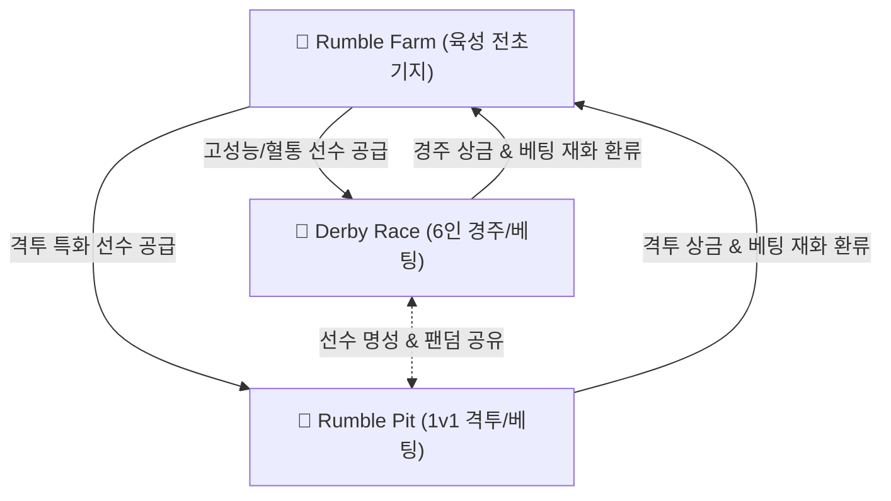

# 🐓 ROOSTER RUMBLE: 통합 기획방향

---

* **문서 버전**: v1.5.0
* **최종 개정일**: 2026-11-24
* **작성 원칙**: 불필요한 수식어 배제 및 100% 개조식 기술 사양 명세

### ■ 문서 개정 이력 (Revision History)

| 버전 (Version) | 개정일 (Date) | 주요 개정 내역 및 상세 변경 사항 | 관련 절 바로가기 |
| :---: | :---: | :--- | :--- |
| **v1.0.0** | 2026-08-31 | 3개 모드(Rumble Farm / Derby Race / Rumble Pit) 통합 비전 및 멀티 플랫폼 이원화 구조 최초 정립 | [[#1. 3개 모드 통합 비전 및 트라이앵글 생태계 구조\|1장 통합 비전]] |
| **v1.2.0** | 2026-10-08 | **[럼블 핏 v1.2.0 정합성 동기화]** 1v1 원형 벽면 아레나, 비의인화 투계 6대 이동 및 7대 전투 기술, 짧은 스탠딩 그로기 및 바닥 다운 즉시 KO 규격 반영 | [[#7.3 Rumble Pit (격투 모드) 핵심 콘텐츠 개발 방향\|7.3절 럼블 핏 개발 방향]] |
| **v1.5.0** | 2026-11-24 | **[VIP 라운지 럼블 팜 4대 기능 통합 및 v1.5.0 단일 기준선 동기화]** 3대 플랫폼(모바일·온라인 웹·미국 VIP 라운지) 분리 구조 확정, VIP 럼블 팜 4대 범위(알 유료 획득·유료 교배·유/무료 성장·유/무료 회복), 3스탬프 무료 알·인큐베이터 2~4슬롯·8종 훈련·단일 교배 공식·9대 전투 기술(`F33/F34`)·단일 리그 외형 파츠 통일 | [[#2.3 미국 오프라인 VIP 라운지 서비스 버전 핵심 기능 명세 (VIP Lounge Exclusive Specs)\|2.3절 VIP 라운지 명세]] |

---

## 목차
1. [[#1. 3개 모드 통합 비전 및 트라이앵글 생태계 구조]]
   - [[#1.1 통합 서비스 비전]]
   - [[#1.2 트라이앵글 선순환 생태계 (Triangle Ecosystem)]]
   - [[#1.3 모드별 핵심 포지셔닝 명세]]
   - [[#1.4 멀티 플랫폼(모바일 / 자체 온라인 / 미국 VIP 라운지) 독립 빌드 및 독립 데이터 운영 구조]]
2. [[#2. 서비스 버전별 핵심 서비스 명세]]
   - [[#2.1 모바일 서비스 버전 핵심 기능 명세 (Mobile Exclusive Specs)]]
   - [[#2.2 자체 온라인 서비스 버전 핵심 기능 명세 (Online Exclusive Specs)]]
   - [[#2.3 미국 오프라인 VIP 라운지 서비스 버전 핵심 기능 명세 (VIP Lounge Exclusive Specs)]]
3. [[#3. 모드 간 데이터/선수(Rooster) 순환 및 상호 연동 메커니즘]]
   - [[#3.1 멀티 스탯 데이터 호환 및 매핑 구조]]
   - [[#3.2 실시간 선수 상태값(Status) 동기화 메커니즘]]
4. [[#4. 통합 경제 시스템 및 재화 파이프라인 (Unified Economy Pipeline)]]
   - [[#4.1 재화 종류별 생산-소모 파이프라인]]
   - [[#4.2 베팅 및 상금 재화 선순환 메커니즘]]
   - [[#4.3 광고 및 마켓 거래 수수료 BM 파이프라인]]
5. [[#5. 통합 캘린더 및 라이브 서비스 스케줄링]]
   - [[#5.1 일간/주간 경기 캘린더 루틴]]
   - [[#5.2 모드 연계 토너먼트 및 시즌제 운영 안]]
6. [[#6. 3개 모드 통합 UI/UX 네비게이션 구조]]
   - [[#6.1 메인 통합 로비 HUD 명세]]
   - [[#6.2 모드 간 원터치 심리스(Seamless) 전환 구조]]
   - [[#6.3 서비스 버전별 전용 빌드 UI 레이아웃 및 연동 명세]]
7. [[#7. 각 모드별 핵심 콘텐츠 개발 방향 명세]]
   - [[#7.1 Rumble Farm (육성 모드) 핵심 콘텐츠 개발 방향]]
   - [[#7.2 Derby Race (경주 모드) 핵심 콘텐츠 개발 방향]]
   - [[#7.3 Rumble Pit (격투 모드) 핵심 콘텐츠 개발 방향]]
   - [[#7.4 모드 통합 개발 우선순위 로드맵]]

---

## 1. 3개 모드 통합 비전 및 트라이앵글 생태계 구조

### 1.1 통합 서비스 비전
* **통합 타깃**: 육성, 경주, 격투, 베팅 요소를 아우르는 캐주얼 아케이드 매니지먼트 생태계 구축
* **핵심 가치**: 
  - 단순 베팅/경기의 휘발성 단점 극복 및 육성 애착 요소 강화
  - 다중 모드 간 선수 공유를 통한 자산 가치 유연성 확보
  - 모바일 아케이드 플레이어, 온라인 스포츠 시뮬레이션 사용자, 오프라인 VIP 라운지 고객 동시 수용

### 1.2 트라이앵글 선순환 생태계 (Triangle Ecosystem)



### 1.3 모드별 핵심 포지셔닝 명세

| 모드명 | 핵심 콘텐츠 | 게임 플레이 성격 | 비주얼 / 연출 톤앤매너 |
| :---: | :--- | :--- | :--- |
| **Rumble Farm** | 알 부화, 유/무료 8종 훈련, 유료 2세대 교배, 유/무료 회복 케어 | 방치/힐링/미니게임·패스트트랙 매니지먼트 | 파스텔톤 밝은 농장 & 2.5D 아이소메트릭 5대 공간 |
| **Derby Race** | 6인 주행 트랙 경주, 승패 베팅, 시뮬레이션 | 6인 다자간 스피드 시뮬레이션 & 베팅 | 역동적 트랙 카메라 & 경주 아레나 |
| **Rumble Pit** | 1v1 원형 아레나 격투, 실시간 인플레이 베팅, 타격 시뮬레이션 | 1대1 치열한 원형 투계장 대전 & 라이브 변동 베팅 | 타격감 있는 원형 벽면 아레나 & 비의인화 투계 액션 |

### 1.4 멀티 플랫폼(모바일 / 자체 온라인 / 미국 VIP 라운지) 독립 빌드 및 독립 데이터 운영 구조
* **독립 별도 빌드(Separate Target Build) 아키텍처**:
  - 모바일 서비스 전용 빌드 Target (AOS APK/iOS IPA 모바일 앱 풀버전)
  - 자체 온라인 서비스 전용 빌드 Target (Web / PC Standalone 온라인 전용 빌드)
  - 미국 오프라인 VIP 라운지 전용 빌드 Target (16:9 대형 전광판 + 좌석 가로 태블릿 + 현장 키오스크 빌드)
* **유저/선수/경기 데이터의 완전 독립 분리 운영 (Data Independence)**:
  - `Mobile App DB`, `Online Web DB`, `VIP Lounge Local DB` 3대 DB 물리적 분리 독립 운영
  - 서비스 버전 간 유저 계정, 재화/크레딧, 보유 알/선수 자산, 경기 전적 상호 이전 및 연동 불허

---

## 2. 서비스 버전별 핵심 서비스 명세

### 2.1 모바일 서비스 버전 핵심 기능 명세 (Mobile Exclusive Specs)

```
[모바일 서비스 핵심 루프]
  알 수거/구매 ──> 부화 & 성장 ──> 선수 등록 ──> 리그 참전 (Derby/Pit) ──> 우승 상금 획득
        │                                                                  │
        └──────────────(유전 교배 / 유저 거래 / 광고 보상)────────────────┘
```

1. **육성 및 선수 등록 프로세스**:
   - 알 안치(2~4슬롯)부터 유/무료 8종 훈련/성장을 거쳐 경주 및 격투 리그 전용 대표 선수로 등록 완료
2. **모바일 전용 Derby Race (경주 리그) 특화 시스템**:
   - **리그 승격/강등 시스템**: Rookie ➔ Bronze ➔ Silver ➔ Gold ➔ Diamond ➔ Championship 6단계 승격제 구축
   - **터치 인터랙션 스퍼트**: 곡선 코너링 탭 인터랙션 및 결승 100m 터치 부스터 시스템 구현
   - **비동기 멀티플레이어 대전**: 타 유저 등록 선수 고스트 데이터 기반 6인 주행 대전 수행
3. **모바일 전용 보상형 광고 (Ad-Reward) 3종**:
   - **무료 알 3스탬프 광고**: 출석(+1) + 광고 2회(+2, 5분 쿨다운) 달성 시 무료 일반 알(`Natural`) 지급
   - **우승 상금 2배 광고**: 경기 우승 후 상금 Gold 200% 수령
   - **피로도 회복 광고**: 10분 쿨다운, 일 3회, 피로도 `-20` 즉시 회복
4. **유전 알 생산 및 유저 간 자율 거래소 (Marketplace)**:
   - 2세대 혈통 알 생산 및 유저 간 미부화 알 매매 거래소 지원 (**8%** 체결 수수료, `[큰손]` 칭호 시 **7%**)
5. **프리미엄 랜덤 알 가차 (Gacha)**:
   - 유료 35종(`Superior` 20종, `Rare` 10종, `Legendary` 5종) 가차 및 10연속 뽑기 전설 알 확정 천장 제공

### 2.2 자체 온라인 서비스 버전 핵심 기능 명세 (Online Exclusive Specs)

```
[자체 온라인 서비스 핵심 루프]
  ├─ [베팅 플레이]: Derby 사전 6인 승자 예측 & Pit 실시간 인플레이 베팅 ──> 배당금 수령
  └─ [선수 참전]: 키운 선수 출전 ──> 파이트 머니 & 우승 상금 수급
```

1. **Derby Race 베팅 중심 시스템**: 6인 주행 트랙 경주 사전 승자 예측(Win, Quinella) 및 배당금 정산(수수료 10%)
2. **Rumble Pit 실시간 라이브 인플레이 베팅**: 1v1 원형 아레나 격투 중 잔여 체력 비율 연동 실시간 배당 베팅(수수료 8%)
3. **선수 참전을 통한 파이트 머니 & 상금 수급**: 경주/격투 출전 시 기본 파이트 머니 및 우승 상금 확보
4. **선수 케어 시스템**: 무료 닭장 자연 휴식 vs 유료 프리미엄 스파 온천 케어(50 Gem / 5,000 Gold)
5. **거래 정책**: 초기 온라인 버전 내 유저 간 알/선수 거래 비활성화

### 2.3 미국 오프라인 VIP 라운지 서비스 버전 핵심 기능 명세 (VIP Lounge Exclusive Specs)

* **동시 서비스 원칙**: 경주(`Derby Race`)·격투(`Rumble Pit`) 실시간 전광판 중계·좌석 베팅과 함께 **럼블 팜(`Rumble Farm`) 핵심 4대 기능**을 좌석 태블릿에서 동시 서비스 (온·오프라인 계정/재화 100% 분리)
* **VIP 라운지 럼블 팜 반영 4대 기능**:
  1. **알 유료 획득**: VIP 크레딧/Gem 유료 알 가차 35종(`Superior`/`Rare`/`Legendary`, 10연 천장 확정) 전용
  2. **유료 교배**: VIP 크레딧/Gem 결제 전용 2세대 혈통 교배 (`ROOSTER`+`HEN`, 생애 5회 한도, 24시간 쿨다운)
  3. **유/무료 성장**: 무료 성장(일반 대기 부화·10초 터치 미니게임 가속·일반 8종 훈련) + 유료 성장(0초 즉시 부화·급속 부스트 훈련) 병행
  4. **유/무료 회복**: 무료 회복(일반 닭장 시간당 -10, 영양 사료 10개 -20) + 유료 회복(프리미엄 스파 피로도 0 완충·부상 완치·24시간 최상 컨디션 고정) 병행
* **VIP 라운지 미반영 (모바일 전용 제외 항목)**: 출석/광고 3스탬프 무료 알, 보상형 광고 3종, 유저 알 거래소(8%) 및 현장 경매/분양, 일일/주간 퀘스트, 영구 업적 8종, 칭호 20종, 모바일 6단계 리그 제외

---

## 3. 모드 간 데이터/선수(Rooster) 순환 및 상호 연동 메커니즘

### 3.1 멀티 스탯 데이터 호환 및 매핑 구조
* **선수 1두의 통합 스탯 데이터셋 (Unified Rooster Dataset)**:
  - 1차 피지컬 6대 스탯(`STR`, `DEX`, `VIT`, `MEN`, `LCK`, `POT`) 성장 즉시 Derby 스탯 6종과 Pit 스탯 6종 자동 재연산 반영

```
[통합 선수 데이터 (Rooster Master Data)]
   ├── [공통 데이터]: 1차 6대 스탯, 피로도, 컨디션, 성별, 세대, 단일 리그+3단계 외형 파츠
   ├── [Derby 스탯]: 속도(SPD), 출발(STA), 지구력(STM), 집중력(FOC), 기질(TMP), 근성(GUT) + 주행 스타일 6종
   └── [Pit 스탯]: 공격력(POW), 방어력(DEF), 최대체력(HP), 회복력(REC), 기술력(TEC), 근성(GRT) + 격투 스타일 5종 + 9대 전투기술
```

### 3.2 실시간 선수 상태값(Status) 동기화 메커니즘
* **피로도 & 컨디션 통합 공유**:
  - `Derby Race` 및 `Rumble Pit` 참전 시 피로도 `+25` 적재 (훈련 시 `+15` 적재)
  - 피로도 `70~89`(`FATIGUED`) 출전 시 전 스탯 `-15%` 페널티, `90+` 출전 시 `30%` 확률 부상(`INJURED`) 발생
* **부상(Injury) 상태의 모드 간 차단 정책**:
  - 부상 발생 시 경주·격투 출전 및 훈련 전면 차단, 유료 프리미엄 스파 입욕을 통해서만 완치 및 복귀 허용

---

## 4. 통합 경제 시스템 및 재화 파이프라인 (Unified Economy Pipeline)

### 4.1 재화 종류별 생산-소모 파이프라인
* **사료 (`Feed`)**: 출석/퀘스트/유입 ➔ 일반 8종 훈련(10~15개) 및 영양 사료 회복(10개) 소모
* **골드 (`Gold`) / 크레딧 (`Credit`)**: 우승 상금·파이트 머니·베팅 정산·키오스크 충전 ➔ 유료 알/스파/훈련/교배/베팅 투입
* **보석 (`Gem`)**: 인앱 결제·퀘스트·업적 ➔ 유료 알 가차(30~300 Gem), 슬롯 확장, 유료 즉시 부화/급속 훈련, 유료 교배·스파 소모

### 4.2 베팅 및 상금 재화 선순환 메커니즘
* 경기 상금·파이트 머니 및 베팅 정산 수익을 농장 육성(유료 알 가차·훈련·유료 교배·스파 케어)에 재투자하여 상위 선수 배출 및 상위 리그·매치 도전 선순환 구축

### 4.3 광고 및 마켓 거래 수수료 BM 파이프라인
* **보상형 광고 파이프라인** *(모바일 전용)*: 일일 출석(+1) + 광고 2회(+2) 3스탬프 무료 일반 알 수급, 상금 2배, 피로도 -20 회복
* **마켓 수수료 파이프라인** *(모바일 전용)*: 유저 간 알 거래 체결 금액 **8%** 회수 (`[큰손]` 칭호 장착 시 **7%**)

---

## 5. 통합 캘린더 및 라이브 서비스 스케줄링

### 5.1 일간/주간 경기 캘린더 루틴
* **더비 레이스**: 24시간 20분 간격 하루 72회 자동 스케줄 운영 (출전 후 40분/2레이스 쿨다운)
* **럼블 핏**: 24시간 30분 간격 하루 48회 자동 대진 운영 (출전 후 30분 쿨다운)

### 5.2 모드 연계 토너먼트 및 시즌제 운영 안
* **주간 듀얼 크라운 (Dual Crown) 챔피언십** *(모바일 리그 확장)*: 동일 선수로 경주·격투 성적 합산 종합 챔피언 선출

---

## 6. 3개 모드 통합 UI/UX 네비게이션 구조

### 6.1 메인 통합 로비 HUD 명세
* **상단 HUD**: 보유 재화(모바일: Gold/Gem/Feed / VIP: VIP Credit/Gold/Feed), 대표 닭 상태 요약
* **하단 5대 고정 네비게이션 탭**: `🌾 농장` | `🏇 경주` | `🥊 격투` | `🏪 마켓` *(모바일)* / `💳 크레딧` *(VIP)* | `⚙️ 설정`

### 6.2 모드 간 원터치 심리스(Seamless) 전환 구조
* **퀵 패스 전환**: 럼블 팜 로스터/출전 관리에서 경기 선택 시 즉시 Derby Race 또는 Rumble Pit 대기실로 전환

### 6.3 서비스 버전별 전용 빌드 UI 레이아웃 및 연동 명세
* **모바일 앱 빌드**: 2.5D 농장 5대 공간 전체, 알 거래소, 보상형 광고 3종, 퀘스트·업적·칭호, 6단계 리그 표출
* **온라인 웹 빌드**: 라이브 베팅 슬립, 중계 뷰, 파이트 머니 및 스파 케어 중심 표출
* **미국 VIP 라운지 빌드**: 16:9 대형 관전 전광판(2화면) + 좌석 태블릿 가로 패스트트랙(4화면: 럼블 팜 4대 기능 + 퀵 베팅) + 키오스크(2화면) 구성

---

## 7. 각 모드별 핵심 콘텐츠 개발 방향 명세

### 7.1 Rumble Farm (육성 모드) 핵심 콘텐츠 개발 방향
1. **알 수급 & 2세대 교배 유전 알고리즘**:
   - 유료 35종 가차(10연 전설 천장) + 모바일 3스탬프/거래소(8%)
   - 단일 유전 공식(`부모합 90% + 난수(-5,+10)`, `POT Max×1.05`, 외형 40/40/20%, 패시브 50%/변이 15%) 서버 검증
2. **부화 온실 (`Hatchery Greenhouse`) 2~4슬롯**:
   - 무료 10초 터치 미니게임(`S:-20% / A:-12% / B:-5%`) 및 유료 0초 즉시 부화 동시 지원
3. **개화 훈련장 (`Training Field`) 8종 유/무료 훈련**:
   - Derby 3종, Pit 4종, 공통 1종 훈련을 무료(일반 대기) 및 유료(즉시 완료 +2 부스트)로 제공
4. **선수 닭장 & 힐링 스파 (`Coop & Healing Spa`) 유/무료 회복**:
   - 무료(닭장 시간당 -10, 영양 사료 10개 -20) vs 유료(프리미엄 스파 피로 0, 부상 완치, 24시간 최상 컨디션 100)
5. **VIP 라운지 4대 기능 동기화**:
   - 알 유료 획득, 유료 교배, 유/무료 성장, 유/무료 회복 4대 기능에 한정하여 VIP 라운지 현장 태블릿 동시 배포

### 7.2 Derby Race (경주 모드) 핵심 콘텐츠 개발 방향
1. **6인 주행 시뮬레이션 엔진**: 결정론적 물리 연산 및 초당 10회 실시간 텔레메트리 브로드캐스트
2. **주행 스타일 6종 & 환경 변수 3종**: 도주/추입/선행/자재/선입/변칙 스타일 분기 및 비·바람(낙엽)·아지랑이 물리·시각 연동
3. **사전 승자 예측 & 상용화 연출**: 단승/복승 동적 배당(1.01~99.00), 머리 위 번호 인디케이터, 중계 카메라 3종, 종료 후 1초 슬로우 리플레이

### 7.3 Rumble Pit (격투 모드) 핵심 콘텐츠 개발 방향
1. **1v1 원형 아레나 & 비의인화 투계 액션**:
   - 조류형 6대 이동 + **9대 전투 기술(공격 4종 + 방어 3종 + 특수 액션 2종 `F33` 머리 잡아 바닥 찍기 / `F34` 머리 풀고 반격하기)** 및 `[타격 ➔ 가드 ➔ 잡기 ➔ 반격]` 4대 순환 상성 구현
   - 단일 기본 리그(Rig) + 3단계 등급별 외형 파츠 + 텍스처 300종 로드맵 적용
2. **실시간 인플레이 변동 배당**: 잔여 체력 비율·스탠딩 그로기·일반 넉다운(2초 기상) 연동 라이브 배당 롤링
3. **투지 버티기 & 즉시 KO 분리**: `Last Stand` 체력 1 생존, 체력 20%↑ 피격 넉다운(`15_Down` 후 기상) vs 체력 0 도달 시 카운트 없는 즉시 KO(`13_Down` + 연속 벨)

### 7.4 모드 통합 개발 우선순위 로드맵

```
[Phase 1]: 독립 DB (Mobile / Online / VIP Local) 및 마스터 데이터셋(6종) 구축
    │
[Phase 2]: 경주/격투 3D 카툰 셰이더·단일 리그 파츠·대전 시뮬레이터 및 팜 1단계 구축
    │
[Phase 3]: 미국 VIP 라운지 상용 빌드 (경주/격투 + VIP 럼블 팜 4대 기능) 완성 ➔ 4차 초기 런칭
    │
[Phase 4]: 모바일 풀버전(거래소·퀘스트·칭호·업적·6단계 리그)·양대 마켓 심사 접수
    │
[Phase 5]: 소프트 런칭 실데이터 밸런싱, 300종 맵핑 완비 ➔ 2027 상반기 글로벌 런칭
```
