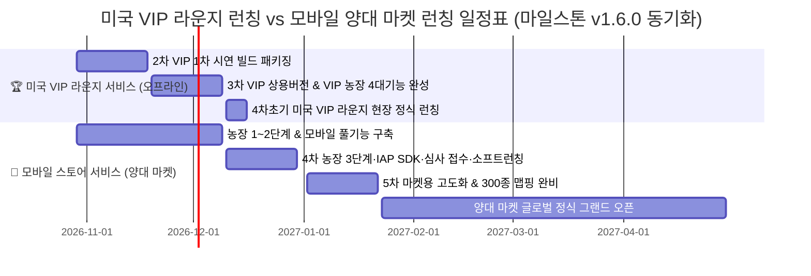

# 🐓 ROOSTER RUMBLE: 유저 동선 기반 진행 시나리오 및 마케팅 계획

* **문서 버전**: `v1.9.0`
* **작성일**: 2026-11-24
* **기준 명세**: [[유저_플레이_동선_및_플로우_구성안.md]] (`v1.9.0`) 및 [[통합 MVP 구성안.md]] (`v1.5.0`)
* **서비스 구성**: **[모바일 스토어 서비스]** / **[미국 VIP 라운지 서비스]**
* **연계 문서**: `ROOSTER_RUMBLE_스토어 및 라운지 통합 일정.md`

---

## 📋 목차
1. [[#1. 서비스 방식별 마케팅 & 운영 전략 기본 방향 (5단계 모형)]]
2. [[#2. 모바일 스토어 서비스 진행 시나리오 및 마케팅 계획]]
3. [[#3. 미국 VIP 라운지 서비스 진행 시나리오 및 마케팅 계획]]
4. [[#4. 서비스 방식별 런칭 & 스토어/라운지 연계 일정표]]
5. [[#5. 서비스 방식별 재접속 & 매출 과금 모델]]

---

## 1. 서비스 방식별 마케팅 & 운영 전략 기본 방향 (5단계 모형)

* **마케팅 구분**: 모바일 스토어 유저 대상 글로벌 마케팅과 미국 오프라인 VIP 라운지 현장 프로모션 분리 집행 (온·오프라인 DB 100% 독립 운영)

| 5단계 마케팅 단계 | 📱 모바일 스토어 서비스 마케팅 | 🏆 미국 VIP 라운지 서비스 마케팅 |
| :--- | :--- | :--- |
| 🎯 **1. 유저 유입 (신규 유치)** | • 구글/애플 스토어 사전예약 • 틱톡/릴스 알 부화 숏폼 광고 • 스토어 검색 최적화 | • 현장 라운지 파티형 오픈 이벤트 • 멤버십 QR 등록 및 키오스크 크레딧 보너스 • 스포츠/아케이드 관전 커뮤니티 유치 |
| ⚡ **2. 초기 정착 (첫 경험)** | • 첫 실행 튜토리얼 웰컴 보상 • 10초 터치 부화 손맛 경험 • 경주/격투 첫 우승 상금 2배 광고 | • 16:9 대형 전광판 중계 & 좌석 태블릿 퀵 베팅 체험 • **알 유료 획득 ➔ 즉시 부화/훈련(유/무료 성장)** 현장 시연 • 첫 적중 바우처 정산 쾌감 부여 |
| 🔁 **3. 지속 재방문 (매일 접속)** | • 3스탬프 일일 무료 알 수급 • 6단계 리그 승강급 & 퀘스트/업적/칭호 • 2세대 교배 & 유저 알 거래소(8%) | • 24시간 타임 스케줄(경주 72회/격투 48회) 현장 중계 • **유료 교배 & 유/무료 회복(닭장·사료·스파)** 기반 나만의 선수 출전 • 라운지 현장 VIP 베팅 토너먼트 |
| 💰 **4. 매출 과금 (매출 결제)** | • 유료 알 가차(35종/천장), 유료 성장/스파/교배 • 유저 알 거래소 수수료(8%, `[큰손]` 7%) • 보상형 광고 3종 수익 | • 현장 베팅 수수료 정산 (8% ~ 10%) • **알 유료 획득(35종)·유료 교배·유료 즉시 성장·유료 스파 회복** |
| 📢 **5. 소문내기 (친구 추천)** | • 유저 알 거래소 매매 • 20종 칭호 자랑 인증 | • 현장 전광판 고배당·우승 닭 인증 • VIP 라운지 스폰서십 및 동반 입장 이벤트 |

---

## 2. 모바일 스토어 서비스 진행 시나리오 및 마케팅 계획

### 2.1 유저 진행 시나리오 (1일 차 ~ 30일 차+)
* **1일 차 (앱 설치 및 우승 경험)**:
  - 앱 다운로드 및 로그인 ➔ 기본 닭 1두 + 1,000 Gold + 50 사료 수령
  - 알 부화 10초 터치 미니게임 수행 ➔ 달리기 경주 리그 출전 및 결승선 터치 부스터 1위 우승 ➔ 상금 2배 광고 시청 (200% 증액)
* **3일 차 (3스탬프 무료 알 수급 & 유/무료 회복 케어)**:
  - 출석체크(+1) 및 광고 2회 시청(+2, 5분 쿨다운) ➔ 3스탬프 무료 일반 알 수령
  - **8종 훈련**(유/무료 선택) 및 경기 출전 후 피로도 70+(`FATIGUED` -15%) 도달 ➔ 무료 닭장 휴식 / 영양 사료(-20) / 광고(-20) 또는 유료 스파(0 완충) 적용
* **7일 차 (리그 승격 & 2세대 닭 교배)**:
  - 모바일 리그 RP 누적 승격 및 보상 수령
  - 암수 닭 2두(`IDLE`, 생애 5회 미만) ➔ 2세대 혈통 교배 (`부모합 90% + 난수(-5,+10)`, `POT Max×1.05`, 외형/스타일 `40/40/20%`)
* **14일 차 ~ 30일 차+ (전설 리그 & 거래소 매매)**:
  - **9대 전투 기술(공4+방3+특수2 `F33/F34`)** 세팅 & 3연속 콤보 완성 ➔ 1대1 격투 즉시 KO승 파이트 머니(150%) 수령
  - 전설 리그 챔피언 등극, 칭호 20종·업적 8종 수집 및 **유저 알 거래소(8% 수수료, `[큰손]` 7%)** 매매 순환

### 2.2 전용 마케팅 집행 계획
* **스토어 검색 최적화 & 사전예약**: Google Play / Apple App Store 사전예약 등록, 한정 알 캡슐 + 3,000 Gold 지급
* **숏폼 영상 광고**: 틱톡/릴스/유튜브 15초 숏폼 제작 (10초 알 부화 손맛 & 경주 터치 부스터·격투 콤보 연출)
* **크리에이터 스폰서십**: 게임 스트리머 대상 1대1 럼블 핏 대전 & 전설 알 가차 라이브 방송 집행

---

## 3. 미국 VIP 라운지 서비스 진행 시나리오 및 마케팅 계획

### 3.1 유저 진행 시나리오 (현장 방문 1회 ~ 단골 VIP)
* **1단계 (라운지 입장 및 크레딧 충전)**:
  - 현장 키오스크 QR 로그인 및 크레딧 충전 (`VIP Lounge Local DB` 독립 계정)
  - 16:9 대형 전광판 24시간 경주(72회)·격투(48회) 중계 관람 및 태블릿 사전/라이브 베팅 참여
* **2단계 (VIP 럼블 팜 4대 기능: 알 유료 획득 & 유/무료 성장)**:
  - 좌석 태블릿 럼블 팜 탭 진입 ➔ **① 알 유료 획득**: 유료 알 35종(`Superior`/`Rare`/`Legendary`, 10연 천장) 구매
  - **③ 유/무료 성장**: 일반 대기+10초 터치 미니게임·일반 8종 훈련(무료) 또는 VIP 크레딧 결제 **0초 즉시 부화·급속 훈련(유료)** 선택 육성
* **3단계 (현장 출전 환류 & 유/무료 회복 & 유료 교배)**:
  - 육성한 나만의 닭을 현장 더비 레이스·럼블 핏 경기에 출전시키고 전광판 관전 + 추가 베팅
  - 경기 후 피로도(+25)·부상(30%) 발생 시 **④ 유/무료 회복**(무료 닭장 휴식/영양 사료 또는 유료 프리미엄 스파 즉시 완치) 진행
  - 우수 성체 암수 2두 보유 시 **② 유료 교배**(VIP 크레딧 전용)로 고잠재력 2세대 `Heritage Egg` 생산
  - *(※ 무료 3스탬프 알, 광고 3종, 거래소·현장 경매/분양, 퀘스트·업적·칭호는 VIP 라운지 미제공)*
* **4단계 (당첨 정산 및 VIP 토너먼트)**:
  - 적중 배당금·파이트 머니 수령 후 키오스크 바우처 출금 및 라운지 전용 VIP 랭킹전 참여

### 3.2 전용 마케팅 집행 계획
* **라운지 오픈 파티형 프로모션**: 초기 방문객 대상 음료·웰컴 크레딧 제공 및 현장 우승자 상금 이벤트
* **패스트트랙 육성+베팅 결합 홍보**: 좌석 태블릿에서 직접 뽑아 즉시 키운 닭을 대형 전광판 경기에 내보내는 '마주 체험' 마케팅 집중

### 3.3 3대 모드별 차별화 마케팅 실행 전략

| 대상 게임 모드 | 핵심 재미 키워드 | 마케팅 소스 및 실행 방안 |
| :--- | :--- | :--- |
| 🚜 **1. 육성 모드 (럼블 팜)** | 알 터치 부화, 8종 성장, 2세대 유전 교배 | • 틱톡/릴스 15초 터치 부화 숏폼 유포 (모바일) • VIP 현장 즉시 부화·유료 교배 마주 체험 프로모션 |
| 🏇 **2. 경주 모드 (더비 레이스)** | 6두 폭풍 달리기, 1초 슬로우 리플레이 | • 터치 부스터 역전·환경 변수 주행 영상 집행 • 라운지 대형 전광판 6두 승부 관전 |
| 🥊 **3. 격투 모드 (럼블 핏)** | 1대1 원형 투계장, 9대 기술·즉시 KO | • `F33` 머리찍기/`F34` 잡기반격 하이라이트 영상 제작 • 실시간 체력 연동 라이브 베팅 현장 흥행 유도 |

---

## 4. 서비스 방식별 런칭 & 스토어/라운지 연계 일정표

* **[미국 VIP 라운지 일정]**: 11/18 1차 시연 빌드 ➔ 12/09 상용 버전(경주·격투 + VIP 럼블 팜 4대 기능) 완료 ➔ **12월 중순(4차 초기) 현장 정식 런칭**
* **[모바일 스토어 일정]**: 12/30 스토어 심사 접수 & 소프트 런칭 ➔ 2027.01.22 5차 마켓 고도화(300종 맵핑 완비) ➔ **2027 상반기 글로벌 동시 오픈**

---

## 5. 서비스 방식별 재접속 & 매출 과금 모델

| 과금 모델 | 서비스 적용 대상 | 과금 유도 전략 & 정산 규칙 |
| :--- | :--- | :--- |
| **① 알 유료 획득 (유료 알 35종 가차)** | 📱 모바일 / 🏆 VIP 라운지 | 30~300 Gem 또는 VIP 크레딧 결제 (10연속 뽑기 시 전설 알 100% 천장 확정) |
| **② 유료 교배 (2세대 혈통 알)** | 📱 모바일 / 🏆 VIP 라운지 | VIP 라운지는 **유료 크레딧 전용** / 모바일은 토큰+5,000G 또는 유료 결제 (생애 5회 한도) |
| **③ 유료 성장 가속 (즉시 부화·급속 훈련)** | 📱 모바일 / 🏆 VIP 라운지 | 무료 대기(미니게임·일반 훈련) 대비 VIP 크레딧/Gem 결제 시 **0초 즉시 완료(+부스트 +2)** |
| **④ 유료 프리미엄 스파 회복** | 📱 모바일 / 🌐 웹 / 🏆 VIP 라운지 | 무료 닭장·사료 외 50 Gem / 5,000G / VIP 크레딧 소모 시 피로 0 완충·부상 즉시 완치·24h 최상 100 |
| **⑤ 베팅 수수료 (8% ~ 10%)** | 🌐 웹 / 🏆 VIP 라운지 | 경주(10%) & 격투(8%) 중계 배당 정산 시 수수료 차감 |
| **⑥ 알 거래소 수수료 (8%) & 광고 3종** | 📱 모바일 전용 *(VIP 제외)* | 거래소 체결 **8%** 수수료(`[큰손]` 7%) 및 무료 3스탬프 알·상금 2배·피로 -20 광고 수익 |
