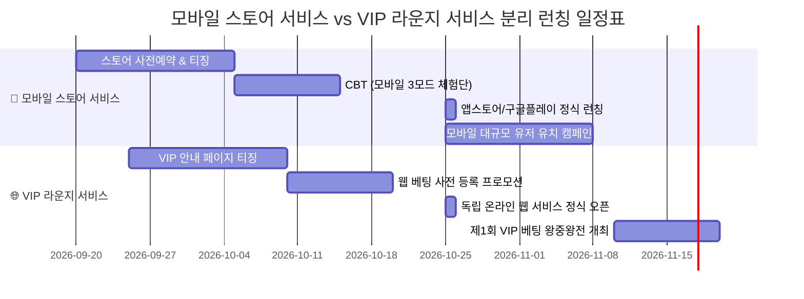

# 🐓 ROOSTER RUMBLE: 유저 동선 기반 진행 시나리오 및 마케팅 계획

* **문서 버전**: `v1.8.0`
* **작성일**: 2026-09-18
* **기준 명세**: [[유저_플레이_동선_및_플로우_구성안.md]] (`v1.8.0`) 및 [[통합 MVP 구성안.md]] (`v0.9.1`)
* **서비스 구성**: **[모바일 스토어 서비스]** / **[VIP 라운지 서비스]**
* **연계 문서**: `ROOSTER_RUMBLE_스토어 및 라운지 통합 일정.md`

---

## 📋 목차
1. [[#1. 서비스 방식별 마케팅 & 운영 전략 기본 방향 (5단계 모형)]]
2. [[#2. 모바일 스토어 서비스 진행 시나리오 및 마케팅 계획]]
3. [[#3. VIP 라운지 서비스 진행 시나리오 및 마케팅 계획]]
4. [[#4. 서비스 방식별 런칭 & 스토어/라운지 연계 일정표]]
5. [[#5. 서비스 방식별 재접속 & 매출 과금 모델]]

---

## 1. 서비스 방식별 마케팅 & 운영 전략 기본 방향 (5단계 모형)

* **마케팅 구분**: 모바일 스토어 유저 대상 마케팅과 자체 온라인 웹 유저 대상 VIP 라운지 마케팅 분리 집행

| 5단계 마케팅 단계 | 📱 모바일 스토어 서비스 마케팅 | 🌐 VIP 라운지 서비스 마케팅 |
| :--- | :--- | :--- |
| 🎯 **1. 유저 유입 (신규 유치)** | • 구글/애플 스토어 사전예약 • 틱톡/릴스 알 부화 숏폼 광고 • 스토어 검색 최적화 | • 자체 VIP 안내 페이지 연동 • Free 10,000 코인 지급 홍보 • 스포츠/베팅 커뮤니티 유치 |
| ⚡ **2. 초기 정착 (첫 경험)** | • 첫 실행 튜토리얼 웰컴 보상 • 10초 터치 부화 손맛 경험 • 경주/격투 첫 우승 상금 2배 광고 | • 경기 전 베팅 튜토리얼/정산 • 첫 배당 정산 쾌감 부여 • 실시간 24시간 관람 중계 제공 |
| 🔁 **3. 지속 재방문 (매일 접속)** | • 3도장 일일 무료 알 수급 • 6단계 리그 승강급 & 퀘스트 • 2세대 닭 교배 & 온천 케어 | • 24시간 타임 스케줄 중계 • 경기 중 실시간 배당 변동 • 정기 베팅 토너먼트 개최 |
| 💰 **4. 매출 과금 (매출 결제)** | • 유료 알 뽑기 (300 보석 천장) • 유료 온천 이용료 • 보상형 광고 3종 수익 | • 베팅 수수료 정산 (8% ~ 10%) • 유료 온천 이용료 |
| 📢 **5. 소문내기 (친구 추천)** | • 유저 알 거래소 매매 • 칭호 자랑 라운지 인증 | • 배당 수익 캡처 라운지 인증 • VIP 토너먼트 스폰서십 |

---

## 2. 모바일 스토어 서비스 진행 시나리오 및 마케팅 계획

### 2.1 유저 진행 시나리오 (1일 차 ~ 30일 차+)
* **1일 차 (앱 설치 및 우승 경험)**:
  - 앱 다운로드 및 소셜 로그인 ➔ 기본 닭 1두 + 1,000 골드 + 50 사료 수령
  - 알 부화 미니게임 수행 ➔ 달리기 경주 리그 출전 및 결승선 부스터 연타 1위 우승 ➔ 상금 2배 광고 시청 팝업 수행 (상금 200% 증액)
* **3일 차 (3도장 알 수급 & 온천 케어)**:
  - 출석체크(+1) 및 광고 2회 시청(+2, 5분 대기시간) ➔ 3도장 무료 알 수령
  - 경주/격투 출전 지침 75(`FATIGUED` 능력치 -15%) 도달 ➔ 광고 시청(-20 회복) 또는 무료 닭장 휴식 진입
* **7일 차 (리그 승격 & 2세대 닭 교배)**:
  - 모바일 리그 RP 누적 승격 및 보상 골드 수령
  - 훈련 완수 닭 2두 선택 ➔ 5,000 골드 소모 2세대 닭 교배 (능력치 90% 계승 & 50% 패시브 유전 알 수령)
* **14일 차 ~ 30일 차+ (전설 리그 & 거래소 매매)**:
  - 7대 전투 스킬 세팅 & 3연속 콤보 완성 ➔ 1대1 격투 KO승 대전 상금(150%) 수령
  - 전설 리그 챔피언 등극 ➔ 알 거래소(5% 수수료) 서브 알 등록 및 재화 회수

### 2.2 전용 마케팅 집행 계획
* **스토어 검색 최적화 & 사전예약**:
  - Google Play / Apple App Store 사전예약 페이지 등록
  - 사전예약자 대상 한정 알 캡슐 1개 + 3,000 골드 지급
* **숏폼 영상 광고**:
  - 틱톡/릴스/유튜브 숏폼 15초 영상 제작 (알 터치 부화 장면 & 결승선 부스터 대역전 장면 연출)
  - 일일 3도장 무료 알 수급 혜택 광고 집행
* **크리에이터 스폰서십**:
  - 게임 스트리머 대상 모바일 1대1 럼블 핏 대전 라이브 방송 스폰서십 집행

---

## 3. VIP 라운지 서비스 진행 시나리오 및 마케팅 계획

### 3.1 유저 진행 시나리오 (1일 차 ~ 30일 차+)
* **1일 차 (웹 접속 및 코인 사용)**:
  - 자체 웹 접속 및 회원가입 ➔ 10,000 Free 코인 수령
  - 24시간 타임 스케줄 확인 ➔ 경기 시작 전 베팅 수행 및 배당 정산 확인
* **3일 차 (사전 분석 & 정산)**:
  - 출전 선수 세부 능력치/전적 분석 ➔ 단승/복승 프리매치 사전 베팅
  - 경기 완료 후 정산 수수료(8% ~ 10%) 차감 정산금 자동 수령
* **7일 차 (경기 중 실시간 베팅)**:
  - 격투 경기 진행 중 잔여 체력 변동 연동 실시간 배당 베팅
  - 5초 전 베팅 마감 타이밍 베팅 수행
* **14일 차 ~ 30일 차+ (VIP 토너먼트)**:
  - 자체 웹 'VIP 베팅 왕중왕전' 참가 ➔ 웹 코인 수급
  - VIP 라운지 베팅 정산 코인 자산 운용 및 랭킹 관리

### 3.2 전용 마케팅 집행 계획
* **VIP 안내 페이지 & Free 코인**:
  - 독립 안내 페이지 가입 시 10,000 Free 코인 지급 프로모션 집행
* **스포츠 & 베팅 커뮤니티 유치**:
  - 스포츠 승예 유저 대상 웹 배너 광고 집행
  - 24시간 경주(72회) 및 격투(48회) 생중계 안내
* **VIP 라이브 베팅 왕중왕전 토너먼트**:
  - 정기 주간 웹 베팅 랭킹전 개최 ➔ 상위 우승자 대상 웹 코인 보상 및 명예의 전당 등재

### 3.3 3대 모드별 차별화 마케팅 실행 전략

| 대상 게임 모드                    | 핵심 재미 키워드              | 마케팅 소스 및 실행 방안                                        |
| :-------------------------- | :--------------------- | :---------------------------------------------------- |
| 🚜 **1. 육성 모드 (럼블 팜)**      | 알 터치 부화, 2세대 유전 교배     | • 틱톡/릴스 15초 터치 부화 숏폼 유포 • 일일 무료 알 홍보               |
| 🏇 **2. 경주 모드 (더비 레이스)**    | 6두 폭풍 달리기, 피니시 터치 부스터  | • 피니시 터치 부스터 연타 플레이 영상 인피드 집행 • 리그 승급 축하 라운지 이벤트   |
| 🥊 **3. 격투 모드 (럼블 핏)**      | 1대1 링 타격감, 3연속 콤보 격돌   | • 3연속 콤보 타격 하이라이트 영상 제작 • 스트리머 1대1 대전 스폰서십 방송 집행   |
| 🎲 **(온라인 연계) VIP 라운지 서비스** | 24시간 실시간 중계, 라이브 배당 정산 | • 웹 Free 10,000 코인 지급 프로모션 • VIP 라운지 안내 페이지 홍보 캠페인 |

---

## 4. 서비스 방식별 런칭 & 스토어/라운지 연계 일정표

* **[모바일 스토어 서비스 일정표]**: 9월 20일 사전예약 ➔ 10월 5일 CBT ➔ 10월 25일 글로벌 정식 런칭
* **[VIP 라운지 서비스 일정표]**: 9월 25일 안내 페이지 티징 ➔ 10월 10일 사전 등록 ➔ 10월 25일 웹 서비스 동시 오픈

---

## 5. 서비스 방식별 재접속 & 매출 과금 모델

| 과금 모델 | 서비스 적용 대상 | 과금 유도 전략 & 정산 규칙 |
| :--- | :--- | :--- |
| **① 유료 알 뽑기 (30~300 보석)** | 📱 모바일 스토어 서비스 | 상점 300 보석 (10연속) 결제 시 전설 알 100% 천장 적용 |
| **② 유료 온천 이용 (50 보석 / 5,000골드)** | 📱 모바일 스토어 서비스 / 🌐 VIP 라운지 서비스 | 경기 전/후 지침 70+ 및 부상 발생 시 24시간 컨디션 100 최상 완충 제안 |
| **③ 알 거래소 수수료 (5% 수수료)** | 📱 모바일 스토어 서비스 | 유저 간 2세대 알 매매 체결 시 5% 정액 수수료 차감 정산 |
| **④ 베팅 수수료 (8% ~ 10%)** | 🌐 VIP 라운지 서비스 | 경주(하루 72회) & 격투(하루 48회) 중계 배당 정산 시 8%~10% 수수료 차감 |
| **⑤ 보상형 광고 3종 (광고 수익)** | 📱 모바일 스토어 서비스 | 3도장 알 수급, 경주 상금 2배, 지침 -20 회복 광고 시청 수익 창출 |
