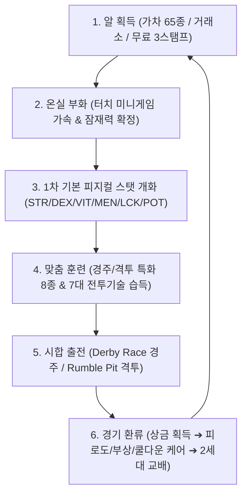
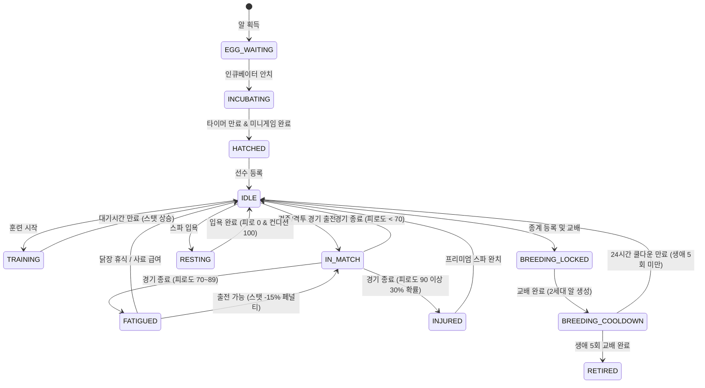

# 🐓 ROOSTER RUMBLE: Rumble Farm (육성 모드) - MVP 세부 기획 구성안

---

* **문서 정체성**: <ROOSTER RUMBLE> 3대 코어 모드 중 육성 전초기지인 **럼블 팜(Rumble Farm)**의 단독 자립형 실무 기획 명세서
* **문서 상태**: MVP 정식 개발 규격서
* **문서 버전**: v0.9.1
* **최종 개정일**: 2026-09-18
* **연계 모드**: 더비 레이스(Derby Race - 경주), 럼블 핏(Rumble Pit - 격투)
* **작성 원칙**: 불필요한 수식어 배제 및 100% 개조식 기술 사양 명세

---

### ■ 문서 개정 이력 (Revision History)

| 버전 (Version) | 개정일 (Date) | 주요 개정 내역 및 상세 변경 사항 | 관련 절 바로가기 |
| :---: | :---: | :--- | :--- |
| **v0.0.1** | 2026-08-11 | 통합 MVP 구성안 내 럼블 팜(육성 모드) 개요 및 기본 범위 최초 기획 | [[#1.1 프로젝트 개요 및 럼블 팜(Rumble Farm) 핵심 컨셉\|1.1절 개요 및 컨셉]] |
| **v0.1.0** | 2026-08-11 | 알 65종 가차 마스터 구조 및 등급별 부화 시간, 잠재력 범위 수치 정의 | [[#2.3 알 뽑기(가차) 65종 마스터 구조, 등급별 확률 및 천장(Pity) 시스템\|2.3절 알 가차 시스템]] |
| **v0.2.0** | 2026-08-13 | 1차 기본 피지컬 스탯(Common Core 6종) 분배식 및 부화 터치 미니게임 가속률 정립 | [[#3.3 부화 시 등급별 1차 기본 스탯 초기 생성 분배식 및 잠재력(POT) 롤링 메커니즘\|3.3절 1차 스탯 생성식]] |
| **v0.3.0** | 2026-08-27 | 닭 캐릭터 10대 상태 머신 전이 규칙 및 유저 간 알 거래소(5% 수수료) 명세 구축 | [[#4.1 닭 캐릭터 10대 상태 머신 전이 규칙\|4.1절 10대 상태 머신]] |
| **v0.4.0** | 2026-08-27 | 훈련 종목 8종(피지컬/경주/격투) 스탯 상승식 및 2차 파생 스탯 연동 프로세스 확립 | [[#5.1 훈련 종목 8종 소모 재화, 대기시간 및 스탯 상승률\|5.1절 훈련 시스템]] |
| **v0.5.0** | 2026-08-27 | 2세대 교배 유전 공식(스탯/잠재력 상속 및 생애 5회 제한), 칭호 20종 마스터 수록 | [[#6.2 부모 스탯 기반 2세대 기본 스탯/잠재력 유전 공식\|6.2절 교배 유전 공식]] |
| **v0.6.0** | 2026-08-27 | 일일 퀘스트 5종, 주간 퀘스트 4종, 영구 누적 업적 8종 및 논리 DB 스키마 7종 수록 | [[#7.2 일일 퀘스트 5종 및 주간 퀘스트 4종 명세표\|7.2절 퀘스트 명세표]] |
| **v0.7.0** | 2026-08-27 | 럼블 팜 전용 오디오 규격 신설 (BGM 2종, SFX-Farm 10종 및 이벤트 매핑 완비) | [[#9.3 럼블 팜 전용 배경음악(BGM) 2종 및 효과음(SFX-Farm) 10종 명세표\|9.3절 팜 효과음 명세]] |
| **v0.8.0** | 2026-08-31 | 기획서 경계 정상화: 공간 레이아웃 5대 영역 정의 및 온보딩 튜토리얼 동선 정제 | [[#9.1 메인 팜 5대 핵심 공간 레이아웃\|9.1절 팜 공간 레이아웃]] |
| **v0.8.1** | 2026-09-01 | 재화 순환 경제 모델(Sink & Source) 수치 정합 및 출석/광고 3스탬프 무료 알 수급 일원화 | [[#2.2 출석/광고 기반 통합 무료 알 수집 체계\|2.2절 무료 알 수집]] |
| **v0.8.2** | 2026-09-04 | 경기 출전 피로도(+25), 부상(30%), 쿨다운(30분) ➔ 팜 복귀 닭장 휴식/스파 치료 환류 메커니즘 동기화 | [[#4.2 경기(Derby/Pit) 출전 후 피로도 적재(+25), 부상 판정(30%) 및 30분 쿨다운 환류 규칙\|4.2절 경기 출전 환류]] |
| **v0.9.0** | 2026-09-07 | 럼블 핏 연계: 훈련을 통한 7대 전문 전투 기술 습득 및 선수 등급별 슬롯(2~5개) 장착 규격 신설 | [[#5.3 훈련 스탯 상승의 격투 2차 파생 스탯 및 7대 전투 기술 개화/습득 연동\|5.3절 전투 기술 연동]] |
| **v0.9.1** | 2026-09-18 | **[단독 분리 신규 작성]** 통합 MVP 구성안에서 럼블 팜 육성 모드 명세를 전면 독립화하여 완전 자립형 단독 실무 기획서 구축 (3대 모드 연관관계 100% 무결 보존) | [[#1. 게임 개요 및 핵심 루프 (Game Overview & Core Loop)\|1장 게임 개요]] |

#### ■ 연동 마스터 데이터 CSV 파일
* **03. 선수 1차 피지컬 스탯 (30두)**: [03_roosters_base_stats_1st.csv](03_roosters_base_stats_1st.csv)
* **04. 선수 2차 경주 스탯 (30두)**: [04_roosters_derby_stats_2nd.csv](04_roosters_derby_stats_2nd.csv)
* **05. 선수 2차 격투 스탯 (30두)**: [05_roosters_pit_stats_2nd.csv](05_roosters_pit_stats_2nd.csv)
* **06. 알 가차 마스터 데이터 (65종)**: [06_egg_gacha_master_list_65.csv](06_egg_gacha_master_list_65.csv)

---

## 목차
1. [[#1. 게임 개요 및 핵심 루프 (Game Overview & Core Loop)]]
   - [[#1.1 프로젝트 개요 및 럼블 팜(Rumble Farm) 핵심 컨셉]]
   - [[#1.2 모바일 vs 자체 온라인 웹 서비스 전략 비교]]
   - [[#1.3 럼블 팜 6단계 코어 플레이 루프 & 플로우차트]]
2. [[#2. 알 획득, 거래소 및 가차 시스템 (Egg Acquisition & Economy)]]
   - [[#2.1 유저 간 알 거래소 (Egg Marketplace) 거래/수수료(8%) 규칙]]
   - [[#2.2 출석/광고 기반 통합 무료 알 수집 체계]]
   - [[#2.3 알 뽑기(가차) 65종 마스터 구조, 등급별 확률 및 천장(Pity) 시스템]]
   - [[#2.4 연동 마스터 데이터 (06_egg_gacha_master_list_65.csv)]]
3. [[#3. 알 부화 및 1차 기본 피지컬 스탯 생성 시스템 (Incubation & Base Stats)]]
   - [[#3.1 등급별 부화 대기시간 및 터치 미니게임(부화 가속) 규칙]]
   - [[#3.2 1차 기본 피지컬 스탯 (Common Core 6종) 정의]]
   - [[#3.3 부화 시 등급별 1차 기본 스탯 초기 생성 분배식 및 잠재력(POT) 롤링 메커니즘]]
4. [[#4. 닭 캐릭터 10대 상태 머신 및 라이프사이클 관리 (Lifecycle & Status)]]
   - [[#4.1 닭 캐릭터 10대 상태 머신 전이 규칙]]
   - [[#4.2 경기(Derby/Pit) 출전 후 피로도 적재(+25), 부상 판정(30%) 및 30분 쿨다운 환류 규칙]]
   - [[#4.3 닭장 휴식, 영양 사료 급여 및 수의사 치료를 통한 상태 회복 프로세스]]
5. [[#5. 훈련 시스템 및 타 모드(Derby/Pit) 파생 스탯 연동 (Training & Mode Linking)]]
   - [[#5.1 훈련 종목 8종 소모 재화, 대기시간 및 스탯 상승률]]
   - [[#5.2 훈련 스탯 상승의 경주 2차 파생 스탯 연동 공식]]
   - [[#5.3 훈련 스탯 상승의 격투 2차 파생 스탯 및 7대 전투 기술 개화/습득 연동]]
6. [[#6. 2세대 교배 시스템 및 유전 메커니즘 (Breeding & Genetics)]]
   - [[#6.1 교배 자격 요건, 비용 및 생애 5회 교배 한도 제약]]
   - [[#6.2 부모 스탯 기반 2세대 기본 스탯/잠재력 유전 공식]]
   - [[#6.3 외형(스킨/색상) 및 패시브 특성 유전 확률표]]
7. [[#7. 칭호, 퀘스트 및 영구 업적 시스템 (Titles & Achievements)]]
   - [[#7.1 칭호(Title) 4대 등급 구조 및 20종 마스터 데이터 명세표]]
   - [[#7.2 일일 퀘스트 5종 및 주간 퀘스트 4종 명세표]]
   - [[#7.3 영구 누적 업적 8종 명세표]]
8. [[#8. 데이터베이스 논리 스키마 및 통신 API 규격 (Database & API Specification)]]
   - [[#8.1 데이터베이스 분리 구성표 및 럼블 팜 관련 7개 엔티티 논리 스키마]]
   - [[#8.2 핵심 REST API 엔드포인트 명세 (육성 관련 8종)]]
   - [[#8.3 실시간 WebSocket 이벤트 명세 (육성 3종)]]
9. [[#9. 화면 레이아웃, UI/UX 및 사운드 연출 규격 (UI/UX & Sound Specification)]]
   - [[#9.1 메인 팜 5대 핵심 공간 레이아웃]]
   - [[#9.2 부화/훈련/교배 조작 팝업 UI/UX 인터랙션 및 오류 예외 처리]]
   - [[#9.3 럼블 팜 전용 배경음악(BGM) 2종 및 효과음(SFX-Farm) 10종 명세표]]

---

## 1. 게임 개요 및 핵심 루프 (Game Overview & Core Loop)

### 1.1 프로젝트 개요 및 럼블 팜(Rumble Farm) 핵심 컨셉
* **모드명**: Rumble Farm (럼블 팜)
* **포지셔닝**: <ROOSTER RUMBLE> 통합 생태계의 기반이 되는 선수(Rooster) 알 구매, 부화, 육성, 훈련, 혈통 관리 및 경기 스케줄링 전담 전초기지 모드.
* **핵심 역할**:
  - `Derby Race` (경주 모드) 및 `Rumble Pit` (격투 모드) 출전용 고성능 선수 공급원 역할 수행.
  - 유전 교배를 통한 세대 교체 및 고유 잠재력(Potential) 개화 창구 제공.
  - 단기 베팅/경기의 피로감을 완화하고 장기 애착을 형성하는 캐주얼 매니지먼트 영역 담당.
* **톤앤매너 및 비주얼 컨셉**:
  - 타겟층: 전연령층 누구나 직관적으로 이해 가능한 캐주얼 아케이드 농장 감성.
  - 닭들의 유쾌한 훈련 동작 및 모션 연출 중심의 힐링/위트 조합.
  - 따뜻한 파스텔톤의 활기찬 농장 비주얼 및 2.5D 아이소메트릭(Isometric) 뷰 적용.

### 1.2 모바일 vs 자체 온라인 웹 서비스 전략 비교

| 구분 | 모바일 앱 (Google Play / App Store) | 자체 온라인 웹 (Online Web Service) |
| :--- | :--- | :--- |
| **플랫폼 성격** | 캐주얼 육성 + 아케이드 리그 플레이 | 라이브 중계 관전 + 커뮤니티 및 거래소 웹 포털 |
| **핵심 플레이** | 알 부화 터치 미니게임, 훈련 조작, 교배 관리 | 선수 육성 현황 조회, 알 경매/거래소, 경기 라이브 베팅 |
| **유료 결제(BM)** | 인앱 결제 (Gem 충전, 가차 티켓 구매) | 웹 결제 연동 (Gold 충전, 거래 수수료 정산) |
| **광고 연동** | 보상형 광고 (3스탬프 무료 알, 피로도 회복, 상금 2배) | 배너 광고 및 프로모션 스폰서십 |
| **계정 체계** | 게스트 / Google Play Games / Apple Game Center | 통합 계정 (OAuth 2.0 / 이메일 인증) ➔ 모바일과 데이터 실시간 동기화 |

### 1.3 럼블 팜 6단계 코어 플레이 루프 & 플로우차트

* **순환 메커니즘**:
  1. **알 수급**: 무료 출석/광고 스탬프(3개 완충 시 무료 알 지급), 유료 가차 뽑기(65종 마스터), 유저 거래소 매수를 통해 알 확보.
  2. **부화 및 개화**: 인큐베이터 안치 후 등급별 시간 대기, 터치 미니게임(10초)으로 최대 20% 시간 단축, 1차 피지컬 스탯 롤링.
  3. **목표별 훈련**: 경주 특화(속도/가속/근성) 또는 격투 특화(공격/방어/투지) 훈련 수행, 격투 7대 기술 개화.
  4. **시합 출전**: 더비 레이스 6두 달리기 또는 럼블 핏 1대1 링 시합 참전.
  5. **재화 수급 및 환류**: 경기 결과에 따른 상금(Gold) 수령, 누적 피로도(+25) 및 부상 닭장 휴식/스파 입욕 치유.
  6. **세대 교체**: 생애 5회 한도 내에서 우수 혈통 간 교배를 통해 잠재력 상한 돌파 2세대 알 생산.

---

## 2. 알 획득, 거래소 및 가차 시스템 (Egg Acquisition & Economy)

### 2.1 유저 간 알 거래소 (Egg Marketplace) 거래/수수료(8%) 규칙
* **거래 대상**: 유저가 보유한 미부화 알(Natural, Superior, Rare, Legendary, Heritage 교배 알).
* **거래 화폐**: 인게임 골드(Gold).
* **거래 수수료 체계**:
  - 판매 등록 수수료: 무료.
  - 거래 체결 수수료: **8.0%** (구매자가 지불한 골드 중 8%를 시스템 하우스 수수료로 소각 차감 후 판매자에게 92% 정산 지급).
  - 칭호 혜택 연동: `[큰손]` 칭호 장착 시 거래 수수료 8% ➔ **7%** 인하 적용.
* **유찰 및 등록 만료 규칙**:
  - 매매 등록 후 **72시간** 동안 미거래 시 자동 등록 취소 및 소유주 보관함 복귀.
  - 최대 동시 등록 슬롯: 기본 3개 (VIP 레벨에 따라 최대 5개 확장).

### 2.2 출석/광고 기반 통합 무료 알 수집 체계
* **단일 통합 3스탬프 게이지 (3/3) 시스템**:
  - 복잡한 알 파편 수집 방식 배제, 단일 직관 게이지 운용.
  - **수집 수단 A (출석 체크)**: 매일 최초 로그인 시 **스탬프 1개** 자동 적립.
  - **수집 수단 B (보상형 광고)**: 광고 1회 시청 시 **스탬프 1개** 추가 적립 (광고 시청 1회당 **5분 쿨다운**, 일일 최대 **2회** 시청 제한).
  - **무료 알 지급**: 출석 1개 + 광고 2개 = 당일 즉시 스탬프 3개 달성 가능 ➔ 달성 즉시 일반 알(Natural Egg, 30종 중 1종 균등 추첨) 1개 인벤토리 지급 및 게이지 리셋.

| 광고 종목 | 일일 시청 제한 | 쿨다운 대기시간 | 보상 및 기능 명세 |
| :---: | :---: | :---: | :--- |
| **무료 알 스탬프 광고** | 하루 최대 2회 | **5분 (300초)** | 1회 시청 시 통합 수집 라인 **스탬프 1개** 적립 (총 3개 달성 시 무료 알 지급) |
| **경기 상금 2배 광고** | 경기 우승 시 팝업 | 즉시 시청 | 우승 상금 Gold 200% 증액 정산 |
| **피로도 회복 광고** | 하루 최대 3회 | **10분 (600초)** | 1회 시청 시 참전 닭 피로도 **-20** 즉시 회복 |

### 2.3 알 뽑기(가차) 65종 마스터 구조, 등급별 확률 및 천장(Pity) 시스템

| 구분 | 마스터 수량 | 기본 획득 확률 | 수급 경로 및 가격 | 기본 부화 시간 | 잠재력(POT) 범위 |
| :---: | :---: | :---: | :--- | :---: | :---: |
| **무료 일반 (Natural)** | 30종 (`EGG-NAT-001~030`) | - | 출석/광고 3스탬프 달성 무료 | 10분 (600초) | 30 ~ 45 |
| **유료 1단계 (Superior)** | 20종 (`EGG-PAID1-001~020`) | 70.0% | 30 Gem 또는 3,000 Gold | 1시간 (3,600초) | 46 ~ 60 |
| **유료 2단계 (Rare)** | 10종 (`EGG-PAID2-001~010`) | 25.0% | 100 Gem 또는 10,000 Gold | 4시간 (14,400초) | 61 ~ 80 |
| **유료 3단계 (Legendary)** | 5종 (`EGG-PAID3-001~005`) | 5.0% | 300 Gem (10연속 천장 확정) | 12시간 (43,200초) | 81 ~ 100 |

* **가차 천장 규칙 (Pity System)**:
  - 1회 뽑기 시마다 천장 카운트 `+1` 누적.
  - 9회 연속 전설 미등장 시, **10회차 뽑기에서 유료 3단계(Legendary 알) 100% 확정 지급**.
  - 전설 알 획득 시 즉시 천장 카운트 0으로 초기화.
* **알 식별자 표준 명명 체계**: `EGG-[TIER_CODE]-[INDEX:03d]` 규격 엄수.

### 2.4 연동 마스터 데이터 (06_egg_gacha_master_list_65.csv)
* **마스터 데이터 파일**: [06_egg_gacha_master_list_65.csv](06_egg_gacha_master_list_65.csv)
* **주요 스키마**: `egg_id`, `egg_name`, `tier`, `grade`, `price_gem`, `price_gold`, `hatch_time_sec`, `min_potential`, `max_potential`, `dominant_stat`.

---

## 3. 알 부화 및 1차 기본 피지컬 스탯 생성 시스템 (Incubation & Base Stats)

### 3.1 등급별 부화 대기시간 및 터치 미니게임(부화 가속) 규칙
* **부화 슬롯 규격**: 기본 2개 무료 제공, 최대 4개 슬롯 확장 가능(Gem 소모).
* **터치 미니게임 가속 인터랙션**:
  - 알을 인큐베이터에 넣은 후 부화 진행 중 **1회 한정** 미니게임 플레이 가능.
  - 진행 방식: 10초간 화면 지정 4개 구역에 무작위 출현하는 타깃 탭(Tap) 연타.
  - 판정 및 단축 수치:
    - **S등급 (15회 이상 성공)**: 잔여 부화 대기시간 **`20%`** 즉시 단축.
    - **A등급 (10~14회 성공)**: 잔여 부화 대기시간 **`12%`** 즉시 단축.
    - **B등급 (5~9회 성공)**: 잔여 부화 대기시간 **`5%`** 즉시 단축.
    - **C등급 (4회 이하 실패)**: 단축 없음.

### 3.2 1차 기본 피지컬 스탯 (Common Core 6종) 정의

| 스탯명 | 영문 코드 | 밸런스 범위 | 육성 모드 내 역할 및 타 모드 파생 연동 영향 |
| :--- | :---: | :---: | :--- |
| **힘 (Strength)** | `STR` | 10 ~ 100 | 골격/근력 척도. 격투 모드 공격력(`POW`), 경주 모드 최고속도(`SPD`) 주력 반영 |
| **민첩 (Dexterity)** | `DEX` | 10 ~ 100 | 순발력/반응 척도. 경주 모드 가속도(`ACC`), 격투 모드 방어력(`DEF`) 및 기술력(`TEC`) 반영 |
| **활력 (Vitality)** | `VIT` | 10 ~ 100 | 체력/지구력 척도. 격투 모드 최대체력(`HP`), 경주 모드 스태미나(`STM`) 주력 반영 |
| **정신력 (Mentality)** | `MEN` | 10 ~ 100 | 멘탈/위기관리 척도. 경주 모드 집중력(`FOC`)·배짱(`GUT`), 격투 모드 회복력(`REC`)·근성(`GRT`) 반영 |
| **행운 (Luck)** | `LCK` | 10 ~ 100 | 운/기회포착 척도. 경주 모드 출발반응(`ACC`) 보정, 훈련 스탯 대성공 확률 및 치명타 보정 반영 |
| **잠재력 (Potential)** | `POT` | 30 ~ 100 | 닭의 성장 한계치 척도. 1차 기본 5대 스탯 각각의 육성 상한선 결정 및 2차 파생 스탯 잠재력 계수 반영 |

### 3.3 부화 시 등급별 1차 기본 스탯 초기 생성 분배식 및 잠재력(POT) 롤링 메커니즘

1. **잠재력(POT) 결정 연산식**:
   $$\text{잠재력(POT)} = \text{RandomInteger}(\text{Min\_POT}, \;\; \text{Max\_POT})$$
   * 알 등급별 정의된 잠재력 범위 내 균등 정수 난수 추출 확정.

2. **1차 기본 5대 스탯 초기 생성 분배 공식**:
   $$\text{스탯}_i = \text{Clamp}\left(\text{반올림}\left(\text{잠재력(POT)} \times 0.65\right) + \text{RandomInteger}(-3, +3), \;\; 10, \;\; \text{잠재력(POT)}\right)$$
   * **[공식 설명]**: 잠재력(`POT`)의 65%를 기준값으로 설정하고, 5개 스탯(`STR`, `DEX`, `VIT`, `MEN`, `LCK`) 각각에 독립 난수(`-3 ~ +3`) 합산 후 최소 10에서 잠재력 상한선 사이로 제한.
   * **[계산 예시 (잠재력 POT 60 알 부화 시)]**:
     - 기준 스탯값: $60 \times 0.65 = 39$
     - STR 난수 `+2` 발생 시: $39 + 2 = \mathbf{41\text{ STR}}$ 산출.
     - DEX 난수 `-1` 발생 시: $39 - 1 = \mathbf{38\text{ DEX}}$ 산출.
     - VIT, MEN, LCK도 독립 난수 합산 적용.
   * **[상한 고정 예시]**: 잠재력 POT `30` 알에서 연산값 `32` 산출 시, 잠재력 상한선인 **`30`**으로 강제 보정.

---

## 4. 닭 캐릭터 10대 상태 머신 및 라이프사이클 관리 (Lifecycle & Status)

### 4.1 닭 캐릭터 10대 상태 머신 전이 규칙

#### ■ 10대 상태 코드 상세 명세표

| 상태 코드 | 상태 명칭 | 출전 | 훈련 | 스파 | 발생 조건 | 상태 해제 및 복귀 조건 |
| :---: | :--- | :---: | :---: | :---: | :--- | :--- |
| `EGG_WAITING` | 알 보관 | X | X | X | 가차/거래소/무료 획득 | 인큐베이터 안치 시 `INCUBATING` 전환 |
| `INCUBATING` | 부화 진행 | X | X | X | 인큐베이터 안치 | 타이머 만료 및 터치 미니게임 완료 시 `HATCHED` 전환 |
| `HATCHED` | 부화 완료 | X | X | X | 미니게임 완료 | 선수 등록 버튼 클릭 시 `IDLE` 전환 |
| `IDLE` | 기본 대기 | O | O | O | 기본 상태 | 훈련 시 `TRAINING`, 출전 시 `IN_MATCH`, 교배 시 `BREEDING_LOCKED` 전환 |
| `TRAINING` | 훈련 진행 | X | X | X | 훈련 실행 | 훈련 대기시간 만료 시 스탯 상승 후 `IDLE` 복귀 |
| `IN_MATCH` | 경기 참전 | X | X | X | 경주/격투 출전 | 경기 종료 시 피로도 `+25` 적재 후 판정 복귀 |
| `FATIGUED` | 피로 누적 | O (스탯-15%) | O | O | 피로도 70 이상 누적 | 닭장 휴식(시간당 -10) 또는 스파 입욕 시 `IDLE` 복귀 |
| `INJURED` | 부상 상태 | X | X | O (유료) | 피로도 90 이상 출전 시 30% 확률 | 프리미엄 스파 이용 시 즉시 완치 후 `IDLE` 복귀 (닭장 치료 불가) |
| `RESTING` | 스파 입욕 | X | X | X | 프리미엄 스파 결제 | 입욕 완료 즉시 피로도 0 완충 및 24시간 컨디션 100 부여 후 `IDLE` 복귀 |
| `BREEDING_LOCKED` | 씨닭 지정 | X | X | X | 종계 등록 | 교배 실행 시 2세대 알 생성 후 `BREEDING_COOLDOWN` 전환 |
| `BREEDING_COOLDOWN` | 교배 휴식 | O | O | O | 교배 완료 | 24시간 경과 시 재교배 잠금 해제 후 `IDLE` 복귀 |

### 4.2 경기(Derby/Pit) 출전 후 피로도 적재(+25), 부상 판정(30%) 및 30분 쿨다운 환류 규칙
* **경기 출전 환류 규칙**:
  - 더비 레이스 또는 럼블 핏 경기 1회 출전 완료 시 피로도 **`+25`** 즉시 적재 (최대 100 상한).
  - 럼블 핏 격투 경기 출전 시 경기 종료 후 **30분간 동일 닭 출전 쿨다운 잠금** 발동.
* **부상 발생 조건**:
  - 피로도 **`90`** 이상 누적 상태에서 무리하게 출전 시, **`30.0%`** 난수 확률로 **부상(`INJURED`)** 상태 전이.
  - 부상 닭은 모든 경주/격투 경기 출전 및 훈련 전면 불가.
* **피로도 페널티**:
  - 피로도 70~89 구간(`FATIGUED`): 경기 출전은 가능하나 경기 중 전 스탯 **`-15%` 페널티** 적용.

### 4.3 닭장 휴식, 영양 사료 급여 및 수의사 치료를 통한 상태 회복 프로세스

| 구분 | 소모 재화 | 피로도 회복 속도 | 컨디션 지수 변화 | 부상 치유 여부 |
| :---: | :---: | :---: | :---: | :---: |
| **일반 닭장 휴식 (무료)** | 무료 | **시간당 -10** 자동 감소 | '보통' (50~70) 유지 | **불가 (부상 치유 안 됨)** |
| **영양 사료 급여** | 사료 10개 | 즉시 **-20** 회복 (일일 3회 제한) | 컨디션 +10 상승 | 불가 |
| **프리미엄 스파 (수의사)** | 50 Gem 또는 5,000 Gold | **즉시 0 완충** | **24시간 동안 '최상(100)' 고정** | **즉시 완치 (정상 IDLE 전환)** |

---

## 5. 훈련 시스템 및 타 모드(Derby/Pit) 파생 스탯 연동 (Training & Mode Linking)

### 5.1 훈련 종목 8종 소모 재화, 대기시간 및 스탯 상승률

| 훈련 종목명 | 타깃 연계 모드 | 주력 상승 1차 스탯 | 소모 사료 | 소모 골드 | 훈련 시간 | 기본 스탯 상승량 |
| :---: | :---: | :---: | :---: | :---: | :---: | :---: |
| **고속 트랙 주행** | Derby Race | 힘 (`STR`) | 10개 | 1,000 Gold | 15분 | STR `+3 ~ +5` |
| **타이어 튀기기** | Derby Race | 민첩 (`DEX`) | 10개 | 1,000 Gold | 15분 | DEX `+3 ~ +5` |
| **모래언덕 오르기** | Derby Race | 정신력 (`MEN`) | 12개 | 1,200 Gold | 20분 | MEN `+3 ~ +5` |
| **통나무 타격하기** | Rumble Pit | 힘 (`STR`) | 10개 | 1,000 Gold | 15분 | STR `+3 ~ +5` |
| **과녁 정밀 타격** | Rumble Pit | 민첩 (`DEX`) | 12개 | 1,200 Gold | 20분 | DEX `+3 ~ +5` |
| **깃털 커버링 수련** | Rumble Pit | 활력 (`VIT`) | 10개 | 1,000 Gold | 15분 | VIT `+3 ~ +5` |
| **외나무 균형대** | Rumble Pit | 정신력 (`MEN`) | 15개 | 1,500 Gold | 30분 | MEN `+4 ~ +6` |
| **진흙탕 극기 훈련** | 공통 피지컬 | 활력/행운 (`VIT/LCK`) | 15개 | 1,500 Gold | 30분 | VIT `+2`, LCK `+3` |

* **훈련 스탯 상승 연산식**:
  $$\text{상승 스탯} = \text{반올림}\left(\text{기본 상승량} \times \text{컨디션 계수}\right)$$
  - 컨디션 계수: 최상(`1.2`), 양호(`1.0`), 보통(`0.9`), 저조(`0.7`).
* **잠재력(POT) 상한 제어 공식**:
  $$\text{최종 스탯} = \text{최솟값}\left(\text{현재 스탯} + \text{상승 스탯}, \;\; \text{잠재력(POT) 상한}\right)$$
  - 타고난 잠재력 상한선을 초과하여 성장 불가 (잠재력 돌파는 2세대 교배로만 가능).

### 5.2 훈련 스탯 상승의 경주 2차 파생 스탯 연동 공식
* 럼블 팜 1차 피지컬 스탯 상승 즉시 더비 레이스 6대 2차 스탯 자동 재연산 반영:
  1. **최고속도 (SPD)**: $\text{반올림}(\text{STR} \times 0.6 + \text{DEX} \times 0.2 + \text{POT} \times 0.2) + \text{Speed\_Bias}$
  2. **가속도 (ACC)**: $\text{반올림}(\text{DEX} \times 0.5 + \text{STR} \times 0.3 + \text{LCK} \times 0.2) + \text{Start\_Bias}$
  3. **스태미나 (STM)**: $\text{반올림}(\text{VIT} \times 0.6 + \text{MEN} \times 0.2 + \text{POT} \times 0.2) + \text{Stamina\_Bias}$
  4. **집중력 (FOC)**: $\text{반올림}(\text{MEN} \times 0.5 + \text{DEX} \times 0.3 + \text{VIT} \times 0.2) + \text{Focus\_Bias}$
  5. **승부근성 (GUT)**: $\text{반올림}(\text{MEN} \times 0.4 + \text{STR} \times 0.3 + \text{VIT} \times 0.3) + \text{Guts\_Bias}$
  6. **침착성 (TMP)**: $\text{반올림}(\text{MEN} \times 0.6 + \text{LCK} \times 0.2 + \text{POT} \times 0.2) + \text{Temper\_Bias}$

### 5.3 훈련 스탯 상승의 격투 2차 파생 스탯 및 7대 전투 기술 개화/습득 연동
* 럼블 팜 1차 피지컬 스탯 상승 즉시 럼블 핏 6대 2차 스탯 자동 재연산 반영:
  1. **공격력 (POW)**: $\text{반올림}(\text{STR} \times 0.5 + \text{DEX} \times 0.3 + \text{POT} \times 0.2) + \text{POW\_Bias}$
  2. **방어력 (DEF)**: $\text{반올림}(\text{VIT} \times 0.5 + \text{DEX} \times 0.3 + \text{MEN} \times 0.2) + \text{DEF\_Bias}$
  3. **최대 체력 (HP)**: $\text{반올림}((\text{VIT} \times 0.6 + \text{STR} \times 0.2 + \text{POT} \times 0.2) \times 10) + \text{HP\_Bias}$
  4. **회복력 (REC)**: $\text{반올림}(\text{VIT} \times 0.5 + \text{MEN} \times 0.3 + \text{POT} \times 0.2) + \text{REC\_Bias}$
  5. **기술력 (TEC)**: $\text{반올림}(\text{DEX} \times 0.4 + \text{MEN} \times 0.3 + \text{POT} \times 0.3) + \text{TEC\_Bias}$
     - 쿨다운 단축 공식 연동: $\text{호흡 정돈 쿨다운} = \max(1.0, 1.5 - \frac{\text{TEC}}{200})$.
  6. **근성 (GRT)**: $\text{반올림}(\text{MEN} \times 0.6 + \text{VIT} \times 0.2 + \text{POT} \times 0.2) + \text{GRT\_Bias}$
* **7대 전투 기술 훈련 개화 및 슬롯 장착**:
  - 훈련 누적 완료 시 특정 전투 기술 개화 (예: 통나무 타격 ➔ `[공2:며느리발톱]`, 과녁 정밀 ➔ `[공3:비상급습]`, 깃털 수련 ➔ `[방1:깃털커버링]`, 외나무 ➔ `[방3:날개패링]`).
  - 선수 등급별 슬롯(일반 2개, 희귀 3개, 영웅 4개, 전설 5개) 범위 내에서 자유 장착/교체 지원.

---

## 6. 2세대 교배 시스템 및 유전 메커니즘 (Breeding & Genetics)

### 6.1 교배 자격 요건, 비용 및 생애 5회 교배 한도 제약
* **교배 자격 조건**:
  - 암수 닭 2두 보유 (레벨 10 이상 육성 완료).
  - 상태: 정상(`IDLE`) 상태 (출전/훈련/부상 중 교배 불가).
  - 생애 교배 횟수: 각 닭당 **5회 미만** (`breeding_count < 5`).
* **교배 소모 비용**: 교배 토큰 1개 + **`5,000 Gold`**.
* **생애 최대 교배 횟수 상한 (Lifetime Limit)**:
  - 닭 1두당 평생 최대 **5회**까지만 교배 가능.
  - 교배 1회 실행 완료 시 `breeding_count += 1` 가산 및 **24시간 재교배 쿨다운(`BREEDING_COOLDOWN`)** 발동.
  - 5회 최대치 도달 시 영구 교배 은퇴 상태(`RETIRED`) 전환 (단, 경주/격투 경기 출전은 영구 유지 가능).

### 6.2 부모 스탯 기반 2세대 기본 스탯/잠재력 유전 공식

1. **2세대 잠재력(POT) 유전 공식**:
   $$\text{자손 POT} = \text{Clamp}\left(\text{반올림}\left(\frac{\text{부 POT} + \text{모 POT}}{2}\right) + \text{RandomInteger}(-2, +5), \;\; 30, \;\; 100\right)$$
   * **[공식 설명]**: 부모 잠재력 평균값에 `-2 ~ +5`의 유전 변이 난수 가산 (우수 혈통 교배 시 부모보다 최대 +5 높은 잠재력 돌파 가능).

2. **2세대 1차 기본 5대 스탯 상속 연산식**:
   $$\text{자손 스탯}_i = \text{Clamp}\left(\text{반올림}\left(\frac{\text{부 스탯}_i + \text{모 스탯}_i}{2} \times 0.70\right) + \text{RandomInteger}(-3, +3), \;\; 10, \;\; \text{자손 POT}\right)$$
   * 부모 스탯 평균의 70%를 기초 스탯으로 인계받아 1세대보다 빠른 육성 기반 제공.

### 6.3 외형(스킨/색상) 및 패시브 특성 유전 확률표

| 구분 | 부(Father) 특성 상속 | 모(Mother) 특성 상속 | 돌연변이 (신규 변이) |
| :---: | :---: | :---: | :---: |
| **외형 스킨 / 깃털 색상** | **45.0%** | **45.0%** | **10.0%** (희귀 변이 컬러) |
| **주행 스타일 (Derby)** | **40.0%** | **40.0%** | **20.0%** (무작위 6종 스타일) |
| **격투 스타일 (Pit)** | **40.0%** | **40.0%** | **20.0%** (무작위 5종 스타일) |
| **선천 보유 전투 기술** | **45.0%** (부모 기술 중 1개) | **45.0%** (부모 기술 중 1개) | **10.0%** (미보유 기술 개화) |

---

## 7. 칭호, 퀘스트 및 영구 업적 시스템 (Titles & Achievements)

### 7.1 칭호(Title) 4대 등급 구조 및 20종 마스터 데이터 명세표

| No | 칭호명 | 등급 | 카테고리 | 획득 조건 | 장착 시 패시브 효과 |
| :---: | :--- | :---: | :---: | :--- | :--- |
| **1** | **`[초보 사육사]`** | 일반 | 육성 | 최초 1마리 닭 부화 완료 | 없음 (치장용) |
| **2** | **`[부화의 달인]`** | 희귀 | 육성 | 알 누적 50회 부화 성공 | 알 부화 터치 미니게임 판정 범위 +5% |
| **3** | **`[명문 혈통]`** | 영웅 | 육성 | 2세대 교배로 잠재력 90 이상 닭 획득 | 2세대 교배 쿨다운 시간 -10% |
| **4** | **`[열혈 트레이너]`** | 희귀 | 훈련 | 훈련 누적 100회 완수 | 훈련 소모 사료(Feed) 1개 고정 할인 |
| **5** | **`[근성의 화신]`** | 영웅 | 훈련 | 단일 닭 6대 스탯 합산 400 돌파 | 모든 훈련 대기시간 -5% 단축 |
| **6** | **`[스파 VIP]`** | 희귀 | 케어 | 프리미엄 스파 누적 20회 이용 | 스파 이용 골드/젬 비용 5% 할인 |
| **7** | **`[첫 발걸음]`** | 일반 | 경주 | 더비 레이스 최초 1회 출전 | 없음 (치장용) |
| **8** | **`[광속의 질주]`** | 희귀 | 경주 | 더비 레이스 누적 50회 우승(1위) | 경주 모드 획득 상금(Gold) +3% |
| **9** | **`[추입의 마술사]`** | 영웅 | 경주 | '추입' 주행 스타일로 누적 30회 1위 | 추입 스타일 편성 시 라스트 스퍼트 +1 |
| **10**| **`[더비의 제왕]`** | **전설** | 경주 | 모바일 챔피언십 리그 주간 1위 달성 | 경주 모드 획득 상금 +5%, 프로필 특수 이펙트 |
| **11**| **`[링의 도전자]`** | 일반 | 격투 | 럼블 핏 최초 1회 출전 | 없음 (치장용) |
| **12**| **`[KO 펀처]`** | 희귀 | 격투 | 럼블 핏 1라운드 KO승 누적 20회 달성 | 격투 승리 파이트 머니 +3% |
| **13**| **`[철벽의 방패]`** | 영웅 | 격투 | 누적 100 라운드 이상 노다운 승리 | 격투 모드 시작 시 닭 최대체력 +20 |
| **14**| **`[핏의 지배자]`** | **전설** | 격투 | 럼블 핏 누적 100승 달성 | 격투 승리 파이트 머니 +5%, 프로필 특수 이펙트 |
| **15**| **`[적중의 신]`** | 희귀 | 베팅 | 단일 경기 10.0배 이상 배당 적중 | 온라인 베팅 정산 수수료 1% 감면 |
| **16**| **`[인생 역전]`** | **전설** | 베팅 | 단일 경기 50.0배 이상 고배당 적중 | 온라인 베팅 정산 수수료 2% 감면 |
| **17**| **`[큰손]`** | 영웅 | 경제 | 유저 거래소 누적 거래액 100만 Gold 돌파 | 거래소 판매 등록 수수료 8% ➔ 7% 인하 |
| **18**| **`[성실한 농장주]`**| 희귀 | 출석 | 연속 출석 30일 달성 | 일일 출석 무료 사료 지급량 +5개 |
| **19**| **`[컬렉터]`** | 영웅 | 수집 | 65종 알 도감 중 40종 이상 등록 | 가차 뽑기 시 희귀(Rare) 이상 확률 +1% |
| **20**| **`[불멸의 럼블러]`**| **전설** | 마스터 | 1~19번 칭호 중 15개 이상 수집 완료 | 전 모드 골드 획득 +5%, 전용 골드 테두리 |

### 7.2 일일 퀘스트 5종 및 주간 퀘스트 4종 명세표

* **일일 퀘스트 (매일 00:00 KST 초기화 / 올클리어 시 보석 30 Gem + 무료 스탬프 1개 + 3,000 Gold)**:

| No | 퀘스트 명칭 | 퀘스트 목표 및 달성 조건 | 개별 지급 보상 |
| :---: | :--- | :--- | :--- |
| **D-1** | **농장 출근 도장** | 게임 로비 일일 1회 접속 | 사료(Feed) 15개 + 1,000 Gold |
| **D-2** | **체력 단련의 시간** | 닭 캐릭터 훈련 누적 3회 실행 | 사료(Feed) 20개 + 1,500 Gold |
| **D-3** | **트랙 위 질주** | 더비 레이스(경주) 누적 2회 출전 | 2,000 Gold + 10 Gem |
| **D-4** | **링 위의 결투** | 럼블 핏(격투) 누적 2회 출전 | 2,000 Gold + 10 Gem |
| **D-5** | **승부사의 촉** | 경주 또는 격투 무료 승자 예측 1회 참여 | 1,500 Gold + 사료 10개 |

* **주간 퀘스트 (매주 월요일 00:00 KST 초기화 / 완주 보너스: 고급 알 1개 + 100 Gem + 20,000 Gold)**:

| No | 퀘스트 명칭 | 퀘스트 목표 및 달성 조건 | 개별 지급 보상 |
| :---: | :--- | :--- | :--- |
| **W-1** | **엘리트 육성가** | 닭 캐릭터 훈련 누적 20회 완수 | 사료 100개 + 10,000 Gold |
| **W-2** | **더비 레이스 정복자**| 더비 레이스 1위(우승) 누적 10회 달성 | 50 Gem + 15,000 Gold |
| **W-3** | **링의 파이터** | 럼블 핏 승리 누적 10회 달성 | 50 Gem + 15,000 Gold |
| **W-4** | **알 부화 전문가** | 인큐베이터 부화 누적 5회 성공 | 고급 알(Superior) 티켓 1장 |

### 7.3 영구 누적 업적 8종 명세표

| No | 업적 명칭 | 1단계 목표 및 보상 | 2단계 목표 및 보상 | 3단계 (최종) 목표 및 보상 |
| :---: | :--- | :--- | :--- | :--- |
| **A-1** | **대규모 양계장** | 닭 5마리 보유 (5,000 G) | 닭 15마리 보유 (15,000 G + 50 Gem) | 닭 30마리 보유 (50,000 G + 200 Gem) |
| **A-2** | **황금 알의 기적** | 고급 알 1회 부화 (30 Gem) | 희귀 알 1회 부화 (100 Gem) | 전설 알 1회 부화 (500 Gem + 전설 알 1장) |
| **A-3** | **스피드 스타** | 경주 10회 우승 (10,000 G) | 경주 50회 우승 (50,000 G + 100 Gem) | 경주 200회 우승 (200,000 G + 500 Gem) |
| **A-4** | **무패의 파이터** | 격투 10회 승리 (10,000 G) | 격투 50회 승리 (50,000 G + 100 Gem) | 격투 200회 승리 (200,000 G + 500 Gem) |
| **A-5** | **교배의 마술사** | 2세대 1회 교배 (5,000 G) | 2세대 10회 교배 (30,000 G + 50 Gem) | 2세대 50회 교배 (100,000 G + 300 Gem) |
| **A-6** | **백만장자** | 누적 10만 Gold 보유 (50 Gem)| 누적 100만 Gold 보유 (300 Gem)| 누적 1,000만 Gold 보유 (1,000 Gem + [황금 양계장] 전용 테마 스킨) |
| **A-7** | **명예 수집가** | 칭호 3개 획득 (30 Gem) | 칭호 10개 획득 (150 Gem) | 칭호 20개 전수 획득 (1,000 Gem + 전설 칭호) |
| **A-8** | **온천 매니아** | 스파 5회 이용 (사료 50개) | 스파 20회 이용 (20,000 G + 50 Gem) | 스파 100회 이용 (100,000 G + 300 Gem) |

---

## 8. 데이터베이스 논리 스키마 및 통신 API 규격 (Database & API Specification)

### 8.1 데이터베이스 분리 구성표 및 럼블 팜 관련 7개 엔티티 논리 스키마

| 엔티티명 | DB 저장소 | 주요 관리 데이터 및 논리 스키마 |
| :--- | :---: | :--- |
| **`tb_rooster`** | 모바일 / 온라인 공통 | `chicken_id`(PK), `user_id`, `name`, `grade`, `generation`, `str`, `dex`, `vit`, `men`, `lck`, `pot`, `status`, `fatigue`, `injury_flag`, `cooldown_until`, `breeding_count`, `skills[]` |
| **`tb_egg_inventory`** | 모바일 / 온라인 공통 | `egg_instance_id`(PK), `user_id`, `egg_id`(FK), `acquired_at`, `status`('WAITING'/'INCUBATING'/'HATCHED'), `slot_index` |
| **`tb_incubator`** | 모바일 / 온라인 공통 | `slot_id`(PK), `user_id`, `egg_instance_id`(FK), `start_time`, `end_time`, `minigame_played`, `speedup_rate` |
| **`tb_training_log`** | 모바일 전용 (로컬/서버 동기화) | `training_id`(PK), `chicken_id`(FK), `program_id`, `started_at`, `end_at`, `stat_type`, `gained_val` |
| **`tb_breeding_log`** | 모바일 / 온라인 공통 | `breed_id`(PK), `sire_id`(부), `dam_id`(모), `offspring_egg_id`, `created_at` |
| **`tb_user_title`** | 모바일 / 온라인 공통 | `user_id`, `title_id`(FK), `unlocked_at`, `is_equipped` |
| **`tb_market_listing`**| 온라인 전용 (서버 RDB) | `listing_id`(PK), `seller_id`, `egg_instance_id`, `price_gold`, `listed_at`, `status`('ACTIVE'/'SOLD'/'EXPIRED') |

### 8.2 핵심 REST API 엔드포인트 명세 (육성 관련 8종)

| 메서드 | URI 엔드포인트 | 호출 주체 및 목적 | 요청 페이로드 / 응답 스펙 |
| :---: | :--- | :--- | :--- |
| `POST` | `/api/farm/egg/stamp` | 무료 출석/광고 스탬프 적립 및 알 수령 | `{ "type": "ATTEND"\|"AD" }` ➔ `{ "stamps": 3, "reward_egg": {...} }` |
| `POST` | `/api/farm/egg/gacha` | 유료 알 가차 뽑기 (단발/10연속) | `{ "tier": 1\|2\|3, "count": 1\|10 }` ➔ `{ "acquired_eggs": [...] }` |
| `POST` | `/api/farm/incubator/set` | 알 인큐베이터 안치 및 부화 시작 | `{ "slot_id": 1, "egg_instance_id": "EGG-INST-101" }` ➔ `{ "end_time": "..." }` |
| `POST` | `/api/farm/incubator/minigame` | 부화 가속 터치 미니게임 결과 제출 | `{ "slot_id": 1, "score": 16 }` ➔ `{ "grade": "S", "reduced_sec": 720 }` |
| `POST` | `/api/farm/incubator/hatch` | 부화 완료 닭 개화 및 선수 등록 | `{ "slot_id": 1 }` ➔ `{ "rooster": { "chicken_id": 11, "stats": {...} } }` |
| `POST` | `/api/farm/train/start` | 8대 훈련 프로그램 시작 | `{ "chicken_id": 11, "program_id": 1 }` ➔ `{ "finish_at": "..." }` |
| `POST` | `/api/farm/breed/execute` | 2세대 교배 실행 및 알 획득 | `{ "sire_id": 11, "dam_id": 12 }` ➔ `{ "offspring_egg": {...} }` |
| `POST` | `/api/farm/spa/cure` | 프리미엄 스파 입욕 (피로도 0 & 부상 완치) | `{ "chicken_id": 11, "pay_type": "GOLD"\|"GEM" }` ➔ `{ "cured": true }` |

### 8.3 실시간 WebSocket 이벤트 명세 (육성 3종)

| 이벤트 채널 식별자 | 패킷 전송 방향 | 발송 주기 및 트리거 조건 | 페이로드(Payload) 주요 데이터 스펙 |
| :--- | :---: | :--- | :--- |
| **`farm:hatch_ready`** | Server ➔ Client | 인큐베이터 부화 타이머 만료 시 즉시 전송 | `user_id`, `slot_id`, `egg_instance_id`, `ready_at` |
| **`farm:train_done`** | Server ➔ Client | 훈련 진행 타이머 만료 시 즉시 전송 | `user_id`, `chicken_id`, `program_id`, `gained_stat`, `new_val` |
| **`farm:market_sold`** | Server ➔ Client | 유저 거래소에 등록한 알 판매 체결 시 전송 | `seller_id`, `listing_id`, `settled_gold`, `fee_deducted` |

---

## 9. 화면 레이아웃, UI/UX 및 사운드 연출 규격 (UI/UX & Sound Specification)

### 9.1 메인 팜 5대 핵심 공간 레이아웃
* **뷰포트 및 공간 시점**: 2.5D 아이소메트릭(Isometric) 쿼터뷰 농장 전경.
* **5대 핵심 공간 영역**:
  1. **부화 온실 (Hatchery Greenhouse)**: 인큐베이터 슬롯(최대 4개) 및 알 부화 터치 조작 영역.
  2. **개화 훈련장 (Training Gym)**: 8대 훈련 기구(트랙, 타이어, 샌드백, 과녁) 및 닭들의 훈련 모션 표출.
  3. **선수 닭장 (Rooster Barn)**: 보유 닭 리스트, 휴식 모션, 피로도 게이지, 컨디션 아이콘 및 출전 슬롯 지정.
  4. **혈통 교배소 (Breeding Sanctuary)**: 종계 2두 안치, 2세대 예상 잠재력 범위 프리뷰 및 교배 연출.
  5. **파머스 마켓 (Farmer's Market)**: 유저 간 알 거래소, 가차 상점, 영양 사료 구매 및 스파 온천탕.

### 9.2 부화/훈련/교배 조작 팝업 UI/UX 인터랙션 및 오류 예외 처리
* **부화 연출 (Hatch UX)**:
  - 10초 미니게임 완료 시 껍질에 금이 가는 3단계 크랙 애니메이션 (`SFX_EGG_CRACK`).
  - 알이 깨지며 병아리 탄생 모션 ➔ 1차 피지컬 스탯 카드 롤링 연출 표출.
* **6대 예외 및 오류 처리**:
  - 부화 슬롯 가득 참: "인큐베이터 슬롯 부족. 슬롯 확장 또는 부화 완료 알 우선 수령 필요" 안내 팝업 표출.
  - 사료/골드 부족: 훈련 시작 차단 및 즉시 상점 충전 모달 유도.
  - 부상 닭 출전 시도: "부상 상태 선수 출전 불가. 스파 치료 우선 진행 필요" 안내 팝업 표출 및 차단.
  - 교배 한도 초과: "생애 5회 교배 한도 소진 은퇴 종계" 안내 경고 표출.
  - 네트워크 단절 중 훈련 완료: 로컬 타이머 완료 시 서버 재접속 즉시 멱등성 검증 후 스탯 동기화.

### 9.3 럼블 팜 전용 배경음악(BGM) 2종 및 효과음(SFX-Farm) 10종 명세표

* **럼블 팜 전용 배경음악 (BGM 2종)**:

| 사운드 큐 식별자 | 음원 파일명 | 템포 / 루프 | 연출 목적 및 앰비언스 설명 |
| :--- | :--- | :---: | :--- |
| **`BGM_FARM_MAIN`** | `bgm_farm_main.ogg` | 102 BPM / 무한루프 | 평화롭고 따뜻한 아쿠스틱 기타/우쿨렐레 기반 목가적 농장 일상 테마 |
| **`BGM_FARM_MINIGAME`** | `bgm_farm_minigame.ogg`| 138 BPM / 10초루프 | 부화 가속 미니게임 진행 시 긴장감과 재미를 주는 경쾌한 타악기 리듬 테마 |

* **럼블 팜 전용 효과음 (SFX-Farm 10종)**:

| 사운드 큐 식별자 | 음원 파일명 | 볼륨 | 재생 채널 | 연출 트리거 및 설명 |
| :--- | :--- | :---: | :---: | :--- |
| **`SFX_EGG_CRACK`** | `sfx_egg_crack.ogg` | 0.85 | SFX | 인큐베이터 알 터치 시 껍질에 금이 가는 소리 |
| **`SFX_CHICK_CHIRP`** | `sfx_chick_chirp.ogg` | 0.90 | SFX | 부화 성공 즉시 귀여운 병아리 탄생 울음소리 |
| **`SFX_TRAIN_PUNCH`** | `sfx_train_punch.ogg` | 0.80 | SFX | 훈련장에서 통나무/타이어 타격 훈련 시 타격음 |
| **`SFX_TRAIN_SUCCESS`**| `sfx_train_success.ogg`| 0.85 | SFX | 훈련 완료 시 스탯 상승 축하 나팔 연출 |
| **`SFX_SPA_WATER`** | `sfx_spa_water.ogg` | 0.75 | SFX | 프리미엄 스파 입욕 시 따뜻한 온천 물소리 |
| **`SFX_BREED_HEART`** | `sfx_breed_heart.ogg` | 0.85 | SFX | 2세대 교배 완료 시 하트 이펙트 및 탄생 팡파르 |
| **`SFX_MARKET_BELL`** | `sfx_market_bell.ogg` | 0.80 | SFX | 거래소 알 판매 체결 또는 거래 완료 알림 벨 |
| **`SFX_FEED_EAT`** | `sfx_feed_eat.ogg` | 0.75 | SFX | 영양 사료 급여 시 모이 쪼아먹는 효과음 |
| **`SFX_POTENTIAL_MAX`**| `sfx_potential_max.ogg`| 0.90 | SFX | 훈련으로 잠재력 상한선 도달 시 특수 차임벨 |
| **`SFX_TITLE_UNLOCK`** | `sfx_title_unlock.ogg`| 0.95 | SFX | 신규 칭호 해금 시 웅장한 오케스트라 팡파르 |

---
