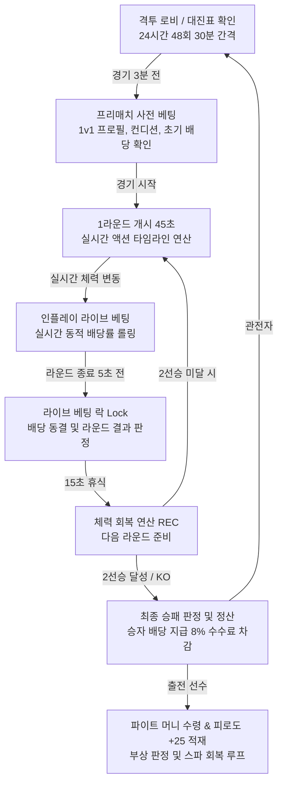

# 🥊 ROOSTER RUMBLE: Rumble Pit (격투 모드) MVP 세부 기획 구성안

* **현재 문서 버전**: `v0.9.1`
* **마지막 개정일**: 2026-09-07
* **문서 정체성**: 1대1 링 격투 시뮬레이션 및 실시간 라이브 베팅 모드(Rumble Pit) MVP 실무 개발 및 작업 지시용 세부 기획 명세서
* **기반 문서**: [통합 MVP 구성안.md](통합%20MVP%20구성안.md), [통합 MVP 마스터 데이터 테이블.md](통합%20MVP%20마스터%20데이터%20테이블.md), [Rumble Pit 기획방향.md](Rumble%20Pit%20기획방향.md)

---

### ■ 문서 개정 이력 (Revision History)

| 버전 (Version) | 개정일 (Date) | 주요 개정 내역 및 상세 변경 사항 | 관련 절 바로가기 |
| :---: | :---: | :--- | :--- |
| **v0.0.1** | 2026-08-11 | 통합 MVP 구성안 내 럼블 핏(격투 모드) 개요 및 기본 범위 최초 기획 | [[#1.1 프로젝트 개요 및 럼블 핏(Rumble Pit) 핵심 컨셉\|1.1절 개요 및 컨셉]] |
| **v0.1.0** | 2026-08-11 | Rumble Pit 하루치 48회 24시간 대진/매칭 룰 및 코너 배정 시드 알고리즘 신규 수록 | [[#2.1 24시간 대진 스케줄(48회) 및 타임라인 운영 규칙\|2.1절 대진 스케줄]] |
| **v0.2.0** | 2026-08-13 | 한글 사칙연산 표준 수식 정제, 격투 서버/클라이언트 사양 보완 (Hitbox 4종, TEC 치명타율, 베팅 락, 동점/판정승 룰) | [[#2.2 1v1 자동 매칭 알고리즘 및 격투 종합 지수 산출식\|2.2절 매칭 지수]] |
| **v0.3.0** | 2026-08-27 | 1v1 단계별 매칭 알고리즘 구체화, 사전 베팅/인플레이 라이브 베팅 UI/UX 조작 및 배당률 롤링 명세 | [[#5.1 2단계 베팅 인터페이스 (프리매치 사전 베팅 vs 인플레이 라이브 베팅)\|5.1절 베팅 인터페이스]] |
| **v0.4.0** | 2026-08-27 | 외부 문서 참조 전면 제거(완전자립화), 컨디션 5등급 상세 보정표 및 시드 난수키, 라운드 휴식 체력 회복식 내재화 | [[#3.6 라운드 간 휴식(15초) 체력 회복, Last Stand 및 피로도/부상/무승부 판정\|3.6절 휴식 회복 및 규칙]] |
| **v0.5.0** | 2026-08-27 | 격투 1초 1틱 AI 매트릭스, 2차 파생 스탯 공식, DB 논리 스키마 및 REST API / WebSocket 규격 수록 | [[#4.3 1차 스탯 기반 2차 격투 스탯 산출 공식\|4.3절 2차 스탯 공식]] |
| **v0.6.0** | 2026-08-27 | 격투 전용 칭호 4종, 일일/주간 퀘스트 및 영구 업적 연동 데이터 수록 | [[#9.2 격투 전용 칭호 4종 명세표\|9.2절 격투 칭호 명세]] |
| **v0.7.0** | 2026-08-27 | 럼블 핏 전용 사운드 규격 신설 (BGM 2종, SFX-Pit 12종 및 이벤트 매핑 완비) | [[#8.3 럼블 핏 전용 효과음 (SFX-Pit) 12종 명세표\|8.3절 격투 효과음]] |
| **v0.8.0** | 2026-09-01 | **[단독 분리 신규 작성]** 통합 MVP 구성안에서 럼블 핏 격투 모드 명세를 전면 독립화하여 자립형 실무 명세서 구축 | [[#1. 게임 개요 및 핵심 루프 (Game Overview & Core Loop)\|1장 게임 개요]] |
| **v0.8.1** | 2026-09-01 | **[파이트 머니 경제 모델 개정]** 무베팅 시 참가비 100% 전액 환급 및 베팅 풀 연동 단일 연속 가중치 함수(Continuous Unified Formula) 도입 (운영사 적자 원천 방지 및 계단식 구간 배제) | [[#5.4 출전 선수 파이트 머니(Fight Money) 및 플랫폼 수수료 정산 (단일 연속 함수 모델)\|5.4절 파이트 머니 모델]] |
| **v0.8.2** | 2026-09-04 | **[실전 시뮬레이션 시나리오 수록]** 3.7절 실전 1v1 격투 시뮬레이션 종합 예시 시나리오 신규 추가 (라운드별 1초 1틱 판정, 치명타, 휴식 회복, 라이브 배당, Last Stand 및 파이트 머니 정산 수치 완비) | [[#3.7 실전 1v1 연속기 격돌 시뮬레이션 종합 예시 시나리오 (Match Walkthrough Scenario)\|3.7절 실전 격투 시나리오]] |
| **v0.9.0** | 2026-09-07 | **[전투 시스템 전면 개편]**<br>1. 총 7대 전문 기술 체계 (공격형 4종 + 방어형 3종) 신설 및 Hitbox/시전시간/계수/효과음 매핑<br>2. 선수 등급별 전투 기술 보유 슬롯 차등(일반 2개 ~ 전설 최대 5개) 및 알 부화/훈련 습득 장착 룰 정립<br>3. 최대 3연속기(Combo) 조합 시너지 매트릭스 (조건부 크리티컬, 1.8배 무조건 반격, 트루 데미지 관통 등 6종) 구축<br>4. 비(非) 턴제 실시간 동시 격돌(Real-Time Clash), 콤보 중간 강제 차단(Interrupt/Cancel), 가드 브레이크 및 기력 호흡 정돈 메커니즘 수립<br>5. 기술 계수 및 방어 관통을 반영한 표준 수식 3요소 완비 타격 피해량/치명타 산출 공식 정립<br>6. 3.7절 실전 1v1 시나리오를 3연속기 실시간 격돌 및 캔슬 버전으로 전면 리뉴얼<br>7. WebSocket 전투 틱(`pit:combat_tick`) 패킷 규격에 기술 식별자, 콤보 단계, 격돌 결과 필드 확장 반영 | • [[#3.1 총 7대 전투 기술 체계 (공격 4종 + 방어 3종) 및 판정/연출 매핑\|3.1절 7대 전문 전투 기술]]<br>• [[#3.2 선수 등급별 전투 기술 보유 슬롯 (최대 5개) 및 장착 룰\|3.2절 등급별 기술 슬롯]]<br>• [[#3.3 최대 3연속 기술(Combo) 구성 및 조건부/확정 시너지 매트릭스\|3.3절 3연속기 조합 매트릭스]]<br>• [[#3.4 실시간 비(非) 턴제 동시 격돌(Real-Time Clash), 콤보 캔슬 및 가드 브레이크\|3.4절 실시간 비턴제 격돌·캔슬]]<br>• [[#3.5 타격 피해량 공식, 치명타 수식 및 스타일 5종별 액션/콤보 가중치\|3.5절 피해량·치명타 공식]]<br>• [[#3.7 실전 1v1 연속기 격돌 시뮬레이션 종합 예시 시나리오 (Match Walkthrough Scenario)\|3.7절 실전 1v1 격돌 시나리오]]<br>• [[#6.3 실시간 WebSocket 양방향 이벤트 명세 (격투 2종)\|6.3절 WebSocket 틱 패킷 규격]] |
| **v0.9.1** | 2026-09-07 | **[전투 시나리오 정합성 검증 및 서술 객관화]**<br>1. 3.7절 실전 시나리오 전면 개편 (경기 타임라인-틱 100% 동기화, 라운드별 체력 감쇄 및 회복 산술 오차 0 정합, 6대 콤보 및 가드 브레이크 수식 실연)<br>2. 1장·2장·7장 내 구버전 표현('1초 1틱')을 '실시간 액션 타임라인'으로 일원화<br>3. 4.2절/4.3절 TEC 스탯에 기력 호흡 정돈 쿨다운 단축 공식 명시<br>4. 6.3절 WebSocket 및 7.1절 아레나 HUD 컴포넌트(기술 슬롯, 콤보 체인, 가드 게이지) 명세 보강<br>5. 문서 전반의 불필요한 수식어 및 문학적 표현 배제, 객관적 기술 사양 중심으로 문장 정제 | • [[#3.7 실전 1v1 연속기 격돌 시뮬레이션 종합 예시 시나리오 (Match Walkthrough Scenario)\|3.7절 전투 시나리오]]<br>• [[#3.4 실시간 비(非) 턴제 동시 격돌(Real-Time Clash), 콤보 캔슬 및 가드 브레이크\|3.4절 실시간 비턴제 격돌]]<br>• [[#4.2 2차 격투 파생 스탯 (Rumble Pit 스탯 6종) 정의\|4.2절 2차 스탯 정의]]<br>• [[#7.1 메인 로비, 격투 대진표 및 1v1 아레나 인게임 화면 계층 구조\|7.1절 아레나 HUD]] |

#### ■ 연동 마스터 데이터 CSV 파일
* **02. 격투 1v1 대진표 (48회)**: [02_rumble_pit_daily_matches_48.csv](02_rumble_pit_daily_matches_48.csv)
* **03. 선수 1차 피지컬 스탯 (30두)**: [03_roosters_base_stats_1st.csv](03_roosters_base_stats_1st.csv)
* **05. 선수 2차 격투 스탯 (30두)**: [05_roosters_pit_stats_2nd.csv](05_roosters_pit_stats_2nd.csv)

---

## 목차
1. [[#1. 게임 개요 및 핵심 루프 (Game Overview & Core Loop)]]
   - [[#1.1 프로젝트 개요 및 럼블 핏(Rumble Pit) 핵심 컨셉]]
   - [[#1.2 모바일 vs 자체 온라인 웹 서비스 전략 비교]]
   - [[#1.3 럼블 핏 핵심 플레이 루프 & 플로우차트]]
2. [[#2. 1대1 링 격투 경기 규칙 및 대진/매칭 시스템]]
   - [[#2.1 24시간 대진 스케줄(48회) 및 타임라인 운영 규칙]]
   - [[#2.2 1v1 자동 매칭 알고리즘 및 격투 종합 지수 산출식]]
   - [[#2.3 단계별 대기시간 매칭 조건 완화 규칙 (3단계)]]
   - [[#2.4 코너 배정(Red/Blue Corner) 시드 난수 규칙]]
3. [[#3. 격투 물리 연산 및 AI 전투 시스템]]
   - [[#3.1 총 7대 전투 기술 체계 (공격 4종 + 방어 3종) 및 판정/연출 매핑]]
   - [[#3.2 선수 등급별 전투 기술 보유 슬롯 (최대 5개) 및 장착 룰]]
   - [[#3.3 최대 3연속 기술(Combo) 구성 및 조건부/확정 시너지 매트릭스]]
   - [[#3.4 실시간 비(非) 턴제 동시 격돌(Real-Time Clash), 콤보 캔슬 및 가드 브레이크]]
   - [[#3.5 타격 피해량 공식, 치명타 수식 및 스타일 5종별 액션/콤보 가중치]]
   - [[#3.6 라운드 간 휴식(15초) 체력 회복, Last Stand 및 피로도/부상/무승부 판정]]
   - [[#3.7 실전 1v1 연속기 격돌 시뮬레이션 종합 예시 시나리오 (Match Walkthrough Scenario)]]
4. [[#4. 선수 능력치 구조 및 2차 격투 파생 스탯 산출 공식]]
   - [[#4.1 1차 기본 피지컬 스탯 (Common Core 6종) 정의]]
   - [[#4.2 2차 격투 파생 스탯 (Rumble Pit 스탯 6종) 정의]]
   - [[#4.3 1차 스탯 기반 2차 격투 스탯 산출 공식]]
   - [[#4.4 격투 스타일 5종별 2차 보정값 (Fight Style Bias) 명세표]]
   - [[#4.5 알파 선수 30두 1차 피지컬 및 2차 격투 스탯 마스터 데이터 세트]]
5. [[#5. 베팅 시스템, 배당률 연산 및 파이트 머니 정산]]
   - [[#5.1 2단계 베팅 인터페이스 (프리매치 사전 베팅 vs 인플레이 라이브 베팅)]]
   - [[#5.2 동적 라이브 배당률 산출 및 보정 공식]]
   - [[#5.3 라이브 베팅 UI 연출 및 5.0초 전 락(Lock) 인터랙션]]
   - [[#5.4 출전 선수 파이트 머니(Fight Money) 및 플랫폼 수수료 정산 (단일 연속 함수 모델)]]
   - [[#5.5 베팅 한도, 다중 베팅 규칙, 무승부 환불 및 Claim Payout UI 인터랙션]]
6. [[#6. 데이터베이스 논리 스키마 및 통신 API/WebSocket 규격]]
   - [[#6.1 데이터베이스 분리 구성표 및 럼블 핏 관련 5개 엔티티 논리 스키마]]
   - [[#6.2 핵심 REST API 엔드포인트 명세 (격투 관련 6종)]]
   - [[#6.3 실시간 WebSocket 양방향 이벤트 명세 (격투 2종)]]
7. [[#7. 화면 레이아웃, UI/UX 및 오류/예외 처리]]
   - [[#7.1 메인 로비, 격투 대진표 및 1v1 아레나 인게임 화면 계층 구조]]
   - [[#7.2 격투 베팅 슬립 패널 및 인플레이 퀵 베팅 바 명세]]
   - [[#7.3 네트워크 단절, 동시 정산 충돌, 베팅 락 등 6대 예외 및 오류 처리 방법]]
8. [[#8. 사운드 및 연출 규격 (SFX / BGM)]]
   - [[#8.1 사운드 시스템 연출 원칙 및 오디오 믹서 버스 아키텍처]]
   - [[#8.2 럼블 핏 전용 배경음악 (BGM) 명세표]]
   - [[#8.3 럼블 핏 전용 효과음 (SFX-Pit) 12종 명세표]]
   - [[#8.4 클라이언트 사운드 이벤트 매핑 및 우선순위 테이블]]
9. [[#9. 럼블 핏 연계 육성, 퀘스트, 칭호 및 업적 시스템]]
   - [[#9.1 럼블 핏 전용 훈련 종목 4종 및 스탯 상승 프로세스]]
   - [[#9.2 격투 전용 칭호 4종 명세표]]
   - [[#9.3 격투 연계 일일/주간 퀘스트 및 영구 누적 업적]]

---

## 1. 게임 개요 및 핵심 루프 (Game Overview & Core Loop)

### 1.1 프로젝트 개요 및 럼블 핏(Rumble Pit) 핵심 컨셉
* **게임 장르**: 실시간 닭싸움(격투) 시뮬레이션 + 실시간 인플레이 라이브 베팅 게임
* **핵심 컨셉**:
  - **모드 정체성**: 사각 링 내 1대1 닭 격투 시뮬레이션 및 실시간 배당률 기반 인플레이 베팅 모드
  - **동적 배당률 베팅**: 라운드 진행 중 체력 변화에 따라 실시간으로 배당률이 재산출되는 **'인플레이 라이브 베팅(In-Play Betting)'** 지원.
  - **자산 및 리스크 관리**: 경기 후 피로도 누적 및 부상 확률이 발생하여 유저의 선수 관리(Risk & Reward) 메커니즘 제공.
  - **실시간 액션 타임라인 서버 연산**: 시드 난수 기반 프레임 타임라인(0.1초 단위) 시뮬레이션 및 2.5D 애니메이션 클라이언트 동기화.

### 1.2 모바일 vs 자체 온라인 웹 서비스 전략 비교

| 구분 | 모바일 앱 (Mobile App) | 자체 온라인 웹 (Online Web) |
| :--- | :--- | :--- |
| **서비스 목적** | 대중적 접근성, 닭 캐릭터 육성 및 격투 출전, 파이트 머니 획득 | 경기 실시간 관람 및 1v1 승자 예측 베팅, 수수료 수익 창출 |
| **계정 및 자산** | 모바일 유저 계정, Gold, Gem, 사료(Feed), 피로도/부상 관리 | 온라인 유저 계정, 베팅 Credit, 파이트 머니 정산금 |
| **격투 경기 기능** | 1대1 링 매치 출전, 자동 시뮬레이션 관전, 경기 상금 수령 | 24시간 48회 격투 실시간 라이브 중계, 사전/라이브 베팅 |
| **베팅 시스템** | 미지원 (순수 출전 및 대전료 수급) | 머니라인 사전 베팅 + 1~3라운드 인플레이 실시간 라이브 베팅 |
| **수익 모델 (BM)** | 육성 훈련비, 부상 치료 유료 스파(50 Gem / 5,000 Gold) | 격투 베팅 수수료 (**8% 정액 차감**), 유료 스파 이용료 |
| **데이터베이스** | `Mobile App DB` (`t_rooster_farm` 등) | `Online Web DB` (`t_pit_bet_payout`, `t_rooster_online` 등) |

### 1.3 럼블 핏 핵심 플레이 루프 & 플로우차트



---

## 2. 1대1 링 격투 경기 규칙 및 대진/매칭 시스템

### 2.1 24시간 대진 스케줄(48회) 및 타임라인 운영 규칙

#### ■ 24시간 자동 인터벌 및 타임테이블
* **운영 인터벌**: 하루 24시간 동안 **30분 간격**(매시 00분, 30분 정각)으로 총 **48회 1v1 링 매치**(`F-20260905-01` ~ `F-20260905-48`) 자동 개설 및 운영.
* **단일 경기 진행 타임라인 (총 3분 30초 소요)**:
  1. **프리매치 대기실 (경기 시작 3분 전 ~ 0초)**: 대진 확정, 초기 배당률 공개, 사전 베팅 오픈 (시작 10초 전 사전 베팅 마감).
  2. **1라운드 (0초 ~ 45초)**: 45초간 실시간 액션 타임라인 전투 연산 및 실시간 라이브 베팅 진행 (종료 5초 전 베팅 락).
  3. **1라운드 휴식 (45초 ~ 60초)**: 15초간 체력 회복 연산(`REC`) 및 2라운드 라이브 배당 갱신.
  4. **2라운드 (60초 ~ 105초)**: 45초간 실시간 액션 타임라인 전투 연산 및 라이브 베팅 진행 (종료 5초 전 베팅 락).
  5. **2라운드 휴식 (105초 ~ 120초)**: 15초간 체력 회복 연산 (한쪽이 2승 달성 시 즉시 경기 종료 및 정산).
  6. **3라운드 (120초 ~ 165초)**: 1승 1패 동률 시 3라운드 경기 진행 (45초).
  7. **결과 발표 및 정산 (165초 ~ 210초)**: 45초간 승패 판정, 배당금 지급 및 Claim Payout 활성화.

#### ■ 출전 쿨다운 잠금 (Cooldown Lock)
* **연속 참전 제한**: 1회 참전 닭 대상 최소 1개 경기(30분간) 참전 쿨다운 잠금 적용

### 2.2 1v1 자동 매칭 알고리즘 및 격투 종합 지수 산출식

#### 1) 격투 종합 지수 산출식
$$\text{격투 종합 지수} = \text{POW} + \text{DEF} + \text{버림}\left(\frac{\text{HP}}{10}\right) + \text{REC} + \text{TEC} + \text{GRT} + \text{당일 컨디션 보정}$$
* **[연산식 설명]**: 선수의 6대 2차 격투 스탯(POW, DEF, HP/10, REC, TEC, GRT)에 당일 컨디션 보정치를 합산하여 매칭 밸런스 단일 점수 산출
* **[대등 매칭 원칙]**: 대진 2두 간 격투 종합 지수 격차 최소화 페어링 (경기 밸런스 유지)

### 2.3 단계별 대기시간 매칭 조건 완화 규칙 (3단계)

| 단계 | 대기 시간 | 매칭 조건 완화 규칙 |
| :---: | :---: | :--- |
| **1단계** | 0 ~ 5초 | `격투 종합 지수` 격차 **`±10` 이내**, 상성 스타일(인파이터 vs 아웃파이터, 브롤러 vs 테크니션, 밸런서 vs 브롤러) 우선 페어링, 피로도 90 이상 및 부상(`INJURED`) 닭 완전 배제 |
| **2단계** | 5 ~ 10초 | `격투 종합 지수` 격차 **`±15` 이내**, 동종 격투 스타일 매칭 허용 (단, 동일 닭 중복 출전 배제) |
| **3단계** | 10초 초과 | `격투 종합 지수` 격차 **`±20`까지 확장** 후 즉시 2두 대진 확정 |

### 2.4 코너 배정(Red/Blue Corner) 시드 난수 규칙
* **코너 셔플 키 산출식**:
  $$\text{코너 셔플 키} = \text{시드 기반 난수 함수}(\text{matchSeed} + \text{":corner:"} + \text{chickenId})$$
* **코너 배정 룰**:
  - 코너 셔플 키 비교 후 상위 선수 **Red Corner (좌측)**, 하위 선수 **Blue Corner (우측)** 배정
  - 동률 발생 시 `chickenId` 오름차순 기준 우선 배정

---

## 3. 격투 물리 연산 및 AI 전투 시스템

### 3.1 총 7대 전투 기술 체계 (공격 4종 + 방어 3종) 및 판정/연출 매핑
* **라운드별 진행 규격**: 1대1 사각 링 3라운드 2선승제 (라운드당 45초, 라운드 간 15초 휴식).
* **전투 기술 시스템 개요**: 공격형 4종 + 방어형 3종(총 7대 기술) 기반 실시간 동시 격돌 체계. 기술별 고유 발동 시간(Frame Duration), 피해량 계수, 연계 시너지 보유

#### ■ 공격형 기술 (Offensive Skills - 4종) 상세 스펙

| 기술 식별자 | 기술명 (한글/영문) | Hitbox 판정 | 시전 시간 | 피해량 계수 | 특수 효과 및 연계 기능 | 연동 효과음 |
| :---: | :--- | :---: | :---: | :---: | :--- | :--- |
| **`[공1]`** | **부리 연타 (Peck Rush)** | 중단 (Head) | `0.4초` | `POW × 1.0` | **시동기**: 선딜레이 최소(0.4초), 적중 시 다음 연계 기술 발동 속도 15% 가속 | `SFX_PIT_HIT_POKE` |
| **`[공2]`** | **며느리발톱 강타 (Spur Cleave)** | 하단 (Leg) | `0.6초` | `POW × 1.2` | **방어 관통 및 경직**: 상대 DEF 20% 관통 피해, 적중 시 피격 경직(0.2초) 부여 | `SFX_PIT_HIT_SPUR` |
| **`[공3]`** | **비상 급습 (Dive Talon)** | 상단 (Air) | `0.7초` | `POW × 1.3` | **공중 강습**: 치명타율 `+15%` 가산, 상대 기본 가드(-60%)를 -30%로 감쇄 약화 | `SFX_PIT_HIT_WING` |
| **`[공4]`** | **회전 날개치기 (Wing Tempest)** | 전신 (Area) | `0.8초` | `POW × 1.5` | **넉백 및 캔슬**: 상대의 진행 중인 연속기 강제 차단(Interrupt) 및 넉백 유발 | `SFX_PIT_HIT_WING` + `SFX_PIT_HIT_CRIT` |

#### ■ 방어형 기술 (Defensive Skills - 3종) 상세 스펙

| 기술 식별자 | 기술명 (한글/영문) | 가드 형태 | 유지 시간 | 피해량 보정 | 특수 효과 및 반격 메커니즘 | 연동 효과음 |
| :---: | :--- | :---: | :---: | :---: | :--- | :--- |
| **`[방1]`** | **깃털 커버링 (Feather Guard)** | 기본 가드 | `0.5초` | **`-60%` 감쇄** | 지속 시간 동안 피격 피해량 60% 감쇄 (연속 피격 시 가드 게이지 소모 및 가드 브레이크 유발 가능) | `SFX_PIT_GUARD` |
| **`[방2]`** | **슬립 위빙 (Slip Weave)** | 상체 회피 | `0.4초` | **`100% 회피 (0 데미지)`** | 지속 시간 동안 상대 공격 100% 무효화(0 데미지), 성공 시 다음 즉시 연계 공격에 **[조건부 100% 확정 크리티컬]** 부여 | `SFX_PIT_DODGE` |
| **`[방3]`** | **날개 패링 (Wing Counter-Parry)** | 패링 반격 | `0.5초` | **`공격 무효화 + 역습`** | 상대 타격 접촉 시 상대 연속기 즉시 강제 캔슬, 상대를 취약(Vulnerable) 상태로 전환 후 확정 반격권 획득 | `SFX_PIT_DODGE` + `SFX_PIT_HIT_WING` |

---

### 3.2 선수 등급별 전투 기술 보유 슬롯 (최대 5개) 및 장착 룰

선수 육성 등급(Grade)별 보유 및 출전 장착 기술 슬롯 차등 부여 (상위 등급일수록 다채로운 연속기 구성 가능)

| 닭 캐릭터 등급 | 보유 가능 기술 슬롯 | 권장 기본 슬롯 구성 | 운용 가능한 연속기 범위 | 전략적 특징 |
| :---: | :---: | :--- | :---: | :--- |
| **일반 (Common)** | **2개** | 공격 1개 + 방어 1개 (예: 공1, 방1) | 단발 및 2연속기 (공+공, 방+공 등) | 기본 공수 교환형 입문 빌드 |
| **희귀 (Rare)** | **3개** | 공격 2개 + 방어 1개 (예: 공1, 공2, 방1) | **최대 3연속기 조합 개시** (공+공+공, 공+방+공 등) | 공격 연타 또는 수비 후 2연타 가능 |
| **영웅 (Epic)** | **4개** | 공격 2개 + 방어 2개 (예: 공1, 공2, 방1, 방3) | 다채로운 3연속기 공수 전환 빌드 | 패링 반격 및 가드 돌파 유연 운용 |
| **전설 (Legendary)** | **최대 5개** | 공격 3개 + 방어 2개 (자유 커스텀 장착) | **3연속기 전 기술 자유 조합 가능** | 상황별 최적 콤보(공+공+공, 방+방+공 등) 구사 가능 |

* **기술 습득 및 장착 규칙**:
  1. **알 부화 시 초기 기술 부여**: 등급별 기본 기술 1~2종(공격 1종, 방어 1종) 선천 개화
  2. **훈련을 통한 신규 기술 습득**: 훈련 센터 수련을 통한 미습득 잔여 기술 추가 획득
  3. **슬롯 장착/교체 인터페이스**: 등급별 슬롯 한도(최대 5개) 내 출전 전 자유 장착/교체 지원

---

### 3.3 최대 3연속 기술(Combo) 구성 및 조건부/확정 시너지 매트릭스

장착 기술 풀 내 전황(거리, 모션, 잔여 HP) 기반 **최대 3연속기(Combo Chain)** 조합 시동. 특정 기술 연계 시 조건부/확정 시너지 발동

#### ■ 6대 대표 연속기 조합 매트릭스

| 콤보 유형 | 대표 조합 예시 | 콤보 명칭 | 발동 조건 및 판정 메커니즘 | 정량적 시너지 효과 |
| :---: | :---: | :--- | :--- | :--- |
| **공 + 공** | `[공1] + [공2]` | **고속 연타** | 1타(부리) 적중 성공 시 2타(며느리발톱) 즉시 연계 | **[조건부 크리티컬]**: 2타 치명타율 **`+25%`** 가산 |
| **방 + 공** | `[방2] + [공3]` | **회피 카운터** | 1타 슬립 위빙으로 상대 공격 완전 회피 성공 시 | **[조건부 크리티컬]**: 2타 공격 **`100% 확정 크리티컬 (1.5배)`** 적용 |
| **공 + 공 + 공** | `[공1] + [공2] + [공4]` | **3단 연속 타격** | 1타 ➔ 2타 ➔ 3타 캔슬 없이 연속 적중 완주 시 | **[피니시 피해 증폭]**: 3타 피해량 **`+30%`** 증폭 및 상대 2.0초간 그로기 유발 |
| **방 + 방 + 공** | `[방1] + [방3] + [공2]` | **패링 반격** | 1타 가드로 흡수 후 2타 패링으로 상대 공격 쳐내기 성공 시 | **[무조건 반격 크리티컬]**: **상대 행동 강제 캔슬 + 100% 무조건 반격 크리티컬 (1.8배 카운터)** |
| **공 + 방 + 공** | `[공1] + [방2] + [공3]` | **페인트 연계** | 1타 타격 후 상대의 카운터 공격을 회피로 흘리고 3타 가격 시 | **[방어력 관통]**: 상대 방어력(DEF) 100% 무시 (**트루 데미지** 적용) |
| **방 + 공 + 공** | `[방1] + [공1] + [공4]` | **가드 돌파 반격** | 가드로 상대 타격 데미지 -60% 감쇄 후 2연속 타격 시동 시 | **[수세 역전]**: 상대를 링 로프 쪽으로 밀어내며 링 중앙 점유권 탈환 |

---

### 3.4 실시간 비(非) 턴제 동시 격돌(Real-Time Clash), 콤보 캔슬 및 가드 브레이크

**비(非) 턴제 실시간 액션 타임라인(Frame Timeline) 기반 동시 격돌 시스템** 적용

```
[Red 선수: 공+공+공 시동] ────────(0.4s 부리연타)────► [0.6s 발차기 시전] ────────► [0.8s 날개치기]
                                                     ▲
                                                     │ (실시간 동시 충돌)
[Blue 선수: 방+방+공 시동] ──────(0.5s 가드 커버링)──► [0.5s 날개 패링 성공] ───► [Red 3타 캔슬 & 1.8배 확정 카운터 피격]
```

#### 1) 액션 시전 타임라인 (Action Duration)
* 각 단발 기술 시전 시간: 약 `0.4초 ~ 0.8초`.
* 최대 3연속기 완주 시간: 약 `1.5초 ~ 2.2초`.
* **독립 타이머 구동**: 상대 동작 대기 없이 **실시간 독립적 공격/방어 기술 즉시 시동**

#### 2) 공 vs 공 동시 타격 격돌 (Mutual Clash & Cross Counter)
* 양 선수가 동일한 시점에 공격 기술을 적중시킬 경우:
  - **위력 판정**: 기술 피해량 계수 및 POW 상위 선수가 판정승하여 상대 모션 캔슬 및 일방 타격
  - **크로스 카운터 (Cross Counter)**: 위력 격차 10% 이내 시 **양측 동시 피격 및 상호 넉백** 처리

#### 3) 콤보 중간 강제 차단 (Combo Interruption & Cancel)
* 상대가 3연속기를 시전하는 도중, 수비측이 2타 타이밍에 `[방3: 날개 패링]`을 성공시키거나 `[공4: 회전 날개치기]`로 카운터를 날릴 경우:
  - **공격측**: 잔여 연속기 즉시 강제 캔슬 및 0.5초 피격 경직(Stun) 상태 진입
  - **수비측**: 즉시 확정 반격권 획득 후 `방+방+공` 1.8배 무조건 반격 크리티컬 발동

#### 4) 가드 브레이크 (Guard Break)
* 수비측이 `[방1: 깃털 커버링]`을 지나치게 연속 사용하여 가드 게이지가 소진되거나, 상대의 `[공2: 며느리발톱 강타]` 또는 `[공4: 회전 날개치기]`를 가드 상태에서 연속 피격당할 경우:
  - **가드 브레이크 발동**: 가드 게이지 소진 또는 관통 공격 피격 시 가드 강제 파괴
  - **취약 상태 적용**: 방어자 1.0초간 무방비 취약 상태 전환, 해당 타격 피해량 **1.5배 관통 데미지** 적용

#### 5) 기력 호흡 정돈 및 쿨다운 (Stamina Breathing)
* **호흡 정돈 전환**: 3연속기 완주 즉시 공방 템포 조율용 **스텝/견제 상태** 진입
* **행동 제약**: 기본 회피 및 단발 가드만 허용, 신규 연속기 즉시 연속 사용 제한
* **호흡 정돈 쿨다운 연산식**:
  $$\text{호흡 정돈 쿨다운(초)} = \text{최댓값}\left(1.5 - \left(\frac{\text{기술력(TEC)}}{100}\right) \times 0.5, \;\; 1.0\right)$$
  - TEC 0 기준 1.5초 쿨다운 적용.
  - TEC 100 기준 최소 1.0초 쿨다운으로 단축 (기술력이 높을수록 연속기 재시동 대기시간 단축).

---

### 3.5 타격 피해량 공식, 치명타 수식 및 스타일 5종별 액션/콤보 가중치

#### 1) 타격 피해량 연산식 (기술 계수 및 방어 관통 반영)
$$\text{타격 피해량} = \text{최댓값}\left(\text{반올림}\left((\text{POW} \times \text{Skill\_Coeff} \times \text{Crit\_Mult} \times \text{Combo\_Amp}) - (\text{DEF} \times (1 - \text{Pen\_Rate}))\right), \;\; 1\right)$$
* **[연산식 설명]**: 공격자 순수 타격력(POW × 기술계수 × 치명타배율 × 콤보증폭)에서 방어자 유효 방어력(DEF × (1 - 관통율)) 차감 산출 (계산값 0 이하 시 최소 1 피해량 보장)
* **[계산 예시 1 (기본 타격: [공1] 부리 연타)]**: 공격자 POW `50`, 방어자 DEF `35` 기준:
  $$(50 \times 1.0 \times 1.0 \times 1.0) - (35 \times (1 - 0)) = 50 - 35 = \mathbf{15\text{ 데미지}}$$
* **[계산 예시 2 (조건부 크리티컬: [방2]+[공3] 회피 후 기습 강타)]**: 공격자 POW `53`, 방어자 DEF `58`, [공3] 계수 1.3, 확정 치명타 1.5 적용 시:
  $$(53 \times 1.3 \times 1.5 \times 1.0) - (58 \times 1.0) = \text{반올림}(103.35) - 58 = 103 - 58 = \mathbf{45\text{ 데미지}}$$
* **[계산 예시 3 (철벽 역습 카운터: [방+방+공] 패링 후 며느리발톱 강타)]**: 공격자 POW `53`, 방어자 DEF `58`, [공2] 계수 1.2, 무조건 반격 크리티컬 1.8, DEF 관통 20%($1 - 0.2 = 0.8$) 적용 시:
  $$(53 \times 1.2 \times 1.8 \times 1.0) - (58 \times 0.8) = \text{반올림}(114.48) - \text{반올림}(46.4) = 114 - 46 = \mathbf{68\text{ 데미지}}$$

#### 2) 치명타 발현 확률 수식
$$\text{치명타 확률(\%)} = \text{최솟값}\left(\text{기술력(TEC)} \times 0.3\% + \text{Combo\_Crit\_Bonus}, \;\; 100.0\%\right)$$
* **[연산식 설명]**: 기본 치명타율(TEC × 0.3%, 상한 30.0%)에 콤보 시너지 보너스([공+공] +25%, [방+공]/[방+방+공] 100% 확정) 합산 산출
* **[계산 예시 (기본 상태)]**: TEC `80` 보유 선수: $80 \times 0.3\% = \mathbf{24.0\%}$.
* **[계산 예시 ([공+공] 2타 시전 시)]**: TEC `52` 보유 선수: $52 \times 0.3\% + 25.0\% = 15.6\% + 25.0\% = \mathbf{40.6\%}$ 확률로 치명타 발동.

#### 3) 격투 스타일 5종별 기술 선택 및 콤보 지향 가중치 매트릭스

| 격투 스타일 | 주요 선호 기술 | 주력 연속기 패턴 | 공격 가중치 | 방어 가중치 | 스텝/견제 | 전투 성향 |
| :---: | :---: | :---: | :---: | :---: | :---: | :--- |
| **인파이터 (Infighter)** | `[공1]`, `[공2]`, `[방1]` | **공+공, 공+공+공** | **70%** | 15% | 15% | 쉴 새 없이 몰아치는 근접 압박 연타 위주 |
| **아웃파이터 (Outfighter)** | `[공3]`, `[방2]`, `[방3]` | **방+공, 공+방+공** | 40% | 35% | **25%** | 거리 유지, 회피 후 기습 치명타 및 페인트 타격 |
| **브롤러 (Brawler)** | `[공2]`, `[공4]`, `[방1]` | **공+공+공, 방+공+공** | **70%** | 20% | 10% | 강력한 넉백 공격과 가드 돌파, 난타전 유도 |
| **테크니션 (Technician)** | `[공1]`, `[공3]`, `[방3]` | **방+방+공, 공+공** | 45% | **40%** | 15% | 날개 패링 카운터 노림수, 1.8배 역전 한방 지향 |
| **밸런서 (Balanced)** | 전 기술 균등 보유 | 유동적 콤보 구사 | 55% | 25% | 20% | 상대 스타일과 체력 상태에 맞춘 유연한 공수 밸런스 |

---

### 3.6 라운드 간 휴식(15초) 체력 회복, Last Stand 및 피로도/부상/무승부 판정

#### 1) 라운드 간 휴식(15초) 체력 회복량 연산식
$$\text{라운드 간 체력 회복량} = \text{최솟값}\left(\text{반올림}\left(\text{최대 체력} \times \left(\frac{\text{회복력(REC)}}{200}\right)\right), \;\; \text{최대 체력} - \text{현재 체력}\right)$$
* **[연산식 설명]**: 라운드 간 15초 휴식 중 회복력(REC) 비례 체력 회복 (최대 체력 초과 불가)
* **[계산 예시]**: 최대 체력 `1,000`, 현재 잔여 체력 `400`, 회복력 REC `60` 보유 선수:
  $$\text{반올림}\left(1,000 \times \frac{60}{200}\right) = \text{반올림}(1,000 \times 0.3) = \mathbf{300\text{ HP 회복}} \quad (\text{최종 잔여 체력}: 400 + 300 = \mathbf{700\text{ HP}})$$

#### 2) 투지 버티기 (Last Stand) 발동 공식
$$\text{발동 확률(\%)} = \text{근성(GRT)} \times 0.5\%$$
* **[연산식 설명]**: 체력 0 도달 시 근성(GRT) 비례 확률(GRT × 0.5%)로 1회 한정 체력 1 유지 및 KO 모면
* **[계산 예시]**: 근성 GRT `80` 보유 선수: $80 \times 0.5\% = \mathbf{40.0\%}$ 확률로 Last Stand 발동.

#### 3) 피로도 누적, 부상 및 판정승 예외 처리
* **피로도 누적**: 격투 경기 1회 완주 시 피로도 **`+25`** 적재 (최대 100).
* **부상 판정**: 피로도 `90` 이상 누적 상태에서 출전 시 **`30%`** 확률로 부상(`INJURED`) 상태로 전환 (출전/훈련 전면 불가, 유료 스파 치료 필요).
* **무승부 / 타임아웃 예외 판정 (Draw Game Rules)**:
  - 3라운드 진행 후 1승 1무 1패이거나 45초 타임아웃 시 **잔여 체력 비율(%) 우위 닭 판정승** 처리.
  - 잔여 체력 비율까지 동률일 경우 **기술력(`TEC`) 스탯 우위 닭 판정승** 처리.

---

### 3.7 실전 1v1 연속기 격돌 시뮬레이션 종합 예시 시나리오 (Match Walkthrough Scenario)

#### ■ 매치 프로필 및 환경 설정
* **경기 식별자**: `F-20260905-11` (05:00 정기 매치)
* **총 베팅 풀 ($B$)**: `50,000 Gold` (사전 베팅 30,000 G + 라이브 베팅 20,000 G)
* **선수 1인당 참가비 ($E$)**: `1,000 Gold`

| 코너 배정 | 출전 선수명 | 격투 스타일 / 등급 | 보유/장착 기술 (최대 5개) | 2차 격투 스탯 (POW/DEF/HP/REC/TEC/GRT) | 사전 기본 배당 |
| :---: | :---: | :---: | :--- | :---: | :---: |
| **Red Corner** | **11. 레드 불릿 (Red Bullet)** | **인파이터** (전설급) | `[공1]`, `[공2]`, `[공4]`, `[방1]`, `[방2]` | `POW 64` / `DEF 58` / `HP 778` / `REC 49` / `TEC 52` / `GRT 45` | **`1.85배`** |
| **Blue Corner** | **1. 블레이징 윙 (Blazing Wing)** | **아웃파이터** (전설급) | `[공1]`, `[공3]`, `[방1]`, `[방2]`, `[방3]` | `POW 53` / `DEF 63` / `HP 726` / `REC 50` / `TEC 58` / `GRT 44` | **`2.05배`** |

#### 1) 1라운드: 인파이터 [공+공] 2연타 vs 아웃파이터 [방+공] 회피 카운터 (45초)
* **경기 타임라인**: `00:00 ~ 00:45` (1라운드 진행, 종료 5초 전 라이브 베팅 락)
* **주요 공방 타임라인 및 수식 연산**:
  1. **Tick 12 (00:12) - 레드 불릿 [공+공 고속 연타]**:
     - 1타 [공1: 부리 연타] 적중: $(64 \times 1.0) - 63 = \mathbf{1\text{ 데미지}}$ (최소 1 보장).
     - 1타 적중 보너스로 2타 [공2: 며느리발톱 강타]에 **치명타율 +25%** 가산 ($52 \times 0.3\% + 25\% = 40.6\%$).
     - 2타 발차기 적중 및 치명타 발동 (DEF 20% 관통):
       $$\text{반올림}(64 \times 1.2 \times 1.5) - \text{반올림}(63 \times 0.8) = 115 - 50 = \mathbf{65\text{ 데미지}} \implies \text{Blue 피격 합계: } \mathbf{66\text{ 데미지}}$$
  2. **Tick 22 (00:22) - 블레이징 윙 [공+방+공 페인트 연계]**:
     - 1타 [공1: 부리] 견제: $53 - 58 \to \mathbf{1\text{ 데미지}}$.
     - 2타 [방2: 슬립 위빙]으로 레드 불릿의 훅 공격 100% 회피 (0 데미지).
     - 3타 [공3: 비상 급습] **[방어력 100% 무시 트루 데미지]** 적중:
       $$\text{반올림}(53 \times 1.3) - (58 \times 0) = 69 - 0 = \mathbf{69\text{ 데미지}} \implies \text{Red 피격 합계: } \mathbf{70\text{ 데미지}}$$
  3. **Tick 35 (00:35) - 블레이징 윙 [방+공 회피 카운터]**:
     - 1타 [방2: 슬립 위빙] 회피 성공 후 2타 [공3: 비상 급습] **조건부 100% 확정 크리티컬 (1.5배)**:
       $$\text{반올림}(53 \times 1.3 \times 1.5) - 58 = 103 - 58 = \mathbf{45\text{ 데미지}} \implies \text{Red 피격 합계: } \mathbf{45\text{ 데미지}}$$
  4. **Tick 40 (00:40) - 레드 불릿 [공+공+공 3단 연속 타격]**:
     - 1타 [공1] 1 데미지 + 2타 [공2] 일반 관통 ($77 - 50 = 27\text{ 데미지}$).
     - 3타 [공4: 회전 날개치기] 피니시 30% 증폭 적중:
       $$\text{반올림}(64 \times 1.5 \times 1.3) - 63 = 125 - 63 = \mathbf{62\text{ 데미지}} \implies \text{Blue 피격 합계: } \mathbf{90\text{ 데미지}}$$
* **1라운드 누적 유효타 및 잔여 체력 정산**:
  - 일반 잽 견제 및 유효타 교환 누적: Red 피격 `95 데미지`, Blue 피격 `68 데미지`.
  - **레드 불릿 1R 총 피격**: $70 + 45 + 95 = \mathbf{210\text{ 데미지}} \implies \mathbf{568\text{ / }778\text{ HP}}$ (잔여 73.0%)
  - **블레이징 윙 1R 총 피격**: $66 + 90 + 68 = \mathbf{224\text{ 데미지}} \implies \mathbf{502\text{ / }726\text{ HP}}$ (잔여 69.1%)

#### 2) 라운드 간 15초 휴식 & 라이브 배당판 갱신
* **휴식 시간**: `00:45 ~ 01:00` (15초간 체력 회복 연산 및 2R 라이브 배당 표출)
* **체력 회복 연산 (REC 기반, §3.6 공식 적용)**:
  - `레드 불릿 (REC 49)`: $\text{최솟값}\left(\text{반올림}\left(778 \times \frac{49}{200}\right), \; 778 - 568\right) = \text{최솟값}(191, 210) = \mathbf{+191\text{ HP 회복}} \implies \mathbf{759\text{ HP}}$ 복구.
  - `블레이징 윙 (REC 50)`: $\text{최솟값}\left(\text{반올림}\left(726 \times \frac{50}{200}\right), \; 726 - 502\right) = \text{최솟값}(182, 224) = \mathbf{+182\text{ HP 회복}} \implies \mathbf{684\text{ HP}}$ 복구.
* **인플레이 라이브 배당 갱신**: 체력 비율 및 라운드 우세 반영 `레드 불릿: 1.75배` / `블레이징 윙: 2.15배`.

#### 3) 2라운드: [공+공+공 맹공] vs [방+방+공 카운터 패링] 실시간 격돌 및 캔슬 (45초)
* **경기 타임라인**: `01:00 ~ 01:45` (2라운드 진행, 종료 5초 전 라이브 베팅 락)
* **주요 공방 타임라인 및 수식 연산**:
  1. **Tick 14 (01:14) - 동시 격돌(Clash)과 패링 강제 차단(Cancel)**:
     - `레드 불릿`이 [공+공+공] 3연타 시동:
       - 1타 [공1: 부리] 시전: 블레이징 윙이 [방1: 깃털 커버링]으로 -60% 감쇄 ($64 \times 0.4 - 63 \to \mathbf{1\text{ 데미지}}$ 흡수).
       - 2타 [공2: 며느리발톱] 시전 타이밍에 `블레이징 윙`이 **[방3: 날개 패링]**을 접촉시켜 적중.
       - **[Clash & Cancel 판정]**: 레드 불릿의 남아있던 3타 [공4]는 **즉시 강제 캔슬**되며 0.5초 경직(Stun) 상태 전환.
     - `블레이징 윙`의 **[방+방+공 패링 반격]** 피니시 발동 (**1.8배 무조건 반격 크리티컬**):
       $$\text{반올림}(53 \times 1.2 \times 1.8) - \text{반올림}(58 \times 0.8) = 114 - 46 = \mathbf{68\text{ 데미지}} \implies \text{Red 피격: } \mathbf{68\text{ 데미지}}$$
  2. **Tick 25 (01:25) - 블레이징 윙 [방+공+공 가드 돌파 반격]**:
     - [방1: 가드](1뎀 흡수) 후 [공1](1뎀) + [공3: 비상 급습](일반 적중: $69 - 58 = 11\text{ 데미지}$) ➔ Red 피격 **`12 데미지`**.
  3. **Tick 36 (01:36) - 레드 불릿의 가드 브레이크(Guard Break) 및 강타**:
     - `블레이징 윙`의 연속 가드로 가드 게이지 소진 상태에서, 레드 불릿이 [공2: 며느리발톱] 강타로 **가드 브레이크(Guard Break)** 유발.
     - 블레이징 윙 1.0초간 취약 상태 전환 ➔ 레드 불릿의 [공4: 회전 날개치기] **1.5배 관통 취약 데미지** 피격:
       $$\text{반올림}(64 \times 1.5 \times 1.5) - (63 \times 0) = 144 - 0 = \mathbf{144\text{ 데미지}} \implies \text{Blue 피격: } \mathbf{144\text{ 데미지}}$$
* **2라운드 누적 유효타 및 잔여 체력 정산**:
  - 난타전 및 유효타 누적: Red 추가 피격 `237 데미지`, Blue 추가 피격 `329 데미지`.
  - **레드 불릿 2R 총 피격**: $68 + 12 + 237 = \mathbf{317\text{ 데미지}} \implies \mathbf{442\text{ / }778\text{ HP}}$
  - **블레이징 윙 2R 총 피격**: $1 + 144 + 329 = \mathbf{474\text{ 데미지}} \implies \mathbf{210\text{ / }726\text{ HP}}$
* **2R 휴식 (01:45 ~ 02:00) 체력 회복**:
  - 레드 불릿: $442 + 191 = \mathbf{633\text{ HP}}$
  - 블레이징 윙: $210 + 182 = \mathbf{392\text{ HP}}$
  - **3R 직전 라이브 배당**: `레드 불릿: 1.30배` vs `블레이징 윙: 4.20배` (01:55 베팅 락).

#### 4) 3라운드: 가드 돌파, 투지 버티기(Last Stand)와 최종 KO 피니시 (45초)
* **경기 타임라인**: `02:00 ~ 02:45` (3라운드 최종 결전)
* **주요 공방 타임라인 및 수식 연산**:
  1. **Tick 08 (02:08) - 레드 불릿 [공+공 고속 연타]**:
     - [공1](1) + [공2](치명타 65) 적중: Blue 피격 **`66 데미지`** (Blue 잔여: $392 - 66 = \mathbf{326\text{ HP}}$).
  2. **Tick 14 (02:14) - 블레이징 윙 [방+공 회피 카운터]**:
     - [방2] 회피 후 [공3] 확정 크리티컬($103 - 58 = 45\text{ 데미지}$) 적중 (Red 잔여: $633 - 45 = \mathbf{588\text{ HP}}$).
  3. **Tick 18 (02:18) - 레드 불릿 [공+방+공 페인트 연계]**:
     - [공1](1) + [방2](회피) + [공4: 회전 날개치기] **트루 데미지 100% 관통**:
       $$\text{반올림}(64 \times 1.5) - 0 = 96 - 0 = \mathbf{96\text{ 데미지}} \implies \text{Blue 피격: } \mathbf{97\text{ 데미지}} \quad (\text{Blue 잔여: } 326 - 97 = \mathbf{229\text{ HP}})$$
  4. **Tick 24 (02:24) - 레드 불릿 [공+공+공 3단 연속 타격]**:
     - 1타 [공1](1) + 2타 [공2](관통 27) + 3타 [공4](피니시 30% 증폭 + 크리티컬 1.5배):
       $$\text{반올림}(64 \times 1.5 \times 1.3 \times 1.5) - 63 = 187 - 63 = \mathbf{124\text{ 데미지}} \implies \text{Blue 피격: } \mathbf{152\text{ 데미지}} \quad (\text{Blue 잔여: } 229 - 152 = \mathbf{77\text{ HP}})$$
  5. **Tick 27 (02:27) - 체력 0 도달 및 투지 버티기 (Last Stand)**:
     - 레드 불릿의 [공2: 며느리발톱] 강타(65 데미지) 및 견제타(12 데미지) 누적으로 **블레이징 윙 체력 0 도달**.
     - **Last Stand 판정**: $\text{근성(GRT 44)} \times 0.5\% = \mathbf{22.0\%\text{ 확률}} \implies \mathbf{발동 성공}$.
     - 체력 1을 남기고 다운 모면 (`SFX_PIT_LAST_STAND`).
  6. **Tick 31 (02:31) - 최종 KO 피니시**:
     - 체력 1 상태에서 레드 불릿의 선제 [공1: 부리 연타] 적중 ($64 - 63 = \mathbf{1\text{ 데미지}}$).
     - 블레이징 윙 캔버스 다운 (`SFX_PIT_KNOCKDOWN`), 심판 10카운트 아웃 판정으로 **레드 불릿 최종 KO 승리 확정** (`SFX_PIT_KO_BELL`).

#### 5) 경기 종료 후 최종 정산 및 경제 결과
1. **베팅 유저 배당금 정산**:
   - 레드 불릿 사전 베팅(1.85배)에 10,000 G 베팅자: $10,000 \times 1.85 \times (1 - 0.08) = \mathbf{17,020\text{ Gold}}$ 실수령 (`Claim` 활성화).
2. **출전 선수 파이트 머니 정산 ($B = 50,000\text{ G} = K$, 단일 연속 함수 모델)**:
   - 하우스 총 베팅 수수료: $50,000 \times 0.08 = 4,000\text{ Gold}$
   - 연속 환원율: $\alpha(50000) = 0.25 + 0.20 \times \frac{50000}{100000} = \mathbf{35.0\%}$
   - **승자 (레드 불릿)**: $1,000 \times 1.30 + (4,000 \times 0.35) = 1,300 + 1,400 = \mathbf{2,700\text{ Gold}}$ 수령.
   - **패자 (블레이징 윙)**: $1,000 \times 0.70 = \mathbf{700\text{ Gold}}$ 안전망 환급.
   - **운영사 (하우스)**: $4,000 - 1,400 = \mathbf{+2,600\text{ Gold}}$ **순수익 흑자 확정 (적자 0원)**.
3. **선수 상태 전이**: 양측 모두 피로도 **`+25`** 적재 및 30분간 출전 쿨다운 잠금.

---

## 4. 선수 능력치 구조 및 2차 격투 파생 스탯 산출 공식

### 4.1 1차 기본 피지컬 스탯 (Common Core 6종) 정의

| 능력치 항목명 | JS/DB 키 | 밸런스 범위 | 세부 기능 및 격투 모드 연동 명세 |
| :--- | :---: | :---: | :--- |
| **힘 (Strength)** | `STR` | 10 ~ 100 | 물리적 파워 척도. 타격 데미지(POW) 및 물리 방어력(DEF) 1차 연산 반영 |
| **민첩 (Dexterity)** | `DEX` | 10 ~ 100 | 순발력 척도. 방어력(DEF), 기술력(TEC) 및 공격/회피 반응속도 반영 |
| **활력 (Vitality)** | `VIT` | 10 ~ 100 | 육체 맷집 척도. 최대 체력(Max HP) 및 라운드 간 체력 회복력(REC) 반영 |
| **정신력 (Mentality)** | `MEN` | 10 ~ 100 | 멘탈/위기대처 척도. 기술력(TEC), 회복력(REC), 근성(GRT) 반영 |
| **행운 (Luck)** | `LCK` | 10 ~ 100 | 변수 창출 척도. 무작위 변수 발생 및 위기 탈출 보조 반영 |
| **잠재력 (Potential)** | `POT` | 10 ~ 100 | 닭의 최대 성장 한계치. 2차 파생 스탯 산출 시 고유 가중치 반영 |

### 4.2 2차 격투 파생 스탯 (Rumble Pit 스탯 6종) 정의

| 능력치 항목명 | DB 키 | 밸런스 범위 | Rumble Pit 링 격투 연산 반영 명세 |
| :--- | :---: | :---: | :--- |
| **공격력 (Power)** | `POW` | 10 ~ 100 | 링 안에서 부리 타격 및 발차기 성공 시 기본 라운드 데미지 결정 |
| **방어력 (Defense)** | `DEF` | 10 ~ 100 | 상대 공격 타격 수용 시 차감되는 대미지 감쇄 정쇄 수치 결정 |
| **최대 체력 (Max HP)** | `HP` | 100 ~ 1,200 | 링 3라운드 격투 진행 동안 체력 게이지 총 상한선 결정 |
| **회복력 (Recovery)** | `REC` | 10 ~ 100 | 라운드 간 15초 휴식 시간 동안 체력 게이지 자동 회복량 결정 |
| **기술력 (Technique)** | `TEC` | 10 ~ 100 | 치명타율(`TEC × 0.3%`, 최대 30%), 방어 관통, 패링 판정 및 연속기 후 기력 호흡 정돈 쿨다운 단축(최대 0.5초 단축) 결정 |
| **근성 (Grit)** | `GRT` | 10 ~ 100 | 체력 0 도달 시 1회 체력 1 남기고 KO 회피하는 Last Stand 발동률 결정 |

### 4.3 1차 스탯 기반 2차 격투 스탯 산출 공식

> [!NOTE]
> **※ [통합 반올림 규칙]**: 2차 파생 스탯 연산 소수점 발생 시 첫째 자리 반올림(`Math.round()`) 정수 확정

1. **공격력 (Power - POW)**:
   $$\text{공격력} = \text{반올림}\left(\text{힘(STR)} \times 0.6 + \text{민첩(DEX)} \times 0.2 + \text{잠재력(POT)} \times 0.2\right) + \text{POW 스타일 보정}$$
   * **[계산 예시 (브롤러 스타일, POW_Bias +8)]**: STR `70`, DEX `50`, POT `60` 기준:
     $$\text{반올림}(70 \times 0.6 + 50 \times 0.2 + 60 \times 0.2) + 8 = \text{반올림}(42 + 10 + 12) + 8 = 64 + 8 = \mathbf{72\text{ POW}}$$

2. **방어력 (Defense - DEF)**:
   $$\text{방어력} = \text{반올림}\left(\text{민첩(DEX)} \times 0.5 + \text{힘(STR)} \times 0.3 + \text{잠재력(POT)} \times 0.2\right) + \text{DEF 스타일 보정}$$
   * **[계산 예시 (브롤러 스타일, DEF_Bias +5)]**: DEX `60`, STR `60`, POT `60` 기준:
     $$\text{반올림}(60 \times 0.5 + 60 \times 0.3 + 60 \times 0.2) + 5 = \text{반올림}(30 + 18 + 12) + 5 = 60 + 5 = \mathbf{65\text{ DEF}}$$

3. **최대 체력 (Max HP)**:
   $$\text{최대 체력} = \text{반올림}\left(\text{활력(VIT)} \times 10 + \text{힘(STR)} \times 2 + \text{잠재력(POT)} \times 2\right) + \text{HP 스타일 보정}$$
   * **[계산 예시 (인파이터 스타일, HP_Bias +0)]**: VIT `70`, STR `60`, POT `60` 기준:
     $$\text{반올림}(70 \times 10 + 60 \times 2 + 60 \times 2) + 0 = 700 + 120 + 120 = \mathbf{940\text{ Max HP}}$$

4. **회복력 (Recovery - REC)**:
   $$\text{회복력} = \text{반올림}\left(\text{활력(VIT)} \times 0.5 + \text{정신력(MEN)} \times 0.3 + \text{잠재력(POT)} \times 0.2\right) + \text{REC 스타일 보정}$$
   * **[계산 예시 (아웃파이터 스타일, REC_Bias +3)]**: VIT `60`, MEN `50`, POT `60` 기준:
     $$\text{반올림}(60 \times 0.5 + 50 \times 0.3 + 60 \times 0.2) + 3 = \text{반올림}(30 + 15 + 12) + 3 = 57 + 3 = \mathbf{60\text{ REC}}$$

5. **기술력 (Technique - TEC)**:
   $$\text{기술력} = \text{반올림}\left(\text{민첩(DEX)} \times 0.4 + \text{정신력(MEN)} \times 0.3 + \text{잠재력(POT)} \times 0.3\right) + \text{TEC 스타일 보정}$$
   * **[기술력 부가 기능]**: 치명타 확률 증가 및 3연속기 완주 후 호흡 정돈 쿨다운 단축 (기본 1.5초 ➔ 최소 1.0초)
   * **[계산 예시 (테크니션 스타일, TEC_Bias +8)]**: DEX `70`, MEN `60`, POT `60` 기준:
     $$\text{반올림}(70 \times 0.4 + 60 \times 0.3 + 60 \times 0.3) + 8 = \text{반올림}(28 + 18 + 18) + 8 = 64 + 8 = \mathbf{72\text{ TEC}}$$

6. **근성 (Grit - GRT)**:
   $$\text{근성} = \text{반올림}\left(\text{정신력(MEN)} \times 0.6 + \text{활력(VIT)} \times 0.2 + \text{잠재력(POT)} \times 0.2\right) + \text{GRT 스타일 보정}$$
   * **[계산 예시 (인파이터 스타일, GRT_Bias +0)]**: MEN `70`, VIT `60`, POT `60` 기준:
     $$\text{반올림}(70 \times 0.6 + 60 \times 0.2 + 60 \times 0.2) + 0 = \text{반올림}(42 + 12 + 12) + 0 = \mathbf{66\text{ GRT}}$$

### 4.4 격투 스타일 5종별 2차 보정값 (Fight Style Bias) 명세표

| 격투 스타일 | POW_Bias (공격력) | DEF_Bias (방어력) | HP_Bias (최대 체력) | REC_Bias (회복력) | TEC_Bias (기술력) | GRT_Bias (근성) |
| :---: | :---: | :---: | :---: | :---: | :---: | :---: |
| **인파이터 (Infighter)** | **+5** | **-4** | +0 | +0 | +0 | +0 |
| **아웃파이터 (Outfighter)** | **-3** | +0 | +0 | **+3** | **+3** | +0 |
| **브롤러 (Brawler)** | **+8** | **+5** | +0 | +0 | **-3** | +0 |
| **테크니션 (Technician)** | +0 | **-3** | +0 | +0 | **+8** | +0 |
| **밸런서 (Balanced)** | +0 | +0 | +0 | +0 | +0 | +0 |

### 4.5 알파 선수 30두 1차 피지컬 및 2차 격투 스탯 마스터 데이터 세트

| ID | 선수 이름 | 격투 스타일 | 힘(STR) | 민첩(DEX) | 활력(VIT) | 정신(MEN) | 행운(LCK) | 잠재(POT) | 공격력(POW) | 방어력(DEF) | 최대체력(HP) | 회복력(REC) | 기술력(TEC) | 근성(GRT) |
| :-: | :--- | :---: | :-: | :-: | :-: | :-: | :-: | :-: | :-: | :-: | :-: | :-: | :-: | :-: |
| 1 | 블레이징 윙 | 아웃파이터 | 56 | 77 | 54 | 43 | 68 | 37 | **53** | **63** | **726** | **50** | **58** | **44** |
| 2 | 썬더 스트라이크 | 아웃파이터 | 55 | 83 | 47 | 45 | 75 | 30 | **53** | **64** | **640** | **46** | **59** | **42** |
| 3 | 래피드 로드 | 아웃파이터 | 35 | 68 | 63 | 42 | 83 | 44 | **40** | **53** | **788** | **56** | **56** | **47** |
| 4 | 윈드 러너 | 아웃파이터 | 62 | 80 | 53 | 48 | 43 | 30 | **56** | **65** | **714** | **50** | **58** | **45** |
| 5 | 페더 대시 | 아웃파이터 | 75 | 91 | 44 | 47 | 29 | 30 | **66** | **74** | **650** | **45** | **63** | **43** |
| 6 | 나이트 호크 | 브롤러 | 84 | 52 | 81 | 70 | 0 | 30 | **75** | **62** | **1038** | **68** | **48** | **64** |
| 7 | 섀도우 페더 | 브롤러 | 71 | 41 | 74 | 50 | 58 | 30 | **65** | **53** | **942** | **58** | **37** | **51** |
| 8 | 사일런트 킬러 | 브롤러 | 80 | 37 | 66 | 58 | 48 | 30 | **69** | **53** | **880** | **56** | **38** | **54** |
| 9 | 아이언 힐 | 브롤러 | 64 | 55 | 80 | 50 | 36 | 30 | **63** | **58** | **988** | **61** | **43** | **52** |
| 10 | 라스트 스퍼터 | 브롤러 | 79 | 52 | 72 | 63 | 19 | 30 | **72** | **61** | **938** | **61** | **46** | **58** |
| 11 | 레드 불릿 | 인파이터 | 64 | 73 | 59 | 46 | 48 | 30 | **64** | **58** | **778** | **49** | **52** | **45** |
| 12 | 스피디 피닉스 | 인파이터 | 59 | 75 | 54 | 51 | 46 | 30 | **61** | **57** | **718** | **48** | **54** | **47** |
| 13 | 에어로 대시 | 인파이터 | 74 | 65 | 56 | 48 | 63 | 30 | **68** | **57** | **768** | **48** | **49** | **46** |
| 14 | 골든 크레스트 | 인파이터 | 52 | 82 | 57 | 48 | 48 | 30 | **59** | **59** | **734** | **49** | **56** | **46** |
| 15 | 스프린트 마스터 | 인파이터 | 67 | 83 | 60 | 52 | 23 | 30 | **68** | **64** | **794** | **52** | **58** | **49** |
| 16 | 아이언 Cluck | 밸런서 | 61 | 63 | 71 | 50 | 43 | 30 | **55** | **56** | **892** | **56** | **49** | **50** |
| 17 | 골리앗 | 밸런서 | 56 | 54 | 72 | 46 | 58 | 30 | **50** | **50** | **892** | **56** | **44** | **48** |
| 18 | 엔듀어런스 | 밸런서 | 64 | 67 | 65 | 52 | 37 | 30 | **58** | **59** | **838** | **54** | **51** | **50** |
| 19 | 스톤 벽 | 밸런서 | 56 | 52 | 77 | 44 | 57 | 30 | **50** | **49** | **942** | **58** | **43** | **48** |
| 20 | 마라토너 | 밸런서 | 61 | 66 | 66 | 51 | 41 | 30 | **56** | **57** | **842** | **54** | **51** | **50** |
| 21 | 서니 Cluck | 밸런서 | 74 | 74 | 67 | 47 | 23 | 30 | **65** | **65** | **878** | **54** | **53** | **48** |
| 22 | 이븐 킬 | 밸런서 | 65 | 74 | 66 | 47 | 34 | 30 | **60** | **62** | **850** | **53** | **53** | **47** |
| 23 | 블루 리본 | 밸런서 | 72 | 70 | 63 | 52 | 29 | 30 | **63** | **63** | **834** | **53** | **53** | **50** |
| 24 | 스태빌리티 | 밸런서 | 64 | 72 | 72 | 49 | 28 | 30 | **59** | **61** | **908** | **57** | **52** | **50** |
| 25 | 퍼펙트 밸런스 | 밸런서 | 67 | 75 | 63 | 52 | 29 | 30 | **61** | **64** | **824** | **53** | **55** | **50** |
| 26 | 매드 루스터 | 테크니션 | 71 | 57 | 49 | 59 | 63 | 30 | **60** | **53** | **692** | **48** | **58** | **51** |
| 27 | 와일드 카드 | 테크니션 | 40 | 61 | 64 | 51 | 78 | 30 | **42** | **45** | **780** | **53** | **57** | **49** |
| 28 | 러시안 룰렛 | 테크니션 | 82 | 49 | 41 | 54 | 77 | 32 | **65** | **52** | **638** | **43** | **53** | **47** |
| 29 | 카오스 | 테크니션 | 38 | 69 | 68 | 42 | 89 | 30 | **43** | **49** | **816** | **53** | **57** | **45** |
| 30 | 더스트 스퍼 | 테크니션 | 34 | 57 | 59 | 55 | 87 | 46 | **41** | **45** | **750** | **55** | **61** | **54** |

---

## 5. 베팅 시스템, 배당률 연산 및 파이트 머니 정산

### 5.1 2단계 베팅 인터페이스 (프리매치 사전 베팅 vs 인플레이 라이브 베팅)

| 베팅 모드 구분 | 오픈 시점 및 마감 | 적용 배당률 및 특징 | 조작 UI 컴포넌트 명세 |
| :--- | :--- | :--- | :--- |
| **1단계: 프리매치 사전 베팅** | 경기 시작 3분 전 대기실 오픈 ➔ **1라운드 시작 10초 전 마감** | 머니라인(승/패), 고정 배당률 적용 | 1v1 선수 프로필 카드, 머니라인 선택 탭, 금액 입력 및 Confirm Bet |
| **2단계: 인플레이 라이브 베팅** | 1~3라운드 실시간 진행 중 및 **라운드 간 15초 휴식 시간 오픈** | 실시간 잔여 체력 비율 기반 **동적 배당률 갱신** | 중계 뷰포트 하단 퀵 베팅 바 (`100`, `500`, `1,000 Gold` 원터치) |

### 5.2 동적 라이브 배당률 산출 및 보정 공식

#### 1) 라이브 동적 배당률 산출 공식
$$\text{선수A 라이브 배당률} = \text{Clamp}\left(\text{선수A 기본 배당률} \times \left(\frac{\text{선수B 잔여 체력}}{\text{선수A 잔여 체력}}\right), \;\; 1.01, \;\; 50.00\right)$$
* **[연산식 설명]**: 잔여 체력 비율 기반 동적 배당률 재산출 및 클램프 제한 (1.01배 ~ 50.00배)
* **[휴식 시간(15초) 배당 갱신 기준]**: 라운드 종료 즉시 REC 체력 회복량 선반영 후 다음 라운드 라이브 배당판 즉시 갱신 표출
* **[계산 예시]**: 선수A 기본 배당 `2.00배`, 선수A 잔여 체력 `400`, 선수B 잔여 체력 `800` 기준:
  $$2.00 \times \left(\frac{800}{400}\right) = 2.00 \times 2.0 = \mathbf{4.00\text{배}}$$
* **[계산 예시 (한계 보정)]**: 선수A 체력 급감으로 계산값 `65.00배` 산출 시:
  $$\mathbf{50.00\text{배}}\text{ (최대 상한선 강제 고정)}$$

### 5.3 라이브 베팅 UI 연출 및 5.0초 전 락(Lock) 인터랙션
* **배당 변동 시각 피드백**: 수치 롤링 전환, 상승 시 ▲(초록) / 하강 시 ▼(빨강) 인디케이터 1.5초간 펄스 표출
* **라이브 베팅 락(Lock) 및 타임스탬프 판정**:
  - **베팅 락(Lock)**: 라운드 종료 5.0초 전 반투명 락 레이어 가동 및 퀵 베팅 버튼 전면 비활성화
  - **타임스탬프 판정**: 종료 5.0초 전 서버 도착 트랜잭션 한정 유효 인정 (초과 수신 건 자동 취소 및 환불 팝업 출력)

### 5.4 출전 선수 파이트 머니(Fight Money) 및 플랫폼 수수료 정산 (단일 연속 함수 모델)

#### ■ 설계 기본 원칙
* **무베팅 시 ($B = 0$) 100% 전액 환급**: 수수료 부과 0원, 참가비 총액(200%)을 승자(130%) 및 패자(70%) 전액 배분
* **단일 연속 함수 적용 (No Tier / No If-Else)**: 인위적 구간 분기 배제, 베팅 풀 규모($B$) 비례 연속 가중치 산출
* **운영사 적자 0% 절대 보장**: 전 구간 (지급 상금 총액) ≤ (선수 참가비 합계 + 베팅 수수료 총액) 성립, 역마진 원천 차단

#### 1) 패자 파이트 머니 (고정 안전망)
$$\text{패자 파이트 머니} = \text{참가비}(E) \times 0.70$$
* **[연산식 설명]**: 패자 대상 참가비의 70% 고정 환급 (실질 골드 손실률 30% 고정)

#### 2) 승자 파이트 머니 단일 연속 공식 (Continuous Unified Formula)
$$\text{승자 파이트 머니}(B) = \left(\text{참가비}(E) \times 1.30\right) + \left(B \times r\right) \times \left(\alpha_{\min} + (\alpha_{\max} - \alpha_{\min}) \times \frac{B}{B + K}\right)$$

#### 3) 공식 파라미터 정의
* $E$: 선수 1두당 참가비 (Entry Fee, 기본 `1,000 Gold`)
* $B$: 해당 경기 관전 유저 총 베팅 풀 (Betting Pool, $0 \le B < \infty$)
* $r$: 하우스 기본 베팅 수수료율 (`0.08`, 즉 8%)
* $\alpha_{\min}$: 최소 보너스 환원율 계수 (`0.25`, 즉 25%)
* $\alpha_{\max}$: 최대 보너스 환원율 상한 계수 (`0.45`, 즉 45%)
* $K$: 가중치 스케일 전환 상수 (`50,000 Gold`)

#### 4) [연산식 설명]
* **기본 승리 상금 ($1.30 \times E$)**: 참가비 1,000 Gold 기준 기본 1,300 Gold(30% 순수익) 확정 지급.
* **베팅 수수료 보너스 항**: 하우스 총 수수료($B \times 0.08$)에 연속 가중치 환원율 $\alpha(B) = 0.25 + 0.20 \times \frac{B}{B + 50000}$를 곱하여 승자에게 추가 상금으로 배당.
* **연속성 거동**: 베팅 풀 $B$가 0에서 증가함에 따라 환원율 $\alpha(B)$가 25%에서 최대 45%로 매끄러운 곡선을 그리며 자동 가속.
* **운영사 순수익 보장**: 하우스는 베팅 수수료의 최소 55.0% ~ 최대 75.0%를 항상 순수익으로 확보. ($B=0$일 때는 마진 0원 / 손실 0원)

#### 5) [계산 예시 (참가비 $E = 1,000\text{ Gold}$ 기준)]

1. **[예시 1: $B = 0\text{ Gold}$ (무베팅 경기)]**:
   - 패자 수령: $1,000 \times 0.70 = \mathbf{700\text{ Gold}}$
   - 승자 수령: $1,000 \times 1.30 + 0 = \mathbf{1,300\text{ Gold}}$
   - 유저 환급 총액: $700 + 1,300 = \mathbf{2,000\text{ Gold}}$ (**100% 전액 환급, 운영사 마진 0원 / 손실 0원**)
2. **[예시 2: $B = 10,000\text{ Gold}$ (소액 베팅 경기)]**:
   - 하우스 총 수수료: $10,000 \times 0.08 = 800\text{ Gold}$
   - 연속 환원율: $\alpha(10000) = 0.25 + 0.20 \times \frac{10000}{60000} = 0.2833$ (28.33%)
   - 승자 보너스: $800 \times 0.2833 = 227\text{ Gold}$
   - 승자 최종 수령액: $1,300 + 227 = \mathbf{1,527\text{ Gold}}$
   - 운영사 순수익: $800 - 227 = \mathbf{+573\text{ Gold}}$ (수수료의 71.67% 흑자)
3. **[예시 3: $B = 50,000\text{ Gold}$ (중형 베팅 경기, $B = K$)]**:
   - 하우스 총 수수료: $50,000 \times 0.08 = 4,000\text{ Gold}$
   - 연속 환원율: $\alpha(50000) = 0.25 + 0.20 \times \frac{50000}{100000} = 0.3500$ (35.00%)
   - 승자 보너스: $4,000 \times 0.3500 = 1,400\text{ Gold}$
   - 승자 최종 수령액: $1,300 + 1,400 = \mathbf{2,700\text{ Gold}}$
   - 운영사 순수익: $4,000 - 1,400 = \mathbf{+2,600\text{ Gold}}$ (수수료의 65.00% 흑자)
4. **[예시 4: $B = 200,000\text{ Gold}$ (대형 베팅 경기)]**:
   - 하우스 총 수수료: $200,000 \times 0.08 = 16,000\text{ Gold}$
   - 연속 환원율: $\alpha(200000) = 0.25 + 0.20 \times \frac{200000}{250000} = 0.4100$ (41.00%)
   - 승자 보너스: $16,000 \times 0.4100 = 6,560\text{ Gold}$
   - 승자 최종 수령액: $1,300 + 6,560 = \mathbf{7,860\text{ Gold}}$
   - 운영사 순수익: $16,000 - 6,560 = \mathbf{+9,440\text{ Gold}}$ (수수료의 59.00% 흑자)

#### ■ 연속 가중치 시뮬레이션 및 운영사 흑자 보장표

| 총 베팅액 ($B$) | 하우스 총 수수료 ($B \times 8\%$) | 연속 환원율 $\alpha(B)$ | 승자 수령액 (Winner) | 패자 수령액 (Loser) | **운영사 순수익 (House Profit)** | 운영사 수수료 마진율 |
| :---: | :---: | :---: | :---: | :---: | :---: | :---: |
| **0 Gold (무베팅)** | **0 G** | **25.00%** | **1,300 G** (130%) | **700 G** (70%) | **0 G (적자 0)** | **0% (100% 환급)** |
| **5,000 Gold** | 400 G | **26.82%** | **1,407 G** | 700 G | **+293 G** | 73.18% |
| **10,000 Gold** | 800 G | **28.33%** | **1,527 G** | 700 G | **+573 G** | 71.67% |
| **30,000 Gold** | 2,400 G | **32.50%** | **2,080 G** | 700 G | **+1,620 G** | 67.50% |
| **50,000 Gold** ($K$) | 4,000 G | **35.00%** | **2,700 G** | 700 G | **+2,600 G** | 65.00% |
| **100,000 Gold** | 8,000 G | **38.33%** | **4,367 G** | 700 G | **+4,933 G** | 61.67% |
| **200,000 Gold** | 16,000 G | **41.00%** | **7,860 G** | 700 G | **+9,440 G** | 59.00% |
| **500,000 Gold** | 40,000 G | **43.18%** | **18,573 G** | 700 G | **+22,727 G** | 56.82% |
| **$\infty$ (이론상 극한)** | $\infty$ | **45.00%** | $\infty$ | 700 G | **수수료의 55.0% 확정** | **55.00% (절대 하한선)** |

---

### 5.5 베팅 한도, 다중 베팅 규칙, 무승부 환불 및 Claim Payout UI 인터랙션
* **베팅 한도**: 최소 `10 Credit/Gold` ~ 최대 `10,000 Credit/Gold` (단일 건 최대 당첨금 상한 `10,000 Credit`).
* **동일 경기 내 다중 베팅**: 사전 베팅 1건 + 각 라운드별 라이브 베팅 각 1건씩 허용 (동일 라운드 중복 베팅 차단).
* **무승부(Draw) 시 사전 베팅 전액 환불 (Push / Void)**: 잔여 체력 및 TEC 스탯까지 동률로 최종 무승부 선언 시, 해당 경기 사전 머니라인 베팅 원금을 전액 유저 계정으로 환불 처리.
* **Claim Payout 3단계 상태 전이**:
  - `Unclaimed (수령 대기)`: 적중 완료 시 주황/초록 고대비 하이라이트 노출.
  - `Processing (통신 중)`: 로딩 스피너 작동 및 중복 터치 차단.
  - `Claimed (수령 완료)`: 회색조 전환 및 영구 비활성화.
* **정산 멱등성 보장**: `payout:{matchId}:{round}:{userId}` 고유 트랜잭션 키로 DB 유니크 제약 적용.

---

## 6. 데이터베이스 논리 스키마 및 통신 API/WebSocket 규격

### 6.1 데이터베이스 분리 구성표 및 럼블 핏 관련 5개 엔티티 논리 스키마

#### ■ 럼블 핏 관련 DB 테이블 구성표

| 서비스 구분 | 테이블 명칭 | 주요 담당 데이터 영역 |
| :--- | :--- | :--- |
| **온라인 전용** | `t_user_online` | 온라인 유저 계정 및 베팅 Credit 잔액 관리 |
| **온라인 전용** | `t_rooster_online` | 온라인 출전 선수 마스터 및 2차 격투 스탯 관리 |
| **온라인 전용** | `t_pit_bet_payout` | 격투 사전/라이브 베팅 접수 및 정산 기록 관리 (멱등성 키) |
| **온라인 전용** | `t_spa_premium_log` | 프리미엄 스파 피로 회복 및 부상 치료 로그 |
| **모바일 전용** | `t_rooster_farm` | 모바일 농장 소유 닭 캐릭터의 피로도, 부상 여부, 격투 스타일 관리 |

#### ■ 럼블 핏 핵심 3대 테이블 논리 스키마 명세

* **(1) `t_pit_bet_payout` (격투 사전/라이브 베팅 및 정산 기록)**

| 필드명 | 논리 데이터 타입 | 필수 여부 | 설명 및 비즈니스 제약 규칙 |
| :--- | :--- | :--- | :--- |
| `payout_tx_id` | `문자열 (트랜잭션 키)` | `기본키 (PK)` | 정산 멱등성 키 (`payout:{matchId}:{round}:{userId}`) |
| `match_id` | `문자열 (최대 30자)` | `필수` | 격투 경기 식별 번호 (예: `F-20260905-01`) |
| `round_num` | `소형 정수` | `필수 (기본값 0)` | 베팅 라운드 (0: 프리매치 사전 베팅, 1~3: 인플레이 라이브) |
| `user_id` | `UUID (문자열)` | `NOT NULL, FK(t_user_online)` | 베팅 유저 ID |
| `bet_mode` | `코드값 (사전/라이브)` | `필수` | 베팅 모드 구분 (`PRE_MATCH` / `IN_PLAY`) |
| `bet_amount` | `대형 정수 (재화 잔액)` | `필수` | 베팅 금액 (10 ~ 10,000 Credit) |
| `target_chicken_id` | `UUID (문자열)` | `필수` | 승리 예측 선수 ID |
| `odds` | `실수 (배당률)` | `필수` | 베팅 체결 당시 배당률 |
| `payout_amount` | `대형 정수 (재화 잔액)` | `필수 (기본값 0)` | 실수령 정산금 (8% 수수료 차감분, 미적중 시 0) |
| `status` | `코드값 (미수령/처리중/수령완료/만료)` | `필수 (기본값 'UNCLAIMED')` | 정산 상태 (`UNCLAIMED` / `PROCESSING` / `CLAIMED` / `EXPIRED`) |
| `created_at` | `타임스탬프 (일시)` | `필수 (생성일시)` | 베팅 확정 일시 |
| `claimed_at` | `타임스탬프 (일시)` | `선택 (Nullable)` | 배당금 수령 완료 일시 |

* **(2) `t_rooster_online` (온라인 출전 선수 마스터)**

| 필드명 | 논리 데이터 타입 | 필수 여부 | 설명 및 비즈니스 제약 규칙 |
| :--- | :--- | :--- | :--- |
| `online_rooster_id` | `UUID (문자열)` | `기본키 (PK)` | 온라인 선수 고유 식별자 (UUID v4) |
| `rooster_code` | `문자열 (코드값)` | `NOT NULL, UNIQUE` | 마스터 선수 코드 (예: `RST-001`) |
| `name` | `문자열 (최대 30자)` | `필수` | 선수명 |
| `fight_style` | `문자열 (코드값)` | `필수` | 격투 스타일 (`Infighter` / `Outfighter` / `Brawler` / `Technician` / `Balanced`) |
| `pow` | `정수 (10~100)` | `필수` | 2차 격투 스탯: 공격력 |
| `def` | `정수 (10~100)` | `필수` | 2차 격투 스탯: 방어력 |
| `hp` | `정수 (100~1200)` | `필수` | 2차 격투 스탯: 최대 체력 |
| `rec` | `정수 (10~100)` | `필수` | 2차 격투 스탯: 회복력 |
| `tec` | `정수 (10~100)` | `필수` | 2차 격투 스탯: 기술력 |
| `grt` | `정수 (10~100)` | `필수` | 2차 격투 스탯: 근성 |
| `match_score` | `정수` | `필수` | 격투 매칭 밸런스 검증 지수 |
| `created_at` | `타임스탬프 (일시)` | `필수 (생성일시)` | 등록 일시 |

* **(3) `t_spa_premium_log` (프리미엄 스파 유료 케어 로그)**

| 필드명 | 논리 데이터 타입 | 필수 여부 | 설명 및 비즈니스 제약 규칙 |
| :--- | :--- | :--- | :--- |
| `log_id` | `UUID (문자열)` | `기본키 (PK)` | 스파 이용 고유 식별자 (UUID v4) |
| `user_id` | `UUID (문자열)` | `필수` | 이용 유저 ID |
| `rooster_id` | `UUID (문자열)` | `필수` | 입욕 닭 ID |
| `cost_type` | `코드값 (GEM/GOLD)` | `필수` | 소모 재화 종류 |
| `cost_amount` | `정수 (수량/포인트)` | `필수` | 결제 금액 (50 Gem 또는 5,000 Gold) |
| `applied_at` | `타임스탬프 (일시)` | `필수 (생성일시)` | 입욕 일시 (피로도 0 완충 및 부상 완치) |
| `expires_at` | `타임스탬프 (일시)` | `필수` | 최상 컨디션 만료 시점 (입욕 후 24시간) |

### 6.2 핵심 REST API 엔드포인트 명세 (격투 관련 6종)

| No | 기능 구분 | HTTP 메서드 및 URI 경로 | 요청 본문 (Payload) 주요 필드 | 응답 데이터 (Response) 주요 필드 |
| :---: | :--- | :--- | :--- | :--- |
| **1** | 격투 대진표/라이브 조회 | `GET /api/v1/pit/matches` | `date` (`YYYY-MM-DD`) | `matches[]` (`match_id`, `red_corner`, `blue_corner`, `live_odds`) |
| **2** | 격투 사전/라이브 베팅 접수 | `POST /api/v1/pit/bet` | `match_id`, `round_num`, `target_chicken_id`, `amount` | `payout_tx_id`, `confirmed_odds`, `remaining_credit` |
| **3** | 격투 배당금 수령 (Claim) | `POST /api/v1/pit/claim` | `payout_tx_ids[]` (단건/일괄) | `total_payout_amount`, `updated_credit_balance` |
| **4** | 출전 격투 대전료 정산 | `POST /api/v1/pit/settle-fight-money` | `match_id`, `rooster_id` | `fight_money_earned`, `new_fatigue`, `is_injured` |
| **5** | 프리미엄 스파 입욕 (치료) | `POST /api/v1/farm/spa/enter` | `rooster_id`, `currency_type` | `result_state` ('IDLE'), `fatigue` (0), `is_injured` (false) |
| **6** | 격투 전적 히스토리 조회 | `GET /api/v1/pit/history` | `page`, `size` | `history[]` (`match_id`, `winner_id`, `my_bet`, `result_payout`) |

### 6.3 실시간 WebSocket 양방향 이벤트 명세 (격투 2종)

| 이벤트 채널 식별자 | 패킷 전송 방향 | 발송 주기 및 트리거 조건 | 페이로드(Payload) 주요 데이터 스펙 |
| :--- | :---: | :--- | :--- |
| **`pit:combat_tick`** | Server ➔ Client | 실시간 액션 타임라인 기반 (0.1초 프레임 시뮬레이션), 기술 시전/격돌/피격/캔슬 이벤트 발생 시 즉시 전송 (유휴 상태 시 1.0초 주기 동기화 브로드캐스트) | `match_id`, `round`, `tick_index`, `timestamp_ms`, `red_skill_id`, `blue_skill_id`, `red_combo_step`, `blue_combo_step`, `clash_result` ('NORMAL'/'CANCEL'/'GUARD_BREAK'), `damage_dealt`, `remaining_hps[]` |
| **`pit:live_odds`** | Server ➔ Client | 라운드 종료 15초 휴식 시작 시 및 종료 5.0초 전 락 브로드캐스트 | `match_id`, `round`, `red_live_odds`, `blue_live_odds`, `is_locked` (Boolean) |

---

## 7. 화면 레이아웃, UI/UX 및 오류/예외 처리

### 7.1 메인 로비, 격투 대진표 및 1v1 아레나 인게임 화면 계층 구조

#### ■ 메인 로비 및 럼블 핏 화면 구성표

| 영역 | 컴포넌트 명칭 | 주요 표출 정보 및 인터랙션 |
| :--- | :--- | :--- |
| **상단 영역 (HUD)** | `Top_HUD_Bar` | 유저 닉네임, 보유 Gold, Gem, 베팅 Credit 잔액, 알림 아이콘 |
| **메인 비주얼** | `Pit_Arena_View` | 2.5D 투계장 링 뷰 (사각 링, 관중석, 심판, 조명 연출) |
| **경기 탭 네비게이션** | `Game_Tab_Controller` | 🔴 Live (진행 중) \| ⏱️ Upcoming (예정 경기 대진표) \| 🏆 Result (격투 전적 및 배당금 수령) |
| **1v1 대진 & 베팅 슬립** | `Quick_Bet_Slip_Panel` | Red Corner vs Blue Corner 프로필, 체력바, 배당률, 퀵 베팅 바, Confirm Bet |
| **하단 네비게이션** | `Bottom_Navigation_Bar` | 🌾 농장 \| 🏇 경주 \| **🥊 격투 (활성화)** \| 🏪 마켓 \| ⚙️ 설정 |

#### ■ 1v1 인게임 격투 화면 (Combat Arena View) 상세
* **상단 전투 HUD**:
  - 좌측: **Red Corner** 선수명, 격투 스타일 태그, 실시간 체력 게이지(HP Bar), 라운드 승리 표시등.
  - 중앙: **라운드 번호 (Round 1~3)**, **남은 시간 카운트다운 (45초)**, 라이브 배당률 표시판.
  - 우측: **Blue Corner** 선수명, 격투 스타일 태그, 실시간 체력 게이지(HP Bar), 라운드 승리 표시등.
* **중앙 링 뷰포트**:
  - 실시간 프레임 액션 애니메이션 (부리 타격, 발차기, 가드, 회피, 패링 카운터, Last Stand 펄스 이펙트).
  - 피격 시 데미지 플로팅 텍스트 (`-15`, 크리티컬 시 `CRITICAL -45`, 가드 브레이크 시 `GUARD BREAK -144`).
  - 양 선수 HUD 하단: 장착 기술 5개 슬롯 아이콘, 현재 시동 중인 콤보 체인(Combo Step 1~3), 가드 내구도 게이지.
* **하단 인플레이 퀵 베팅 바**:
  - 라운드 진행 중 배당 변동 롤링 표출 및 원터치 칩 버튼 (`100`, `500`, `1,000 Gold`, `MAX`).
  - 라운드 종료 5.0초 전 전체 바 반투명 딤드 및 자물쇠(Lock) 아이콘 노출.

### 7.2 격투 베팅 슬립 패널 및 인플레이 퀵 베팅 바 명세

| 컴포넌트명 | 역할 및 렌더링 정보 | 인터랙션 및 상태 제어 규칙 |
| :--- | :--- | :--- |
| **1v1 선수 선택 카드** | Red 코너 / Blue 코너 선택 카드, 스타일 뱃지, 실시간 배당률 | 단일 터치 선택 (하이라이트 테두리), 라운드 종료 5초 전 잠금 |
| **인플레이 퀵 칩 버튼** | `+100`, `+500`, `+1,000`, `Max` 원터치 증액 버튼 | 터치 즉시 베팅 슬립 금액 갱신 및 예상 당첨금 실시간 롤링 |
| **예상 당첨금 표시기** | `예상 당첨금 = 베팅금 * 배당률` 실시간 표출 | 10,000 Credit 상한 초과 시 상한선 강제 고정 및 뱃지 표출 |
| **Confirm Bet 버튼** | `Confirm Bet [금액]` 확정 버튼 | 터치 즉시 패널 전체 락, 로딩 스피너 작동 및 중복 통신 원천 차단 |

### 7.3 네트워크 단절, 동시 정산 충돌, 베팅 락 등 6대 예외 및 오류 처리 방법

| 발생 예외 상황 | 감지 조건 | 처리 로직 및 UI 인터랙션 명세 |
| :---: | :--- | :--- |
| **인플레이 베팅 중 네트워크 단절** | 3초간 수신 응답 부재 | 5초 타임아웃 락 해제 후 베팅 금액 유저 계정으로 자동 환불 및 경고 다이얼로그 출력 |
| **동시 정산 DB 다중 접속 충돌** | DB 잠금 대기 2초 초과 | `409 Conflict` 반환, 트랜잭션 즉시 롤백 및 *"동시 정산 요청 지연, 잠시 후 재시도"* 안내 팝업 |
| **베팅 슬립 잔액/한도 초과 입력** | 보유 잔액 < 베팅금 또는 한도 초과 | 입력창 테두리 적색 전환, '잔액 부족/한도 초과' 에러 툴팁 노출 및 Confirm Bet 버튼 비활성화 |
| **라운드 종료 5초 전 초과 접수** | `pit:live_odds.is_locked == true` | 베팅 패널 상호작용 완전 차단, '라이브 베팅 마감' 적색 토스트 출력 및 베팅금 미차감 |
| **부상 선수 링 출전 시도** | `is_injured == true` | 참전 버튼 비활성화 및 '스파 힐링 치료 필요' 경고 모달 출력 |
| **중복 터치 다중 베팅 시도** | 첫 번째 요청 처리 중 재요청 | 첫 요청 수신 즉시 UI 버튼 비활성화 및 로딩 스피너 표출로 중복 전송 방어 |

---

## 8. 사운드 및 연출 규격 (SFX / BGM)

### 8.1 사운드 시스템 연출 원칙 및 오디오 믹서 버스 아키텍처
* **Master Bus**: 전체 오디오 최종 출력 채널.
* **BGM Bus**: 럼블 핏 대기실 및 격투 링 배경음악 채널 (라운드 전환 시 크로스페이드).
* **SFX Bus**: 인게임 타격, 가드, 다운, 심판 호각, 관중 함성 채널.
* **UI Bus**: 칩 터치, 베팅 체결, 배당금 획득 징글 알림 채널.

### 8.2 럼블 핏 전용 배경음악 (BGM) 명세표

| BGM ID | 트랙 명칭 | 재생 씬 / 타이밍 | 테마 및 음악 장르 | 연출 분위기 가이드 | 루프 여부 |
| :---: | :--- | :--- | :---: | :--- | :---: |
| `BGM_PIT_FIGHT` | **혈투의 링** | 1~3라운드 격투 진행 중 | 시네마틱 액션 배틀 오케스트라 | 150 BPM 박진감 넘치는 격투 액션 연출 | 루프 (Loop) |

### 8.3 럼블 핏 전용 효과음 (SFX-Pit) 12종 명세표

| SFX ID | 사운드 명칭 | 출력 타이밍 (트리거 시점) | 연출 효과 및 음색 가이드 |
| :---: | :--- | :--- | :--- |
| `SFX_PIT_GONG` | **라운드 공** | 라운드 시작 및 종료 시 | 청명하고 묵직한 황동 링 공(Gong) 사운드 |
| `SFX_PIT_HIT_POKE` | **부리 쪼기** | 기본 타격 성공 시 | 날카로운 부리로 쪼아 박는 타격음 |
| `SFX_PIT_HIT_WING` | **날개 치기** | 연속 타격 및 카운터 성공 시 | 거센 날개로 후려치는 둔탁음 |
| `SFX_PIT_HIT_SPUR` | **스퍼 킥** | 발차기 강타 성공 시 | 며느리발톱이 꽂히는 헤비 타격음 |
| `SFX_PIT_HIT_CRIT` | **치명타 강타** | 크리티컬 히트 발동 시 | 베이스 왜곡과 함께 파열하는 강타음 |
| `SFX_PIT_GUARD` | **가드 방어** | 상대 공격 방어 성공 시 | 깃털 커버링으로 막아내는 감쇄음 |
| `SFX_PIT_DODGE` | **회피 슬립** | 회피 및 패링 발동 시 | 공격을 아슬아슬하게 피하는 바람 소리 |
| `SFX_PIT_LAST_STAND`| **투지 버티기** | Last Stand 체력 1 생존 시 | 심장 박동과 함께 솟는 기운 이펙트음 |
| `SFX_PIT_KNOCKDOWN` | **다운 바닥 충격** | 체력 0 도달 바닥 쓰러짐 시 | 링 캔버스 바닥에 쓰러지는 충격음 |
| `SFX_PIT_REFEREE_CNT`| **심판 카운트** | 다운 후 카운트다운 진행 시 | 심판의 단호한 카운트 보이스 |
| `SFX_PIT_KO_BELL` | **KO 선언 벨** | KO 및 TKO 확정 시 | 연속으로 울리는 경기 종료 벨소리 |
| `SFX_PIT_CROWD_ROAR`| **투계장 환호** | KO 및 승리 확정 시 | 열광적인 투계장 관중 환호성 |

### 8.4 클라이언트 사운드 이벤트 매핑 및 우선순위 테이블

| 이벤트 트리거 (Game Event) | 연결 사운드 리소스 ID | 믹서 버스 | Priority | 페이드 / 덕킹(Ducking) 연출 가이드 |
| :--- | :--- | :---: | :---: | :--- |
| **격투 라운드 시작 (0초)** | `SFX_PIT_GONG` + `BGM_PIT_FIGHT` | Action/BGM | 1 | 링 공 사운드 울림과 동시 격투 BGM 재생 |
| **격투 치명타 적중** | `SFX_PIT_HIT_CRIT` | Action | 1 | 슬로우모션 연출 시 BGM 순간 덕킹 |
| **투지 버티기 (Last Stand)** | `SFX_PIT_LAST_STAND` | Action | 1 | 심장 박동 사운드 증폭 및 배경음 일시 감쇄 |
| **격투 KO 다운 판정** | `SFX_PIT_KNOCKDOWN` + `SFX_PIT_KO_BELL` | Action | 1 | BGM 페이드아웃 및 관중 환호 증폭 |
| **베팅 슬립 체결** | `SFX_UI_BET_LOCK` | UI | 2 | 독립 UI 버스 재생 |
| **배당금 수령 완료** | `SFX_UI_GOLD_GAIN` | UI | 2 | 금화 카운팅 사운드 롤링 |

---

## 9. 럼블 핏 연계 육성, 퀘스트, 칭호 및 업적 시스템

### 9.1 럼블 핏 전용 훈련 종목 4종 및 스탯 상승 프로세스

| 훈련 종목명 | 타깃 스탯 | 소모 사료 | 소모 골드 | 대기시간 | 스탯 상승량 |
| :--- | :---: | :---: | :---: | :---: | :---: |
| **통나무 타격하기** | 공격력 (`POW`) | 사료 10개 | 1,000 Gold | 15분 | POW `+3 ~ +5` |
| **과녁 정밀 타격** | 기술력 (`TEC`) | 사료 12개 | 1,200 Gold | 20분 | TEC `+1% ~ +2%` |
| **깃털 커버링(방어) 수련** | 방어력 (`DEF`) | 사료 10개 | 1,000 Gold | 15분 | DEF `+3 ~ +5` |
| **외나무 밸런스 균형대** | 근성 (`GRT`) | 사료 15개 | 1,500 Gold | 30분 | GRT `+4 ~ +6` |

* **훈련 연동 프로세스**:
  1. 훈련 완료 즉시 대상 1차 기본 스탯(`STR`, `DEX`, `VIT`, `MEN`) 직접 상승
  2. 1차 스탯 변동에 따른 2차 격투 스탯(`POW`, `DEF`, `HP`, `REC`, `TEC`, `GRT`) 실시간 자동 재연산
  3. 훈련 완료 즉시 피로도 `+15` 적재
  4. **기술 전수 훈련 연계**: 특정 스탯 조건(예: TEC 50 이상 시 패링 반격 개방) 달성 시 훈련 센터를 통한 미습득 기술 추가 습득

### 9.2 격투 전용 칭호 4종 명세표

| No | 칭호명 | 등급 | 카테고리 | 획득 조건 | 장착 시 패시브 효과 |
| :---: | :--- | :---: | :---: | :--- | :--- |
| **11** | **`[링의 도전자]`** | 일반 | 격투 | 럼블 핏 최초 1회 출전 | 없음 (치장용) |
| **12** | **`[KO 펀처]`** | 희귀 | 격투 | 럼블 핏 1라운드 KO승 누적 20회 달성 | 격투 승리 파이트 머니 **`+3%`** |
| **13** | **`[철벽의 방패]`** | 영웅 | 격투 | 누적 100 라운드 이상 노다운 승리 | 격투 모드 시작 시 닭 최대체력 **`+20`** |
| **14** | **`[핏의 지배자]`** | **전설** | 격투 | 럼블 핏 누적 100승 달성 | 격투 승리 파이트 머니 **`+5%`**, 프로필 특수 이펙트 |

### 9.3 격투 연계 일일/주간 퀘스트 및 영구 누적 업적

* **일일 퀘스트 (D-4)**: `링 위의 결투` ➔ 럼블 핏 누적 2회 출전 시 **[2,000 Gold + 10 Gem]** 지급.
* **주간 퀘스트 (W-3)**: `링의 파이터` ➔ 럼블 핏 승리 누적 10회 달성 시 **[50 Gem + 15,000 Gold]** 지급.
* **영구 업적 (A-4)**: `무패의 파이터`
  - 1단계: 격투 10회 승리 (10,000 Gold)
  - 2단계: 격투 50회 승리 (50,000 Gold + 100 Gem)
  - 3단계: 격투 200회 승리 (200,000 Gold + 500 Gem)

