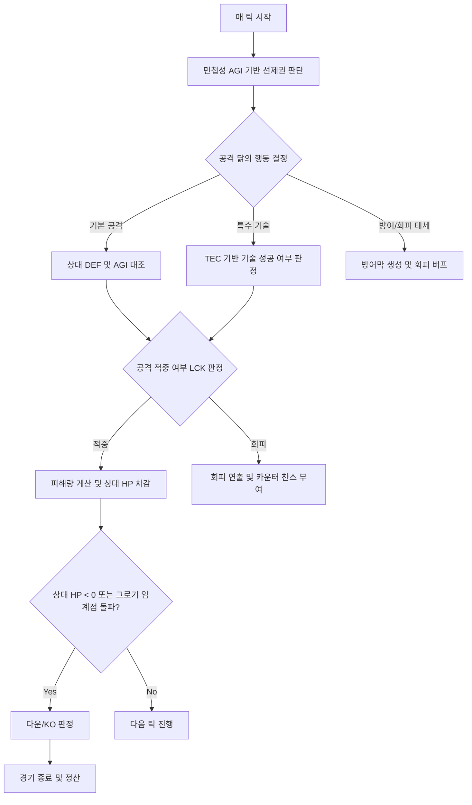
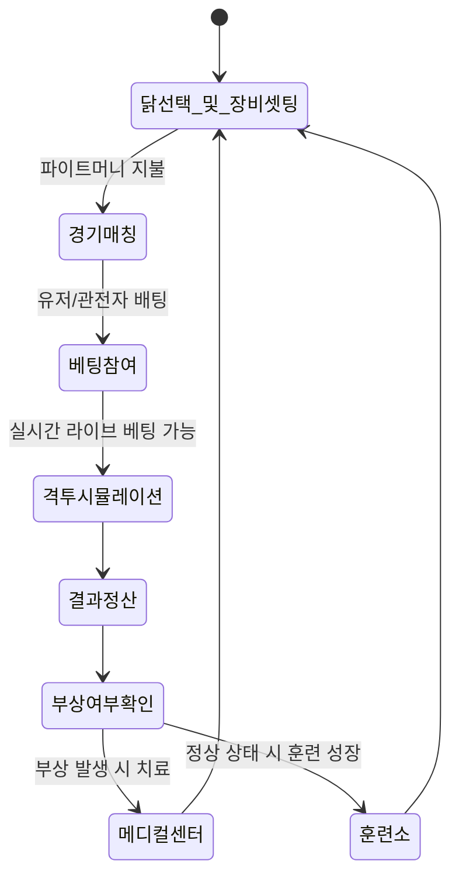

# 🐓 럼블 핏 기획 방향 초안

---

## 목차
- [[#1. 게임 개요]]
- [[#2. 게임 핵심 컨셉 및 차별점]]
- [[#3. 격투 핵심 룰 및 매치 모드]]
  - [[#■ 기본 경기 진행 방식]]
  - [[#■ 주요 매치 모드]]
- [[#4. 격투 능력치 구조]]
  - [[#4.1 기본 능력치 (1차 스탯)]]
  - [[#4.2 격투 능력치 (2차 스탯_격투)]]
  - [[#4.3 알파 선수 30종 기본 데이터 세트]]
- [[#5. 격투 스타일]]
- [[#6. 컨디션 규칙]]
- [[#7. 다변화된 베팅 & 배당 시스템]]
- [[#8. 격투 시뮬레이션 알고리즘 개요]]
  - [[#■ 핵심 공식 예시]]
- [[#9. 훈련 및 부상 치료 시스템 (육성 요소)]]
- [[#10. 핵심 루프]]
- [[#11. 비주얼 및 연출 방향성 (중요)]]
- [[#부록: 더비 레이스 경주 능력치 산출 공식 및 호환 규칙]]
  - [[#A.1 더비 레이스 경주 능력치 산출식]]
  - [[#A.2 더비 레이스 주행 스타일별 편향값 테이블]]
  - [[#A.3 경주 능력치 (2차 스탯_경주) 데이터]]

---

---

## 1. 게임 개요
| 항목 | 내용 |
| :---: | :--- |
| **게임 장르** | 실시간 닭싸움(격투) 시뮬레이션 + 실시간 라이브 베팅 게임 |
| **주요 콘텐츠** | 1대1 싱글 매치, 다자간 서바이벌(배틀로얄), 실시간 변동 배당 베팅, 격투형 닭 육성/훈련, 커스텀 장비 및 스킨 |
| **핵심 기능** | 격투 알고리즘 기반 자동 대전 + 경기 진행 상황에 따른 실시간 배당률 변동 + 라이브 인플레이(In-Play) 베팅 + 시드 기반 공정성 난수 시스템 |
| **플랫폼** | 모바일 앱 + 웹 브라우저 (크로스 플랫폼 지원) |
| **타겟층** | 성인 (스포츠 베팅 및 시뮬레이션 게임 선호층) |
| **BM (수익모델)** | 배팅 하우스 엣지(수수료), 파이트 클럽 참가비(입장료) 수수료, 무기/장비 아이템 판매, 치료 및 훈련 부스터 가속권, 프리미엄 구독권 |

---

## 2. 게임 핵심 컨셉 및 차별점
"루스터 럼블 (더비 레이스)"이 트랙을 달리는 **'경주(Racing)'** 중심이었다면, **"럼블 핏 (Rumble Pit)"**은 링 안에서 펼쳐지는 치열한 **'격투(Fighting)'**에 초점을 맞춥니다.
* **정적인 베팅에서 동적인 베팅으로**: 단방향 경주와 달리 격투는 라운드마다 전세가 역전될 수 있으므로, 경기 도중 베팅이 가능한 **'라이브 인플레이 베팅'**을 핵심으로 삼습니다.
* **부상과 회복의 리스크 관리**: 격투 결과에 따라 닭이 부상을 입거나 요양이 필요해짐으로써, 단순한 무한 성장이 아닌 **유저의 자산 관리(Risk & Reward)** 재미를 제공합니다.
* **시각적 연출의 극대화**: 부리 타격, 발차기, 회피, 반격, 피니시 블로우 등 역동적인 격투 애니메이션을 통해 경주보다 높은 시각적 몰입감을 제공합니다.

---

## 3. 격투 핵심 룰 및 매치 모드
### ■ 기본 경기 진행 방식
1. **대기실 (Pre-Match)**: 대전이 매칭되면 두 닭의 프로필, 격투 능력치, 최근 전적, 장비, 컨디션이 공개됩니다. 배당률이 초기 고정 산출됩니다.
2. **사전 베팅 (Pre-Betting)**: 유저들은 승/패, 라운드 수, KO 여부 등에 사전 베팅을 진행합니다.
3. **격투 진행 (Fight)**: 두 닭이 링 중앙에서 자동으로 격투 시뮬레이션을 수행합니다. (3라운드 2선승제 혹은 단판 데스매치)
4. **실시간 베팅 (In-Play Betting)**: 체력 게이지 변화, 다운 횟수 등에 따라 배당률이 실시간으로 요동치며, 유저는 경기 도중에도 추가 베팅을 할 수 있습니다.
5. **결과 정산**: 경기 종료(KO, TKO, 판정승) 후 승자 배당을 지급하고 수수료를 차감합니다.

### ■ 주요 매치 모드
* **싱글 파이트 (1vs1 Standard)**: 가장 대중적인 1대1 매치. 전통적인 격투 스포츠 룰을 따릅니다.
* **럼블 아레나 (4~6마리 배틀로얄)**: 사각 링에서 여러 마리의 닭이 동시에 난전을 펼치며, 최종 생존 1마리를 가리는 고배당 모드입니다.
* **지하 파이트 클럽 (Underground Tournament)**: 장비를 자유롭게 장착하고 부상 위험도가 높은 대신, 막대한 상금(파이트 머니)이 걸린 프로페셔널 리그입니다.

---

## 4. 격투 능력치 구조
닭의 육성은 육성 모드의 **기본 능력치 (1차 스탯)**에 포인트를 분배하는 방식으로 진행되며, 실제 인게임 격투 공식에는 이들이 조합된 6가지 **격투 능력치 (2차 스탯_격투)**가 산출되어 반영됩니다.

### 4.1 기본 능력치 (1차 스탯)
| 기본 능력치 (1차 스탯) | 성장 유형 | 격투적 해석 및 역할 |
| :---: | :---: | :--- |
| **힘 (Strength - STR)** | 고정+성장 | 타격 대미지(POW), 물리 방어력(DEF)에 직접 영향 |
| **민첩 (Dexterity - DEX)** | 고정+성장 | 회피 기동 속도, 공격 반응 속도, 정확도 |
| **활력 (Vitality - VIT)** | 고정 | 타고난 육체적 맷집, 뼈와 가죽의 밀도 |
| **정신력 (Mentality - MEN)** | 가변+성장 | 위기 대처 멘탈, 침착함, 상대의 심리적 기세 압박 |
| **행운 (Luck - LCK)** | 가변 | 예측 불가한 변수 창출 및 치명적 위기 탈출력 |
| **잠재력 (Potential - POT)** | 고정 | 선수의 선천적 종합 피지컬 깊이 및 미세 오차 보정 기여 |

* **스탯 성장 규칙**:
  - 기본 능력치 (1차 스탯)는 육성 모드에서 캐릭터 육성 과정에서 성장시킬 수 있습니다.
  - 기본 능력치 (1차 스탯) 성장에 관한 세부 사항은 육성 모드 기획 작업 시에 추가 예정입니다.

### 4.2 격투 능력치 (2차 스탯_격투)
기본 능력치 (1차 스탯)를 결합하여 결정되며, 격투 스타일별 고유 보정치를 가산하여 시뮬레이션 내부 연산에 실질적인 파라미터로 사용됩니다.
* **공격력 (Power - POW)** = `(STR * 0.6 + DEX * 0.2 + POT * 0.2) + POW_Style_Bias`
  - **공격력** = `(힘 * 0.6 + 민첩 * 0.2 + 잠재력 * 0.2) + 공격력 스타일 보정`
* **방어력 (Defense - DEF)** = `(DEX * 0.5 + STR * 0.3 + POT * 0.2) + DEF_Style_Bias`
  - **방어력** = `(민첩 * 0.5 + 힘 * 0.3 + 잠재력 * 0.2) + 방어력 스타일 보정`
* **최대 체력 (Max HP)** = `(VIT * 10 + STR * 2 + POT * 2) + HP_Style_Bias`
  - **최대 체력** = `(활력 * 10 + 힘 * 2 + 잠재력 * 2) + 체력 스타일 보정`
* **회복력 (Recovery - REC)** = `(VIT * 0.5 + MEN * 0.3 + POT * 0.2) + REC_Style_Bias`
  - **회복력** = `(활력 * 0.5 + 정신력 * 0.3 + 잠재력 * 0.2) + 회복력 스타일 보정`
* **기술력 (Technique - TEC)** = `(DEX * 0.4 + MEN * 0.3 + POT * 0.3) + TEC_Style_Bias`
  - **기술력** = `(민첩 * 0.4 + 정신력 * 0.3 + 잠재력 * 0.3) + 기술력 스타일 보정`
* **근성 (Grit - GRT)** = `(MEN * 0.6 + VIT * 0.2 + POT * 0.2) + GRT_Style_Bias`
  - **근성** = `(정신력 * 0.6 + 활력 * 0.2 + 잠재력 * 0.2) + 근성 스타일 보정`

#### 4.2.1 격투 스타일별 보정값 테이블
| 격투 스타일 | 공격력 (POW_Style_Bias) | 방어력 (DEF_Style_Bias) | 최대 HP (HP_Style_Bias) | 회복력 (REC_Style_Bias) | 기술력 (TEC_Style_Bias) | 근성 (GRT_Style_Bias) |
| :---: | :---: | :---: | :---: | :---: | :---: | :---: |
| **인파이터** | +5 | -4 | +0 | +0 | +0 | +0 |
| **아웃파이터** | -3 | +0 | +0 | +3 | +3 | +0 |
| **브롤러** | +8 | +5 | +0 | +0 | -3 | +0 |
| **테크니션** | +0 | -3 | +0 | +0 | +8 | +0 |
| **밸런서** | +0 | +0 | +0 | +0 | +0 | +0 |

---

### 4.3 알파 선수 30종 기본 데이터 세트
더비 레이스의 기존 30종 알파 캐릭터와 스탯 구성을 완전히 동일하게 유지하면서, 역산된 기본 능력치 (1차 스탯)(Attributes)와 이를 공식에 대입해 산출한 격투 능력치 (2차 스탯_격투)(Derived Stats) 데이터를 각각 독립된 테이블로 분리하여 구성합니다.

#### 4.3.1 알파 선수 기본 능력치 (1차 스탯) 데이터 세트
| ID | 선수 이름 | 레이스 스타일 | 격투 스타일 | 힘 (STR) | 민첩 (DEX) | 활력 (VIT) | 정신력 (MEN) | 행운 (LCK) | 잠재력 (POT) | 합계 |
| :-: | :--- | :---: | :---: | :-: | :-: | :-: | :-: | :-: | :-: | :-: |
| 1 | 블레이징 윙 (Blazing Wing) | 도주 | 아웃파이터 | 56 | 77 | 54 | 43 | 68 | 37 | 335 |
| 2 | 썬더 스트라이크 (Thunder Strike) | 도주 | 아웃파이터 | 55 | 83 | 47 | 45 | 75 | 30 | 335 |
| 3 | 래피드 로드 (Rapid Road) | 도주 | 아웃파이터 | 35 | 68 | 63 | 42 | 83 | 44 | 335 |
| 4 | 윈드 러너 (Wind Runner) | 도주 | 아웃파이터 | 62 | 80 | 53 | 48 | 43 | 30 | 316 |
| 5 | 페더 대시 (Feather Dash) | 도주 | 아웃파이터 | 75 | 91 | 44 | 47 | 29 | 30 | 316 |
| 6 | 나이트 호크 (Night Hawk) | 추입 | 브롤러 | 84 | 52 | 81 | 70 | 0 | 30 | 317 |
| 7 | 섀도우 페더 (Shadow Feather) | 추입 | 브롤러 | 71 | 41 | 74 | 50 | 58 | 30 | 324 |
| 8 | 사일런트 킬러 (Silent Killer) | 추입 | 브롤러 | 80 | 37 | 66 | 58 | 48 | 30 | 319 |
| 9 | 아이언 힐 (Iron Heel) | 추입 | 브롤러 | 64 | 55 | 80 | 50 | 36 | 30 | 315 |
| 10 | 라스트 스퍼터 (Last Spurter) | 추입 | 브롤러 | 79 | 52 | 72 | 63 | 19 | 30 | 315 |
| 11 | 레드 불릿 (Red Bullet) | 선행 | 인파이터 | 64 | 73 | 59 | 46 | 48 | 30 | 320 |
| 12 | 스피디 피닉스 (Speedy Phoenix) | 선행 | 인파이터 | 59 | 75 | 54 | 51 | 46 | 30 | 315 |
| 13 | 에어로 대시 (Aero Dash) | 선행 | 인파이터 | 74 | 65 | 56 | 48 | 63 | 30 | 336 |
| 14 | 골든 크레스트 (Golden Crest) | 선행 | 인파이터 | 52 | 82 | 57 | 48 | 48 | 30 | 317 |
| 15 | 스프린트 마스터 (Sprint Master) | 선행 | 인파이터 | 67 | 83 | 60 | 52 | 23 | 30 | 315 |
| 16 | 아이언 Cluck (Iron Cluck) | 자재 | 밸런서 | 61 | 63 | 71 | 50 | 43 | 30 | 318 |
| 17 | 골리앗 (Goliath) | 자재 | 밸런서 | 56 | 54 | 72 | 46 | 58 | 30 | 316 |
| 18 | 엔듀어런스 (Endurance) | 자재 | 밸런서 | 64 | 67 | 65 | 52 | 37 | 30 | 315 |
| 19 | 스톤 벽 (Stone Wall) | 자재 | 밸런서 | 56 | 52 | 77 | 44 | 57 | 30 | 316 |
| 20 | 마라토너 (Marathoner) | 자재 | 밸런서 | 61 | 66 | 66 | 51 | 41 | 30 | 315 |
| 21 | 서니 Cluck (Sunny Cluck) | 선입 | 밸런서 | 74 | 74 | 67 | 47 | 23 | 30 | 315 |
| 22 | 이븐 킬 (Even Keel) | 선입 | 밸런서 | 65 | 74 | 66 | 47 | 34 | 30 | 316 |
| 23 | 블루 리본 (Blue Ribbon) | 선입 | 밸런서 | 72 | 70 | 63 | 52 | 29 | 30 | 316 |
| 24 | 스태빌리티 (Stability) | 선입 | 밸런서 | 64 | 72 | 72 | 49 | 28 | 30 | 315 |
| 25 | 퍼펙트 밸런스 (Perfect Balance) | 선입 | 밸런서 | 67 | 75 | 63 | 52 | 29 | 30 | 316 |
| 26 | 매드 루스터 (Mad Rooster) | 변칙 | 테크니션 | 71 | 57 | 49 | 59 | 63 | 30 | 329 |
| 27 | 와일드 카드 (Wild Card) | 변칙 | 테크니션 | 40 | 61 | 64 | 51 | 78 | 30 | 324 |
| 28 | 러시안 룰렛 (Russian Roulette) | 변칙 | 테크니션 | 82 | 49 | 41 | 54 | 77 | 32 | 335 |
| 29 | 카오스 (Chaos) | 변칙 | 테크니션 | 38 | 69 | 68 | 42 | 89 | 30 | 336 |
| 30 | 더스트 스퍼 (Dust Spur) | 변칙 | 테크니션 | 34 | 57 | 59 | 55 | 87 | 46 | 338 |

#### 4.3.2 알파 선수 격투 능력치 (2차 스탯_격투) 데이터 세트
| ID | 선수 이름 | 격투 스타일 | 공격력 (POW) | 방어력 (DEF) | 최대 체력 (Max HP) | 회복력 (REC) | 기술력 (TEC) | 근성 (GRT) |
| :-: | :--- | :---: | :-: | :-: | :-: | :-: | :-: | :-: |
| 1 | 블레이징 윙 (Blazing Wing) | 아웃파이터 | 53 | 63 | 726 | 50 | 58 | 44 |
| 2 | 썬더 스트라이크 (Thunder Strike) | 아웃파이터 | 53 | 64 | 640 | 46 | 59 | 42 |
| 3 | 래피드 로드 (Rapid Road) | 아웃파이터 | 40 | 53 | 788 | 56 | 56 | 47 |
| 4 | 윈드 러너 (Wind Runner) | 아웃파이터 | 56 | 65 | 714 | 50 | 58 | 45 |
| 5 | 페더 대시 (Feather Dash) | 아웃파이터 | 66 | 74 | 650 | 45 | 63 | 43 |
| 6 | 나이트 호크 (Night Hawk) | 브롤러 | 75 | 62 | 1038 | 68 | 48 | 64 |
| 7 | 섀도우 페더 (Shadow Feather) | 브롤러 | 65 | 53 | 942 | 58 | 37 | 51 |
| 8 | 사일런트 킬러 (Silent Killer) | 브롤러 | 69 | 53 | 880 | 56 | 38 | 54 |
| 9 | 아이언 힐 (Iron Heel) | 브롤러 | 63 | 58 | 988 | 61 | 43 | 52 |
| 10 | 라스트 스퍼터 (Last Spurter) | 브롤러 | 72 | 61 | 938 | 61 | 46 | 58 |
| 11 | 레드 불릿 (Red Bullet) | 인파이터 | 64 | 58 | 778 | 49 | 52 | 45 |
| 12 | 스피디 피닉스 (Speedy Phoenix) | 인파이터 | 61 | 57 | 718 | 48 | 54 | 47 |
| 13 | 에어로 대시 (Aero Dash) | 인파이터 | 68 | 57 | 768 | 48 | 49 | 46 |
| 14 | 골든 크레스트 (Golden Crest) | 인파이터 | 59 | 59 | 734 | 49 | 56 | 46 |
| 15 | 스프린트 마스터 (Sprint Master) | 인파이터 | 68 | 64 | 794 | 52 | 58 | 49 |
| 16 | 아이언 Cluck (Iron Cluck) | 밸런서 | 55 | 56 | 892 | 56 | 49 | 50 |
| 17 | 골리앗 (Goliath) | 밸런서 | 50 | 50 | 892 | 56 | 44 | 48 |
| 18 | 엔듀어런스 (Endurance) | 밸런서 | 58 | 59 | 838 | 54 | 51 | 50 |
| 19 | 스톤 벽 (Stone Wall) | 밸런서 | 50 | 49 | 942 | 58 | 43 | 48 |
| 20 | 마라토너 (Marathoner) | 밸런서 | 56 | 57 | 842 | 54 | 51 | 50 |
| 21 | 서니 Cluck (Sunny Cluck) | 밸런서 | 65 | 65 | 878 | 54 | 53 | 48 |
| 22 | 이븐 킬 (Even Keel) | 밸런서 | 60 | 62 | 850 | 53 | 53 | 47 |
| 23 | 블루 리본 (Blue Ribbon) | 밸런서 | 63 | 63 | 834 | 53 | 53 | 50 |
| 24 | 스태빌리티 (Stability) | 밸런서 | 59 | 61 | 908 | 57 | 52 | 50 |
| 25 | 퍼펙트 밸런스 (Perfect Balance) | 밸런서 | 61 | 64 | 824 | 53 | 55 | 50 |
| 26 | 매드 루스터 (Mad Rooster) | 테크니션 | 60 | 53 | 692 | 48 | 58 | 51 |
| 27 | 와일드 카드 (Wild Card) | 테크니션 | 42 | 45 | 780 | 53 | 57 | 49 |
| 28 | 러시안 룰렛 (Russian Roulette) | 테크니션 | 65 | 52 | 638 | 43 | 53 | 47 |
| 29 | 카오스 (Chaos) | 테크니션 | 43 | 49 | 816 | 53 | 57 | 45 |
| 30 | 더스트 스퍼 (Dust Spur) | 테크니션 | 41 | 45 | 750 | 55 | 61 | 54 |

---

## 5. 전투 스타일
각 닭은 태어날 때 결정되거나 훈련을 통해 선택할 수 있는 **고유한 전투 스타일**을 가집니다. 전투 스타일은 격투 능력치 (2차 스탯_격투) 산출 시 고유 보정치(Style_Bias)로 합산 적용되며, 시뮬레이션 중 행동 패턴(RNG 행동 가중치)에도 영향을 미칩니다.

| 스타일 | 특징 | 2차 격투 스탯 보정 (Style_Bias) | 시뮬레이션 내 특수 효과 |
| :---: | :--- | :---: | :--- |
| **인파이터 (Infighter)** | 근접 연타와 압박형 개싸움 | POW +5, DEF -4 | 근접 타격 시 2연타(더블 히트) 확률 +15% |
| **아웃파이터 (Outfighter)** | 거리 조절과 회피 및 카운터 | POW -3, REC +3, TEC +3 | 회피(Evasion) 성공 시 즉시 카운터 공격(피해량 1.5배) 발동 확률 +20% |
| **브롤러/슬러거 (Brawler)** | 강철 맷집과 한 방 역전주의 | POW +8, DEF +5, TEC -3 | 치명타 적중 시 적을 그로기(Groggy) 상태로 만들 확률 +25% |
| **테크니션 (Technician)** | 정교한 급소 타격 및 급소 공략 | TEC +8, DEF -3 | 상대의 방어력(DEF)을 30% 무시하는 방어 관통 공격 발동 |
| **밸런서 (Balanced)** | 공수 균형이 잡힌 육각형 타입 | 보정 없음 | 무상성, 경기 후반에도 일정한 효율 유지 |

*주: 스타일 보정(Style_Bias) 수치는 '4.2 격투 능력치 (2차 스탯_격투)'의 연산식에 직접 상수로 반영되어 최종 격투 능력치를 결정합니다.*

---

## 6. 컨디션 보정 규칙
컨디션은 격투 경기마다 무작위 또는 관리 상태에 따라 일시적으로 변동하는 수치입니다. 더비 레이스와 **동일한 5단계 컨디션 구성**을 취하되, 적용 값은 격투(Rumble Pit) 전용 스탯 보정으로 작동합니다.

| 컨디션 | 보정값 (Rumble Pit 전용) | 표시 | 격투 시 미치는 실질적 영향 |
| :---: | :---: | :---: | :--- |
| **Excellent** | 주요 전투 스탯 2개 +4, 랜덤 스탯 1개 +2 | 매우 좋음 | POW, AGI, TEC 중 2개 대폭 상승, 전반적인 화력과 속도 극대화 |
| **Good** | 주요 전투 스탯 1개 +3 | 좋음 | 전투력(POW 또는 AGI) 상승으로 우세한 고점 확보 |
| **Normal** | 보정 없음 | 보통 | 기본 능력치 그대로 전투 수행 |
| **Shaky** | 주요 전투 스탯 1개 -3, GRT(투지) -5 | 불안정 | 맷집 및 회피 저하, 체력 저하 시 쉽게 기권하거나 실수를 연발함 |
| **Tired** | VIT(체력) -5, REC(회복력) -3 | 피곤함 | 최대 HP가 감소된 상태로 시작하며, 라운드 간 체력 회복량이 저하됨 |

*컨디션 정보는 베팅 시작 전 플레이어에게 투명하게 공개되어 핵심 배팅 지표로 활용됩니다.*

---

## 7. 다변화된 베팅 & 배당 시스템
1대1 격투에 최적화된 스포츠 토토 형식의 다양한 배팅 라인업을 제공합니다.

* **머니라인 (Moneyline - 승무패)**: 가장 직관적인 승리 닭 예측 (무승부는 판정 무승부 시 적용).
* **라운드 언더/오버 (Round Under/Over)**: 경기가 빠르게 끝날 것인지(KO), 판정까지 갈 것인지 시간 예측.
* **메소드 오브 빅토리 (Method of Victory)**: KO(넉아웃), TKO(부상 기권), Decision(판정승) 등 구체적인 승리 방식 예측.
* **퍼스트 피(First Blood/Down)**: 첫 번째로 다운을 빼앗거나 먼저 타격을 성공시키는 닭을 예측하는 퀵 베팅.
* **실시간 배당 변동 공식**:
  `Odds_Live = (1 / Probability_Live) * (1 - Commission)`
  *경기 상황(체력 격차, 부상 여부)에 따라 실시간 기대 승률(Probability)이 매초 재계산되며 배당판에 반영됩니다.*

---

## 8. 격투 시뮬레이션 알고리즘 개요
격투는 매 **틱(Tick, 0.1초 단위)**마다 두 닭의 행동 결정을 시뮬레이션합니다.

### ■ 핵심 공식 예시
1. **기본 타격 적중률 (Hit Chance)**:
   `Hit Chance = 75% + (AGI_Attacker - AGI_Defender) * 0.5% + (LCK_Attacker - LCK_Defender) * 0.2%`
2. **실제 입히는 피해량 (Damage)**:
   `Damage = POW * (1 - DEF / (DEF + 100)) * RandomModifier(0.9 ~ 1.1)`
3. **그로기(Groggy) 확률**:
   *단일 타격 피해가 상대 최대 HP의 25%를 초과할 경우, VIT 수치에 반비례하여 그로기 상태(3초간 AGI 50% 페널티)에 빠짐.*

---

## 9. 훈련 및 부상 치료 시스템 (육성 요소)
전투용 닭은 격렬한 소모성 자산입니다. 전투력 유지와 관리가 핵심 플레이 루프입니다.

* **훈련 시스템**:
  * **샌드백 타격 (POW +0.2)**: 펀치력 강화.
  * **러닝머신 런 (AGI +0.2)**: 반사 신경 및 풋워크 강화.
  * **전술 비디오 시청 (TEC +0.2)**: AI 기술 숙련도 증가.
* **장비 커스터마이징 (Spurs & Protectors)**:
  * **금속 스퍼 (Spurs)**: 닭의 뒷발톱에 장착하는 인공 칼날. 공격력(POW)을 대폭 향상시키는 대신, 피격 시 상대 및 본인의 부상 확률이 늘어남.
  * **가슴 방탄 깃털 (Armor)**: 방어력(DEF)을 높여 치명타 데미지를 무마함.
* **부상 (Injury) 메커니즘**:
  * 경기 중 일정 확률로 '날개 골절', '부리 균열', '실명 위험' 등의 부상이 발생합니다.
  * 부상 상태에서는 특정 능력치에 영구 페널티가 부여되며, 치료를 위해 **'요양 치료원(메디컬 센터)'**에 입원시켜 시간과 회복 코인을 소모해야 합니다.

---

## 10. 게임 루프

---

## 11. 비주얼 및 연출 방향성 (중요)
닭싸움이라는 소재의 특성상 **동물 학대 및 잔혹성 논란(심의 이슈)**을 철저히 회피하는 비주얼 컨셉을 잡아야 합니다.
* **사이버 펑크 / 기계 닭 콘셉트**:
  * 닭의 몸체 일부가 사이보그화되어 있거나(로봇 부리, 부스터 윙), 아예 풀 메카닉 닭들이 격돌하는 컨셉을 적용합니다. 이를 통해 잔혹한 생명체 훼손의 느낌을 제거하고 로봇 격투기(예: 리얼 스틸)의 쾌감을 제공합니다.
* **카툰 렌더링 / 캐주얼 연출**:
  * 실사풍의 피 흘리는 묘사는 철저히 배제하고, 먼지 구름이 일어나며 만화적 이펙트(쾅!, 팍!)와 모션 효과를 활용하여 타격감을 살립니다.
* **중계진 및 사운드**:
  * 링 위에서 깃털이 날릴 때마다 관중의 야유와 환호, 캐스터의 격정적인 목소리를 텍스트와 사운드로 연출하여 e스포츠 중계를 보는 듯한 현장감을 줍니다.

---

*본 문서는 럼블 핏 기획의 방향성 초안으로, 추후 격투 시뮬레이션 물리 모델 및 라이브 베팅의 동적 배당 알고리즘에 대한 구체화 작업이 이어질 예정입니다.

---

## 부록: 더비 레이스 경주 능력치 산출 공식 및 호환 규칙
육성 모드의 6대 기본 능력치 (1차 스탯)를 기반으로 경주 능력치 (2차 스탯_경주)를 산출하기 위한 산출 규칙과 데이터 세트 정의입니다.

### A.1 더비 레이스 경주 능력치 산출식
육성 모드의 6대 기본 능력치 (1차 스탯)를 기반으로 경주 능력치 (2차 스탯_경주)를 산출하는 공식 명세입니다. 잠재력(Potential - POT) 스탯이 모든 능력치에 5% 가중치로 기여합니다.

* **경주 능력치 (2차 스탯_경주)** = `((1차 스탯 기본 유도 가중치 합) * 0.95) + (POT * 0.05) + Style_Bias`

* **속도 (Speed - SPD)** = `((STR * 0.5 + DEX * 0.4 + LCK * 0.1) * 0.95) + POT * 0.05 + SPD_Style_Bias`
  - **속도** = `((힘 * 0.5 + 민첩 * 0.4 + 행운 * 0.1) * 0.95) + 잠재력 * 0.05 + 속도 스타일 보정`
* **출발 (Start - SRT)** = `((DEX * 0.7 + MEN * 0.2 + LCK * 0.1) * 0.95) + POT * 0.05 + SRT_Style_Bias`
  - **출발** = `((민첩 * 0.7 + 정신력 * 0.2 + 행운 * 0.1) * 0.95) + 잠재력 * 0.05 + 출발 스타일 보정`
* **지구력 (Stamina - STA)** = `((VIT * 0.8 + STR * 0.2) * 0.95) + POT * 0.05 + STA_Style_Bias`
  - **지구력** = `((활력 * 0.8 + 힘 * 0.2) * 0.95) + 잠재력 * 0.05 + 지구력 스타일 보정`
* **집중 (Focus - FCS)** = `((MEN * 0.7 + DEX * 0.3) * 0.95) + POT * 0.05 + FCS_Style_Bias`
  - **집중** = `((정신력 * 0.7 + 민첩 * 0.3) * 0.95) + 잠재력 * 0.05 + 집중 스타일 보정`
* **기질 (Temper - TEM)** = `((MEN * 0.8 + LCK * 0.2) * 0.95) + POT * 0.05 + TEM_Style_Bias`
  - **기질** = `((정신력 * 0.8 + 행운 * 0.2) * 0.95) + 잠재력 * 0.05 + 기질 스타일 보정`
* **근성 (Guts - GTS)** = `((VIT * 0.5 + MEN * 0.5) * 0.95) + POT * 0.05 + GTS_Style_Bias`
  - **근성** = `((활력 * 0.5 + 정신력 * 0.5) * 0.95) + 잠재력 * 0.05 + 근성 스타일 보정`

### A.2 더비 레이스 주행 스타일별 편향값 테이블
| 주행 스타일 | 속도(SPD) | 출발(SRT) | 지구력(STA) | 집중(FCS) | 기질(TEM) | 근성(GTS) |
| :---: | :---: | :---: | :---: | :---: | :---: | :---: |
| **도주** | +15 | +20 | +0 | +0 | +0 | +0 |
| **추입** | +0 | +0 | +15 | +0 | +10 | +25 |
| **선행** | +5 | +10 | +0 | +0 | +0 | +15 |
| **자재** | +0 | +0 | +25 | +10 | +0 | +0 |
| **선입** | +5 | +0 | +10 | +15 | +0 | +10 |
| **변칙** | +10 | +0 | +0 | +0 | +35 | +10 |

### A.3 경주 능력치 (2차 스탯_경주) 데이터
잠재력(POT) 5% 기여 공식이 적용된 30종 선수의 경주 능력치 (2차 스탯_경주) 데이터 세트입니다.

| ID | 선수 이름 | 주행 스타일 | 속도 (SPD) | 출발 (SRT) | 지구력 (STA) | 집중 (FCS) | 기질 (TEM) | 근성 (GTS) |
| :-: | :--- | :---: | :-: | :-: | :-: | :-: | :-: | :-: |
| 1 | 블레이징 윙 (Blazing Wing) | 도주 | 79 | 88 | 54 | 52 | 47 | 48 |
| 2 | 썬더 스트라이크 (Thunder Strike) | 도주 | 81 | 92 | 48 | 55 | 50 | 45 |
| 3 | 래피드 로드 (Rapid Road) | 도주 | 68 | 83 | 57 | 50 | 50 | 52 |
| 4 | 윈드 러너 (Wind Runner) | 도주 | 80 | 88 | 54 | 56 | 46 | 49 |
| 5 | 페더 대시 (Feather Dash) | 도주 | 89 | 94 | 49 | 59 | 43 | 45 |
| 6 | 나이트 호크 (Night Hawk) | 추입 | 61 | 49 | 94 | 63 | 65 | 98 |
| 7 | 섀도우 페더 (Shadow Feather) | 추입 | 56 | 44 | 86 | 46 | 61 | 85 |
| 8 | 사일런트 킬러 (Silent Killer) | 추입 | 58 | 42 | 82 | 51 | 65 | 85 |
| 9 | 아이언 힐 (Iron Heel) | 추입 | 56 | 51 | 89 | 50 | 56 | 88 |
| 10 | 라스트 스퍼터 (Last Spurter) | 추입 | 61 | 50 | 86 | 58 | 63 | 91 |
| 11 | 레드 불릿 (Red Bullet) | 선행 | 69 | 73 | 58 | 53 | 46 | 66 |
| 12 | 스피디 피닉스 (Speedy Phoenix) | 선행 | 67 | 75 | 54 | 57 | 49 | 66 |
| 13 | 에어로 대시 (Aero Dash) | 선행 | 72 | 70 | 58 | 52 | 50 | 66 |
| 14 | 골든 크레스트 (Golden Crest) | 선행 | 67 | 80 | 55 | 57 | 47 | 66 |
| 15 | 스프린트 마스터 (Sprint Master) | 선행 | 72 | 79 | 60 | 60 | 45 | 70 |
| 16 | 아이언 Cluck (Iron Cluck) | 자재 | 58 | 57 | 92 | 63 | 48 | 59 |
| 17 | 골리앗 (Goliath) | 자재 | 54 | 52 | 92 | 57 | 47 | 58 |
| 18 | 엔듀어런스 (Endurance) | 자재 | 61 | 59 | 88 | 65 | 48 | 57 |
| 19 | 스톤 벽 (Stone Wall) | 자재 | 53 | 50 | 96 | 56 | 46 | 59 |
| 20 | 마라토너 (Marathoner) | 자재 | 59 | 59 | 88 | 64 | 48 | 57 |
| 21 | 서니 Cluck (Sunny Cluck) | 선입 | 72 | 62 | 76 | 69 | 42 | 66 |
| 22 | 이븐 킬 (Even Keel) | 선입 | 69 | 63 | 74 | 69 | 44 | 65 |
| 23 | 블루 리본 (Blue Ribbon) | 선입 | 70 | 61 | 73 | 71 | 47 | 66 |
| 24 | 스태빌리티 (Stability) | 선입 | 67 | 61 | 78 | 70 | 44 | 69 |
| 25 | 퍼펙트 밸런스 (Perfect Balance) | 선입 | 70 | 64 | 72 | 72 | 47 | 66 |
| 26 | 매드 루스터 (Mad Rooster) | 변칙 | 73 | 57 | 52 | 57 | 93 | 63 |
| 27 | 와일드 카드 (Wild Card) | 변칙 | 61 | 59 | 58 | 53 | 90 | 66 |
| 28 | 러시안 룰렛 (Russian Roulette) | 변칙 | 76 | 52 | 48 | 51 | 92 | 57 |
| 29 | 카오스 (Chaos) | 변칙 | 64 | 64 | 60 | 49 | 85 | 64 |
| 30 | 더스트 스퍼 (Dust Spur) | 변칙 | 58 | 59 | 54 | 55 | 96 | 66 |

#### [참고용] 기존 더비 레이스 2차 스탯 대비 변동 비교표
| ID | 선수 이름 | 주행 스타일 | 속도 (SPD) | 출발 (SRT) | 지구력 (STA) | 집중 (FCS) | 기질 (TEM) | 근성 (GTS) |
| :-: | :--- | :---: | :-: | :-: | :-: | :-: | :-: | :-: |
| 1 | 블레이징 윙 (Blazing Wing) | 도주 | 79 (+1) | 88 (0) | 54 (0) | 52 (0) | 47 (+2) | 48 (0) |
| 2 | 썬더 스트라이크 (Thunder Strike) | 도주 | 81 (+9) | 92 (0) | 48 (0) | 55 (0) | 50 (0) | 45 (+3) |
| 3 | 래피드 로드 (Rapid Road) | 도주 | 68 (0) | 83 (+1) | 57 (-1) | 50 (0) | 50 (-2) | 52 (+12) |
| 4 | 윈드 러너 (Wind Runner) | 도주 | 80 (+10) | 88 (+10) | 54 (-6) | 56 (-2) | 46 (-2) | 49 (+4) |
| 5 | 페더 대시 (Feather Dash) | 도주 | 89 (+14) | 94 (+9) | 49 (-1) | 59 (-1) | 43 (+5) | 45 (-5) |
| 6 | 나이트 호크 (Night Hawk) | 추입 | 61 (-4) | 49 (+3) | 94 (+18) | 63 (-5) | 65 (+10) | 98 (+8) |
| 7 | 섀도우 페더 (Shadow Feather) | 추입 | 56 (-4) | 44 (+2) | 86 (+14) | 46 (-4) | 61 (+11) | 85 (+3) |
| 8 | 사일런트 킬러 (Silent Killer) | 추입 | 58 (-4) | 42 (+7) | 82 (+12) | 51 (-19) | 65 (+20) | 85 (0) |
| 9 | 아이언 힐 (Iron Heel) | 추입 | 56 (-2) | 51 (+1) | 89 (+9) | 50 (-10) | 56 (+8) | 88 (+10) |
| 10 | 라스트 스퍼터 (Last Spurter) | 추입 | 61 (-2) | 50 (+2) | 86 (+11) | 58 (-8) | 63 (+11) | 91 (+11) |
| 11 | 레드 불릿 (Red Bullet) | 선행 | 69 (+1) | 73 (+1) | 58 (+3) | 53 (+3) | 46 (+4) | 66 (-4) |
| 12 | 스피디 피닉스 (Speedy Phoenix) | 선행 | 67 (+1) | 75 (0) | 54 (+4) | 57 (+5) | 49 (+1) | 66 (-8) |
| 13 | 에어로 대시 (Aero Dash) | 선행 | 72 (0) | 70 (0) | 58 (0) | 52 (+4) | 50 (0) | 66 (-6) |
| 14 | 골든 크레스트 (Golden Crest) | 선행 | 67 (+2) | 80 (+2) | 55 (+3) | 57 (+2) | 47 (+2) | 66 (-5) |
| 15 | 스프린트 마스터 (Sprint Master) | 선행 | 72 (+2) | 79 (+5) | 60 (+4) | 60 (+2) | 45 (+5) | 70 (-5) |
| 16 | 아이언 Cluck (Iron Cluck) | 자재 | 58 (+3) | 57 (-1) | 92 (+4) | 63 (-7) | 48 (-2) | 59 (+11) |
| 17 | 골리앗 (Goliath) | 자재 | 54 (+2) | 52 (+2) | 92 (0) | 57 (-11) | 47 (-1) | 58 (+13) |
| 18 | 엔듀어런스 (Endurance) | 자재 | 61 (+3) | 59 (-3) | 88 (+3) | 65 (-7) | 48 (+3) | 57 (+7) |
| 19 | 스톤 벽 (Stone Wall) | 자재 | 53 (+3) | 50 (+2) | 96 (+1) | 56 (-10) | 46 (-6) | 59 (+19) |
| 20 | 마라토너 (Marathoner) | 자재 | 59 (+3) | 59 (-1) | 88 (+6) | 64 (-11) | 48 (+6) | 57 (+5) |
| 21 | 서니 Cluck (Sunny Cluck) | 선입 | 72 (+4) | 62 (0) | 76 (+4) | 69 (-9) | 42 (+8) | 66 (+6) |
| 22 | 이븐 킬 (Even Keel) | 선입 | 69 (+4) | 63 (-2) | 74 (+6) | 69 (+1) | 44 (+4) | 65 (0) |
| 23 | 블루 리본 (Blue Ribbon) | 선입 | 70 (0) | 61 (+1) | 73 (+8) | 71 (+1) | 47 (+9) | 66 (-2) |
| 24 | 스태빌리티 (Stability) | 선입 | 67 (+5) | 61 (-3) | 78 (+3) | 70 (+5) | 44 (-1) | 69 (+7) |
| 25 | 퍼펙트 밸런스 (Perfect Balance) | 선입 | 70 (+4) | 64 (-2) | 72 (+6) | 72 (+6) | 47 (+5) | 66 (0) |
| 26 | 매드 루스터 (Mad Rooster) | 변칙 | 73 (+1) | 57 (-1) | 52 (+2) | 57 (+9) | 93 (+5) | 63 (-2) |
| 27 | 와일드 카드 (Wild Card) | 변칙 | 61 (+1) | 59 (-9) | 58 (+3) | 53 (+13) | 90 (+10) | 66 (-2) |
| 28 | 러시안 룰렛 (Russian Roulette) | 변칙 | 76 (0) | 52 (0) | 48 (0) | 51 (+16) | 92 (0) | 57 (-15) |
| 29 | 카오스 (Chaos) | 변칙 | 64 (0) | 64 (0) | 60 (+10) | 49 (+7) | 85 (0) | 64 (0) |
| 30 | 더스트 스퍼 (Dust Spur) | 변칙 | 58 (0) | 59 (-1) | 54 (0) | 55 (+10) | 96 (0) | 66 (0) |

