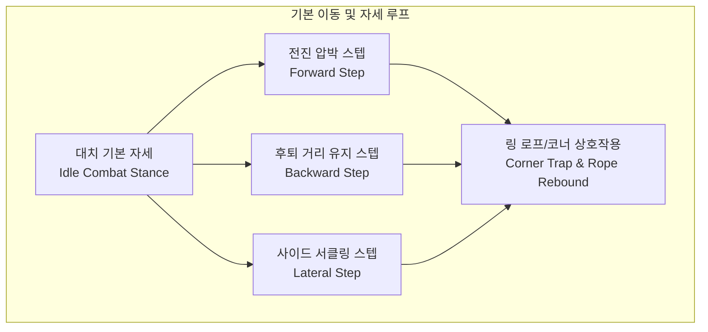
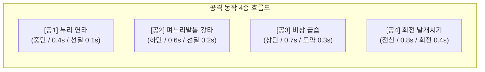
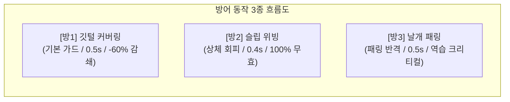
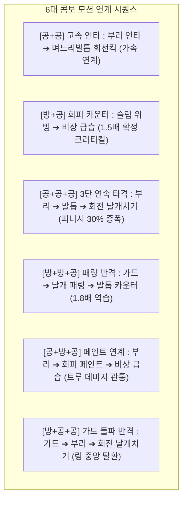
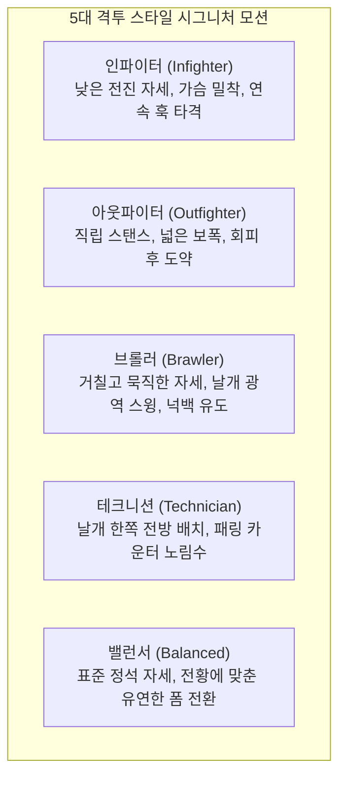

# 🥊 ROOSTER RUMBLE: Rumble Pit 선수 공격/방어 동작 구성안 (Fighter Action & Motion Specification)

* **현재 문서 버전**: `v0.9.8`
* **마지막 개정일**: 2026-09-29
* **문서 정체성**: 럼블 핏(Rumble Pit) MVP 구성안 중 **선수 캐릭터의 공격/방어/회피/피격 동작(애니메이션 모션, 프레임 규격, 히트박스, 콤보 트랜지션, VFX/SFX 연동)**에 특화된 단독 동작 명세서
* **기반 문서**: [Rumble Pit MVP 구성안.md](file:///d:/OneDrive/업무_진행/C/ROOSTER%20RUMBLE/Rumble%20Pit%20MVP%20구성안.md), [Rumble Pit 전투 장면 인게임 구성안.md](file:///d:/OneDrive/업무_진행/C/ROOSTER%20RUMBLE/Rumble%20Pit%20전투%20장면%20인게임%20구성안.md)

---

### ■ 문서 개정 이력 (Revision History)

| 버전 (Version) | 개정일 (Date) | 주요 개정 내역 및 상세 변경 사항 | 관련 절 바로가기 |
| :---: | :---: | :--- | :--- |
| **v0.0.1** | 2026-08-11 | 닭 격투 기본 공방 모션(부리 쪼기, 기본 가드) 및 링 대치 자세 최초 기획 | [[#1.1 대치 기본 자세 및 시선/무게중심 규격\|1.1절 기본 대치 자세]] |
| **v0.2.0** | 2026-08-13 | Hitbox 4종(Head/Leg/Air/Area) 및 공격 부위별 모션 타임라인 규격 수립 | [[#2.1 공1 부리 연타 모션 및 판정 스펙\|2.1절 부리 연타 모션]] |
| **v0.4.0** | 2026-08-27 | Last Stand 투지 버티기 생존 모션 및 링 바닥 다운(Knockdown) 연출 정의 | [[#6.3 투지 버티기(Last Stand) 1 HP 생존 모션\|6.3절 Last Stand 모션]] |
| **v0.7.0** | 2026-08-27 | 동작별 연동 효과음(SFX-Pit 12종) 및 타격/피격 VFX 애니메이션 매핑 | [[#8. 동작별 시각 이펙트(VFX) 및 사운드(SFX) 매핑 매트릭스\|8장 동작 VFX/SFX 매핑]] |
| **v0.9.0** | 2026-09-07 | 7대 전문 기술(공4+방3), 6대 콤보 연계 모션, 실시간 패링 캔슬/가드브레이크 동작 수립 | [[#3.1 방1 깃털 커버링 가드 모션 및 게이지 소모\|3.1절 방어형 기술 모션]] |
| **v0.9.1** | 2026-09-28 | **[단독 분리 발췌]** 럼블핏 MVP 구성안에서 선수 공격/방어 동작 사양 전면 추출 및 독립 동작 명세서화 | [[#2. 공격 동작(Offensive Motions) 4종 상세 명세\|2장 공격 동작 4종 명세]] |
| **v0.9.2** | 2026-09-29 | **[SFX 12종 실사 MP3 에셋 제작]** 8장 매핑 SFX-Pit 12종 실사 녹음 음원 기반 MP3 에셋 구축 및 사운드보드 연동 | [[#8.2 SFX-Pit 14종 오디오 파일 목록 및 청음\|8.2절 SFX 오디오 파일 목록]] |
| **v0.9.3** | 2026-09-29 | **[라운드 시작 연출 개편]** 권투/격투 아나운서 보이스("Round 1... FIGHT!") + KO 벨 참조 1회 공식 벨소리(DING!) 합성 에셋 완비 | [[#8.1 동작별 시각 이펙트(VFX) 및 사운드(SFX) 매핑 매트릭스\|8.1절 시작 연출]] |
| **v0.9.4** | 2026-09-29 | **[라운드 1~3 보이스 및 긴박감 개편]** 전문 격투 아나운서 하이텐션 샤우팅(Round 1~3, Final Round) 및 한국어 긴박 보이스 전 라운드 에셋 완비 | [[#8. 동작별 시각 이펙트(VFX) 및 사운드(SFX) 매핑 매트릭스\|8장 동작 VFX/SFX 매핑]] |
| **v0.9.5** | 2026-09-29 | **[라운드 시작 보이스 단일화]** 다크 헤비 버전(Dragon Announcer: First/Second/Third Round... FIGHT!) 공식 단독 채택 및 에셋 일원화 | [[#8. 동작별 시각 이펙트(VFX) 및 사운드(SFX) 매핑 매트릭스\|8장 동작 VFX/SFX 매핑]] |
| **v0.9.6** | 2026-09-29 | **[SFX 11종 정예화 및 에셋 정리]** 심판 카운트 큐(SFX_PIT_REFEREE_CNT) 삭제 및 다크 헤비 단독 정규 파일 외 불필요 음원 전량 파기 | [[#8.2 SFX-Pit 14종 오디오 파일 목록 및 청음\|8.2절 SFX 오디오 파일 목록]] |
| **v0.9.7** | 2026-09-29 | **[공방 SFX 고품질화, 다목적 공방음 추가 및 라운드 벨소리 분리]** 공격/방어 SFX 실사 음원 기반 고품질화, 다목적 타격(SFX_PIT_HIT_GEN)/방어(SFX_PIT_GUARD_GEN) 2종 신설, 라운드 보이스 내 벨소리 완전 분리 및 중복 퍼스트 라운드 에셋 영구 삭제 | [[#8.2 SFX-Pit 14종 오디오 파일 목록 및 청음\|8.2절 SFX 오디오 파일 목록]] |
| **v0.9.8** | 2026-09-29 | **[격투 경기 박진감 고품질 오케스트라 BGM 구축]** 인게임 전투 배경음악(BGM_PIT_FIGHT, 150 BPM 시네마틱 액션 배틀 오케스트라 172.58초) 마스터링 에셋 완비 및 pit/bgm/ 경로 배치 | [[#8.2 SFX-Pit 14종 오디오 파일 목록 및 청음\|8.2절 SFX 오디오 파일 목록]] |

---

## 목차
1. [[#1. 선수 기본 자세 및 이동/스텝(Footwork) 동작]]
   - [[#1.1 대치 기본 자세 및 시선/무게중심 규격]]
   - [[#1.2 링 내 풋워크 및 스텝 이동 동작]]
   - [[#1.3 링 코너 몰림 및 로프 반동 모션]]
2. [[#2. 공격 동작(Offensive Motions) 4종 상세 명세]]
   - [[#2.1 공1 부리 연타 모션 및 판정 스펙]]
   - [[#2.2 공2 며느리발톱 강타 모션 및 판정 스펙]]
   - [[#2.3 공3 비상 급습 모션 및 판정 스펙]]
   - [[#2.4 공4 회전 날개치기 모션 및 판정 스펙]]
3. [[#3. 방어 및 회피/반격 동작(Defensive Motions) 3종 상세 명세]]
   - [[#3.1 방1 깃털 커버링 가드 모션 및 게이지 소모]]
   - [[#3.2 방2 슬립 위빙 상체 회피 모션 및 판정]]
   - [[#3.3 방3 날개 패링 쳐내기 및 반격 모션]]
4. [[#4. 3연속기(Combo Chain) 6대 조합별 모션 연계 흐름]]
   - [[#4.1 공+공 고속 연타 모션 블렌딩 및 2타 가속]]
   - [[#4.2 방+공 회피 카운터 위빙 후 즉시 급습 역습]]
   - [[#4.3 공+공+공 3단 연속 타격 완주 모션]]
   - [[#4.4 방+방+공 패링 반격 1.8배 피니시 역습 모션]]
   - [[#4.5 공+방+공 페인트 연계 트루 데미지 관통 모션]]
   - [[#4.6 방+공+공 가드 돌파 반격 링 중앙 탈환 모션]]
5. [[#5. 격돌(Clash), 캔슬(Cancel) 및 특수 상태 모션]]
   - [[#5.1 상호 동시 타격(Mutual Clash) 및 크로스 카운터 모션]]
   - [[#5.2 콤보 중간 강제 차단(Cancel) 및 피격 경직(Stun) 모션]]
   - [[#5.3 가드 브레이크(Guard Break) 및 무방비 취약(Vulnerable) 모션]]
   - [[#5.4 기력 호흡 정돈(Stamina Breathing) 쿨다운 모션]]
6. [[#6. 피격(Hit Reaction), 다운 및 생존 모션]]
   - [[#6.1 피격 부위별 리액션 모션]]
   - [[#6.2 링 캔버스 다운(Knockdown) 및 기상 모션]]
   - [[#6.3 투지 버티기(Last Stand) 1 HP 생존 모션]]
   - [[#6.4 최종 KO 쓰러짐 및 승리 세리머니 모션]]
7. [[#7. 격투 스타일 5종별 시그니처 자세 및 모션 가중치]]
   - [[#7.1 스타일별 시그니처 자세 및 모션 특징]]
   - [[#7.2 인게임 동작 가중치 및 연속기 구사 성향]]
8. [[#8. 동작별 시각 이펙트(VFX) 및 사운드(SFX) 매핑 매트릭스]]
   - [[#8.1 동작별 시각 이펙트(VFX) 및 사운드(SFX) 매핑 매트릭스]]
   - [[#8.2 SFX-Pit 13종 오디오 파일 목록 및 청음]]

---

## 1. 선수 기본 자세 및 이동/스텝(Footwork) 동작



### 1.1 대치 기본 자세 및 시선/무게중심 규격

* **아이들 자세 명칭**: `IDLE_STANCE`
* **모션 컨셉**: 지하 투계장 링 위에서 상대 선수를 정면 응시하며 상하로 가볍게 리듬을 타는 긴장된 전투 대치 자세.
* **신체 부위별 포즈 가이드**:
  - **머리 및 목**: 목깃을 바짝 세우고 턱을 당겨 두부 급소를 보호하며, 시선은 상대를 고정 추적.
  - **날개(양 날개)**: 양 날개를 몸통 측면에 70% 밀착하여 웅크린 상태 유지 (언제든 방어 가드 또는 공격 시동 전환 가능).
  - **다리 및 꼬리**: 무릎을 살짝 굽혀 무게중심을 낮추고, 며느리발톱을 링 바닥에 단단히 고정. 꼬리깃은 45도 상향 기립하여 균형 유지.
* **호흡 바운스 주기**: 0.8초 주기 상하 미세 바운스 (1초당 약 1.25회 호흡 루프).

---

### 1.2 링 내 풋워크 및 스텝 이동 동작

| 동작 식별자 | 동작 명칭 | 이동 방향 및 속도 | 모션 연출 가이드 | 모션 지속 프레임 | 전환 가능 액션 |
| :--- | :--- | :---: | :--- | :---: | :--- |
| **`STEP_FWD`** | **전진 압박 스텝** | 상대 방향 전진 (1.8 m/s) | 한쪽 발을 강하게 내디디며 상체를 전방 15도 숙이고 전진 | 0.3초 (9프레임) | 전 공격 기술 (`공1`~`공4`), 기본 가드 |
| **`STEP_BWD`** | **후퇴 거리 유지 스텝** | 상대 반대 방향 후퇴 (1.5 m/s) | 양 발을 가볍게 뒤로 튕기며 머리를 뒤로 젖혀 사정거리 탈출 | 0.35초 (10프레임) | 슬립 위빙 (`방2`), 비상 급습 (`공3`) |
| **`STEP_SIDE`** | **사이드 서클링 스텝** | 좌/우 원형 횡이동 (1.6 m/s) | 링 중앙을 축으로 상대 측면을 파고드는 반원형 사이드 스텝 | 0.4초 (12프레임) | 날개 패링 (`방3`), 며느리발톱 (`공2`) |

---

### 1.3 링 코너 몰림 및 로프 반동 모션

* **코너 몰림 모션 (`CORNER_TRAPPED`)**:
  - 링 포스트 구석에 등이 닿았을 때 발동.
  - 날개를 파닥이며 탈출로를 모색하는 당황 모션, 방어 가중치 +20% 일시 증가.
* **로프 반동 모션 (`ROPE_REBOUND`)**:
  - 넉백 공격을 받아 링 탄성 로프에 충돌했을 때 발동.
  - 3가닥 링 로프가 후방으로 늘어났다가 튕겨 나오며 반작용으로 선수를 링 중앙 쪽으로 밀어내는 물리 모션 (지속 시간: 0.4초).

---

## 2. 공격 동작(Offensive Motions) 4종 상세 명세



### 2.1 공1 부리 연타 모션 및 판정 스펙

* **기술 식별자**: `[공1] 부리 연타 (Peck Rush)`
* **판정 부위 (Hitbox)**: **중단 (Head)**
* **모션 프레임 타임라인 (총 0.4초 / 30fps 기준 12프레임)**:
  - **선딜레이 (Startup, 0.0초 ~ 0.1초, 3프레임)**: 목을 뒤로 10도 젖히며 공격 탄성 축적.
  - **타격 프레임 (Active, 0.1초 ~ 0.25초, 4프레임)**: 머리를 전방으로 번개처럼 뻗으며 부리로 상대 두부를 연속 2회 쪼는 초고속 잽 모션.
  - **후딜레이 (Recovery, 0.25초 ~ 0.4초, 5프레임)**: 머리를 원위치로 회수하며 기본 자세 복귀.
* **피해량 계수**: `POW × 1.0`
* **모션 연계 특권**: 적중 성공 시 다음 연계 기술 시전 속도 **15% 가속** 적용 (콤보 시동기).
* **피격자 리액션**: 상대 두부가 뒤로 10도 젖혀지는 경미한 상단 경직 (`HIT_HEAD_LIGHT`).

---

### 2.2 공2 며느리발톱 강타 모션 및 판정 스펙

* **기술 식별자**: `[공2] 며느리발톱 강타 (Spur Cleave)`
* **판정 부위 (Hitbox)**: **하단 (Leg)**
* **모션 프레임 타임라인 (총 0.6초 / 30fps 기준 18프레임)**:
  - **선딜레이 (Startup, 0.0초 ~ 0.2초, 6프레임)**: 한쪽 날개를 펼쳐 균형을 잡고 몸통을 90도 회전 장전.
  - **타격 프레임 (Active, 0.2초 ~ 0.4초, 6프레임)**: 지지발을 축으로 몸통을 360도 수평 회전시키며 날카로운 뒤축 며느리발톱으로 상대 다리와 복부를 강타.
  - **후딜레이 (Recovery, 0.4초 ~ 0.6초, 6프레임)**: 회전 관성을 흡수하며 두 발로 링 캔버스를 착지 지탱.
* **피해량 계수**: `POW × 1.2` (상대 방어력 DEF **20% 관통**).
* **피격자 리액션**: 상대 다리가 꺾이며 무릎을 꿇었다 일어나는 **0.2초간의 하단 피격 경직** (`HIT_LEG_HEAVY`).

---

### 2.3 공3 비상 급습 모션 및 판정 스펙

* **기술 식별자**: `[공3] 비상 급습 (Dive Talon)`
* **판정 부위 (Hitbox)**: **상단 (Air)**
* **모션 프레임 타임라인 (총 0.7초 / 30fps 기준 21프레임)**:
  - **도약 프레임 (Startup, 0.0초 ~ 0.3초, 9프레임)**: 양 날개를 거세게 퍼덕이며 지면에서 1.5m 공중으로 수직 도약.
  - **급강하 타격 (Active, 0.3초 ~ 0.5초, 6프레임)**: 공중에서 양 발톱을 전방으로 뻗고 활공하듯 급강하하여 상대 안면과 가슴을 찍어 누름.
  - **착지 복귀 (Recovery, 0.5초 ~ 0.7초, 6프레임)**: 지면에 착지하며 날개를 퍼덕여 충격 흡수 후 기립.
* **피해량 계수**: `POW × 1.3` (기본 치명타율 **+15% 가산**, 상대 기본 가드 감쇄율을 -60%에서 -30%로 약화).
* **피격자 리액션**: 상단 하향 압박으로 상대 상체가 바닥 쪽으로 꺾이는 수직 피격 경직 (`HIT_AIR_STAMP`).

---

### 2.4 공4 회전 날개치기 모션 및 판정 스펙

* **기술 식별자**: `[공4] 회전 날개치기 (Wing Tempest)`
* **판정 부위 (Hitbox)**: **전신 (Area)**
* **모션 프레임 타임라인 (총 0.8초 / 30fps 기준 24프레임)**:
  - **장전 프레임 (Startup, 0.0초 ~ 0.3초, 9프레임)**: 양 날개를 최대로 펼치고 온몸을 웅크려 원심력 극대화.
  - **광역 타격 (Active, 0.3초 ~ 0.55초, 8프레임)**: 맹렬한 기세로 제자리 720도 2회전 돌풍을 일으키며 깃털 바람과 함께 상대 전신을 타격.
  - **후딜레이 (Recovery, 0.55초 ~ 0.8초, 7프레임)**: 회전 종료 후 날개를 모으며 중심 회복.
* **피해량 계수**: `POW × 1.5`
* **특수 판정**: 상대의 진행 중인 연속기 **강제 차단(Interrupt/Cancel)** 및 상대 선수를 링 로프 쪽으로 2m 튕겨내는 **넉백(Knockback)** 유발.
* **피격자 리액션**: 날개 돌풍에 밀려 양 발이 캔버스에서 떨어지며 후방으로 넉백 슬라이딩 (`HIT_KNOCKBACK`).

---

## 3. 방어 및 회피/반격 동작(Defensive Motions) 3종 상세 명세



### 3.1 방1 깃털 커버링 가드 모션 및 게이지 소모

* **기술 식별자**: `[방1] 깃털 커버링 (Feather Guard)`
* **동작 형태**: **기본 가드 (Full Guard)**
* **모션 프레임 타임라인 (총 0.5초 / 30fps 기준 15프레임)**:
  - **가드 전환 (0.0초 ~ 0.1초, 3프레임)**: 양 날개를 신속히 가슴과 안면 전면으로 모아 교차 방패 형태 구축.
  - **가드 유지 (0.1초 ~ 0.4초, 9프레임)**: 날개 깃털을 바짝 세워 상대 타격 충격 흡수 자세 유지.
  - **가드 해제 (0.4초 ~ 0.5초, 3프레임)**: 날개를 측면으로 벌리며 기본 대치 자세 복귀.
* **피해량 보정**: 피격 데미지 **`-60%` 감쇄 흡수**.
* **가드 내구도 게이지 소모**:
  - 가드 상태에서 타격 피격 시마다 가드 게이지 **-25%** 차감.
  - 게이지가 0에 도달할 경우 즉시 [[#5.3 가드 브레이크(Guard Break) 및 무방비 취약(Vulnerable) 모션|가드 브레이크]] 상태로 강제 전환.

---

### 3.2 방2 슬립 위빙 상체 회피 모션 및 판정

* **기술 식별자**: `[방2] 슬립 위빙 (Slip Weave)`
* **동작 형태**: **상체 회피 (Body Slip)**
* **모션 프레임 타임라인 (총 0.4초 / 30fps 기준 12프레임)**:
  - **회피 시동 (0.0초 ~ 0.1초, 3프레임)**: 상대 공격 궤적 반대편으로 머리와 상체를 순간 30도 비틀어 숙임.
  - **완전 회피 (0.1초 ~ 0.3초, 6프레임)**: 캔버스 바닥을 낮게 스치듯 U자 형태로 상체를 회전하며 상대 타격을 흘려보냄 (선수 뒤로 잔상 연출).
  - **원위치 복귀 (0.3초 ~ 0.4초, 3프레임)**: 반동을 이용해 용수철처럼 기립하며 공격 자세 전환.
* **피해량 보정**: 상대 타격 피해량 **`100% 무효화 (0 데미지)`**.
* **카운터 연계 특권**: 회피 성공 즉시 다음 공격 액션에 **`조건부 100% 확정 크리티컬 (1.5배)`** 버프 부여.

---

### 3.3 방3 날개 패링 쳐내기 및 반격 모션

* **기술 식별자**: `[방3] 날개 패링 (Wing Counter-Parry)`
* **동작 형태**: **패링 카운터 (Parry & Counter)**
* **모션 프레임 타임라인 (총 0.5초 / 30fps 기준 15프레임)**:
  - **패링 장전 (0.0초 ~ 0.1초, 3프레임)**: 우측 날개를 아래로 내렸다가 상향 쳐올릴 준비.
  - **쳐내기 접촉 (Active, 0.1초 ~ 0.25초, 5프레임)**: 상대 타격 접촉 순간 날개를 대각선 상향으로 강하게 쳐올려 상대 궤적을 튕겨냄 (접촉 순간 스파크 및 0.2초 슬로우 연출).
  - **반격 자세 전환 (0.25초 ~ 0.5초, 7프레임)**: 튕겨 나간 상대를 향해 즉시 무조건 반격 타격을 가할 수 있는 확정 공격 태세 확립.
* **특수 판정**: 상대 콤보 즉시 강제 캔슬 + 상대 무방비 취약 전환 후 **`100% 무조건 반격 크리티컬 (1.8배)`** 확정권 획득.

---

## 4. 3연속기(Combo Chain) 6대 조합별 모션 연계 흐름



### 4.1 공+공 고속 연타 모션 블렌딩 및 2타 가속

* **조합 식별자**: `[공1: 부리 연타] + [공2: 며느리발톱 강타]`
* **모션 트랜지션 블렌딩**:
  - 1타 부리 연타의 후딜레이(0.15초)를 생략하고 캔슬하여 2타 발차기 선딜레이를 즉시 블렌딩.
  - 2타 발차기 회전 속도 15% 가속 적용 (전체 완주 시간: 0.4초 + 0.5초 = **`0.9초`**).
* **인게임 연출**: 1타 타격 적중 즉시 발차기 회전 궤적에 붉은색 잔광 블러 이펙트 생성.

---

### 4.2 방+공 회피 카운터 위빙 후 즉시 급습 역습

* **조합 식별자**: `[방2: 슬립 위빙] + [공3: 비상 급습]`
* **모션 트랜지션 블렌딩**:
  - 슬립 위빙으로 상체를 숙인 반동을 그대로 도약력으로 전환하여 공중으로 솟구침.
  - 위빙 종료 프레임(0.3초)에서 지면을 박차고 비상 급습 모션으로 매끄럽게 연결 (완주 시간: 0.4초 + 0.6초 = **`1.0초`**).
* **인게임 연출**: 캔버스에 회피 잔상이 남아있는 상태에서 상공 1.5m에서 급강하하며 화면 순간 줌인 및 확정 크리티컬 옐로우 섬광 파열.

---

### 4.3 공+공+공 3단 연속 타격 완주 모션

* **조합 식별자**: `[공1: 부리] + [공2: 발톱] + [공4: 회전 날개치기]`
* **모션 트랜지션 블렌딩**:
  - 부리 연타(1타) ➔ 회전 발차기(2타) ➔ 제자리 720도 회전 날개치기(3타)로 이어지는 최고 난이도 공세.
  - 1타-2타-3타 모션이 멈춤 없이 춤추듯 회전력을 누적하며 전개 (완주 시간: **`1.6초`**).
* **인게임 연출**: 3타 피니시 타격 순간 카메라 쉐이크(진동 시간 0.3초)와 함께 상대 선수가 링 로프로 날아가는 헤비 넉백 연출.

---

### 4.4 방+방+공 패링 반격 1.8배 피니시 역습 모션

* **조합 식별자**: `[방1: 가드] + [방3: 패링] + [공2: 며느리발톱]`
* **모션 트랜지션 블렌딩**:
  - 1타 깃털 가드로 상대 선제타 충격을 막아낸 직후, 2타 날개 패링으로 상대 후속타를 상향 쳐냄.
  - 쳐내진 상대가 뒤로 기우뚱하는 틈을 타 축적된 회전력으로 3타 며느리발톱 강타를 복부에 직격 (완주 시간: **`1.4초`**).
* **인게임 연출**: 패링 순간 0.2초 역동적 슬로우모션 ➔ 1.8배 카운터 크리티컬 타격 시 금속 파열 스파크 이펙트.

---

### 4.5 공+방+공 페인트 연계 트루 데미지 관통 모션

* **조합 식별자**: `[공1: 부리] + [방2: 슬립 위빙] + [공3: 비상 급습]`
* **모션 트랜지션 블렌딩**:
  - 부리 잽(1타)으로 상대 가드를 유도한 후, 상대의 반격을 예측하고 상체를 숙여 위빙(2타)으로 흘려냄.
  - 상대의 헛손질 빈틈을 타고 공중으로 치솟아 비상 급습(3타)으로 두부를 내리찍음 (완주 시간: **`1.4초`**).
* **인게임 연출**: 3타 적중 시 방어선을 그대로 뚫고 지나가는 푸른색 관통 궤적 파티클 및 `TRUE DAMAGE` 표출.

---

### 4.6 방+공+공 가드 돌파 반격 링 중앙 탈환 모션

* **조합 식별자**: `[방1: 가드] + [공1: 부리] + [공4: 회전 날개치기]`
* **모션 트랜지션 블렌딩**:
  - 가드로 수세에 몰려 로프에 기댄 상태에서 부리 잽(2타)으로 거리를 벌리고, 즉시 회전 날개치기(3타)로 반경을 쓸어 담음 (완주 시간: **`1.5초`**).
* **인게임 연출**: 코너에 몰렸던 선수가 상대를 밀어내며 링 중앙 스포트라이트 영역을 탈환하는 카메라 패닝 연출.

---

## 5. 격돌(Clash), 캔슬(Cancel) 및 특수 상태 모션

### 5.1 상호 동시 타격(Mutual Clash) 및 크로스 카운터 모션

```
[Red: 부리 연타 돌진] ──► 💥 (동일 프레임 충돌) ◄── [Blue: 며느리발톱 킥 돌진]
                               │
            ┌──────────────────┴──────────────────┐
            ▼                                     ▼
 [위력 격차 10% 초과 시]               [위력 격차 10% 이내 시: 크로스 카운터]
 위력 상위자 일방 적중 & 상대 캔슬        양측 동시 피격, 상호 1.5m 후방 넉백
```

* **동시 충돌(Clash) 모션**:
  - 양 선수가 동시에 공격 모션을 펼치며 링 중앙에서 부딪치는 프레임.
  - 충돌 접점에서 원형 화이트 쇼크웨이브 충격파 출력.
* **크로스 카운터(Cross Counter) 모션**:
  - 양 선수의 주먹/발톱/부리가 교차하며 서로의 안면을 동시에 가격.
  - 양측 모두 고개가 꺾이며 뒤로 1.5m 밀려나는 상호 넉백 모션 동시 재생.

---

### 5.2 콤보 중간 강제 차단(Cancel) 및 피격 경직(Stun) 모션

* **모션 명칭**: `MOTION_CANCEL_STUN`
* **발동 트리거**: 3연속기 시전 도중 상대의 날개 패링(`방3`) 또는 회전 날개치기(`공4`)에 피격당한 순간.
* **모션 연출 가이드**:
  - 전개 중이던 공격 애니메이션이 즉각 강제 정지(Freeze).
  - 머리를 부여잡고 뒤로 휘청거리며 중심을 잃는 **`0.5초 피격 경직(Stun)`** 모션 출력.
  - 머리 위에 노란색 별 회전 파티클 표출.

---

### 5.3 가드 브레이크(Guard Break) 및 무방비 취약(Vulnerable) 모션

* **모션 명칭**: `GUARD_BREAK_VULNERABLE`
* **발동 트리거**: 가드 게이지 0 도달 또는 가드 상태에서 관통 강타 피격 시.
* **모션 연출 가이드**:
  - 가드를 형성하던 양 날개가 힘없이 양옆으로 활짝 젖혀지며 가슴과 복부 급소가 전면 노출됨.
  - **`1.0초간 무방비 취약 상태`** 유지 (조작 및 방어 불가, 비틀거리는 루프 모션).
  - 전신에 보라색 방패 파열 파편이 흩어지는 VFX 연출.

---

### 5.4 기력 호흡 정돈(Stamina Breathing) 쿨다운 모션

* **모션 명칭**: `STAMINA_BREATHE_LOOP`
* **발동 트리거**: 3연속기 완주 직후 TEC 기반 쿨다운(1.0초 ~ 1.5초) 구간.
* **모션 연출 가이드**:
  - 날개를 낮추고 턱을 가볍게 치켜들며 상하로 깊은 숨을 몰아쉬는 스텝 자세.
  - 상대와의 거리를 약 1.5m 벌린 채 링 주위를 가볍게 도는 서클링 모션 유지.

---

## 6. 피격(Hit Reaction), 다운 및 생존 모션

### 6.1 피격 부위별 리액션 모션

| 피격 부위 | 판정 기술 | 피격 모션 명칭 | 애니메이션 연출 가이드 | 모션 지속 시간 |
| :--- | :--- | :--- | :--- | :---: |
| **두부 (Head)** | 부리 연타 (`공1`) | `HIT_HEAD` | 고개가 뒤로 빠르게 젖혀졌다가 돌아오는 경미한 스냅 | 0.2초 (6프레임) |
| **복부/하체 (Body/Leg)** | 며느리발톱 (`공2`) | `HIT_BODY` | 상체가 C자로 꺾이며 한쪽 다리가 풀려 무릎을 굽히는 둔탁한 경직 | 0.35초 (10프레임) |
| **공중 강습 (Air Stamp)** | 비상 급습 (`공3`) | `HIT_AIR` | 머리 위에서 가해진 충격으로 턱이 가슴 쪽으로 강하게 내리박힘 | 0.3초 (9프레임) |
| **광역 넉백 (Knockback)** | 회전 날개치기 (`공4`)| `HIT_KNOCKBACK`| 발이 지면에서 뜨며 뒤로 2m 미끄러지는 넉백 슬라이딩 | 0.5초 (15프레임) |

---

### 6.2 링 캔버스 다운(Knockdown) 및 기상 모션

* **다운 쓰러짐 모션 (`MOTION_KNOCKDOWN`)**:
  - 체력 0 도달 또는 누적 피격 한계치 도달 시 발동.
  - 무릎이 꺾이며 옆으로 쓰러진 후 링 캔버스 바닥에 날개를 늘어뜨리고 엎어짐 (지속 시간: 0.6초).
  - 캔버스 충돌 시 먼지 파티클 및 쿵 하는 충격음(`SFX_PIT_KNOCKDOWN`) 발생.
* **기상 모션 (`MOTION_GET_UP`)**:
  - 라운드 휴식 후 또는 10카운트 전 회복 시 발동.
  - 한쪽 날개로 바닥을 짚고 힘겹게 상체를 일으킨 후 날개를 털며 일어섬 (지속 시간: 0.8초).

---

### 6.3 투지 버티기(Last Stand) 1 HP 생존 모션

* **모션 명칭**: `LAST_STAND_SURVIVE`
* **발동 트리거**: 체력 0 도달 순간 선천적 근성(GRT) 비례 확률(GRT × 0.5%) 발동 성공 시.
* **모션 연출 가이드**:
  - 다운 쓰러짐 직전, 한쪽 무릎이 바닥에 닿는 순간 선수가 부리로 캔버스를 쪼며 쓰러짐을 거부.
  - 눈빛이 붉게 타오르며 온몸을 강하게 털고 포효하듯 벌떡 기립.
  - 전신을 감싸는 황금색 오라 펄스 이펙트 및 심장 박동 공명음(`SFX_PIT_LAST_STAND`) 출력.

---

### 6.4 최종 KO 쓰러짐 및 승리 세리머니 모션

* **최종 KO 쓰러짐 (`MOTION_KO_COLLAPSE`)**:
  - 최종 3라운드 또는 10카운트 아웃으로 패배 확정 시.
  - 선수가 대자로 완전히 누워 날개와 고개가 바닥에 축 처진 채 미동도 하지 않는 영구 다운 자세.
* **승리 세리머니 (`MOTION_VICTORY_ROAR`)**:
  - 승리 선수가 링 코너 턴버클(포스트 상단) 위로 훌쩍 뛰어오름.
  - 양 날개를 활짝 펼치며 목을 길게 빼고 하늘을 향해 우렁찬 승리의 닭울음소리 포효 ("꼬끼오-!").
  - 머리 위로 골드 승리 월계관 뱃지 및 스포트라이트 집중 연출.

---

## 7. 격투 스타일 5종별 시그니처 자세 및 모션 가중치

### 7.1 스타일별 시그니처 자세 및 모션 특징



| 격투 스타일 | 시그니처 자세 특징 | 주력 선호 모션 | 고유 모션 연출 디테일 |
| :---: | :--- | :--- | :--- |
| **인파이터 (Infighter)** | 무게중심을 극도로 낮춘 전방 돌진 폼 | `부리 연타`, `며느리발톱`, `공공공` | 쉴 새 없이 고개를 흔들며 상대 안면으로 파고드는 저돌적 접근 |
| **아웃파이터 (Outfighter)** | 보폭을 넓히고 꼿꼿이 선 경량 폼 | `슬립 위빙`, `비상 급습`, `방공` | 링 로프를 넓게 활용하며 상대 공격을 종이 한 장 차이로 흘림 |
| **브롤러 (Brawler)** | 어깨깃을 크게 부풀린 육중한 헤비 폼 | `며느리발톱`, `회전 날개치기` | 상대 가드를 완력으로 찢어버리듯 양 날개를 거칠게 휘두름 |
| **테크니션 (Technician)** | 한쪽 날개를 방패처럼 세운 카운터 폼 | `날개 패링`, `페인트 연계`, `방방공` | 상대 모션을 정밀 관찰하며 접촉 프레임에 날카로운 패링 쳐내기 |
| **밸런서 (Balanced)** | 공수 밸런스가 완벽한 정석 교본 폼 | 유동적 콤보 체인 구사 | 상대 스타일과 잔여 체력에 맞춰 스텝과 타격 폼을 유연하게 전환 |

---

### 7.2 인게임 동작 가중치 및 연속기 구사 성향

| 격투 스타일 | 공격 모션 가중치 | 방어/회피 가중치 | 스텝/거리 유지 | 1순위 주력 콤보 모션 체인 |
| :---: | :---: | :---: | :---: | :--- |
| **인파이터** | **70%** | 15% | 15% | `[공+공]`, `[공+공+공]` (무한 압박 연타) |
| **아웃파이터** | 40% | 35% | **25%** | `[방+공]`, `[공+방+공]` (거리 유지 회피 카운터) |
| **브롤러** | **70%** | 20% | 10% | `[공+공+공]`, `[방+공+공]` (가드 돌파 넉백 난타) |
| **테크니션** | 45% | **40%** | 15% | `[방+방+공]`, `[공+공]` (패링 반격 역전 한방) |
| **밸런서** | 55% | 25% | 20% | 전 연속기 균등 구사 (상황별 최적 공수 전환) |

---

## 8. 동작별 시각 이펙트(VFX) 및 사운드(SFX) 매핑 매트릭스

### 8.1 동작별 시각 이펙트(VFX) 및 사운드(SFX) 매핑 매트릭스

| 동작 카테고리 | 트리거 동작 | 시각 효과 (VFX Animation) | 연동 효과음 ID | 음색 및 연출 가이드 |
| :--- | :--- | :--- | :--- | :--- |
| **시작** | `라운드 시작 (1R~3R)` | 중앙 대형 자막 `ROUND 1/2/3 - FIGHT!` 점멸 | `SFX_PIT_ROUND_START` | 다크 헤비 아나운서 순수 샤우팅("First/Second/Third Round... FIGHT!") [벨소리와 완전 분리, DING 벨 개별 트리거] |
| **공격** | `[공1] 부리 연타` | 부리 끝 백색 스파크 파티클 | `SFX_PIT_HIT_POKE` | 날카로운 부리로 쪼아 박는 초고속 잽 타격음 (실사 펀치 트랜지언트) |
| **공격** | `[공2] 며느리발톱` | 발톱 회전 궤적 적색 슬래시 잔광 | `SFX_PIT_HIT_SPUR` | 공기를 가르는 예리한 슬래시와 묵직한 발차기 바디 타격음 |
| **공격** | `[공3] 비상 급습` | 공중 체공 바람 잔상 + 급강하 쇼크웨이브 | `SFX_PIT_HIT_WING` | 거센 날개 펄럭임 돌풍음과 묵직한 몸통 후려침 타격음 |
| **공격** | `[공4] 날개치기` | 720도 녹색 돌풍 회오리 파티클 | `SFX_PIT_HIT_WING` + `CRIT` | 헤비 돌풍음과 함께 묵직하게 파열하는 타격음 |
| **공격** | `다목적 타격` | 정타 적중 시 백색/황색 충격 섬광 | `SFX_PIT_HIT_GEN` | **[신규]** 모든 일반 공격/평타/스킬에 범용 적용 가능한 정통 펀치 클린 히트 강타음 |
| **방어** | `[방1] 깃털 가드` | 날개 전면 백색 깃털 방패 실드 | `SFX_PIT_GUARD` | 깃털을 모아 데미지를 둔탁하게 흡수하는 감쇄음 |
| **방어** | `다목적 방어` | 가드 방어 및 블로킹 성공 시 방어막 펄스 | `SFX_PIT_GUARD_GEN` | **[신규]** 모든 방어/쳐내기/블로킹에 범용 적용 가능한 단단하고 묵직한 솔리드 블록음 |
| **회피** | `[방2] 슬립 위빙` | 상체 회피 궤적 청록색 잔상 실루엣 | `SFX_PIT_DODGE` | 공격을 종이 한 장 차이로 피하는 날렵한 공기 가르는 소리 |
| **패링** | `[방3] 날개 패링` | 날개 쳐올림 순간 황금빛 번개 스파크 | `SFX_PIT_GUARD_GEN` + `HIT_GEN` | 솔리드 블록과 함께 금속을 튕겨내는 카운터 타격음 |
| **특수** | `가드 브레이크` | 보라색 방패 파열 파편 사방 비산 | `SFX_PIT_HIT_CRIT` | 방패가 산산조각 깨지는 듯한 파열 강타음 |
| **특수** | `Last Stand` | 선수 전신 감싸는 황금 오라 펄스 | `SFX_PIT_LAST_STAND` | 묵직한 심장 박동음과 함께 치솟는 오라 공명음 |
| **피격** | `일반 피격` | 피격 부위 백색 타격 섬광 | `SFX_PIT_HIT_GEN` | 부리/발톱/날개 기본 타격음 연동 |
| **피격** | `치명타 피격` | 대형 황색 방사형 섬광 + 카메라 진동 | `SFX_PIT_HIT_CRIT` | 베이스 왜곡과 함께 파열하는 강력한 타격음 |
| **다운** | `캔버스 다운` | 바닥 충돌 흙먼지 링 파티클 | `SFX_PIT_KNOCKDOWN` | 캔버스 바닥에 육중하게 쓰러지는 충격 둔탁음 |
| **종료** | `KO 확정` | 골드 승리 월계관 + 색종이 폭죽 | `SFX_PIT_KO_BELL` + `CROWD` | 연속 3회 청명한 종소리와 관중들의 폭발적 함성 |

---

### 8.2 SFX-Pit 14종 오디오 파일 목록 및 청음

* **파일 포맷**: MP3 (44,100 Hz, 192 kbps, Stereo/Mono, 피크 마진 -0.7 dBFS 정규화)
* **음향 제작 방식**: 권투/격투 대전 액션 연출(다크 헤비 순수 샤우팅 보이스, 단독 1회 공식 벨소리, 실사 펀치/임팩트 타격음 및 솔리드 블록 가드음, 인간 심장박동, 경기장 관중 환호) 기반 믹싱 및 마스터링
* **사운드보드 플레이어**: [Rumble_Pit_SFX_사운드보드.html](file:///d:/OneDrive/업무_진행/C/ROOSTER%20RUMBLE/Rumble_Pit_SFX_사운드보드.html) (14종 개별 청음, 1~3R 라운드별 선택 청음 및 인게임 콤보 연계 레이어링 청음)
* **저장 디렉토리**: [assets/audio/pit/sfx/](file:///d:/OneDrive/업무_진행/C/ROOSTER%20RUMBLE/assets/audio/pit/sfx/)

| 연번 | SFX 리소스 ID | 오디오 파일명 (Clickable) | 재생시간 | 파일용량 | 음향 특성 및 음원 소스 | 연동 동작 및 매핑 사양 |
| :---: | :--- | :--- | :---: | :---: | :--- | :--- |
| 1 | `SFX_PIT_ROUND_START` | [sfx_pit_round1_start.mp3](file:///d:/OneDrive/업무_진행/C/ROOSTER%20RUMBLE/assets/audio/pit/sfx/sfx_pit_round1_start.mp3) | 2.02초 | 50 KB | 다크 헤비 아나운서 순수 샤우팅("First Round... FIGHT!") [벨소리 완전 분리] | 라운드 시작 순수 보이스 연출 (1R~3R 완비) |
| 2 | `SFX_PIT_BELL_SINGLE` | [sfx_pit_bell_single.mp3](file:///d:/OneDrive/업무_진행/C/ROOSTER%20RUMBLE/assets/audio/pit/sfx/sfx_pit_bell_single.mp3) | 2.40초 | 58 KB | KO 3연타 벨 Strike 3 추출 기반 단독 1회 공식 벨소리 (DING!) | 라운드 시작/종료 공식 단독 타종 |
| 3 | `SFX_PIT_HIT_POKE` | [sfx_pit_hit_poke.mp3](file:///d:/OneDrive/업무_진행/C/ROOSTER%20RUMBLE/assets/audio/pit/sfx/sfx_pit_hit_poke.mp3) | 0.20초 | 6 KB | 실사 펀치 트랜지언트 및 날카로운 부리 스냅 (실사 펀치) | [공1] 부리 연타 초고속 잽 |
| 4 | `SFX_PIT_HIT_SPUR` | [sfx_pit_hit_spur.mp3](file:///d:/OneDrive/업무_진행/C/ROOSTER%20RUMBLE/assets/audio/pit/sfx/sfx_pit_hit_spur.mp3) | 0.35초 | 9 KB | 예리한 나이프 슬래시 공기 절단음 + 묵직한 발차기 바디 타격음 | [공2] 며느리발톱 회전킥 |
| 5 | `SFX_PIT_HIT_WING` | [sfx_pit_hit_wing.mp3](file:///d:/OneDrive/업무_진행/C/ROOSTER%20RUMBLE/assets/audio/pit/sfx/sfx_pit_hit_wing.mp3) | 0.42초 | 11 KB | 거센 깃털 펄럭임 돌풍음 + 묵직한 몸통 후려침 타격음 | [공3] 비상급습 / [공4] 날개치기 |
| 6 | `SFX_PIT_HIT_CRIT` | [sfx_pit_hit_crit.mp3](file:///d:/OneDrive/업무_진행/C/ROOSTER%20RUMBLE/assets/audio/pit/sfx/sfx_pit_hit_crit.mp3) | 0.58초 | 15 KB | 서브 럼블 베이스 + 헤비 펀치 + 플레이트 파열 크런치 강타음 | 치명타 강타 / 가드 브레이크 |
| 7 | `SFX_PIT_HIT_GEN` | [sfx_pit_hit_gen.mp3](file:///d:/OneDrive/업무_진행/C/ROOSTER%20RUMBLE/assets/audio/pit/sfx/sfx_pit_hit_gen.mp3) | 0.30초 | 8 KB | **[신규 추가]** 실사 미디엄/헤비 펀치 블렌딩 클린 히트 정타음 | 다목적 범용 타격음 (평타/스킬 공용) |
| 8 | `SFX_PIT_GUARD` | [sfx_pit_guard.mp3](file:///d:/OneDrive/업무_진행/C/ROOSTER%20RUMBLE/assets/audio/pit/sfx/sfx_pit_guard.mp3) | 0.28초 | 8 KB | 깃털 펄럭임 + 소프트 헤비 바디 가드 충격 흡수음 | [방1] 깃털 커버링 가드 |
| 9 | `SFX_PIT_GUARD_GEN` | [sfx_pit_guard_gen.mp3](file:///d:/OneDrive/업무_진행/C/ROOSTER%20RUMBLE/assets/audio/pit/sfx/sfx_pit_guard_gen.mp3) | 0.26초 | 7 KB | **[신규 추가]** 솔리드 우드/소프트 임팩트 기반 단단한 블로킹음 | 다목적 범용 방어음 (가드/블록 공용) |
| 10 | `SFX_PIT_DODGE` | [sfx_pit_dodge.mp3](file:///d:/OneDrive/업무_진행/C/ROOSTER%20RUMBLE/assets/audio/pit/sfx/sfx_pit_dodge.mp3) | 0.24초 | 7 KB | 빠른 상체 회피 순간의 날렵한 펄럭임 및 공기 가르는 스위시음 | [방2] 슬립 위빙 / 패링 시동 |
| 11 | `SFX_PIT_LAST_STAND`| [sfx_pit_last_stand.mp3](file:///d:/OneDrive/업무_진행/C/ROOSTER%20RUMBLE/assets/audio/pit/sfx/sfx_pit_last_stand.mp3) | 2.30초 | 56 KB | 실제 생체 심장 박동음 (쿵-쿵, 쿵-쿵) 2회 반복 (기존 유지) | 투지 버티기 1 HP 생존 |
| 12 | `SFX_PIT_KNOCKDOWN` | [sfx_pit_knockdown.mp3](file:///d:/OneDrive/업무_진행/C/ROOSTER%20RUMBLE/assets/audio/pit/sfx/sfx_pit_knockdown.mp3) | 0.68초 | 18 KB | 링 캔버스 매트 바닥 충격음 + 육체 낙하 둔탁음 (기존 유지) | 링 캔버스 다운 바닥 충격 |
| 13 | `SFX_PIT_KO_BELL` | [sfx_pit_ko_bell.mp3](file:///d:/OneDrive/업무_진행/C/ROOSTER%20RUMBLE/assets/audio/pit/sfx/sfx_pit_ko_bell.mp3) | 1.74초 | 43 KB | 공식 경기 종료 벨 3연타 (Ding! Ding! Ding!) 실사 녹음 (기존 유지) | KO 공식 확정 벨소리 |
| 14 | `SFX_PIT_CROWD_ROAR`| [sfx_pit_crowd_roar.mp3](file:///d:/OneDrive/업무_진행/C/ROOSTER%20RUMBLE/assets/audio/pit/sfx/sfx_pit_crowd_roar.mp3) | 3.60초 | 87 KB | 실제 경기장 군중 환호성 및 갈채 녹음 (기존 유지) | 지하 투계장 열광 관중 환호 |

* **라운드 1~3 공식 다크 헤비 순수 보이스 음원 목록 (벨소리 완전 분리)**:
  - **1라운드 순수 보이스**: [sfx_pit_round1_start.mp3](file:///d:/OneDrive/업무_진행/C/ROOSTER%20RUMBLE/assets/audio/pit/sfx/sfx_pit_round1_start.mp3) (2.02초, 50 KB) - "First Round... FIGHT!" (보이스 단독)
  - **2라운드 순수 보이스**: [sfx_pit_round2_start.mp3](file:///d:/OneDrive/업무_진행/C/ROOSTER%20RUMBLE/assets/audio/pit/sfx/sfx_pit_round2_start.mp3) (2.19초, 53 KB) - "Second Round... FIGHT!" (보이스 단독)
  - **3라운드 순수 보이스**: [sfx_pit_round3_start.mp3](file:///d:/OneDrive/업무_진행/C/ROOSTER%20RUMBLE/assets/audio/pit/sfx/sfx_pit_round3_start.mp3) (2.02초, 50 KB) - "Third Round... FIGHT!" (보이스 단독)
  - **단독 1회 공식 벨소리**: [sfx_pit_bell_single.mp3](file:///d:/OneDrive/업무_진행/C/ROOSTER%20RUMBLE/assets/audio/pit/sfx/sfx_pit_bell_single.mp3) (2.40초, 58 KB) - KO 3연타 벨 참조 1회 공식 타종 벨소리 (독립 트리거 대응)

