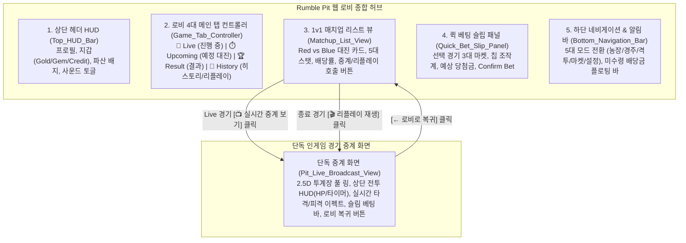

# 🥊 ROOSTER RUMBLE: Rumble Pit - 웹 로비 기본 구성 요소 정의 (Web Lobby Specification)

* **문서 상태**: 격투 웹 로비 UI/UX 및 화면 컴포넌트 기획 명세서 (최종 단독 마스터판)
* **문서 버전**: `v1.1.0`
* **마지막 개정일**: 2026-09-29
* **대상 범위**: Rumble Pit 웹 로비 화면 계층, 5대 영역 컴포넌트(경기 리스트, 베팅, 결과 확인, 경기 히스토리, 리플레이), 단독 인게임 경기 중계 화면 분리 규격, 반응형 뷰포트 규격, 오류/예외 처리
* **기반 문서**: [Rumble Pit MVP 구성안.md](file:///d:/OneDrive/업무_진행/C/ROOSTER%20RUMBLE/Rumble%20Pit%20MVP%20구성안.md), [Rumble Pit 전투 장면 인게임 구성안.md](file:///d:/OneDrive/업무_진행/C/ROOSTER%20RUMBLE/Rumble%20Pit%20전투%20장면%20인게임%20구성안.md), [통합 MVP 구성안.md](file:///d:/OneDrive/업무_진행/C/ROOSTER%20RUMBLE/통합%20MVP%20구성안.md)

---

### ■ 문서 개정 이력 (Revision History)

| 버전 (Version) | 개정일 (Date) | 주요 개정 내역 및 상세 변경 사항 | 관련 절 바로가기 |
| :---: | :---: | :--- | :--- |
| **v1.0.0** | 2026-09-29 | **[격투 웹 로비 기본 구성 요소 정의 단독 문서 신규 수립]** 5대 화면 계층(상단 HUD, 메인 아레나 뷰, 탭 컨트롤러, 1v1 대진/베팅 슬립, 하단 네비게이션), 1v1 스탯 비교 카드, 인플레이 베팅 조작 인터페이스, 반응형 레이아웃 및 6대 예외 처리 명세 집대성 | [[#1. 개요 및 웹 로비 아키텍처\|1장 로비 아키텍처]] |
| **v1.1.0** | 2026-09-29 | **[인게임 단독 중계 분리 및 로비 기능 전면 재구조화]** 인게임 격투 경기 중계를 로비 내부 뷰포트에서 완전 분리하여 단독 경기 중계 화면(`Pit_Live_Broadcast_View`)으로 독립. 로비는 경기 리스트, 베팅, 결과 확인, 경기 히스토리 및 리플레이(Replay) 제공 허브로 개편 | [[#2. 5대 기본 화면 영역 및 컴포넌트 상세 명세\|2장 로비 5대 컴포넌트]] |

---

## 목차
1. [[#1. 개요 및 웹 로비 아키텍처]]
   - [[#1.1 문서 목적 및 단독 중계 화면 분리 원칙]]
   - [[#1.2 로비 5대 기능 화면 계층 구조]]
   - [[#1.3 반응형 뷰포트 및 디스플레이 규격]]
2. [[#2. 5대 기본 화면 영역 및 컴포넌트 상세 명세]]
   - [[#2.1 상단 헤더 HUD (Top HUD Bar)]]
   - [[#2.2 로비 4대 메인 탭 컨트롤러 (Game Tab Controller)]]
   - [[#2.3 1v1 매치업 리스트 및 대진 카드 (Matchup List View)]]
   - [[#2.4 퀵 베팅 슬립 패널 (Quick Bet Slip Panel)]]
   - [[#2.5 하단 네비게이션 및 플로팅 알림 바 (Bottom Navigation & Toast)]]
3. [[#3. 경기 히스토리 및 리플레이 (History & Replay) 규격]]
   - [[#3.1 지난 경기 전적 상세 아카이브 UI]]
   - [[#3.2 경기 리플레이 (Replay) 뷰어 호출 및 제어]]
4. [[#4. 단독 인게임 격투 중계 화면 (Live Broadcast View) 규격]]
   - [[#4.1 단독 중계 화면 진입 및 전환 정책]]
   - [[#4.2 풀 스크린 2.5D 아레나 뷰포트 및 전투 HUD]]
   - [[#4.3 하단 슬림 인플레이 퀵 베팅 바]]
5. [[#5. 1v1 대진 정보 및 선수 스탯 표출 규격]]
   - [[#5.1 Red Corner vs Blue Corner 비교 카드]]
   - [[#5.2 5대 핵심 스탯 및 레이더 바 시각화]]
   - [[#5.3 장착 기술 슬롯 및 콤보 프리셋 뱃지]]
6. [[#6. 격투 베팅 슬립 패널 및 인터랙션 명세]]
   - [[#6.1 지원 베팅 유형 (3종) 명세]]
   - [[#6.2 칩 프리셋 및 금액 입력 컨트롤러]]
   - [[#6.3 실시간 배당률 롤링 및 예상 수령액 계산기]]
   - [[#6.4 Confirm Bet 버튼 상태 머신]]
7. [[#7. 경기 상태별 화면 전이 및 스케줄러 동기화]]
   - [[#7.1 24시간 48회 타임테이블 스케줄러]]
   - [[#7.2 상태 전이 시퀀스 및 UI 상태 동기화]]
8. [[#8. 오류 및 예외 처리 규격 (6대 엣지 케이스)]]
   - [[#8.1 파산 감지 및 무료 충전소 복귀 동선]]
   - [[#8.2 실시간 통신 단절 및 베팅 락 해제]]
   - [[#8.3 마감 5초 전 초과 접수 차단]]
   - [[#8.4 중복 입력 및 동시 정산 방어]]
9. [[#9. UI 에셋 키 및 사운드 연동 규격]]
   - [[#9.1 UI 아이콘 및 뱃지 키 매핑]]
   - [[#9.2 로비 사운드 이벤트 트리거]]

---

## 1. 개요 및 웹 로비 아키텍처

### 1.1 문서 목적 및 단독 중계 화면 분리 원칙
* **문서 목적**: `ROOSTER RUMBLE` 격투 모드(Rumble Pit) 웹 로비 화면 및 단독 인게임 경기 중계 화면의 UI/UX 계층, 컴포넌트 명세, 경기 리스트, 베팅, 결과 확인, 경기 히스토리 및 리플레이 제어 표준 수립.
* **단독 중계 화면 분리 원칙**:
  - **인게임 격투 경기 중계는 로비 내부 임베디드가 아닌 완전히 독립된 단독 중계 화면(`Pit_Live_Broadcast_View`)에서 전담 송출**.
  - **웹 로비는 경기 관리 및 사용자 액션 허브(경기 리스트 확인, 베팅 조작, 결과 확인, 과거 경기 히스토리 조회, 리플레이 호출)로 기능 집중**.
  - Live 진행 중인 경기 카드에서 `[📺 실시간 단독 중계 보기]` 버튼 클릭 시 풀 스크린 단독 중계 화면으로 매끄럽게 전환/복귀 지원.

### 1.2 로비 5대 기능 화면 계층 구조



### 1.3 반응형 뷰포트 및 디스플레이 규격

| 디바이스 구분 | 기준 해상도 | 로비 화면 레이아웃 정책 | 단독 중계 화면 레이아웃 정책 |
| :--- | :---: | :--- | :--- |
| **데스크톱 웹 (PC Wide)** | `1920 × 1080` 이상 | **좌우 2단 분할 레이아웃**:<br>- 좌측(넓은 폭): 4대 탭 콘텐츠 (경기 리스트 / 히스토리)<br>- 우측(440px 고정): 선택 경기 퀵 베팅 슬립 패널 | 16:9 비율 중앙 집중형 와이드 시네마틱 뷰포트 (하단 슬림 인플레이 베팅 바) |
| **태블릿 / 랩톱 (Medium)** | `1024 × 768` ~ `1440 × 900` | **좌우 반응형 2단 분할** (베팅 슬립 너비 380px 축소) | 4:3 / 16:10 반응형 아레나 뷰포트 |
| **모바일 웹 (Mobile Portrait)** | `390 × 844` 기준 | **단일 컬럼 수직 스크롤 레이아웃**:<br>- 상단: 헤더 HUD 고정<br>- 중앙: 탭별 리스트 스크롤<br>- 하단: 접이식 퀵 베팅 드로어 & 네비게이션 | 세로형 상하 분할 중계 뷰 (상단: 링 중계 뷰, 하단: 실시간 전투 HUD 및 인플레이 칩) |

---

## 2. 5대 기본 화면 영역 및 컴포넌트 상세 명세

### 2.1 상단 헤더 HUD (Top HUD Bar)
* **컴포넌트 식별자**: `Top_HUD_Bar`
* **주요 표출 정보**:
  - `Profile_Widget`: 유저 닉네임, 레벨 뱃지(`Lv.28`), 대표 수탉 초상화 썸네일.
  - `Wallet_Widget`:
    * 보유 **Gold**: 일반 재화 잔액 (`1,250,000 Gold`).
    * 보유 **Gem**: 유료 재화 잔액 (`350 Gem`).
    * 베팅 **Credit**: 현재 베팅 가능 잔액 (`5,400 Credit`) 및 즉시 충전(`+`) 버튼.
  - `Bankruptcy_Badge`: 보유 잔액이 최소 베팅액(100 Credit) 미만 시 적색 점멸 배지 표출.
  - `Quick_Action_Group`: 로비 BGM 온/오프 토글(`🎵`), 환경설정(`⚙️`), 헬프 안내(`❓`).

### 2.2 로비 4대 메인 탭 컨트롤러 (Game Tab Controller)
* **컴포넌트 식별자**: `Game_Tab_Controller`
* **4대 탭 기능 및 정책**:

| 탭 식별자 | 탭 명칭 및 아이콘 | 주요 제공 정보 및 기능 | 뱃지 표기 |
| :--- | :---: | :--- | :---: |
| **`TAB_LIVE`** | 🔴 **Live (진행 중)** | 현재 실시간 진행 중인 1v1 매치 카드 + `[📺 실시간 단독 중계 보기]` 진입 버튼 + 인플레이 베팅 | 적색 펄스 (1경기) |
| **`TAB_UPCOMING`** | ⏱️ **Upcoming (예정 경기)** | 오늘 예정된 향후 경기 대진표 리스트 (경기 시간, 양 선수 스탯 비교, 사전 베팅 슬립) | 잔여 경기 수 (5) |
| **`TAB_RESULT`** | 🏆 **Result (결과 확인)** | 최근 종료된 경기 결과 요약(스코어, KO 시간) 및 적중 배당금 수령(`Claim Payout`) | 미수령 건수 (N건) |
| **`TAB_HISTORY`** | 📜 **History & Replay** | 과거 경기 전적 상세 아카이브(라운드별 타격 수, 스코어카드) + `[🎬 리플레이 재생]` 뷰어 호출 | 누적 전적 |

### 2.3 1v1 매치업 리스트 및 대진 카드 (Matchup List View)
* **컴포넌트 식별자**: `Matchup_List_View`
* **대진 카드 구성 요소**:
  - `Match_Header`: 매치 번호 (예: `RUMBLE PIT #042`), 경기 시작 시간 (로컬 타임 & 카운트다운), 승리 조건 (`3R 2선승제, 45초`).
  - `Fighter_Profiles`: Red 코너 vs Blue 코너 초상화, 닉네임, 스타일 태그, 통산 전적(KO율).
  - `Odds_Summary`: 양 선수 실시간 승리 배당률 표기 (예: Red 1.65배 vs Blue 2.25배).
  - `Action_Buttons`:
    * Live 상태: `[📺 실시간 단독 중계 보기]` (단독 중계 화면으로 즉시 전환).
    * Upcoming 상태: `[🎟️ 사전 베팅하기]` (우측 베팅 슬립으로 매치 로드).
    * Result/History 상태: `[🎬 경기 리플레이 보기]` (중계 뷰어 리플레이 모드로 전환).

### 2.4 퀵 베팅 슬립 패널 (Quick Bet Slip Panel)
* **컴포넌트 식별자**: `Quick_Bet_Slip_Panel`
* **주요 구성**:
  - 선택된 매치 정보 요약 (`RUMBLE PIT #042` / Red vs Blue).
  - 3대 베팅 마켓 전환 탭 (매치 최종 승자 / 2R 승자 / KO 피니시 여부).
  - 양 코너 선택 카드 (Red 코너 / Blue 코너 단일 선택).
  - 칩 조작계 (`+100`, `+500`, `+1,000`, `+5,000`, `MAX`, `CLEAR`) 및 직접 입력 필드.
  - 실시간 예상 당첨금 연산 표기기 (최대 100,000 Credit 상한 자동 적용).
  - `Confirm Bet [금액]` 확정 버튼 (마감 5초 전 잠금 딤드).

### 2.5 하단 네비게이션 및 플로팅 알림 바 (Bottom Navigation & Toast)
* **컴포넌트 식별자**: `Bottom_Navigation_Bar`
* **5대 고정 탭**: `🌾 농장` | `🏇 경주` | `🥊 격투 (현재 활성)` | `🏪 마켓` | `⚙️ 설정`
* **플로팅 미수령 배당금 알림 바**:
  - 종료 경기 중 미수령 배당금 존재 시 하단에 플로팅 바 노출 (`[미수령 배당금 1,450 Gold 발생] [즉시 수령]`).
  - 원클릭 수령 시 잔액 즉시 가산, 관중 환호 SFX 출력 및 Result 탭 카운트 갱신.

---

## 3. 경기 히스토리 및 리플레이 (History & Replay) 규격

### 3.1 지난 경기 전적 상세 아카이브 UI
* **제공 데이터 목록**:
  - 경기 일련번호 및 일시 (예: `2026-09-29 15:00 • RUMBLE PIT #041`).
  - 양 코너 출전 선수 및 최종 결과 (예: `불꽃의 루스터 [승] vs 블루 썬더 [패]`).
  - 승리 방식 및 시간: `2라운드 38초 KO 피니시 승리` 또는 `3R 판정승 (29-28)`.
  - 최종 확정 배당률: 승자 배당률 `1.45배`, KO 피니시 배당률 `2.10배`.
  - 상세 스코어카드: 라운드별 유효 타격 수(Hits), 다운 횟수(Knockdowns), 방어 성공률(Guard %).

### 3.2 경기 리플레이 (Replay) 뷰어 호출 및 제어
* **리플레이 진입 동선**: 히스토리 카드 우측 `[🎬 리플레이 재생]` 버튼 클릭.
* **리플레이 뷰어 동작**:
  - 단독 경기 중계 화면(`Pit_Live_Broadcast_View`)으로 전환되며 **리플레이 모드(Replay Mode)**로 동작.
  - 상단에 `[REPLAY RECORDED MATCH]` 노란색 배지 점등.
  - 하단 타임라인 컨트롤러: `[일시정지/재생]`, `[2배속/4배속 재생]`, `[타임라인 시크바]`, `[주요 하이라이트/KO 시점 바로가기]`.
  - `[← 로비로 복귀]` 버튼 클릭 시 보던 히스토리 목록으로 즉시 원복.

---

## 4. 단독 인게임 격투 중계 화면 (Live Broadcast View) 규격

### 4.1 단독 중계 화면 진입 및 전환 정책
* **화면 분리 원칙**: 로비의 잡다한 메뉴, 대진표 리스트, 배너를 모두 배제하고 오직 1v1 격투 경기 관전에만 100% 몰입할 수 있는 시네마틱 단독 화면.
* **진입 조건**: 로비 Live 탭 매치 카드에서 `[📺 실시간 단독 중계 보기]` 클릭 시 전환 애니메이션(페이드/줌인)과 함께 진입.
* **복귀 조건**: 상단 좌측 `[← 로비로 복귀]` 버튼 클릭 시 언제든지 로비 화면으로 원복.

### 4.2 풀 스크린 2.5D 아레나 뷰포트 및 전투 HUD

```
+-----------------------------------------------------------------------+
| [← 로비로 복귀]              [ 🔴 LIVE 중계 ]             [ ⚙️ 중계설정 ] |
|                                                                       |
| [RED CORNER]                    [ ROUND 2 ]             [BLUE CORNER] |
| 불꽃의 루스터                     [ 00:28 ]              강철의 타이탄  |
| HP: ■■■■■■■■□□ (850/1000)         ● ○ ○          HP: ■■■■■■□□□□ (620) |
+-----------------------------------------------------------------------+
|                                                                       |
|                          (스포트라이트 조명 빔)                          |
|                                                                       |
|                                                                       |
|              🐓                                   🦤                 |
|        불꽃의 루스터         [ CRITICAL -45! ]       강철의 타이탄       |
|                                                                       |
| ============================== 사각 링 로프 =========================== |
| ///////////////////////////// 캔버스 바닥 //////////////////////////// |
+-----------------------------------------------------------------------+
| [인플레이 퀵 베팅]  선택: [Red 코너 1.65배]  금액: [1,000] [⚡ 베팅확정]  |
+-----------------------------------------------------------------------+
```

* **상단 전투 HUD**: 양 선수 실시간 HP 게이지, 라운드 번호, 45초 카운트다운 타이머, 라운드 승점 3구 점등.
* **중앙 2.5D 아레나**: 캐릭터 애니메이션(공격/방어/회피/다운), 피격 데미지 텍스트 팝업, 특수 이펙트(치명타 섬광, 라스트 스탠드 펄스).
* **사운드 자동 연동**: 격투 전투 BGM(`bgm_pit_fight.mp3`), 타격/방어 SFX, 공식 타종 벨, 장내 관중 환호, 아나운서 보이스 실시간 믹싱.

### 4.3 하단 슬림 인플레이 퀵 베팅 바
* **역할**: 경기 중계 화면을 가리지 않으면서 경기 진행 도중 실시간 라운드 베팅을 지원하는 초슬림 바.
* **구성**: 코너 선택 토글 + 퀵 칩 버튼(`100`, `500`, `1,000`, `MAX`) + `[⚡ 베팅 확정]` 버튼.
* **마감 처리**: 라운드 종료 5.0초 전 퀵 베팅 바 전체 딤드 락 및 자물쇠 표시.

---

## 5. 1v1 대진 정보 및 선수 스탯 표출 규격

### 5.1 Red Corner vs Blue Corner 비교 카드
* **기본 표기**: 양 코너 선수명, 프로필 초상화, 대표 스타일 태그, 통산 승률/KO율.
* **컨디션 3단계**: `▲ 최상` (전 스탯 +5% 녹색), `● 보통` (기본 스탯 유지), `▼ 저조` (전 스탯 -5% 청색).

### 5.2 5대 핵심 스탯 및 레이더 바 시각화
1. **공격력 (Attack, 0~100)**: 기본 타격력 및 치명타 확률 결정.
2. **방어력 (Defense, 0~100)**: 피격 데미지 감소 및 가드 내구도 결정.
3. **속도 (Speed, 0~100)**: 선제 타격권 및 회피 확률 결정.
4. **체력 (Health, 0~100)**: 라운드별 최대 HP 총량 결정 (1,000 HP 기준 환산).
5. **투지 (Stamina/Grit, 0~100)**: 다운 회복 속도 및 Last Stand 1 HP 발동 확률 결정.

### 5.3 장착 기술 슬롯 및 콤보 프리셋 뱃지
* 공격 기술: `부리 연속 쪼기 (공1)`, `며느리발톱 회전차기 (공2)`, `회전 날개치기 (공4)`.
* 방어/특수: `날개 패링 카운터 (방2)`, `측면 스텝 회피 (방3)`.
* 시동기 ➔ 연계기 ➔ 피니시 콤보 체인 매핑 뱃지 표기.

---

## 6. 격투 베팅 슬립 패널 및 인터랙션 명세

### 6.1 지원 베팅 유형 (3종) 명세
* **`BET_WINNER`**: 3R 2선승제 최종 매치 승자 맞히기.
* **`BET_ROUND_WINNER`**: 각 라운드별 승자 맞히기 (인플레이 전용).
* **`BET_KO_FINISH`**: 3R 이내 KO 피니시 발생 여부 (Yes / No).

### 6.2 칩 프리셋 및 금액 입력 컨트롤러
* 증액 버튼: `+100`, `+500`, `+1,000`, `+5,000 Credit`.
* 특수 버튼: `MAX BET` (보유 잔액 또는 상한선 적용), `CLEAR` (0 초기화).

### 6.3 실시간 배당률 롤링 및 예상 수령액 계산기
* 배당률 변동 시 녹색(상승)/적색(하락) 숫자 롤링 애니메이션.
* 예상 수령액 공식: $\min(\text{베팅금} \times \text{배당률}, 100,000 \text{ Credit})$.
* 상한선 도달 시 `[MAX PAYOUT REACHED]` 골드 뱃지 노출.

### 6.4 Confirm Bet 버튼 상태 머신
* `비활성 (Disabled)`: 미선택 또는 0원 상태.
* `입력 대기 (Ready)`: 유효 금액 입력 완료 상태.
* `처리 중 (Submitting)`: 버튼 내부 로딩 스피너 작동, 다중 클릭 차단.
* `마감 잠금 (Locked)`: 라운드 종료 5초 전 강제 잠금 상태.

---

## 7. 경기 상태별 화면 전이 및 스케줄러 동기화

### 7.1 24시간 48회 타임테이블 스케줄러
* **30분 주기 사이클**:
  - `00:00 ~ 24:00` (24분간): **Upcoming** (사전 베팅 오픈, 대진 분석).
  - `24:00 ~ 25:00` (1분간): **Pre-Fight** (선수 입장, 사전 베팅 마감).
  - `25:00 ~ 28:00` (3분간): **Live** (3R 아레나 경기 단독 중계 송출, 인플레이 베팅).
  - `28:00 ~ 28:30` (30초간): **Settlement** (판정/KO 정산, 배당금 분배).
  - `28:30 ~ 30:00` (1분 30초간): **Post-Match** (하이라이트 기록 저장, 차기 대진 갱신).

### 7.2 상태 전이 시퀀스 및 UI 상태 동기화
* 경기 시작 60초 전 로비 Live 탭으로 매치 자동 이동.
* 경기 종료 즉시 Result 탭 및 History 탭으로 전적 자동 저장, 플로팅 미수령 알림 바 활성화.

---

## 8. 오류 및 예외 처리 규격 (6대 엣지 케이스)

### 8.1 파산 감지 및 무료 충전소 복귀 동선
* 보유 잔액 100 Credit 미만 시 HUD 적색 배지 점등, 베팅 비활성화, 농장 일일 미션 무료 충전소 유도 다이얼로그 노출.

### 8.2 실시간 통신 단절 및 베팅 락 해제
* WebSocket 3초 무응답 시 반투명 딤드 및 재연결 토스트, 5초 초과 시 대기 중 베팅금 계정 자동 반환.

### 8.3 마감 5초 전 초과 접수 차단
* `is_betting_locked == true` 이후 패킷은 HTTP `423 Locked` 반환, 베팅금 미차감 및 '베팅 접수 마감' 토스트 알림.

### 8.4 중복 입력 및 동시 정산 방어
* 첫 클릭 즉시 Confirm 버튼 DOM 비활성화(Disabled) 및 버튼 내부 로딩 스피너 작동으로 중복 패킷 전송 차단.

#### ■ 6대 예외 상황 종합 매트릭스 표

| 발생 예외 상황 | 감지 조건 | 처리 로직 및 UI 인터랙션 명세 |
| :---: | :--- | :--- |
| **파산 상태 감지 (Bankruptcy)** | 보유 잔액 < 최소 베팅액(100 Credit) | 상단 HUD 적색 배지 점등, 베팅 슬립 버튼 비활성화, '무료 충전소(농장 일일 미션)' 이동 유도 모달 노출 |
| **실시간 통신 단절 (Disconnect)** | 웹소켓/API 3.0초간 무응답 | 화면 중앙 반투명 딤드 및 '서버 재연결 중...' 토스트 표출, 승인 전 베팅금 계정 자동 반환 |
| **베팅 마감 시점 초과 접수** | `is_betting_locked == true` 이후 수신 | HTTP `423 Locked` 반환, 베팅 패널 적색 점멸 및 '베팅 접수 마감' 토스트 알림 (금액 미차감) |
| **잔액 부족 및 한도 초과** | 베팅금 > 보유 잔액 또는 단일 한도 초과 | 금액 입력창 적색 하이라이트 테두리 전환, '잔액 부족' 인라인 툴팁 출력 및 버튼 비활성화 |
| **중복 클릭 (Double Submit)** | 이전 트랜잭션 진행 중 재클릭 | 첫 클릭 즉시 Confirm 버튼 DOM 비활성화(Disabled) 및 버튼 내부 로딩 스피너 작동으로 중복 호출 원천 차단 |
| **부상 선수 참전 시도** | `fighter.is_injured == true` | 선수 카드에 적색 밴드 오버레이, 참전/선택 불가 처리 및 '스파 힐링 센터 치료 필요' 안내 다이얼로그 호출 |

---

## 9. UI 에셋 키 및 사운드 연동 규격

### 9.1 UI 아이콘 및 뱃지 키 매핑
* `ui_icon_pit_hud_profile`: 상단 유저 프로필 썸네일
* `ui_icon_pit_wallet_credit`: 베팅 크레딧 지갑 아이콘
* `ui_badge_live_pulsing`: 라이브 진행 중 적색 펄스 뱃지
* `ui_badge_replay`: 리플레이 녹화 경기 황색 뱃지
* `ui_btn_watch_live`: 실시간 단독 중계 보기 버튼
* `ui_btn_play_replay`: 경기 리플레이 재생 버튼
* `ui_icon_lock_bet`: 베팅 마감 자물쇠 아이콘

### 9.2 로비 사운드 이벤트 트리거
* **로비 배경음악**: `BGM_LOBBY` ([bgm_lobby_theme.mp3](file:///d:/OneDrive/업무_진행/C/ROOSTER%20RUMBLE/assets/audio/race/bgm/bgm_lobby_theme.mp3), 루프 재생)
* **단독 중계 배경음악**: `BGM_PIT_FIGHT` ([bgm_pit_fight.mp3](file:///d:/OneDrive/업무_진행/C/ROOSTER%20RUMBLE/assets/audio/pit/bgm/bgm_pit_fight.mp3), 2분 52초 오케스트라)
* **UI 인터랙션 SFX**:
  - 코너 선수 선택 시: [sfx_pit_guard.mp3](file:///d:/OneDrive/업무_진행/C/ROOSTER%20RUMBLE/assets/audio/pit/sfx/sfx_pit_guard.mp3)
  - 베팅 확정 성공 시: [sfx_pit_bell_single.mp3](file:///d:/OneDrive/업무_진행/C/ROOSTER%20RUMBLE/assets/audio/pit/sfx/sfx_pit_bell_single.mp3)
  - 배당금 수령(`Claim Payout`) 시: [sfx_pit_crowd_roar.mp3](file:///d:/OneDrive/업무_진행/C/ROOSTER%20RUMBLE/assets/audio/pit/sfx/sfx_pit_crowd_roar.mp3)
  - 타격/치명타 피격 시: [sfx_pit_hit_crit.mp3](file:///d:/OneDrive/업무_진행/C/ROOSTER%20RUMBLE/assets/audio/pit/sfx/sfx_pit_hit_crit.mp3)

