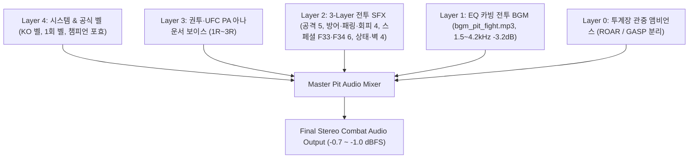
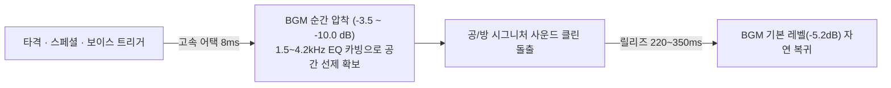
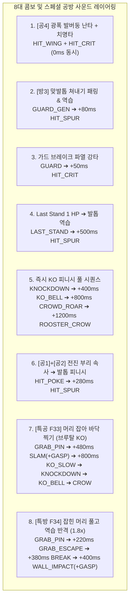

# 🥊 ROOSTER RUMBLE: Rumble Pit - 인게임 사운드 구성안 (In-Game Sound Specification)

* **문서 상태**: 인게임 사운드 기술 및 기획 명세서 (v2.1 공/방 전면 차별화 · 리얼·강조 마스터판)
* **문서 버전**: `v2.1.0`
* **마지막 개정일**: 2026-11-19
* **대상 범위**: Rumble Pit 로비/대기실, 1v1 원형 벽면 아레나 전투(3R 2선승제, 45초 격투 + 15초 휴식), 스페셜 공방(`F33` 머리 잡아 바닥 찍기 / `F34` 머리 풀고 반격), 즉시 KO 다운 및 승리 세리머니 사운드 전반 (BGM 1종, SFX 25종 27개 MP3 파일, 권투 PA 라운드 보이스 3종, 1R 실전 시뮬레이션 데모 트랙, 8대 콤보·스페셜 레이어링, `cue_table_v6.csv` 1:1 매핑)
* **기반 문서**: [Rumble Pit MVP 구성안.md](file:///d:/OneDrive/%EC%97%85%EB%AC%B4_%EC%A7%84%ED%96%89/C/ROOSTER%20RUMBLE/Rumble%20Pit%20MVP%20%EA%B5%AC%EC%84%B1%EC%95%88.md), [Rumble_Pit_전투_시뮬레이션_규칙_정의서.md](file:///d:/OneDrive/%EC%97%85%EB%AC%B4_%EC%A7%84%ED%96%89/C/ROOSTER%20RUMBLE/Rumble_Pit_%EC%A0%84%ED%88%AC_%EC%8B%9C%EB%AE%AC%EB%A0%88%EC%9D%B4%EC%85%98_%EA%B7%9C%EC%B9%99_%EC%A0%95%EC%9D%98%EC%84%9C.md), [Rumble Pit 선수 공격 방어 동작 구성안.md](file:///d:/OneDrive/%EC%97%85%EB%AC%B4_%EC%A7%84%ED%96%89/C/ROOSTER%20RUMBLE/Rumble%20Pit%20%EC%84%A0%EC%88%98%20%EA%B3%B5%EA%B2%A9%20%EB%B0%A9%EC%96%B4%20%EB%8F%99%EC%9E%91%20%EA%B5%AC%EC%84%B1%EC%95%88.md), [Rumble Pit 전투 장면 인게임 구성안.md](file:///d:/OneDrive/%EC%97%85%EB%AC%B4_%EC%A7%84%ED%96%89/C/ROOSTER%20RUMBLE/Rumble%20Pit%20%EC%A0%84%ED%88%AC%20%EC%9E%A5%EB%A9%B4%20%EC%9D%B8%EA%B2%8C%EC%9E%84%20%EA%B5%AC%EC%84%B1%EC%95%88.md), [통합 MVP 구성안.md](file:///d:/OneDrive/%EC%97%85%EB%AC%B4_%EC%A7%84%ED%96%89/C/ROOSTER%20RUMBLE/%ED%86%B5%ED%95%A9%20MVP%20%EA%B5%AC%EC%84%B1%EC%95%88.md)

---

### ■ 문서 개정 이력 (Revision History)

| 버전 (Version) | 개정일 (Date) | 주요 개정 내역 및 상세 변경 사항 | 관련 절 바로가기 |
| :---: | :---: | :--- | :--- |
| **v1.0.0** | 2026-09-29 | **[격투 사운드 구성안 단독 문서 독립 신설]** 기존 베이스 문서 내용 100% 보존 상태에서 격투 BGM·SFX 14종·라운드 순수 보이스·오디오 아키텍처·믹싱/덕킹 규격 전면 집대성 | [[#1. 개요 및 사운드 아키텍처\|1장 사운드 아키텍처]] |
| **v1.1.0** | 2026-09-29 | **[미제작 BGM 정리, 사운드보드 연동 항목 제거 및 1R 시뮬레이션 데모 신설]** 제작 음원 부재 미제작 인트로 BGM 삭제, 사운드보드 연동 항목 정리, 1라운드 실전 사운드 시뮬레이션 데모(`demo_pit_round1_simulation.mp3`) 신규 구축 및 세부 타임라인 명세 수립 | [[#8. 1라운드 실전 사운드 시뮬레이션 샘플 사양 및 시나리오\|8장 1R 사운드 시뮬레이션]] |
| **v1.2.0** | 2026-10-08 | **[비의인화 닭 골격 기반 공/방/이동 기술 명칭 및 즉시 KO 사운드 매핑 동기화]** `Rumble Pit MVP 구성안(v1.2.0)` 및 `Rumble_Pit_전투_시뮬레이션_규칙_정의서(v1.2.0)` 기준 공격 4종(`전진 부리 속사`, `낮은 발톱 할퀴기`, `비상 발톱 급습`, `광폭 발버둥 난타`), 방어 3종(`깃털 부풀려 버티기`, `납작 엎드리기`, `맞발톱 쳐내기`), 이동 6종 및 바닥 다운 즉시 KO 사운드 트리거 명세 일괄 동기화 | [[#3. SFX (효과음) 25종 상세 명세\|3장 SFX 25종 명세]] |
| **v2.0.0** | 2026-11-19 | **[리얼·강조 3-Layer 전면 리디자인 및 스페셜 공방(`F33/F34`) 시퀀스 신설]**<br>1. 무료 인디 팩(Kenney) 의존 전면 폐기 ➔ **OpenGameArt CC0 실사 전투·폴리 + 서브 펀치 + 실제 수탉 기합·포효** 기반 3-Layer(어택·바디·테일) 사운드 전면 재제작 (`25종 27개 MP3`)<br>2. **공격 vs 방어·패링 대역 분리 강화**: 타격(2.5~6kHz 크랙+펀치), 깃털 가드(2kHz↓ 댐핑 흡수), 맞발톱 패링(황금 메탈 링)의 즉각적 청각 변별력 확보<br>3. **스페셜 공방 6종 신설**: `[특공 F33]` 머리 잡아 바닥 찍기(`GRAB_PIN`, `SLAM`, `GRAB_MISS`) 및 `[특방 F34]` 머리 풀고 반격(`GRAB_ESCAPE`, `BREAK`, `GROGGY`) 단계별 음원 제작<br>4. **특수상태·시스템 보강**: `MISS`, `WALL_IMPACT`, `KO_SLOW`, `CROWD_GASP`, `ROOSTER_CROW` 신설 및 권투/UFC PA 아나운서 라운드 보이스(`1R~3R`) 전면 쇄신<br>5. **BGM EQ 카빙(`1.5~4.2kHz -3.2dB`) · 고속 사이드체인(`8ms`) · `cue_table_v6.csv` 1:1 매핑표** 및 `38.03초` 실전 데모 트랙 재합성 완료 | • [[#1.3 3-Layer 리얼·강조 사운드 디자인 규격\|1.3절 3-Layer 디자인 규격]]<br>• [[#3.3 스페셜 공격·방어 (F33/F34) 시퀀스 효과음 (6종)\|3.3절 스페셜 공방 6종]]<br>• [[#6. 8대 콤보·스페셜 공방 사운드 레이어링 명세\|6장 8대 레이어링 명세]]<br>• [[#7. 연출 큐 테이블 (cue_table_v6.csv) ↔ 실음원 1:1 매핑표\|7장 큐 시트 1:1 매핑]] |
| **v2.1.0** | 2026-11-19 | **[효과음 평가 반영 — 관중 탄성 리얼 교체 및 공/방 변별력 전면 차별화]**<br>1. **관중 탄성(`SFX_PIT_CROWD_GASP`) 전면 교체**: 공포 영화풍(`oooooooooo.ogg` 변조) 소스 완전 폐기 ➔ 실사 경기장 2채널 급등 서지 + 다중 관객 짧은 `"Whoa/Oh/Hey"` 리액션(`1.38초`)으로 자연스러운 스포츠 환호 질감 구현<br>2. **'1기술 · 1재질 · 1리듬 · 소스 배타 할당' 원칙 수립**: `HIT_POKE`(저역 0% 3연타 딱-딱-딱), `HIT_SPUR`(230ms 발톱 긁힘), `HIT_WING`(3연속 날갯짓 돌풍➔급강하), `HIT_GEN`(2.8~3.2kHz 단단한 스냅 정타), `GUARD`(9ms 부드러운 480Hz↓ 쿠션+깃털 부스럭), `GUARD_GEN`(900Hz↑ 순수 황금 메탈 패링), `BREAK`(차임➔쌍발 가슴 킥 2연타), `WALL_IMPACT`(빈 목재 판자+철망 떨림) 재제작으로 전투 쌍 평균 스펙트럼 유사도 `0.450` (`HIT_GEN ↔ GUARD` 유사도 `0.572`) 달성<br>3. **`SFX_PIT_SLAM` · `SFX_PIT_KNOCKDOWN` 저역 밸런스 교정**: 과도한 초저역 마스킹 제거로 자갈·모래 산란(`SLAM` Sub `31.5%`) 및 전신 낙하 흙 쓸림 명료도 개선<br>4. **사운드보드 v2.1 UI 개편**: 상단 `공/방 변별력 즉시 비교 바` 신설 및 25종 재측정 메타데이터·`1R` 데모 트랙 동기화 | • [[#1.3 3-Layer 리얼·강조 사운드 디자인 규격\|1.3절 3-Layer 디자인 규격]]<br>• [[#3. SFX (효과음) 25종 상세 명세\|3장 SFX 25종 명세]]<br>• [[#8. 1라운드 실전 사운드 시뮬레이션 샘플 사양 및 시나리오\|8장 1R 사운드 시뮬레이션]] |

---

## 목차
1. [[#1. 개요 및 사운드 아키텍처]]
   - [[#1.1 문서 목적 및 정체성]]
   - [[#1.2 5대 오디오 채널 레이어 구조]]
   - [[#1.3 3-Layer 리얼·강조 사운드 디자인 규격]]
2. [[#2. BGM (배경음악) 사양 및 EQ 카빙 명세]]
   - [[#2.1 전투 BGM: BGM_PIT_FIGHT (혈투의 링)]]
3. [[#3. SFX (효과음) 25종 상세 명세]]
   - [[#3.1 공격 기술 효과음 (5종)]]
   - [[#3.2 방어 · 회피 · 패링 · 빗나감 효과음 (4종)]]
   - [[#3.3 스페셜 공격·방어 (F33/F34) 시퀀스 효과음 (6종)]]
   - [[#3.4 특수 상태 · 다운 · 벽 충돌 · 슬로우 효과음 (4종)]]
   - [[#3.5 시스템 · 벨 · 관중 · 챔피언 포효 효과음 (5종 + 보이스 1종 3트랙)]]
4. [[#4. 권투·UFC 스타일 라운드 시작 보이스 및 타종 연출 명세]]
   - [[#4.1 아레나 PA 하이텐션 아나운서 보이스 (1R~3R)]]
   - [[#4.2 단독 1회 공식 벨소리 독립 타종 연동]]
5. [[#5. 인게임 오디오 믹싱, 고속 덕킹 및 반복 피로도 제어]]
   - [[#5.1 오디오 우선순위 체계 (Priority Queue)]]
   - [[#5.2 고속 사이드체인 덕킹 파라미터 규격 (Attack 8ms)]]
   - [[#5.3 다빈도 SFX 엔진 랜덤 변조 규격]]
6. [[#6. 8대 콤보·스페셜 공방 사운드 레이어링 명세]]
7. [[#7. 연출 큐 테이블 (cue_table_v6.csv) ↔ 실음원 1:1 매핑표]]
8. [[#8. 1라운드 실전 사운드 시뮬레이션 샘플 사양 및 시나리오]]
   - [[#8.1 가상 1라운드 세부 타임라인 (38.03초)]]
9. [[#9. 리소스 관리 및 디렉터리 구조]]

---

## 1. 개요 및 사운드 아키텍처

### 1.1 문서 목적 및 정체성
* `ROOSTER RUMBLE` 원형 투계 격투 모드(Rumble Pit)의 BGM, SFX 25종(27개 MP3), 아나운서 보이스, 스페셜 공방(`F33`/`F34`) 시퀀스 및 엔진 연동 매핑 표준 정의.
* 기존 경량 인디 팩 사운드 탈피 및 실전 청음 피드백을 반영하여 **자연스러운 경기장 탄성 + 1기술·1재질·1리듬 기반 공/방 완벽 변별력**을 구현한 `v2.1.0` 마스터 명세서.
* 실제 제작·마스터링 완료된 음원 에셋(`assets/audio/pit/`), `cue_table_v6.csv` 및 `v2.1` 사운드보드(변별력 즉시 비교 바 · A/B 비교 지원)와의 100% 일치성 확보.

### 1.2 5대 오디오 채널 레이어 구조



| 레이어 | 대상 사운드 | 기준 출력 볼륨 | 덕킹 및 동적 제어 정책 |
| :--- | :--- | :---: | :--- |
| **Layer 4 (System/Bell)** | KO 확정 3연타 벨, 단독 1회 공식 벨, 승리 수탉 포효 | `0 dB` (최상위) | 덕킹 미적용 (상시 최우선 클린 출력) |
| **Layer 3 (Voice)** | 아레나 PA 하이텐션 아나운서 보이스 (1R~3R) | `-0.5 ~ 0 dB` | 하위 Layer 1(BGM) `-7.5 dB` 즉각 감쇄 트리거 |
| **Layer 2 (Combat SFX)** | 일반 공/방 9종 + 스페셜(`F33/F34`) 6종 + 상태/벽 4종 | `-1.0 ~ -2.5 dB` | 타격/스페셜 적중 시 BGM `8ms` 고속 사이드체인 덕킹 유발 |
| **Layer 1 (BGM)** | EQ 카빙 배틀 오케스트라 (`bgm_pit_fight.mp3`) | `-5.2 dB` | `1.5~4.2kHz` 대역 선제 컷 + 타격 순간 자동 감쇄, KO 시 페이드아웃 |
| **Layer 0 (Crowd)** | 투계장 환호(`ROAR`) 및 탄성/놀람(`GASP`) | `-4.0 ~ -8.0 dB` | 평시 저역 필터링 앰비언스 ➔ 치명타/슬램 시 `GASP`, KO 시 `ROAR` 폭발 |

### 1.3 3-Layer 리얼·강조 사운드 디자인 규격
* **모든 핵심 공/방 SFX의 3-Layer 합성 표준**:
  1. **Layer A (어택/스냅, `2.5 ~ 6.5 kHz`)**: `0~5ms` 무지연 트랜지언트(트랜지언트 셰이퍼 + 경질 크랙/발톱 스크레이프/금속 패링)로 모바일 내장 스피커 및 BGM 위에서의 즉각적 타격 선명도 확보.
  2. **Layer B (바디/임팩트, `45 ~ 450 Hz`)**: 기술 성격에 맞춘 배타적 바디 재질(미디엄 정타, 무거운 젖은 타월 슬램, 480Hz↓ 쿠션 블록, 빈 목재 판자) 배치로 물리적 충격감과 재질 차이 동시 전달.
  3. **Layer C (시그니처 테일, 조류/아레나 공간감)**: 짧은 깃털 부스럭, 자갈·모래 산란, 철망 떨림, 절제된 수탉 기합·비명(`-14 ~ -17 dB`), L/R 비상관 원형 아레나 스테레오 잔향(`7~25% wet`) 배치.
* **v2.1 '1기술 · 1재질 · 1리듬 · 소스 배타 할당' 전면 차별화 원칙**:
  * **소스 중복 금지**: 전 음원 공용 서브 펀치/채찍 남용을 배제하고 각 공·방 동작별 배타 원천 소스(`thwack`, `scrapes`, `impactwood`, `metal`, `paper`, `ding`) 할당 ➔ 전투 15종 쌍 평균 스펙트럼 코사인 유사도 **`0.450`** 확보.
  * **공격 4대 청각 아이덴티티**: `[공1]` 0% 저역 3연속 부리 스타카토(0/75/150ms) · `[공2]` 230ms 날카로운 발톱 긁힘(`scrape`) · `[공3/공4]` 3연속 날갯짓 돌풍(0/95/190ms)➔급강하 타격(295ms) · `[범용 정타]` `2.8~3.2kHz` 단단한 스냅(`HIT_GEN` vs `GUARD` 유사도 **`0.572`**).
  * **방어 · 회피 청각 변별력**: `[방1 깃털 가드]` `9ms` 부드러운 어택 + `480Hz↓` 쿠션 흡수 + 선명한 깃털 부스럭 · `[방3 맞발톱 패링]` `900Hz↑` 저역 완전 배제 황금 메탈 링 · `[방2 회피]` `240ms` 하강 스윕 vs `[F12 빗나감]` `160ms` 고역 단발 헛스윙.
  * **관중 탄성(`CROWD_GASP`) 실사 스포츠 교체**: 유령풍 변조 음원 폐기 ➔ 실제 경기장 2구간 급등 함성 서지(`real_crowd_cheer`) + 5인 다중 관객 짧은 리액션(`"Whoa!/Oh!/Hey!"`, `380~2600Hz` 대역 제한).

---

## 2. BGM (배경음악) 사양 및 EQ 카빙 명세

모든 음원 포맷: `Stereo, 44.1 kHz, 192 kbps MP3`, DC 오프셋 제거 및 소프트 리미터 적용.

### 2.1 전투 BGM: BGM_PIT_FIGHT (혈투의 링)
* **에셋 ID**: `BGM_PIT_FIGHT`
* **파일 경로**: [assets/audio/pit/bgm/bgm_pit_fight.mp3](file:///d:/OneDrive/%EC%97%85%EB%AC%B4_%EC%A7%84%ED%96%89/C/ROOSTER%20RUMBLE/assets/audio/pit/bgm/bgm_pit_fight.mp3) *(v1 원본 백업: `assets/audio/pit/sfx_v1_backup/bgm_pit_fight_v1.mp3`)*
* **재생시간 / 용량 / 템포**: **172.64초** / **4,046.3 KB** / **150 BPM** (심리스 루프)
* **v2.0/v2.1 EQ 카빙 마스터링**:
  * `35 Hz` 이하 불필요 초저역 HPF 정리 (서브 펀치·슬램과 부밍 충돌 방지).
  * **`2,600 Hz` 중심(`1.5 ~ 4.2 kHz` 대역) `-3.2 dB` 피킹 컷 + `110 Hz` `-1.0 dB` 정리** ➔ 전투 타격 어택과 아나운서 보이스가 BGM을 뚫고 선명하게 돌출되는 믹싱 공간 확보.
  * 피크 `-1.9 dBFS`, RMS `-15.9 dBFS` 마스터링으로 SFX 중첩 시에도 클리핑 0건 유지.

---

## 3. SFX (효과음) 25종 상세 명세

* **음원 저장 디렉터리**: [assets/audio/pit/sfx/](file:///d:/OneDrive/%EC%97%85%EB%AC%B4_%EC%A7%84%ED%96%89/C/ROOSTER%20RUMBLE/assets/audio/pit/sfx/) *(구버전 백업: `assets/audio/pit/sfx_v1_backup/`)*
* **원천 음원 구성**: OpenGameArt CC0 실사 전투·폴리 팩(`thwack`, `scrapes`, `hits_and_punches`, `wet_towel_on_floor`, `wood_crack_hit`, `impact_starninjas`, `sword_clash`, `ding_starninjas`, `swishes`, `dragonflap`, `Jump`, `100_cc0_sfx`, `crowd_shouting`) + 실사 경기장 환호(`real_crowd_cheer`) + 실사 수탉·흙질주·심장박동·공식 링벨·PA/관중 TTS 결합.

### 3.1 공격 기술 효과음 (5종)

| 연번 | SFX 리소스 ID | 오디오 파일명 (Clickable) | 재생시간 | 파일용량 | 3-Layer 구성 및 음향 특성 | 연동 동작 및 매핑 사양 |
| :---: | :--- | :--- | :---: | :---: | :--- | :--- |
| 1 | `SFX_PIT_HIT_POKE` | [sfx_pit_hit_poke.mp3](file:///d:/OneDrive/%EC%97%85%EB%AC%B4_%EC%A7%84%ED%96%89/C/ROOSTER%20RUMBLE/assets/audio/pit/sfx/sfx_pit_hit_poke.mp3) | 0.39초 | 9.2 KB | 저역 0%(`520Hz↑` HPF), 초고속 3연속 부리 스타카토(`0/75/150ms`, 피치 상승 "딱-딱-딱!") | `[공1: 전진 부리 속사]` 초고속 연타 쪼기 |
| 2 | `SFX_PIT_HIT_SPUR` | [sfx_pit_hit_spur.mp3](file:///d:/OneDrive/%EC%97%85%EB%AC%B4_%EC%A7%84%ED%96%89/C/ROOSTER%20RUMBLE/assets/audio/pit/sfx/sfx_pit_hit_spur.mp3) | 0.39초 | 9.2 KB | 고역 스우시 ➔ **`230ms` 날 선 발톱 연속 긁힘(`scrape3/6`, `3.4kHz` 강조 "츠아악!")**, 펀치/서브 배제 | `[공2: 낮은 발톱 할퀴기]` |
| 3 | `SFX_PIT_HIT_WING` | [sfx_pit_hit_wing.mp3](file:///d:/OneDrive/%EC%97%85%EB%AC%B4_%EC%A7%84%ED%96%89/C/ROOSTER%20RUMBLE/assets/audio/pit/sfx/sfx_pit_hit_wing.mp3) | 0.63초 | 14.7 KB | 좌우 교차 **3연속 날갯짓 돌풍(`0/95/190ms`)** ➔ `295ms` 체중 급강하 바디 강타(`thwack_body+jump2`) | `[공3: 비상 발톱 급습]`, `[공4: 광폭 발버둥 난타]` |
| 4 | `SFX_PIT_HIT_CRIT` | [sfx_pit_hit_crit.mp3](file:///d:/OneDrive/%EC%97%85%EB%AC%B4_%EC%A7%84%ED%96%89/C/ROOSTER%20RUMBLE/assets/audio/pit/sfx/sfx_pit_hit_crit.mp3) | 0.57초 | 13.5 KB | `22ms` 호흡 정지 흡입 ➔ 리얼 스냅 + 파쇄(`crack1+splatter`) + `155Hz->45Hz` 서브 폭발 + 비명 | 치명타 강타(`F05`), 가드 브레이크 파열 |
| 5 | `SFX_PIT_HIT_GEN` | [sfx_pit_hit_gen.mp3](file:///d:/OneDrive/%EC%97%85%EB%AC%B4_%EC%A7%84%ED%96%89/C/ROOSTER%20RUMBLE/assets/audio/pit/sfx/sfx_pit_hit_gen.mp3) | 0.31초 | 7.3 KB | `2.8~3.2kHz` 어택 스냅 강화(`transient 2.3x`) + 단단한 `thwack` 미디엄 정타 ("짝-퍽!") | 다목적 범용 정타(`F03`), 동시 격돌(`Clash`) |

### 3.2 방어 · 회피 · 패링 · 빗나감 효과음 (4종)

| 연번 | SFX 리소스 ID | 오디오 파일명 (Clickable) | 재생시간 | 파일용량 | 3-Layer 구성 및 음향 특성 | 연동 동작 및 매핑 사양 |
| :---: | :--- | :--- | :---: | :---: | :--- | :--- |
| 6 | `SFX_PIT_GUARD` | [sfx_pit_guard.mp3](file:///d:/OneDrive/%EC%97%85%EB%AC%B4_%EC%A7%84%ED%96%89/C/ROOSTER%20RUMBLE/assets/audio/pit/sfx/sfx_pit_guard.mp3) | 0.42초 | 9.8 KB | `9ms` 부드러운 어택 + **`480Hz↓` 둔탁 쿠션 쉴드 흡수** + 선명한 깃털 부스럭(`paper2+flap_1`, "쿵—푸스슥") | `[방1: 깃털 부풀려 버티기]` 60% 피해 흡수 |
| 7 | `SFX_PIT_GUARD_GEN` | [sfx_pit_guard_gen.mp3](file:///d:/OneDrive/%EC%97%85%EB%AC%B4_%EC%A7%84%ED%96%89/C/ROOSTER%20RUMBLE/assets/audio/pit/sfx/sfx_pit_guard_gen.mp3) | 0.55초 | 12.9 KB | **저역 0%(`900Hz↑` HPF)**, 100% 경질 발톱 충돌 + 황금빛 패링 메탈 링(`3.4~3.8kHz` "챙—!!") | `[방3: 맞발톱 쳐내기]` 패링 & 솔리드 블록 |
| 8 | `SFX_PIT_DODGE` | [sfx_pit_dodge.mp3](file:///d:/OneDrive/%EC%97%85%EB%AC%B4_%EC%A7%84%ED%96%89/C/ROOSTER%20RUMBLE/assets/audio/pit/sfx/sfx_pit_dodge.mp3) | 0.24초 | 5.5 KB | 좌(`-0.45`)➔우(`+0.45`) 55ms 시차 매끈한 하강 공기 스윕(`350~2600Hz`, "슈우우욱-") | `[방2: 납작 엎드리기]`, `[이5: 측면 사이드 홉]` |
| 9 | `SFX_PIT_MISS` | [sfx_pit_miss.mp3](file:///d:/OneDrive/%EC%97%85%EB%AC%B4_%EC%A7%84%ED%96%89/C/ROOSTER%20RUMBLE/assets/audio/pit/sfx/sfx_pit_miss.mp3) | 0.16초 | 3.7 KB | **`1.5kHz↑` 초단발 가벼운 고역 허공 헛스윙("휙!")**, 저역 임팩트 0% | 공격 빗나감 (`F12`, 아트바이블 무진동 큐) |

### 3.3 스페셜 공격·방어 (F33/F34) 시퀀스 효과음 (6종)

| 연번 | SFX 리소스 ID | 오디오 파일명 (Clickable) | 재생시간 | 파일용량 | 3-Layer 구성 및 음향 특성 | 연동 동작 및 매핑 사양 |
| :---: | :--- | :--- | :---: | :---: | :--- | :--- |
| 10 | `SFX_PIT_GRAB_PIN` | [sfx_pit_grab_pin.mp3](file:///d:/OneDrive/%EC%97%85%EB%AC%B4_%EC%A7%84%ED%96%89/C/ROOSTER%20RUMBLE/assets/audio/pit/sfx/sfx_pit_grab_pin.mp3) | 0.39초 | 9.2 KB | 타격음 0%, 부리 클램프 물림(`switch1+crack5`, "콱!") + 깃털 버둥거림("푸드덕") + 미세 기합 | `[특공 F33-①]` 머리 잡아 고정 (0.2초 유예 시작) |
| 11 | `SFX_PIT_SLAM` | [sfx_pit_slam.mp3](file:///d:/OneDrive/%EC%97%85%EB%AC%B4_%EC%A7%84%ED%96%89/C/ROOSTER%20RUMBLE/assets/audio/pit/sfx/sfx_pit_slam.mp3) | 0.71초 | 16.5 KB | `0~185ms` 하강 스윕 ➔ **지면 붕괴 강타(`towel3+jump1+crack1`) + 모래·자갈 산란(Sub `31.5%` 균형)** | `[특공 F33-②]` 머리 잡아 바닥 찍기 (`F_SLAM_CLOSE`) |
| 12 | `SFX_PIT_GRAB_MISS` | [sfx_pit_grab_miss.mp3](file:///d:/OneDrive/%EC%97%85%EB%AC%B4_%EC%A7%84%ED%96%89/C/ROOSTER%20RUMBLE/assets/audio/pit/sfx/sfx_pit_grab_miss.mp3) | 0.21초 | 4.9 KB | `1.1kHz↑` 허공 부리 헛물기 스냅("딱!") + 130ms 짧은 바람 스우시 | `[특공 F33-③]` 잡기 실패 및 시동 캔슬 시 |
| 13 | `SFX_PIT_GRAB_ESCAPE` | [sfx_pit_grab_escape.mp3](file:///d:/OneDrive/%EC%97%85%EB%AC%B4_%EC%A7%84%ED%96%89/C/ROOSTER%20RUMBLE/assets/audio/pit/sfx/sfx_pit_grab_escape.mp3) | 0.31초 | 7.3 KB | 탄성 깃 파열("파닥!") ➔ **`95ms` 후 밝고 빠른 상승 회전 스윕(`900~4800Hz`, "휘익!")** | `[특방 F34-①]` 잡힌 머리 풀기 / 단독 회피 탈출 |
| 14 | `SFX_PIT_BREAK` | [sfx_pit_break.mp3](file:///d:/OneDrive/%EC%97%85%EB%AC%B4_%EC%A7%84%ED%96%89/C/ROOSTER%20RUMBLE/assets/audio/pit/sfx/sfx_pit_break.mp3) | 0.47초 | 11.0 KB | **`0ms` 단독 황금 차임(`bell2+ding1`) ➔ `90ms/175ms` 쌍발 가슴 카운터 킥 2연타("탕-탁!")** | `[특방 F34-②]` 머리 풀고 역습 반격 (`POW × 1.8`) |
| 15 | `SFX_PIT_GROGGY` | [sfx_pit_groggy.mp3](file:///d:/OneDrive/%EC%97%85%EB%AC%B4_%EC%A7%84%ED%96%89/C/ROOSTER%20RUMBLE/assets/audio/pit/sfx/sfx_pit_groggy.mp3) | 1.52초 | 35.5 KB | 둔중한 저역 어지럼 맥동(`3.8Hz`) + 은은한 `2.45kHz` 이명 텐션 + 비틀거리는 흙발소리 | `F30` 스탠딩 그로기 / `F33` 플로우 B(`HP < 20%`) |

### 3.4 특수 상태 · 다운 · 벽 충돌 · 슬로우 효과음 (4종)

| 연번 | SFX 리소스 ID | 오디오 파일명 (Clickable) | 재생시간 | 파일용량 | 3-Layer 구성 및 음향 특성 | 연동 동작 및 매핑 사양 |
| :---: | :--- | :--- | :---: | :---: | :--- | :--- |
| 16 | `SFX_PIT_KNOCKDOWN` | [sfx_pit_knockdown.mp3](file:///d:/OneDrive/%EC%97%85%EB%AC%B4_%EC%A7%84%ED%96%89/C/ROOSTER%20RUMBLE/assets/audio/pit/sfx/sfx_pit_knockdown.mp3) | 0.42초 | 9.8 KB | 서브 절제 전신 낙하 충격("털썩", `towel10+jump3`) + 느린 모래 쓸림(`110ms`, Sub `54.2%`) | 일반 넉다운(`15번`, 2초 후 기상) / 즉시 KO 다운(`13번`) |
| 17 | `SFX_PIT_LAST_STAND` | [sfx_pit_last_stand.mp3](file:///d:/OneDrive/%EC%97%85%EB%AC%B4_%EC%A7%84%ED%96%89/C/ROOSTER%20RUMBLE/assets/audio/pit/sfx/sfx_pit_last_stand.mp3) | 2.59초 | 60.6 KB | 가속 생체 심장박동(`쿵-쿵`) + `55Hz->90Hz` 저역 투지 각성 스웰 라이저 | `Last Stand` 1 HP 투지 생존 발동 시 |
| 18 | `SFX_PIT_WALL_IMPACT` | [sfx_pit_wall_impact.mp3](file:///d:/OneDrive/%EC%97%85%EB%AC%B4_%EC%A7%84%ED%96%89/C/ROOSTER%20RUMBLE/assets/audio/pit/sfx/sfx_pit_wall_impact.mp3) | 0.50초 | 11.6 KB | **육체 펀치·서브 제거**, 속 빈 목재 판자 공명(`280Hz` "덩-!") + `35ms` 후 철망 펜스 금속 떨림("철컹—") | 원형 아레나 외벽 격돌 (`F31`, `Wall Impact`) |
| 19 | `SFX_PIT_KO_SLOW` | [sfx_pit_ko_slow.mp3](file:///d:/OneDrive/%EC%97%85%EB%AC%B4_%EC%A7%84%ED%96%89/C/ROOSTER%20RUMBLE/assets/audio/pit/sfx/sfx_pit_ko_slow.mp3) | 1.25초 | 29.4 KB | `145Hz -> 34Hz` 타임-슬로우 서브 드롭 + 저역 공기 스윕 | `[특공 F33]` 플로우 A (`HP = 0` 0.4배속 슬로우 KO) |

### 3.5 시스템 · 벨 · 관중 · 챔피언 포효 효과음 (5종 + 보이스 1종 3트랙)

| 연번 | SFX 리소스 ID | 오디오 파일명 (Clickable) | 재생시간 | 파일용량 | 3-Layer 구성 및 음향 특성 | 연동 동작 및 매핑 사양 |
| :---: | :--- | :--- | :---: | :---: | :--- | :--- |
| 20 | `SFX_PIT_ROUND_START` | [sfx_pit_round1_start.mp3](file:///d:/OneDrive/%EC%97%85%EB%AC%B4_%EC%A7%84%ED%96%89/C/ROOSTER%20RUMBLE/assets/audio/pit/sfx/sfx_pit_round1_start.mp3) | 1.38초 | 32.4 KB | 권투/UFC 링 아나운서 톤 + 아레나 PA 슬랩백 리버브 (1R~3R 완비) | 라운드 시작 순수 보이스 (벨과 완전 분리) |
| 21 | `SFX_PIT_BELL_SINGLE` | [sfx_pit_bell_single.mp3](file:///d:/OneDrive/%EC%97%85%EB%AC%B4_%EC%A7%84%ED%96%89/C/ROOSTER%20RUMBLE/assets/audio/pit/sfx/sfx_pit_bell_single.mp3) | 0.97초 | 22.7 KB | 황동 링 벨 단독 1회 타종 + `650Hz` 바디 공명 + 아레나 잔향 | 라운드 시작(`FIGHT!` 직후) 및 45초 타임오버 |
| 22 | `SFX_PIT_KO_BELL` | [sfx_pit_ko_bell.mp3](file:///d:/OneDrive/%EC%97%85%EB%AC%B4_%EC%A7%84%ED%96%89/C/ROOSTER%20RUMBLE/assets/audio/pit/sfx/sfx_pit_ko_bell.mp3) | 1.80초 | 42.2 KB | 공식 경기 종료 3연속 벨(`Ding! Ding! Ding!`) + 아레나 공간 잔향 | 체력 0 바닥 다운 즉시 KO 경기 종료 확정 |
| 23 | `SFX_PIT_CROWD_ROAR` | [sfx_pit_crowd_roar.mp3](file:///d:/OneDrive/%EC%97%85%EB%AC%B4_%EC%A7%84%ED%96%89/C/ROOSTER%20RUMBLE/assets/audio/pit/sfx/sfx_pit_crowd_roar.mp3) | 3.84초 | 90.0 KB | 실제 경기장 환호 + 함성 스테레오 믹싱, 자연 어택/테일 마감 | KO·판정승 직후 투계장 폭발적 대환호 (`CROWD_ROAR`) |
| 24 | `SFX_PIT_CROWD_GASP` | [sfx_pit_crowd_gasp.mp3](file:///d:/OneDrive/%EC%97%85%EB%AC%B4_%EC%A7%84%ED%96%89/C/ROOSTER%20RUMBLE/assets/audio/pit/sfx/sfx_pit_crowd_gasp.mp3) | 1.38초 | 32.4 KB | **실사 경기장 2구간 급등 함성 서지 + 5인 다중 관객 `"Whoa/Oh/Hey"` 리액션** (공포풍 음원 완전 폐기) | 치명타·슬램(`F33`)·반격(`F34`)·이변 순간 (`CROWD_GASP`/`OH`) |
| 25 | `SFX_PIT_ROOSTER_CROW` | [sfx_pit_rooster_crow.mp3](file:///d:/OneDrive/%EC%97%85%EB%AC%B4_%EC%A7%84%ED%96%89/C/ROOSTER%20RUMBLE/assets/audio/pit/sfx/sfx_pit_rooster_crow.mp3) | 1.49초 | 34.9 KB | 실제 수탉 우렁찬 단발 풀 포효 + 프레즌스 강조 + 아레나 리버브 | KO·판정 승리 확정 후 챔피언 수탉 포효 세레머니 |

---

## 4. 권투·UFC 스타일 라운드 시작 보이스 및 타종 연출 명세

### 4.1 아레나 PA 하이텐션 아나운서 보이스 (1R~3R)
* **보이스 콘셉트**: 구버전 저음 피치 변조 괴수 톤 전면 폐기 ➔ **미국 권투/UFC 링 아나운서 듀얼 조합**(`en-US-ChristopherNeural` 바리톤 라운드 호명 + `en-US-GuyNeural` 하이텐션 `"FIGHT!"` 폭발 샤우팅)에 경기장 PA 방송 체인(`140Hz HPF`, `2.8~3.2kHz` 프레즌스 부스트, 펀치 새츄레이션, 아레나 슬랩백 리버브) 적용.
* **라운드별 순수 음원 목록**:
  * **1라운드**: [sfx_pit_round1_start.mp3](file:///d:/OneDrive/%EC%97%85%EB%AC%B4_%EC%A7%84%ED%96%89/C/ROOSTER%20RUMBLE/assets/audio/pit/sfx/sfx_pit_round1_start.mp3) (`1.38초`, `32.4 KB`) - *"First Round! ... FIGHT!"*
  * **2라운드**: [sfx_pit_round2_start.mp3](file:///d:/OneDrive/%EC%97%85%EB%AC%B4_%EC%A7%84%ED%96%89/C/ROOSTER%20RUMBLE/assets/audio/pit/sfx/sfx_pit_round2_start.mp3) (`1.52초`, `35.5 KB`) - *"Second Round! ... FIGHT!"*
  * **3라운드**: [sfx_pit_round3_start.mp3](file:///d:/OneDrive/%EC%97%85%EB%AC%B4_%EC%A7%84%ED%96%89/C/ROOSTER%20RUMBLE/assets/audio/pit/sfx/sfx_pit_round3_start.mp3) (`1.91초`, `44.7 KB`) - *"Third and Final Round! ... FIGHT!"*

### 4.2 단독 1회 공식 벨소리 독립 타종 연동
* **음원 파일**: [sfx_pit_bell_single.mp3](file:///d:/OneDrive/%EC%97%85%EB%AC%B4_%EC%A7%84%ED%96%89/C/ROOSTER%20RUMBLE/assets/audio/pit/sfx/sfx_pit_bell_single.mp3) (`0.97초`, `22.7 KB`)
* **트리거 규칙**: 라운드 시작 벨 타종 직후 아나운서 보이스 연결 또는 보이스 `"FIGHT!"` 외침 직후 단독 1회 타종, 라운드 45초 타임오버 시 단독 1회 타종.

---

## 5. 인게임 오디오 믹싱, 고속 덕킹 및 반복 피로도 제어

### 5.1 오디오 우선순위 체계 (Priority Queue)
* `[P0: KO 확정 3연타 벨(KO_BELL) / 스페셜 바닥 찍기(SLAM) / 즉시 KO 다운(KNOCKDOWN)]`
* `[P1: 스페셜 역습 반격(BREAK) / 라운드 보이스(ROUND_START) / 단독 공식 벨(BELL_SINGLE) / 챔피언 포효]`
* `[P2: 치명타 강타(HIT_CRIT) / 잡기 체결·탈출(GRAB_PIN, GRAB_ESCAPE) / Last Stand 심장박동 / 외벽 격돌]`
* `[P3: 일반 공격(POKE, SPUR, WING, GEN) / 방어·패링·회피·미스(GUARD, GUARD_GEN, DODGE, MISS)]`
* `[P4: EQ 카빙 BGM(BGM_PIT_FIGHT) / 관중 탄성·환호(CROWD_GASP, CROWD_ROAR)]`

### 5.2 고속 사이드체인 덕킹 파라미터 규격 (Attack 8ms)



| 트리거 이벤트 | 덕킹 대상 | 감쇄량 (dB) | 어택 타임 | 홀드 타임 | 릴리즈 타임 |
| :--- | :--- | :---: | :---: | :---: | :---: |
| **스페셜 바닥 찍기 (`F33`) / 브루탈 KO** | BGM (`bgm_pit_fight`) | **-9.5 ~ -12.0 dB** | 8 ms | 0.85 ~ 1.2 s | 300 ms |
| **스페셜 반격 (`F34`) / 치명타 강타** | BGM (`bgm_pit_fight`) | **-7.0 ~ -7.5 dB** | 8 ms | 0.45 ~ 0.5 s | 240 ms |
| **라운드 보이스 시작** | BGM (`bgm_pit_fight`) | **-7.5 dB** | 15 ms | 1.7 s | 320 ms |
| **일반 타격 / 가드 / 맞발톱 패링** | BGM (`bgm_pit_fight`) | **-3.5 ~ -4.5 dB** | 8 ms | 0.22 ~ 0.35 s | 220 ms |
| **KO 확정 3연타 벨** | BGM 전면 페이드아웃 | **-18.0 dB (종료)** | 50 ms | 2.9 s | 완전 종료 |

### 5.3 다빈도 SFX 엔진 랜덤 변조 규격
* 연속 공격·가드 반복 시 기계적 피로감("머신건 효과") 방지를 위한 Unity 클라이언트 재생 규칙:
  * **피치 랜덤 변조**: 동일 SFX 연속 재생 시 **`±5%` (±0.85 semitone)** 랜덤 피치 시프트 적용.
  * **볼륨 미세 변조**: **`±1.5 dB`** 랜덤 게인 편차 및 좌우 선수 위치 비례 2D 스테레오 패닝(`-0.35 ~ +0.35`) 적용.

---

## 6. 8대 콤보·스페셜 공방 사운드 레이어링 명세



| 시퀀스 명칭 | 연동 사운드 조합 | 시차(Delay) 규격 | 연출 의도 및 청음 특징 |
| :--- | :--- | :---: | :--- |
| **1. [공4] 광폭 난타 + 치명타** | `HIT_WING` + `HIT_CRIT` | 0ms 동시 출력 | 강풍 날갯짓 돌풍과 3.4kHz 크랙·서브 펀치가 동시 폭발 |
| **2. [방3] 맞발톱 패링 & 역습** | `GUARD_GEN` $\rightarrow$ `HIT_SPUR` | 0ms ➔ +80ms | 황금빛 맞발톱 메탈 링 직후 날카로운 하체 할퀴기 카운터 |
| **3. 가드 브레이크 파열** | `GUARD` $\rightarrow$ `HIT_CRIT` | 0ms ➔ +50ms | 둔중한 깃털 가드 흡수음 직후 파쇄 크런치로 방어 붕괴 각인 |
| **4. Last Stand 역습** | `LAST_STAND` $\rightarrow$ `HIT_SPUR` | 0ms ➔ +500ms | 생체 심장박동과 각성 라이저 속에서 폭발하는 반격 일격 |
| **5. 즉시 KO 피니시 시퀀스** | `KNOCKDOWN` $\rightarrow$ `KO_BELL` $\rightarrow$ `ROAR` $\rightarrow$ `CROW` | 0 ➔ +400 ➔ +800 ➔ +1200ms | 전신 바닥 충격 ➔ 3연타 벨 ➔ 대환호 ➔ 챔피언 수탉 포효 |
| **6. [공1]+[공2] 고속 연계** | `HIT_POKE` $\rightarrow$ `HIT_SPUR` | 0ms ➔ +280ms | 3연속 부리 쪼기 스타카토 직후 230ms 날카로운 발톱 할퀴기 마감 |
| **7. [특공 F33] 머리 잡아 바닥 찍기** | `GRAB_PIN` $\rightarrow$ `SLAM` + `GASP` $\rightarrow$ `KO_SLOW` | 0 ➔ +480ms ➔ +800ms | 부리 물림 ➔ 지면 대파열 슬램 ➔ 잔여 HP에 따라 KO/그로기/넉다운 분기 |
| **8. [특방 F34] 머리 풀고 반격** | `GRAB_PIN` $\rightarrow$ `GRAB_ESCAPE` $\rightarrow$ `BREAK` $\rightarrow$ `WALL` | 0 ➔ +220 ➔ +600 ➔ +1000ms | 잡힌 직후 회전 깃털 탈출 ➔ 황금 반격 1.8x 킥 ➔ 1.5m 외벽 격돌 |

---

## 7. 연출 큐 테이블 (cue_table_v6.csv) ↔ 실음원 1:1 매핑표

[cue_table_v6.csv](file:///d:/OneDrive/%EC%97%85%EB%AC%B4_%EC%A7%84%ED%96%89/C/ROOSTER%20RUMBLE/cue_table_v6.csv) 내 격투(`fight`) 및 공통(`any`) 큐 사운드 키와 실제 제작 MP3 파일 간 1:1 연동 매핑 규격:

| 엔진 큐 사운드 키 (`cue_table_v6.csv`) | 매핑 큐 ID | 연결 실음원 파일 (`assets/audio/pit/sfx/`) | 비고 및 엔진 제어 |
| :--- | :--- | :--- | :--- |
| `SFX_Hit_S` | `F03`, `F27` | `sfx_pit_hit_poke.mp3` / `sfx_pit_hit_gen.mp3` | 약공격·속사(`공1`) 및 단발 정타 피치 ±5% 변조 |
| `SFX_Hit_Double` | `F04`, `F27`, `F28`, `F31` | `sfx_pit_hit_spur.mp3` / `sfx_pit_hit_gen.mp3` | 2타 연타(`공2`) 및 후속 타격 |
| `SFX_Attack` | `F03`, `F04`, `F05` | `sfx_pit_hit_wing.mp3` / `sfx_pit_hit_gen.mp3` | 도약·광폭 공격(`공3/공4`) |
| `SFX_Crit` | `F05`, `F28` | `sfx_pit_hit_crit.mp3` | 치명타 강타 · 가드 브레이크 파열 |
| `SFX_Miss` | `F12` | `sfx_pit_miss.mp3` | 공격 빗나감 (무진동·저역 배제) |
| `SFX_Whoosh` | `F32`, `H01` | `sfx_pit_dodge.mp3` / `sfx_pit_guard_gen.mp3` | 회피 스우시 및 맞발톱 패링(`F32`) / 하이라이트 진입 |
| `SFX_Rally` | `F10` | `sfx_pit_last_stand.mp3` | 투혼·위기 극복 심장박동 스웰 |
| `SFX_GrabPin` | `F33` (선행) | `sfx_pit_grab_pin.mp3` | `[특공 F33]` 머리 잡아 고정 체결 |
| `SFX_Slam` | `F33` | `sfx_pit_slam.mp3` | `[특공 F33]` 머리 잡아 바닥 쳐박기 본타격 |
| `SFX_GrabEscape` | `F34` (선행) | `sfx_pit_grab_escape.mp3` | `[특방 F34]` 잡힌 머리 회전 탈출 (단독 회피 공용) |
| `SFX_Break` | `F34` | `sfx_pit_break.mp3` | `[특방 F34]` 머리 풀고 역습 1.8x 카운터 킥 |
| `SFX_Wall` | `F31` | `sfx_pit_wall_impact.mp3` | 원형 아레나 외벽 격돌 (`Wall Impact`) |
| `SFX_Groggy` | `F30`, `F33` 플로우 B | `sfx_pit_groggy.mp3` | 스탠딩 그로기 1.5초 어지럼 텐션 |
| `SFX_Ko` | `F13`, `F14` | `sfx_pit_knockdown.mp3` + `sfx_pit_ko_bell.mp3` | 바닥 다운 충격 + 즉시 KO 3연타 벨 (`F33` 플로우 A 시 `sfx_pit_ko_slow.mp3` 선행) |
| `SFX_Bell` | `F16`, `F17` | `sfx_pit_bell_single.mp3` | 라운드 개시·종료·판정·무승부 단독 1회 벨 |
| `SFX_Fight` | `G07` | `sfx_pit_round1_start.mp3` ~ `round3_start.mp3` | 라운드별 권투 PA 보이스 + 단독 1회 벨 |
| `SFX_Win` | `F13~F16`, `H02` | `sfx_pit_rooster_crow.mp3` | 승리 수탉 포효 (필요 시 공용 `bgm_result_theme.mp3` 병행) |
| `CROWD_ROAR` | `F05`, `F08`, `F13~F16`, `F34`, `H02` | `sfx_pit_crowd_roar.mp3` | 폭발적 투계장 대환호 |
| `CROWD_GASP` / `CROWD_OH` / `CROWD_SWELL` | `F01`, `F02`, `F06`, `F07`, `F09`, `F11`, `F18`, `F28`, `F29`, `F31`, `F33`, `H03` | `sfx_pit_crowd_gasp.mp3` | 탄성·놀람·위기 서지 관중 반응 통합 (`F28/F29` 등 게인 조절) |
| *(보이스/카운트/입장)* | `G01`, `G02`, `G04~G06` | 공통 UI/카운트 비프 또는 추후 확장 슬롯 | `sfx_pit_dodge.mp3`(등장 스윕) 등 임시 대체 가능 |

---

## 8. 1라운드 실전 사운드 시뮬레이션 샘플 사양 및 시나리오

1라운드 실전 격투 전체(EQ 카빙 BGM, 관중 앰비언스, 1회 벨, 권투 PA 라운드 보이스, 일반 공/방·맞발톱 패링 대비, `[특방 F34]` 머리 풀고 역습+벽충돌, 치명타+그로기+투지 버티기, `[특공 F33]` 머리 잡아 바닥 찍기+슬로우+즉시 KO 3연타 벨+수탉 포효)를 압축 검증하는 마스터 시뮬레이션 트랙.

* **오디오 파일 경로**: [assets/audio/pit/demo/demo_pit_round1_simulation.mp3](file:///d:/OneDrive/%EC%97%85%EB%AC%B4_%EC%A7%84%ED%96%89/C/ROOSTER%20RUMBLE/assets/audio/pit/demo/demo_pit_round1_simulation.mp3)
* **트랙 재생시간 / 파일용량**: **38.03초** / **891.4 KB** (`44.1 kHz, 192 kbps Stereo MP3`)
* **마스터링 측정치**: 피크 `-1.8 dBFS`, 실효치 RMS `-18.5 dBFS`, 고속 사이드체인 덕킹(`Attack 8ms`)으로 전 공방 SFX 명료도 확보.

### 8.1 가상 1라운드 세부 타임라인 (38.03초)

* **00.0s ~ 04.0s [오프닝 & 권투 PA 라운드 개시]**:
  * `0.00s`: 투계장 관중 앰비언스 진입 + EQ 카빙 전투 BGM 페이드인.
  * `0.60s`: 경기 시작 단독 1회 공식 벨(`SFX_PIT_BELL_SINGLE`) 타종.
  * `1.30s`: 권투/UFC PA 아나운서 1R 보이스(`SFX_PIT_ROUND_START`: *"First Round! ... FIGHT!"*, BGM `-7.5dB` 덕킹).
* **04.5s ~ 11.5s [일반 공방 & 방어·패링 대비 강조]**:
  * `4.50s`: Red 코너 `[공1]` 전진 부리 속사 3연타 (`SFX_PIT_HIT_POKE`, 좌측 패닝 `-0.28`).
  * `5.05s`: Blue 코너 `[방1]` 깃털 부풀려 버티기 (`SFX_PIT_GUARD`, `480Hz↓` 쿠션+깃털 방어 흡수 대비).
  * `6.60s`: Blue 코너 `[공3/공4]` 비상 발톱 급습 3연속 돌풍 강타 (`SFX_PIT_HIT_WING`, 우측 패닝 `+0.25`).
  * `7.35s`: Red 코너 `[방3]` 맞발톱 쳐내기 황금 패링 (`SFX_PIT_GUARD_GEN`, `900Hz↑` 순수 메탈 링).
  * `7.90s`: Red 코너 `[방2]` 납작 엎드리기 회피 (`SFX_PIT_DODGE`) ➔ `8.35s` `[공2]` 낮은 발톱 할퀴기 반격 (`SFX_PIT_HIT_SPUR`).
  * `9.60s`: 공격 빗나감 (`SFX_PIT_MISS`) ➔ `10.20s` 범용 정타 적중 (`SFX_PIT_HIT_GEN`, `2.8~3.2kHz` 어택 스냅).
* **12.5s ~ 16.0s [스페셜 공방 1: `[특방 F34]` 머리 풀고 역습 반격]**:
  * `12.50s`: Blue 코너 특수 잡기 시동 ➔ 머리 잡아 고정 (`SFX_PIT_GRAB_PIN`).
  * `12.78s`: Red 코너 0.28초 내 회전 탈출 (`SFX_PIT_GRAB_ESCAPE`).
  * `13.15s`: **역전 1.8x 양발 가슴 카운터 킥 2연타 폭발 (`SFX_PIT_BREAK`, BGM `-7.0dB` 고속 덕킹)**.
  * `13.55s`: 피격자 1.5m 밀려나며 빈 목재+철망 외벽 격돌 (`SFX_PIT_WALL_IMPACT`) + 실사 관중 탄성 (`SFX_PIT_CROWD_GASP`).
* **17.2s ~ 25.5s [치명타 · 스탠딩 그로기 · 투지 버티기]**:
  * `17.20s`: 범용 정타 (`SFX_PIT_HIT_GEN`) ➔ `18.00s` **치명타 강타 적중 (`SFX_PIT_HIT_CRIT`, BGM `-7.5dB` 덕킹)**.
  * `18.55s`: 피격자 스탠딩 그로기 비틀거림 (`SFX_PIT_GROGGY`, 1.52초).
  * `20.60s`: 체력 1 생존 투지 버티기 발동 (`SFX_PIT_LAST_STAND`, 생체 심장박동 + 각성 스웰).
  * `23.50s` ~ `24.30s`: 최후의 발톱 할퀴기 (`SFX_PIT_HIT_SPUR`) vs 깃털 가드 버티기 (`SFX_PIT_GUARD`).
* **26.8s ~ 38.0s [스페셜 공방 2: `[특공 F33]` 머리 잡아 바닥 찍기 ➔ 브루탈 KO 피니시]**:
  * `26.80s`: Red 코너 머리 잡아 고정 체결 (`SFX_PIT_GRAB_PIN`).
  * `27.28s`: **지면 붕괴 대충돌 슬램 + 자갈 산란 (`SFX_PIT_SLAM`, BGM `-9.5dB` 덕킹)** + 실사 관중 경악 서지 (`SFX_PIT_CROWD_GASP`).
  * `28.05s`: 0.4배속 브루탈 KO 타임-슬로우 서브 스윕 (`SFX_PIT_KO_SLOW`).
  * `29.00s`: 완전 바닥 다운 충격 (`SFX_PIT_KNOCKDOWN`) ➔ `29.60s` **즉시 KO 3연타 벨 (`SFX_PIT_KO_BELL`)** & BGM 페이드아웃.
  * `30.40s` ~ `38.03s`: 투계장 대환호 (`SFX_PIT_CROWD_ROAR`) + `32.00s` **우승 챔피언 수탉 포효 (`SFX_PIT_ROOSTER_CROW`)** 마감.

---

## 9. 리소스 관리 및 디렉터리 구조

```text
assets/audio/pit/
├── bgm/                                # [격투 전용 EQ 카빙 배경음악]
│   └── bgm_pit_fight.mp3               # 150 BPM 배틀 오케스트라 (1.5~4.2kHz -3.2dB 카빙, 172.64s)
├── demo/                               # [격투 실전 사운드 시뮬레이션 데모]
│   └── demo_pit_round1_simulation.mp3  # v2.1 1R 풀 시뮬레이션 (스페셜 F33/F34 포함, 38.03s, 891.4 KB)
├── sfx/                                # [v2.1 공/방 차별화 리얼·강조 효과음 25종 (총 27개 MP3 + 보드)]
│   ├── pit_sfx_soundboard.html         # 럼블 핏 v2.1 인터랙티브 사운드보드 (변별력 비교 바 · A/B 비교)
│   ├── sfx_pit_hit_poke.mp3            # [공1] 전진 부리 속사 3연타 스타카토 (0.39s)
│   ├── sfx_pit_hit_spur.mp3            # [공2] 낮은 발톱 할퀴기 230ms 스크레이프 (0.39s)
│   ├── sfx_pit_hit_wing.mp3            # [공3/공4] 비상 발톱 급습 3연속 돌풍+급강하 (0.63s)
│   ├── sfx_pit_hit_crit.mp3            # 치명타 강타 · 가드 브레이크 파열 (0.57s)
│   ├── sfx_pit_hit_gen.mp3             # 범용 정타 · 동시 격돌 Clash (0.31s)
│   ├── sfx_pit_guard.mp3               # [방1] 깃털 부풀려 버티기 480Hz↓ 쿠션+부스럭 (0.42s)
│   ├── sfx_pit_guard_gen.mp3           # [방3] 맞발톱 쳐내기 900Hz↑ 황금 메탈 패링 (0.55s)
│   ├── sfx_pit_dodge.mp3               # [방2/이5] 납작 엎드리기 · 사이드 홉 (0.24s)
│   ├── sfx_pit_miss.mp3                # [신규] 공격 빗나감 F12 단발 고역 헛스윙 (0.16s)
│   ├── sfx_pit_grab_pin.mp3            # [신규 F33-①] 머리 잡아 고정 체결 (0.39s)
│   ├── sfx_pit_slam.mp3                # [신규 F33-②] 머리 잡아 바닥 쳐박기+자갈 산란 (0.71s)
│   ├── sfx_pit_grab_miss.mp3           # [신규 F33-③] 잡기 실패/헛잡기 (0.21s)
│   ├── sfx_pit_grab_escape.mp3         # [신규 F34-①] 잡힌 머리 풀기 상승 회전 탈출 (0.31s)
│   ├── sfx_pit_break.mp3               # [신규 F34-②] 머리 풀고 차임➔쌍발 가슴 반격 (0.47s)
│   ├── sfx_pit_groggy.mp3              # [신규 F30] 스탠딩 그로기 어지럼 텐션 (1.52s)
│   ├── sfx_pit_knockdown.mp3           # 일반 넉다운 / 즉시 KO 전신 바닥 낙하 (0.42s)
│   ├── sfx_pit_last_stand.mp3          # 투지 버티기 1 HP 생체 심장박동 (2.59s)
│   ├── sfx_pit_wall_impact.mp3         # [신규 F31] 빈 목재+철망 원형 외벽 격돌 (0.50s)
│   ├── sfx_pit_ko_slow.mp3             # [신규 F33-A] 0.4배속 브루탈 KO 슬로우 (1.25s)
│   ├── sfx_pit_bell_single.mp3         # 단독 1회 공식 링 벨 (0.97s)
│   ├── sfx_pit_ko_bell.mp3             # 즉시 KO 확정 3연타 벨 (1.80s)
│   ├── sfx_pit_crowd_roar.mp3          # 투계장 열광 대환호 CROWD_ROAR (3.84s)
│   ├── sfx_pit_crowd_gasp.mp3          # [교체] 실사 관중 탄성 서지 CROWD_GASP (1.38s)
│   ├── sfx_pit_rooster_crow.mp3        # [신규] 승리 챔피언 수탉 포효 (1.49s)
│   ├── sfx_pit_round1_start.mp3        # 권투 PA 1라운드 시작 보이스 (1.38s)
│   ├── sfx_pit_round2_start.mp3        # 권투 PA 2라운드 시작 보이스 (1.52s)
│   └── sfx_pit_round3_start.mp3        # 권투 PA 3라운드 시작 보이스 (1.91s)
└── sfx_v1_backup/                      # [A/B 비교 검증용 v1.2 구버전 원본 백업]
    ├── bgm_pit_fight_v1.mp3
    ├── demo_pit_round1_simulation.mp3
    └── sfx_pit_*.mp3 (16개 원본)
```
