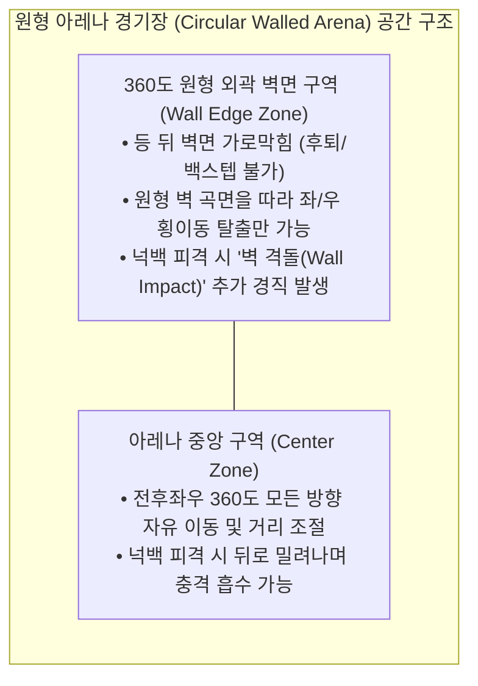
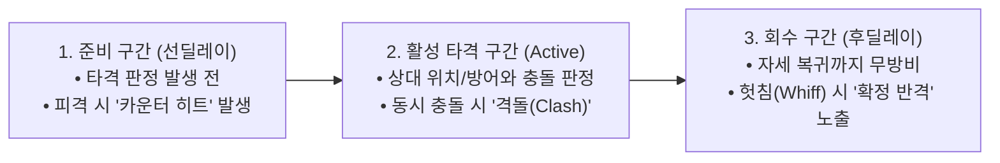
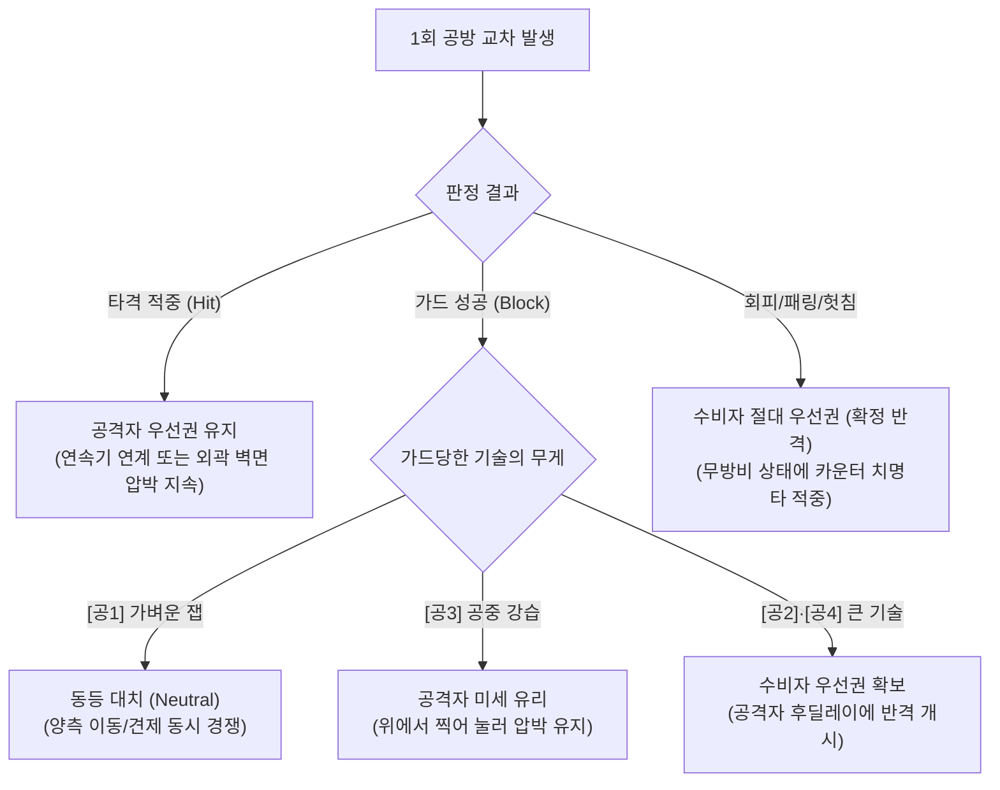
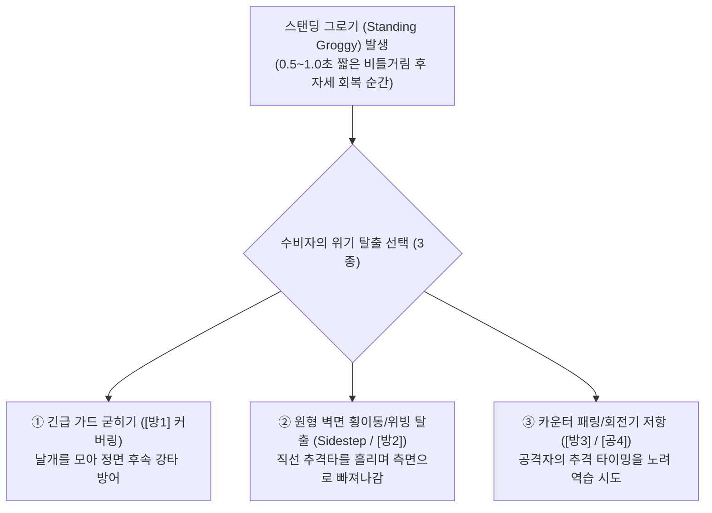

# 🥊 ROOSTER RUMBLE: 격투 모드(Rumble Pit) 전투 시뮬레이션 규칙 정의서

* **문서 버전**: `v1.1.0`
* **작성일**: 2026-10-06
* **기준 문서**: [ROOSTER RUMBLE QA 체크리스트.md](file:///D:/OneDrive/업무_진행/C/ROOSTER%20RUMBLE/ROOSTER%20RUMBLE%20QA%20체크리스트.md), [ROOSTER RUMBLE 작업자용 QA 실행 가이드.md](file:///D:/OneDrive/업무_진행/C/ROOSTER%20RUMBLE/ROOSTER%20RUMBLE%20작업자용%20QA%20실행%20가이드.md)
* **문서 목적**: 서버 기반 1:1 투계 전투 시뮬레이션 데이터 생성 및 클라이언트 중계 재생을 위한 **공격·방어·이동(버츄얼 파이터 방식) 핵심 기획 규칙 정의**
* **작성 범위**: 프로그램 파트의 구체적 구현 알고리즘(물리 연산식, 상태 머신 코드 등)은 배제하고, 알고리즘 설계의 기준이 되는 **원형 벽면 경기장 공간·이동·공방 상성·우선권·그로기 및 즉시 KO 규칙**만 명시함

---

### ■ 문서 개정 이력 (Revision History)

| 버전 | 개정일 | 주요 개정 내역 및 상세 변경 사항 | 관련 절 바로가기 |
| :---: | :---: | :--- | :--- |
| **v1.0.0** | 2026-10-06 | 버츄얼 파이터 스타일 기반 1:1 전투 시뮬레이션 공/방/이동 규칙 최초 작성 | [[#1. 시뮬레이션 기본 전제 및 전투 진행 구조\|1장 기본 전제]] |
| **v1.1.0** | 2026-10-06 | **[경기장 규격 확정 및 QA 체크리스트/실행 가이드 전면 반영]** 1. 경기장 형태를 사각 링/로프에서 **깔끔한 아케이드형 원형 경기장(Circular Arena) + 외곽 벽(Wall)**으로 전면 변경 2. QA 확정안 반영: **다운(Knockdown) 시 재기립·카운트 없이 즉시 경기 종료(KO)**로 변경하고, 경기 중 강타 피격은 **짧은 스탠딩 그로기(Groggy) 및 위기 탈출 공방**으로 개편 3. QA 확정안 반영: 조작 오해 방지를 위한 **히트스톱(프레임 정지)·슬로우 모션·딥 다이브 줌인 전면 배제** 및 객관적 관전 시점 명세 4. QA 확정안 반영: 아케이드 섬광/스파크 타격 이펙트, **크리티컬 한정 단발성 화면 혈흔(신체 지속 출혈 배제)**, 인게임 불필요 상태 표기 제거 및 사전 베팅 기준 정렬 | • [[#1.3 원형 벽면 경기장 규격 및 QA 확정 전투·연출 원칙\|1.3절 원형 경기장 및 QA 원칙]] • [[#2.3 원형 외곽 벽면 몰림(Wall Pressure) 및 벽 격돌 규칙\|2.3절 원형 벽면 몰림 규칙]] • [[#6. 그로기(Groggy) 위기 공방 및 다운 즉시 종료(KO) 규칙\|6장 그로기 및 즉시 KO 규칙]] • [[#8. 서버 시뮬레이션 결과 데이터 구성 및 중계 재생 명세\|8장 시뮬레이션 및 중계 명세]] |

---

## 목차
1. [[#1. 시뮬레이션 기본 전제 및 전투 진행 구조]]
   - [[#1.1 버츄얼 파이터(Virtua Fighter)식 1:1 대전 지향점]]
   - [[#1.2 서버 시뮬레이션 생성 및 클라이언트 중계 재생 원칙]]
   - [[#1.3 원형 벽면 경기장 규격 및 QA 확정 전투·연출 원칙]]
2. [[#2. 원형 경기장 공간(거리·위치) 및 이동(Movement) 규칙]]
   - [[#2.1 선수 간 거리(Range) 3단계 구분 규칙]]
   - [[#2.2 6대 이동 동작(Footwork) 및 궤적 회피 규칙]]
   - [[#2.3 원형 외곽 벽면 몰림(Wall Pressure) 및 벽 격돌 규칙]]
3. [[#3. 공격(Attack) 판정 및 4대 공격 기술 확장 규칙]]
   - [[#3.1 타격 부위(상·중·하단) 및 공격 궤적(직선·회전) 정의]]
   - [[#3.2 공격 4종 기술의 거리·부위·궤적 상세 매핑]]
   - [[#3.3 공격 동작 3단계 구간 및 헛침(Whiff) 노출 규칙]]
4. [[#4. 방어(Defense) 판정 및 공방 상성 매트릭스]]
   - [[#4.1 방어 3종 기술의 자세·회피·쳐내기 확장 규칙]]
   - [[#4.2 공격(4종) × 방어·이동(6종) 상성 판정 매트릭스]]
   - [[#4.3 가드 유지 한계 및 가드 브레이크(Guard Break) 규칙]]
5. [[#5. 공방 우선권(Initiative), 연속기(Combo) 및 동시 격돌(Clash) 규칙]]
   - [[#5.1 공방 결과에 따른 우선권(유불리) 전환 규칙]]
   - [[#5.2 카운터 히트(Counter Hit) 및 동시 타격 격돌(Clash) 규칙]]
   - [[#5.3 최대 3연속기(Combo) 시너지 및 중간 차단(Cancel) 규칙]]
6. [[#6. 그로기(Groggy) 위기 공방 및 다운 즉시 종료(KO) 규칙]]
   - [[#6.1 스탠딩 그로기(Groggy) 발생 조건 및 짧은 지속시간 원칙]]
   - [[#6.2 그로기 직후 공격자 마무리 압박 vs 수비자 위기 탈출 규칙]]
   - [[#6.3 투지 버티기(Last Stand) 및 다운 즉시 경기 종료(KO) 규칙]]
7. [[#7. 격투 스타일(5종)별 거리·이동·공방 선택 성향 규칙]]
   - [[#7.1 5대 격투 스타일별 공간 운용 및 공방 선호도 정의]]
   - [[#7.2 경기 상황(우세·열세·벽면 몰림)에 따른 행동 성향 변화]]
8. [[#8. 서버 시뮬레이션 결과 데이터 구성 및 중계 재생 명세]]
   - [[#8.1 시뮬레이션 타임라인 데이터 필수 기록 항목]]
   - [[#8.2 QA 기준 클라이언트 중계 재생 및 연출 동기화 규칙]]

---

## 1. 시뮬레이션 기본 전제 및 전투 진행 구조

### 1.1 버츄얼 파이터(Virtua Fighter)식 1:1 대전 지향점
* **게임형 대전 액션 공방 지향 (`QA 01·02번 확정`)**:
  - 단순 발싸움 위주의 실제 투계 재현이나 표정 묘사에서 벗어나, 아케이드 카툰풍 닭 캐릭터들이 뚜렷한 동작 시인성을 바탕으로 화려하게 치고받는 **1:1 게임형 대전 액션 메커니즘** 지향
  - 3차원 원형 경기장 공간 위에서 **간격(거리) 조절 ➔ 탐색 및 견제 ➔ 상·중·하단 및 직선·회전 수읽기 ➔ 우선권(유불리) 주고받기 ➔ 외곽 벽면(Wall) 압박 및 그로기 공방**이 실시간으로 전개됨
* **기존 7대 기술 체계와의 결합**:
  - 기존 정의된 **7대 전투 기술(공격 4종 + 방어 3종)**과 **3연속기(Combo) 체계**를 그대로 유지하되, 각 기술에 **유효 사거리(근/중/원), 타격 부위(상/중/하단), 궤적 속성(직선/회전), 가드 후 우선권(유불리)** 규칙을 부여함

### 1.2 서버 시뮬레이션 생성 및 클라이언트 중계 재생 원칙
* **서버 단일 시뮬레이션 데이터 생성**:
  - 모든 격투 경기는 서버에서 두 출전 닭의 능력치(`POW`, `DEF`, `HP`, `REC`, `TEC`, `GRT`), 격투 스타일, 보유 기술 슬롯 및 본 문서의 공/방/이동 규칙에 기반하여 시뮬레이션 타임라인 데이터를 생성함
  - 유저의 실시간 조작 개입은 없으며, 캐릭터 간 모든 이동·공격·방어·위기 탈출 판단은 정의된 규칙에 따라 서버 시뮬레이션에서 일관되게 생성됨
* **클라이언트 동일 중계 재생**:
  - 모든 접속 유저의 클라이언트는 서버가 생성한 시뮬레이션 타임라인 데이터를 수신하여 동일한 공방 장면을 오차 없이 재생함
  - 공격 적중, 가드 방어, 회피, 패링, 그로기 상태를 **화면의 캐릭터 동작만 보고도 직관적으로 구별**할 수 있도록 명확한 모션과 이펙트로 중계함 (`QA 통과 체크 기준`)

### 1.3 원형 벽면 경기장 규격 및 QA 확정 전투·연출 원칙
* **원형 벽면 경기장 (`Circular Walled Arena`) 확정 (`신규 확정 + QA 06번`)**:
  - 어둡고 거친 언더그라운드 투계장이나 사각 링 로프 구조를 배제하고, **시인성이 높고 깔끔한 게임형 아케이드 컨셉의 '원형 경기장(Circular Arena)'**을 기본 규격으로 확정함
  - 경기장 외곽 경계는 탄성 로프가 아닌 **단단한 원형 벽(Wall)**으로 둘러싸여 있으며, 링아웃(장외 패배) 없이 외곽 벽면에 몰렸을 때의 **벽면 압박(Wall Pressure) 및 벽 격돌(Wall Impact)** 규칙이 작동함
* **다운 시 카운트·재기립 배제 및 즉시 종료 (`QA 07·09번 확정`)**:
  - 권투처럼 바닥에 쓰러진 뒤 다운 카운트를 세거나 다시 일어나는(재기립) 연출은 **인위적인 승패 조작 오해**를 유발하므로 전면 배제함
  - 경기 도중 큰 충격을 입었을 때는 쓰러지지 않고 서서 비틀거리는 **짧은 '그로기(Groggy)' 상태**로만 표현하며, 체력이 모두 소진되어 **바닥에 다운(Knockdown)되는 순간 카운트 없이 즉시 경기 종료(KO)**로 판정함
* **조작 오인 방지를 위한 객관적 관전 연출 (`QA 03·04·05·10·12번 확정`)**:
  - **히트스톱 및 딥 다이브 줌인 전면 배제**: 유저가 직접 조작하지 않는 베팅 관전 게임 특성상, 특정 닭의 타격 순간 화면을 멈추는 히트스톱(프레임 정지/슬로우 모션)이나 급격한 딥 다이브 카메라 줌인은 반대편 베팅 유저에게 승부 조작 의심을 유발하므로 일체 사용하지 않음
  - **타격 이펙트 및 크리티컬 혈흔 규칙**: 아케이드 섬광·스파크 이펙트를 중심으로 타격감을 표현하되, **큰 타격(크리티컬 히트) 적중 시에만** 화면에 피가 짧게 튀었다가 즉시 사라지는 연출을 적용함 (캐릭터 신체의 지속적 상처·출혈 묘사 전면 배제)
  - **인게임 상태 표시 배제 및 사전 베팅 기준**: 경기 시작 전 가이드/정보 화면에서 선수 기록·능력치·전투 특성을 제공하고, 경기 시작 후에는 관전 집중을 방해하는 실시간 컨디션 오라/상태 표기를 띄우지 않음. 또한 초기 서비스는 **경기 전 사전 베팅**만 노출함 (라운드 간 중간 베팅은 후속 검토 항목으로 분리)

---

## 2. 원형 경기장 공간(거리·위치) 및 이동(Movement) 규칙

### 2.1 선수 간 거리(Range) 3단계 구분 규칙
두 닭 캐릭터 사이의 상대 거리는 항상 아래 3단계 중 하나로 판정되며, 현재 거리에 따라 시전 가능한 기술과 적중 여부가 결정됨.

| 거리 단계 | 거리 정의 및 대치 상태 | 공격 적중 가능 범위 | 주요 발생 행동 |
| :---: | :--- | :--- | :--- |
| **근접 거리** (`Close Range`) | 부리와 가슴이 맞닿을 듯한 초근접 난타 간격 | 단거리 신속기(`[공1]`), 하단기(`[공2]`), 회전기(`[공4]`) 즉시 적중 | 빠른 연타 압박, 가드 굳히기, 위빙 회피, 패링 반격, 백스텝 이탈 |
| **중거리** (`Mid Range`) | 한 걸음 전진하거나 다리/날개를 뻗어야 닿는 견제 간격 | 중거리 타격기(`[공2]`, `[공4]`) 및 도약기(`[공3]`) 적중 (`[공1]` 단독 시전 시 헛침) | 전후 스텝 간격 조절, 좌우 횡이동 탐색, 견제기 내밀기, 헛침 유도 |
| **원거리** (`Long Range`) | 양 선수가 멀리 떨어진 탐색 및 호흡 정돈 간격 | 공중 도약 강습기(`[공3]`)만 단숨에 거리 좁히며 적중 가능 (나머지 공격 전부 헛침) | 전방 대시 접근, 원형 사이드 서클링, 연속기 후 기력 호흡 정돈 |

### 2.2 6대 이동 동작(Footwork) 및 궤적 회피 규칙
캐릭터는 공격이나 방어를 수행하지 않는 상태에서 아래 6가지 이동 동작을 통해 원형 경기장 내 거리와 각도를 제어함.

| 이동 구분 | 이동 동작 명칭 | 거리/각도 변화 효과 | 이동 중 방어 및 피격 판정 규칙 |
| :---: | :--- | :--- | :--- |
| **전진 스텝** | `Step Forward` | 상대와의 거리를 반 걸음 좁힘 (원➔중, 중➔근) | 이동 중 즉시 가드(`[방1]`) 전환 가능 (안전한 접근 수단) |
| **후퇴 스텝** | `Step Back` | 상대와의 거리를 반 걸음 벌림 (근➔중, 중➔원) | 이동 중 자연 방어 유지 가능, 상대 짧은 공격의 헛침(Whiff) 유도 |
| **전방 대시** | `Dash In` | 거리를 단숨에 1단계 이상 급속 축소 (원➔근/중) | **대시 동작 중 가드 불가**, 상대 맞이치기 공격에 피격 시 카운터 판정 |
| **백스텝** | `Backstep` | 뒤로 빠르게 도약하여 근접 압박에서 즉시 이탈 (근➔원/중) | 상대 근거리 직선/하단 공격 회피 가능, 단 **착지 순간 짧은 무방비 후딜레이** 존재 (원거리 추격기 `[공3]`에 취약) |
| **좌/우 횡이동** | `Sidestep (L/R)` | 상대 정면 타격선(Line of Attack)에서 좌/우 측면으로 비켜남 | **상대의 '직선 궤적 공격(`[공1]`, `[공3]`)'을 완전히 흘려보내고 측면 노출 유도**, 단 **'회전/광역 공격(`[공2]`, `[공4]`)'에는 추적 피격**됨 |
| **원형 서클링**| `Circular Walk` | 원형 경기장 곡률을 따라 좌/우로 크게 돌며 위치 교대 | 외곽 벽면 몰림 상황에서 벽을 타고 빠져나오거나 중앙 주도권 탈환 |

### 2.3 원형 외곽 벽면 몰림(Wall Pressure) 및 벽 격돌 규칙
* **원형 경기장 2대 구역 구분**:
  - **아레나 중앙 (`Center Zone`)**: 전후좌우 모든 방향으로 제한 없이 이동 및 넉백 밀려남이 가능한 기본 구역
  - **외곽 벽면 경계 (`Wall Edge Zone`)**: 원형 경기장 가장자리의 단단한 벽면에 등이 닿거나 인접하여 더 이상 뒤로 물러설 공간이 없는 구역
* **외곽 벽면 몰림 시 작동하는 3대 규칙**:
  1. **후방 퇴로 차단 및 원형 탈출 강제**: 등 뒤가 벽으로 막혀 `후퇴 스텝(Step Back)` 및 `백스텝(Backstep)`이 불가능해지며, 상대와 강제로 `근접 거리` 또는 `중거리`가 유지됨. 벽면 압박에서 벗어나려면 원형 벽면을 따라 **`좌/우 횡이동(Sidestep)`·`원형 서클링(Circular Walk)`**으로 돌아 나가거나, 패링/강타로 상대를 밀쳐내야 함
  2. **벽 격돌 추가 경직 (`Wall Impact / Wall Stagger`)**: 탄성 로프와 달리 단단한 벽면이므로, 벽을 등진 상태에서 넉백 속성 공격(`[공4: 회전 날개치기]` 또는 3연속기 피니시)에 피격될 경우 **벽면에 강하게 부딪히며 짧은 스탠딩 그로기(비틀거림 경직)**에 빠짐
  3. **가드 압박 가중**: 벽에 몰린 채 가드(`[방1]`)로만 버틸 경우, 뒤로 밀려나며 충격을 분산하지 못해 **가드 게이지 소모량이 중앙 평지 대비 가중**되어 가드 브레이크 위험이 급증함

---

## 3. 공격(Attack) 판정 및 4대 공격 기술 확장 규칙

### 3.1 타격 부위(상·중·하단) 및 공격 궤적(직선·회전) 정의
버츄얼 파이터 방식의 입체적 공방을 위해 모든 공격 기술은 **타격 부위(Height)**와 **공격 궤적(Trajectory)** 2가지 물리 속성을 동시에 가짐.

* **타격 부위 3단 구분**:
  - **상단/공중 (`High / Air`)**: 상대의 머리·어깨 위쪽에서 꽂히는 타격. 서서 가드로 방어 가능하나 **상체 숙이기 회피(`[방2: 슬립 위빙]`)에 허공을 가름**
  - **중단 (`Mid`)**: 상대의 가슴·몸통 정면을 노리는 표준 타격. 서서 가드로 방어 가능하며, **낮은 자세 가드나 무리한 숙이기를 타격함**
  - **하단 (`Low`)**: 상대의 다리·발목을 후려치는 타격. **일반 서서 가드를 뚫고 타격**하며, 낮은 자세 방어나 백스텝으로만 대처 가능
* **공격 궤적 2종 구분**:
  - **직선 궤적 (`Linear`)**: 정면 일직선으로 빠르게 찌르거나 급강하하는 공격. 발동 속도와 사거리 대비 위력이 뛰어나지만 **상대의 좌/우 횡이동(`Sidestep`) 및 위빙(`[방2]`)에 회피당함**
  - **회전/광역 궤적 (`Circular / Tracking`)**: 몸통이나 날개를 크게 회전시켜 좌우 측면을 동시에 휩쓰는 공격. 발동은 직선기보다 느리지만 **원형 벽면을 타고 횡이동(`Sidestep`)하거나 위빙(`[방2]`)을 시도하는 상대를 추적하여 타격함**

### 3.2 공격 4종 기술의 거리·부위·궤적 상세 매핑
기존 4대 공격 기술(`[공1]`~`[공4]`)에 버츄얼 파이터식 공간·부위·궤적 규칙을 매핑한 상세 명세표임.

| 기술 식별자 | 기술명 | 유효 사거리 | 타격 부위 | 공격 궤적 | 발동 속도 | 핵심 공방 역할 및 특수 판정 규칙 |
| :---: | :--- | :---: | :---: | :---: | :---: | :--- |
| **`[공1]`** | **부리 연타** (`Peck Rush`) | **근접** | **중·상단** (안면/가슴) | **직선** (`Linear`) | **최고속** (0.4초) | • **근접 최속 시동기**: 근접 거리에서 가장 먼저 닿는 기본 잽 견제기 • 가드당해도 후딜레이가 매우 짧아 불리하지 않으며 연속기 시동에 최적 • 단, 사거리가 짧아 중·원거리에서 헛치기 쉽고 **횡이동 및 위빙(`[방2]`)에 취약** |
| **`[공2]`** | **며느리발톱 강타** (`Spur Cleave`) | **근접 ~ 중거리** | **하단** (다리/발목) | **반회전** (`Semi-Track`) | **보통** (0.6초) | • **하단 가드 붕괴 및 반회전 킥**: 몸을 틀며 뒤축 발톱으로 하단을 후려침 • 상대의 상·중단 위주 서서 가드 및 상체 위빙(`[방2]`)을 무너뜨리고 방어력 일부 관통 • 발톱이 나오는 방향 쪽 횡이동을 잡아내며 적중 시 상대 다리 경직 유발 |
| **`[공3]`** | **비상 급습** (`Dive Talon`) | **중거리 ~ 원거리** (돌진 단축) | **상단/공중** (두부 강습) | **직선 도약** (`Linear Jump`) | **다소 느림** (0.7초) | • **원거리 단축 공중 강습기**: 도약 후 급강하하여 거리를 단숨에 근접으로 좁힘 • 공중 도약 중 상대의 하단 공격(`[공2]`)을 무시하고 일방 타격 가능 • 위에서 내려찍는 특성상 상대가 가드(`[방1]`)해도 공격자가 유리한 우선권 유지 • 단, 직선 궤적이므로 **횡이동(`Sidestep`) 및 위빙(`[방2]`), 패링(`[방3]`)에 취약** |
| **`[공4]`** | **회전 날개치기** (`Wing Tempest`) | **근접 ~ 중거리** | **전신 중단** (몸통 전체) | **360도 완전회전** (`Full Tracking`) | **가장 느림** (0.8초) | • **횡이동 원천 봉쇄 및 벽면 넉백기**: 720도 회전 돌풍으로 전방과 양 측면을 모두 타격 • 원형 경기장에서 **좌/우 횡이동(`Sidestep`) 및 슬립 위빙(`[방2]`)을 100% 추적 타격**함 • 적중 시 상대를 외곽 벽면 쪽으로 크게 밀쳐내며, 상대 연속기를 강제 차단함 • 단, 발동이 느려 근접에서 `[공1]`에 먼저 끊기거나 가드당할 경우 큰 빈틈 노출 |

### 3.3 공격 동작 3단계 구간 및 헛침(Whiff) 노출 규칙
모든 공격 기술은 시전 시 아래 3단계 시간 구간을 거치며, 각 구간에서 피격되거나 빗나갈 때의 규칙이 다르게 작동함.

1. **준비 구간 (Startup / 선딜레이)**: 공격 자세를 취하며 타격이 뻗어 나가기 직전까지의 구간. 이 구간에 상대의 더 빠른 공격에 먼저 맞으면 **카운터 히트(Counter Hit)**가 발생하여 자신의 공격은 취소되고 큰 경직을 입음
2. **활성 타격 구간 (Active)**: 부리·발톱·날개가 목표 지점에 도달하여 타격 판정을 발생시키는 구간
3. **회수 구간 (Recovery / 후딜레이)**: 공격이 끝난 뒤 기본 대치 자세로 돌아오기까지의 구간. 특히 상대가 백스텝이나 횡이동으로 피하여 **공격이 허공을 가른 경우(헛침 / Whiff)**, 적중이나 가드 시보다 회수 구간이 길어지며 이 시간 동안 방어 불능 상태가 되어 상대에게 **헛침 처벌(Whiff Punish)** 기회를 내줌

---

## 4. 방어(Defense) 판정 및 공방 상성 매트릭스

### 4.1 방어 3종 기술의 자세·회피·쳐내기 확장 규칙
기존 3대 방어 기술(`[방1]`~`[방3]`)은 단순 확률 방어가 아닌, 상대 공격의 **부위(상/중/하)**와 **궤적(직선/회전)**에 맞물리는 능동적 수비 동작으로 작동함.

| 기술 식별자 | 기술명 | 방어 유형 | 유효 대응 범위 | 취약 공격 (파훼 수단) | 성공 시 후속 효과 및 우선권 변화 |
| :---: | :--- | :---: | :--- | :--- | :--- |
| **`[방1]`** | **깃털 커버링** (`Feather Guard`) | **밀착 가드** (충격 흡수) | • 기본: 상·중단 및 회전 공격 방어 • 하단 인식 시: 낮은 가드 전환 | • 미반응 시 하단(`[공2]`) 관통 피해 • 연속 가드 시 **가드 브레이크** 위험 | • 타격 피해 대폭 감쇄(`-60%`) 및 약간의 후방 밀림 발생 • 상대가 큰 기술(`[공2]`, `[공4]`)을 가드당했을 경우 수비자가 즉시 반격 우선권 획득 |
| **`[방2]`** | **슬립 위빙** (`Slip Weave`) | **상체 회피** (무효화+급습) | • **직선 공격(`[공1]`, `[공3]`)** • 상단/고타점 타격 | • **360도 회전기(`[공4]`)에 피격** • **하단 킥(`[공2]`)에 다리 피격** | • 상대 공격 피해 `0` 완전 무효화 및 상대 후딜레이 포착 • 즉시 이어지는 다음 연계 공격에 **조건부 100% 확정 치명타** 부여 |
| **`[방3]`** | **날개 패링** (`Wing Parry`) | **쳐내기 반격** (궤적 굴절) | • **중·상단 직선/단발 타격(`[공1]`, `[공2]`, `[공3]`)** 접촉 순간 | • **전신 회전 돌풍(`[공4]`) 패링 불가** • 상대가 공격하지 않거나 페인트 시 패링 헛침 후딜레이 노출 | • 상대의 공격 및 진행 중인 **연속기를 즉시 강제 캔슬**시킴 • 상대를 짧은 무방비 경직(`Stun`) 상태로 만들고 **무조건 반격 치명타** 확정 |

### 4.2 공격(4종) × 방어·이동(6종) 상성 판정 매트릭스
서버 시뮬레이션이 매 공방 순간 결과를 도출할 때 참조하는 **공격 기술 대 수비·이동 행동 간의 절대 상성 규칙표**임.

| 공격 기술 \ 수비·이동 | `[방1]` 깃털 커버링 (일반 가드) | `[방2]` 슬립 위빙 (상체 회피) | `[방3]` 날개 패링 (쳐내기) | `좌/우 횡이동` (`Sidestep`) | `백스텝` (`Backstep`) | `전방 대시 / 공격 준비 중` (무방비 노출) |
| :---: | :--- | :--- | :--- | :--- | :--- | :--- |
| **`[공1]` 부리 연타** (근접 / 중상단 / 직선) | **가드 성공** (피해 감쇄, 공방 대등) | **회피 성공 (수비 승)** (헛침 유도 + 확정 반격) | **패링 성공 (수비 대승)** (공격 캔슬 + 스턴 반격) | **회피 성공 (수비 승)** (직선 궤적 이탈) | **회피 성공** (근접 사거리 밖 이탈) | **적중 / 카운터 히트** (빠른 발동으로 선제 타격) |
| **`[공2]` 며느리발톱** (근·중 / 하단 / 반회전) | **가드 관통 / 반감** (하단 방어 미전환 시 적중, 가드 시 수비자 반격 유리) | **공격 적중 (공격 승)** (상체 위빙 중 하단 다리 타격) | **패링 성공 (수비 대승)** (발톱 궤적 쳐내기 + 스턴) | **방향별 반반 판정** (발톱 회전 방향 횡이동 시 피격, 반대쪽 시 회피) | **근접 시 적중 / 중거리 시 회피** (사거리 끝자락 이탈 가능) | **적중 / 카운터 히트** (하단 경직 유발) |
| **`[공3]` 비상 급습** (중·원 / 상단공중 / 직선) | **가드 성공 (공격 유리)** (가드 데미지 누적 및 공격자 우선권 유지) | **회피 성공 (수비 대승)** (착지 후딜레이에 확정 치명타 반격) | **패링 성공 (수비 대승)** (급강하 궤적 쳐내기 + 스턴) | **회피 성공 (수비 대승)** (직선 강습 빗나감 ➔ 큰 착지 빈틈 노출) | **공격 적중 (공격 승)** (도약 사거리로 백스텝 착지 캐치) | **적중 / 카운터 히트** (하단기 무시 일방 타격) |
| **`[공4]` 회전 날개치기** (근·중 / 전신 / 360도 회전) | **가드 성공 (수비 유리)** (밀림 발생하나 가드 직후 수비자 반격 우선권 확보) | **공격 적중 (공격 대승)** (전신 회전으로 위빙 완전 파훼 및 벽면 넉백) | **공격 적중 (공격 대승)** (광역 회전 돌풍으로 패링 분쇄 및 벽면 넉백) | **공격 적중 (공격 대승)** (양방향 횡이동 100% 추적 타격) | **근접 시 적중 / 중거리 시 회피** (회전 반경 밖 이탈 시 헛침) | **강력 적중 (공격 대승)** (상대 연속기 강제 차단 및 외곽 벽면 넉백) |

### 4.3 가드 유지 한계 및 가드 브레이크(Guard Break) 규칙
* **가드 내구도 개념**: `[방1: 깃털 커버링]`은 연속해서 타격을 가드할 경우 가드 내구도가 소모됨
* **가드 소모 가중 요인**:
  - 일반 견제기(`[공1]`) 가드 시에는 소모량이 미미하나, 중량 타격기(`[공2]`, `[공3]`, `[공4]`)를 연속 가드하거나 **원형 외곽 벽면에 몰린 상태**에서 가드할 경우 소모량이 크게 증가함
  - 공격을 가드하지 않고 이동하거나 공격을 시도하는 동안 가드 내구도는 자연 회복됨
* **가드 브레이크 발생 및 결과**:
  - 가드 내구도가 한계에 도달한 상태에서 중량 공격(`[공2]`, `[공3]`, `[공4]`)을 가드할 경우 **가드 브레이크(Guard Break)**가 발생함
  - 가드 브레이크 발생 즉시 수비자의 양 날개가 젖혀지며 **짧은 무방비 그로기(방어·회피·이동 불가) 상태**에 빠지고, 공격자의 후속 강타가 방어력 무시 관통 치명타로 확정 적중함

---

## 5. 공방 우선권(Initiative), 연속기(Combo) 및 동시 격돌(Clash) 규칙

### 5.1 공방 결과에 따른 우선권(유불리) 전환 규칙
버츄얼 파이터의 핵심인 **프레임 유불리(턴 주고받기)**를 시뮬레이션 규칙화한 것으로, 1회 공방이 끝난 직후 **누가 먼저 다음 행동을 시작할 수 있는가(우선권)**를 결정함.

1. **공격 적중 시 (`Hit Advantage`)**: 공격을 맞힌 쪽이 계속 우선권을 쥐며, 2타·3타 연속기(Combo)를 이어가거나 상대를 원형 외곽 벽면으로 몰아붙임
2. **가드 성공 시 (`Block Advantage / Disadvantage`)**:
   - **`[공1: 부리 연타]` 가드 시**: 빈틈이 거의 없어 **백중세(동등 우선권)** 유지 (양측 모두 횡이동·백스텝·잽 내밀기 대등 경쟁)
   - **`[공3: 비상 급습]` 가드 시**: 공중에서 체중을 실어 찍어 누르므로 가드하고도 수비자가 움츠러들어 **공격자가 미세한 우선권** 유지
   - **`[공2: 며느리발톱]` 또는 `[공4: 회전 날개치기]` 단발/마무리 가드 시**: 동작이 큰 기술이 막혔으므로 **수비자에게 우선권이 완전히 넘어감** (수비자가 즉시 반격 시동기 개시)
3. **회피(`[방2]`/횡이동/백스텝 헛침 유도) 및 패링(`[방3]`) 성공 시 (`Punish Advantage`)**: 수비자에게 **절대 우선권**이 부여되어, 공격자가 자세를 추스르기 전에 수비자의 반격 기술이 100% 확정 적중함

### 5.2 카운터 히트(Counter Hit) 및 동시 타격 격돌(Clash) 규칙
* **카운터 히트 (`Counter Hit`)**:
  - 한 선수가 공격을 시전하는 **준비 구간(선딜레이)** 또는 `전방 대시` 도중에 상대의 더 빠른 공격이 먼저 닿을 경우 카운터 히트로 판정됨
  - 카운터 히트 피격 시 일반 적중보다 큰 피해량과 긴 경직이 발생하여, 공격자의 후속 연계 타격이 더 쉽게 이어짐
* **동시 타격 격돌 (`Clash` & `Cross Counter`)**:
  - 양 선수가 동시에 공격 활성 구간에 진입하여 정면충돌할 경우:
    1. **궤적/부위 상성 우위**: 예를 들어 `[공3: 비상 급습(공중)]`과 `[공2: 며느리발톱(하단)]`이 동시 충돌하면 공중으로 뜬 `[공3]`이 하단 판정을 일방적으로 이김
    2. **기술 위력 우위**: 동일 단수 충돌 시 공격 위력(`POW × 기술 계수`)이 뚜렷하게 높은 쪽이 상대 공격을 뭉개고 일방 적중함
    3. **크로스 카운터 (동시 피격)**: 두 공격의 위력과 타이밍이 대등(격차 10% 이내)할 경우 양측 모두 피해를 입는 크로스 카운터가 발생함

### 5.3 최대 3연속기(Combo) 시너지 및 중간 차단(Cancel) 규칙
* **6대 연속기 조합 시너지 유지**:
  - `공+공` (전광석화 2연타: 1타 적중 시 2타 치명타율 상승)
  - `방+공` (회피 후 기습 강타: 1타 위빙 회피 성공 시 2타 확정 크리티컬)
  - `공+공+공` (맹공의 3단 콤보: 3타 전수 적중 시 피해 증폭 및 스탠딩 그로기·벽면 넉백 유발)
  - `방+방+공` (철벽의 역습 카운터: 1타 가드 + 2타 패링 성공 시 상대 캔슬 및 1.8배 무조건 반격 크리티컬)
  - `공+방+공` (페인트 치고 빠지기: 1타 견제 후 상대 반격을 2타로 흘리고 3타 방어 무시 타격)
  - `방+공+공` (가드 돌파 반격: 1타 가드 흡수 후 2연속 타격으로 아레나 중앙 주도권 탈환)
* **연속기 중간 강제 차단 (`Combo Interruption / Cancel`)**:
  - 연속기는 1타가 적중했다고 해서 끝까지 무조건 보장되는 것이 아니며, 1타가 **가드당했거나 빗나갔을 때** 공격자가 무리하게 2타·3타를 이어갈 경우 수비자가 그 틈에 **`[방3: 날개 패링]`**, **`[방2: 슬립 위빙]`**, **`횡이동`**, 또는 **`[공4: 회전 날개치기]`**를 끼워 넣어 공격자의 잔여 연속기를 **즉시 강제 캔슬**시키고 역습할 수 있음
* **연속기 완주 후 기력 호흡 정돈**:
  - 3연속기를 끝까지 시전한 선수는 기술력(`TEC`)에 반비례하는 짧은 호흡 정돈 시간(1.0~1.5초) 동안 연속기 재시동이 제한되며, 스텝 이동이나 단발 방어/견제로 간격을 다시 조율함

---

## 6. 그로기(Groggy) 위기 공방 및 다운 즉시 종료(KO) 규칙

> **[QA 체크리스트 07·09번 및 실행 가이드 확정 기준]**
> * 권투처럼 바닥에 쓰러진 뒤 다운 카운트를 세거나 재기립(기상)하는 연출은 **승패 조작 오해 소지**가 있으므로 전면 배제함
> * 경기 도중 발생하는 위기 상태는 바닥에 눕지 않고 서서 비틀거리는 **짧은 '스탠딩 그로기(Groggy)'**로 표현하며, 체력이 0이 되어 **바닥에 다운(Knockdown)되는 순간 즉시 경기 종료(KO)**로 처리함

### 6.1 스탠딩 그로기(Groggy) 발생 조건 및 짧은 지속시간 원칙
* **스탠딩 그로기(`Standing Groggy`) 정의**:
  - 경기 도중 큰 충격을 입었을 때 바닥에 쓰러지지 않고 두 발로 버틴 채 상체가 흔들리며 일시적으로 방어력이 약화되는 위기 상태
  - 관전자가 *"살짝 밀려서 졌나 싶었는데 그로기 상태에서 버티고 역전하네"*라며 응원할 수 있는 극적 서스펜스를 제공함 (`QA 07번 의도 반영`)
* **그로기 발생 4대 조건**:
  1. `공+공+공` 3단 연속기의 마지막 3타 피니시에 직격당한 경우
  2. **가드 브레이크(Guard Break)**가 발생하여 양 날개 가드가 젖혀진 경우
  3. 원형 외곽 벽면을 등진 상태에서 `[공4: 회전 날개치기]` 등 강타를 맞아 **벽 격돌(`Wall Impact`)**이 발생한 경우
  4. `[방3: 날개 패링]`에 공격이 쳐내져 중심을 잃은 경우
* **경기 템포 유지를 위한 짧은 지속시간 원칙**:
  - 그로기 연출이 길어져 경기 템포가 늘어지거나 조작처럼 보이지 않도록, 그로기 지속시간은 **0.5초 ~ 1.0초 이내의 짧은 순간**으로 엄격히 제한함

### 6.2 그로기 직후 공격자 마무리 압박 vs 수비자 위기 탈출 규칙
짧은 그로기 상태가 풀리는 직후 순간에 **공격자의 추격 압박 선택**과 **수비자의 위기 탈출 선택**이 맞물리는 가위바위보 수읽기가 전개됨.

| 수비자 위기 탈출 선택 \ 공격자 추격 행동 | ① 직선 급습 마무리 (`[공1]` 연타 / `[공3]` 비상 급습) | ② 하단/전신 회전 가드 붕괴 (`[공2]` 며느리발톱 / `[공4]` 날개치기) | ③ 페인트 대기 후 카운터 처벌 (접근 후 `[방1]`/`[방3]` 대기) |
| :---: | :--- | :--- | :--- |
| **① 긴급 가드 굳히기** (`[방1]` 깃털 커버링) | **방어 성공 (수비 생존)** 직선 공격을 가드로 막아내며 위기 모면 | **가드 관통 / 재차 가드 브레이크 (공격 승)** 하단기(`[공2]`)에 뚫리거나 중량 타격에 가드 재붕괴 | **중립 대치 복귀 (Neutral)** 양측 모두 피해 없이 호흡 정돈 및 간격 재조정 |
| **② 횡이동 / 위빙 탈출** (`Sidestep` / `[방2]`) | **회피 후 역습 성공 (수비 대승)** 직선 강습을 허공에 흘려보내고 측면 확정 반격 | **추적 타격 피격 (공격 대승)** 회전 궤적(`[공2]`, `[공4]`)에 횡이동이 잡히며 큰 피해 | **벽면/위기 탈출 성공 (수비 유리)** 외곽 벽면에서 벗어나 아레나 중앙으로 위치 회복 |
| **③ 패링 / 회전기 저항** (`[방3]` / `[공4]`) | **패링 역전 카운터 (수비 대승)** 성급한 직선 추격을 패링으로 쳐내고 1.8배 역습 | **정면 격돌 (공격 위력 우위)** 그로기 직후 느린 회전기 시동 중 상대 강타에 카운터 피격 | **헛침 후 처벌 피격 (공격 대승)** 수비자의 성급한 패링/회전기를 기다렸다 확정 카운터 |

### 6.3 투지 버티기(Last Stand) 및 다운 즉시 경기 종료(KO) 규칙
* **투지 버티기 (`Last Stand` - 쓰러지지 않고 버티기)**:
  - 결정적 타격을 입어 잔여 체력이 `0` 이하로 떨어지는 순간, 선수의 **근성(`GRT`)** 스탯에 비례하는 확률(`GRT × 0.5%`, 경기당 최대 1회)로 **투지 버티기**가 발동함
  - 발동 성공 시 **바닥에 다운되지 않고(재기립 연출 없음)** 다리에 힘을 주어 서서 버텨내며 체력 `1`을 남긴 채 마지막 역전 공방을 이어감
* **바닥 다운(`Knockdown`) = 즉시 경기 종료(`KO`) 확정 (`QA 09번 확정`)**:
  - 투지 버티기가 발동하지 않거나 이미 소모된 상태에서 체력이 `0`에 도달하면, 그 순간 비로소 파이터가 **바닥에 완전히 쓰러지는 다운(`Knockdown`)**이 발생함
  - 파이터가 바닥에 다운되는 즉시 **심판 카운트다운이나 재기립 시도 없이 그 자리에서 즉시 경기 종료(KO)**가 선언되며, 곧바로 승리 세리머니 및 결과/배당 정산 화면으로 전환됨

---

## 7. 격투 스타일(5종)별 거리·이동·공방 선택 성향 규칙

### 7.1 5대 격투 스타일별 공간 운용 및 공방 선호도 정의
서버 시뮬레이션이 각 닭 캐릭터의 다음 행동을 결정할 때 기준이 되는 **5대 격투 스타일별 원형 공간 운용·이동·공방·위기 탈출 성향 규칙표**임.

| 격투 스타일 | 선호 유지 거리 | 주력 이동(Footwork) 성향 | 주력 공격 및 연속기 성향 | 주력 방어 및 대응 성향 | 그로기/벽면 몰림 시 탈출 성향 |
| :---: | :---: | :--- | :--- | :--- | :---: |
| **인파이터** (`Infighter`) | **근접 거리** (`Close`) | • `전진 스텝` 및 `전방 대시` 비중 최상 • 상대를 원형 외곽 벽면으로 몰아붙이는 압박 선호 | • `[공1: 부리]` 시동 후 `[공2]` 연결 (`공+공`, `공+공+공`) • 가드 시에도 끊임없이 근접 연타 시도 | • 근접 `[방2: 슬립 위빙]` 및 짧은 `[방1: 가드]` 후 즉시 맞받아치기 | **위빙 회피(`[방2]`)** 후 즉시 근접 맞받아치기 |
| **아웃파이터** (`Outfighter`) | **중·원거리** (`Mid ~ Long`) | • `후퇴 스텝`, `백스텝`, `원형 서클링` 비중 최상 • 외곽 벽면을 등지지 않도록 아레나 중앙 사수 | • 상대 헛침(Whiff) 유도 후 `[공3: 비상 급습]` 기습 • `방+공`, `공+방+공` 치고 빠지기 선호 | • `백스텝` 거리 이탈 및 `[방2: 슬립 위빙]` 회피 후 확정 크리티컬 반격 | **원형 서클링 / 횡이동** (벽면 탈출 및 거리 벌리기 최우선) |
| **브롤러** (`Brawler`) | **근접 ~ 중거리** (`Close ~ Mid`) | • 우직한 `전진 스텝` 위주, 후퇴나 백스텝 거의 안 함 • 맞으면서도 밀고 들어가는 난타전 선호 | • `[공2: 며느리발톱]` 및 `[공4: 회전 날개치기]` 중량 강타 위주 • 상대 횡이동 분쇄 및 벽면 격돌 유발 특화 | • `[방1: 깃털 커버링]`으로 버틴 뒤 `방+공+공` 가드 돌파 반격 | **긴급 가드(`[방1]`)** 후 `[공4]` 광역 회전 밀어내기 |
| **테크니션** (`Technician`) | **중거리** (`Mid`) | • `좌/우 횡이동(Sidestep)` 및 정밀한 `전후 스텝` 비중 최상 • 상대의 직선 공격 각도를 비켜나는 발놀림 | • 상대 빈틈 포착 시 `[공1]+[공2]` 또는 패링 직후 확정 카운터 공격 | • **`[방3: 날개 패링]`** 및 `횡이동` 비중 최상 • `방+방+공` 1.8배 무조건 반격 카운터 지향 | **날개 패링(`[방3]`)** 노림수 및 **좌/우 횡이동** 혼합 |
| **밸런서** (`Balanced`) | **전 거리 유동** (`Adaptive`) | • 상대 스타일의 반대 상성 거리로 유연하게 이동 전환 | • 특정 패턴에 치우치지 않고 상황에 맞는 최적 단발/연속기 구사 | • `[방1]`, `[방2]`, `[방3]` 및 횡이동을 고르게 분배하여 안정적 수비 | **상황별 균등 선택** |

### 7.2 경기 상황(우세·열세·벽면 몰림)에 따른 행동 성향 변화
정적인 패턴 반복을 방지하고 실제 격투 경기의 드라마틱한 흐름을 만들기 위해, 경기 중 상황 변화에 따라 아래 규칙으로 행동 성향이 동적으로 보정됨.

| 경기 상황 조건 | 공격자의 행동 변화 규칙 | 수비자(열세/위기 측)의 행동 변화 규칙 |
| :--- | :--- | :--- |
| **원형 외곽 벽면 몰림 시** | • 상대가 원형 벽을 타고 좌우로 빠져나가지 못하도록 **회전/광역기(`[공4]`)** 및 **반회전 하단기(`[공2]`)** 비중 상향 • 벽 격돌(`Wall Impact`) 및 가드 브레이크 압박 강화 | • 벽면 탈출을 위해 **`좌/우 횡이동(Sidestep)` + `원형 서클링(Circular Walk)`** 시도 비중 급증 • 또는 위기 탈출용 **`[방3: 날개 패링]`** 및 **`[공4: 회전 날개치기]`** 저항 시도 |
| **체력 대폭 우세 시** (잔여 체력 30%p 이상 리드) | • 무리한 전방 대시나 큰 후딜레이 기술을 자제하고, `후퇴 스텝`·`원형 서클링` 및 안전한 `[공1]` 견제와 방어 비중 상향 (굳히기 운영) | • 점수 만회를 위해 `전방 대시` 접근 및 고위험·고수익 3연속기(`공+공+공`), `[공3: 비상 급습]` 시도 비중 대폭 상향 |
| **라운드 종료 임박 시** (잔여 시간 10초 이내) | • 판정 우위를 지키기 위한 거리 벌리기(`백스텝`, `원형 서클링`) 및 방어 집중 | • 라운드 역전을 위한 총공세(방어 비중 축소, 연속 공격 및 돌진기 집중) |
| **가드 게이지 위험 시** (가드 브레이크 직전) | • 상대의 가드를 부수기 위해 중량 타격기(`[공2]`, `[공3]`, `[공4]`) 집중 투입 | • `[방1: 가드]` 선택을 일시 중단하고, 위험을 감수하더라도 **`[방2: 위빙]`**, **`[방3: 패링]`**, 또는 **`백스텝/횡이동`**으로 전환 |

---

## 8. 서버 시뮬레이션 결과 데이터 구성 및 중계 재생 명세

### 8.1 시뮬레이션 타임라인 데이터 필수 기록 항목
서버는 위 1~7장의 규칙에 따라 경기를 시뮬레이션한 후, 모든 클라이언트가 동일한 격투 장면을 재생할 수 있도록 매 타임라인 이벤트마다 아래의 규칙 결과값을 기록하여 전송함.

| 데이터 구분 | 기록 항목 | 포함되어야 할 상태 및 판정 정보 |
| :---: | :--- | :--- |
| **원형 공간 및 위치** | 두 선수의 아레나 내 위치 및 거리 | • 선수 간 현재 거리 단계 (`근접` / `중거리` / `원거리`) • 각 선수의 원형 경기장 구역 상태 (`중앙 구역(Center)` / `외곽 벽면 구역(Wall Edge)`) • 원형 아레나 내 상대 각도 및 좌우 횡이동 방향 |
| **이동 및 행동 상태** | 시전 동작 및 기술 식별자 | • 이동 동작 (`전진` / `후퇴` / `대시` / `백스텝` / `좌우 횡이동` / `원형 서클링`) • 공격/방어 기술 ID (`[공1]`~`[공4]`, `[방1]`~`[방3]`) 및 연속기 단계 (`단발` / `1~3타`) |
| **공방 상성 판정 결과** | 교차 충돌 및 판정 결과 코드 | • 적중 여부 (`일반 적중` / `카운터 히트` / `크로스 카운터` / `헛침(Whiff)`) • 방어 결과 (`가드 감쇄` / `가드 브레이크` / `위빙 회피` / `횡이동 회피` / `패링 캔슬`) • 공방 직후 우선권 획득자 (`Red 유리` / `Blue 유리` / `동등 대치`) |
| **그로기 및 벽 격돌 상태** | 위기 상태 및 벽면 상호작용 | • 스탠딩 그로기(`Groggy`) 발생 여부 및 벽 격돌(`Wall Impact`) 여부 • 그로기 직후 수비자 위기 탈출 선택 (`가드 굳히기` / `횡이동·위빙 탈출` / `패링·회전기 저항`) 결과 |
| **이펙트 및 승패 상태** | 체력·가드·이펙트·KO 기록 | • 발생한 타격 피해량 및 **크리티컬 히트 여부 (클라이언트 화면 단발 혈흔 트리거용)** • 양 선수의 잔여 체력(`HP`) 및 잔여 가드 내구도 상태 • 투지 버티기(`Last Stand`) 발동 여부 및 **다운 즉시 종료(`KO`)** / 라운드 판정 결과 |

### 8.2 QA 기준 클라이언트 중계 재생 및 연출 동기화 규칙
`ROOSTER RUMBLE QA 체크리스트.md` 및 `ROOSTER RUMBLE 작업자용 QA 실행 가이드.md`의 확정 기준을 준수하여 클라이언트 재생 시 아래 연출 원칙을 엄격히 적용함.

* **원형 벽면 경기장 및 발놀림 시각화**:
  - 시인성이 높고 깔끔한 아케이드풍 원형 벽면 경기장 위에서 `전후 스텝`, `대시/백스텝`, `좌우 횡이동(원형 서클링)`을 통해 두 닭이 간격을 재고 벽면 압박을 주고받는 모습을 재생함
  - 외곽 벽면에 몰린 선수가 `[공4: 회전 날개치기]` 등 넉백 공격에 피격될 때, 로프 반동이 아닌 **단단한 외곽 벽면에 부딪혀 흔들리는 벽 격돌(`Wall Impact`) 모션**을 재생함
* **공격 적중 vs 방어/회피의 즉각적 시인성 확보 (`QA 통과 체크 1번`)**:
  - 얼굴 표정 묘사 대신 큼직한 카툰풍 공격/방어 모션과 **아케이드 섬광·스파크 이펙트**를 사용하여, 유저가 화면만 보고도 공격 적중 상태인지 가드/회피/패링 상태인지 즉각 구별할 수 있도록 표현함
* **히트스톱·슬로우 모션·딥 다이브 줌인 전면 배제 (`QA 05번 및 통과 체크 2번`)**:
  - 패링 성공, 가드 브레이크, 크리티컬 강타가 발생하더라도 **인위적인 프레임 정지(히트스톱), 슬로우 모션, 급격한 딥 다이브 카메라 줌인을 일체 적용하지 않음**
  - 타격 연출이 승패 판정 순간을 가리거나 경기를 멈춘 것처럼 보이지 않도록 객관적인 관전 카메라 시점을 일관되게 유지함
* **크리티컬 한정 단발성 화면 혈흔 연출 (`QA 04번 및 통과 체크 3번`)**:
  - 캐릭터 몸에 상처가 남거나 피를 계속 흘리는 지속적 출혈 묘사는 전면 배제함
  - 서버 데이터상 **큰 타격(`Critical Hit` / 피니시 강타) 적중 이벤트**가 수신되었을 때만, 화면(렌즈) 가장자리에 피가 짧게 튀었다가 즉시 사라지는 이펙트를 출력하여 큰 공격 적중을 직관적으로 전달함
* **짧은 스탠딩 그로기 및 다운 즉시 결과 전환 (`QA 07·09번 및 통과 체크 4번`)**:
  - 경기 중 강타 피격 시 바닥에 눕지 않고 서서 비틀거리는 **짧은 그로기 모션(0.5~1.0초)**만 재생하여 경기 템포가 늘어지지 않게 유지함
  - 체력이 0이 되어 **바닥에 쓰러지는 다운(`Knockdown`) 모션이 재생되면, 카운트다운이나 재기립 모션 없이 즉시 KO 선언 및 결과 화면으로 전환**함

