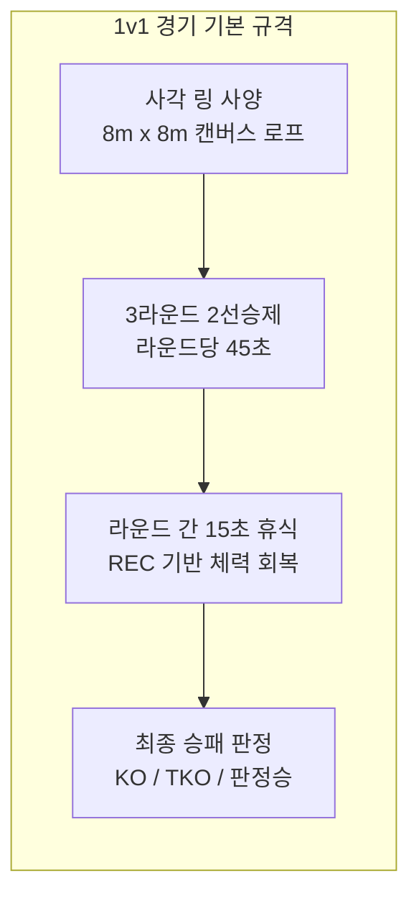
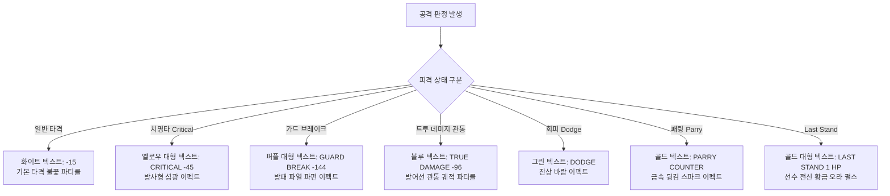
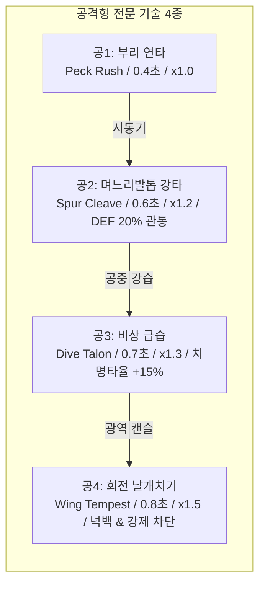
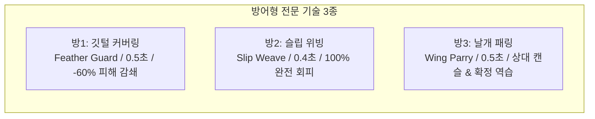
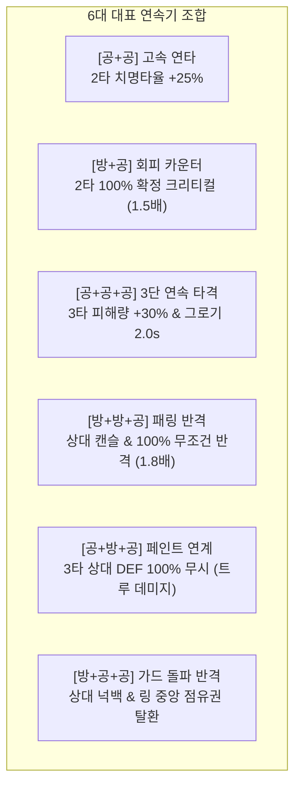
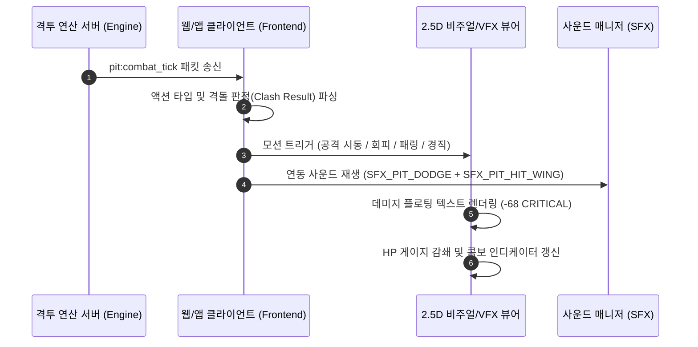

# 🥊 ROOSTER RUMBLE: Rumble Pit 전투 장면 인게임 구성안 (In-Game Combat Specification)

* **현재 문서 버전**: `v0.9.8`
* **마지막 개정일**: 2026-09-29
* **문서 정체성**: 럼블 핏(Rumble Pit) MVP 구성안 중 **전투 장면 인게임 구성(화면 레이아웃, 7대 기술, 3연속기, 실시간 격돌/캔슬, 물리 수식, VFX/SFX 연출, 실전 시나리오)**에 특화된 단독 실무 명세서
* **기반 문서**: [Rumble Pit MVP 구성안.md](file:///d:/OneDrive/업무_진행/C/ROOSTER%20RUMBLE/Rumble%20Pit%20MVP%20구성안.md), [통합 MVP 구성안.md](file:///d:/OneDrive/업무_진행/C/ROOSTER%20RUMBLE/통합%20MVP%20구성안.md)

---

### ■ 문서 개정 이력 (Revision History)

| 버전 (Version) | 개정일 (Date) | 주요 개정 내역 및 상세 변경 사항 | 관련 절 바로가기 |
| :---: | :--- | :--- | :--- |
| **v0.0.1** | 2026-08-11 | 럼블 핏 인게임 전투 기본 규격(사각 링 3R 2선승제, 45초/15초) 최초 기획 | [[#1.1 1v1 전투 씬 컨셉 및 경기 기본 규격\|1.1절 전투 씬 기본 규격]] |
| **v0.2.0** | 2026-08-13 | Hitbox 4종, TEC 치명타율 연동, 동시 타격(Clash) 판정 기초 수립 | [[#2.1 공격형 전투 기술 4종 상세 스펙\|2.1절 공격형 기술 스펙]] |
| **v0.4.0** | 2026-08-27 | 라운드 간 휴식(15초) 체력 회복식 및 Last Stand(GRT 비례) 생존 판정 공식 내재화 | [[#4.3 라운드 간 체력 회복식 및 Last Stand 공식\|4.3절 휴식 회복 및 Last Stand]] |
| **v0.7.0** | 2026-08-27 | 인게임 전투 전용 효과음(SFX-Pit 12종) 및 배경음악(BGM_PIT_FIGHT) 매핑 완비 | [[#6.2 전투 전용 효과음(SFX-Pit 14종) 이벤트 매핑\|6.2절 전투 효과음 매핑]] |
| **v0.9.0** | 2026-09-07 | 7대 전문 기술(공4+방3), 6대 콤보 시너지, 실시간 동시 격돌/캔슬/가드브레이크 수립 | [[#3.1 6대 대표 연속기(Combo Chain) 조합 매트릭스\|3.1절 6대 콤보 매트릭스]] |
| **v0.9.1** | 2026-09-23 | **[단독 분리 발췌]** 럼블핏 MVP 구성안에서 전투 장면 인게임 화면/물리/연출 사양 전면 추출 및 독립 명세서화 | [[#1.2 인게임 아레나 화면 레이아웃 및 HUD 컴포넌트 구조\|1.2절 인게임 화면 레이아웃]] |
| **v0.9.3** | 2026-09-29 | 라운드 시작 연출 개편(권투/격투 보이스 + KO 벨 참조 1회 벨소리) 및 SFX-Pit 12종 최신화 반영 | [[#6.2 전투 전용 효과음(SFX-Pit 14종) 이벤트 매핑\|6.2절 전투 효과음 매핑]] |
| **v0.9.4** | 2026-09-29 | 라운드 1~3 전체 긴박 샤우팅 보이스(Round 1~3, Final Round) 및 한국어 긴박 보이스 에셋 연동 완비 | [[#6.2 전투 전용 효과음(SFX-Pit 14종) 이벤트 매핑\|6.2절 전투 효과음 매핑]] |
| **v0.9.5** | 2026-09-29 | **[라운드 시작 보이스 단일화]** 다크 헤비 버전(Dragon Announcer: First/Second/Third Round... FIGHT!) 공식 단독 채택 및 1R~3R 에셋 일원화 | [[#6.2 전투 전용 효과음(SFX-Pit 14종) 이벤트 매핑\|6.2절 전투 효과음 매핑]] |
| **v0.9.6** | 2026-09-29 | **[전투 SFX 11종 정예화 및 에셋 정리]** 심판 카운트 큐(SFX_PIT_REFEREE_CNT) 삭제(총 11종 정예화) 및 라운드 보이스 다크 헤비 단독 정규화 반영 | [[#6.2 전투 전용 효과음(SFX-Pit 14종) 이벤트 매핑\|6.2절 전투 효과음 매핑]] |
| **v0.9.7** | 2026-09-29 | **[공방 SFX 고품질화, 다목적 공방음 추가 및 라운드 벨소리 분리]** 공격/방어 사운드 고품질화, 범용 타격(SFX_PIT_HIT_GEN)/방어(SFX_PIT_GUARD_GEN) 추가, 순수 라운드 보이스 분리 및 중복 퍼스트 라운드 에셋 삭제 | [[#6.2 전투 전용 효과음(SFX-Pit 14종) 이벤트 매핑\|6.2절 전투 효과음 매핑]] |
| **v0.9.8** | 2026-09-29 | **[격투 경기 박진감 고품질 오케스트라 BGM 구축]** 인게임 전투 배경음악(BGM_PIT_FIGHT, 150 BPM 시네마틱 액션 배틀 오케스트라 172.58초) 마스터링 에셋 완비 및 pit/bgm/ 경로 배치 | [[#6.1 전투 전용 배경음악 (BGM) 명세\|6.1절 전투 배경음악 명세]] |

---

## 목차
1. [[#1. 인게임 전투 개요 및 화면 계층 구조]]
   - [[#1.1 1v1 전투 씬 컨셉 및 경기 기본 규격]]
   - [[#1.2 인게임 아레나 화면 레이아웃 및 HUD 컴포넌트 구조]]
   - [[#1.3 카메라 워크 및 시각 연출(VFX) 규격]]
2. [[#2. 7대 전문 전투 기술 및 인게임 모션/판정 스펙]]
   - [[#2.1 공격형 전투 기술 4종 상세 스펙]]
   - [[#2.2 방어형 전투 기술 3종 상세 스펙]]
   - [[#2.3 선수 등급별 기술 슬롯(2~5개) 및 인게임 HUD 매핑]]
3. [[#3. 실시간 비(非) 턴제 동시 격돌 및 연속기(Combo) 시스템]]
   - [[#3.1 6대 대표 연속기(Combo Chain) 조합 매트릭스]]
   - [[#3.2 실시간 액션 타임라인 동시 격돌(Clash) 및 크로스 카운터]]
   - [[#3.3 콤보 중간 강제 차단(Cancel) 및 가드 브레이크(Guard Break)]]
   - [[#3.4 기력 호흡 정돈 쿨다운 및 스텝/견제 메커니즘]]
4. [[#4. 인게임 물리 수식 및 스탯 연산]]
   - [[#4.1 타격 피해량 연산식 (기술 계수 및 방어 관통 반영)]]
   - [[#4.2 치명타 발현 확률 수식]]
   - [[#4.3 라운드 간 체력 회복식 및 Last Stand 공식]]
   - [[#4.4 격투 스타일 5종별 인게임 AI 행동 가중치 매트릭스]]
5. [[#5. 실시간 전투 통신 틱 규격 및 클라이언트 렌더링 파이프라인]]
   - [[#5.1 WebSocket pit:combat_tick 패킷 규격]]
   - [[#5.2 클라이언트 상태 동기화 및 렌더링 파이프라인]]
6. [[#6. 인게임 전투 사운드(SFX) 및 BGM 매핑]]
   - [[#6.1 전투 전용 배경음악 (BGM) 명세]]
   - [[#6.2 전투 전용 효과음(SFX-Pit 14종) 이벤트 매핑]]
7. [[#7. 실전 1v1 인게임 전투 연출 시뮬레이션 워크스루]]
   - [[#7.1 매치 프로필 및 인게임 환경 세팅]]
   - [[#7.2 1라운드: 고속 연타 vs 회피 카운터 공방 연출 (00:00 ~ 00:45)]]
   - [[#7.3 라운드 간 15초 휴식 및 체력 회복 연출 (00:45 ~ 01:00)]]
   - [[#7.4 2라운드: 동시 격돌, 패링 캔슬 및 가드 브레이크 연출 (01:00 ~ 01:45)]]
   - [[#7.5 3라운드: Last Stand 발동 및 최종 KO 판정 연출 (02:00 ~ 02:45)]]

---

## 1. 인게임 전투 개요 및 화면 계층 구조

### 1.1 1v1 전투 씬 컨셉 및 경기 기본 규격



* **전투 모드 정체성**: 사각 링 안에서 펼쳐지는 2두의 닭 캐릭터 간 1대1 실시간 격투 액션 시뮬레이션.
* **실시간 액션 타임라인 서버 연산**:
  - 턴제 방식 완전 배제.
  - 시드 난수 기반 0.1초 프레임 단위 실시간 액션 타임라인 연산 적용.
  - 서버 시뮬레이션 결과를 WebSocket 패킷으로 수신하여 2.5D 클라이언트 뷰포트에 실시간 동기화 렌더링.
* **경기 진행 규격**:
  - 경기장: 지하 투계장 분위기의 사각 링(8m × 8m), 4각 포스트 및 탄성 로프 설치.
  - 경기 포맷: 3라운드 2선승제 (각 라운드 45초).
  - 인터벌: 라운드 간 15초 휴식 (체력 회복 연산 및 2/3라운드 라이브 배당 표출).
  - 단일 경기 총 관람 시간: 총 3분 30초 (대기실 3분 전 오픈, 인게임 실시간 전투 45초 × 3R + 휴식 15초 × 2회 + 승패 판정/정산 45초).

---

### 1.2 인게임 아레나 화면 레이아웃 및 HUD 컴포넌트 구조

```
+-----------------------------------------------------------------------------------+
|  [RED CORNER]                                                     [BLUE CORNER]   |
|  11. 레드 불릿 (전설/인파이터)                 ROUND 1             1. 블레이징 윙 (전설/아웃파이터) |
|  [■■■■■■■■■■■■■■■■■■□□] 73.0% (568/778)       00:32 (45s)       [■■■■■■■■■■■■■■□□□□] 69.1% (502/726)  |
|  가드: [■■■■■■■■□□] 80%   승: ● ○             배당: 1.85 vs 2.05    가드: [■■■■■■□□□□] 60%   승: ○ ○ |
+-----------------------------------------------------------------------------------+
|                                                                                   |
|                                    [2.5D 링 뷰포트]                                |
|                                                                                   |
|            (Red 코너 좌측)                                  (Blue 코너 우측)       |
|                 🐓 (Red Bullet)                            🐓 (Blazing Wing)      |
|             [공1: 부리 연타 시전]                        [방2: 슬립 위빙 회피]     |
|                   │                                             │                 |
|                   └───────────► [동시 충돌 격돌 지점] ◄──────────┘                 |
|                                         💥                                        |
|                                  "CRITICAL -45!"                                  |
|                                                                                   |
|                                                                                   |
+-----------------------------------------------------------------------------------+
|  [Red 전투 상태 HUD]                                           [Blue 전투 상태 HUD] |
|  기술 슬롯: [공1][공2][공4][방1][방2]                          기술 슬롯: [공1][공3][방1][방2][방3]|
|  콤보 체인: [1타: 공1] ➔ [2타: 공2] (ON)                       콤보 체인: [1타: 방2] ➔ [2타: 공3]  |
|  호흡 쿨다운: [ READY ]                                         호흡 쿨다운: [ READY ]             |
+-----------------------------------------------------------------------------------+
|  [하단 인플레이 퀵 베팅 바 (종료 5초 전 락)]                                         |
|  Red 승 (1.75x) [ +100 ] [ +500 ] [ +1,000 ] [ MAX ] | Blue 승 (2.15x) [ +100 ] ... |
+-----------------------------------------------------------------------------------+
```

#### 1) 상단 메인 헤더 HUD (`Top_Battle_HUD`)
* **좌측 Red Corner 정보 영역**:
  - 출전 선수 번호 및 이름 (`11. 레드 불릿`).
  - 등급 뱃지(전설) 및 격투 스타일 태그(`인파이터`).
  - 실시간 HP 게이지: 현재 HP / 최대 HP 수치 및 백분율(%) 표출, 피격 시 데미지 영역 흰색 점멸 후 적색 감쇄.
  - 가드 내구도 바(Guard Bar): 깃털 커버링 유지 시 게이지 소모량 표출 (100% ~ 0%).
  - 라운드 스코어 표시등: 2선승제 라운드 승리 시 점등(●/○).
  - 당일 컨디션 아이콘: 5등급 상태 뱃지 표출.
* **중앙 경기 상태 컨트롤러**:
  - 현재 라운드 번호 표출 (`ROUND 1`, `ROUND 2`, `ROUND 3`).
  - 라운드 카운트다운 타이머 (`45초` 역카운트, 잔여 10초 미만 시 황색 점멸).
  - 중앙 실시간 배당률 표시판 (`1.85` vs `2.05`).
* **우측 Blue Corner 정보 영역**:
  - Red Corner와 대칭 구조의 Blue Corner 선수 정보, HP 게이지, 가드 바, 라운드 스코어, 컨디션 뱃지 표출.

#### 2) 중앙 2.5D 아레나 뷰포트 (`Combat_Arena_Viewport`)
* **선수 배치 및 좌표계**:
  - 좌측: Red Corner 선수 (기본 시선 방향: 우측).
  - 우측: Blue Corner 선수 (기본 시선 방향: 좌측).
  - 이동 모션: 전진 압박, 후퇴 거리 유지, 사이드 스텝 회전, 링 코너 몰림 연출.
* **히트박스(Hitbox) 판정 영역**:
  - 중단(Head): 부리 타격 피격 영역.
  - 하단(Leg): 며느리발톱 킥 피격 영역.
  - 상단(Air): 공중 비상 급습 타격 영역.
  - 전신(Area): 회전 날개치기 광역 타격 영역.

#### 3) 하단 선수별 전투 인디케이터 (`Bottom_Combat_Status_HUD`)
* **보유/장착 기술 슬롯 (최대 5개)**: 출전 선수가 장착한 기술 아이콘 실시간 표출, 시전 중인 기술 테두리 골드 하이라이트.
* **콤보 체인 인디케이터 (Combo Step Indicator)**:
  - 1타 ➔ 2타 ➔ 3타 진행 상황 실시간 노드 점등.
  - 캔슬 발생 시 콤보 노드 적색 파열 애니메이션.
* **기력 호흡 정돈 쿨다운 게이지 (Stamina Gauge)**: 3연속기 완주 후 스텝/견제 상태 동안 재시동 쿨다운(1.0초~1.5초) 원형 인디케이터 표출.

---

### 1.3 카메라 워크 및 시각 연출(VFX) 규격

#### ■ 인게임 카메라 워크 4대 모드

| 카메라 모드 | 구도 및 화각 (FOV) | 트리거 조건 | 연출 목적 |
| :--- | :--- | :--- | :--- |
| **기본 아레나 뷰 (Normal)** | 링 전체 조망 와이드 앵글 (FOV 55도) | 기본 공방 교환 및 견제/스텝 상태 | 양 선수 간 거리 및 링 위치 파악 |
| **접근전 밀착 뷰 (Clash Zoom)** | 링 중앙 1.3배 줌인 (FOV 42도) | 3연속기 시동 및 상호 동시 충돌 시 | 공방 타격감 및 기술 모션 디테일 전달 |
| **치명타 슬로우 (Dynamic Slow)** | 순간 1.6배 줌인 + 0.2초간 0.5배속 슬로우모션 | 패링 카운터 1.8배 크리티컬 및 가드브레이크 강타 | 극적 타격감 및 시청각 카타르시스 극대화 |
| **다운/피니시 뷰 (KO Impact)** | 쓰러지는 선수 중심 로우 앵글 트래킹 | 체력 0 도달 바닥 쓰러짐 및 KO 확정 시 | 경기 종료 피니시 강조 및 심판 10카운트 포커싱 |

#### ■ 플로팅 데미지 텍스트 및 시각 이펙트(VFX) 규격



---

## 2. 7대 전문 전투 기술 및 인게임 모션/판정 스펙

### 2.1 공격형 전투 기술 4종 상세 스펙



| 기술 식별자 | 기술명 (한글/영문) | Hitbox 판정 | 시전 시간 | 피해량 계수 | 특수 효과 및 인게임 모션 연출 | 연동 효과음 |
| :---: | :--- | :---: | :---: | :---: | :--- | :--- |
| **`[공1]`** | **부리 연타 (Peck Rush)** | 중단 (Head) | `0.4초` | `POW × 1.0` | **선딜 최소 시동기**: 머리를 빠르게 전방으로 뻗어 상대 부리와 두부를 연속 2회 쪼는 고속 잽 모션. 적중 시 다음 연계 기술 발동 속도 15% 가속 | `SFX_PIT_HIT_POKE` |
| **`[공2]`** | **며느리발톱 강타 (Spur Cleave)** | 하단 (Leg) | `0.6초` | `POW × 1.2` | **방어 관통 및 경직**: 몸을 한 바퀴 회전하며 날카로운 뒷발톱으로 상대 하체와 몸통을 긁어차는 훅 모션. 상대 DEF 20% 관통, 적중 시 0.2초 피격 경직 | `SFX_PIT_HIT_SPUR` |
| **`[공3]`** | **비상 급습 (Dive Talon)** | 상단 (Air) | `0.7초` | `POW × 1.3` | **공중 강습 타격**: 날개를 퍼덕이며 순간 도약(공중 체공 0.3초) 후 상대 두부를 향해 양 발톱으로 급강하 찍기 모션. 치명타율 +15% 가산, 기본 가드(-60%)를 -30%로 감쇄 약화 | `SFX_PIT_HIT_WING` |
| **`[공4]`** | **회전 날개치기 (Wing Tempest)** | 전신 (Area) | `0.8초` | `POW × 1.5` | **넉백 및 캔슬 피니시**: 양 날개를 최대로 펼치고 강하게 회전 돌풍을 일으키며 상대 전신을 타격하는 헤비 모션. 피격된 상대 링 로프 쪽으로 넉백 유발 및 상대 연속기 강제 차단 | `SFX_PIT_HIT_WING` + `SFX_PIT_HIT_CRIT` |

---

### 2.2 방어형 전투 기술 3종 상세 스펙



| 기술 식별자 | 기술명 (한글/영문) | 가드 형태 | 유지 시간 | 피해량 보정 | 특수 효과 및 인게임 모션 연출 | 연동 효과음 |
| :---: | :--- | :---: | :---: | :---: | :--- | :--- |
| **`[방1]`** | **깃털 커버링 (Feather Guard)** | 기본 가드 | `0.5초` | **`-60%` 감쇄** | 양 날개를 가슴 전면으로 모아 웅크리는 방어 자세. 피격 피해량 60% 감쇄 흡수 (연속 피격 시 가드 게이지 소모, 게이지 소진 시 가드 브레이크 유발) | `SFX_PIT_GUARD` |
| **`[방2]`** | **슬립 위빙 (Slip Weave)** | 상체 회피 | `0.4초` | **`100% 회피 (0 데미지)`** | 상대 타격 궤적에 맞춰 상체와 목을 좌우로 꺾으며 흘려보내는 회피 모션. 피해량 100% 무효화(0 데미지), 성공 시 다음 즉시 연계 공격에 **[조건부 100% 확정 크리티컬]** 부여 | `SFX_PIT_DODGE` |
| **`[방3]`** | **날개 패링 (Wing Counter-Parry)** | 패링 반격 | `0.5초` | **`공격 무효화 + 역습`** | 상대 타격 접촉 프레임에 맞춰 한쪽 날개를 쳐올려 궤적을 튕겨내는 카운터 모션. 상대 콤보 즉시 강제 캔슬, 상대 취약 상태 전환 후 **[1.8배 무조건 반격 크리티컬]** 확정권 획득 | `SFX_PIT_DODGE` + `SFX_PIT_HIT_WING` |

---

### 2.3 선수 등급별 기술 슬롯(2~5개) 및 인게임 HUD 매핑

선수 등급에 따라 장착 가능한 기술 슬롯 수 차등 배정 (상위 등급일수록 인게임 콤보 선택권 확장).

| 닭 캐릭터 등급 | 보유 기술 슬롯 | 기본 슬롯 구성 예시 | 운용 가능한 콤보 범위 | 인게임 HUD 슬롯 표시 형태 |
| :---: | :---: | :--- | :---: | :--- |
| **일반 (Common)** | **2개** | `[공1]`, `[방1]` | 단발 및 2연속기 (`공+공`, `방+공`) | 2개 원형 아이콘 슬롯 점등 |
| **희귀 (Rare)** | **3개** | `[공1]`, `[공2]`, `[방1]` | **최대 3연속기 개시** (`공+공+공`, `방+공+공`) | 3개 원형 아이콘 슬롯 점등 |
| **영웅 (Epic)** | **4개** | `[공1]`, `[공2]`, `[방1]`, `[방3]` | 공수 전환 3연속기 (`방+방+공`, `공+방+공`) | 4개 원형 아이콘 슬롯 점등 |
| **전설 (Legendary)** | **최대 5개** | `[공1]`, `[공2]`, `[공4]`, `[방1]`, `[방2]` | **전 기술 자유 커스텀 조합 완비** | 5개 골드 테두리 아이콘 슬롯 점등 |

---

## 3. 실시간 비(非) 턴제 동시 격돌 및 연속기(Combo) 시스템

### 3.1 6대 대표 연속기(Combo Chain) 조합 매트릭스

장착된 기술 풀 내에서 실시간 전황(거리, 상대 모션, 잔여 HP)에 따라 **최대 3연속기(Combo Chain)** 조합 시동. 특정 기술 조합 완주 시 강력한 정량적 시너지 부여.



| 콤보 유형 | 대표 조합 예시 | 콤보 명칭 | 발동 조건 및 판정 메커니즘 | 정량적 시너지 효과 | 인게임 연출 특징 |
| :---: | :---: | :--- | :--- | :--- | :--- |
| **공 + 공** | `[공1] + [공2]` | **고속 연타** | 1타(부리) 적중 성공 시 2타(며느리발톱) 즉시 연계 | **2타 치명타율 `+25%` 가산** | 2타 타격 시 발톱 궤적 잔광 강조 |
| **방 + 공** | `[방2] + [공3]` | **회피 카운터** | 1타 슬립 위빙으로 상대 공격 완전 회피 성공 시 | **2타 `100% 확정 크리티컬 (1.5배)`** | 회피 순간 잔상 + 급습 순간 화각 줌인 |
| **공 + 공 + 공** | `[공1] + [공2] + [공4]` | **3단 연속 타격** | 1타 ➔ 2타 ➔ 3타 캔슬 없이 연속 적중 완주 시 | **3타 피해량 `+30%` 증폭 및 상대 2.0초 그로기** | 3타 피니시 시 화면 흔들림(Camera Shake) |
| **방 + 방 + 공** | `[방1] + [방3] + [공2]` | **패링 반격** | 1타 가드로 흡수 후 2타 패링으로 상대 공격 쳐내기 성공 시 | **상대 강제 캔슬 + `100% 무조건 반격 크리티컬 (1.8배)`** | 패링 순간 번개 스파크 + 0.2초 역동적 슬로우 |
| **공 + 방 + 공** | `[공1] + [방2] + [공3]` | **페인트 연계** | 1타 타격 후 상대 카운터를 회피로 흘리고 3타 가격 시 | **상대 DEF 100% 무시 (`트루 데미지`)** | 3타 관통 시 푸른색 궤적 파티클 |
| **방 + 공 + 공** | `[방1] + [공1] + [공4]` | **가드 돌파 반격** | 가드로 상대 타격 -60% 흡수 후 2연속 타격 시동 시 | **상대 로프 넉백 및 링 중앙 점유권 탈환** | 상대를 밀어내며 카메라 중앙 재배치 |

---

### 3.2 실시간 액션 타임라인 동시 격돌(Clash) 및 크로스 카운터

```
[Red 선수: 공+공+공 시동] ────────(0.4s 부리연타)────► [0.6s 발차기 시전] ────────► [0.8s 날개치기]
                                                     ▲
                                                     │ (실시간 동시 충돌 지점)
[Blue 선수: 방+방+공 시동] ──────(0.5s 가드 커버링)──► [0.5s 날개 패링 성공] ───► [Red 3타 캔슬 & 1.8배 확정 카운터 피격]
```

* **독립 프레임 타이머 구동**:
  - 상대의 동작 대기 없이 실시간으로 각자 공격/방어 액션 시동.
  - 단발 기술 시전 시간: `0.4초 ~ 0.8초`.
  - 최대 3연속기 완주 시간: `1.5초 ~ 2.2초`.
* **동시 타격(Mutual Clash) 및 크로스 카운터(Cross Counter)**:
  - 양 선수가 동일 프레임(오차 0.05초 이내)에 공격 기술을 교차 적중시킬 경우:
    - **위력 판정**: 순수 타격 위력(POW × 계수) 상위 선수가 판정승하여 상대 모션 캔슬 후 일방 타격.
    - **크로스 카운터**: 양 선수의 공격 위력 격차가 10% 이내일 경우 **양측 동시 피격 및 상호 넉백** 연출 (`CRITICAL` 플로팅 동시 노출).

---

### 3.3 콤보 중간 강제 차단(Cancel) 및 가드 브레이크(Guard Break)

#### 1) 콤보 중간 강제 차단 (Combo Interruption & Cancel)
* **발동 조건**: 상대가 3연속기를 전개하는 도중, 수비측이 2타 타이밍에 `[방3: 날개 패링]`을 접촉시키거나 `[공4: 회전 날개치기]` 카운터 강타를 적중시킬 경우.
* **인게임 판정 및 연출**:
  - **공격측**: 남아있던 3타 피니시 모션 즉시 강제 캔슬, 0.5초 피격 경직(Stun) 상태 진입.
  - **수비측**: 즉시 공격 주도권 탈환 후 `방+방+공` 1.8배 무조건 반격 크리티컬 발동.
  - 시각 연출: 캔슬 발생 프레임에서 황색 파열 스파크 이펙트 및 모션 멈춤 효과.

#### 2) 가드 브레이크 (Guard Break)
* **발동 조건**:
  - 수비측이 `[방1: 깃털 커버링]`을 무리하게 지속 사용하여 가드 내구도 게이지가 0에 도달한 경우.
  - 상대의 방어 관통 공격(`[공2: 며느리발톱 강타]`, `[공4: 회전 날개치기]`)을 가드 상태에서 연속 허용한 경우.
* **인게임 판정 및 연출**:
  - 방어 자세 강제 파괴 및 수비자 1.0초간 무방비 취약(Vulnerable) 상태 전환.
  - 해당 타격 데미지 **1.5배 관통 데미지** 피격.
  - 시각 연출: 보라색 방패 파열 파티클 출력 및 `GUARD BREAK -[데미지]` 텍스트 노출.

---

### 3.4 기력 호흡 정돈 쿨다운 및 스텝/견제 메커니즘

* **기력 호흡 정돈(Stamina Breathing) 진입**: 3연속기 완주 직후 무분별한 콤보 남발을 방지하고 공방 템포를 조율하기 위해 **스텝/거리 유지 상태**로 자동 전환.
* **행동 제약**: 호흡 정돈 중에는 기본 회피 및 단발 가드만 허용, 신규 3연속기 시동 일시 제한.
* **호흡 정돈 쿨다운 연산식**:
  $$\text{호흡 정돈 쿨다운(초)} = \text{최댓값}\left(1.5 - \left(\frac{\text{기술력(TEC)}}{100}\right) \times 0.5, \;\; 1.0\right)$$
  - TEC 0 기준 1.5초 쿨다운 적용.
  - TEC 100 기준 최소 1.0초 쿨다운으로 단축 (기술력이 높을수록 공방 재시동 대기시간 단축).
  - 인게임 HUD: 선수 하단에 회전형 쿨다운 서클 표출, 충전 완료 즉시 `READY` 점등.

---

## 4. 인게임 물리 수식 및 스탯 연산

### 4.1 타격 피해량 연산식 (기술 계수 및 방어 관통 반영)

$$\text{타격 피해량} = \text{최댓값}\left(\text{반올림}\left((\text{POW} \times \text{Skill\_Coeff} \times \text{Crit\_Mult} \times \text{Combo\_Amp}) - (\text{DEF} \times (1 - \text{Pen\_Rate}))\right), \;\; 1\right)$$

* **수식 변수 정의**:
  - `POW`: 공격자의 공격력 스탯.
  - `Skill_Coeff`: 사용 기술 피해량 계수 (`공1: 1.0`, `공2: 1.2`, `공3: 1.3`, `공4: 1.5`).
  - `Crit_Mult`: 치명타 배율 (일반 타격 `1.0`, 기본 치명타 `1.5`, 패링 반격 `1.8`).
  - `Combo_Amp`: 콤보 피해 증폭 계수 (기본 `1.0`, 3단 피니시 `1.3`).
  - `DEF`: 방어자의 방어력 스탯.
  - `Pen_Rate`: 방어력 관통율 (`공2: 0.2`, `공+방+공: 1.0`, 기타 `0.0`).
* **수식 예시 산출**:
  - **기본 1타 [공1]**: POW 64, 상대 DEF 63 $\implies (64 \times 1.0) - 63 = \mathbf{1\text{ 데미지}}$ (최소 1 보장).
  - **[방+공] 회피 후 [공3] 확정 크리티컬**: POW 53, 상대 DEF 58, 크리티컬 1.5 $\implies \text{반올림}(53 \times 1.3 \times 1.5) - 58 = 103 - 58 = \mathbf{45\text{ 데미지}}$.
  - **[방+방+공] 패링 후 [공2] 무조건 반격 크리티컬**: POW 53, 상대 DEF 58, 크리티컬 1.8, 관통 20% $\implies \text{반올림}(53 \times 1.2 \times 1.8) - \text{반올림}(58 \times 0.8) = 114 - 46 = \mathbf{68\text{ 데미지}}$.
  - **[공+방+공] 페인트 후 [공4] 트루 데미지**: POW 64, 상대 DEF 63, 관통 100% $\implies \text{반올림}(64 \times 1.5) - 0 = \mathbf{96\text{ 데미지}}$.

---

### 4.2 치명타 발현 확률 수식

$$\text{치명타 확률(\%)} = \text{최솟값}\left(\text{기술력(TEC)} \times 0.3\% + \text{Combo\_Crit\_Bonus}, \;\; 100.0\%\right)$$

* **기본 치명타율**: 기술력(TEC) × 0.3% (TEC 100 기준 최대 30.0%).
* **콤보 시너지 가산치 (`Combo_Crit_Bonus`)**:
  - `[공+공]` 2타 시전 시: **`+25.0%`** 가산.
  - `[방+공]` 회피 성공 후 2타 시전 시: **`100.0%`** 확정 발동.
  - `[방+방+공]` 패링 성공 후 3타 시전 시: **`100.0%`** 확정 발동.

---

### 4.3 라운드 간 체력 회복식 및 Last Stand 공식

#### 1) 라운드 간 휴식(15초) 체력 회복량 연산식
$$\text{라운드 간 체력 회복량} = \text{최솟값}\left(\text{반올림}\left(\text{최대 체력} \times \left(\frac{\text{회복력(REC)}}{200}\right)\right), \;\; \text{최대 체력} - \text{현재 체력}\right)$$
* **연산식 설명**: 15초 휴식 중 회복력(REC)에 비례하여 체력 회복 (최대 체력 초과 불가).
* **예시 산출**: Max HP 778, 잔여 HP 568, REC 49 선수:
  $$\text{반올림}\left(778 \times \frac{49}{200}\right) = \text{반올림}(190.61) = \mathbf{+191\text{ HP 회복}} \implies \mathbf{759\text{ HP 복구}}.$$

#### 2) 투지 버티기 (Last Stand) 발동 공식
$$\text{발동 확률(\%)} = \text{근성(GRT)} \times 0.5\%$$
* **발동 메커니즘**: 경기 중 체력이 0에 도달하여 KO 판정이 발생할 때, 선천적 근성(GRT)에 비례하여 **경기당 1회 한정 체력 1을 남기고 다운을 모면**.
* **예시 산출**: GRT 44 선수 $\implies 44 \times 0.5\% = \mathbf{22.0\%}$ 확률로 발동 성공.
* **인게임 연출**: 체력 바에 1 HP 표시와 함께 금빛 외곽선 점멸, 심장 박동음(`SFX_PIT_LAST_STAND`) 출력.

---

### 4.4 격투 스타일 5종별 인게임 AI 행동 가중치 매트릭스

인게임 시뮬레이션 엔진이 선수 성향에 따라 기술을 선택하는 기준 매트릭스.

| 격투 스타일 | 주요 선호 기술 | 주력 연속기 패턴 | 공격 가중치 | 방어 가중치 | 스텝/견제 | 인게임 행동 성향 |
| :---: | :---: | :---: | :---: | :---: | :---: | :--- |
| **인파이터 (Infighter)** | `[공1]`, `[공2]`, `[방1]` | **공+공, 공+공+공** | **70%** | 15% | 15% | 끊임없이 파고들어 근접 2~3연타 몰아치기 |
| **아웃파이터 (Outfighter)** | `[공3]`, `[방2]`, `[방3]` | **방+공, 공+방+공** | 40% | 35% | **25%** | 링 외곽 거리 유지, 회피 후 기습 카운터 |
| **브롤러 (Brawler)** | `[공2]`, `[공4]`, `[방1]` | **공+공+공, 방+공+공** | **70%** | 20% | 10% | 강력한 넉백 공격과 가드 돌파, 난타전 유도 |
| **테크니션 (Technician)** | `[공1]`, `[공3]`, `[방3]` | **방+방+공, 공+공** | 45% | **40%** | 15% | 날개 패링 카운터 노림수, 1.8배 역전 한방 지향 |
| **밸런서 (Balanced)** | 전 기술 균등 보유 | 유동적 콤보 구사 | 55% | 25% | 20% | 상대 스타일과 잔여 체력에 맞춘 유연한 대처 |

---

## 5. 실시간 전투 통신 틱 규격 및 클라이언트 렌더링 파이프라인

### 5.1 WebSocket pit:combat_tick 패킷 규격

서버 물리 엔진에서 매 액션 단위(0.1초 정밀도)로 연산 후 클라이언트로 송출하는 전투 틱 패킷.

```json
{
  "event": "pit:combat_tick",
  "data": {
    "match_id": "F-20260905-11",
    "round": 2,
    "tick_index": 14,
    "timestamp_ms": 74000,
    "red_action": {
      "skill_id": "공2",
      "skill_name": "며느리발톱 강타",
      "combo_step": 2,
      "state": "INTERRUPTED"
    },
    "blue_action": {
      "skill_id": "방3",
      "skill_name": "날개 패링",
      "combo_step": 2,
      "state": "PARRY_SUCCESS"
    },
    "clash_result": "CANCEL",
    "damage_dealt": {
      "target": "RED",
      "damage": 68,
      "is_crit": true,
      "crit_mult": 1.8,
      "is_guard_break": false
    },
    "remaining_hps": {
      "red_hp": 442,
      "blue_hp": 210
    }
  }
}
```

---

### 5.2 클라이언트 상태 동기화 및 렌더링 파이프라인



---

## 6. 인게임 전투 사운드(SFX) 및 BGM 매핑

### 6.1 전투 전용 배경음악 (BGM) 명세

* **음원 저장 디렉터리**: [assets/audio/pit/bgm/](file:///d:/OneDrive/업무_진행/C/ROOSTER%20RUMBLE/assets/audio/pit/bgm/)
* **파일 포맷**: MP3 (44,100 Hz, 192 kbps, Stereo, 피크 마진 -0.7 dBFS 정규화)

| BGM ID | 트랙 명칭 | 오디오 파일명 (Clickable) | 재생시간 / 템포 | 음악 장르 | 인게임 연출 및 믹싱 제어 |
| :---: | :--- | :--- | :---: | :--- | :--- |
| **`BGM_PIT_FIGHT`** | **혈투의 링** | [bgm_pit_fight.mp3](file:///d:/OneDrive/업무_진행/C/ROOSTER%20RUMBLE/assets/audio/pit/bgm/bgm_pit_fight.mp3) | 172.58초 (2.88분)<br>150 BPM / 루프 | **박진감 넘치는 시네마틱 액션 배틀 오케스트라** | 1~3라운드 격투 전 구간 재생. 타격 SFX 출력 시 -4.5dB 덕킹 감쇄, 라운드 휴식 시 500ms 페이드아웃 |

---

### 6.2 전투 전용 효과음(SFX-Pit 14종) 이벤트 매핑

| SFX ID | 사운드 명칭 | 출력 타이밍 (트리거 이벤트) | 볼륨 / 우선순위 | 연출 효과 및 음색 가이드 |
| :---: | :--- | :--- | :---: | :--- |
| **`SFX_PIT_ROUND_START`** | **라운드 시작 보이스 (1R~3R)** | 라운드 개시(0초) 시 | 1.0 / High | 다크 헤비 아나운서 순수 샤우팅("First/Second/Third Round... FIGHT!") [벨소리와 분리] |
| **`SFX_PIT_BELL_SINGLE`** | **1회 공식 링 벨** | 라운드 개시 및 종료 트리거 시 | 1.0 / High | 청명하고 긴 서스테인의 1회 공식 경기 벨소리 (DING!) 타종 |
| **`SFX_PIT_HIT_POKE`** | **부리 쪼기** | `[공1: 부리 연타]` 적중 시 | 0.8 / Normal | 날카로운 부리로 쪼아 박는 초고속 잽 타격음 (실사 펀치) |
| **`SFX_PIT_HIT_SPUR`** | **스퍼 킥** | `[공2: 며느리발톱 강타]` 적중 시 | 0.85 / Normal | 예리한 슬래시 공기 절단음 + 묵직한 발차기 바디 타격음 |
| **`SFX_PIT_HIT_WING`** | **날개 치기** | `[공3]`, `[공4]` 시전 및 패링 역습 시 | 0.85 / Normal | 거센 날개 펄럭임 돌풍음 + 묵직한 몸통 후려침 타격음 |
| **`SFX_PIT_HIT_CRIT`** | **치명타 강타** | 크리티컬 히트 및 3단 콤보 피니시 시 | 0.95 / High | 서브 럼블 베이스 왜곡과 함께 파열하는 강력한 크런치 강타음 |
| **`SFX_PIT_HIT_GEN`** | **다목적 범용 타격** | 모든 일반 공격/평타/스킬 정타 적중 시 | 0.85 / Normal | **[신규]** 실사 펀치 블렌딩 기반 묵직하고 명확한 클린 히트 정타 타격음 |
| **`SFX_PIT_GUARD`** | **가드 방어** | `[방1: 깃털 커버링]` 방어 성공 시 | 0.75 / Normal | 깃털을 모아 데미지를 둔탁하게 흡수하는 소프트 가드 감쇄음 |
| **`SFX_PIT_GUARD_GEN`** | **다목적 범용 방어** | 모든 가드 방어 및 블로킹 성공 시 | 0.8 / Normal | **[신규]** 솔리드 우드/가드 면 충격 기반 단단하고 묵직한 블록 사운드 |
| **`SFX_PIT_DODGE`** | **회피 슬립** | `[방2: 슬립 위빙]` 및 패링 회피 시 | 0.8 / Normal | 공격을 종이 한 장 차이로 피하는 날렵한 옷깃 펄럭임 및 공기 가르는 소리 |
| **`SFX_PIT_LAST_STAND`**| **투지 버티기** | Last Stand 체력 1 생존 판정 시 | 1.0 / Very High | 묵직한 생체 심장 박동음과 함께 치솟는 오라 공명음 (기존 유지) |
| **`SFX_PIT_KNOCKDOWN`** | **다운 충격** | 체력 0 도달 링 캔버스 쓰러짐 시 | 0.9 / High | 캔버스 바닥에 육중하게 쓰러지는 충격 둔탁음 (기존 유지) |
| **`SFX_PIT_KO_BELL`** | **KO 선언 벨** | KO 및 TKO 승패 최종 확정 시 | 1.0 / Very High | 연속 3회 청명하게 울리는 경기 종료 종소리 (기존 유지) |
| **`SFX_PIT_CROWD_ROAR`**| **투계장 환호** | KO 피니시 및 경기 종료 승리 선언 시 | 0.9 / High | 지하 투계장 관중들의 폭발적인 함성과 박수갈채 (기존 유지) |

---

## 7. 실전 1v1 인게임 전투 연출 시뮬레이션 워크스루

### 7.1 매치 프로필 및 인게임 환경 세팅

* **매치 식별자**: `F-20260905-11` (05:00 정기 매치)
* **경기 링 환경**: 지하 아레나 사각 링 (어두운 배경 + 링 중앙 스포트라이트 집중).

| 코너 배정 | 출전 선수명 | 격투 스타일 / 등급 | 장착 기술 (5개 슬롯) | 주요 전투 스탯 (POW / DEF / HP / TEC / GRT) |
| :---: | :---: | :---: | :--- | :--- |
| **Red Corner** | **11. 레드 불릿 (Red Bullet)** | **인파이터** (전설급) | `[공1]`, `[공2]`, `[공4]`, `[방1]`, `[방2]` | `POW 64` / `DEF 58` / `HP 778` / `TEC 52` / `GRT 45` |
| **Blue Corner** | **1. 블레이징 윙 (Blazing Wing)** | **아웃파이터** (전설급) | `[공1]`, `[공3]`, `[방1]`, `[방2]`, `[방3]` | `POW 53` / `DEF 63` / `HP 726` / `TEC 58` / `GRT 44` |

---

### 7.2 1라운드: 고속 연타 vs 회피 카운터 공방 연출 (00:00 ~ 00:45)

```
[00:00 보이스+벨] ────────────────► [00:12 레드불릿 공+공 2연타 (-66 HP)] ──► [00:22 블레이징윙 트루뎀 (-70 HP)]
 SFX_PIT_ROUND_START                   치명타 40.6% 적중 잔광 연출              DEF 100% 관통 파란 파티클
                                                            │
[00:45 1R 종료] ◄── [00:40 레드불릿 공공공 3단피니시 (-90 HP)] ◄─┘
 568 HP vs 502 HP    3타 30% 증폭 및 화면 쉐이크 연출
```

1. **00:00 (1라운드 개시)**:
   - 다크 헤비 아나운서 위압 샤우팅("First Round... FIGHT!") 및 KO 확정 벨 참조 1회 공식 벨소리(`sfx_pit_round1_start.mp3`) 타종 울림과 함께 `ROUND 1 - FIGHT!` 타이틀 중앙 점멸.
   - 배경음악 `BGM_PIT_FIGHT` 점진적 빌드업 시작.
2. **00:12 (레드 불릿 [공+공 고속 연타])**:
   - 레드 불릿이 스텝으로 접근 후 1타 [공1: 부리 연타] 적중 ($64 - 63 = \mathbf{1\text{ 데미지}}$).
   - 1타 적중 보너스로 2타 [공2] 치명타율 +25% 가산 ($52 \times 0.3\% + 25\% = \mathbf{40.6\%}$).
   - 2타 발차기 적중 및 치명타 발동 (상대 DEF 20% 관통):
     $$\text{반올림}(64 \times 1.2 \times 1.5) - \text{반올림}(63 \times 0.8) = 115 - 50 = \mathbf{65\text{ 데미지}} \implies \text{Blue 1R 피격: } \mathbf{66\text{ 데미지}}$$
   - 연출: 옐로우 섬광 파티클 및 `CRITICAL -65` 텍스트 팝업 (`SFX_PIT_HIT_SPUR` + `SFX_PIT_HIT_CRIT`).
3. **00:22 (블레이징 윙 [공+방+공 페인트 연계])**:
   - 1타 [공1: 부리] 견제타 (1 데미지).
   - 2타 [방2: 슬립 위빙]으로 레드 불릿의 카운터 훅을 완전히 흘려냄 (0 데미지, 잔상 효과).
   - 3타 [공3: 비상 급습] **트루 데미지 100% 방어 무시 관통**:
     $$\text{반올림}(53 \times 1.3) - 0 = 69 - 0 = \mathbf{69\text{ 데미지}} \implies \text{Red 1R 피격: } \mathbf{70\text{ 데미지}}$$
   - 연출: 푸른빛 관통 궤적 파티클 및 `TRUE DAMAGE -69` 표출.
4. **00:40 (레드 불릿 [공+공+공 3단 연속 타격])**:
   - 1타 [공1](1뎀) + 2타 [공2](27뎀 관통) ➔ 3타 [공4: 회전 날개치기] **피니시 30% 증폭 강타**:
     $$\text{반올림}(64 \times 1.5 \times 1.3) - 63 = 125 - 63 = \mathbf{62\text{ 데미지}} \implies \text{Blue 1R 피격: } \mathbf{90\text{ 데미지}}$$
   - 연출: 화면 흔들림(Camera Shake)과 함께 블레이징 윙이 로프 쪽으로 튕겨 나감.
5. **00:45 (1라운드 종료 잔여 체력 정산)**:
   - **레드 불릿 잔여 체력**: `568 / 778 HP` (잔여 73.0%).
   - **블레이징 윙 잔여 체력**: `502 / 726 HP` (잔여 69.1%).

---

### 7.3 라운드 간 15초 휴식 및 체력 회복 연출 (00:45 ~ 01:00)

* **카메라 워크**: 각 코너 구석으로 복귀한 양 선수 코너 체어 분할 화면 표출.
* **체력 회복(REC) 연산 및 연출**:
  - `레드 불릿 (REC 49)`: $\text{반올림}\left(778 \times \frac{49}{200}\right) = \mathbf{+191\text{ HP 회복}} \implies \mathbf{759\text{ HP}}$ 복구.
  - `블레이징 윙 (REC 50)`: $\text{반올림}\left(726 \times \frac{50}{200}\right) = \mathbf{+182\text{ HP 회복}} \implies \mathbf{684\text{ HP}}$ 복구.
  - 연출: 체력 바에 녹색 힐링 오라 상승 연출 및 `+191 HP`, `+182 HP` 회복 플로팅 표출.

---

### 7.4 2라운드: 동시 격돌, 패링 캔슬 및 가드 브레이크 연출 (01:00 ~ 01:45)

1. **01:00 (2라운드 개시)**:
   - 다크 헤비 아나운서 위압 샤우팅("Second Round... FIGHT!") 및 1회 공식 벨소리(`sfx_pit_round2_start.mp3`) 타종과 함께 `ROUND 2 - FIGHT!` 타이틀 중앙 점멸.
2. **01:14 (동시 격돌 및 패링 강제 차단 Cancel)**:
   - 레드 불릿이 [공+공+공] 3연타 시동: 1타 [공1] 시전 시 블레이징 윙이 [방1: 깃털 커버링]으로 1데미지 흡수.
   - 2타 [공2: 발차기] 시전 프레임에 맞춰 블레이징 윙이 **[방3: 날개 패링]** 카운터 성공.
   - **[Clash & Cancel 판정]**:
     - 레드 불릿의 남아있던 3타 [공4]는 **즉시 강제 캔슬**되며 0.5초 경직(Stun) 상태 전환.
     - 블레이징 윙의 **[방+방+공 패링 반격]** 피니시 발동 (**1.8배 무조건 반격 크리티컬**):
       $$\text{반올림}(53 \times 1.2 \times 1.8) - \text{반올림}(58 \times 0.8) = 114 - 46 = \mathbf{68\text{ 데미지}} \implies \text{Red 피격: } \mathbf{68\text{ 데미지}}$$
     - 연출: 패링 순간 0.2초 역동적 슬로우모션 + 금빛 스파크 파열 (`SFX_PIT_DODGE` + `SFX_PIT_HIT_WING`).
3. **01:36 (가드 브레이크 Guard Break 발동)**:
   - 블레이징 윙의 연속 가드로 가드 게이지가 소진된 상태에서, 레드 불릿이 [공2: 며느리발톱] 강타로 **가드 브레이크(Guard Break)** 유발.
   - 블레이징 윙 1.0초간 취약 상태 전환 ➔ 레드 불릿의 [공4: 회전 날개치기] **1.5배 관통 취약 데미지** 피격:
     $$\text{반올림}(64 \times 1.5 \times 1.5) - 0 = 144 - 0 = \mathbf{144\text{ 데미지}} \implies \text{Blue 피격: } \mathbf{144\text{ 데미지}}$$
   - 연출: 보라색 방패 파열 파티클 출력 및 `GUARD BREAK -144` 텍스트 팝업.
4. **01:45 (2라운드 종료 잔여 체력 및 2R 휴식 정산)**:
   - 2R 종료 잔여 체력: 레드 불릿 `442 HP` vs 블레이징 윙 `210 HP`.
   - 2R 휴식 회복 후 3R 진입 체력: **레드 불릿 `633 HP`** vs **블레이징 윙 `392 HP`**.

---

### 7.5 3라운드: Last Stand 발동 및 최종 KO 판정 연출 (02:00 ~ 02:45)

```
[02:00 3R 보이스+벨] ──► [02:24 레드불릿 공공공 크리티컬 (-152 HP)] ──► [02:27 블레이징윙 체력 0 도달]
 sfx_pit_round3_start     3타 1.3배 x 1.5배 증폭 크리티컬                   Last Stand 22.0% 발동 성공!
                                                                        │ (체력 1 남기고 황금 오라 점멸)
[02:31 레드불릿 KO승 확정] ◄── [02:31 블레이징윙 다운 쓰러짐] ◄─────────┘
 KO 벨소리 및 관중 환호성       레드불릿 선제 부리연타 적중 (-1 HP)
 SFX_PIT_KO_BELL                SFX_PIT_KNOCKDOWN & 10카운트 아웃
```

1. **02:00 (3라운드 개시)**:
   - 다크 헤비 아나운서 위압 샤우팅("Third Round... FIGHT!") 및 1회 공식 벨소리(`sfx_pit_round3_start.mp3`) 타종 울림과 함께 `ROUND 3 - FIGHT!` 타이틀 중앙 점멸.

1. **02:24 (레드 불릿 [공+공+공] 맹공 피니시)**:
   - [공1](1뎀) + [공2](27뎀) + [공4](피니시 30% 증폭 + 크리티컬 1.5배) 폭발:
     $$\text{반올림}(64 \times 1.5 \times 1.3 \times 1.5) - 63 = 187 - 63 = \mathbf{124\text{ 데미지}} \implies \text{Blue 피격: } \mathbf{152\text{ 데미지}}$$
   - 블레이징 윙 잔여 체력: $229 - 152 = \mathbf{77\text{ HP}}$.
2. **02:27 (체력 0 도달 및 Last Stand 투지 버티기 발동)**:
   - 레드 불릿의 [공2: 며느리발톱] 강타 및 견제타 누적으로 **블레이징 윙 체력 0 도달**.
   - **Last Stand 판정**: $\text{근성(GRT 44)} \times 0.5\% = \mathbf{22.0\%}$ 확률 $\implies$ **발동 성공!**
   - 연출: 체력 바에 `1 HP`를 남기며 선수가 무릎을 꿇었다가 다시 일어섬. 전신에 황금색 투지 오라 점멸, 심장 박동 효과음(`SFX_PIT_LAST_STAND`) 출력.
3. **02:31 (최종 KO 피니시 및 경기 종료)**:
   - 체력 1 상태에서 레드 불릿의 선제 [공1: 부리 연타] 적중 ($64 - 63 = \mathbf{1\text{ 데미지}}$).
   - 블레이징 윙 링 캔버스에 다운 쓰러짐 (`SFX_PIT_KNOCKDOWN`).
   - 카메라가 다운된 블레이징 윙을 로우 앵글로 비추며 심판 10카운트 시각 카운트다운 진행.
   - 10카운트 아웃 판정 즉시 땡땡땡 연속 공소리(`SFX_PIT_KO_BELL`) 및 투계장 관중의 폭발적 환호성(`SFX_PIT_CROWD_ROAR`) 출력.
   - 중앙 화면에 `KNOCKOUT! WINNER: RED BULLET!` 대형 골드 텍스트 출력으로 인게임 전투 씬 완결.

