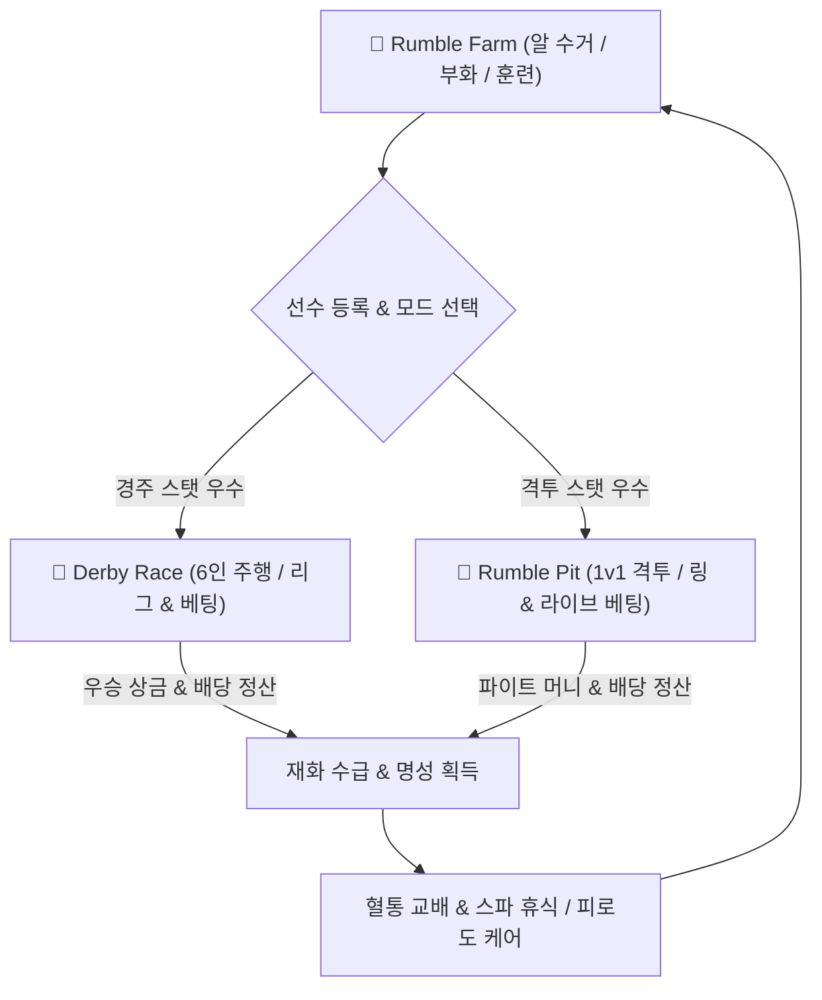

# 🐓 ROOSTER RUMBLE: 통합 MVP 구성안

* **현재 문서 버전**: `v0.0.1`
* **마지막 개정일**: 2026-08-11
* **문서 정체성**: 3개 모드(경주, 격투, 육성) 통합 최소 수율 검증용 MVP 기획 명세

---

## 목차
1. [[#1. 통합 MVP 개요 및 개발 범위 정의]]
   - [[#1.1 통합 서비스 비전 및 MVP 검증 목표]]
   - [[#1.2 플랫폼 및 서비스 버전 이원화 MVP 타깃]]
   - [[#1.3 통합 MVP 코어 플레이 순환 루프]]
2. [[#2. 모드 1: Rumble Farm (육성 모드) MVP 명세]]
   - [[#2.1 알 부화 및 시간 단축 미니게임 MVP]]
   - [[#2.2 타깃 모드 맞춤 개화 훈련 시스템 MVP]]
   - [[#2.3 유전 인계 공식 및 무작위 변이 알고리즘 MVP]]
   - [[#2.4 선수 케어 (무료 닭장 vs 유료 스파) 이원화 MVP]]
   - [[#2.5 모바일 마켓 거래 및 보상형 광고 BM MVP]]
3. [[#3. 모드 2: Derby Race (경주 모드) MVP 명세]]
   - [[#3.1 6인 주행 시뮬레이션 엔진 MVP]]
   - [[#3.2 온라인 버전: 사전 승자 예측 및 동적 배당 정산 MVP]]
   - [[#3.3 모바일 버전: 6단계 리그 승격제 및 터치 스퍼트 MVP]]
   - [[#3.4 파산 감지 및 무료 구제 루프 MVP]]
4. [[#4. 모드 3: Rumble Pit (격투 모드) MVP 명세]]
   - [[#4.1 1v1 동적 격투 물리 & 라운드 판정 MVP]]
   - [[#4.2 온라인 버전: 실시간 인플레이(In-Play) 변동 배당 MVP]]
   - [[#4.3 KO / 투지 버티기 및 부상 발생 알고리즘 MVP]]
   - [[#4.4 파이트 머니 & 하우스 엣지 수수료 정산 MVP]]
5. [[#5. 통합 MVP 데이터베이스 & 백엔드 독립 아키텍처]]
   - [[#5.1 모바일 DB vs 온라인 DB 물리적 독립 분리 MVP 구조]]
   - [[#5.2 통합 선수 마스터 데이터셋 (Unified Rooster Dataset) 명세]]
   - [[#5.3 실시간 피로도 & 컨디션 상태값 동기화 모듈]]
6. [[#6. 통합 MVP 개발 일정 및 5단계 리스크 검증 로드맵]]

---

## 1. 통합 MVP 개요 및 개발 범위 정의

### 1.1 통합 서비스 비전 및 MVP 검증 목표
* **통합 서비스 정의**: 알 부화 및 육성(`Rumble Farm`), 6인 주행 경주(`Derby Race`), 1v1 링 격투(`Rumble Pit`)를 아우르는 캐주얼 아케이드 매니지먼트 생태계
* **통합 MVP 최우선 검증 목표**:
  - 3개 모드 간 선수(Rooster) 순환 및 멀티 스탯 데이터 호환성 검증
  - 유전 교배 ➔ 훈련 개화 ➔ 경주/격투 참전 ➔ 재화 수급 ➔ 다음 세대 교배로 이어지는 코어 루틴 수율 검증
  - 모바일 아케이드 상용화 BM 및 온라인 베팅 하우스 엣지 정산 정합성 검증

### 1.2 플랫폼 및 서비스 버전 이원화 MVP 타깃
* **모바일 전용 빌드 MVP**: 아케이드 리그 출전, 알 부화/훈련, 자율 마켓 거래, 보상형 광고 및 터치 액션 경주 구현
* **자체 온라인 전용 빌드 MVP**: 6인 경주 사전 베팅, 1v1 격투 실시간 라이브 인플레이 베팅, 파이트 머니 및 유료 스파 케어 구현
* **독립 물리 아키텍처**: 모바일 서비스 DB와 자체 온라인 서비스 DB의 물리적 분리 독립 운영 수립

### 1.3 통합 MVP 코어 플레이 순환 루프



---

## 2. 모드 1: Rumble Farm (육성 모드) MVP 명세

### 2.1 알 부화 및 시간 단축 미니게임 MVP
* **부화 인큐베이터 슬롯**: 기본 2슬롯 제공 (최대 6슬롯 확장 가능)
* **알 등급별 부화 타이머**: 일반 알(10분), 혈통 알(2시간), 전설 알(12시간)
* **알 터치 미니게임 (Egg Tapping Minigame)**:
  - 껍질 흔들림 이펙트 발생 시 10초간 화면 지정 영역 탭/스와이프 모션 입력
  - 미니게임 성공 시 잔여 부화 시간의 20% 즉시 차감 단축 (알당 최대 3회 수행 제한)

### 2.2 타깃 모드 맞춤 개화 훈련 시스템 MVP
* **개화 훈련 메커니즘**: 사료(Energy) 소모를 통한 보유 잠재력 상한선(Potential)을 현재 스탯으로 전환 개화
* **타깃 모드별 훈련 분류**:
  - `Derby Race 맞춤 훈련`: 고속 트랙(최고속도), 타이어 튀기기(가속도), 모래산 오르기(근성)
  - `Rumble Pit 맞춤 훈련`: 통나무 타격(공격력), 과녁 정밀 타격(치명타율), 깃털 차단(방어력), 매화틀 버티기(투지)

### 2.3 유전 인계 공식 및 무작위 변이 알고리즘 MVP
* **기초 스탯 인계 공식**:

$$\text{Child Base Stat} = \left( \text{Stat}_{\text{ParentA}} \times 0.45 + \text{Stat}_{\text{ParentB}} \times 0.45 \right) + \text{RandomMutation}(-5\% \sim +10\%)$$

* **잠재력 상한 인계 공식**:

$$\text{Child Potential Cap} = \max(\text{Potential}_{\text{ParentA}}, \text{Potential}_{\text{ParentB}}) + \text{GenerationBonus}(+5\%)$$

* **패시브 및 외형 계승 확률**: 부모 우성 패시브 각 50% 독립 계승, 히든 변이 패시브 15% 발현

### 2.4 선수 케어 (무료 닭장 vs 유료 스파) 이원화 MVP
* **무료 케어 (닭장 배치)**: 시간 경과에 따른 기본 피로도 자연 회복 (시간당 피로도 -10)
* **유료 케어 (프리미엄 스파)**: 젬/골드 소모 입욕 시 피로도 즉시 완충, 컨디션 '최상' 고정 및 부상 상태 즉시 치료

### 2.5 모바일 마켓 거래 및 보상형 광고 BM MVP
* **유저 간 알 자율 거래소 (Marketplace)**: 모바일 전용 부화/혈통 알 매매 등록 및 플랫폼 거래 수수료 차감 시스템 구현
* **보상형 광고 파이프라인**:
  - 광고 5~10회 시청 완료 시 희귀 알 파츠 조각 완성 및 전용 알 지급
  - 경주/격투 종료 후 광고 시청 시 우승 상금 2배(Double Gold) 즉시 수령
  - 광고 시청을 통한 피로도 -20 즉시 차감

---

## 3. 모드 2: Derby Race (경주 모드) MVP 명세

### 3.1 6인 주행 시뮬레이션 엔진 MVP
* **시뮬레이션 엔진**: 순위 산출 정의(v1.8.14) 시뮬레이션 알고리즘 서버 엔진 완전히 이식
* **주행 구간별 스탯 적용**:
  - 초반 구간: 가속도(Acceleration) 및 반응속도 영향
  - 중반 구간: 최고속도(Top Speed) 및 트랙 코너링 영향
  - 스퍼트 구간: 근성(Guts) 및 체력 잔여량 영향
* **주행 스타일(선입, 선두, 추입, 자유) 상성 메커니즘**: 주행 스타일별 구간 가속 및 체력 소모율 차등 알고리즘 적용

### 3.2 온라인 버전: 사전 승자 예측 및 동적 배당 정산 MVP
* **베팅 종목 (Betting Types)**:
  - 단승식(Win): 1등 도착 선수 맞히기
  - 복승식(Place): 1~2등 순위 상관없이 맞히기
  - 삼쌍승식(Trifecta): 1, 2, 3등 순서대로 맞히기
* **동적 배당률 산출 및 Clamp 정책**:
  - 선수 스탯, 전적, 컨디션 데이터 기반 배당 산출 (최저 1.01 ~ 최대 99.00 Clamp 제어)
  - 하우스 엣지(수수료) 차감 후 적중 정산금 자동 수급 처리

### 3.3 모바일 버전: 6단계 리그 승격제 및 터치 스퍼트 MVP
* **모바일 6단계 리그 구조**: Rookie ➔ Bronze ➔ Silver ➔ Gold ➔ Diamond ➔ Championship 6단계 승격제
* **터치 액션 스퍼트 (Touch Action)**: 라스트 100m 스퍼트 게이지 충전 시 터치 입력으로 부스터 가속 실행 (수동/자동 선택)
* **비동기 PvP 대전**: 타 유저 닭 고스트 데이터(Ghost Data) 기반 6인 주행 대전 수행

### 3.4 파산 감지 및 무료 구제 루프 MVP
* **파산 감지**: 보유 게임 머니가 최소 베팅/참가비 미만 하락 시 파산 상태 즉시 판정
* **구제 루프**: 비활성화 시각 처리 및 무료 충전소/광고 시청 구제 보너스 팝업 강제 노출 유도

---

## 4. 모드 3: Rumble Pit (격투 모드) MVP 명세

### 4.1 1v1 동적 격투 물리 & 라운드 판정 MVP
* **격투 물리 & Hitbox 연출**: 부리 타격, 발차기, 회피, 반격, 피니시 블로우 애니메이션 및 Hitbox 판정 연출
* **3라운드 2선승제 데미지 계산식**:
  - 라운드당 데미지 = $(\text{공격력} \times \text{치명타 보정}) - \text{상대 방어력}$
  - 라운드 시간(45초) 초과 시 잔여 체력 비율이 높은 선수가 라운드 판정승 처리

### 4.2 온라인 버전: 실시간 인플레이(In-Play) 변동 배당 MVP
* **실시간 라이브 배당 산출**: 경기 진행 중 라운드별 체력 잔여량, 다운 횟수 감지에 따른 실시간 배당률 요동 및 추가 베팅 접수
* **동시성 제어**: 경기 진행과 라이브 베팅 간 타임아웃 락(5초) 및 네트워크 단절 UX 방어 적용

### 4.3 KO / 투지 버티기 및 부상 발생 알고리즘 MVP
* **투지(Stamina) 버티기**: 체력 0 도달 시 투지 수치 비율 확률로 KO 방지 1회 버티기(Last Stand) 발동
* **피로도 & 부상 메커니즘**:
  - 1경기 출전 시 피로도 +25 자동 적재 (최대 100)
  - 피로도 90 이상 누적 참전 시 30% 확률로 부상(Injury) 상태 전환 (부상 시 출전 불응 처리)

### 4.4 파이트 머니 & 하우스 엣지 수수료 정산 MVP
* **파이트 머니 (Fight Money)**: 온라인 참전 닭 경기 완료 시 승패 관계없이 기본 참가비 환급 수율 보장
* **하우스 엣지 정산**: 정산금의 일정 비율 하우스 엣지 수수료 차감 후 유저 자산 반영

---

## 5. 통합 MVP 데이터베이스 & 백엔드 독립 아키텍처

### 5.1 모바일 DB vs 온라인 DB 물리적 독립 분리 MVP 구조

```
┌─────────────────────────────────────────────────────────────┐
│                    [독립 백엔드 DB 아키텍처]                  │
└─────────────────────────────────────────────────────────────┘
  ├── [모바일 전용 DB (Mobile DB)]
  │     └── 모바일 계정, 알 마켓 거래, 광고 보상, 리그 승격 전적
  │
  └── [자체 온라인 전용 DB (Online DB)]
        └── 온라인 계정, 사전/인플레이 베팅, 파이트 머니, 스파 유료 케어
```

### 5.2 통합 선수 마스터 데이터셋 (Unified Rooster Dataset) 명세

```json
{
  "rooster_id": "ROOSTER_2026_08_001",
  "name": "골든 루스터",
  "generation": 2,
  "gender": "MALE",
  "parts_code": {"head": "CROWN_01", "body": "GOLD_FEATHER"},
  "status": {"fatigue": 25, "condition": "EXCELLENT", "is_injured": false},
  "derby_stats": {
    "top_speed": 85,
    "acceleration": 78,
    "guts": 90,
    "style": "FRONT_RUNNER"
  },
  "pit_stats": {
    "attack": 88,
    "defense": 70,
    "critical_rate": 25,
    "stamina": 82,
    "style": "IN_FIGHTER"
  }
}
```

### 5.3 실시간 피로도 & 컨디션 상태값 동기화 모듈
* **통합 공유 상태값**: `fatigue`(피로도), `condition`(컨디션), `is_injured`(부상 여부)
* **동기화 규칙**: 경주 또는 격투 참전 직후 해당 DB의 선수 상태값 즉시 업데이트 및 스파 케어 연동

---

## 6. 통합 MVP 개발 일정 및 5단계 리스크 검증 로드맵

```
[Phase 1: DB & 마스터 데이터셋 구축] ──> 모바일/온라인 독립 DB 및 통합 스탯 스키마 생성
               │
[Phase 2: Rumble Farm 육성 모드] ────> 부화 미니게임, 훈련 스탯 개화 & 유전 공식 구현
               │
[Phase 3: Derby Race 경주 모드] ────> 6인 시뮬레이션 엔진, 베팅/배당 & 모바일 리그 구축
               │
[Phase 4: Rumble Pit 격투 모드] ────> 1v1 물리 엔진, 라이브 베팅 & KO/부상 알고리즘 이식
               │
[Phase 5: BM & 최종 통합 검증] ─────> 마켓 거래, 광고 SDK, 파이트 머니 & 상용화 수율 검증
```

---
