# 🐓 ROOSTER RUMBLE: 통합 MVP 전체 게임 플로우 차트

* **문서 버전**: `v1.3.1`
* **기준 명세**: [[통합 MVP 구성안.md]] (`v0.7.0`)
* **웹 뷰어**: [통합_MVP_전체_게임_플로우차트.html](통합_MVP_전체_게임_플로우차트.html)

---

## 📑 전체 게임 플로우 목차 (Table of Contents)

### [1. 【1】 유저 인입 및 플랫폼 온보딩 (Entry & Onboarding)](#1-유저-인입-및-플랫폼-온보딩-entry--onboarding)
- **1.1** 유저 인증 및 로그인 (API-1: `POST /api/v1/auth/login`)
- **1.2** [모바일] 튜토리얼 진행 & 기본 보상 (기본 닭 1두 + 1,000G + 50 사료) ➔ 모바일 메인 로비
- **1.3** [온라인] 지갑/계정 연동 & 웹 로비 (10,000 Credit 지급 + 실시간 중계/베팅 슬립)
- 🔗 **세부 기획서 링크**: [[통합 MVP 구성안.md#1.3 모바일 버전 vs 온라인 버전 기능 및 서비스 전략 비교|§1.3 모바일 vs 온라인 비교표]]

### [2. 【2】 럼블 팜: 알 획득 및 부화 시스템 (Egg & Hatching)](#2-럼블-팜-알-획득-및-부화-시스템-egg--hatching)
- **2.1** 알 4대 수급 경로 (출석/광고 3스탬프 무료 알, 상점 65종 가차, 유저 거래소)
- **2.2** 인벤토리 보관 (`EGG_WAITING`) & 인큐베이터 슬롯 안치 (`INCUBATING`)
- **2.3** 10초 터치 부화 미니게임 (S등급 -20% / A등급 -12% / B등급 -5% 시간 단축)
- **2.4** 부화 완료 (`HATCHED`) & 1차 기본 스탯 초기 생성 분배식 (`Clamp(POT*0.65 ± 3, 10, POT)`, 성별 50%)
- 🔗 **세부 기획서 링크**: [[통합 MVP 구성안.md#2.1 알 획득 방법 (가차 65종, 유저 거래소, 출석/광고 무료 수급)|§2.1 알 획득 체계]] / [[통합 MVP 구성안.md#2.2 알 부화 시스템 (등급별 시간, 터치 미니게임, 1차 기본 스탯 초기 생성 분배식)|§2.2 부화 및 스탯 공식]]

### [3. 【3】 육성, 훈련, 교배 & 케어 루프 (Care & Training & Breeding)](#3-육성-훈련-교배--케어-루프-care--training--breeding)
- **3.1** 보유 닭 선수단 등록 (`t_rooster_farm`, `IDLE`)
- **3.2** 7종 능력치 훈련 시스템 (경주 3종 / 격투 4종, 2차 파생 스탯 실시간 연동, 피로도 +15)
- **3.3** 2세대 종계 교배 시스템 (5,000G + 토큰, 부모 합 90% 계승, 잠재력 상한 Max*1.05, 50% 패시브 유전)
- **3.4** 10대 캐릭터 상태 머신 및 피로도 판정 (피로 70+ `FATIGUED` 스탯 -15%, 피로 90+ 출전 시 30% `INJURED` 부상)
- **3.5** 3대 케어 시스템 (일반 닭장 시간당 -10, 광고 -20 회복, 프리미엄 스파 24h 최상 컨디션 완충/완치)
- 🔗 **세부 기획서 링크**: [[통합 MVP 구성안.md#2.4 훈련 시스템 (종목별 소모/대기시간, 능력치 상승 및 2차 파생 연동 프로세스)|§2.4 훈련 명세]] / [[통합 MVP 구성안.md#2.5 2세대 교배 시스템 (능력치/잠재력 유전 공식, 패시브/외형 유전 인계, 생애 5회 제약)|§2.5 교배 공식]] / [[통합 MVP 구성안.md#2.3 닭 캐릭터 10대 상태 머신 및 피로도/부상/회복 규칙|§2.3 상태 머신]]

### [4. 【4】 더비 레이스: 6두 경주 & 온/오프라인 통합 (Derby Race)](#4-더비-레이스-6두-경주--온오프라인-통합-derby-race)
- **4.1** 24시간 타임 스케줄 (일 72회, 20분 간격) & 6두 자동 매칭/게이트 배정 알고리즘
- **4.2** [모바일] 6단계 리그 출전 (`IN_MATCH`), 1,200m 경주 시뮬레이션, 피니시 터치 부스터, 승점(RP) 및 주간 랭킹 보상
- **4.3** [온라인] 승자 베팅 접수 (Win 단승 / Quinella 복승), 30초 전 베팅 마감 (`BettingClosed`)
- **4.4** 서버 경주 물리 연산 (`RaceResultComputed`) & 초당 10회 실시간 텔레메트리 브로드캐스트 (130m 트랙 3D 보간)
- **4.5** 배당금 정산 트랜잭션 (수수료 10% 차감, 1.01~99.00배 Clamp, 멱등성 Payout) 및 수령
- 🔗 **세부 기획서 링크**: [[통합 MVP 구성안.md#3.1 24시간 경기 스케줄(72회) 및 6두 자동 매칭/게이트 배정 알고리즘|§3.1 스케줄/매칭]] / [[통합 MVP 구성안.md#3.4 [모바일 전용] 경주 6단계 리그, 승점(RP) 산정, 승강급 룰 및 주간 랭킹 보상 체계|§3.4 모바일 리그]] / [[통합 MVP 구성안.md#3.3 [온라인 전용] 승자 베팅 종목, 배당금 계산 규칙 및 베팅 UI/UX 조작 명세|§3.3 베팅 명세]] / [[통합 MVP 구성안.md#3.5 경주 결과 연산 공식, 서버 상태 머신 및 클라이언트 시각 보간 명세|§3.5 물리 연산]]

### [5. 【5】 럼블 핏: 1v1 격투 & 사전/라이브 베팅 (Rumble Pit)](#5-럼블-핏-1v1-격투--사전라이브-베팅-rumble-pit)
- **5.1** 24시간 대진표 (일 48회, 30분 간격) & 1v1 자동 매칭/Red·Blue 코너 배정 알고리즘
- **5.2** [온라인] 프리매치 사전 머니라인 베팅 (경기 3분 전 오픈)
- **5.3** 1대1 링 격투 개시 (3라운드 2선승제, 라운드당 45초)
- **5.4** 매 1초 1틱 서버 AI 연산 매트릭스 (스타일 5종 액션, Hitbox & 데미지 공식, 패링 카운터/가드 감쇄/치명타)
- **5.5** 체력(HP) 판정, 투지 버티기 (Last Stand: `GRT*0.5%`), 라운드 KO 다운/판정승 & 15초 휴식 체력 회복
- **5.6** 인플레이 실시간 라이브 베팅 (WebSocket `pit:live_odds`, 잔여 HP 비율 동적 배당 롤링, 5초 전 락)
- **5.7** 최종 경기 결과 확정, 출전 선수 파이트 머니 지급 (총 150%) 및 온라인 베팅 배당금 정산 (수수료 8%)
- 🔗 **세부 기획서 링크**: [[통합 MVP 구성안.md#4.1 24시간 대진표(48회) 및 1v1 자동 매칭/코너 배정 알고리즘|§4.1 대진/매칭]] / [[통합 MVP 구성안.md#4.2 1대1 링 격투 룰, 라운드 데미지 공식 및 1초 1틱 AI 매트릭스|§4.2 격투 룰 & AI]] / [[통합 MVP 구성안.md#4.4 [온라인 전용] 실시간 라이브 베팅 및 배당 변동 규칙, 라이브 UX/UI 조작 명세|§4.4 라이브 베팅]] / [[통합 MVP 구성안.md#4.5 출전 파이트 머니 지급 및 베팅 수수료 정산|§4.5 파이트 머니]]

### [6. 【6】 메타 경제 순환 & 리텐션 루프 (Meta Economy)](#6-메타-경제-순환--리텐션-루프-meta-economy)
- **6.1** 일일 5종 / 주간 4종 퀘스트 시스템 및 재화 보상 수령
- **6.2** 영구 누적 업적 8종 달성 & 대표 칭호 20종 마스터 (패시브 버프 상시 부여)
- **6.3** 유저 통합 자산 풀 (Gold / Gem / Feed / Credit)
- **6.4** 파산 방지 긴급 구제 시스템 (보유 골드 < 100G 시 광고 시청 1,000G 긴급 지원)
- **6.5** 자산 재투자 선순환 (유료 가차 ➔ 스파 케어 ➔ 고난도 훈련 ➔ 2세대 교배 ➔ 상위 리그/고배당 도전)
- 🔗 **세부 기획서 링크**: [[통합 MVP 구성안.md#2.6 칭호(Title) 시스템 (4대 등급, 장착 효과 및 20종 마스터 명세)|§2.6 칭호 20종]] / [[통합 MVP 구성안.md#2.7 일일/주간 퀘스트 및 영구 누적 업적 시스템|§2.7 퀘스트 & 업적]]

---

## 🗺️ 마스터 플로우 차트 (Mermaid)

```mermaid
flowchart TD
    %% =========================================================================
    %% SECTION 1: 유저 인입 및 온보딩
    %% =========================================================================
    subgraph SEC_ENTRY ["【1】 유저 인입 및 플랫폼 온보딩 (Entry & Onboarding)"]
        START(("🎮 게임 시작")) --> AUTH["API-1: 유저 인증 및 로그인<br/>(POST /api/v1/auth/login)"]
        AUTH --> CHK_PLATFORM{"접속 플랫폼"}
        
        CHK_PLATFORM -->|📱 모바일 앱| MOB_CHECK{"신규 유저 여부"}
        MOB_CHECK -->|신규| MOB_TUTORIAL["튜토리얼 진행 & 기본 보상<br/>- 기본 닭 1두 지급<br/>- 1,000 Gold / 50 Feed"]
        MOB_CHECK -->|기존| MOB_LOBBY["모바일 메인 로비 진입<br/>(Top HUD + 5대 하단 탭)"]
        MOB_TUTORIAL --> MOB_LOBBY

        CHK_PLATFORM -->|🌐 온라인 웹| WEB_CHECK{"지갑 연동 / 계정 확인"}
        WEB_CHECK --> WEB_INIT["웹 로비 진입 & 크레딧 지급<br/>- 10,000 베팅 Credit 부여<br/>- 실시간 경기 중계 & 베팅 슬립"]
    end

    %% =========================================================================
    %% SECTION 2: 럼블 팜 - 알 획득 및 부화
    %% =========================================================================
    subgraph SEC_FARM_EGG ["【2】 럼블 팜: 알 획득 및 부화 시스템 (Egg & Hatching)"]
        MOB_LOBBY --> ACQUIRE_PATH{"알 획득 경로 선택"}
        
        ACQUIRE_PATH -->|출석 / 광고| EGG_STAMP["단일 통합 3스탬프 적립<br/>- 일일 출석 시 +1 적립<br/>- 광고 시청 시 +1 (일 2회)"]
        EGG_STAMP --> CHK_STAMP{"3스탬프 달성?"}
        CHK_STAMP -->|YES| EGG_NATURAL["무료 일반 알 (Natural) 획득<br/>- 잠재력: 30~45 / 부화 10분"]
        CHK_STAMP -->|NO| MOB_LOBBY

        ACQUIRE_PATH -->|상점 가차| EGG_GACHA["알 가차 65종 마스터<br/>- Superior (30 Gem, POT 46~60)<br/>- Rare (100 Gem, POT 61~80)<br/>- Legendary (300 Gem / 10연차 천장)"]
        ACQUIRE_PATH -->|유저 거래소| EGG_MARKET["API-유저 거래소 (t_market_trade)<br/>- Gold 매매 체결 (5% 수수료)"]
        
        EGG_NATURAL --> EGG_INV["인벤토리 보관<br/>[상태: EGG_WAITING]"]
        EGG_GACHA --> EGG_INV
        EGG_MARKET --> EGG_INV
        
        EGG_INV --> INCUBATE["인큐베이터 슬롯 안치 [상태: INCUBATING]<br/>- 등급별 부화 타이머 가동"]
        INCUBATE --> MINI_GAME_TRIG{"부화 시간 50% 경과"}
        
        MINI_GAME_TRIG --> MINI_GAME["10초 터치 미니게임 팝업<br/>- S등급: 부화시간 -20% 단축<br/>- A등급: -12% / B: -5% / C: 0%"]
        MINI_GAME --> HATCH_EXEC["부화 완료 & 스탯 연산<br/>(POST /farm/incubator/hatch)<br/>[상태: HATCHED]"]
        
        HATCH_EXEC --> STAT_GEN["1차 기본 스탯 초기 생성 분배<br/>- 잠재력(POT) 균등 난수 확정<br/>- 5대 스탯 = Clamp(POT*0.65 ± 3, 10, POT)<br/>- 성별 50% 부여 (수탉 HEN / 암탉 ROOSTER)"]
        STAT_GEN --> ROOSTER_REG["선수단 등록 완료 [상태: IDLE]"]
    end

    %% =========================================================================
    %% SECTION 3: 육성, 훈련, 교배 및 케어
    %% =========================================================================
    subgraph SEC_CARE_TRAIN ["【3】 육성, 훈련, 교배 & 케어 루프 (Care & Training & Breeding)"]
        ROOSTER_REG --> ROOSTER_ROSTER["보유 닭 선수단 (t_rooster_farm) [IDLE]"]
        ROOSTER_ROSTER --> ACT_CHOICE{"활동 선택"}
        
        ACT_CHOICE -->|능력치 훈련| TRAIN_START["훈련 종목 선택 (경주3종 / 격투4종)<br/>(POST /farm/training/start)<br/>- 사료 & 골드 소모 [상태: TRAINING]"]
        TRAIN_START --> TRAIN_TIMER["훈련 타이머 가동 (15~30분)"]
        TRAIN_TIMER --> TRAIN_CLAIM["훈련 결과 수령 (POST /training/claim)<br/>- 1차 스탯 상승 (POT 상한선 제어)<br/>- 2차 경주/격투 파생 스탯 실시간 재연산<br/>- 피로도 +15 누적"]
        TRAIN_CLAIM --> STATE_CHECK
        
        ACT_CHOICE -->|2세대 교배| BREED_CHECK{"교배 조건 검증<br/>- 수탉 1두 + 암탉 1두 1쌍<br/>- 각 닭 breeding_count < 5회<br/>- 부상/쿨다운 없음"}
        BREED_CHECK -->|충족| BREED_EXEC["종계 2세대 교배 실행<br/>(POST /farm/breeding/exec)<br/>- 5,000 Gold + 교배 토큰 1개<br/>[상태: BREEDING_LOCKED]"]
        BREED_EXEC --> BREED_GEN["2세대 유전 공식 연산<br/>- 기본스탯 = Clamp(부모합90% ± 난수, 10, 100)<br/>- 잠재력상한 = Round(Max(부모A,B)*1.05)<br/>- 패시브 50% 유전 / 15% 돌연변이"]
        BREED_GEN --> HERITAGE_EGG["교배 혈통 알 (Heritage Egg) 생성"]
        HERITAGE_EGG --> EGG_INV
        BREED_GEN --> BREED_AFTER["부모 닭 후속 처리<br/>- breeding_count += 1<br/>- 24시간 쿨다운 [BREEDING_COOLDOWN]"]
        BREED_AFTER --> ROOSTER_ROSTER

        STATE_CHECK{"피로도 및 부상 판정"}
        STATE_CHECK -->|피로도 < 70| IDLE_RET["정상 대기 [상태: IDLE]"]
        IDLE_RET --> ROOSTER_ROSTER
        STATE_CHECK -->|피로도 70~89| STATE_FATIGUE["피로 누적 [FATIGUED]<br/>(경기 출전 시 스탯 -15% 페널티)"]
        STATE_CHECK -->|피로도 90+ 출전| INJURY_ROLL{"부상 발생 확률 검증<br/>(30% 난수 판정)"}
        INJURY_ROLL -->|부상 발생| STATE_INJURY["부상 상태 [INJURED]<br/>(출전 및 훈련 전면 불가)"]
        INJURY_ROLL -->|생존| STATE_FATIGUE
        
        STATE_FATIGUE --> CARE_CHOICE{"케어 방식 선택"}
        CARE_CHOICE -->|무료 닭장| COOP_REST["일반 닭장 무료 대기<br/>- 시간당 피로도 -10 감소"]
        COOP_REST --> ROOSTER_ROSTER
        CARE_CHOICE -->|보상형 광고| AD_REST["피로도 광고 (-20 즉시 회복, 일3회)"]
        AD_REST --> ROOSTER_ROSTER
        CARE_CHOICE -->|프리미엄 스파| SPA_EXEC
        STATE_INJURY --> SPA_EXEC["프리미엄 스파 입욕 (POST /spa/enter)<br/>- 50 Gem 또는 5,000 Gold<br/>[상태: RESTING]"]
        SPA_EXEC --> SPA_DONE["스파 완료 케어 즉시 적용<br/>- 피로도 0 완충 & 부상 즉시 완치<br/>- 24시간 '최상(100)' 컨디션 부여 [IDLE 복귀]"]
        SPA_DONE --> ROOSTER_ROSTER
    end

    %% =========================================================================
    %% SECTION 4: 더비 레이스
    %% =========================================================================
    subgraph SEC_DERBY_RACE ["【4】 더비 레이스: 6두 경주 & 온/오프라인 통합 (Derby Race)"]
        DERBY_SCHED["24시간 타임 스케줄 (일 72회, 20분 간격)<br/>(GET /api/v1/derby/schedule)"] --> DERBY_MATCH["6두 자동 매칭 알고리즘 (4단계 완화)<br/>- match_score 격차 ±10~±20<br/>- 게이트 1~6번 시드 난수 배정"]
        DERBY_MATCH --> DERBY_BRANCH{"참여 모드 분기"}

        DERBY_BRANCH -->|📱 모바일 리그 출전| MOB_LEAGUE_ENTER["6단계 리그 출전 [IN_MATCH]<br/>(루키 ~ 챔피언십)"]
        MOB_LEAGUE_ENTER --> DERBY_SIM_MOB["1,200m 경주 레이스 시뮬레이션<br/>- 주행 스타일 6종 가중치 반영<br/>- 결승 100m 터치 부스터 (+5% 순간 가속)"]
        DERBY_SIM_MOB --> MOB_LEAGUE_RES["경주 종료 순위 확정<br/>- 순위별 승점(RP) 가산/차감<br/>- 우승 상금 Gold 지급 (광고 2배 찬스)<br/>- 피로도 +15 누적"]
        MOB_LEAGUE_RES --> MOB_SEASON_CHECK{"주간 랭킹 마감 여부<br/>(매주 월 00:00)"}
        MOB_SEASON_CHECK -->|정산| MOB_REWARD_CLAIM["리그 승강급 반영 & 시즌 보상 수령<br/>(Gold, Gem, 사료, 알 티켓, 칭호)"]
        MOB_SEASON_CHECK -->|진행| STATE_CHECK
        MOB_REWARD_CLAIM --> STATE_CHECK

        DERBY_BRANCH -->|🌐 온라인 웹 베팅| WEB_BET_OPEN["배팅 접수 [서버 상태: BettingOpen]<br/>- Win (단승) / Quinella (복승) 선택<br/>- 3열 2행 선수 카드 & 배당률 롤링"]
        WEB_BET_OPEN --> WEB_BET_INPUT["베팅 슬립 금액 입력 & 체결<br/>(POST /api/v1/derby/bet)<br/>- 최소 10 ~ 최대 10,000 Credit"]
        WEB_BET_INPUT --> DERBY_LOCK{"경기 시작 30초 전"}
        DERBY_LOCK -->|마감| WEB_BET_CLOSED["베팅 마감 [서버: BettingClosed]"]
        WEB_BET_CLOSED --> DERBY_PHYSICS["서버 경주 물리 연산 [RaceResultComputed]<br/>- 스타일 가중 스탯 산출<br/>- 기본시간 20s - (가중스탯-60)*0.05s ± 난수<br/>- 1/1000초(ms) 단위 도착 순위 확정"]
        DERBY_PHYSICS --> DERBY_WS["실시간 텔레메트리 브로드캐스트<br/>(WebSocket 'derby:telemetry' 초당 10회)<br/>- 130m 트랙 3D 시각 보간"]
        DERBY_WS --> DERBY_PAYOUT["배당금 정산 트랜잭션 [PayoutCommitted]<br/>- 수수료 10% 차감, 1.01~99.00배 Clamp<br/>- 멱등성 키 'payout:raceId:userId' 기록"]
        DERBY_PAYOUT --> DERBY_PUB["결과 공개 [서버: ResultPublished]"]
        DERBY_PUB --> DERBY_CLAIM_UI["유저 배당금 수령 (POST /derby/claim)<br/>- 30일 유효기간 내 Claim"]
        DERBY_CLAIM_UI --> WEB_INIT
    end

    %% =========================================================================
    %% SECTION 5: 럼블 핏
    %% =========================================================================
    subgraph SEC_RUMBLE_PIT ["【5】 럼블 핏: 1v1 격투 & 사전/라이브 베팅 (Rumble Pit)"]
        PIT_SCHED["24시간 대진표 (일 48회, 30분 간격)<br/>(GET /api/v1/pit/matches)"] --> PIT_MATCH["1v1 자동 매칭 알고리즘 (3단계 완화)<br/>- 격투종합지수 격차 ±10~±20<br/>- Red / Blue 코너 시드 배정"]
        PIT_MATCH --> PIT_BRANCH{"참여 모드 분기"}

        PIT_BRANCH -->|🥊 1v1 선수 출전| PIT_FIGHTER_ENTER["선수 링 입장 [상태: IN_MATCH]<br/>- 파이팅 스타일 5종 매트릭스"]
        PIT_BRANCH -->|🌐 웹 프리매치| PIT_PRE_BET["프리매치 사전 베팅 (경기 3분 전 오픈)<br/>- 머니라인(승자) 배당 베팅"]
        PIT_FIGHTER_ENTER --> COMBAT_SIM["1대1 링 격투 개시 (3R 2선승제, R당 45초)"]
        PIT_PRE_BET --> COMBAT_SIM

        COMBAT_SIM --> ROUND_LOOP["라운드 진행 (매 1초 1틱 서버 AI 연산)<br/>(WebSocket 'pit:combat_tick' 초당 1회)"]
        ROUND_LOOP --> TICK_AI["스타일 5종 기반 액션 결정<br/>(부리/발차기/가드/패링/스텝)"]
        TICK_AI --> DAMAGE_CALC["Hitbox & 데미지 공식 연산<br/>- 데미지 = Max(공격력*치명타배율 - 방어력, 1)<br/>- 패링 시 1.5배 역카운터 / 가드 시 -50%<br/>- 치명타 확률 Min(TEC*0.3%, 30%)"]
        
        DAMAGE_CALC --> HP_CHECK{"체력(HP) = 0 ?"}
        HP_CHECK -->|YES| LAST_STAND_CHK{"투지 버티기 (Last Stand) 판정<br/>(근성 GRT * 0.5% 확률)"}
        LAST_STAND_CHK -->|성공| HP_SURVIVE["체력 1 남기고 생존 & 전투 지속"]
        HP_SURVIVE --> TICK_AI
        LAST_STAND_CHK -->|실패| KO_DOWN["라운드 KO 다운 판정"]

        HP_CHECK -->|NO| TIME_CHECK{"45초 만료?"}
        TIME_CHECK -->|진행| TICK_AI
        TIME_CHECK -->|타임아웃| ROUND_END_DEC["체력 우위 판정승 (동률 시 TEC 비교)"]

        KO_DOWN --> ROUND_SETTLE["15초 휴식 & 체력 회복<br/>(MaxHP * REC/200)"]
        ROUND_END_DEC --> ROUND_SETTLE

        ROUND_SETTLE --> LIVE_BET_OPEN["인플레이 라이브 베팅 오픈<br/>(WebSocket 'pit:live_odds')<br/>- 잔여 체력 비율 기반 동적 배당 롤링"]
        LIVE_BET_OPEN --> LIVE_BET_LOCK{"5초 전 베팅 락"}
        LIVE_BET_LOCK --> LIVE_BET_CLOSE["라이브 슬립 잠금"]

        ROUND_SETTLE --> MATCH_SETTLE_CHK{"2선승 달성 여부"}
        MATCH_SETTLE_CHK -->|NO| ROUND_LOOP
        MATCH_SETTLE_CHK -->|YES| PIT_FINAL_RES["최종 경기 승패 확정 & 정산"]

        PIT_FINAL_RES --> PIT_PAYOUT_FIGHTER["출전 선수 파이트 머니 정산<br/>- 기본료 80% + 승리상금 70% (총 150%)<br/>- 피로도 +25 누적"]
        PIT_FINAL_RES --> PIT_PAYOUT_BET["온라인 베팅 배당금 정산<br/>- 플랫폼 수수료 8% 차감 (1.01~50.00배)"]
        PIT_PAYOUT_FIGHTER --> STATE_CHECK
        PIT_PAYOUT_BET --> WEB_INIT
    end

    %% =========================================================================
    %% SECTION 6: 메타 경제 & 리텐션
    %% =========================================================================
    subgraph SEC_META_ECONOMY ["【6】 메타 경제 순환 & 리텐션 루프 (Meta Economy)"]
        ROOSTER_ROSTER --> QUEST_SYS["일일 5종 / 주간 4종 퀘스트 시스템"]
        QUEST_SYS --> CLAIM_Q["퀘스트 보상 수령 (Gold, Gem, 사료, 알)"]
        ROOSTER_ROSTER --> ACHIEVE_SYS["영구 업적 8종 & 칭호 20종 마스터"]
        ACHIEVE_SYS --> TITLE_EQUIP["대표 칭호 장착 (패시브 버프 상시 부여)"]
        
        CLAIM_Q --> USER_WALLET["유저 자산 풀 (Gold / Gem / Feed / Credit)"]
        TITLE_EQUIP --> USER_WALLET

        USER_WALLET --> BANKRUPT_CHK{"골드 < 100G (파산 위기?)"}
        BANKRUPT_CHK -->|YES| FREE_RECHARGE["광고 무료 충전소 (1,000G 긴급 지원)"]
        FREE_RECHARGE --> USER_WALLET
        BANKRUPT_CHK -->|NO| REINVEST["자산 재투자 선순환<br/>- 유료 알 뽑기 / 스파 온천 / 교배<br/>➔ 상위 선수 육성 ➔ 상위 리그/고배당 도전"]
        REINVEST --> ACQUIRE_PATH
    end

    %% =========================================================================
    %% 네온 테마 스타일 클래스
    %% =========================================================================
    classDef entryStyle fill:#0f172a,stroke:#38bdf8,stroke-width:2px,color:#f8fafc;
    classDef farmStyle fill:#064e3b,stroke:#34d399,stroke-width:2px,color:#f8fafc;
    classDef trainStyle fill:#451a03,stroke:#fbbf24,stroke-width:2px,color:#f8fafc;
    classDef derbyStyle fill:#3b0764,stroke:#c084fc,stroke-width:2px,color:#f8fafc;
    classDef pitStyle fill:#4c0519,stroke:#fb7185,stroke-width:2px,color:#f8fafc;
    classDef metaStyle fill:#1e1b4b,stroke:#a5b4fc,stroke-width:2px,color:#f8fafc;
    classDef decisionStyle fill:#1e293b,stroke:#38bdf8,stroke-width:2px,color:#f8fafc;

    class START,AUTH,MOB_CHECK,MOB_TUTORIAL,MOB_LOBBY,WEB_CHECK,WEB_INIT entryStyle;
    class ACQUIRE_PATH,EGG_STAMP,EGG_NATURAL,EGG_GACHA,EGG_MARKET,EGG_INV,INCUBATE,MINI_GAME,HATCH_EXEC,STAT_GEN,ROOSTER_REG farmStyle;
    class ROOSTER_ROSTER,TRAIN_START,TRAIN_TIMER,TRAIN_CLAIM,BREED_CHECK,BREED_EXEC,BREED_GEN,HERITAGE_EGG,BREED_AFTER,STATE_FATIGUE,STATE_INJURY,COOP_REST,AD_REST,SPA_EXEC,SPA_DONE,IDLE_RET trainStyle;
    class DERBY_SCHED,DERBY_MATCH,MOB_LEAGUE_ENTER,DERBY_SIM_MOB,MOB_LEAGUE_RES,MOB_REWARD_CLAIM,WEB_BET_OPEN,WEB_BET_INPUT,WEB_BET_CLOSED,DERBY_PHYSICS,DERBY_WS,DERBY_PAYOUT,DERBY_PUB,DERBY_CLAIM_UI derbyStyle;
    class PIT_SCHED,PIT_MATCH,PIT_FIGHTER_ENTER,PIT_PRE_BET,COMBAT_SIM,ROUND_LOOP,TICK_AI,DAMAGE_CALC,HP_SURVIVE,KO_DOWN,ROUND_SETTLE,LIVE_BET_OPEN,LIVE_BET_CLOSE,PIT_FINAL_RES,PIT_PAYOUT_FIGHTER,PIT_PAYOUT_BET pitStyle;
    class QUEST_SYS,CLAIM_Q,ACHIEVE_SYS,TITLE_EQUIP,USER_WALLET,FREE_RECHARGE,REINVEST metaStyle;
    class CHK_PLATFORM,CHK_STAMP,MINI_GAME_TRIG,ACT_CHOICE,STATE_CHECK,INJURY_ROLL,CARE_CHOICE,DERBY_BRANCH,MOB_SEASON_CHECK,DERBY_LOCK,PIT_BRANCH,HP_CHECK,LAST_STAND_CHK,TIME_CHECK,LIVE_BET_LOCK,MATCH_SETTLE_CHK,BANKRUPT_CHK decisionStyle;
```

