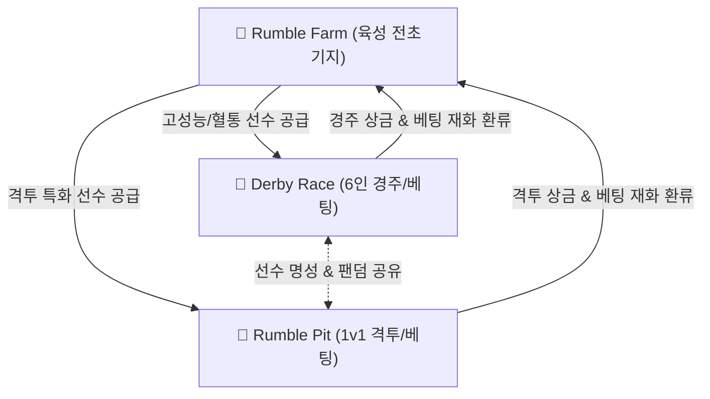

# 🐓 ROOSTER RUMBLE: 통합 기획방향

---

## 목차
1. [[#1. 3개 모드 통합 비전 및 트라이앵글 생태계 구조]]
   - [[#1.1 통합 서비스 비전]]
   - [[#1.2 트라이앵글 선순환 생태계 (Triangle Ecosystem)]]
   - [[#1.3 모드별 핵심 포지셔닝 명세]]
   - [[#1.4 멀티 플랫폼(모바일 / 자체 온라인) 이원화 독립 빌드 및 독립 데이터 운영 구조]]
2. [[#2. 서비스 버전별 핵심 서비스 명세]]
   - [[#2.1 모바일 서비스 버전 핵심 기능 명세]]
   - [[#2.2 자체 온라인 서비스 버전 핵심 기능 명세]]
3. [[#3. 모드 간 데이터/선수(Rooster) 순환 및 상호 연동 메커니즘]]
   - [[#3.1 멀티 스탯 데이터 호환 및 매핑 구조]]
   - [[#3.2 실시간 선수 상태값(Status) 동기화 메커니즘]]
4. [[#4. 통합 경제 시스템 및 재화 파이프라인 (Unified Economy Pipeline)]]
   - [[#4.1 재화 종류별 생산-소모 파이프라인]]
   - [[#4.2 베팅 및 상금 재화 선순환 메커니즘]]
   - [[#4.3 광고 및 마켓 거래 수수료 BM 파이프라인]]
5. [[#5. 통합 캘린더 및 라이브 서비스 스케줄링]]
   - [[#5.1 일간/주간 경기 캘린더 루틴]]
   - [[#5.2 모드 연계 토너먼트 및 시즌제 운영 안]]
6. [[#6. 3개 모드 통합 UI/UX 네비게이션 구조]]
   - [[#6.1 메인 통합 로비 HUD 명세]]
   - [[#6.2 모드 간 원터치 심리스(Seamless) 전환 구조]]
   - [[#6.3 서비스 버전별 전용 빌드 UI 레이아웃 및 연동 명세]]
7. [[#7. 각 모드별 핵심 콘텐츠 개발 방향 명세]]
   - [[#7.1 Rumble Farm (육성 모드) 핵심 콘텐츠 개발 방향]]
   - [[#7.2 Derby Race (경주 모드) 핵심 콘텐츠 개발 방향]]
   - [[#7.3 Rumble Pit (격투 모드) 핵심 콘텐츠 개발 방향]]
   - [[#7.4 모드 통합 개발 우선순위 로드맵]]

---

## 1. 3개 모드 통합 비전 및 트라이앵글 생태계 구조

### 1.1 통합 서비스 비전
* **통합 타깃**: 육성, 경주, 격투, 베팅 요소를 아우르는 거대 캐주얼 아케이드 매니지먼트 생태계 구축
* **핵심 가치**: 
  - 단순 베팅/경기의 휘발성 단점 극복 및 육성 애착 요소 강화
  - Multi-play 모드 간 선수 공유를 통한 자산 가치 유연성 확보
  - 모바일 아케이드 플레이어 및 자체 온라인 스포츠 시뮬레이션 사용자층 동시 수용

### 1.2 트라이앵글 선순환 생태계 (Triangle Ecosystem)



### 1.3 모드별 핵심 포지셔닝 명세

| 모드명 | 핵심 콘텐츠 | 게임 플레이 성격 | 비주얼 / 연출 톤앤매너 |
| :---: | :--- | :--- | :--- |
| **Rumble Farm** | 알 부화, 훈련, 혈통 교배, 피로도/스케줄 케어 | 방치/힐링/미니게임 중심의 매니지먼트 | 파스텔톤 밝은 농장 & 위트 모션 |
| **Derby Race** | 6인 주행 트랙 경주, 승패 베팅, 시뮬레이션 | 6인 다자간 스피드 시뮬레이션 & 베팅 | 역동적 트랙 카메라 & 경주 아레나 |
| **Rumble Pit** | 1v1 링 격투, 실시간 인플레이 베팅, 타격 시뮬레이션 | 1대1 치열한 링 대전 & 라이브 변동 베팅 | 타격감 있는 샌드박스 & 링 액션 |

### 1.4 멀티 플랫폼(모바일 / 자체 온라인) 이원화 독립 빌드 및 독립 데이터 운영 구조
* **독립 별도 빌드(Separate Target Build) 아키텍처**:
  - 모바일 서비스 전용 빌드 Target (AOS APK/iOS IPA 모바일 앱 전용 빌드)
  - 자체 온라인 서비스 전용 빌드 Target (Web / PC Standalone 온라인 전용 빌드)
  - 서비스 플랫폼 환경 및 규제 정책에 따른 독립 타깃 빌드 파이프라인 수립
* **유저/선수/경기 데이터의 완전 독립 분리 운영 (Data Independence)**:
  - 모바일 서비스 전용 DB 및 자체 온라인 서비스 전용 DB 물리적 분리 독립 운영
  - 유저 계정, 보유 알/선수 자산, 경기 전적, 베팅/재화 데이터를 각 서비스 버전별로 완전 독립 분리
  - 서비스 버전 간 데이터 상호 이전 및 자산 동기화 불허 (독립 서비스 생태계 구축)

---

## 2. 서비스 버전별 핵심 서비스 명세

### 2.1 모바일 서비스 버전 핵심 기능 명세 (Mobile Exclusive Specs)

```
[모바일 서비스 핵심 루프]
  알 수거/구매 ──> 부화 & 성장 ──> 선수 등록 ──> 리그 참전 (Derby/Pit) ──> 우승 상금 획득
        │                                                                  │
        └──────────────(유전 교배 / 유저 거래 / 광고 보상)────────────────┘
```

1. **육성 및 선수 등록 프로세스**:
   - 알 안치부터 훈련/성장을 거쳐 경주 및 격투 리그 전용 대표 선수로 등록 완료
2. **모바일 전용 Derby Race (경주 리그) 특화 시스템**:
   - **기존 베팅 중심 온라인 버전과의 차별화**: 온라인 버전이 '사전/실시간 베팅 및 관전' 중심인 반면, 모바일 버전은 **'육성 선수 직접 출전 및 리그 제패'** 중심 아케이드 경주로 정의
   - **리그 승격/강등 시스템 (Mobile Derby League System)**:
     * Rookie ➔ Bronze ➔ Silver ➔ Gold ➔ Diamond ➔ Championship 6단계 승격제 구축
     * 리그 등급별 참전 요건(기초 스탯 상한) 및 우승 상금 파이프라인 차등 적용
   - **터치 인터랙션 스퍼트 및 기술 개입 (Touch Action)**:
     * 베팅 위주가 아닌 플레이어 직접 개입 요소 부여 (수동 스퍼트 / 자동 주행 선택)
     * 주행 중 곡선 코너링 탭 인터랙션 및 라스트 스퍼트 터치 부스터 시스템 구현
   - **비동기 멀티플레이어 대전 (Asynchronous PvP)**:
     * 타 유저가 리그에 등록한 선수 고스트 데이터(Ghost Data) 기반 6인 주행 대전 수행
   - **PVE 아케이드 타임어택 및 보스 라이벌전**:
     * 전용 트랙 타임어택 스피드 챌린지 및 네임드 보스 닭과의 1v1 맞대결 모드 구성
3. **모바일 전용 보상형 광고 (Ad-Reward) 및 상금 배가 BM**:
   - **우승 상금 2배 수령 (Double Gold Ad)**: 경기 종료 후 보상형 광고 시청 시 우승 상금 2배 즉시 수령
   - **광고 시청 알 파츠 완성**: 5회~10회 광고 시청 달성 시 희귀 알 파츠 조각 완성 및 알 획득
   - **피로도 소폭 회복 광고**: 광고 시청을 통한 피로도 -20 즉시 차감 및 빠른 재출전 지원
4. **유전 알 생산 및 유저 간 자율 거래소 (Marketplace)**:
   - 우수 선수의 유전자/외형 인계 2세대 유료 혈통 알 생산
   - 유저 간 부화용/혈통 알 자율 매매 거래소 및 플랫폼 거래 수수료 차감 시스템 구축
5. **프리미엄 랜덤 알 가차 (Gacha)**:
   - 전설급 전용 외형 및 고정 유전자 내장 프리미엄 알 유료 뽑기 제공

### 2.2 자체 온라인 서비스 버전 핵심 기능 명세 (Online Exclusive Specs)

```
[자체 온라인 서비스 핵심 루프 (기존 Derby Race 작업 기준)]
  ├─ [베팅 플레이]: Derby 사전/인플레이 6인 승자 예측 베팅 ──> 배당금 수령
  └─ [선수 참전]: 키운 선수 출전 ──> 파이트 머니(Fight Money) & 우승 상금 수급
```

1. **기존 Derby Race 베팅 중심 시스템 (온라인 전용 기준)**:
   - **베팅 및 배당 정산 중심**: 6인 주행 트랙 경주 대상 사전 승자 예측(Win, Place, Trifecta) 및 배당금 수령 중심
   - **하우스 엣지 및 실시간 배당률 계산**: 배당률 Clamp 범위(1.01 ~ 99.00) 및 수수료 정산 알고리즘 적용
2. **Rumble Pit 실시간 라이브 인플레이 베팅**:
   - 1v1 격투 경기 진행 중 체력/다운 상태 감지에 따른 실시간 변동 배당 베팅 수행
3. **선수 참전을 통한 파이트 머니 & 상금 수급**:
   - 육성한 선수를 경주/격투 경기에 직접 출전시켜 기본 파이트 머니(참가비 환급) 및 최종 우승 상금 확보
4. **온라인 전용 육성 모드 재화 정책**:
   - 최초 온보딩 시 1회 기본 알 무료 지급, 추가 알은 게임 머니(In-game Currency) 결제 구매
5. **선수 케어 시스템 (무료 / 유료 이원화)**:
   - **무료 케어**: 일반 닭장 시간 경과 자연 피로도 회복
   - **유료 케어**: 프리미엄 스파 힐링 (피로도 즉시 완충, 컨디션 '최상' 고정 및 부상 즉시 치유)
6. **거래 정책**:
   - 초기 온라인 서비스 버전 내 알 및 선수 유저 간 거래 비활성화 (추후 확장 고려)

---

## 3. 모드 간 데이터/선수(Rooster) 순환 및 상호 연동 메커니즘

### 3.1 멀티 스탯 데이터 호환 및 매핑 구조
* **선수 1두의 통합 스탯 데이터셋 (Unified Rooster Dataset)**:
  - 팜에서 훈련 시 스탯 종류에 따라 Derby 스탯과 Pit 스탯 동시/선택 개화

```
[통합 선수 데이터 (Rooster Master Data)]
   ├── [공통 스탯]: 체력(HP), 피로도, 컨디션, 명성, 세대(Gen), 외형 파츠
   ├── [Derby 스탯]: 최고속도, 가속도, 근성, 주행 스타일 (선입/추입/선두)
   └── [Pit 스탯]: 공격력, 방어력, 치명타율, 투지, 격투 스타일 (타격/인파이팅)
```

### 3.2 실시간 선수 상태값(Status) 동기화 메커니즘
* **피로도 & 컨디션 통합 공유**:
  - `Derby Race` 및 `Rumble Pit` 참전 시 모드 구분 없이 피로도 동일 누적 (+25/경기)
  - 피로도 가중치에 따른 컨디션 난수 변화를 모든 모드 로스터에 실시간 반영
* **부상(Injury) 상태의 모드 간 차단 정책**:
  - 특정 모드 참전 중 피로도 과중으로 부상 발생 시, 타 모드 출전 버튼 동시 비활성화 처리
  - `Rumble Farm` 힐링 스파 입욕을 통해서만 부상 치유 및 재참전 허용

---

## 4. 통합 경제 시스템 및 재화 파이프라인 (Unified Economy Pipeline)

### 4.1 재화 종류별 생산-소모 파이프라인

```
┌─────────────────────────────────────────────────────────────┐
│                       [통합 재화 파이프라인]                  │
└─────────────────────────────────────────────────────────────┘
  • 훈련 사료 / 부화 가속제 ───> Rumble Farm 훈련/부화 소모
  • 럼블 코인 (Gold) ──────────> Derby / Pit 경기 참가비 & 베팅
  • 젬 (Gem) ──────────────────> 프리미엄 알 / 고성능 장비 / 스파 가속
  • 상금 / 베팅 정산금 ───────> Rumble Farm 시설 확장 & 2세대 교배 투자
```

### 4.2 베팅 및 상금 재화 선순환 메커니즘
* **모드 간 경제 밸런스 유지 정책**:
  - `Derby Race` 및 `Rumble Pit` 베팅 상금 일부를 `Rumble Farm` 재화(사료/교배 토큰)로 환급 지급
  - 육성 재화의 가치를 유지하여 경기 참전과 팜 육성 플레이의 비중 균형 도모

### 4.3 광고 및 마켓 거래 수수료 BM 파이프라인
* **보상형 광고 파이프라인**: 광고 시청 횟수(5~10회) 달성 시 조각 완성을 통한 고급 알 지급
* **마켓 수수료 파이프라인**: 모바일 거래소 내 알 매매 체결 시 마켓 수수료 시스템 자동 징수

---

## 5. 통합 캘린더 및 라이브 서비스 스케줄링

### 5.1 일간/주간 경기 캘린더 루틴

```
[08:00 ~ 12:00] Rumble Farm 오프라인 생산 수거 및 모닝 훈련
[12:00 ~ 18:00] Derby Race 주간 더비 리그 참전 및 사전 베팅
[18:00 ~ 23:00] Rumble Pit 나이트 파이트 클럽 라이브 인플레이 대전
[23:00 ~ 08:00] 선수단 힐링 스파 휴식 및 야간 부화 타이머 가동
```

### 5.2 모드 연계 토너먼트 및 시즌제 운영 안
* **주간 듀얼 크라운 (Dual Crown) 챔피언십**:
  - 동일 선수로 `Derby Race` 순위 점수와 `Rumble Pit` 승률 점수를 합산하여 종합 챔피언 선출
  - 듀얼 크라운 달성 닭에 대해 `Rumble Farm` 전설 교배 가산점 및 트로피 외형 부여

---

## 6. 3개 모드 통합 UI/UX 네비게이션 구조

### 6.1 메인 통합 로비 HUD 명세
* **상단 HUD**: 통합 재화(골드, 젬, 사료), 대표 출전 닭 컨디션 요약 정보 표출
* **하단 3대 모드 진입 네비게이션 탭**:
  - `[농장 (Farm)]`: 2.5D 아이소메트릭 농장 뷰 즉시 이동
  - `[경주 (Derby)]`: 트랙 관전/베팅 로비 즉시 이동
  - `[격투 (Pit)]`: 파이트 클럽 아레나 링 즉시 이동

### 6.2 모드 간 원터치 심리스(Seamless) 전환 구조
* **스케줄 게시판 기반 퀵 패스**:
  - `Rumble Farm` 스케줄 게시판에서 등록된 경기를 터치 시, 로비를 거치지 않고 해당 모드 대기실로 직접 진입

### 6.3 서비스 버전별 전용 빌드 UI 레이아웃 및 연동 명세
* **서비스 버전별 개별 빌드 환경 명세**:
  - 모바일 빌드 접속 시: 아케이드 육성, 알 마켓 거래, 광고 보상 및 리그 출전 전용 HUD 표출
  - 자체 온라인 빌드 접속 시: 라이브 베팅 정산, 파이트 머니/상금 수급 및 프리미엄 케어 전용 HUD 표출

---

## 7. 각 모드별 핵심 콘텐츠 개발 방향 명세

### 7.1 Rumble Farm (육성 모드) 핵심 콘텐츠 개발 방향

```
[Rumble Farm 개발 핵심]
  유전 인계 공식 ──> 인큐베이터 & 미니게임 ──> 스탯 개화 훈련 ──> 스파/케어 이원화 ──> 거래/광고 BM
```

1. **유전 인계 공식 및 무작위 변이 알고리즘 개발 방향**:
   - 부모 닭 스탯 합산 인계 및 난수 보정(-5% ~ +10%) 모듈 서버 사이드 완전 검증 구현
   - 희귀 패시브 및 돌연변이(15%) 발현 시각화 연출 개발
2. **부화 온실 & 시간 단축 미니게임 개발 방향**:
   - 10초 타깃 탭/스와이프 모션 감지 기반 잔여 시간 20% 단축 미니게임 인터랙션 구현
   - 인큐베이터 6슬롯 실시간 타이머 및 이펙트 최적화
3. **스탯 개화 훈련 시스템 개발 방향**:
   - Derby 스탯(속도, 가속, 근성) 및 Pit 스탯(공격, 방어, 치명, 투지) 트랙/연무장 구분 구현
   - 사료 소모량 대비 잠재력 전환율 수치 밸런싱 모듈 구축
4. **선수 케어 (무료/유료) 이원화 개발 방향**:
   - 무료 케어: 일반 닭장 시간 경과 자연 회복 프로세스
   - 유료 케어: 프리미엄 스파 입욕 즉시 피로도 완충, 컨디션 '최상' 고정 및 부상 즉시 치료 개발
5. **마켓 거래 & 보상형 광고 BM 개발 방향**:
   - 모바일 전용 유저 간 알 자율 거래소 구축 (플랫폼 거래 수수료 차감 시스템 연동)
   - 보상형 광고 SDK 연동 (5~10회 시청 시 알 파츠 조각 완성 및 전용 알 지급)
   - 유료 2세대 혈통 알 생산 및 프리미엄 랜덤 알 가차 모듈 개발

---

### 7.2 Derby Race (경주 모드) 핵심 콘텐츠 개발 방향

```
[Derby Race 개발 핵심]
  6인 트랙 시뮬레이터 ──> 주행 스타일 매핑 ──> 사전 승자 예측 ──> 실시간 트랙 카메라 연출
```

1. **6인 주행 시뮬레이션 엔진 개발 방향**:
   - 최신 순위 산출 정의(v1.8.14) 및 시뮬레이터 알고리즘 서버 엔진 이식
   - 트랙 구간별(초반, 중반, 스퍼트 구간) 스탯 및 난수 보정 계산 처리
2. **주행 스타일(선입, 선두, 추입, 자유) 매핑 개발 방향**:
   - Rumble Farm에서 훈련된 주행 스타일별 구간 가속도 및 체력 소모율 차등 알고리즘 개발
   - 스타일 간 상성 메커니즘을 통한 경주 결과 다변화 구현
3. **사전 승자 예측 및 배당 산출 시스템 개발 방향**:
   - 선수 스탯, 전적, 컨디션 데이터 기반 사전 동적 배당 산출 알고리즘(Clamp 1.01 ~ 99.00) 구축
   - 베팅 정산금 및 상금 수급 파이프라인 개발
4. **다이나믹 카메라 & 트랙 연출 개발 방향**:
   - 6인 경주 닭 선두 다툼 및 스퍼트 구간 전용 줌인 카메라 뷰 및 이펙트 모션 적용

---

### 7.3 Rumble Pit (격투 모드) 핵심 콘텐츠 개발 방향

```
[Rumble Pit 개발 핵심]
  1v1 동적 격투 물리 ──> 실시간 인플레이 베팅 ──> KO/투지 시스템 ──> 파이트 머니 환급
```

1. **1v1 동적 격투 물리 & 타격 애니메이션 개발 방향**:
   - 부리 타격, 발차기, 회피, 반격, 피니시 블로우 격투 애니메이션 및 Hitbox 판정 연출
   - 격투 스탯(공격, 방어, 치명타) 기반 라운드별(3라운드 2선승제) 데미지 계산식 구현
2. **실시간 인플레이(In-Play) 변동 배당 시스템 개발 방향**:
   - 경기 진행 중 체력 게이지 및 다운 횟수 실시간 감지에 따른 라이브 배당률 변동 알고리즘 구축
   - 경기 도중 실시간 추가 베팅 처리 및 모바일/웹 동시성 제어 개발
3. **KO / 투지 및 부상 발생 시스템 개발 방향**:
   - 투지(Stamina) 스탯 기반 벼티기 및 KO/TKO 판정 로직 구현
   - 경기 후 피로도 급증(+25) 및 피로도 90 이상 참전 시 30% 확률 부상 처리 시스템 구축
4. **파이트 머니 & 참가비 수수료 환류 개발 방향**:
   - 온라인 전용 참전 닭 파이트 머니(기본 참가비 환급) 및 하우스 엣지 수수료 징수 시스템 구현

---

### 7.4 모드 통합 개발 우선순위 로드맵

```
[Phase 1]: 서비스 버전별 독립 백엔드 DB (Mobile DB / Online DB) 및 마스터 데이터셋 구축
    │
[Phase 2]: Rumble Farm 모바일/온라인 별도 육성/부화/훈련 및 독립 빌드 파이프라인 수립
    │
[Phase 3]: Derby Race 6인 시뮬레이션 & 사전 베팅 시스템 개발
    │
[Phase 4]: Rumble Pit 1v1 격투 엔진 & 실시간 인플레이 베팅 구축
    │
[Phase 5]: 모바일 마켓 거래/광고 BM 및 온라인 프리미엄 케어 상용화 적용
```

* **개발 리스크 제어 및 데이터 보안 정책**:
  - 시뮬레이션 알고리즘 서버 사이드 독립 처리로 클라이언트 해킹 방지
  - 모바일 DB와 온라인 DB의 이원화 분리를 통한 플랫폼 간 데이터 간섭 차단 및 전용 데이터 밸런싱 유지
